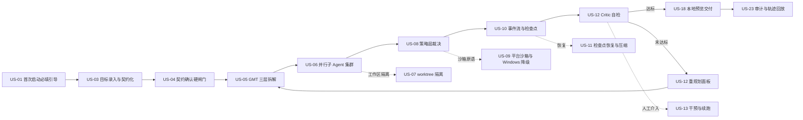

# AICoding 架构设计 · UserStory — openINTJ Agent Console

> 本文档为《AICoding 架构设计》核心产物之一，定位为**产品需求与用户故事（UserStory）**。
> 上游输入：《高层架构设计》v1.4（`高层架构设计.md`）中的需求边界、产品模块全景图、功能清单与产品原型；资料摘要 `material_digest.md`；行业调研报告 `research_report.md` v1.2。
> 下游输出：驱动《系统设计》《部署设计》《安全设计》的具体功能实现，并作为 Phase 7 编码实现的需求基线。
> 阶段门：**G4**。本文档与《系统设计》共同构成 G4 的送审材料。

**编号引用规则**（强制，承接 G3）：

- `高层架构 §6.1 In-Scope S1 ~ S12 + N1 ~ N3` 是**范围清单**编号空间，本文档一律带章节前缀引用，写作 `高层架构 §6.1 In-Scope S5`；
- `高层架构 §6.3 F1 ~ F39` 是**功能清单**编号空间，本文档一律写作 `高层架构 §6.3 F17`；
- 两个编号空间**不可混用**，本文档不出现裸编号 `S5` / `F17` 的引用形式。

**证据标注约定**（全文适用）：

| 标注 | 含义 |
| --- | --- |
| 事实 | 可追溯到 `material_digest.md` 的 D 编号章节、`research_report.md` 的 SR 来源条目，或用户的已冻结裁决（X1、IC-01 ~ IC-09） |
| 假设 | 上游无直接证据、由本阶段为推进需求表达而做出的推断，均已写明推断依据 |
| 建议 | 本阶段的取舍倾向或待用户确认项，不构成对下游的技术选型授权 |

---

## 0. 元信息

```yaml
标题: openINTJ Agent Console - UserStory v1.1
版本: v1.2
状态: Draft   # Draft | Reviewing | Approved | Deprecated
创建日期: 2026-10-20
最后更新: 2026-10-20
作者: product-story-designer（产品故事师 - 顾全景）
评审人:
  - team-lead（主理人）
  - 用户（G4 人工审核）

关联文档:
  上游输入:
    - 高层架构设计: .workbuddy/output/高层架构设计.md（v1.4，G3 已通过）
    - 资料摘要: .workbuddy/output/material_digest.md（D1~D6，X1~X4，Q1~Q13）
    - 行业调研: .workbuddy/output/research_report.md（v1.2，SR-01~SR-65，SB-01~SB-06，R-01~R-12）
  下游产出:
    - 系统设计: 系统设计.md（G4，并行产出）
    - 部署设计: 部署设计.md（G5）
    - 安全设计: 安全设计.md（G5）

已冻结裁决（本文档不得推翻）:
  - X1    产品形态 = 桌面客户端（非 Web 应用）
  - IC-01 桌面壳层 = Electron
  - IC-02 IDE 嵌入 = 内嵌 VSCodium（Code-OSS 的 MIT 构建，遥测已移除）+ Open VSX；禁用 VS Code 商标；微软专有扩展不可用
  - IC-03 云端沙箱供给 = 自建（自有云账号）
  - IC-04 云厂商 = 腾讯云；Region 待定 · 假定 ap-guangzhou
  - IC-05 MVP 范围 = 14 项能力原子全部进 MVP
  - IC-06 双协议 UI 承载位 = 独立「设置与凭据中心」页；Screen A / B 双屏保持不变；首次启动必填引导（选供应商 → 选协议 → 填 Key → 连通性自检）
  - IC-07 目标契约 = 执行前硬闸门
  - LLM  直连真实 API，Anthropic 原生 + OpenAI 兼容双协议并行，不接 Mock
  - IC-08 审批在环的交互粒度 = 方案 C 按风险分级；三档可切换（宽松 / 标准 / 严格），默认档位 = 标准【经中间确认，2026-10-20 用户裁决】
  - IC-09 本地工作区与云端工作区的主副本关系 = 方案 A 本地为主副本 + 云端按需创建独立副本，不做持续同步【经中间确认，2026-10-20 用户裁决】

本阶段发出的中间确认（均已回注并落盘）:
  - IC-08 审批在环的交互粒度（每次都问 / 会话级授权 / 按风险分级）——**已裁决：方案 C 按风险分级，默认档位『标准』**；三档命名为 宽松 / 标准 / 严格（用户裁决原文把最松档表述为「自治」，语义等同本文档的「宽松」档，本文档统一使用「宽松」）

本阶段消费的他人中间确认（非本角色论题，由主理人中转后直接消费）:
  - IC-09 本地工作区与云端工作区的主副本关系——由 system-architect 发起、用户于 2026-10-20 裁决「方案 A：本地主副本 + 云端按需独立副本，不做持续同步」；已按裁决修订 US-19 并新增 US-19B「把云端产出取回本地」
```

| 版本 | 日期 | 作者 | 变更内容 | 评审状态 |
| --- | --- | --- | --- | --- |
| v1.0 | 2026-10-20 | `product-story-designer` | 初稿：六章正文 + §7 待人工确认事项 + 附录 A 中间确认自检报告 + 附录 B 硬指标自检；24 条 UserStory 覆盖高层架构 §6.1 In-Scope S1 ~ S12 与 N1 ~ N3 全部 15 条；对外承诺 C1 ~ C8 全部落到具体 Story 的验收标准 | Draft |
| v1.1 | 2026-10-20 | `product-story-designer` | 落盘两项用户裁决：**IC-08** 审批在环交互粒度 = 方案 C 按风险分级、默认档位「标准」——定稿 US-08 审批类 AC 与 §6.4.3 授权条款，新增命令风险分级表（四类判定与处置）、三档可显式切换 AC、风险分级表可配置 AC、审计事件携带风险等级字段 AC、Windows 侧「宽松」档风险敞口提示；**IC-09** 本地为主副本 + 云端按需独立副本、不做持续同步——US-19 补主副本与 ephemeral 两条业务逻辑、数据表改为「投射内容范围」、新增 AC-9 与 AC-10，新增 US-19B「把云端产出取回本地」Story（不单独占用编号）；全文「同步」一词纪律检查通过（仅保留 UI 一致性语义 3 类） | Draft |
| v1.2 | 2026-10-20 | `product-story-designer` | 按主理人复核意见做**定点修订**（不重写全文、不动七段式骨架）：① **IC-08 三档命名统一**为「宽松 / 标准 / 严格」，删除「自治」档位名（仅保留于逐字引用的用户裁决原文并标注等同「宽松」），§5.8 开头中间确认块按指定表述整块改写，§6.4.3 新增三档定义表（含出网与云端写行）并标注默认档位「标准」，命令风险分级表「严格档」列按三档定义表对齐；② **§7 恢复 N-02 行**并标记为「已裁决（IC-08）」，不再属于待拍板集合；③ **§6.2「并发数」行的引用串号修正**：`(§7 N-02)` → `(§7 N-04)`；④ **§3 互查结论计数修正**：P1 由 8 改为 7、P2 由 3 改为 4（合计 39 ✓），「MVP ❌」由 3 项改为 5 项并区分 P2 组（F16 / F24 / F26 / F33）与 P1 组（F19，O1 降级）；⑤ US-19 §5.19.3 授权浮层「将要上传的内容范围」改为「投射」语义。**裁决原文恢复为逐字照录，档位命名映射说明移出引号**（引文内不插入任何括注） | Draft |
| v1.3 | 2026-10-21 | 主理人（Phase 6 术语统一 + IC-12 落盘） | ① **IC-12 落盘**：并行子 Agent 数上限 = **8**（2026-10-21 用户裁决）——§6.2「并发数」行由「默认取值待用户拍板」改为定值 8，US-06 AC-5 的截断上限由「本文档不给数值」改为 8；② **§7 N-04 拆分**为 N-04a（已裁决 · 并行度上限 8）与 N-04b（待拍板 · 模型调用超时与重试阈值）；③ 其余章节、Story、AC 一字未动 | Draft |

---

## 1. 业务背景与价值

### 1.1 业务背景

- **当前业务现状**：彻底的绿地项目——工作区仅含 `.workbuddy` 目录，无任何源代码、包管理清单、README、CI 配置或校验脚本（事实，`material_digest.md` D5 §5.1 ~ §5.3）。唯一既有资产是上一次设计任务产出的界面设计 openINTJ Agent Console（事实，D3 §3.1）。
- **行业 / 产品 / 用户规模**：品类为「桌面端 AI Agent 工作台」；服务对象为自付 API 费用的个人开发者与小团队。产品侧**不做团队协作的多租户能力**（`高层架构设计.md` §6.1 Out-of-Scope O3），因此 MVP 的用户规模口径为**单机单用户**，不做席位、账号体系与共享工作区；云端沙箱层按租户做资源归属与强隔离（SB-06）属于**沙箱层的资源隔离**，不是面向团队的产品能力。
- **触发本次需求的事件**：用户提出「套用 openINTJ 设计任务的产出物，给我开发 openINTJ 的程序」（事实，D1 §1.2、§1.3），并明确「先出架构文档再开发」（事实，D2 §2.3）。本阶段即在架构文档体系内，把已冻结的业务边界翻译成可被研发直接消费的用户故事与验收标准。
- **本系统在产品矩阵中的位置**：openINTJ 在「个人与小团队的 AI Agent 工作台」这条价值主线上承担「目标治理 + 安全执行」的核心职责。上游承接 LLM Provider（Anthropic 原生 / OpenAI 兼容）、MCP server、Skill 包、Open VSX 扩展源、VSCodium 二进制与腾讯云（CVM / COS / VPC / CAM）；下游驱动本机 shell / 文件系统 / 内嵌 IDE / 内嵌终端 / 本地预览，以及自建于腾讯云的云端工作区、云端沙箱与云端预览。本系统**不训练也不托管模型**（O4），不做 Web 端（O5）与移动端（O6）。

### 1.2 行业方案

> 同类功能、痛点的行业标杆系统及解决方案。下表只列与本文档 Story 设计直接相关的 5 家，完整 11 家见 `高层架构设计.md` §3.1。

| 标杆系统 | 与本产品同类的做法 | 本产品的差异点 | 来源 |
| --- | --- | --- | --- |
| B1 Claude Code + Claude Agent SDK | 内置 Read / Write / Edit / Bash 工具集；permissionMode 五档；Hooks 事件体系；Subagents | 只借鉴其能力模型与事件语义，**不借鉴单供应商绑定**——本产品双协议并行（`高层架构设计.md` §3.2） | 调研 SR-01 ~ SR-04 |
| B2 OpenAI Codex CLI | `approval_policy × sandbox_mode` 双轴权限；macOS Seatbelt / Linux Landlock + seccomp / Windows 受限令牌 | 借鉴双轴模型并自研；**Windows 侧不承诺等价隔离强度**（C1） | 调研 SR-05、R-04 |
| B3 Cursor | 最多 8 个并行 Agent，用 Git worktree 隔离 | 借鉴 worktree 隔离范式并自研；每个并行子 Agent 独占一份工作区副本（对应 US-06 / US-07） | 调研 SR-07 |
| B6 OpenHands | EventStream 为单一事实来源；Runtime 抽象；动作封闭词表 | 借鉴事件流 + 检查点语义，在 TypeScript 中自研；**不复用其 Python 实现**（对应 US-10 / US-11） | 调研 §4.3 T11 |
| B11 腾讯 CodeBuddy / WorkBuddy | Skills 技能包组织；多窗口多 Agent 并行；安全网关代理替代内网穿透 | 借鉴 Skill 组织方式与「安全网关代理替代内网穿透」的思路（对应 US-21），不借鉴腾讯云生态绑定 | 调研 SR-60 ~ SR-65 |

**差异化定位（假设）**：11 家标杆中未见把「目标契约 + 成功判据 + Critic 自检评分趋势」作为一等公民能力。推断依据见 `高层架构设计.md` §3.2 末段——该判断是 US-03 / US-04 / US-12 三条 Story 的立论基础，属推断而非已核实事实。

### 1.3 方案收益与价值

> 与 `高层架构设计.md` §1.3 的九条量化目标 V1 ~ V9 逐条对齐，本表只补充「由哪条 Story 兑现」。

| 功能模块 | 预期价值收益 | 量化标准（对齐 V 编号 / 兑现 Story） |
| --- | --- | --- |
| 目标契约与成功判据（Screen B） | 目标在执行前被显式确认，任务达成与否可判定而非主观判断 | 契约确认后才启动执行的任务占比 = 100%（V1 体验维度；US-03 / US-04） |
| 检查点与恢复 | 长程任务中断后可续跑，不必整体重来 | 从最近检查点恢复后需重放的步数 ≤ 5 步（V1；US-11 / US-13） |
| 权限与沙箱策略层 | 本地执行全程可裁决、可追溯 | 策略层拦截与留痕完整率 = 100%（V2；US-08 / US-09 / US-23） |
| Git worktree 隔离 | 并行子 Agent 写入互不覆盖 | 子 Agent 工作区隔离覆盖率 = 100%（V3；US-06 / US-07） |
| 设置与凭据中心 + 双协议适配层 | 双协议直连真实 API，凭据不明文落盘 | 双协议端到端成功率 100% / 凭据明文落盘处数 0（V4；US-01 / US-02） |
| 上下文分层压缩 | 长任务上下文成本可解释、可下降 | 单次任务上下文 token 峰值较全量事件回放下降 ≥ 60%（V5；US-11） |
| Electron 一体化壳层 | 冷启动与常驻内存不超出用户已接受的代价 | 冷启动到可交互 P95 ≤ 3 秒 / 空闲内存 ≤ 300MB（V6；US-24） |
| MCP 与 Skill 标准协议接入 | 自定义能力可跨产品复用，不锁死在私有协议 | 标准协议接入占比 100%（V7；US-16 / US-17） |
| 本地预览服务 | 一次点击即可预览本地服务，不残留进程 | 预览启动操作步骤 ≤ 1 步 / 任务结束后残留进程数 0（V8；US-18） |
| 云端三项（工作区 / 沙箱 + 消息通道 / 预览） | 长时任务与高并行度不受本机资源约束 | 云端端到端任务成功率 100% / 沙箱出网违规次数 0（V9；US-19 ~ US-22） |
| 效率主指标 | 用户从「逐步驱动」转为「只在重规划与干预点介入」 | 在 ≤ 2 次干预内完成的任务占比 ≥ 60%（§1.3 效率维度；US-12 / US-13） |

### 1.4 术语清单

> 与 `高层架构设计.md` §5.1 / §6.2 的模块标准名严格对齐，供《系统设计》的术语表直接引用。

| 术语 | 英文 / 标准名 | 含义 |
| --- | --- | --- |
| 目标契约 | Goal Contract | 用户一句话目标经结构化后的三段式产物：目标契约正文 + 成功判据 + 约束；经用户确认后方可进入执行态（IC-07 硬闸门） |
| 成功判据 | Success Criteria | 可判定的验收条件，作为 Critic 自检的评分基准；每条须带判定方式 |
| 约束 | Constraint | 禁改目录、禁网、预算上限、可用工具集等限制条件 |
| GMT | Goal / Milestone / Task | 目标拆解的三层可执行结构：目标 → 里程碑 → 任务 |
| Critic | Critic | 依据成功判据对里程碑产出打分的自检组件；评分未达阈值触发重规划 |
| 检查点 | Checkpoint | 在里程碑边界与关键节点落盘的可恢复状态点 |
| 事件流 | EventStream | 全量 Action / Observation 事件按序落盘，作为状态的单一事实来源 |
| 子 Agent | Sub-Agent | 由子 Agent 调度器派生、绑定独立工作区副本的并行执行单元 |
| worktree 隔离 | Git Worktree Isolation | 为每个并行子 Agent 创建独立 Git worktree，避免写入互相覆盖 |
| 策略层 | Permission & Sandbox Policy | 权限与沙箱策略层；审批策略与沙箱策略两轴正交可配 |
| 审批在环 | Approval-in-the-loop | 执行器调用前经策略层裁决并由用户确认的交互机制 |
| MCP | Model Context Protocol | 工具与资源的标准协议；MVP 采用 2025-06-18 规范（stdio + Streamable HTTP） |
| Skill | Agent Skills | agentskills.io 开放标准的能力包；SKILL.md + frontmatter 六字段 |
| 双协议 | Dual Protocol | Anthropic 原生协议与 OpenAI 兼容协议并行直连，各自原生实现后归一化到内部消息模型 |
| 设置与凭据中心 | Settings & Credentials | IC-06 冻结的独立页面，承载供应商选择 / 协议切换 / API Key 管理 / 连通性自检 |
| 连通性自检 | Connectivity Self-Check | 以真实 API 发起一次最小探测请求，验证供应商、协议与 Key 的组合可用 |
| 云端三项 | Cloud Trio | 云端工作区、云端沙箱 + 消息通道、云端部署测试预览；经 IC-05 进 MVP |
| SB-01 ~ SB-06 | Self-Built Capability Set | 自建云端沙箱最小能力集：镜像与快照 / 预热池 / 实例回收 / 网络策略 / 配额与成本模型 / 多租户隔离 |
| 隔离原语 | Isolation Primitive | OS 或虚拟化层提供的隔离机制；云端侧待 U-05 核实 /dev/kvm 是否透传后定 microVM 或容器 |
| Channel Adapter | Unified Channel Adapter | 把任务事件外送到 Webhook / IM Bot / MQ 的统一适配器，事件归一化 |
| ternimal | terminal（终端） | `material_digest.md` D2 §2.1 中的笔误，已由高层架构冻结为「终端」 |

---

## 2. 范围与边界

### 2.1 系统内模块及功能

> 一级功能清单。与 `高层架构设计.md` §6.2 产品模块全景图一一对应，不新增、不删减模块。

| 一级模块 | 一句话职责 | 覆盖高层架构 §6.1 In-Scope | 覆盖高层架构 §6.3 功能项 |
| --- | --- | --- | --- |
| 目标契约与治理工作台 | 目标录入 → 契约化 → 确认（硬闸门）→ GMT 三层拆解 | S1 | F1 ~ F4 |
| 长程任务编排与主控台 | 事件流落盘、检查点与恢复、Critic 自检与重规划、干预记录 | S2 | F5 ~ F10 |
| 并行子 Agent 集群 | 多子 Agent 并发编排与结果归并 | S3 | F11、F12 |
| 工作区与隔离 | 本地工作区管理、Git worktree 隔离、云端工作区 | S4、S11 | F13、F14、F34 |
| 执行器与权限沙箱策略层 | shell / CLI 调用、审批在环、命令白名单、平台原生沙箱 | S5 | F15 ~ F19 |
| 内嵌工作台（IDE / 终端） | 内嵌 VSCodium + Open VSX、xterm.js + node-pty | S6、S7 | F27 ~ F29 |
| 模型与协议接入 | 双协议直连真实 API、设置与凭据中心 | N2 | F20 ~ F22 |
| 标准协议扩展（MCP / Skill） | MCP client、Skill 扫描与渐进加载 | S8、S9 | F23、F25 |
| 部署、测试与预览 | 本地 preview server 与云端 ephemeral preview | S10 | F30、F31 |
| 云端沙箱编排与消息通道 | 自建沙箱编排层（SB-01 ~ SB-06）+ 统一 Channel Adapter | S12 | F35 ~ F39 |
| 审计与复盘 | 执行与权限裁决 100% 留痕、执行轨迹回放 | N3 | F32 |
| 桌面客户端基线 | Electron 一体化壳层与启动 / 常驻基线 | N1 | — |

### 2.2 系统外模块及功能

> 当前系统**不覆盖**的功能及其原因。本节是本文档的硬边界：**以下六项在 §5 用户旅程中不出现任何 Story**，只在相关 Story 的「能力边界」小节中以约束形式出现。

| 编号 | 不做的事 | 原因 | 本文档中的边界体现 |
| --- | --- | --- | --- |
| O1 | Windows 平台的 OS 级本地沙箱 | Windows 原生沙箱为实验特性，已知限制是无法阻止 world-writable 目录写入（调研 R-04，SR-05）；Windows 侧降级为审批在环 + 命令白名单 + 工作区根目录约束 | US-09 只验收「降级实现 + 差异明示」，不验收 OS 级隔离；US-09 的 AC 明确禁止出现「与 macOS 等价」类表述（C1） |
| O2 | 微软专有扩展能力（C/C++、C# Dev Kit、Remote 系列） | IC-02 已冻结为内嵌 VSCodium + Open VSX，微软市场条款不允许再分发这些扩展 | US-14 只验收开源替代（clangd / BasedPyright / Open Remote-SSH / Open Remote-WSL）与缺失提示；C# Dev Kit 明确不做，由用户在外部 IDE 完成（C3） |
| O3 | 面向团队协作的多租户产品能力（账号体系、席位、共享工作区、权限分级管理） | 14 项能力原子中不含团队协作与席位管理；云端沙箱的租户隔离属沙箱层资源隔离，不是产品能力 | 全文无注册 / 登录 / 邀请 / 席位 / 角色分级类 Story；US-01 的引导只做本机单用户凭据配置 |
| O4 | 自研 LLM、模型训练与模型托管 | 用户明确要求直连真实大模型 API（D2 §2.2） | US-02 只验收「接入与调用外部供应商」，无任何训练 / 微调 / 托管类 Story |
| O5 | Web 端形态与浏览器访问 | X1 已裁决产品形态为桌面客户端 | 全文无浏览器访问 / URL 分享访问类 Story；US-18 与 US-22 的预览均在客户端面板内打开，不构成 Web 端形态 |
| O6 | 移动端 / 远程访问形态 | 用户原话仅覆盖 Windows 与 macOS 桌面端（D2 §2.1） | 全文无移动端适配类 Story；§6.3 操作与环境需求只列 Windows 与 macOS |

### 2.3 外部依赖

| 依赖系统 | 提供方 | 依赖能力 | 接入方式 | 接口人 |
| --- | --- | --- | --- | --- |
| LLM Provider（Anthropic 原生协议） | Anthropic | 消息推理 / 工具调用 / 流式返回 | HTTPS REST（Anthropic Messages 原生协议） | 甲方决策者（自持 API Key，本机配置） |
| LLM Provider（OpenAI 兼容协议） | 各兼容供应商（用户在设置与凭据中心自选） | 同上 | HTTPS REST（OpenAI Chat Completions 兼容） | 甲方决策者（自持 API Key，本机配置） |
| MCP Server | 第三方或本地进程 | 工具与资源 | stdio + Streamable HTTP（保留旧 SSE 兼容探测） | 最终用户 A（自行添加与管理） |
| Skill 包 | 本地目录 / 仓库 | 能力扩展 | 文件系统扫描 + 渐进式加载 | 最终用户 A（自行放置与启用） |
| Open VSX 扩展源 | Open VSX 社区 | 内嵌 IDE 扩展安装 | HTTPS | 社区开源项目，无专属接口人 |
| VSCodium 二进制 | VSCodium 社区构建 | IDE 内核 | 内嵌二进制 + IPC | 社区开源项目，无专属接口人 |
| 腾讯云 CVM / COS / VPC / CAM | 腾讯云 | 云端工作区、云端沙箱、云端预览供给 | HTTPS / SDK | 云账号持有者（**待 Q4 补齐**：账号 / Region / 配额 / 预算上限四项） |
| 本机 shell / CLI / 应用程序 | 用户机器 | 命令执行与进程管理 | 子进程（node-pty / child_process），必经策略层裁决 | 受影响方：本机环境 |
| 本机文件系统 | 用户机器 | 文件读写 | 文件 API，默认限工作区内 | 受影响方：本机环境 |
| 本机 OS 隔离原语 | 用户机器操作系统 | macOS Seatbelt / Linux Landlock + seccomp / Windows 受限令牌降级 | 系统调用 | 平台与安全组（实现方），无外部接口人 |
| 本机 Git | 用户机器 | worktree 创建与切换 | CLI 调用 | 最终用户 B（工作区绑定方） |

**依赖约束（承接 `高层架构设计.md` §5.2）**：

- LLM 两条链路的凭据**不出本机且不明文落盘**（V4），超时与重试策略由《系统设计》冻结；两套协议在 system 字段位置、content block 结构、tool_use 形态、流式事件类型、缓存机制上均有实质差异，必须各自原生实现（调研 D-03）。
- 腾讯云一项在 Q4 剩余四项补齐前**只出接口与抽象，不出数值**（C4 / C7），Region 一律标注「待定 · 假定 ap-guangzhou」。
- 本机 shell / CLI / 文件系统的每一次调用都必经策略层裁决并留痕（V2）。

---

## 3. 功能清单

> **定位**：全景骨架表，进入「角色 / 场景 / US」之前先看到完整功能版图。
> **互查声明**：本节 39 项的编号、优先级与 MVP / 完整版标记，与 `高层架构设计.md` §6.3 F1 ~ F39 **逐行一致**，未做任何增删改；「对应 US」列为本文档新增，用于功能项到用户故事的双向追溯。

| 编号 | 一级模块 | 二级模块 | 功能项 | 优先级 | MVP 范围 | 完整版范围 | 对应 US |
| --- | --- | --- | --- | --- | --- | --- | --- |
| F1 | 目标契约面板 | 目标契约录入与确认 | 把用户的一句话目标转为结构化目标契约，用户确认后方可进入执行态 | P0 | ✅ | ✅ | US-03、US-04 |
| F2 | 目标契约面板 | 成功判据定义 | 定义可判定的验收条件，作为 Critic 自检的评分基准 | P0 | ✅ | ✅ | US-03 |
| F3 | 目标契约面板 | 约束声明 | 声明禁改目录、禁网、预算上限、可用工具集等约束 | P0 | ✅ | ✅ | US-03、US-13 |
| F4 | 目标拆解引擎 | Goal-Milestone-Task 三层自动拆解 | 把契约化的目标拆解为三层可执行结构 | P0 | ✅ | ✅ | US-05 |
| F5 | 编排引擎 | 事件流落盘（Action / Observation 封闭词表） | 全量事件按序落盘，作为状态的单一事实来源 | P0 | ✅ | ✅ | US-10 |
| F6 | 编排引擎 | 检查点与恢复 | 在 Milestone 边界与关键节点强制落检查点，支持从检查点续跑 | P0 | ✅ | ✅ | US-10、US-11 |
| F7 | 编排引擎 | 上下文分层压缩 | 近期保留原始事件，远期转为摘要，抑制上下文膨胀 | P1 | ✅ | ✅ | US-11 |
| F8 | Critic 自检与重规划 | 里程碑级 Critic 评分 | 依据成功判据对每个 Milestone 的产出打分 | P0 | ✅ | ✅ | US-12 |
| F9 | Critic 自检与重规划 | 未达标自动重规划 | 评分未达阈值时自动生成重规划方案并从最近检查点续跑 | P0 | ✅ | ✅ | US-12 |
| F10 | Critic 自检与重规划 | 干预记录与人工重规划入口 | 用户暂停 / 改约束 / 改判据，并落一条可追溯的干预记录 | P0 | ✅ | ✅ | US-13 |
| F11 | 子 Agent 调度器 | 并行子 Agent 集群 | 多子 Agent 并发编排，各自绑定独立工作区副本 | P1 | ✅ | ✅ | US-06 |
| F12 | 子 Agent 调度器 | 子 Agent 结果归并 | 汇总各子 Agent 产出并做冲突检测 | P1 | ✅ | ✅ | US-06 |
| F13 | 工作区管理 | 本地工作区创建与切换 | 管理工作区根、Git 仓库绑定与切换 | P0 | ✅ | ✅ | US-07 |
| F14 | 工作区管理 | Git worktree 隔离 | 为每个并行子 Agent 创建独立 worktree，避免互相覆盖 | P0 | ✅ | ✅ | US-07 |
| F15 | 执行器 | shell / CLI 调用 | 经策略层裁决后执行本地命令 | P0 | ✅ | ✅ | US-08 |
| F16 | 执行器 | 应用程序唤起 | 唤起本机已安装应用程序并回收其生命周期 | P2 | ❌ | ✅ | 无（完整版） |
| F17 | 权限与沙箱策略层 | 审批在环 + 命令白名单 | 双轴权限：审批策略与沙箱策略正交可配 | P0 | ✅ | ✅ | US-08 |
| F18 | 权限与沙箱策略层 | macOS Seatbelt / Linux Landlock + seccomp | 平台原生 OS 隔离原语落地 | P0 | ✅ | ✅ | US-09 |
| F19 | 权限与沙箱策略层 | Windows OS 级隔离（受限令牌 + AppContainer + Job Object） | 本期 Out-of-Scope（O1）：Windows 侧以审批在环 + 白名单 + 工作区根目录约束替代 | P1 | ❌ | ✅ | US-09（仅降级实现与明示） |
| F20 | LLM 双协议适配层 | Anthropic 原生协议接入 | 原生实现 Anthropic Messages 协议并归一化到内部消息模型 | P0 | ✅ | ✅ | US-02 |
| F21 | LLM 双协议适配层 | OpenAI 兼容协议接入 | 原生实现 OpenAI Chat Completions 兼容协议并归一化 | P0 | ✅ | ✅ | US-02 |
| F22 | 设置与凭据中心 | 供应商选择 / 协议切换 / API Key 管理 | 多供应商配置、协议切换、凭据加密存储与轮换、连通性自检 | P0 | ✅ | ✅ | US-01、US-02 |
| F23 | MCP 网关 | MCP client（消费外部 server） | 以 stdio 与 Streamable HTTP 接入外部 MCP server | P0 | ✅ | ✅ | US-16 |
| F24 | MCP 网关 | MCP server（对外暴露能力） | 把 openINTJ 自身能力以 MCP 形态对外暴露 | P1 | ❌ | ✅ | 无（完整版） |
| F25 | Skill 加载器 | SKILL.md 扫描与渐进加载 | 按 agentskills.io 开放标准扫描技能目录并渐进式加载 | P0 | ✅ | ✅ | US-17 |
| F26 | Skill 加载器 | 用户自定义 Skill 创建 | 在客户端内新建与编辑 Skill 包 | P2 | ❌ | ✅ | 无（完整版） |
| F27 | 内嵌 IDE | VSCodium 启动 / 打开 / 聚焦 / 工作区同步 | 内嵌 IDE 的最小集成，与编排引擎共享同一工作区路径 | P0 | ✅ | ✅ | US-14 |
| F28 | 内嵌 IDE | Open VSX 扩展安装与管理 | 从 Open VSX 安装扩展，并提供缺失扩展的替代建议 | P1 | ✅ | ✅ | US-14 |
| F29 | 内嵌终端 | xterm.js + node-pty 终端面板 | 客户端内可交互终端，命令执行前经策略层裁决 | P0 | ✅ | ✅ | US-15 |
| F30 | 预览服务 | 本地 preview server 与端口管理 | 一键启停预览，端口自动分配，随任务结束自动回收 | P1 | ✅ | ✅ | US-18 |
| F31 | 预览服务 | 云端 ephemeral preview | 自建于腾讯云的临时预览环境（泛域名证书 + 临时反代路由 + 用完自动回收） | P0 | ✅ | ✅ | US-22 |
| F32 | 审计与日志 | 执行轨迹回放 | 按事件时间轴回放任意一次任务的执行过程 | P1 | ✅ | ✅ | US-23 |
| F33 | 审计与日志 | 成本归因报表 | 按 Milestone 归因 token 与费用 | P2 | ❌ | ✅ | 无（完整版） |
| F34 | 工作区管理 | 云端工作区 | 自建于腾讯云 CVM / COS / VPC / CAM 的远端工作区；按 IC-09 为「本地主副本 + 云端按需创建的独立副本」，与本地工作区共用同一套抽象但无持续同步 | P0 | ✅ | ✅ | US-19、US-19B |
| F35 | 云端沙箱编排 | 镜像与快照（SB-01）+ 预热池（SB-02）+ 实例回收（SB-03） | 镜像版本管理与快照恢复；常驻预热实例池消除冷启动；实例销毁与孤儿实例夜巡兜底 | P0 | ✅ | ✅ | US-20 |
| F36 | 云端沙箱编排 | 网络策略（SB-04） | 默认禁网 + 按需出网白名单 + 租户间网络隔离 + DNS 策略 | P0 | ✅ | ✅ | US-20 |
| F37 | 云端沙箱编排 | 配额与成本模型（SB-05） | 并发上限、单实例存活时长上限、计量与账单归集、预算熔断；阈值在 Q4 补齐后填入 | P0 | ✅ | ✅ | US-20 |
| F38 | 云端沙箱编排 | 多租户隔离（SB-06） | 租户到实例的资源归属与强隔离、租户级凭据隔离、跨租户不可见 | P0 | ✅ | ✅ | US-20 |
| F39 | 消息通道 | 统一 Channel Adapter（Webhook + IM Bot + MQ，事件归一化） | 把任务事件外送到外部通道；借鉴安全网关代理替代内网穿透 | P0 | ✅ | ✅ | US-21 |

**互查结论**：39 项功能中 P0 共 28 项、P1 共 7 项、P2 共 4 项（合计 39 ✓）。28 项 P0 全部进 MVP。MVP ❌ 共 5 项：F16、F24、F26、F33（均为 P2，落完整版）与 F19（P1，O1 降级，Windows 侧以审批在环 + 白名单 + 工作区根目录约束替代）。这 5 项不单独成 Story，仅在 US-09 与 US-14 的能力边界中声明。

> 逐项校核（可复核）：P0 = F1、F2、F3、F4、F5、F6、F8、F9、F10、F13、F14、F15、F17、F18、F20、F21、F22、F23、F25、F27、F29、F31、F34、F35、F36、F37、F38、F39（28 项）；P1 = F7、F11、F12、F19、F28、F30、F32（7 项）；P2 = F16、F24、F26、F33（4 项）；28 + 7 + 4 = 39 ✓。

**§3 自检（协议 §2.4 第一次）**：本节为上游已冻结功能清单的逐行承接，未做任何优先级调整或增删，故未产生新的方案分歧；反向验证三问见附录 A 的「DP-1」行。

---

## 4. 角色与场景

### 4.1 角色清单

> 5 类核心角色，与 `高层架构设计.md` §2.1 核心角色关注点逐行对齐。

| 角色 | 业务身份 | 主要操作 | 核心关注点 |
| --- | --- | --- | --- |
| R1 甲方决策者 | 本人 / 自付 API 费用的个人开发者与小团队负责人 | 决定是否采用、配置模型供应商与协议、设定预算上限 | 单次长程任务的 API 花费是否可预测、能否中途熔断 |
| R2 最终用户 A | 主控台操作者（工程师 / 研究者） | 下达目标、审阅目标契约、在重规划面板中干预 | 任务跑偏后能否从最近检查点续跑，而不必整体重来 |
| R3 最终用户 B | 并行子 Agent 的委派与审阅者 | 拆分与派发子任务、审阅 Critic 评分趋势、批准干预 | 多个子 Agent 并行时是否彼此污染同一份工作区 |
| R4 受影响方：本机环境 | 用户机器的文件系统、进程、已安装应用与凭据 | 被 Agent 调用 shell / CLI / 应用程序与系统权限 | 是否会发生工作区之外的越权写入，以及 API Key 明文落盘导致的泄露 |
| R5 受影响方：合规与成本 | 数据驻留与支出的责任方（云端阶段为云账号持有者） | 审计执行轨迹、轮换凭据、审阅沙箱出网策略 | 代码与提示词是否离开本机；上云前是否有显式的授权与位置声明 |

#### 4.1.1 角色画像卡

> 每类角色补充画像、目标、关键场景与痛点，供 Story 设计与验收标准编写时定位视角。

| 角色 | 角色画像 | 目标 | 关键场景 | 痛点 |
| --- | --- | --- | --- | --- |
| R1 甲方决策者 | 自付 API 费用的个人开发者或小团队负责人；既是用的人也是付钱的人；关心投入产出比而非交互细节 | 让单次长程任务的 API 花费可预测，并能在超预算前熔断 | 首次启动配置供应商与协议；设定预算上限；月末看单任务花费分布 | 双协议直连真实 API 却无配置与凭据承载位（P4）；上下文膨胀推高成本（P5） |
| R2 最终用户 A | 主控台前的工程师 / 研究者；把长程、多步、需要可验收交付的工程或研究任务交给 Agent | 目标跑偏或中断后，从最近检查点续跑而非整体重来 | 下达目标并确认契约；在执行流中干预；从检查点恢复 | 长程任务跑偏且中断即前功尽弃（P1）；桌面壳层资源代价影响启动与常驻（P6）；任务产出要切到外部工具才能验证（P8） |
| R3 最终用户 B | 需要把一个目标拆给多个子 Agent 并行跑的委派者；同时是子 Agent 产出的审阅者 | 并行不互相污染，且归并时能看清冲突 | 设定并行度；审阅 Critic 评分趋势；处理结果归并冲突 | 并行子 Agent 共享工作区互相污染（P3）；自定义能力与工具无法跨产品复用（P7） |
| R4 受影响方：本机环境 | 用户机器的文件系统、进程、已安装应用与凭据的代言方；不直接操作 UI，但承受每一次本地调用的后果 | 不发生工作区外越权写入；凭据不明文落盘 | 被 Agent 调用 shell / CLI / 应用程序；被写入工作区外路径；被读取凭据目录 | 本地执行越权，且 Windows 侧隔离强度不足（P2） |
| R5 受影响方：合规与成本 | 数据驻留与支出的责任方；云端阶段即云账号持有者 | 上云前有显式授权与位置声明；出网策略可审阅 | 审阅沙箱出网策略；轮换凭据；审计执行轨迹 | 代码与提示词是否离开本机（对应 C8）；上云前是否有显式授权与位置声明 |

**关于 R4「受影响方：本机环境」的说明**：该角色不由人直接扮演，但在本文档中**享有与人类角色同等的验收权利**——US-08、US-09、US-23 三条 Story 的验收标准均以「本机环境是否发生越权写入 / 凭据是否明文落盘 / 裁决是否 100% 留痕」为判定口径，其可观测载体是审计事件流与策略层裁决日志。这是本地沙箱与系统权限设计的直接相关方，也是 C8「本地沙箱为主、代码不出本机」这一 MVP 基线承诺的验收主体。

### 4.2 关键场景清单

> 频率列不使用日均 / QPS 口径——本项目为绿地项目且为单机单用户形态，无任何实测基线，故改用**结构性频率**（每次任务 / 每次里程碑 / 每次调用 / 首次启动一次 / 每周 / 每月），避免出现无依据的数字。

| 编号 | 角色 | 触发条件 | 期望结果 | 频率 |
| --- | --- | --- | --- | --- |
| SC-01 | R1 甲方决策者 | 首次安装并启动客户端，尚未配置任何供应商 | 在必填引导中完成选供应商 → 选协议 → 填 Key → 连通性自检，通过后进入主控台 | 首次启动一次；凭据轮换时重复 |
| SC-02 | R1 甲方决策者 | 已配置的供应商涨价或不可用，需切换供应商 / 协议 | 在设置与凭据中心切换并重跑自检，切换过程不影响已有任务事件流 | 每月或按需 |
| SC-03 | R2 最终用户 A | 在指令输入中下达一句话目标 | 生成目标契约草稿（目标契约 + 成功判据 + 约束），可编辑 | 每次任务一次 |
| SC-04 | R2 最终用户 A | 契约草稿已生成但未确认 | 「开始执行」不可点击，界面明示缺失项；确认后方可进入执行态 | 每次任务一次 |
| SC-05 | R2 最终用户 A | 契约确认完成 | 自动生成 GMT 三层拆解并在主控台呈现执行图谱 | 每次任务一次 |
| SC-06 | R3 最终用户 B | 拆解出的多个 Task 可并行 | 各子 Agent 独占 worktree 副本并行执行，结果归并时给出冲突检测 | 每次任务多次 |
| SC-07 | R4 受影响方：本机环境 | 子 Agent 要执行一条工作区外的写入命令 | 默认拒绝并弹窗授权，未批准不执行，裁决事件落审计 | 每次越权调用 |
| SC-08 | R4 受影响方：本机环境 | 在 Windows 上启用沙箱 | UI 明示其隔离强度弱于 macOS，不承诺等价 | 每次任务（Windows 侧） |
| SC-09 | R2 最终用户 A | 任务执行中，里程碑产出完成 | 事件流与检查点落盘，Critic 打分；未达标自动重规划并从最近检查点续跑 | 每次里程碑 |
| SC-10 | R2 最终用户 A | 任务跑偏或用户想改方向 | 暂停 / 改约束 / 改判据，并从检查点续跑，每次干预落一条记录 | 每次干预 |
| SC-11 | R2 最终用户 A | 客户端异常退出后重新启动 | 从最近检查点恢复，重放步数 ≤ 5 步 | 每次异常中断 |
| SC-12 | R2 最终用户 A | 任务产出可在本地运行 | 一次点击启动预览，任务结束后端口与进程自动回收，残留进程 0 | 每次交付 |
| SC-13 | R3 最终用户 B | 任务需要超出本机资源的长时运行或高并行度 | 在自有腾讯云账号下创建云端工作区与沙箱，UI 显式告知目标位置并经用户授权 | 按需（需先完成 Q4） |
| SC-14 | R5 受影响方：合规与成本 | 需要把任务事件外送到外部通道 | 经统一 Channel Adapter 外送，不暴露本机端口 | 按需 |
| SC-15 | R5 受影响方：合规与成本 | 月末复核 | 审计留痕完整率 100%，可回放任意一次任务的执行轨迹 | 每月 |

**§4 自检（协议 §2.4 第二次）**：角色清单为上游 §2.1 五类角色的原样承接，未做子角色细分；关键场景清单为新增，但不改变功能集合与对外承诺。反向验证三问见附录 A 的「DP-2」「DP-3」行。

---

## 5. 用户旅程（UserStory）

### 5.0 用户旅程总览

**主链路与 Story 映射**（主链路 8 环节承接 `高层架构设计.md` §5.3）：



**Story 索引表**（共 24 条 Story + 1 条同源附条 US-19B，覆盖高层架构 §6.1 In-Scope S1 ~ S12 与 N1 ~ N3 全部 15 条）：

| US 编号 | Story 名称 | 主角色 | 覆盖高层架构 §6.1 In-Scope | 覆盖高层架构 §6.3 功能项 | 对外承诺落点 |
| --- | --- | --- | --- | --- | --- |
| US-01 | 首次启动必填引导（选供应商 → 选协议 → 填 Key → 连通性自检） | R1 | In-Scope N2 | F22 | — |
| US-02 | 双协议模型直连与协议切换 | R1 | In-Scope N2 | F20、F21、F22 | — |
| US-03 | 目标录入与目标契约化（目标契约 / 成功判据 / 约束） | R2 | In-Scope S1 | F1、F2、F3 | — |
| US-04 | 契约确认硬闸门与启动执行 | R2 | In-Scope S1 | F1 | — |
| US-05 | Goal-Milestone-Task 三层拆解与执行图谱 | R2 | In-Scope S1 | F4 | — |
| US-06 | 并行子 Agent 集群调度与结果归并 | R3 | In-Scope S3 | F11、F12 | — |
| US-07 | 工作区管理与 Git worktree 隔离 | R3 | In-Scope S4 | F13、F14 | — |
| US-08 | 本地执行器与权限裁决（命令白名单 / 审批在环 / 危险命令拦截） | R4 | In-Scope S5 | F15、F17 | C8 |
| US-09 | 平台原生沙箱与 Windows 降级明示 | R4 | In-Scope S5 | F18、F19 | C1、C8 |
| US-10 | 事件流全量落盘与检查点生成 | R2 | In-Scope S2、N3 | F5、F6 | — |
| US-11 | 从检查点恢复与上下文分层压缩 | R2 | In-Scope S2 | F6、F7 | — |
| US-12 | Critic 自检评分与未达标自动重规划 | R2 | In-Scope S2 | F8、F9 | — |
| US-13 | 人工干预：暂停 / 改约束 / 改判据 / 从检查点续跑 | R2 | In-Scope S2 | F10 | — |
| US-14 | 内嵌 IDE 与工作区同步 | R2 | In-Scope S6 | F27、F28 | C2、C3 |
| US-15 | 内嵌终端与命令回显 | R2 | In-Scope S7 | F29 | C2 |
| US-16 | MCP 标准协议接入 | R2 | In-Scope S8 | F23 | — |
| US-17 | Skill 标准协议接入 | R2 | In-Scope S9 | F25 | — |
| US-18 | 本地部署、测试与预览 | R2 | In-Scope S10 | F30 | — |
| US-19 | 云端工作区（本地为主副本 + 云端按需独立副本，IC-09） | R5 | In-Scope S11 | F34 | C4、C7、C8 |
| US-19B | 把云端产出取回本地（与 US-19 同源，不单独占用编号；IC-09 派生） | R2 | In-Scope S11 | F34 | C8 |
| US-20 | 云端沙箱编排与多租户隔离 | R5 | In-Scope S12 | F35、F36、F37、F38 | C5、C6 |
| US-21 | 统一消息通道接入 | R5 | In-Scope S12 | F39 | C4 |
| US-22 | 云端部署、测试与临时预览 | R2 | In-Scope S10 | F31 | C4、C7 |
| US-23 | 审计留痕与执行轨迹回放 | R5 | In-Scope N3 | F32 | — |
| US-24 | 桌面客户端启动与常驻基线 | R2 | In-Scope N1 | — | — |

**UE 原型表述纪律（全文适用）**：既有画布 `https://ardot.tencent.com/file/738212981753792` 本轮访问被重定向至登录页，未取得画布正文（`material_digest.md` D4 §4.1），其规格来自 D3 的二次转述，证据等级为「二次转述 · 未经原样精读」（Q13）。因此本文档所有「UE 原型」小节**只给出信息架构、页面要素与交互节点，不给像素坐标、图层结构、组件嵌套关系与具体尺寸**。视觉基调统一承接：底色 `#030014` 深空紫黑、青蓝 / 紫蓝 / 青绿三色极光辉光、玻璃卡片 `rgba(255,255,255,0.03)` 叠加 60px 背景模糊、胶囊按钮圆角 `radius 99`、字体 `Noto Sans SC` / `Inter Tight` / `JetBrains Mono`。

### 5.1 US-01 首次启动必填引导

#### 5.1.1 业务场景

- **视角**：R1 甲方决策者（本人安装并自付 API 费用）
- **描述逻辑**：用户在 Windows 或 macOS 上首次安装并启动 openINTJ 客户端，此前本机没有任何模型供应商配置。用户希望用最短路径把「能真正调用模型」这件事配好，然后开始下达目标；用户不希望在配置不全的情况下进入主控台后才发现无法执行。
- **前提**：IC-06 已冻结该引导为**必填**流程，形态为「选供应商 → 选协议 → 填 Key → 连通性自检」，承载位是独立的「设置与凭据中心」页。

#### 5.1.2 业务流程

- **视角**：R1 甲方决策者
- **描述方式**：Given / When / Then 表述产品表现流程

1. Given 用户首次启动客户端且本机无任何供应商配置，When 客户端完成冷启动并渲染首屏，Then 直接进入「设置与凭据中心」的首次启动必填引导，主控台在引导完成前不可达。
2. Given 引导处于第 1 步，When 用户在供应商列表中选择一家供应商，Then 系统按该供应商支持的协议自动收敛「协议」候选（Anthropic 原生 / OpenAI 兼容），不支持的组合不可选。
3. Given 用户已选定供应商与协议，When 用户填入 API Key 并点击「下一步」，Then 系统以该 Key 向该供应商发起一次真实的最小探测请求（不接 Mock）。
4. Given 连通性自检成功，When 自检结果返回，Then 引导进入完成态，用户可进入主控台，且「设置与凭据中心」页保留该配置记录。
5. Given 连通性自检失败，When 用户点击「重试」，Then 系统重新发起探测并展示失败原因，用户停留在引导中不进入主控台。

#### 5.1.3 UE 原型

- 四步向导，位于「设置与凭据中心」页内，顶部为步骤指示（1 选供应商 / 2 选协议 / 3 填 Key / 4 连通性自检），底部为胶囊按钮「上一步 / 下一步」，深空紫黑底 + 玻璃卡片承载每一步的表单。
- 第 1 步：供应商卡片列表（每卡标注其支持的协议）；第 2 步：协议二选一，不支持者置灰并给出原因；第 3 步：Key 输入框（默认掩码显示）+「本机加密存储」说明文案；第 4 步：自检进度与结果（成功 / 失败原因 / 重试）。
- 全局约束：引导未完成时，侧边栏胶囊导航中除「设置与凭据中心」外的入口不可用；主控台与内嵌工作台不可用。

#### 5.1.4 业务逻辑

- **视角**：业务系统
- **描述方式**：结构化表述业务逻辑流程

1. 客户端冷启动后读取配置与凭据库；若不存在任何「已通过自检」的供应商配置，则状态机进入 `ONBOARDING_REQUIRED`。
2. 用户在向导中的每一步写入配置与凭据库；API Key 经本机凭据加密后落库，明文仅在内存中存在。
3. 第 4 步由 LLM 双协议适配层按所选协议发起一次最小探测请求（含极少量 token 的一次调用），不产生任何业务副作用。
4. 探测成功 → 写入 `credential.status = VERIFIED` 与一次自检通过事件，状态机迁移至 `READY`，释放主控台入口。
5. 探测失败 → 写入一次自检失败事件（含失败原因分类，不含 Key 明文），状态机保持 `ONBOARDING_REQUIRED`，主控台入口继续锁定。
6. 全流程的每一次写入与探测结果均落审计与日志（对齐高层架构 §6.1 In-Scope N3）。

#### 5.1.5 数据描述

| 数据项 | 来源 | 去向 | 说明 |
| --- | --- | --- | --- |
| 供应商配置记录 | 用户在向导中的选择 | 配置与凭据库（本机） | 含供应商标识、协议类型、模型标识、校验状态、校验时间 |
| API Key 密文 | 用户填入 | 配置与凭据库（本机，加密） | 明文不落盘；展示时掩码 |
| 连通性自检结果事件 | LLM 双协议适配层 | 事件存储 + 审计与日志 | 含协议、耗时、失败原因分类；**不含** Key 明文与请求正文 |
| 向导状态 | 客户端状态机 | 本机存储 | `ONBOARDING_REQUIRED` 与 `READY` 两态 |

#### 5.1.6 验收标准 AC

- **AC-1（正常路径）**：Given 用户首次启动客户端且无已通过自检的供应商配置，When 客户端冷启动完成，Then 首屏为「设置与凭据中心」的必填引导，且主控台入口不可点击。
- **AC-2（正常路径）**：Given 用户按「选供应商 → 选协议 → 填 Key → 连通性自检」完成四步且自检成功，When 用户点击「进入主控台」，Then 主控台可用，且侧边栏胶囊导航全部入口解锁。
- **AC-3（硬闸门 · 核心）**：Given 连通性自检未通过（Key 无效 / 网络不可达 / 协议不匹配 / 超时中任一），When 用户尝试进入主控台，Then 系统拒绝进入并停留在引导第 4 步，界面明示失败原因与「重试」入口——**未通过连通性自检不得进入主控台**。
- **AC-4（凭据安全 · 对齐 V4）**：Given 用户完成 Key 填入，When 对客户端本机存储目录做全文检索，Then API Key 明文出现处数 = 0，且 UI 展示为掩码。
- **AC-5（不接 Mock · 对齐高层架构 §6.1 In-Scope N2）**：Given 用户填入一个无效 Key，When 点击自检，Then 自检必须失败——系统不得存在任何使自检恒为成功的 Mock 分支。
- **AC-6（异常路径 · 协议不匹配）**：Given 用户选择了某协议但所选供应商不支持该协议，When 进入第 2 步，Then 该协议选项置灰不可选并给出原因文案。
- **AC-7（异常路径 · 网络不可达）**：Given 本机处于离线状态，When 用户点击自检，Then 在超时策略内返回失败并展示「网络不可达」分类，不得无限等待。
- **AC-8（可追溯）**：Given 一次自检完成，When 查询审计日志，Then 存在一条自检事件，含协议、时间、结果、失败原因分类，且不含 Key 明文。

#### 5.1.7 外部集成接口

- **Anthropic Messages 原生协议**：发起一次最小探测请求，验证 Key 与协议组合可用；超时与重试策略由《系统设计》冻结。
- **OpenAI Chat Completions 兼容协议**：同上；两套协议在 system 字段位置、content block 结构、tool_use 形态、流式事件类型上均有实质差异，必须各自原生实现（调研 D-03）。
- **本条不涉及的外部能力**：本 Story 不做任何云端账号配置，云端相关见 US-19 ~ US-22。

### 5.2 US-02 双协议模型直连与协议切换

#### 5.2.1 业务场景

- **视角**：R1 甲方决策者
- **描述逻辑**：用户已完成首次启动引导并正常使用。供应商涨价、限流或要换模型时，用户希望在不重装、不破坏历史事件流的前提下切换供应商或协议，并确认新组合确实可用。

#### 5.2.2 业务流程

- **视角**：R1 甲方决策者
- **描述方式**：Given / When / Then

1. Given 用户已在主控台中，When 用户从侧边栏胶囊导航底部进入「设置与凭据中心」，Then 展示已配置供应商列表，每项标注协议、模型、校验状态与最近一次自检时间。
2. Given 用户新增一家供应商，When 用户选择协议并填入 Key 后点击自检，Then 走与 US-01 相同的真实探测流程，通过后该供应商标记为可用。
3. Given 用户把默认供应商从 A 切到 B，When 切换生效，Then 新任务使用 B；已在进行中的任务按任务级绑定继续执行，不因切换而中断。
4. Given 用户轮换某供应商的 Key，When 保存并自检通过，Then 旧 Key 失效且审计日志记录一次轮换事件（不含明文）。
5. Given 用户删除某供应商配置，When 确认删除，Then 该配置与凭据从本机库中移除，历史事件流不受影响。

#### 5.2.3 UE 原型

- 「设置与凭据中心」页：顶部为已配置供应商卡片列表（协议徽标 / 模型名 / 校验状态点 / 最近自检时间）；中部为「设为默认」「轮换 Key」「重跑自检」「删除」四类胶囊按钮；底部为新增供应商入口。
- 校验状态用三色极光辉光点区分：已校验（青绿）/ 未校验（青蓝）/ 校验失败（紫蓝告警态）。
- 协议切换以单选组呈现，切换后 Key 输入框按协议要求重新校验格式。

#### 5.2.4 业务逻辑

- **视角**：业务系统
- **描述方式**：结构化表述

1. 配置与凭据库以供应商为粒度存储：每条记录含协议类型、模型标识、Key 密文、校验状态、校验时间戳。
2. LLM 双协议适配层为每种协议提供各自的原生实现，并把响应归一化到内部消息模型；新增供应商不改动编排引擎。
3. 任务在创建时绑定当时有效的供应商与协议快照，运行中不受默认配置变更影响。
4. 切换、轮换、删除、自检四类操作均写入审计事件，事件不含 Key 明文。
5. 探测与调用全程不引入 Mock（高层架构 §6.1 In-Scope N2）。

#### 5.2.5 数据描述

| 数据项 | 来源 | 去向 | 说明 |
| --- | --- | --- | --- |
| 供应商配置快照 | 任务创建时的配置副本 | 任务元数据 | 保证运行中任务不受默认配置切换影响 |
| 归一化消息 | LLM 双协议适配层 | 编排引擎 | 两种协议归一到同一内部消息模型 |
| 轮换 / 删除 / 自检事件 | 设置与凭据中心 | 审计与日志 | 含操作类型与时间，不含 Key 明文 |
| token 用量与费用累计 | 每次模型调用 | KPI 模块 + 审计 | 支撑成本归因回路（完整版 F33） |

#### 5.2.6 验收标准 AC

- **AC-1（正常路径 · 双协议各一家 · 对齐 V4）**：Given 用户已配置 Anthropic 原生协议供应商一家与 OpenAI 兼容协议供应商一家，When 分别对两家各发起一次含工具调用的完整循环，Then 两家均成功返回且结果被正确归一化，端到端成功率 = 100%。
- **AC-2（正常路径 · 切换）**：Given 默认供应商为 A 且有一任务正在使用 A，When 用户把默认供应商切为 B 并重跑自检通过，Then 该在途任务继续使用 A 且不中断，新任务使用 B。
- **AC-3（凭据 · 对齐 V4）**：Given 用户完成配置与轮换，When 检索本机存储，Then API Key 明文出现处数 = 0。
- **AC-4（不接 Mock）**：Given 用户填入无效 Key，When 发起一次真实调用，Then 调用失败并可在执行流中看到供应商返回的原始错误分类。
- **AC-5（异常路径 · 切换后自检失败）**：Given 用户切到供应商 B 但自检失败，When 用户尝试用 B 起新任务，Then 系统阻止并提示「目标供应商未通过连通性自检」，原默认配置保持可用。
- **AC-6（可追溯）**：Given 一次 Key 轮换完成，When 查询审计日志，Then 存在一条轮换事件，含供应商、时间、操作类型，不含明文。

#### 5.2.7 外部集成接口

- **LLM Provider（Anthropic 原生协议）**：HTTPS REST，Anthropic Messages 原生协议，流式返回。
- **LLM Provider（OpenAI 兼容协议）**：HTTPS REST，OpenAI Chat Completions 兼容，流式返回。
- 两者的凭据均不出本机（C8 数据流向约束的组成部分）。

### 5.3 US-03 目标录入与目标契约化

#### 5.3.1 业务场景

- **视角**：R2 最终用户 A（主控台操作者）
- **描述逻辑**：用户在主控台的指令输入中下达一句话目标（如「给这个仓库补上缺失的单元测试并让 CI 通过」）。用户担心 Agent 理解跑偏，因此希望在启动前看到结构化的目标契约、可判定的成功判据与明确的约束，并能修改。

#### 5.3.2 业务流程

- **视角**：R2 最终用户 A
- **描述方式**：Given / When / Then

1. Given 用户在主控台指令输入中下达一句话目标，When 用户提交，Then 系统生成目标契约草稿（目标契约正文 + 成功判据候选 + 约束候选）并在「目标契约页」呈现。
2. Given 契约草稿已生成，When 用户逐项编辑，Then 三项内容均可编辑：目标契约正文、成功判据（可增删条目、每条须指定判定方式）、约束（禁改目录 / 禁网 / 预算上限 / 可用工具集）。
3. Given 用户新增一条成功判据，When 用户未指定判定方式，Then 该判据被标记为不可判定并阻止进入 US-04 的确认态。
4. Given 用户声明了禁改目录，When 后续执行涉及该目录，Then 由策略层按 US-08 的规则裁决。
5. Given 用户设置了预算上限，When 累计花费达到该上限，Then 任务熔断并落一条事件（对齐 R1 的 Top1 关心点）。

#### 5.3.3 UE 原型

- 「目标契约页」（Screen B 承载）：三张玻璃卡片并置——「目标契约」正文卡（可编辑富文本）、「成功判据」列表卡（每条含判据描述 + 判定方式下拉 + 阈值）、「约束」配置卡（禁改目录清单 / 禁网开关 / 预算上限输入 / 可用工具集多选）。
- 判定方式候选为可判定类别：命令退出码、测试通过率、文件存在性、输出匹配；不接受「效果良好」类主观表述。
- 未达标判据在卡片上以告警态辉光提示，并在页面顶部汇总「N 项待补全」。

#### 5.3.4 业务逻辑

- **视角**：业务系统
- **描述方式**：结构化表述

1. 目标拆解引擎接收自然语言目标，结合工作区上下文生成契约草稿；草稿为**建议**，用户确认前不产生任何执行副作用。
2. 成功判据持久化时携带 `judge_method` 字段，取值限定为可判定类别枚举；缺失该字段的判据不进入确认态。
3. 约束持久化为结构化对象：禁改目录路径列表、禁网布尔、预算上限数值、可用工具集清单。
4. 契约草稿、编辑过程与最终确认各落一条事件，保证「目标是如何被定义的」可回放（对齐高层架构 §6.1 In-Scope N3）。
5. 预算上限在每次模型调用后累加比对，越限即熔断并向 KPI 模块与执行流推送事件。

#### 5.3.5 数据描述

| 数据项 | 来源 | 去向 | 说明 |
| --- | --- | --- | --- |
| 目标契约草稿 | 目标拆解引擎 | 目标契约页 | 含正文、成功判据候选、约束候选 |
| 成功判据条目 | 用户编辑 | 事件存储 | 含判据描述、`judge_method`、阈值 |
| 约束对象 | 用户配置 | 策略层 + 事件存储 | 禁改目录 / 禁网 / 预算上限 / 工具集 |
| 契约编辑事件 | 目标契约页 | 审计与日志 | 每次编辑落一条，可回放 |

#### 5.3.6 验收标准 AC

- **AC-1（正常路径）**：Given 用户输入一句话目标并提交，When 系统生成草稿，Then 目标契约正文、成功判据、约束三项均非空白且呈现在「目标契约页」，且此时未发生任何本地执行。
- **AC-2（正常路径 · 判据可判定）**：Given 用户新增一条成功判据并指定了判定方式（命令退出码 / 测试通过率 / 文件存在性 / 输出匹配之一），When 保存，Then 该判据被标记为可判定并计入判据总数。
- **AC-3（异常路径 · 判据不可判定）**：Given 用户新增一条成功判据但未指定判定方式，When 用户尝试确认契约，Then 系统阻止确认并高亮该条判据，提示缺失项。
- **AC-4（异常路径 · 判据为空）**：Given 成功判据条目数为 0，When 用户尝试确认契约，Then 系统阻止确认并提示「至少需要 1 条成功判据」。
- **AC-5（约束生效）**：Given 用户声明了禁改目录 D，When 后续执行中出现对 D 的写入请求，Then 该请求被策略层拒绝并留痕（与 US-08 的 AC 联动）。
- **AC-6（预算熔断）**：Given 用户设置预算上限 U 且任务累计花费达到 U，When 下一次模型调用发起前，Then 任务熔断、执行停止、并落一条熔断事件。
- **AC-7（可追溯）**：Given 一次契约编辑完成，When 查询审计日志，Then 存在对应编辑事件，含编辑前后内容摘要。

#### 5.3.7 外部集成接口

- **LLM Provider**：生成契约草稿需调用一次真实模型；使用 US-01 / US-02 中通过自检的供应商与协议。
- 本 Story 不依赖 MCP、Skill、云端能力。

### 5.4 US-04 契约确认硬闸门与启动执行

#### 5.4.1 业务场景

- **视角**：R2 最终用户 A
- **描述逻辑**：用户已审阅并编辑完契约，准备启动执行。IC-07 已冻结目标契约为**执行前硬闸门**：未确认目标契约与成功判据不得进入执行态。用户已知悉并接受的代价是每次起任务多一步确认。

#### 5.4.2 业务流程

- **视角**：R2 最终用户 A
- **描述方式**：Given / When / Then

1. Given 契约草稿已生成，When 用户点击「确认契约」，Then 系统落一条确认事件，契约进入「已确认」态并解锁「开始执行」按钮。
2. Given 契约未确认或存在缺失项，When 用户点击「开始执行」，Then 按钮不可点击，界面明示缺失项清单。
3. Given 契约已确认，When 用户点击「开始执行」，Then 任务进入执行态，编排引擎开始 GMT 拆解（US-05）与后续主链路。
4. Given 用户在执行中修改了成功判据，When 修改生效，Then 以 US-13 的干预流程落一条干预记录，原已确认态转为「已确认 · 有修订」。

#### 5.4.3 UE 原型

- 「目标契约页」底部为两个胶囊按钮：「确认契约」（次态）与「开始执行」（主态，未满足条件时置灰）。
- 置灰态下按钮旁给出缺失项清单浮层：逐条列出「目标契约正文为空」「成功判据 0 条」「判据 X 缺判定方式」「未通过连通性自检」等。
- 确认成功后，契约卡顶部出现「已确认」状态徽标与确认时间。

#### 5.4.4 业务逻辑

- **视角**：业务系统
- **描述方式**：结构化表述

「开始执行」的**可点击判定条件**（四项全真才置为可执行，任一项为假即置为不可执行）：

1. 目标契约正文非空；
2. 成功判据 ≥ 1 条，且每条均带 `judge_method`（取值属可判定类别枚举）；
3. 契约已被用户显式确认，且确认事件已落盘；
4. 至少一家供应商处于「已通过连通性自检」状态（US-01 的 `READY`）。

- 条件不满足时，系统返回缺失项清单而非静默禁用；确认事件与启动事件均写入事件存储与审计。

#### 5.4.5 数据描述

| 数据项 | 来源 | 去向 | 说明 |
| --- | --- | --- | --- |
| 契约确认事件 | 用户点击确认 | 事件存储 + 审计与日志 | 含确认时间、契约快照哈希 |
| 硬闸门判定结果 | 目标拆解引擎 / 编排引擎 | 目标契约页 | 四项条件的逐项真值 + 缺失项清单 |
| 启动执行事件 | 用户点击开始 | 事件存储 | 任务进入执行态的起点事件 |
| 契约快照 | 确认时刻的契约 | 任务元数据 | 后续 Critic 评分与干预对比的基准 |

#### 5.4.6 验收标准 AC

- **AC-1（正常路径 · 可执行）**：Given 目标契约正文非空、成功判据 ≥ 1 条且每条带判定方式、契约已确认并落盘、至少一家供应商自检通过，When 用户点击「开始执行」，Then 按钮可点击且任务进入执行态。
- **AC-2（硬闸门 · 不可执行 · 契约未确认）**：Given 目标契约已生成但用户未点击确认，When 用户点击「开始执行」，Then 按钮不可点击且不产生任何执行事件。
- **AC-3（硬闸门 · 不可执行 · 判据缺失）**：Given 成功判据条目数为 0，When 用户点击「开始执行」，Then 按钮不可点击，且界面明示「至少需要 1 条成功判据」。
- **AC-4（硬闸门 · 不可执行 · 判据不可判定）**：Given 存在至少一条成功判据缺少 `judge_method`，When 用户点击「开始执行」，Then 按钮不可点击，并高亮该条判据。
- **AC-5（硬闸门 · 不可执行 · 无可用供应商）**：Given 没有任何供应商处于已通过自检状态，When 用户点击「开始执行」，Then 按钮不可点击，并跳转提示先完成 US-01 引导。
- **AC-6（硬闸门 · 不可执行 · 契约正文为空）**：Given 目标契约正文为空，When 用户点击「开始执行」，Then 按钮不可点击，并提示补全契约正文。
- **AC-7（缺失项清单完整性）**：Given 同时存在 N 项不满足条件，When 用户点击「开始执行」，Then 界面列出全部 N 项缺失，不得只提示其中一项。
- **AC-8（可追溯 · 对齐 V1）**：Given 一批任务已完成，When 统计所有已进入执行态的任务，Then 其中「契约确认后才启动」的占比 = 100%。

#### 5.4.7 外部集成接口

- 无新增外部依赖；本 Story 只依赖本机事件存储与审计。

### 5.5 US-05 Goal-Milestone-Task 三层拆解与执行图谱

#### 5.5.1 业务场景

- **视角**：R2 最终用户 A
- **描述逻辑**：契约确认后，用户希望看到目标被拆成可执行的三层结构，并能一眼看出当前进展；若拆解不合理，用户希望立刻调整而不是等到跑偏后。

#### 5.5.2 业务流程

- **视角**：R2 最终用户 A
- **描述方式**：Given / When / Then

1. Given 契约已确认且用户点击「开始执行」，When 编排引擎开始工作，Then 生成 Goal → Milestone → Task 三层结构并在主控台「长程任务执行图谱」中呈现。
2. Given 三层结构已生成，When 用户展开任一 Milestone，Then 可见其下的 Task 清单、状态与绑定关系。
3. Given 用户对某条 Task 不满意，When 用户调整或删除它，Then 结构更新并落一条编辑事件。
4. Given 已有 Milestone 完成，When 用户查看执行图谱，Then 已完成的 Milestone 与其检查点关联，可点击跳转（详见 US-10）。

#### 5.5.3 UE 原型

- 主控台「长程任务执行图谱」模块：纵向三层节点流（Goal 节点 → Milestone 节点组 → Task 节点组），节点以玻璃卡片承载，状态用三色极光辉光区分（待执行 / 执行中 / 已完成 / 已失败）。
- 节点可展开与折叠；Milestone 节点上带检查点标记，点击跳转到 US-10 的检查点详情。
- 顶部一条进度条显示 Milestone 完成计数。

#### 5.5.4 业务逻辑

- **视角**：业务系统
- **描述方式**：结构化表述

1. 目标拆解引擎基于已确认契约生成三层结构；Milestone 为检查点的强制边界（US-10）。
2. 三层结构持久化到事件存储，作为事件流的骨架；每个 Task 绑定一个子 Agent 与一份工作区副本（US-06 / US-07）。
3. 结构变更（增删改）落一条结构变更事件，保证可回放。
4. 重规划触发时（US-12），三层结构在最近检查点之后重建，之前的已完成 Milestone 保持不变。

#### 5.5.5 数据描述

| 数据项 | 来源 | 去向 | 说明 |
| --- | --- | --- | --- |
| GMT 结构 | 目标拆解引擎 | 事件存储 + 主控台 | Goal / Milestone / Task 三层及其状态 |
| 结构变更事件 | 用户编辑或重规划 | 审计与日志 | 含变更类型与前后值 |
| Milestone 完成事件 | 编排引擎 | 事件存储 | 触发检查点生成（US-10） |
| Task 绑定关系 | 子 Agent 调度器 | 工作区管理 | Task 与 worktree 副本的映射 |

#### 5.5.6 验收标准 AC

- **AC-1（正常路径）**：Given 契约已确认且用户点击开始执行，When 拆解完成，Then 主控台呈现 Goal / Milestone / Task 三层结构，且 Milestone 数 ≥ 1、每个 Milestone 下 Task 数 ≥ 1。
- **AC-2（正常路径 · 核心路径步数）**：Given 用户在主控台下达目标，When 走完「录入 → 确认 → 开始执行」，Then 到「看到首个 Milestone 开始执行」的操作步数 ≤ 3 步。
- **AC-3（正常路径 · 可跳转）**：Given 某 Milestone 已完成并生成检查点，When 用户在执行图谱中点击该 Milestone 的检查点标记，Then 跳转到该检查点详情（与 US-10 联动）。
- **AC-4（异常路径 · 拆解失败）**：Given 模型调用失败导致拆解未完成，When 重试仍失败，Then 系统保持契约已确认态并提示失败原因，不得生成半成品结构进入执行态。
- **AC-5（异常路径 · 空结构）**：Given 拆解结果为 0 个 Milestone，When 系统校验，Then 阻止进入执行并在执行图谱区明示「拆解结果为空，需调整契约或重试」。
- **AC-6（可追溯）**：Given 用户编辑了某 Task，When 查询审计日志，Then 存在一条结构变更事件。

#### 5.5.7 外部集成接口

- **LLM Provider**：拆解调用一次真实模型，使用已通过自检的供应商与协议。

### 5.6 US-06 并行子 Agent 集群调度与结果归并

#### 5.6.1 业务场景

- **视角**：R3 最终用户 B（并行子 Agent 的委派与审阅者）
- **描述逻辑**：目标被拆出多条可并行的 Task 后，用户希望同时派发给多个子 Agent 执行以缩短总时长，同时不必担心它们互相覆盖同一份文件。

#### 5.6.2 业务流程

- **视角**：R3 最终用户 B
- **描述方式**：Given / When / Then

1. Given 三层拆解已完成且存在可并行的 Task，When 用户设定并行度并启动，Then 子 Agent 调度器派生 N 个子 Agent，各自绑定独立工作区副本（US-07）。
2. Given 多个子 Agent 正在并行执行，When 用户在主控台「并行子 Agent 集群」模块查看，Then 可见每个子 Agent 的状态、当前 Task、绑定工作区副本与累计花费。
3. Given 某子 Agent 执行失败，When 失败发生，Then 该子 Agent 失败不影响其他子 Agent，且失败原因在执行流中可见。
4. Given 全部子 Agent 完成，When 进入结果归并，Then 系统汇总产出并给出冲突检测结果（同一文件被多个子 Agent 修改的清单）。
5. Given 归并发现冲突，When 用户查看冲突清单，Then 可逐项选择保留哪一份或触发一次针对性重规划。

#### 5.6.3 UE 原型

- 主控台「并行子 Agent 集群」模块：子 Agent 卡片网格（状态辉光 / 当前 Task / 工作区副本标识 / 累计花费）；顶部为并行度设置与「全部暂停」胶囊按钮。
- 结果区为归并面板：变更文件清单 + 冲突文件清单（冲突项以告警辉光标记并提供「保留 A / 保留 B / 触发重规划」三个动作）。

#### 5.6.4 业务逻辑

- **视角**：业务系统
- **描述方式**：结构化表述

1. 子 Agent 调度器按并行度派生子 Agent；每个子 Agent 通过 Git worktree 隔离独占一份工作区副本（对应 V3）。
2. 子 Agent 的全部执行调用仍必经权限与沙箱策略层（US-08），不因并行而绕过裁决。
3. 每个子 Agent 的事件写入同一条事件流并携带子 Agent 标识，保证可归因与可回放。
4. 归并阶段做文件级冲突检测：同一路径被多个子 Agent 修改即判为冲突，输出冲突清单而非静默覆盖。
5. 冲突处理动作（保留 / 重规划）落一条归并事件。

#### 5.6.5 数据描述

| 数据项 | 来源 | 去向 | 说明 |
| --- | --- | --- | --- |
| 子 Agent 实例 | 子 Agent 调度器 | 执行器 / 工作区管理 | 含标识、状态、绑定 Task、绑定 worktree |
| 子 Agent 事件 | 各子 Agent | 事件存储 | 携带子 Agent 标识，支持按子 Agent 过滤 |
| 变更文件清单 | 工作区管理 | 归并面板 | 路径 + 变更类型 + 来源子 Agent |
| 冲突清单 | 归并逻辑 | 归并面板 + 审计 | 同一路径的多来源修改记录 |

#### 5.6.6 验收标准 AC

- **AC-1（正常路径 · 隔离覆盖率 · 对齐 V3）**：Given 用户以并行度 N 启动任务，When 全部子 Agent 派生完成，Then 每个子 Agent 均绑定独立 worktree 副本，子 Agent 工作区隔离覆盖率 = 100%（不存在两个子 Agent 共用同一副本）。
- **AC-2（正常路径 · 互不覆盖）**：Given 两个子 Agent 同时修改了同一相对路径下的同名文件，When 归并阶段执行，Then 两个修改均被保留在各自副本中且冲突清单列出该项，不得出现静默覆盖导致一方修改丢失。
- **AC-3（正常路径 · 归并）**：Given 全部子 Agent 完成且无冲突，When 归并执行，Then 输出完整变更集并可在内嵌 IDE 中查看。
- **AC-4（异常路径 · 单子 Agent 失败）**：Given 某子 Agent 执行失败，When 失败发生，Then 其余子 Agent 继续执行不受影响，失败子 Agent 状态为失败且原因可见。
- **AC-5（异常路径 · 并行度超上限 · IC-12 已裁决）**：Given 用户设定的并行度超过上限，When 启动，Then 系统按上限 **8** 截断并明示实际生效的并行度（IC-12：并行子 Agent 数上限 = 8，2026-10-21 用户裁决）。
- **AC-6（审批不绕过）**：Given 并行执行中某子 Agent 发起一次工作区外写入，When 请求到达策略层，Then 仍按 US-08 的规则裁决，不得因并行而自动放行。
- **AC-7（可追溯）**：Given 一次并行执行完成，When 按子 Agent 过滤事件流，Then 每个子 Agent 的事件均可通过其标识完整过滤出来。

#### 5.6.7 外部集成接口

- **本机 Git**：worktree 创建与切换（US-07 展开）。
- **LLM Provider**：每个子 Agent 的模型调用，按任务绑定的供应商与协议。

### 5.7 US-07 工作区管理与 Git worktree 隔离

#### 5.7.1 业务场景

- **视角**：R3 最终用户 B
- **描述逻辑**：用户需要把本地某个 Git 仓库（或目录）绑定为工作区，并在并行执行时为子 Agent 准备互不干扰的副本；用户希望工作区切换简单，且副本可被清理不残留。

#### 5.7.2 业务流程

- **视角**：R3 最终用户 B
- **描述方式**：Given / When / Then

1. Given 用户在主控台选择「绑定工作区」，When 用户选择一个本地 Git 仓库路径，Then 系统校验其为合法 Git 仓库并绑定为当前工作区根。
2. Given 用户切换到另一个已绑定工作区，When 切换完成，Then 内嵌 IDE 的工作区路径同步切换（US-14）。
3. Given 任务以并行度 N 启动，When 派生子 Agent，Then 系统为每个子 Agent 创建一个独立 worktree，路径可追溯。
4. Given 任务结束或用户放弃某分支，When 用户执行清理，Then 对应 worktree 被移除，不残留孤儿副本。
5. Given 用户选择云端工作区，When 创建完成，Then 走 US-19 流程，与本地工作区共用同一套工作区抽象。

#### 5.7.3 UE 原型

- 工作区管理入口位于主控台侧边栏胶囊导航：工作区卡片列表（路径 / Git 分支 / 状态 / 当前标识）；操作为胶囊按钮「绑定」「切换」「解绑」「清理副本」。
- worktree 副本列表展示在任务详情内：副本路径 / 绑定子 Agent / 创建时间 / 清理按钮。

#### 5.7.4 业务逻辑

- **视角**：业务系统
- **描述方式**：结构化表述

1. 工作区管理维护工作区根与 Git 仓库绑定关系；工作区根即为策略层的根目录约束边界（US-08 / US-09）。
2. 派生子 Agent 时创建 worktree，副本与子 Agent 一对一绑定并记录映射。
3. 任务结束、用户放弃或异常退出时触发副本清理；清理失败进孤儿副本清单并在 UI 提示。
4. 本地工作区与云端工作区共用同一套工作区抽象（高层架构 §6.3 F34），切换不改变上层编排逻辑。

#### 5.7.5 数据描述

| 数据项 | 来源 | 去向 | 说明 |
| --- | --- | --- | --- |
| 工作区记录 | 用户绑定 | 工作区管理 | 路径、Git 仓库标识、当前分支、状态 |
| worktree 映射 | 子 Agent 调度器 | 工作区管理 | 子 Agent 标识与副本路径的一对一映射 |
| 清理事件 | 工作区管理 | 审计与日志 | 含副本路径与清理结果 |
| 孤儿副本清单 | 工作区管理 | UI 提示 | 清理失败的副本 |

#### 5.7.6 验收标准 AC

- **AC-1（正常路径 · 绑定）**：Given 用户选择一个合法本地 Git 仓库路径，When 点击绑定，Then 该仓库成为当前工作区根且内嵌 IDE 路径同步。
- **AC-2（异常路径 · 非法路径）**：Given 用户选择的路径不是 Git 仓库，When 点击绑定，Then 系统拒绝并提示原因，不产生半绑定状态。
- **AC-3（正常路径 · 隔离 · 对齐 V3）**：Given 并行度 N 的任务启动，When 副本创建完成，Then 创建的 worktree 数 = N，且映射表中无重复路径。
- **AC-4（正常路径 · 清理）**：Given 任务结束，When 用户执行清理，Then 该任务的全部 worktree 被移除，残留副本数 = 0。
- **AC-5（异常路径 · 清理失败）**：Given 某副本因被占用而清理失败，When 清理执行，Then 该副本进入孤儿副本清单并在 UI 提示，同时落一条清理失败事件。
- **AC-6（抽象一致）**：Given 用户在本地与云端工作区之间切换，When 上层编排读取工作区接口，Then 行为一致，编排逻辑无分支差异。

#### 5.7.7 外部集成接口

- **本机 Git**：仓库校验、worktree 创建 / 切换 / 移除。
- **腾讯云 CVM / COS / VPC / CAM**：云端工作区供给（US-19 展开），在 Q4 补齐前只出接口不出数值（C4 / C7）。

### 5.8 US-08 本地执行器与权限裁决

> **【经中间确认】IC-08 已裁决**（裁决时间 2026-10-20，裁决人：用户）：审批在环采用**按风险分级**方案，三档可切换（**宽松 / 标准 / 严格**），**默认档位「标准」**。用户可在设置与凭据中心调整档位。三档语义见 §6.4.3。
>
> **裁决原文（逐字照录，未作转述）**：「按风险分级三档可切换（严格/标准/自治），默认标准：只读命令自动放行、工作区内写入任务开始时一次性授权、工作区外写入与危险命令逐次弹窗。兼顾安全底线与长程任务不被打断，用户可在设置里自己调松紧。」
>
> **档位命名映射**：上述原文中的「自治」档，即本文档统一命名的「宽松」档；二者语义相同（只读与工作区内写入自动放行）。为避免被理解为「免审批」，本文档正文一律使用「宽松 / 标准 / 严格」三档命名。
>
> **落盘范围**：本 Story 的全部审批类 AC（含命令风险分级表，见 §5.8.4.1）、US-09 的审批类 AC、§6.4.3 授权条款均已按该裁决定稿，不再列为待拍板项（§7 N-02 已标记为「已裁决（IC-08）」）。

#### 5.8.1 业务场景

- **视角**：R4 受影响方：本机环境（文件系统、进程、已安装应用与凭据）
- **描述逻辑**：子 Agent 在执行 Task 时需要调用本机 shell / CLI 来跑测试、装依赖、执行构建。用户不希望被每一步都打断，但绝不允许 Agent 在未被察觉的情况下删除工作区外的文件、提权或读取凭据目录。

#### 5.8.2 业务流程

- **视角**：R2 最终用户 A / R4 受影响方：本机环境
- **描述方式**：Given / When / Then

1. Given 子 Agent 需要执行一条命令，When 命令到达执行器，Then 请求先送权限与沙箱策略层裁决，裁决完成前进程不启动。
2. Given 该命令属于只读命令（ls / cat / git status 等白名单内只读类），When 策略层裁决，Then 自动放行并执行，同时落一条放行事件。
3. Given 该命令属于工作区内的写入，When 策略层裁决，Then 在本任务会话已授权的前提下自动放行；未授权时弹出一次性授权确认。
4. Given 该命令属于工作区外写入或危险命令（递归删除、格式化、提权、监听端口、访问凭据目录等），When 策略层裁决，Then 每次均弹出显式审批，未批准则不执行。
5. Given 用户拒绝了某次审批，When 拒绝生效，Then 命令不执行、落一条拒绝事件，并把该结果回灌给编排引擎作为一次观察（供重规划参考）。

#### 5.8.3 UE 原型

- 审批以浮层形式出现在当前页面上方，不遮挡执行流：浮层含「命令原文」「风险等级」「影响范围（工作区内 / 工作区外 / 危险）」「批准 / 拒绝 / 批准并记住本次任务」三个胶囊按钮。
- 内嵌终端面板与实时执行流中同步出现该条待审批项，状态为「等待裁决」。
- 风险等级以三色极光辉光区分：只读（青绿）/ 工作区写入（青蓝）/ 危险（紫蓝告警态）。
- 档位切换入口位于「设置与凭据中心」的「权限与审批」区：三档单选组（**宽松 / 标准 / 严格**），默认选中「标准」，切换后立即对后续调用生效；该区内可查看并增删命令风险分级表条目（见 §5.8.4.1）。
- 只读与工作区内写入不弹出浮层，只在执行流中留下一条放行标记，避免打断长程任务与并行子 Agent。

#### 5.8.4 业务逻辑

- **视角**：业务系统
- **描述方式**：结构化表述

1. 执行器在调用前把命令抽象为一次「执行请求」送策略层；策略层由审批策略轴与沙箱策略轴两轴正交裁决（对齐高层架构 §6.3 F17）。
2. 执行请求经命令风险分级表判定为四类之一（见 §5.8.4.1）；分级结果与处置动作绑定，不因调用来源（主控台编排 / 内嵌终端 / 并行子 Agent / MCP 工具）而改变。
3. 裁决结果四选一：放行 / 需会话级授权 / 需逐次审批 / 拒绝；每一种结果均落一条裁决事件，且**必须携带风险等级字段**（对齐高层架构 §6.1 In-Scope N3 与 V2）。
4. 未获批准的请求不产生任何进程；裁决超时按拒绝处理并留痕。
5. **只读与工作区内的写入不得阻塞并发**：这两类不进入串行审批队列，避免并行子 Agent 集群（高层架构 §6.1 In-Scope S3）因审批队列退化为串行执行（IC-08 裁决要点）。
6. 全部裁决事件进入审计与日志，支撑 V2「留痕完整率 100%」与 US-23 的轨迹回放。

##### 5.8.4.1 命令风险分级表（US-08 / US-09 的验收依据）

> 本表由 IC-08「按风险分级」裁决直接派生，是两条 Story 全部审批类 AC 的判定依据；默认档位为「标准」。

| 风险等级 | 判定口径 | 典型命令 | 宽松档处置 | **标准档处置（默认）** | 严格档处置 |
| --- | --- | --- | --- | --- | --- |
| L0 只读 | 不产生写入、不产生副作用、不访问凭据目录 | `ls` / `cat` / `git status` / `git diff` / 版本查询 / 只读检索 | 自动放行并留痕 | **自动放行并留痕** | 逐次审批并留痕，未批准不执行 |
| L1 工作区内写入 | 写入路径全部落在当前工作区根内 | 工作区内文件新建与修改、工作区内 `git` 提交、包管理器在工作区内安装 | 自动放行并留痕 | **会话级授权一次（任务开始时一次性授权，本次任务内后续同类放行）并留痕** | 逐次审批并留痕，未批准不执行 |
| L2 工作区外写入 | 写入路径部分或全部落在工作区根之外 | 向用户主目录、系统目录、其他仓库路径写入；跨工作区拷贝 | 逐次审批，未批准不执行 | **逐次审批：默认拒绝并弹窗请求显式授权，未授权不执行** | 逐次审批，未批准不执行 |
| L3 危险命令 | 具备不可逆破坏、提权、外联或凭据暴露风险 | `rm -rf`（递归删除） / 格式化（format / mkfs / diskpart 类） / 提权（sudo / runas / UAC 提权类） / 监听端口（起服务并暴露本机端口） / 访问凭据目录（读取本机凭据与密钥存放位置） | 逐次审批，未批准前进程不启动 | **逐次审批：每次均弹出显式审批，未批准前进程不启动** | 逐次审批，未批准前进程不启动 |
| 出网与云端写（表外动作） | 不属于命令分级的网络出口与云端写入动作 | 云端出网白名单外的访问、向云端工作区写入、创建云端资源 | 逐次审批 | **逐次审批** | 逐次审批 |

- **判定口径约束**：一条命令同时命中多类时，取**最高**风险等级裁决（如工作区外的 `rm -rf` 判为 L3）。
- **可配置性**：分级表条目与匹配规则可在「设置与凭据中心」的「权限与审批」区查看，并支持用户增删自定义条目（见 AC-12）；默认条目清单与匹配正则由《系统设计》冻结。
- **Windows 侧**：L2 / L3 在 Windows 上无 OS 级隔离兜底（O1 / C1），因此「宽松」档在 Windows 上的风险敞口必须在 UI 明示（见 US-09 AC-9）。
- **并发不得被审批阻塞（IC-08 关键约束）**：在「宽松」与「标准」两档下，**只读命令与工作区内的写入不进入串行审批队列**。若这两类也逐次弹窗，S3 并行子 Agent 集群会因审批队列退化为串行执行，与 US-06 AC-1 的隔离覆盖率承诺冲突。只有高风险动作（出网、云端写、危险命令、工作区外写入）才逐次审批。

#### 5.8.5 数据描述

| 数据项 | 来源 | 去向 | 说明 |
| --- | --- | --- | --- |
| 执行请求 | 执行器 | 权限与沙箱策略层 | 含命令原文、工作目录、来源子 Agent |
| 风险等级 | 策略层分级表 | 审批浮层 + 审计事件 | 只读 / 工作区写入 / 危险 |
| 裁决事件 | 策略层 | 审计与日志 + 编排引擎 | 含裁决结果、风险等级、耗时、是否用户确认 |
| 会话授权状态 | 用户授权 | 策略层 | 任务级，任务结束即失效 |

#### 5.8.6 验收标准 AC

- **AC-1（正常路径 · 只读放行）**：Given 一条白名单内只读命令到达执行器，When 策略层裁决，Then 命令自动执行，且落一条「放行」裁决事件。
- **AC-2（正常路径 · 会话级授权）**：Given 一条工作区内写入命令且本任务会话已授权，When 策略层裁决，Then 命令执行并落一条带风险等级的裁决事件。
- **AC-3（正常路径 · 危险命令拦截 · 核心）**：Given 一条危险命令（递归删除 / 格式化 / 提权 / 监听端口 / 访问凭据目录之一）到达执行器，When 策略层裁决，Then 弹出显式审批浮层，且**在用户批准之前进程不启动**。
- **AC-4（异常路径 · 拒绝生效）**：Given 用户在审批浮层点击「拒绝」，When 拒绝生效，Then 命令不执行、无进程产生、并落一条「拒绝」裁决事件。
- **AC-5（异常路径 · 裁决超时）**：Given 审批浮层在超时策略内未获用户响应，When 超时发生，Then 按拒绝处理、不执行、并留痕（超时阈值由《系统设计》冻结，本文档不给数值）。
- **AC-6（硬指标 · 对齐 V2）**：Given 一批执行请求已完成，When 统计审计日志中的裁决事件，Then 每一条执行请求都有且仅有一条对应裁决事件，策略层拦截与留痕完整率 = 100%。
- **AC-7（工作区外默认拒绝）**：Given 一条工作区外写入请求且用户未授权，When 策略层裁决，Then 默认拒绝并弹窗请求显式授权，不得默认放行。
- **AC-8（约束联动）**：Given 用户在契约中声明了禁改目录 D，When 出现对 D 的写入请求，Then 该请求被拒绝并留痕（与 US-03 的 AC-5 联动）。
- **AC-9（并行不绕过）**：Given 并行执行中的子 Agent 发起危险命令，When 策略层裁决，Then 与其他子 Agent 走同一套裁决规则，不因并行而自动放行（与 US-06 的 AC-6 联动）。
- **AC-10（C8 约束）**：Given 执行请求涉及把工作区内容外送，When 策略层裁决，Then 按 C8「本地沙箱为主、代码不出本机」的默认基线处理：任何外送均需显式授权并在 UI 中告知目标位置。
- **AC-11（IC-08 · 默认档位 = 标准）**：Given 用户完成首次启动引导后未手动调整过档位，When 一条只读命令 / 工作区内写入 / 工作区外写入 / 危险命令分别到达策略层，Then 处置结果依次为「自动放行」「会话级授权一次后放行（本次任务内后续同类放行）」「默认拒绝并弹窗请求显式授权（逐次审批）」「每次弹出显式审批，未批准不启动」——即默认档位「标准」的四类处置与命令风险分级表（§5.8.4.1）逐项一致。
- **AC-12（IC-08 · 风险分级表可配置）**：Given 用户在「设置与凭据中心」的「权限与审批」区打开命令风险分级表，When 用户新增一条自定义条目并指定其风险等级，Then 后续同类命令按用户指定的等级裁决并留痕；When 用户删除某自定义条目，Then 该条目恢复为默认分级。
- **AC-13（IC-08 · 三档可显式切换）**：Given 用户在「权限与审批」区把档位从「标准」切到「严格」或「宽松」，When 切换保存，Then 后续执行请求立即按新档位处置；三档中每一档均可在 UI 中被显式选中，不存在隐藏档位。
- **AC-14（N3 · 审计事件携带风险等级）**：Given 一条执行请求完成裁决（放行 / 会话授权 / 逐次审批 / 拒绝任一），When 查询审计日志中该条裁决事件，Then 事件必含风险等级字段（L0 / L1 / L2 / L3 之一），且字段取值与命令风险分级表的判定一致。
- **AC-15（IC-08 · 并发不被审批队列阻塞）**：Given 并行度 N 的多个子 Agent 同时发起只读命令或工作区内写入命令（已获会话授权），When 这些请求到达策略层，Then 全部并发处理、互不排队等待，不出现因审批队列导致的串行执行。

#### 5.8.7 外部集成接口

- **本机 shell / CLI**：经策略层裁决后由子进程执行（node-pty / child_process）。
- **本机文件系统**：读写默认限工作区内。
- 本 Story 不依赖云端能力。

### 5.9 US-09 平台原生沙箱与 Windows 降级明示

#### 5.9.1 业务场景

- **视角**：R4 受影响方：本机环境
- **描述逻辑**：用户在 macOS 与 Windows 两台机器上使用同一产品。macOS 侧可用平台原生 OS 隔离原语；Windows 侧因高层架构 §6.1 Out-of-Scope O1 不做 OS 级沙箱，降级为审批在环 + 命令白名单 + 工作区根目录约束。用户必须**明确知道**这个差异，不能被暗示两者等价。

#### 5.9.2 业务流程

- **视角**：R2 最终用户 A / R4 受影响方：本机环境
- **描述方式**：Given / When / Then

1. Given 用户在 macOS 上启用本地沙箱，When 任务开始执行，Then 执行过程受 Seatbelt 原语约束，越界访问被 OS 层拦截。
2. Given 用户在 Linux 上启用本地沙箱，When 任务开始执行，Then 执行过程受 Landlock + seccomp 原语约束。
3. Given 用户在 Windows 上启用本地沙箱，When 沙箱启用，Then UI 明示该侧隔离强度弱于 macOS，采用审批在环 + 命令白名单 + 工作区根目录约束的组合。
4. Given 用户在 Windows 上执行涉及 world-writable 目录的操作，When 系统检测到该场景，Then UI 提示该场景下 Windows 侧无法阻止写入（对齐调研 R-04 的已知限制）。
5. Given 用户查看关于页或安装说明，When 查阅沙箱说明，Then 可见与 UI 一致的隔离强度差异说明（C1）。

#### 5.9.3 UE 原型

- 沙箱状态位于主控台与内嵌终端面板的显眼位置：一个状态徽标（平台名 + 沙箱原语名 + 强度说明）。
- Windows 侧徽标为告警态辉光，文案含两句必现内容：其一「Windows 侧采用审批在环 + 命令白名单 + 工作区根目录约束」；其二「隔离强度弱于 macOS，不等价」。
- 首次在 Windows 上启用沙箱时弹出一次确认浮层，需用户确认已知悉。
- Windows 侧的「权限与审批」档位区额外显示一行常驻提示：档位为「宽松」时，L2 / L3 类命令缺少 OS 级隔离兜底，误授权将直接作用于本机（IC-08 三档 × O1 降级的组合提示）。

#### 5.9.4 业务逻辑

- **视角**：业务系统
- **描述方式**：结构化表述

1. OS 沙箱原语适配层按平台选择实现分支：macOS 用 Seatbelt；Linux 用 Landlock + seccomp；Windows 用受限令牌等降级组合（高层架构 §6.3 F18 / F19）。
2. 降级分支启用时，系统强制向 UI 推送「强度差异」状态位；该状态位为**必显**，不允许被 UI 主题或配置关闭。
3. 工作区根目录约束把可写范围限定在工作区根内；越界按 US-08 的命令风险分级表（§5.8.4.1）裁决。
4. 沙箱启用 / 降级 / 拦截事件全部落审计，且携带平台标识与是否降级标记。
5. 审批档位（**宽松 / 标准 / 严格**）与命令风险分级表在三个平台共用同一套语义；但 Windows 侧因无 OS 级隔离兜底，同一档位的实际隔离强度弱于 macOS 与 Linux（C1）。

#### 5.9.5 数据描述

| 数据项 | 来源 | 去向 | 说明 |
| --- | --- | --- | --- |
| 平台与沙箱原语标识 | OS 沙箱原语适配层 | UI 状态徽标 + 审计 | 平台名、原语名、是否降级 |
| 隔离强度差异状态位 | 适配层 | UI 必显区 + 关于页 | Windows 侧恒为真 |
| 沙箱拦截事件 | 适配层 | 审计与日志 | 含被拦截的路径 / 操作与原因 |
| 工作区根目录约束 | 工作区管理 | 策略层 | 越界判定的边界值 |

#### 5.9.6 验收标准 AC

- **AC-1（正常路径 · macOS）**：Given 用户在 macOS 上启用本地沙箱，When 执行一条越界写入，Then 该写入被 Seatbelt 原语拦截且落一条拦截事件。
- **AC-2（正常路径 · Linux）**：Given 用户在 Linux 上启用本地沙箱，When 执行一条越界写入，Then 该写入被 Landlock + seccomp 原语拦截且落一条拦截事件。
- **AC-3（正常路径 · Windows 降级）**：Given 用户在 Windows 上启用本地沙箱，When 沙箱生效，Then 执行受审批在环 + 命令白名单 + 工作区根目录约束三者共同约束。
- **AC-4（C1 · 文案硬约束）**：Given 客户端运行在 Windows 上，When 查阅沙箱状态徽标、首次启用确认浮层、关于页与安装说明四处文案，Then 四处**均**明示「隔离强度弱于 macOS，不等价」，且四处**均不**出现「与 macOS 等价」「同等强度」「OS 级隔离」类表述——违反任一条即判定不通过。
- **AC-5（C1 · 不可关闭）**：Given 用户尝试通过设置关闭 Windows 侧的强度差异提示，When 查阅设置项，Then 不存在该关闭开关。
- **AC-6（C8 · 本地基线）**：Given MVP 阶段且用户未显式授权上云，When 检查任务执行的数据流向，Then 用户代码、提示词与执行轨迹默认留在本机，无自动外送行为。
- **AC-7（异常路径 · world-writable 场景）**：Given 用户在 Windows 上执行涉及 world-writable 目录的操作，When 系统识别到该场景，Then UI 提示该场景下 Windows 侧无法阻止写入（对齐调研 R-04 已知限制）。
- **AC-8（边界声明）**：Given 评审方核对本文档，When 检索 Windows OS 级沙箱相关 Story，Then 不存在任何以「Windows OS 级隔离」为验收对象的 Story（O1 已列入 Out-of-Scope）。
- **AC-9（IC-08 · Windows 侧「宽松」档风险敞口提示）**：Given 客户端运行在 Windows 上且用户把审批档位切到「宽松」，When 切换生效，Then「权限与审批」区出现常驻提示，明示该档位在 Windows 上缺少 OS 级隔离兜底、L2 / L3 类命令一旦误授权将直接作用于本机；且该提示**不可关闭**（与 AC-5 同一纪律）。
- **AC-10（IC-08 · 降级侧分级一致性）**：Given 客户端运行在 Windows 上，When 一条 L2（工作区外写入）或 L3（危险命令）请求到达策略层，Then 处置与 US-08 §5.8.4.1 的规定完全一致，且系统不得暗示存在任何 OS 层兜底可拦截越权写入。

#### 5.9.7 外部集成接口

- **本机 OS 隔离原语**：macOS Seatbelt、Linux Landlock + seccomp、Windows 受限令牌等降级组合。
- **调研待核实项**：Windows 侧后续演进候选为 WSL2 补充隔离层（须先确认 Q8 / U-07），MVP 不做。

### 5.10 US-10 事件流全量落盘与检查点生成

#### 5.10.1 业务场景

- **视角**：R2 最终用户 A
- **描述逻辑**：长程任务可能跑几十分钟到数小时。用户希望在实时执行流中看到每一步发生了什么，并且确信「即使现在断电，重开也能接着跑」。

#### 5.10.2 业务流程

- **视角**：R2 最终用户 A
- **描述方式**：Given / When / Then

1. Given 任务进入执行态，When 产生任何 Action 或 Observation，Then 事件按序写入事件存储（封闭词表），并实时推送到主控台「实时执行流」模块。
2. Given 一个 Milestone 完成，When 边界到达，Then 系统在最近检查点基础上生成一个新检查点（强制落点）。
3. Given 关键节点（如一次危险命令裁决、一次重规划触发）发生，When 事件产生，Then 系统额外落一个检查点。
4. Given 用户点击「检查点与恢复」模块，When 查看列表，Then 可见全部检查点（时间 / 关联 Milestone / 关联事件序号）。
5. Given 用户点击某检查点，When 跳转，Then 展示该检查点处的事件上下文与其后的事件序列。

#### 5.10.3 UE 原型

- 主控台「实时执行流」模块：纵向事件流（时间 / 事件类型 / 来源子 Agent / 摘要），新事件从顶部插入并带极光辉光进入动效；支持按事件类型与子 Agent 过滤。
- 主控台「检查点与恢复」模块：检查点时间轴（节点可点击），每个节点标注关联 Milestone 与事件序号，右侧为检查点详情面板。

#### 5.10.4 业务逻辑

- **视角**：业务系统
- **描述方式**：结构化表述

1. 编排引擎把所有 Action / Observation 事件写入事件存储，事件流为状态的**单一事实来源**（对齐高层架构 §6.3 F5）。
2. 检查点在 Milestone 边界与关键节点强制生成；检查点含事件序号、GMT 结构快照、工作区状态引用。
3. 事件写入与检查点生成均为本机落盘；云端任务的检查点支持云端恢复（US-19 / US-20）。
4. 事件推送到 UI 的实时性约束见 §6.2（执行事件从产生到呈现 P95 ≤ 500ms）。

#### 5.10.5 数据描述

| 数据项 | 来源 | 去向 | 说明 |
| --- | --- | --- | --- |
| Action 事件 | 编排引擎 / 执行器 | 事件存储 + 实时执行流 | 封闭词表内的动作事件 |
| Observation 事件 | 执行器 / 模型返回 | 事件存储 + 实时执行流 | 封闭词表内的观察事件 |
| 检查点记录 | 编排引擎 | 事件存储 | 事件序号 + GMT 快照 + 工作区状态引用 |
| 审计副本 | 事件存储 | 审计与日志 | 对齐高层架构 §6.1 In-Scope N3 |

#### 5.10.6 验收标准 AC

- **AC-1（正常路径 · 全量落盘）**：Given 一次任务完整执行，When 比对执行流中呈现的事件数与事件存储中的事件数，Then 两者相等，无丢事件。
- **AC-2（正常路径 · 检查点强制落点）**：Given 一个 Milestone 完成，When 边界到达，Then 生成一个新检查点，且检查点数随完成 Milestone 数单调不减。
- **AC-3（正常路径 · 实时性）**：Given 一个执行事件产生，When 推送到实时执行流，Then 从产生到呈现的时延 P95 ≤ 500ms。
- **AC-4（异常路径 · 落盘失败）**：Given 事件写入本机存储失败，When 失败发生，Then 系统暂停执行并提示，不得在落盘失败的情况下继续产生新事件。
- **AC-5（异常路径 · 崩溃后完整性）**：Given 客户端在任务执行中被强制结束，When 重新启动并读取事件存储，Then 已落盘事件完整可读，且最后一个检查点可定位。
- **AC-6（可追溯 · 对齐 N3）**：Given 一批执行与裁决事件已产生，When 统计审计日志，Then 事件流全量落盘且执行与权限裁决留痕完整率 = 100%。

#### 5.10.7 外部集成接口

- 无新增外部依赖；本机事件存储与审计为内建能力。

### 5.11 US-11 从检查点恢复与上下文分层压缩

#### 5.11.1 业务场景

- **视角**：R2 最终用户 A
- **描述逻辑**：客户端崩溃、用户主动中断或关机后，用户希望重开时能从最近检查点接着跑，而不是从头再来；同时用户不想为「重跑一次」付出整份上下文的 token 成本。

#### 5.11.2 业务流程

- **视角**：R2 最终用户 A
- **描述方式**：Given / When / Then

1. Given 客户端重新启动且存在未完成任务，When 用户打开该任务，Then 系统提示「可从最近检查点恢复」并展示检查点时间与关联 Milestone。
2. Given 用户选择从某检查点恢复，When 恢复执行，Then 系统加载该检查点的 GMT 快照与工作区状态，并从其后继续。
3. Given 恢复完成，When 用户查看执行流，Then 恢复后需重放的步数 ≤ 5 步。
4. Given 事件流累计 token 越过阈值，When 上下文管理器检测触发，Then 执行分层压缩：近期保留原始事件，远期转为摘要。
5. Given 压缩已发生，When 用户查看执行流与检查点，Then 检查点记录与审计留痕不受压缩影响（压缩只影响送入模型的上下文，不删改落盘事件）。

#### 5.11.3 UE 原型

- 恢复入口：任务卡片上的「从检查点恢复」胶囊按钮 + 检查点选择浮层（检查点时间 / 关联 Milestone / 其后待重放步数预估）。
- 恢复后在执行流顶部出现一条「已从检查点 C 恢复」的分隔标记。
- 上下文状态指示位于 KPI 模块：当前上下文 token 占用与「已压缩」标记。

#### 5.11.4 业务逻辑

- **视角**：业务系统
- **描述方式**：结构化表述

1. 恢复流程：定位检查点 → 加载 GMT 快照 → 加载工作区状态 → 重放其后至多 5 步事件 → 继续编排。
2. 上下文分层压缩由上下文管理器按阈值触发；近期窗口保留原始事件，远期窗口替换为摘要事件。
3. 压缩是**视图层**行为：只改变送入模型的上下文，不删改事件存储中已落盘的任何事件与检查点。
4. 恢复与压缩均落事件，可回放。

#### 5.11.5 数据描述

| 数据项 | 来源 | 去向 | 说明 |
| --- | --- | --- | --- |
| 检查点快照 | 事件存储 | 编排引擎 | GMT 结构快照 + 工作区状态引用 |
| 重放步数 | 恢复逻辑 | UI 提示 + 审计 | 恢复后实际重放的事件步数 |
| 上下文窗口 | 上下文管理器 | LLM 双协议适配层 | 近期原始事件 + 远期摘要 |
| 压缩事件 | 上下文管理器 | 审计与日志 | 含压缩前后 token 数 |

#### 5.11.6 验收标准 AC

- **AC-1（正常路径 · 可恢复）**：Given 存在未完成任务且其事件流中有检查点，When 用户选择从最近检查点恢复，Then 任务从该检查点之后继续执行，已完成的 Milestone 不重复执行。
- **AC-2（硬指标 · 对齐 V1）**：Given 一次从最近检查点的恢复完成，When 统计恢复后实际重放的事件步数，Then 重放步数 ≤ 5 步。
- **AC-3（正常路径 · 无检查点）**：Given 任务尚未生成任何检查点就被中断，When 用户尝试恢复，Then 系统提示「无可用检查点」并提供「从头开始」选项，不得静默重跑。
- **AC-4（正常路径 · 压缩 · 对齐 V5）**：Given 事件流累计 token 越过压缩阈值，When 上下文管理器触发，Then 送入模型的上下文中远期事件被替换为摘要，且单次任务上下文 token 峰值较全量事件回放下降 ≥ 60%。
- **AC-5（硬约束 · 压缩不改史实）**：Given 压缩已发生，When 查询事件存储与审计日志，Then 已落盘事件与检查点数量与压缩前一致，无删改。
- **AC-6（异常路径 · 恢复失败）**：Given 检查点对应的工作区副本已被清理，When 用户选择该检查点恢复，Then 系统提示不可恢复并列出可恢复的候选检查点。

#### 5.11.7 外部集成接口

- 无新增外部依赖；本机事件存储与工作区管理为内建能力。

### 5.12 US-12 Critic 自检评分与未达标自动重规划

#### 5.12.1 业务场景

- **视角**：R2 最终用户 A
- **描述逻辑**：任务跑完一个 Milestone 后，用户不想自己逐行验收——用户希望系统按先前确认的成功判据自动打分，未达标就自动从最近检查点重规划续跑，并把评分趋势展示出来。

#### 5.12.2 业务流程

- **视角**：R2 最终用户 A
- **描述方式**：Given / When / Then

1. Given 一个 Milestone 的产出完成，When Critic 被触发，Then 系统依据该任务的成功判据逐条打分并给出总分。
2. Given Critic 评分达到成功判据阈值，When 判定完成，Then 该 Milestone 标记达标并进入下一个 Milestone。
3. Given Critic 评分未达阈值，When 判定完成，Then 系统自动生成重规划方案，从最近检查点续跑，并在「重规划面板」展示方案。
4. Given 多次重规划仍未达标，When 达到重规划次数上限，Then 系统停止自动重规划，转入人工介入（提示用户改约束或改判据），并落一条事件。
5. Given 用户查看「Critic 评分趋势」，When 打开该模块，Then 可见按 Milestone 排列的评分折线与每次重规划的标记。

#### 5.12.3 UE 原型

- 主控台「自检重规划循环」模块：当前 Milestone 的逐条判据评分条（判据名 / 得分 / 阈值 / 达标态辉光）+ 总分 + 重规划按钮。
- Screen B「Critic 评分趋势」模块：横轴为 Milestone 序号、纵轴为评分的折线图，重规划点以标记点呈现；悬停可见该次评分的判据明细。
- 重规划面板：系统给出的重规划方案文本 + 「采纳 / 修改 / 放弃」三个胶囊按钮。

#### 5.12.4 业务逻辑

- **视角**：业务系统
- **描述方式**：结构化表述

1. Critic 以契约快照中的成功判据为唯一评分基准；判据的 `judge_method` 决定判定方式（命令退出码 / 测试通过率 / 文件存在性 / 输出匹配）。
2. 评分与阈值比较：达标 → Milestone 完成；未达标 → 触发重规划，重规划从最近检查点续跑，不回到任务起点。
3. 重规划次数设上限，越限转人工介入（避免无限循环消耗预算）。
4. 评分、重规划方案、采纳结果全部落事件，供趋势图与复盘使用。

#### 5.12.5 数据描述

| 数据项 | 来源 | 去向 | 说明 |
| --- | --- | --- | --- |
| 判据评分明细 | Critic | 自检重规划循环模块 + 事件存储 | 每条判据的得分、阈值、判定依据 |
| Milestone 总分 | Critic | 评分趋势图 + 事件存储 | 与成功判据阈值比较的结果 |
| 重规划方案 | Critic / 重规划逻辑 | 重规划面板 + 事件存储 | 含从哪个检查点续跑 |
| 重规划计数 | 编排引擎 | 上限判定 | 同一 Milestone 的连续重规划次数 |

#### 5.12.6 验收标准 AC

- **AC-1（正常路径 · 评分）**：Given 一个 Milestone 产出完成，When Critic 被触发，Then 输出逐条判据评分与总分，且每条判据均给出判定依据。
- **AC-2（正常路径 · 达标）**：Given Critic 评分达到成功判据阈值，When 判定完成，Then 该 Milestone 标记达标并推进到下一个 Milestone。
- **AC-3（正常路径 · 未达标自动重规划 · 对齐 V1）**：Given Critic 评分未达阈值，When 判定完成，Then 系统自动生成重规划方案并从最近检查点续跑，未达标自动重规划触发率 = 100%。
- **AC-4（硬约束 · 不回起点）**：Given 触发了一次重规划，When 恢复执行，Then 从最近检查点续跑，已达标 Milestone 不重跑。
- **AC-5（异常路径 · 无判据）**：Given 任务的成功判据为空，When Critic 被触发，Then 系统拒绝评分并提示「无评分基准」——该情形在 US-04 硬闸门下不应发生，若发生须落一条异常事件。
- **AC-6（异常路径 · 重规划次数越限）**：Given 同一 Milestone 的重规划次数达到上限，When 再次未达标，Then 系统停止自动重规划、转入人工介入并落一条事件（上限值由《系统设计》冻结，本文档不给数值）。
- **AC-7（可追溯）**：Given 一次评分与重规划完成，When 查询评分趋势，Then 该次评分与重规划标记均在趋势图中可见。

#### 5.12.7 外部集成接口

- **LLM Provider**：Critic 评分与重规划方案生成各调用一次真实模型，按任务绑定的供应商与协议。

### 5.13 US-13 人工干预：暂停 / 改约束 / 改判据 / 从检查点续跑

#### 5.13.1 业务场景

- **视角**：R2 最终用户 A
- **描述逻辑**：任务跑偏、预算要收紧、成功判据写错时，用户希望立刻介入：暂停执行、改约束或改判据，然后从检查点接着跑；每一次介入都要留痕，事后能复盘「我当时改了什么」。

#### 5.13.2 业务流程

- **视角**：R2 最终用户 A
- **描述方式**：Given / When / Then

1. Given 任务正在执行，When 用户点击「暂停」，Then 正在进行的调用在安全点停止，状态转为已暂停，后续调用不再发起。
2. Given 任务已暂停，When 用户修改约束（增删禁改目录 / 切换禁网 / 调整预算上限 / 调整可用工具集）并保存，Then 新约束对后续执行生效。
3. Given 任务已暂停，When 用户修改成功判据并保存，Then 新判据成为后续 Critic 评分的基准，已完成的评分不回改。
4. Given 用户完成修改，When 用户选择「从检查点续跑」并选定检查点，Then 任务从该检查点继续（与 US-11 同一恢复机制）。
5. Given 用户选择「放弃本次任务」，When 确认，Then 任务终止、工作区副本按 US-07 清理、终止事件落审计。

#### 5.13.3 UE 原型

- 「干预与重规划浮层」：三个动作区——暂停 / 继续、约束编辑区（禁改目录清单 / 禁网开关 / 预算上限 / 工具集）、成功判据编辑区；底部为「从检查点续跑」「放弃任务」两个胶囊按钮。
- Screen B「干预记录」模块：按时间倒序的干预条目（时间 / 干预类型 / 干预前后值 / 触发者），可展开查看细节。
- 暂停后主控台顶部出现常驻状态条「已暂停」，恢复后消失。

#### 5.13.4 业务逻辑

- **视角**：业务系统
- **描述方式**：结构化表述

1. 暂停信号由编排引擎在安全点响应：已发起的调用不强制 kill，未发起的调用不再发起（避免产生半完成状态）。
2. 约束变更写回任务约束对象并立即对后续调用生效；判据变更写回契约快照并作为后续 Critic 基准。
3. 每次干预落一条**干预记录事件**，含干预类型、前后值、时间、关联的检查点。
4. 续跑复用 US-11 的恢复机制；放弃任务触发工作区副本清理与终止事件。
5. 干预记录是 Screen B「干预记录」模块与后续复盘的数据源。

#### 5.13.5 数据描述

| 数据项 | 来源 | 去向 | 说明 |
| --- | --- | --- | --- |
| 暂停 / 继续事件 | 用户操作 | 事件存储 + 审计 | 含暂停时的事件序号 |
| 约束变更记录 | 用户编辑 | 任务约束对象 + 干预记录 | 含前后值 |
| 判据变更记录 | 用户编辑 | 契约快照 + 干预记录 | 含前后值，已完成评分不回改 |
| 干预记录事件 | 干预浮层 | Screen B 干预记录 + 审计 | 干预类型 / 前后值 / 关联检查点 |

#### 5.13.6 验收标准 AC

- **AC-1（正常路径 · 暂停）**：Given 任务正在执行，When 用户点击暂停，Then 在安全点停止、状态转为已暂停，且暂停后不再发起新的模型调用或执行调用。
- **AC-2（正常路径 · 改约束生效）**：Given 用户在暂停态新增禁改目录 D，When 保存并续跑，Then 续跑后对 D 的写入请求按 US-08 规则被拒绝并留痕。
- **AC-3（正常路径 · 改判据生效）**：Given 用户在暂停态修改了成功判据，When 保存并续跑，Then 后续 Critic 以新判据评分，已完成的评分结果保持不变。
- **AC-4（正常路径 · 续跑 · 对齐 V1）**：Given 用户选定检查点 C 并续跑，When 恢复执行，Then 从 C 之后继续，重放步数 ≤ 5 步。
- **AC-5（干预留痕）**：Given 用户完成一次干预，When 查询干预记录，Then 存在一条含干预类型、前后值、时间与关联检查点的记录。
- **AC-6（异常路径 · 暂停中拒绝执行）**：Given 任务处于已暂停状态，When 某个子 Agent 试图发起新的执行调用，Then 该调用被拒绝且不产生进程。
- **AC-7（正常路径 · 放弃任务）**：Given 用户选择放弃任务并确认，When 终止完成，Then 任务状态为已终止、工作区副本被清理、终止事件落审计。
- **AC-8（效率指标支撑）**：Given 一批任务完成，When 统计人工干预次数分布，Then 系统可输出「在 ≤ 2 次干预内完成的任务占比」，用于 §1.3 效率指标的度量。

#### 5.13.7 外部集成接口

- 无新增外部依赖；复用 US-11 的恢复机制与事件存储。

### 5.14 US-14 内嵌 IDE 与工作区同步

#### 5.14.1 业务场景

- **视角**：R2 最终用户 A
- **描述逻辑**：任务在跑、文件在被改，用户希望在同一个客户端里直接打开这些文件查看与微调，而不是切到外部编辑器；同时用户需要为某些语言装上扩展，但要知道微软专有扩展用不了以及替代项是什么。

#### 5.14.2 业务流程

- **视角**：R2 最终用户 A
- **描述方式**：Given / When / Then

1. Given 用户已在主控台中并绑定了工作区，When 用户点击侧边栏胶囊导航的 IDE 入口，Then 内嵌 IDE 以当前工作区路径打开，无需再次选择目录。
2. Given 子 Agent 在其 worktree 副本中修改了文件，When 用户在 IDE 中切换到该副本，Then 展示的是该副本的文件内容，与主工作区互不混淆。
3. Given 用户在 IDE 中需要某语言支持，When 用户打开扩展面板并搜索，Then 从 Open VSX 安装可用扩展。
4. Given 用户搜索的扩展属于微软专有扩展，When 搜索结果返回，Then 系统不提供该扩展，并给出开源替代建议或明确声明不可用。
5. Given 用户搜索 C# Dev Kit，When 搜索结果返回，Then 明确提示不可用并说明由用户在外部 IDE 完成（O2 / C3）。

#### 5.14.3 UE 原型

- 内嵌 IDE 面板：与主控台同处一个客户端窗口，通过侧边栏胶囊导航切换；顶部为当前工作区路径面包屑（含 worktree 副本标识）。
- 扩展面板：搜索框 + 结果列表（来源标注 Open VSX）；不可用的微软专有扩展以置灰条目呈现，附替代建议文案。

#### 5.14.4 业务逻辑

- **视角**：业务系统
- **描述方式**：结构化表述

1. 内嵌 IDE 由 VSCodium 二进制承载（IC-02），与编排引擎共享同一工作区路径；MVP 只做最小集成：启动 / 打开 / 聚焦 / 工作区同步 / 扩展安装（高层架构 §6.3 F27）。
2. 工作区切换由工作区管理驱动，IDE 被动同步路径（US-07）。
3. 扩展安装走 Open VSX；微软专有扩展不在可安装集合内，命中时返回替代建议或不可用声明。
4. IDE 内的文件读写同样受工作区根目录约束与策略层裁决约束（与 US-08 / US-09 一致）。

#### 5.14.5 数据描述

| 数据项 | 来源 | 去向 | 说明 |
| --- | --- | --- | --- |
| 当前工作区路径 | 工作区管理 | 内嵌 IDE | 含 worktree 副本标识 |
| 扩展安装记录 | Open VSX 安装结果 | 本机配置 + 审计 | 含扩展标识与来源 |
| 不可用扩展查询 | 用户搜索 | 替代建议逻辑 | 命中微软专有清单即返回替代或声明 |
| 文件变更 | 用户在 IDE 内编辑 | 工作区文件系统 | 受策略层裁决约束 |

#### 5.14.6 验收标准 AC

- **AC-1（正常路径 · 工作区同步）**：Given 用户已在主控台绑定工作区 W，When 用户打开内嵌 IDE，Then IDE 以 W 为工作区打开，与编排引擎使用同一路径。
- **AC-2（正常路径 · 副本切换）**：Given 用户在 IDE 中切换到某子 Agent 的 worktree 副本，When 打开同名文件，Then 展示的是该副本的内容，与主工作区文件互不混淆。
- **AC-3（正常路径 · 扩展安装）**：Given 用户在扩展面板搜索一个 Open VSX 上的开源扩展，When 点击安装，Then 安装成功并在 IDE 中可用。
- **AC-4（C3 · 微软专有扩展不可用）**：Given 用户搜索微软专有扩展（C/C++、C# Dev Kit、Remote 系列），When 结果返回，Then 这些扩展**均不可安装**，且界面给出替代建议或不可用声明——不得对外承诺可得。
- **AC-5（C3 · 替代项）**：Given 用户需要 C/C++ 或 Python 语言支持，When 查看替代建议，Then 给出 clangd（替代 C/C++）与 BasedPyright（替代 Python）；需要远程开发时给出 Open Remote-SSH / Open Remote-WSL。
- **AC-6（C3 · C# Dev Kit 明确不做）**：Given 用户搜索 C# Dev Kit，When 结果返回，Then 明确提示不可用并说明由用户在外部 IDE 完成。
- **AC-7（C2 · 商标硬约束）**：Given 评审方检查客户端全部用户可见文案（界面文案、关于页、安装说明、许可声明），When 全文检索 `Visual Studio Code` 与 `VS Code` 两个字符串，Then 出现次数 = 0；涉及该内核处一律表述为 `VSCodium` 或 `Code-OSS`。
- **AC-8（异常路径 · Open VSX 不可达）**：Given 本机无法访问 Open VSX，When 用户搜索扩展，Then 系统提示不可达且不产生安装失败残留。

#### 5.14.7 外部集成接口

- **VSCodium 二进制**：IDE 内核，内嵌二进制 + IPC；不得使用 VS Code 商标（C2）。
- **Open VSX 扩展源**：HTTPS 安装扩展；微软专有扩展不可用（C3），覆盖度盘点见调研 R-11。

### 5.15 US-15 内嵌终端与命令回显

#### 5.15.1 业务场景

- **视角**：R2 最终用户 A
- **描述逻辑**：用户需要自己敲一条命令看看环境（如查看依赖版本），也希望看到 Agent 执行的命令与输出；但任何命令都必须先过策略层。

#### 5.15.2 业务流程

- **视角**：R2 最终用户 A
- **描述方式**：Given / When / Then

1. Given 用户在内嵌终端中输入一条命令并回车，When 命令提交，Then 先经权限与沙箱策略层裁决，裁决通过后才执行。
2. Given 命令执行中产生输出，When 输出到达，Then 终端实时回显，并同步在「实时执行流」中出现对应事件。
3. Given 用户需要中断一条正在执行的命令，When 用户发送中断信号，Then 命令被中断且终端回到可输入态。
4. Given 用户调整了终端面板尺寸，When 尺寸变化，Then pty 随之 resize，输出不折行错乱。
5. Given 命令被策略层拒绝，When 拒绝发生，Then 终端明示拒绝原因，不静默失败。

#### 5.15.3 UE 原型

- 内嵌终端面板：xterm.js 渲染区 + 顶部状态条（当前工作目录 / 沙箱状态徽标 / 风险等级）。
- 待审批命令在终端中以「等待裁决」占位行呈现，裁决后原地替换为执行结果或拒绝原因。
- 与主链路执行流共享同一视觉系统；命令字体使用 `JetBrains Mono`。

#### 5.15.4 业务逻辑

- **视角**：业务系统
- **描述方式**：结构化表述

1. 终端输入与 Agent 发起的命令走同一条裁决链路（US-08），不存在绕过策略层的终端通道。
2. 终端通过 node-pty 绑定 pty；需按 Electron ABI 重建原生模块并配置 asar unpack（调研 R-07）。
3. 输出同时写入终端回显与事件流（作为 Observation 事件）。
4. 中断信号与 resize 由 pty 层处理，不绕过策略层的生命周期管理。

#### 5.15.5 数据描述

| 数据项 | 来源 | 去向 | 说明 |
| --- | --- | --- | --- |
| 终端输入命令 | 用户输入 | 策略层 → 执行器 | 与 Agent 命令同一裁决链路 |
| 终端输出流 | pty | 终端回显 + 事件流 | 作为 Observation 事件落盘 |
| 终端状态 | 终端面板 | 主控台 | 工作目录、沙箱状态、风险等级 |
| 中断 / resize 事件 | 用户操作 | pty 层 | 不改变策略层裁决链路 |

#### 5.15.6 验收标准 AC

- **AC-1（正常路径 · 执行与回显）**：Given 用户在终端输入一条白名单内只读命令，When 回车，Then 命令经裁决后执行，输出实时回显并同步出现在实时执行流中。
- **AC-2（硬约束 · 不绕过裁决）**：Given 用户在终端输入一条危险命令，When 回车，Then 同样弹出审批浮层，未批准不执行——终端不是绕过策略层的通道。
- **AC-3（异常路径 · 被拒绝）**：Given 一条命令被策略层拒绝，When 拒绝发生，Then 终端明示拒绝原因，不得静默返回空结果。
- **AC-4（正常路径 · 中断）**：Given 一条命令正在执行，When 用户发送中断信号，Then 命令被中断且终端回到可输入态，不残留僵尸进程。
- **AC-5（正常路径 · resize）**：Given 用户调整终端面板尺寸，When 尺寸变化，Then pty 随之 resize，输出排版正常。
- **AC-6（C2 · 商标）**：Given 检查终端面板的全部文案，When 检索 `Visual Studio Code` 与 `VS Code`，Then 出现次数 = 0。

#### 5.15.7 外部集成接口

- **xterm.js + node-pty**：终端渲染与 pty 绑定；需按 Electron ABI 重建原生模块。
- **本机 shell**：命令执行宿主，必经策略层裁决。

### 5.16 US-16 MCP 标准协议接入

#### 5.16.1 业务场景

- **视角**：R2 最终用户 A
- **描述逻辑**：用户想把外部工具能力（如数据库查询、检索服务）接入 Agent，希望按业界标准协议配置一次就能用，并且这些能力也能被其他产品复用，不想被私有协议锁死。

#### 5.16.2 业务流程

- **视角**：R2 最终用户 A
- **描述方式**：Given / When / Then

1. Given 用户在 MCP / Skill 管理面板点击「添加 MCP server」，When 用户选择 stdio 或 Streamable HTTP 并填入配置，Then 系统保存配置并尝试连接。
2. Given MCP server 连接成功，When 工具列表返回，Then 面板展示可用工具清单，用户可逐个启用或禁用。
3. Given 某 server 使用已废弃的 HTTP + SSE 传输，When 系统探测，Then 按兼容探测处理并提示该传输已废弃（2025-06-18 规范）。
4. Given 子 Agent 执行中需要某 MCP 工具，When 调用发起，Then 该调用同样经策略层裁决并落事件。
5. Given 用户禁用某工具，When 禁用生效，Then 后续执行不再调用该工具。

#### 5.16.3 UE 原型

- MCP / Skill 管理面板：server 卡片列表（名称 / 传输方式 / 连接状态辉光 / 工具数量）；操作为「添加」「编辑」「删除」「连接测试」；工具清单以折叠列表呈现，每项带启用开关。
- 连接失败卡片展示失败原因分类，不展示敏感配置明文。

#### 5.16.4 业务逻辑

- **视角**：业务系统
- **描述方式**：结构化表述

1. MCP 网关以 client 角色接入外部 server，支持 stdio 与 Streamable HTTP；保留对旧 HTTP + SSE 的兼容探测（高层架构 §6.3 F23）。
2. 工具注册到编排引擎的可用工具集，并受契约中「可用工具集」约束限制（US-03）。
3. MCP 工具调用与本地命令走同一套策略层裁决与审计。
4. 客户端内**不提供私有工具协议的录入入口**（对齐 V7）。

#### 5.16.5 数据描述

| 数据项 | 来源 | 去向 | 说明 |
| --- | --- | --- | --- |
| MCP server 配置 | 用户添加 | 本机配置（加密敏感项） | 传输方式、启动命令或端点、启用状态 |
| 工具清单 | MCP server | MCP 网关 → 编排引擎 | 工具名、描述、启用状态 |
| 工具调用事件 | 编排引擎 | 事件存储 + 审计 | 含工具名、入参摘要、结果摘要 |
| 连接状态 | MCP 网关 | 管理面板 | 已连接 / 失败（含原因分类） |

#### 5.16.6 验收标准 AC

- **AC-1（正常路径 · 接入）**：Given 用户添加了一个 stdio 或 Streamable HTTP 的 MCP server，When 连接成功，Then 面板展示其工具清单且工具可被调用。
- **AC-2（硬指标 · 对齐 V7）**：Given 一批工具能力已接入，When 统计其接入方式，Then 全部经标准协议接入，标准协议接入占比 = 100%，且客户端内不存在私有工具协议的录入入口。
- **AC-3（正常路径 · 旧传输兼容）**：Given 某 server 使用旧 HTTP + SSE 传输，When 系统探测，Then 按兼容探测处理并提示该传输已废弃。
- **AC-4（异常路径 · 连接失败）**：Given server 配置错误或进程启动失败，When 连接测试执行，Then 展示失败原因分类且不展示配置明文，不产生半注册状态。
- **AC-5（硬约束 · 裁决不绕过）**：Given 子 Agent 调用一个 MCP 工具，When 调用发起，Then 该调用经策略层裁决并落一条事件。
- **AC-6（可用工具集约束）**：Given 用户在契约中限定了可用工具集，When 执行中出现该集合外的 MCP 工具调用，Then 该调用被拒绝并留痕。

#### 5.16.7 外部集成接口

- **MCP Server**：stdio + Streamable HTTP，遵循 2025-06-18 规范；工具注册数量与单次调用超时由《系统设计》冻结。

### 5.17 US-17 Skill 标准协议接入

#### 5.17.1 业务场景

- **视角**：R2 最终用户 A
- **描述逻辑**：用户有一批按开放标准写的技能包（SKILL.md），希望客户端自动扫描到并在需要时加载，而不是把所有技能说明都塞进上下文。

#### 5.17.2 业务流程

- **视角**：R2 最终用户 A
- **描述方式**：Given / When / Then

1. Given 用户把 Skill 包放入技能目录，When 用户在管理面板点击「扫描」，Then 系统扫描并列出全部合规 Skill 包（名称 / 描述 / 六字段元数据）。
2. Given 某 Skill 包的 frontmatter 缺少规范字段或含规范外字段，When 扫描执行，Then 该包被标记为不合规并给出原因，不进入可用集合。
3. Given 某 Skill 包声明了 `allowed-tools`，When 加载执行，Then 该字段**不作为权限判定依据**（调研 R-08，该字段为实验性）。
4. Given 执行中命中某 Skill 的触发条件，When 加载发生，Then 渐进式加载其内容到上下文，非命中 Skill 不占用上下文。
5. Given 用户禁用某 Skill，When 禁用生效，Then 后续执行不再加载该 Skill。

#### 5.17.3 UE 原型

- MCP / Skill 管理面板的 Skill 区：技能卡片列表（名称 / 描述 / 合规状态辉光 / 启用开关）；不合规卡片附原因标签。
- 点击卡片展开 frontmatter 六字段明细与触发条件说明。

#### 5.17.4 业务逻辑

- **视角**：业务系统
- **描述方式**：结构化表述

1. Skill 加载器按 agentskills.io 开放标准扫描技能目录，解析 SKILL.md 与其 frontmatter 六字段（高层架构 §6.3 F25）。
2. 校验严格：缺字段或含规范外字段即判不合规；`allowed-tools` 不参与权限判定。
3. 渐进式加载：仅命中触发条件的 Skill 才进入上下文，抑制上下文膨胀（与 US-11 的压缩目标一致）。
4. Skill 加载事件落审计。

#### 5.17.5 数据描述

| 数据项 | 来源 | 去向 | 说明 |
| --- | --- | --- | --- |
| Skill 清单 | 目录扫描 | 管理面板 + 编排引擎 | 名称、描述、六字段元数据、启用状态 |
| 合规校验结果 | Skill 加载器 | 管理面板 + 审计 | 合规 / 不合规（含原因） |
| 加载事件 | Skill 加载器 | 事件存储 + 审计 | 含 Skill 名与触发来源 |
| 上下文占用 | 渐进加载 | 上下文管理器 | 仅命中 Skill 进入上下文 |

#### 5.17.6 验收标准 AC

- **AC-1（正常路径 · 扫描）**：Given 技能目录中存在合规 Skill 包，When 用户点击扫描，Then 全部合规包被列出且可启用。
- **AC-2（异常路径 · 不合规）**：Given 某 Skill 包 frontmatter 缺字段或含规范外字段，When 扫描执行，Then 该包被标记为不合规并给出原因，且不进入可用集合。
- **AC-3（硬约束 · allowed-tools 不作权限依据）**：Given 某 Skill 声明了 `allowed-tools`，When 其涉及的执行请求到达策略层，Then 裁决依据仍是命令风险分级与用户授权，与该字段取值无关。
- **AC-4（正常路径 · 渐进加载）**：Given 执行中命中某 Skill 触发条件，When 加载发生，Then 仅该 Skill 进入上下文，未命中 Skill 不占用上下文。
- **AC-5（硬指标 · 对齐 V7）**：Given 一批 Skill 已接入，When 统计接入方式，Then 全部按 agentskills.io 开放标准接入，标准协议接入占比 = 100%。
- **AC-6（边界声明）**：Given 评审方核对本文档，When 检索「在客户端内新建与编辑 Skill 包」相关 Story，Then 不存在该 Story（高层架构 §6.3 F26 为完整版范围）。

#### 5.17.7 外部集成接口

- **Skill 包（本地目录 / 仓库）**：文件系统扫描 + 渐进式加载，遵循 agentskills.io 开放标准。

### 5.18 US-18 本地部署、测试与预览

#### 5.18.1 业务场景

- **视角**：R2 最终用户 A
- **描述逻辑**：任务产出是一个可运行的服务时，用户希望一次点击就在客户端内看到效果，不用自己去起服务、猜端口；任务结束后也不希望留下占着端口的僵尸进程。

#### 5.18.2 业务流程

- **视角**：R2 最终用户 A
- **描述方式**：Given / When / Then

1. Given 任务产出可在本地运行，When 用户点击「启动预览」，Then 系统自动分配端口并启动本地 preview server，在预览面板中展示。
2. Given 预览已启动，When 用户需要重启，Then 一键重启并复用或重新分配端口，不产生冲突。
3. Given 任务结束或用户关闭任务，When 生命周期回收触发，Then 预览进程与端口被回收，残留进程数 = 0。
4. Given 用户想手动停止预览，When 点击「停止」，Then 进程与端口立即释放。
5. Given 需要云端临时预览环境，When 用户点击创建，Then 走 US-22 流程，且首次使用需先在设置与凭据中心完成云账号配置。

#### 5.18.3 UE 原型

- 本地预览面板：预览地址条（含自动分配的端口）+ 内嵌预览区 + 「启动 / 停止 / 重启」三个胶囊按钮 + 运行状态徽标。
- 端口与进程信息以 `JetBrains Mono` 呈现；任务结束后面板自动回到未启动态并提示「已回收」。

#### 5.18.4 业务逻辑

- **视角**：业务系统
- **描述方式**：结构化表述

1. 预览服务由执行器驱动，端口自动分配（避免占用固定端口）并记录分配结果。
2. 预览生命周期绑定任务：任务结束、用户关闭或异常退出时触发回收，含子进程与端口释放。
3. 回收失败进残留清单并在 UI 提示，配合孤儿进程兜底清理。
4. 本地预览与云端预览共用同一套 `PreviewProvider` 抽象（高层架构 §4.3 演进纪律）。

#### 5.18.5 数据描述

| 数据项 | 来源 | 去向 | 说明 |
| --- | --- | --- | --- |
| 端口分配记录 | 预览服务 | 预览面板 + 审计 | 端口、启动时间、绑定任务 |
| 预览进程标识 | 预览服务 | 进程管理 | 用于回收与残留检测 |
| 回收事件 | 预览服务 | 审计与日志 | 含回收结果与残留情况 |
| 残留清单 | 预览服务 | UI 提示 | 回收失败的进程与端口 |

#### 5.18.6 验收标准 AC

- **AC-1（正常路径 · 一键启动 · 对齐 V8）**：Given 任务产出可在本地运行，When 用户点击启动预览，Then 预览在 ≤ 1 步操作内可访问，端口由系统自动分配。
- **AC-2（硬指标 · 残留为 0 · 对齐 V8）**：Given 任务结束，When 生命周期回收触发，Then 预览进程与端口被释放，任务结束后残留进程数 = 0。
- **AC-3（正常路径 · 手动停止）**：Given 预览运行中，When 用户点击停止，Then 进程与端口立即释放，面板回到未启动态。
- **AC-4（异常路径 · 端口冲突）**：Given 自动分配的端口已被占用，When 启动预览，Then 系统改分配其他端口并成功启动，不得直接失败退出。
- **AC-5（异常路径 · 回收失败）**：Given 某预览进程未能被正常回收，When 回收执行，Then 该进程进入残留清单并在 UI 提示，同时落一条回收失败事件。
- **AC-6（抽象一致）**：Given 用户在本地与云端预览之间切换，When 上层调用预览接口，Then 行为一致，编排逻辑无分支差异。

#### 5.18.7 外部集成接口

- **本机进程与端口**：preview server 的启动、端口分配与回收。

### 5.19 US-19 云端工作区

> **阻塞声明**：本 Story 与 US-20 ~ US-22 的详细设计依赖 Q4 剩余四项（云账号 / Region / 配额 / 预算上限）。在补齐前，验收标准**只验接口与闭环，不验任何数值**（C4 / C7）。

#### 5.19.1 业务场景

- **视角**：R5 受影响方：合规与成本（云账号持有者）
- **描述逻辑**：任务需要跑很久或并行度很高，本机资源扛不住，或用户离开本机后仍要继续。用户愿意用自己的腾讯云账号创建远端工作区，但**必须先被明确告知代码要去哪里**、并显式授权。
- **IC-09 前提（经中间确认，2026-10-20 用户裁决）**：本地工作区是唯一主副本；云端工作区是**按需显式创建的独立副本**，创建输入为「本地工作区快照 + Git 远端」的一次性投射，**不做持续同步**，云端副本随任务结束即回收（ephemeral）。云端产出回到本地走 US-19B 的显式取回。

#### 5.19.2 业务流程

- **视角**：R5 受影响方：合规与成本
- **描述方式**：Given / When / Then

1. Given 用户首次使用云端能力，When 用户在设置与凭据中心配置云账号，Then 系统校验凭据可用并保存（不明文落盘）。
2. Given 用户在云端工作区入口点击「新建云端工作区」，When 用户点击创建，Then 系统先弹出授权确认，明示目标位置（云厂商与 Region 标注），用户确认后才创建——创建是 **UI 中的显式动作**，不由系统自动触发（IC-09）。
3. Given 用户填写创建输入，When 用户提交，Then 输入为「本地工作区快照 + Git 远端」两项，系统据此做**一次性投射**生成云端副本；此后**不存在**任何持续同步通道（IC-09）。
4. Given 云端工作区创建完成，When 用户在本地与云端工作区间切换，Then 上层编排行为一致，共用同一套工作区抽象；但云端副本的内容不自动回流本地（见 US-19B）。
5. Given 云端任务执行中，When 生成检查点，Then 检查点支持云端恢复。
6. Given 任务结束或用户主动回收，When 回收触发，Then 云端副本被释放（ephemeral），不保留「上次云端状态」供后续回到（IC-09）。
7. Given 用户要把云端产出拿回本机，When 用户在 UI 中发起「取回」，Then 走 US-19B 的取回与合并确认流程——**取回是显式用户动作，不是自动行为**。

#### 5.19.3 UE 原型

- 云端工作区入口：工作区卡片列表中的「新建云端工作区」胶囊按钮。
- 授权确认浮层（**必显**）：明示「目标云厂商」「Region（待定 · 假定 ap-guangzhou）」「将要投射的内容范围（本地 → 云端一次性投射）」「计费归属（用户自有账号与配额）」四项，用户确认后才继续。
- 工作区卡片上标注 Region 为「待定 · 假定 ap-guangzhou」，不得写成已确认事实（C7）。

#### 5.19.4 业务逻辑

- **视角**：业务系统
- **描述方式**：结构化表述

1. 云端工作区自建于腾讯云 CVM / COS / VPC / CAM（IC-03 / IC-04），与本地工作区共用同一套工作区抽象（高层架构 §6.3 F34）。
2. 创建前的授权确认为**强制步骤**：未确认不创建；Region 一律标注「待定 · 假定 ap-guangzhou」。
3. 凭据（云账号密钥）不明文落盘，与 LLM Key 共用同一凭据库策略。
4. 云端任务的检查点与事件流支持云端恢复（与 US-11 同一语义）。
5. **【经中间确认】IC-09 主副本语义（2026-10-20 用户裁决）**：**本地工作区是唯一主副本，用户代码始终以本机为准；云端工作区是按需显式创建的独立副本**。二者之间**无持续同步机制**——不提供自动同步通道、不提供后台同步任务、不提供「两端始终一致」的状态语义。云端结果回到本地必须由用户显式发起「取回」动作（US-19B）。
6. **【经中间确认】IC-09 ephemeral 语义**：云端工作区与云端沙箱为**一次性**资源——随任务创建、随任务结束回收、用完即弃。系统**不得**提供「云端工作区长期驻留」「随时回到上次云端状态」「云端保持最新」一类能力或文案；任务结束即释放，不保留可续用的云端状态。
7. 与 C8「本地沙箱为主、代码不出本机」完全自洽：默认不出本机，上云是显式授权动作（见 AC-2）。

#### 5.19.5 数据描述

| 数据项 | 来源 | 去向 | 说明 |
| --- | --- | --- | --- |
| 云账号凭据 | 用户在设置与凭据中心填入 | 配置与凭据库（本机加密） | 不明文落盘 |
| 云端工作区记录 | 创建结果 | 工作区管理 | 标识、Region 标注、状态、创建时间 |
| 授权确认事件 | 用户确认 | 审计与日志 | 含明示的目标位置与确认时间 |
| 投射内容范围 | 用户选择（本地 → 云端一次性投射） | 云端工作区 | 明示范围，不默认全量；非持续同步（IC-09） |

#### 5.19.6 验收标准 AC

- **AC-1（正常路径 · 闭环）**：Given 用户已在设置与凭据中心完成云账号配置且凭据可用，When 用户创建云端工作区并完成一次任务执行，Then 云端工作区端到端闭环成功（对齐 V9）。
- **AC-2（C8 · 授权前置 · 核心）**：Given 用户点击创建云端工作区，When 创建流程开始，Then 系统先弹出授权确认浮层并明示目标位置，未确认则不创建、不向云端投射任何内容——**代码与提示词默认留在本机**。
- **AC-3（C7 · Region 标注纪律）**：Given 检查客户端内与文档中凡涉及 Region 的位置，When 全文检索，Then 全部标注为「待定 · 假定 ap-guangzhou」，**不得**出现把该 Region 写成已确认事实的表述。
- **AC-4（C4 · 无数值型承诺）**：Given 检查云端工作区相关的全部 UI 文案与文档，When 全文检索，Then **不得**出现容量、规格、单价、成本、并发上限、存活时长上限等任何数值型承诺。
- **AC-5（抽象一致）**：Given 用户在本地与云端工作区之间切换，When 上层编排读取工作区接口，Then 行为一致，编排逻辑无分支差异。
- **AC-6（正常路径 · 云端恢复）**：Given 云端任务生成了检查点，When 从该检查点恢复，Then 云端任务恢复成功，成功率 = 100%（对齐 V9）。
- **AC-7（异常路径 · 凭据不可用）**：Given 云账号凭据无效或配额不足，When 用户创建云端工作区，Then 系统拒绝并给出原因分类，不得创建半成品资源。
- **AC-8（凭据安全）**：Given 云账号凭据已保存，When 检索本机存储，Then 凭据明文出现处数 = 0。
- **AC-9（IC-09 · 主副本语义）**：Given 用户已创建云端工作区并完成任务，When 检查本地工作区，Then 本地主副本不受云端副本影响；且系统**不提供**任何自动同步通道——云端结果回到本地必须由用户显式发起「取回」动作。
- **AC-10（IC-09 · 一次性投射与 ephemeral）**：Given 用户创建云端工作区，When 检查创建输入与生命周期，Then 输入为「本地工作区快照 + Git 远端」的**一次性投射**，系统不提供任何持续同步开关；当任务结束或用户回收时，云端副本被释放，不保留可续用的「上次云端状态」；且 UI 与文档中**不得**出现「云端工作区长期驻留」「随时回到上次云端状态」「云端保持最新」类表述。

#### 5.19.7 外部集成接口

- **腾讯云 CVM / COS / VPC / CAM**：HTTPS / SDK；Region 待定 · 假定 ap-guangzhou（C7）。
- **待补输入**：Q4 剩余四项（账号 / Region / 配额 / 预算上限）——MVP 云端部分开工前必须补齐。

### 5.19B US-19B 把云端产出取回本地

> **编号说明**：本 Story 由 IC-09（方案 A：本地为主副本 + 云端按需独立副本）直接派生，与 US-19「云端工作区」同源。为避免引起 US-20 ~ US-24 五条 Story 的编号顺延与全文交叉引用返工，本 Story 附在 US-19 之后编号为 **US-19B，不单独占用编号**；覆盖功能项同为高层架构 §6.3 F34，覆盖范围条目同为高层架构 §6.1 In-Scope S11。

#### 5.19B.1 业务场景

- **视角**：R2 最终用户 A（数据流向责任方为 R5 受影响方：合规与成本）
- **描述逻辑**：用户在云端跑完一个任务，产出（变更集 / 产物）留在云端副本上。用户需要把这些产出拿回本地主副本继续用。因为本地工作区是唯一主副本（IC-09），且本机在此期间可能已被本地任务改动，所以**取回必须是显式的用户动作**，并在写入本地前走一次合并确认——不是自动回流，也不是后台同步。

#### 5.19B.2 业务流程

- **视角**：R2 最终用户 A
- **描述方式**：Given / When / Then

1. Given 云端任务已完成且云端副本尚未被回收，When 用户在云端任务卡片上点击「取回产出」，Then 系统列出云端变更集与产物清单，供用户选择取回范围。
2. Given 用户选定取回范围并点击继续，When 取回执行，Then 系统把所选变更集与产物下载到本机暂存。
3. Given 下载完成，When 准备写入本地工作区，Then 系统**先展示一次合并确认**：把云端变更集与本地主副本当前状态做路径级比对，列出将被新增 / 修改 / 覆盖的路径。
4. Given 用户在合并确认中点击「确认写入」，When 写入执行，Then 本地工作区更新，并落一条取回事件（含取回范围与时间）。
5. Given 用户在合并确认中点击「取消」，When 取消生效，Then 本地工作区保持不变，暂存内容可重试或丢弃。
6. Given 用户从未发起取回动作，When 检查本地工作区，Then 其内容不被云端副本改动——云端结果不会自动回流本地。

#### 5.19B.3 UE 原型

- 取回入口：云端任务卡片上的「取回产出」胶囊按钮；仅在任务已完成且副本未回收时可用，副本已回收时按钮不可用并提示副本已释放。
- 取回浮层两步：第一步选择取回范围（变更集条目多选 + 产物条目多选）；第二步为合并确认（差异清单按新增 / 修改 / 覆盖三组折叠呈现），底部为「确认写入」「取消」两个胶囊按钮。
- 取回完成后任务卡片出现「已取回」标记与取回时间；审计与日志中可查到对应取回事件。

#### 5.19B.4 业务逻辑

- **视角**：业务系统
- **描述方式**：结构化表述

1. 取回是**显式用户动作**：系统不自动触发、不后台回流、不提供「自动取回」开关（IC-09）。
2. 取回写入前必须做一次合并确认：输出新增 / 修改 / 覆盖三类路径清单，用户可取消。
3. 覆盖类写入以用户的确认结果为唯一依据；系统**不做自动冲突解决**——本产品按 IC-09 方案 A 的取舍，不含同步引擎与冲突检测 / 合并子系统。
4. 取回完成落一条取回审计事件，含取回范围、时间、关联云端任务与副本标识。
5. 云端副本回收后不可取回：UI 明示需在副本回收前完成取回（ephemeral 语义，IC-09）。
6. 取回写入本地时受工作区根目录约束，并同样经权限与沙箱策略层裁决（US-08）。

#### 5.19B.5 数据描述

| 数据项 | 来源 | 去向 | 说明 |
| --- | --- | --- | --- |
| 云端变更集 | 云端副本 | 本机暂存 | 路径 + 变更类型 |
| 云端产物 | 云端副本 | 本机暂存 | 构建产物 / 测试报告等 |
| 合并确认清单 | 比对逻辑 | 取回浮层 + 审计 | 新增 / 修改 / 覆盖三类分组 |
| 取回事件 | 取回逻辑 | 审计与日志 | 含取回范围、时间、关联任务与副本标识 |

#### 5.19B.6 验收标准 AC

- **AC-1（IC-09 · 不自动回流 · 核心）**：Given 云端任务已完成且用户未发起取回动作，When 检查本地工作区，Then 其内容与取回前一致，不被云端副本以任何方式改动。
- **AC-2（正常路径 · 取回范围可选）**：Given 用户点击「取回产出」，When 浮层展示，Then 列出云端变更集与产物清单，且可逐项选择取回范围。
- **AC-3（硬约束 · 合并确认前置 · 核心）**：Given 用户已选定取回范围，When 准备写入本地工作区，Then 系统**必须**展示一次合并确认（含新增 / 修改 / 覆盖三类路径清单）；未展示合并确认即写入本地，判定为不通过。
- **AC-4（异常路径 · 用户取消）**：Given 用户在合并确认中点击「取消」，When 取消生效，Then 本地工作区保持不变，并落一条取消事件。
- **AC-5（正常路径 · 写入与留痕）**：Given 用户在合并确认中点击「确认写入」，When 写入完成，Then 本地工作区包含云端变更，且审计日志中存在一条可取回事件，含取回范围与时间。
- **AC-6（异常路径 · 副本已回收）**：Given 云端副本已被回收，When 用户点击「取回产出」，Then 按钮不可用并提示副本已释放，不得静默失败。
- **AC-7（边界声明 · 不做自动冲突解决）**：Given 合并确认清单中出现覆盖类路径，When 用户查看该分组，Then 系统只呈现差异并由用户决定，不得自动合并或自动解决冲突（IC-09 方案 A 不含冲突检测与合并子系统）。
- **AC-8（C8 自洽）**：Given 一次取回完成，When 检查数据流向，Then 流向为「云端副本 → 本机」的显式单次取回；默认状态下用户代码、提示词与执行轨迹仍留在本机。
- **AC-9（边界声明 · 无同步类能力）**：Given 评审方核对本文档，When 检索「同步」类 Story，Then 不存在自动同步、后台同步或「两端始终一致」类 Story（IC-09 方案 A 的核心取舍）。

#### 5.19B.7 外部集成接口

- **本地工作区文件系统**：取回写入的目标，受工作区根目录约束（US-07 / US-08）。
- **云端产物下载通道**：腾讯云 COS / CVM 上的变更集与产物下载；Region 待定 · 假定 ap-guangzhou（C7）。

### 5.20 US-20 云端沙箱编排与多租户隔离

> **阻塞声明**：隔离原语（microVM 或容器）取决于调研 U-05「腾讯云 CVM 是否透传 /dev/kvm」的核实结果，本 Story 的 AC **不预设隔离原语**，只验收「降级必须被显式承认」这一承诺纪律（C5）。

#### 5.20.1 业务场景

- **视角**：R5 受影响方：合规与成本（云账号持有者）
- **描述逻辑**：任务跑在云端沙箱里，用户关心三件事：沙箱起来得快不快（预热池）、跑完会不会留下机器一直烧钱（实例回收）、能不能随便出网（网络策略）。用户也想知道自己的沙箱和别人的沙箱是不是真的隔离。

#### 5.20.2 业务流程

- **视角**：R5 受影响方：合规与成本
- **描述方式**：Given / When / Then

1. Given 用户启动一个云端任务，When 沙箱实例被申请，Then 从镜像与快照（SB-01）创建，并经预热池（SB-02）消除冷启动等待。
2. Given 云端任务执行中尝试访问公网，When 请求出网，Then 按默认禁网 + 按需出网白名单（SB-04）处理，未授权的出网被拒绝并留痕。
3. Given 云端任务结束、超时或异常，When 回收条件触发，Then 实例被销毁（SB-03）；若有孤儿实例，由夜巡兜底清理。
4. Given 多个租户各自运行沙箱，When 租户 A 尝试访问租户 B 的资源，Then 访问被拒绝，跨租户不可见（SB-06）。
5. Given 用户查阅沙箱说明，When 查看隔离强度描述，Then 明确看到隔离原语的实际形态与「可能降级」的显式承认（C5）。

#### 5.20.3 UE 原型

- 云端沙箱面板：实例卡片（状态辉光 / 创建时间 / 运行任务 / 出网策略摘要）；操作为「查看日志」「强制回收」。
- 出网策略区：默认禁网开关 + 出网白名单条目列表（可增删）。
- 隔离说明区（**必显**）：当前隔离原语形态 + 「该形态取决于云厂商是否透传 /dev/kvm，若不透传则隔离强度弱于 microVM」的显式承认文案（C5）。

#### 5.20.4 业务逻辑

- **视角**：业务系统
- **描述方式**：结构化表述

1. 沙箱编排层自建六项能力：镜像与快照（SB-01）、预热池（SB-02）、实例回收（SB-03）、网络策略（SB-04）、配额与成本模型（SB-05）、多租户隔离（SB-06）——**这六项是云端三项唯一的工作量分解底稿**（C6）。
2. 网络默认禁网，按需开白名单；租户间网络隔离；DNS 策略一并配置。
3. 实例在会话结束 / 超时 / 异常时销毁，孤儿实例由夜巡兜底。
4. 配额与预算阈值在 Q4 补齐后填入；补齐前只出接口不出数值。
5. 沙箱出网违规与实例生命周期事件全部落审计。

#### 5.20.5 数据描述

| 数据项 | 来源 | 去向 | 说明 |
| --- | --- | --- | --- |
| 沙箱实例记录 | 沙箱编排层 | 云端沙箱面板 + 审计 | 标识、状态、租户、创建与销毁时间 |
| 出网请求与裁决 | 沙箱网络策略 | 审计与日志 | 含目标、是否放行、依据 |
| 镜像与快照版本 | SB-01 | 沙箱编排层 | 沙箱创建的基础镜像版本 |
| 配额与用量 | SB-05 | 计费与熔断逻辑 | 阈值在 Q4 补齐后填入 |

#### 5.20.6 验收标准 AC

- **AC-1（正常路径 · 端到端 · 对齐 V9）**：Given 用户已配置云账号并启动一个云端任务，When 任务执行完成，Then 云端沙箱端到端任务成功率 = 100%。
- **AC-2（硬指标 · 出网违规为 0 · 对齐 V9）**：Given 云端任务执行期间，When 统计出网裁决事件，Then 未授权出网行为次数 = 0，且每一次被拒出网均有留痕。
- **AC-3（正常路径 · 实例回收）**：Given 云端任务结束、超时或异常，When 回收触发，Then 实例被销毁且不继续计费；存在孤儿实例时由夜巡兜底清理。
- **AC-4（正常路径 · 多租户隔离 · SB-06）**：Given 租户 A 与租户 B 各有沙箱实例在运行，When 租户 A 尝试访问租户 B 的资源或凭据，Then 访问被拒绝，跨租户不可见。
- **AC-5（C5 · 降级显式承认 · 核心）**：Given 用户查阅设计文档、UI 文案与对外文档中的沙箱隔离说明，When 全文检查，Then 三处**均**显式承认「隔离原语可能由 microVM 降级为容器，取决于云厂商是否透传 /dev/kvm」，且**均不**对隔离强度做无保留承诺。
- **AC-6（C6 · 工作量口径）**：Given 评审方核对云端三项的工作量估算，When 检查分解底稿，Then 分解项与 SB-01 ~ SB-06 六项一一对应，且未沿用「采购第三方沙箱 SDK 接入」的旧估算口径。
- **AC-7（C4 · 无数值型承诺）**：Given 检查云端沙箱相关的全部文案与文档，When 全文检索，Then 不得出现实例规格、单价、并发上限、存活时长上限、月度成本等任何数值型承诺。
- **AC-8（异常路径 · 配额不足）**：Given 用户配额不足以创建新实例，When 用户启动云端任务，Then 系统拒绝并给出原因分类，不产生半成品实例。
- **AC-9（U-05 挂起）**：Given 隔离原语形态尚未核实，When 用户在 UI 中查看，Then 显示为待核实状态并附上述承认文案——**本 Story 不预设 microVM 或容器**。

#### 5.20.7 外部集成接口

- **腾讯云 CVM / COS / VPC / CAM**：实例、镜像、网络与身份；Region 待定 · 假定 ap-guangzhou（C7）。
- **待核实项**：U-05（是否透传 /dev/kvm）——决定隔离原语走 microVM 还是容器。

### 5.21 US-21 统一消息通道接入

#### 5.21.1 业务场景

- **视角**：R5 受影响方：合规与成本
- **描述逻辑**：用户希望任务的关键事件能外送到自己常用的通道（Webhook / IM 机器人 / 消息队列），以便人在离开客户端时也能收到进展；同时用户不希望为此把自己机器的端口暴露到公网。

#### 5.21.2 业务流程

- **视角**：R5 受影响方：合规与成本
- **描述方式**：Given / When / Then

1. Given 用户在设置中新增一个事件外送通道，When 用户选择通道类型并填入配置，Then 系统保存配置并做一次连通性测试。
2. Given 通道类型为 Webhook，When 任务事件产生，Then 事件被归一化后外送，且成功或失败均留痕。
3. Given 通道类型为 IM Bot 或 MQ，When 用户配置，Then 按统一适配器接入（Q5 未明确前先实现 Webhook 适配器）。
4. Given 外送失败，When 重试策略用尽，Then 落一条外送失败事件并在 UI 提示，不影响任务本身执行。
5. Given 用户关闭某通道，When 关闭生效，Then 后续事件不再外送至该通道。

#### 5.21.3 UE 原型

- 消息通道配置区（设置与凭据中心内）：通道卡片列表（类型 / 状态辉光 / 事件订阅范围）；操作为「新增」「测试」「编辑」「关闭」。
- 事件订阅范围以多选呈现（里程碑完成 / 干预发生 / 任务完成 / 任务失败 / 裁决拒绝）。
- 配置中的敏感项掩码显示，与 API Key 同一策略。

#### 5.21.4 业务逻辑

- **视角**：业务系统
- **描述方式**：结构化表述

1. 统一 Channel Adapter 把内部事件归一化为外部通道可消费的消息（高层架构 §6.3 F39）。
2. 借鉴**安全网关代理替代内网穿透**的方案，避免暴露本机端口（调研结论）。
3. 外送为异步且至少一次送达；失败按重试策略处理，用尽后留痕。
4. 外送内容受约束：不含凭据明文，不含未授权外送的代码内容（与 C8 一致）。

#### 5.21.5 数据描述

| 数据项 | 来源 | 去向 | 说明 |
| --- | --- | --- | --- |
| 通道配置 | 用户新增 | 配置与凭据库（加密敏感项） | 类型、端点、订阅范围、启用状态 |
| 归一化事件 | Channel Adapter | 外部通道 | 事件类型、时间、摘要 |
| 外送结果事件 | Channel Adapter | 审计与日志 | 成功 / 失败（含原因分类与重试次数） |
| 订阅范围 | 用户配置 | Channel Adapter | 决定哪些事件被外送 |

#### 5.21.6 验收标准 AC

- **AC-1（正常路径 · Webhook 外送）**：Given 用户配置了一个 Webhook 通道并订阅了「里程碑完成」事件，When 一个里程碑完成，Then 该事件被归一化后成功外送，且留一条成功事件。
- **AC-2（异常路径 · 外送失败）**：Given 目标端点不可达，When 外送执行且重试策略用尽，Then 落一条外送失败事件并在 UI 提示，任务本身继续执行不受影响。
- **AC-3（硬约束 · 不暴露本机端口）**：Given 用户配置了事件外送，When 检查网络路径，Then 采用安全网关代理方式，**不通过内网穿透暴露本机端口**。
- **AC-4（硬约束 · 不外送凭据）**：Given 任一事件被外送，When 检查外送内容，Then 不含任何凭据明文。
- **AC-5（Q5 待明确）**：Given 用户需要 IM Bot 或 MQ 通道，When 查看可选通道，Then Webhook 可用；IM Bot 与 MQ 适配器在 Q5 明确后再补（建议先实现 Webhook）。
- **AC-6（正常路径 · 关闭通道）**：Given 用户关闭某通道，When 后续事件产生，Then 该通道不再收到任何事件。

#### 5.21.7 外部集成接口

- **Webhook / IM Bot / MQ**：统一 Channel Adapter 外送；安全网关代理替代内网穿透。
- **待明确项**：Q5（消息通道的外延）——MVP 云端部分编码前确认。

### 5.22 US-22 云端部署、测试与临时预览

#### 5.22.1 业务场景

- **视角**：R2 最终用户 A
- **描述逻辑**：用户想把任务产出放到一个能被别人访问的临时环境里看效果，看完就回收，不留长期资源也不长期烧钱。

#### 5.22.2 业务流程

- **视角**：R2 最终用户 A
- **描述方式**：Given / When / Then

1. Given 用户首次使用云端预览，When 用户点击创建，Then 系统提示需先在设置与凭据中心完成云账号配置（US-19）。
2. Given 云账号已配置，When 用户点击创建云端预览环境，Then 系统创建临时环境（含泛域名证书 + 临时反代路由 + 用完自动回收三要素）并返回访问地址。
3. Given 预览环境运行中，When 用户在预览面板查看，Then 与本地预览共用同一套预览抽象，交互一致。
4. Given 预览到期或用户主动结束，When 回收触发，Then 临时环境与路由被回收，不留长期资源。
5. Given 用户查阅预览说明，When 查看 Region 与成本描述，Then 一律标注「待定 · 假定 ap-guangzhou」且无数值型承诺（C4 / C7）。

#### 5.22.3 UE 原型

- 云端预览面板：与本地预览面板同构，增加「临时环境」标识、到期提示与「立即回收」胶囊按钮。
- 首次使用引导：若未配置云账号，面板显示「去配置」入口，直达设置与凭据中心。

#### 5.22.4 业务逻辑

- **视角**：业务系统
- **描述方式**：结构化表述

1. 云端 ephemeral preview 自建于腾讯云，含三要素：泛域名证书、临时反代路由、用完自动回收（高层架构 §6.3 F31）。
2. 与本地预览共用 `PreviewProvider` 抽象（高层架构 §4.3 演进纪律）。
3. 首次使用强制云账号配置前置；未配置不创建任何云端资源。
4. 回收与创建事件全部落审计。

#### 5.22.5 数据描述

| 数据项 | 来源 | 去向 | 说明 |
| --- | --- | --- | --- |
| 预览环境记录 | 创建结果 | 云端预览面板 + 审计 | 标识、访问地址、创建时间、到期策略 |
| 路由与证书 | 预览服务 | 临时反代 | 泛域名证书与临时路由 |
| 回收事件 | 预览服务 | 审计与日志 | 含回收结果与残留情况 |
| 云账号配置状态 | 设置与凭据中心 | 预览服务 | 未配置则阻止创建 |

#### 5.22.6 验收标准 AC

- **AC-1（正常路径 · 闭环 · 对齐 V9）**：Given 云账号已配置，When 用户创建云端预览环境并访问，Then 端到端闭环成功并可正常访问。
- **AC-2（正常路径 · 自动回收）**：Given 云端预览到期或用户主动结束，When 回收触发，Then 临时环境与路由被回收，不留长期资源。
- **AC-3（前置约束）**：Given 用户未配置云账号，When 用户点击创建云端预览，Then 系统阻止创建并引导至设置与凭据中心，不创建任何云端资源。
- **AC-4（C4 · 无数值型承诺）**：Given 检查云端预览相关的全部文案与文档，When 全文检索，Then 不得出现容量、时长、单价、成本等任何数值型承诺。
- **AC-5（C7 · Region 标注）**：Given 检查云端预览相关的 Region 表述，When 全文检索，Then 一律标注「待定 · 假定 ap-guangzhou」，不得写成已确认事实。
- **AC-6（抽象一致）**：Given 用户在本地与云端预览之间切换，When 上层调用预览接口，Then 行为一致，编排逻辑无分支差异。
- **AC-7（异常路径 · 创建失败）**：Given 云端资源不足或凭据失效，When 用户创建预览环境，Then 系统拒绝并给出原因分类，不产生半成品资源。

#### 5.22.7 外部集成接口

- **腾讯云 CVM / COS / VPC / CAM**：临时预览环境供给；Region 待定 · 假定 ap-guangzhou（C7）。

### 5.23 US-23 审计留痕与执行轨迹回放

#### 5.23.1 业务场景

- **视角**：R5 受影响方：合规与成本
- **描述逻辑**：月末复核时，用户要能回答三个问题：这台机器上 Agent 到底做了什么？每一次越界尝试是不是都被拦了并留痕？一次具体任务能不能完整回放？

#### 5.23.2 业务流程

- **视角**：R5 受影响方：合规与成本
- **描述方式**：Given / When / Then

1. Given 一次任务已执行完成，When 用户打开轨迹回放，Then 按事件时间轴回放该任务的全过程（高层架构 §6.3 F32）。
2. Given 用户想只看某一类事件，When 用户按工具类型或子 Agent 过滤，Then 回放只显示符合条件的事件。
3. Given 用户想确认某次越权尝试，When 用户按裁决结果过滤，Then 被拒绝与被降级的裁决事件完整可见。
4. Given 用户导出审计留存，When 导出执行，Then 输出内容不含凭据明文（与 V4 一致）。

#### 5.23.3 UE 原型

- 轨迹回放页：时间轴 + 事件列表（时间 / 事件类型 / 来源 / 摘要 / 裁决结果）+ 过滤栏（事件类型 / 子 Agent / 裁决结果 / 时间范围）+ 导出胶囊按钮。
- 被拒绝的裁决事件以告警辉光标记，便于越权复核。

#### 5.23.4 业务逻辑

- **视角**：业务系统
- **描述方式**：结构化表述

1. 编排引擎、权限与沙箱策略层、Critic 三条链路的事件均写入审计与日志（高层架构 §6.1 In-Scope N3）。
2. 事件流为回放数据源；压缩只影响模型上下文，不影响落盘事件（US-11 的 AC-5）。
3. 审计事件至少一次送达，含执行事件与裁决事件两类必留项。
4. 导出与展示均脱敏：不含凭据明文。

#### 5.23.5 数据描述

| 数据项 | 来源 | 去向 | 说明 |
| --- | --- | --- | --- |
| 执行事件 | 编排引擎 / 执行器 | 审计与日志 | 全量落盘 |
| 权限裁决事件 | 权限与沙箱策略层 | 审计与日志 | 含裁决结果与风险等级 |
| 干预与重规划事件 | Critic / 干预浮层 | 审计与日志 | 含前后值 |
| 导出文件 | 审计与日志 | 用户本机 | 脱敏，不含凭据明文 |

#### 5.23.6 验收标准 AC

- **AC-1（硬指标 · 对齐 N3 与 V2）**：Given 一批任务已执行完成，When 统计执行事件与权限裁决事件的留痕情况，Then 执行与权限裁决 100% 审计留痕，留痕完整率 = 100%。
- **AC-2（正常路径 · 回放）**：Given 用户打开某次任务的轨迹回放，When 回放执行，Then 可按事件时间轴完整回放该任务全过程，事件数与落盘事件数一致。
- **AC-3（正常路径 · 过滤）**：Given 用户按工具类型或子 Agent 过滤，When 过滤生效，Then 仅显示符合条件的事件，且过滤不改变落盘数据。
- **AC-4（正常路径 · 越权复核）**：Given 用户按裁决结果过滤「拒绝」，When 过滤生效，Then 全部被拒绝的裁决事件可见，含风险等级与原因。
- **AC-5（脱敏硬约束）**：Given 用户导出审计留存，When 检查导出内容，Then 凭据明文出现处数 = 0。
- **AC-6（压缩不改史实）**：Given 上下文压缩已发生，When 回放该任务，Then 回放内容与压缩前一致（与 US-11 的 AC-5 联动）。
- **AC-7（边界声明）**：Given 评审方核对本文档，When 检索「按 Milestone 归因 token 与费用」相关 Story，Then 不存在该 Story（高层架构 §6.3 F33 为完整版范围）。

#### 5.23.7 外部集成接口

- 无新增外部依赖；本机审计与日志为内建能力。

### 5.24 US-24 桌面客户端启动与常驻基线

#### 5.24.1 业务场景

- **视角**：R2 最终用户 A
- **描述逻辑**：用户每天要开很多次这个客户端，也会让它常驻后台跑长任务。用户在 IC-01 中已接受 Electron 的代价（包体 80 ~ 150MB、空闲内存 150 ~ 300MB、冷启动 1 ~ 3 秒），现在要把这个代价转成可验收的指标，避免长期劣化。

#### 5.24.2 业务流程

- **视角**：R2 最终用户 A
- **描述方式**：Given / When / Then

1. Given 用户双击启动客户端，When 冷启动完成，Then 从启动到可交互的耗时满足基线（P95 ≤ 3 秒）。
2. Given 客户端已启动且无任务运行，When 静置一段时间，Then 空闲内存占用满足基线（≤ 300MB）。
3. Given 客户端正在运行长任务，When 用户最小化或切到其他应用，Then 任务继续执行不被挂起。
4. Given 用户关闭窗口，When 有任务在跑，Then 系统提示任务仍在运行并让用户选择最小化到托盘或结束任务。
5. Given 用户查看关于页，When 查阅形态说明，Then 明确这是**桌面客户端**，不出现 Web 端或移动端表述（O5 / O6）。

#### 5.24.3 UE 原型

- 一体化窗口：侧边栏胶囊导航串联主控台（Screen A）、目标契约页（Screen B）、内嵌 IDE、内嵌终端、预览面板与设置与凭据中心；Screen A / B 双屏设计资产原样保留（IC-06）。
- 关闭确认浮层：两个胶囊按钮「最小化到托盘」「结束任务并退出」。
- 全部页面沿用同一视觉系统（深空紫黑底 + 极光辉光 + 玻璃卡片 + 胶囊按钮 + 三款字体）。

#### 5.24.4 业务逻辑

- **视角**：业务系统
- **描述方式**：结构化表述

1. Electron 一体化壳层承载全部触点，不拆成多个应用（高层架构 §1.2 D2）。
2. 冷启动路径上的重活（沙箱原语初始化、IDE 二进制加载）需异步化或延后，保证「可交互」的达成时间。
3. 常驻期间的任务执行不因窗口最小化而挂起。
4. 启动与常驻的资源占用作为可回归的验收项，纳入每次发版检查。

#### 5.24.5 数据描述

| 数据项 | 来源 | 去向 | 说明 |
| --- | --- | --- | --- |
| 冷启动耗时样本 | 客户端启动流程 | 性能回归记录 | 用于 P95 统计 |
| 空闲内存占用样本 | 客户端常驻流程 | 性能回归记录 | 无任务运行时的采样 |
| 窗口与任务状态 | 客户端壳层 | 关闭确认逻辑 | 决定关闭行为 |
| 形态说明文案 | 关于页 | 用户 | 桌面客户端，无 Web / 移动端表述 |

#### 5.24.6 验收标准 AC

- **AC-1（硬指标 · 对齐 V6 与 N1）**：Given 一批冷启动样本已采集，When 统计 P95，Then 冷启动到可交互耗时 P95 ≤ 3 秒。
- **AC-2（硬指标 · 对齐 V6 与 N1）**：Given 客户端已启动且无任务运行，When 采样空闲内存占用，Then 空闲内存 ≤ 300MB。
- **AC-3（正常路径 · 后台执行）**：Given 客户端正在运行长任务，When 用户最小化窗口，Then 任务继续执行，进度与事件流持续更新。
- **AC-4（正常路径 · 关闭确认）**：Given 有任务在跑且用户关闭窗口，When 关闭触发，Then 弹出确认浮层让用户选择最小化到托盘或结束任务，不得静默结束任务。
- **AC-5（形态边界 · O5 / O6）**：Given 检查关于页与安装说明，When 全文检索，Then 不出现「浏览器访问」「Web 端」「移动端」等与桌面客户端形态冲突的承诺表述。
- **AC-6（一体化形态 · 对齐 D2）**：Given 用户使用完整主链路，When 在主控台、目标契约页、内嵌 IDE、内嵌终端、预览面板与设置与凭据中心之间切换，Then 全部在同一客户端内完成，无需切换到外部应用（除 O2 明确由外部 IDE 完成的场景外）。

#### 5.24.7 外部集成接口

- **Electron**：桌面壳层，需手动配置 contextIsolation 与 CSP（IC-01）。

**§5 自检（协议 §2.4 第三次）**：24 条 Story + 1 条同源附条 US-19B 全部按七段式展开，未做跨角色 / 跨核心场景的合并，也未把单条 Story 拆得过细；审批交互粒度一项已按 IC-08 发起中间确认**并于 2026-10-20 收到用户裁决、落盘定稿**；US-19B 为 IC-09 裁决派生，采用 US-19B 编号以避免 US-20 ~ US-24 的编号顺延与交叉引用返工。反向验证三问见附录 A 的「DP-4」~「DP-9」行。

---

## 6. 非功能性需求

### 6.1 易用性需求

**操作便利性**

- 核心路径步数：从「下达目标」到「看到首个 Milestone 开始执行」的操作步数 ≤ 3 步（US-05 AC-2）。
- 预览步骤数：本地预览启动操作步骤 ≤ 1 步（US-18 AC-1，对齐 V8）。
- 干预可达性：暂停 / 改约束 / 改判据三个动作在任务执行中任意时刻均可达，不需要先停止任务（US-13）。
- 恢复可达性：从检查点恢复在任务列表中一键可达，并提供检查点候选（US-11）。

**UI 一致性**

- 视觉系统统一承接：底色 `#030014` 深空紫黑；青蓝 / 紫蓝 / 青绿三色极光辉光；玻璃卡片 `rgba(255,255,255,0.03)` 叠加 60px 背景模糊；胶囊按钮圆角 `radius 99`；字体 `Noto Sans SC` / `Inter Tight` / `JetBrains Mono`。
- 模块清单原样承接：Screen A 八模块（侧边栏胶囊导航 / KPI / 长程任务执行图谱 / 并行子 Agent 集群 / 自检重规划循环 / 实时执行流 / 检查点与恢复 / 指令输入）与 Screen B 七模块（目标契约 / 成功判据 / 约束 / Goal-Milestone-Task 三层拆解 / 重规划面板 / Critic 评分趋势 / 干预记录）保持不变；IC-06 只在侧边栏胶囊导航底部增设「设置与凭据中心」入口。
- 状态语义一致：同一状态在全部页面使用同一辉光色与同一文案口径（已校验 / 未校验 / 校验失败；待执行 / 执行中 / 已完成 / 已失败）。

**引导提示**

- 首次启动必填引导：选供应商 → 选协议 → 填 Key → 连通性自检（US-01，IC-06）。
- Windows 侧沙箱首次启用确认：需用户确认已知悉隔离强度差异（US-09）。
- 云端首次使用引导：未配置云账号时阻止创建并引导至设置与凭据中心（US-19、US-22）。
- 硬闸门缺失项提示：不满足条件时逐条列出全部缺失项，而非静默禁用（US-04 AC-7）。

**错误反馈**

- 失败必给原因分类：连通性自检失败、拆解失败、落盘失败、恢复失败、外送失败、预览回收失败、云端创建失败——每一处都要求给出原因分类并留痕，不允许静默失败（对应各 Story 的异常路径 AC）。
- 不展示明文：失败提示与日志均不展示凭据明文。

**无障碍支持**

- 键盘可达：侧边栏胶囊导航、胶囊按钮、审批浮层的三个动作均可通过键盘到达与触发。
- 不依赖颜色单独传达状态：每一个辉光状态必须同时附带文字标签（如「已校验」而非仅一个绿点）。
- 对比度：深空紫黑底上的前景色需满足可读对比度要求；具体比值待画布元素级规格补齐后由 UI 环节给出（Q13），本文档不虚构数值。

**规格纪律**：UI 元素级规格（像素坐标、图层结构、组件嵌套关系）在画布可精读前一律不写（Q13），本文档全部 UE 原型小节只给信息架构与交互要素。

### 6.2 性能响应需求

> **取值纪律**：凡上游（`高层架构设计.md` §2.3 V1 ~ V9、§6.4 关键交互约束、IC-01）已给出基线的，本表原样承接为可验收指标；凡上游未给出基线的，本表**不给自定值**，改为列入 §7 待用户拍板，避免出现隐性的对外 SLA 承诺。

| 指标 | 口径定义 | 目标值 | 来源 |
| --- | --- | --- | --- |
| 冷启动到可交互 | 双击启动到主控台可响应首次输入的耗时 P95 | ≤ 3 秒 | V6 / 高层架构 §6.1 In-Scope N1 |
| 空闲内存占用 | 客户端已启动且无任务运行时的常驻内存 | ≤ 300MB | V6 / 高层架构 §6.1 In-Scope N1 |
| 执行事件呈现时延 | 执行事件从产生到呈现在「实时执行流」的时延 P95 | ≤ 500ms | 高层架构 §6.4 关键交互约束 |
| 检查点恢复重放步数 | 从最近检查点恢复后需重放的事件步数 | ≤ 5 步 | V1 |
| 上下文压缩收益 | 单次任务上下文 token 峰值较全量事件回放的下降幅度 | ≥ 60% | V5 |
| 干预次数分布 | 在 ≤ 2 次干预内完成的任务占比 | ≥ 60% | 高层架构 §1.3 效率维度 |
| 事件落盘完整性 | 执行流呈现事件数与事件存储事件数的一致性 | 相等，无丢事件 | 高层架构 §6.1 In-Scope N3 |
| 预览残留 | 任务结束后残留进程数 | 0 | V8 |
| 模型调用时延 | 端到端模型响应耗时 | **不设对外承诺值**——由供应商与网络决定；客户端只设超时与重试策略，阈值由《系统设计》冻结（§7 N-04） | 建议，非承诺 |
| 吞吐量（QPS / TPS） | 服务端请求吞吐 | **不适用**——MVP 为单机单用户桌面形态，无服务端吞吐口径 | 事实（O3 / 单机形态） |
| 并发数 | 并行子 Agent 数上限 | **8**（IC-12 已裁决，2026-10-21） | 已裁决，非承诺 |
| 子 Agent 隔离覆盖率 | 每个并行子 Agent 是否独占 worktree 副本 | 100% | V3 |

### 6.3 操作与环境需求

| 维度 | 要求 |
| --- | --- |
| 客户端形态 | Electron 一体化桌面客户端（IC-01）；安装包体积落在用户已接受的 80 ~ 150MB 区间（该区间为 IC-01 已接受的代价，不是新增承诺） |
| 操作系统 | Windows 与 macOS 为正式目标平台（D2 §2.1）；Windows 侧本地沙箱为降级实现并明示差异（O1 / C1） |
| Linux 桌面端 | 列为「支持但不承诺」——复用 Landlock + seccomp 分支，不做专门适配与测试（Q8 / U-07 待确认） |
| 不做形态 | Web 端（O5）与移动端 / 远程访问（O6）不提供 |
| 网络环境 | 需可访问所配置 LLM 供应商端点；使用云端能力时需可访问腾讯云端点；本地预览使用本机端口，不对外暴露（US-21 AC-3） |
| Region | 云端能力一律标注「待定 · 假定 ap-guangzhou」，不得写成已确认事实（C7） |
| 本机依赖组件 | Git（worktree 隔离的必要条件）；node-pty 需按 Electron ABI 重建原生模块并配置 asar unpack（调研 R-07）；内嵌 VSCodium 二进制 |
| 设备规格 | **不设硬性数值基线**——本轮无任何设备与资源输入，任何 CPU / 内存 / 磁盘基线都缺乏依据；建议值列入 §7 N-03 待用户拍板 |
| 数据驻留 | MVP 基线承诺为「本地沙箱为主、代码不出本机」：用户代码、提示词与执行轨迹默认留在本机；任何上云行为须显式授权并在 UI 告知目标位置（C8） |

### 6.4 安全性需求

> 本产品为单机单用户桌面形态，**不提供面向团队协作的账号体系**（O3），因此安全性需求的重心不在「用户登录」，而在「本机资源访问的裁决与留痕」与「凭据保护」。

#### 6.4.1 安全密码设置

- **本产品不提供应用内账号密码设置功能**（O3 已冻结：无账号体系、席位与权限分级管理），模板该项对 openINTJ **不适用**，本文档不做等价替换。
- 凡涉及凭据录入处（LLM API Key、云账号密钥、消息通道密钥），一律要求满足**同等强度**：**8 位以上大小写字母 + 数字 + 特殊字符**；客户端在录入界面明示该强度要求，但**不代为生成、不降低要求、不明文落盘**（US-01 AC-4、US-19 AC-8）。
- 凭据一律掩码展示，支持轮换与删除，轮换与删除均落审计事件（US-02 AC-6）。

#### 6.4.2 安全软件架构

- **模块间通信安全**：Electron 主进程与渲染进程之间启用 contextIsolation 与 CSP（IC-01）；IPC 通道按白名单开放，内嵌 IDE 与内嵌终端不获得越权通道。
- **组件 / 用户 / 资源的认证与访问控制**：每一次本地 shell / CLI / 文件系统调用均经权限与沙箱策略层裁决（US-08）；工作区根目录为默认边界，越界默认拒绝（US-08 AC-7）；云端侧按租户做资源归属与强隔离（US-20 AC-4）。
- **与外部系统接口的安全**：与 LLM Provider、Open VSX、MCP Server、腾讯云的交互一律使用 HTTPS；出网在云端沙箱侧默认禁止、按需开白名单（US-20）；事件外送采用安全网关代理，不通过内网穿透暴露本机端口（US-21 AC-3）；限制外部应用可获取的内容——外送与日志均不含凭据明文（US-21 AC-4、US-23 AC-5）。

#### 6.4.3 安全设计

- **提供认证授权功能**：面向「资源」而非「账号」的授权体系——授权对象为工作区根目录、工作区外路径、危险命令、MCP 工具集、云端出网目标；授权方式由审批策略轴与沙箱策略轴两轴正交配置（高层架构 §6.3 F17），并经审批在环由用户确认（US-08）。
- **【经中间确认】IC-08 授权粒度条款（2026-10-20 用户裁决，已定稿）**：
  - 审批交互粒度采用**按风险分级**；档位三档可显式切换：**宽松 / 标准 / 严格**，**默认档位 = 标准**，用户可在「设置与凭据中心」的「权限与审批」区自行调整松紧。
  - **三档定义表（IC-08 裁决要点，与各 Story 验收标准一致）**：

    | 档位 | 只读命令 | 工作区内写入 | 工作区外写入 / 危险命令 | 出网与云端写 |
    | --- | --- | --- | --- | --- |
    | 宽松 | 自动放行 | 自动放行 | 逐次审批 | 逐次审批 |
    | **标准（默认）** | 自动放行 | **会话级授权一次**（本次任务内后续同类放行） | 逐次审批 | 逐次审批 |
    | 严格 | 逐次审批 | 逐次审批 | 逐次审批 | 逐次审批 |

  - **并发不被审批阻塞（关键约束）**：在「宽松」与「标准」两档下，**只读命令与工作区内的写入不得阻塞并发**，不进入串行审批队列。若这两类也逐次弹窗，并行子 Agent 集群（高层架构 §6.1 In-Scope S3）会因审批队列退化为串行执行，与 US-06 AC-1 的隔离覆盖率承诺冲突。只有高风险动作（出网、云端写、危险命令、工作区外写入）才逐次审批。
  - 判定依据为命令风险分级表（US-08 §5.8.4.1）四类：**L0 只读 / L1 工作区内写入 / L2 工作区外写入 / L3 危险命令**；L3 至少覆盖递归删除、格式化、提权、监听端口、访问凭据目录五类。
  - 标准档处置：L0 自动放行；L1 会话级授权一次（任务开始时一次性授权，本次任务内后续同类放行）；L2 默认拒绝并弹窗请求显式授权；L3 每次弹出显式审批、未批准前进程不启动。
  - 档位命名：用户裁决原文把最松档表述为「自治」，语义等同本文档的「宽松」档；本文档统一使用**「宽松 / 标准 / 严格」**，不保留「自治」作为档位名。
  - 审计与日志中的每一条裁决事件**必须携带风险等级字段**，以满足 V2「100% 经策略层裁决并留痕」与高层架构 §6.1 In-Scope N3「执行与权限裁决 100% 审计留痕」。
  - Windows 侧因 O1 降级无 OS 级隔离兜底（C1），「宽松」档在该平台的风险敞口必须在 UI 明示且不可关闭（US-09 AC-9）。
- **硬闸门即授权前置**：目标契约未确认不得进入执行态（US-04）；连通性自检未通过不得进入主控台（US-01 AC-3）；云账号未配置不得创建云端资源（US-19、US-22）。

#### 6.4.4 安全开发

- 应对函数入口参数的合法性和准确性进行检查：命令、路径、工具入参、Skill frontmatter 均在入口校验（US-16、US-17）。
- 应进行输入边界检查，限制输入的正确长度和格式：目标契约正文、成功判据条目、约束路径清单均设格式与长度校验。
- 应保证不因代码的编写导致出现可被直接利用的高危漏洞：不在渲染进程中直接执行 shell；不把用户输入拼进命令字符串而不做转义。
- 应在应用系统输入输出模块中进行适当的过滤，以防范恶意指令和内部信息泄露：模型返回内容中若含指令性文本，不直接作为可执行命令；日志与外送内容过滤凭据。
- 禁止使用未经授权和验证的代码：不引入微软专有扩展（O2 / C3）；不引入私有工具协议（V7 / US-16 AC-2）；不引入未经许可的第三方 SDK。
- 应保证应用程序不存在任何可绕行安全机制的行为或遗留后门：**内嵌终端不是绕过策略层的通道**（US-15 AC-2）；并行执行不绕过裁决（US-06 AC-6、US-08 AC-9）；不存在使连通性自检恒为成功的 Mock 分支（US-01 AC-5）。

#### 6.4.5 安全测试和部署

- 应进行安全扫描测试：依赖组件与内嵌二进制（Electron / VSCodium / node-pty）纳入定期扫描。
- 应进行安全配置基线检查：contextIsolation、CSP、凭据存储加密、沙箱原语启用状态纳入基线检查项。
- 应进行安全功能的测试：硬闸门（US-04）、越权拦截（US-08 / US-09）、凭据不明文（US-01 / US-02 / US-19）、审计留痕 100%（US-23）四项列为发版必测。
- 系统在上线前应不存在高危风险：Windows 侧隔离强度差异已明示（C1）、云端隔离原语降级已明示（C5），不得以未明示的弱隔离上线。

#### 6.4.6 数据安全

- **数据存储和传输加密**：LLM API Key、云账号密钥、消息通道密钥等身份鉴别信息在本机**加密存储、不明文落盘**（V4 / C8）；与全部外部系统的交互使用 HTTPS。
- **执行数据留痕**：事件流全量落盘，执行与权限裁决 100% 审计留痕（高层架构 §6.1 In-Scope N3），压缩只影响模型上下文、不删改落盘事件（US-11 AC-5）。
- **数据流向声明**：MVP 基线承诺为「本地沙箱为主、代码不出本机」（C8）；任何上云行为须显式授权并在 UI 告知目标位置（US-19 AC-2）。
- **脱敏**：审计导出、日志展示、外送内容均不含凭据明文。

**§6 自检（协议 §2.4 第四次 · 最后一次完整复核）**：§6.1 ~ §6.4 全部子节齐备，性能取值严格区分「上游已冻结基线」与「待拍板项」，未自定任何对外 SLA 数值。反向验证三问见附录 A 的「DP-8」~「DP-11」行。

---

## 7. 待人工确认事项

> 本章列出本文档**未能自行定稿**的事项。凡标「待拍板」者，本文档一律未自定数值或默认行为；凡标「待补输入」者，来自上游既有待确认项，本文档已按其状态撰写（多为「只出接口不出数值」）。

> **已裁决并落盘的两项（不再是待定项，保留在此仅供 G4 审核时追溯）**：
>
> - **IC-08 审批在环的交互粒度** —— 2026-10-20 用户裁决：**方案 C 按风险分级，三档（宽松 / 标准 / 严格）可显式切换，默认档位 = 标准**。已落盘：US-08（命令风险分级表 §5.8.4.1、AC-11 ~ AC-15）、US-09（AC-9、AC-10）、§6.4.3 授权条款（含三档定义表）。
> - **IC-09 本地工作区与云端工作区的主副本关系** —— 2026-10-20 用户裁决：**方案 A 本地为主副本 + 云端按需创建独立副本，不做持续同步，云端沙箱保持 ephemeral**。已落盘：US-19（5.19.4 两条业务逻辑、数据表改「投射内容范围」、AC-9、AC-10）、新增 US-19B「把云端产出取回本地」。
>
> 以下为**仍需人工拍板或补齐输入**的事项：

| 编号 | 事项 | 本文档的处置 | 影响的下游环节 | 何时必须确认 |
| --- | --- | --- | --- | --- |
| **N-02（已裁决 · IC-08）** | 审批在环的交互粒度（每次都问 / 会话级授权 / 按风险分级）与默认档位 | **已裁决**：方案 C 按风险分级，默认档位「标准」，三档可切换（宽松 / 标准 / 严格）。已落盘于 US-08（命令风险分级表 §5.8.4.1、AC-11 ~ AC-15）、US-09（AC-9、AC-10）、§6.4.3（三档定义表） | 系统设计策略层接口、安全设计授权模型 | **已裁决，无需再确认**（2026-10-20 用户裁决） |
| **N-03（待拍板）** | 设备规格基线（CPU / 内存 / 磁盘） | §6.3 不设硬性数值基线，改以「能运行所选模型调用与本地构建」为定性口径 | 部署设计打包矩阵、安装说明 | Phase 7 编码实现前 |
| **N-04a（已裁决 · IC-12）** | 并行子 Agent 数上限 | **已裁决 = 8**（2026-10-21 用户裁决）。已落盘于 §6.2 并发数行与 US-06 AC-5 | 系统设计策略层配置、并行调度实现 | **已裁决，无需再确认** |
| **N-04b（待拍板）** | 模型调用的超时与重试阈值 | §6.2 不设对外承诺值，交由《系统设计》按供应商特性在实现时冻结 | 系统设计接口清单、性能测试用例 | Phase 7 编码实现前 |
| **Q4（待补输入 · 阻塞项）** | 云账号 / Region / 配额 / 预算上限四项仍缺 | US-19 ~ US-22 只验接口与闭环，**不验任何数值**；Region 一律标「待定 · 假定 ap-guangzhou」（C4 / C7） | 部署设计、安全设计、系统设计云端模块 | **MVP 云端部分开工前** |
| **U-05（待核实）** | 腾讯云 CVM 是否透传 /dev/kvm | US-20 不预设隔离原语，只验「降级必须被显式承认」（C5） | 部署设计、安全设计可信边界 | MVP 云端部分开工前 |
| **Q5（待补输入）** | 「消息通道」的外延 | US-21 先实现 Webhook 适配器，IM Bot 与 MQ 待确认后补 | 系统设计接口清单 | MVP 云端部分编码前 |
| **Q8 / U-07（待补输入）** | Linux 与 WSL 是否在目标平台范围内 | §6.3 按「Linux 支持但不承诺」撰写，Windows 侧保留 WSL2 补充隔离层的评估权但不进 MVP | 部署设计打包矩阵、安全设计 | 完整版启动前 |
| **Q13（待补输入）** | 画布元素级规格的获取方式 | 全部 UE 原型小节只给信息架构与交互要素，**不虚构像素坐标 / 图层结构 / 组件嵌套关系** | UI 设计、前端实现 | Phase 7 编码实现前 |
| **Q9（已承接）** | 验收标准口径 | 本文档按业务口径验收：24 条 Story 的每条 AC 均可判定；V1 ~ V9 九条量化目标全部落到具体 AC；技术实现细节（表结构、接口签名）不在本文档验收口径内 | G4 审核、测试用例 | 已由本文档兑现 |
| **Q7 / Q12 / N-01（上游待确认）** | 优先级与工期基线、是否开源、团队划分 | 本文档不涉及工期估算与开源决策；Story 优先级沿用高层架构 §6.3 的 P0 / P1 / P2 | 排期、许可证选型 | Phase 7 编码实现前 |

---

## 附录 A：中间确认自检报告

> 依据 `skills/aicoding-team-bootstrap/protocols/intermediate_confirmation.md` §2.4，对本阶段每个关键决策点完成 §2.1 判定与 §2.3 反向验证三问。本附录随 G4 审核一并提交，作为追溯材料。

### A.1 已命中并发起中间确认的决策点（1 项）

| 编号 | 决策点 | §2.1 判定 | §2.3 Q1 答案与证据 | §2.3 Q2 答案与证据 | §2.3 Q3 答案与证据 | 命中条款 | 处置 |
| --- | --- | --- | --- | --- | --- | --- | --- |
| IC-08 | 审批在环的交互粒度（每次都问 / 会话级授权 / 按风险分级） | **命中**。三个方案均合理且各有代价：方案 A 安全上限最高但违背「自治执行」与「≤ 2 次干预」目标；方案 B 交互最少但审计粒度粗且在 Windows 无第二道防线；方案 C 兼顾两者但需维护风险分级表。上游 `高层架构设计.md` §6.3 F17 只冻结了「审批在环 + 命令白名单」这套双轴模型，**未冻结弹窗触发粒度**，V2 也只要求「100% 经策略层裁决」而未要求「100% 弹窗」 | **可控**。返工范围固定为 3 处：US-08 与 US-09 的审批类 AC（约 8 条）、§6.4.3 授权条款 1 段、新增或删减命令风险分级表 1 张；切换成本估 2 ~ 4 人周，低于 1 人月阈值 | **用户可感知**。感知方为用户本人与「受影响方：本机环境」；感知点为「跑一个长程任务时被弹窗打断多少次」（方案 A 每步 +1 次点击、方案 B 全程 0 次、方案 C 仅危险动作 +1 次），属用户操作步骤的增减 | **未显式提及**。D2 §2.4 原子 10 / 11 / 12 原话为「能够调用电脑本地包括windows和macOS的shell、CLI、应用程序和本地系统权限与本地沙箱安全运行环境」，只要求「能调用」与「有安全运行环境」，未指定审批弹几次；本决策在同一能力集合下改变操作步数与风险敞口 | §2.2(2) + §2.3 判定行「未显式提及但改变产品形态或对外承诺」 | **已按协议 §3.2 五项必填字段发起**（论题 / 3 个候选方案含优劣与下游影响 / 推荐项 C / 阻塞范围 / 期望回答时限）。阻塞范围为 US-08、US-09 的审批类 AC 与 §6.4.3；其余章节并行推进。**【已回注并落盘】**用户于 2026-10-20 裁决「方案 C + 默认『标准』」，与推荐项一致；裁决原文已逐字写入 US-08 开头。已据此定稿：US-08（新增命令风险分级表 §5.8.4.1 四类判定与处置、AC-11 ~ AC-15）、US-09（AC-9 Windows「宽松」档风险敞口提示、AC-10 降级侧分级一致性）、§6.4.3 授权条款（含三档定义表）；§7 N-02 已标记为「已裁决（IC-08）」，不再属待拍板集合。（原「用户回注前按方案 C 撰写、默认档位列 §7 N-02 待拍板」的过渡表述已作废） |

### A.2 未命中、不发起中间确认的决策点（含反向验证证据）

| 编号 | 决策点 | §2.1 判定 | §2.3 Q1 答案与证据 | §2.3 Q2 答案与证据 | §2.3 Q3 答案与证据 | 结论 |
| --- | --- | --- | --- | --- | --- | --- |
| DP-1 | §3 功能清单 39 项的优先级与 MVP 标记 | 未命中。上游 `高层架构设计.md` §6.3 已冻结 39 项的编号、优先级与 MVP / 完整版标记，本文档逐行承接，未做任何优先级调整或增删 | **可控**。返工范围：§3 一张表；切换成本不足 1 人周 | **感知不到**。判断依据：本文档相对上游未产生任何功能集合、交互路径或对外承诺的变化 | **一致**。功能集合与上游 In-Scope 15 条逐条对应 | 不发起（上游已冻结，本文档只做承接并加一列 Story 追溯） |
| DP-2 | §4.1 是否把 5 类角色细分为子角色（管理员拆为运营 / 合规等） | 未命中。高层架构 §2.1 已冻结 5 类核心角色；本文档不做子角色细分，避免引起 §3 功能归属与下游模块边界变化 | **可控**。返工范围：§4.1 两张表；切换成本不足 1 人周 | **感知不到**（指本决策不产生变化）。判断依据：本文档相对基线未新增角色 | **一致**。与高层架构 §2.1 五类角色逐行对齐 | 不发起（上游已冻结，本文档不细分） |
| DP-3 | §4.2 关键场景清单的「频率」列采用结构性频率而非日均 / QPS 口径 | 未命中。绿地项目且为单机单用户形态，无任何实测基线；写日均 / QPS 属编造数字，写结构性频率是唯一有依据的写法 | **可控**。返工范围：§4.2 一张表的频率列；切换成本不足 1 人周 | **感知不到**。判断依据：频率列只影响文档表述，不改变任何功能、交互路径或对外承诺 | **一致**。用户原始诉求未显式提及使用频率 | 不发起（改为如实使用结构性频率，并在表前说明原因） |
| DP-4 | §5 的 US 拆分粒度（按 In-Scope 条目组织成 24 条，不合并跨角色 Story） | 未命中。拆分依据是高层架构 §6.1 In-Scope 的 15 条条目与 §6.3 的 39 项功能，粒度由上游边界决定，不存在跨方案的取舍空间 | **可控**。返工范围：§5 各 Story 的边界调整，不涉及功能集合；切换成本估 1 ~ 2 人周 | **感知不到**。判断依据：Story 是需求表达单元，不是用户可见的功能或交互；合并或拆分 Story 不改变产品形态与用户操作步骤 | **一致**。24 条 Story 与高层架构 §6.1 In-Scope S1 ~ S12 与 N1 ~ N3 一一覆盖，无遗漏也无超出 | 不发起 |
| DP-5 | 首次启动引导是否可跳过 | 未命中（**已冻结**）。IC-06 已冻结「首次启动**必填**引导（选供应商 → 选协议 → 填 Key → 连通性自检）」；主理人本轮 §8.2 进一步要求「验收标准必须包含未通过连通性自检不得进入主控台」。协议 §6 禁止就已裁决论题重复发起 | 不适用（已冻结，用户本人裁决） | 用户可感知，但感知内容是**已裁决且已被用户接受**的操作步骤（用户已知悉「每次起任务多一步确认」类代价并选择接受） | 一致。IC-06 与 IC-07 均为用户裁决，本文档是兑现而非选择 | 不发起（已裁决，见 US-01 AC-2 / AC-3） |
| DP-6 | Windows 侧隔离强度差异的明示文案（C1） | 未命中。C1 为已冻结的对外承诺，且 Windows 原生沙箱无法阻止 world-writable 写入是**已核实的 OS 能力事实**（调研 R-04 / SR-05）；文案怎么写要服从 C1，不存在方案分歧 | **可控**。返工范围：US-09 的文案类 AC 与 §6.4 相关条款，约 2 处；切换成本不足 1 人周 | 用户可感知，但感知内容是**合规要求的明示**，不是可选方案；无论选哪种实现，对外呈现都是同一条明示文案 | 一致。D2 §2.4 原子 12「本地沙箱安全运行环境」与本条是同一诉求的兑现 | 不发起（承袭高层架构附录 C.2 中同一决策点的既有自检结论） |
| DP-7 | 云端三项的 AC 是否给出数值型承诺（C4 / C7） | 未命中。C4 与 C7 已冻结「不得给出数值型承诺」「Region 一律标待定 · 假定 ap-guangzhou」，本文档没有第二个选项 | **可控**。返工范围：US-19 ~ US-22 的数值相关 AC，约 4 处；切换成本不足 1 人周 | 用户可感知，但感知内容是**对外承诺的收敛**（不给数值），属已冻结承诺的兑现 | 一致。用户原话含「云端的工作区、沙箱可以接入消息通道」与「云端部署、测试和预览服务」，本决策不削减该能力，只约束其数值表述 | 不发起（已冻结） |
| DP-8 | §6.2 性能数值：上游未给基线处是否自定取值 | 未命中（**取值为不选**）。本阶段在此处做的不是「选 A 还是选 B」，而是**明确不自定**：性能指标只承接上游已冻结的 8 项，模型调用时延、并行度上限、设备规格一律交《系统设计》冻结或列入 §7 待拍板 | **可控**。返工范围：§6.2 一张表；切换成本不足 1 人周 | **感知不到**（指本决策不产生对外承诺）。判断依据：本决策的效果是**不写入**数值，因而不产生任何对外 SLA 承诺；待拍板项在 §7 显式列出供用户裁决 | **未显式提及**。D2 与 D1 全篇无任何性能指标（D2 §2.5 完备度观察已记录该缺口）；本文档如实标注为待拍板，未擅自填补 | 不发起（改为列入 §7 N-03 ~ N-04 待拍板，并在 §6.2 表内注明「建议，非承诺」；原 N-02 审批档位已由 IC-08 裁决，不再属待拍板集合） |
| DP-9 | C1 ~ C8 八条对外承诺是否全部落到 Story 的验收标准 | 未命中。八条承诺在高层架构 §6.6 已冻结，本文档的处置是**找落点**（哪条 Story 的哪条 AC 兑现），不是重新裁决承诺内容 | **可控**。返工范围：8 条承诺对应的 AC 引用，约 10 处；切换成本不足 1 人周 | 用户可感知，但感知内容是**既有承诺的兑现**，本文档未新增也未削减任何承诺 | 一致。八条承诺逐条对应调研 R-01 / R-04 / R-12 与 IC-02 / IC-04 / IC-05，与用户原话无冲突 | 不发起（落点对照见附录 B.2） |
| DP-10 | UE 原型是否给出像素级规格 | 未命中。画布本轮无法精读（D4 §4.1，证据等级为二次转述），Q13 已把该缺口列为待确认；写像素规格属虚构事实，不是可选方案 | **可控**。返工范围：各 Story 的 UE 原型小节；若画布可精读后需补充，切换成本估 1 ~ 2 人周 | **感知不到**（指本决策不产生变化）。判断依据：本决策的效果是**不写入**像素数值，相对基线无交互路径变化 | 一致。用户要求「套用 openINTJ 设计任务的产出物」（D1 §1.2），本文档承接其模块清单与视觉系统，不虚构其元素级规格 | 不发起（改为在 §5.0 声明规格纪律，各 Story 只给信息架构与交互要素） |
| DP-11 | 是否为本产品新增应用内账号密码体系 | 未命中（**已冻结**）。O3 已冻结不做面向团队协作的多租户产品能力，含账号体系与权限分级管理；本文档 §6.4.1 明确标注模板该项不适用 | **可控**。返工范围：§6.4.1 一小节；切换成本不足 1 人周 | **感知不到**（指本决策不产生变化）。判断依据：本文档相对基线未新增注册 / 登录 / 席位功能，功能集合不变 | 一致。14 项能力原子中不含团队协作与席位管理（material_digest D2 §2.4） | 不发起（已冻结，见 O3 与 §6.4.1） |

### A.3 自检完整性说明

- 本阶段共完成 **12 个决策点**的 §2.1 判定与 §2.3 反向验证三问（IC-08 一项命中，DP-1 ~ DP-11 共 11 项未命中），无遗漏。
- 命中并发起中间确认：**1 项**（IC-08），按协议 §3.2 五项必填字段单题单发，明确给出推荐项（方案 C 按风险分级），并在阻塞范围中列明可并行章节；**已于 2026-10-20 收到用户裁决并落盘**（方案 C + 默认档位「标准」），阻塞解除。
- 未命中 11 项，均已在上表给出三问的**具体证据**，未以「可控 / 感知不到 / 一致」的空泛结论替代；其中 4 项（DP-5、DP-6、DP-7、DP-11）属上游已冻结论题，按协议 §6 未重复发起。
- **DP-5（首次启动引导是否可跳过）经主理人复核确认判定正确**，本条及其反向验证证据**保留不动**（主理人 2026-10-20 明确要求不得删除）。
- 已冻结论题（X1、IC-01 ~ IC-07）在本文档中一律作为**输入约束**兑现，未做任何推翻或重开。**IC-08 与 IC-09 已在本次修订中落盘为已裁决结论，不再就二者重复发起中间确认。**
- **消费他人中间确认 1 项（IC-09）**：该论题由 `system-architect` 发起、用户于 2026-10-20 裁决（方案 A 本地主副本 + 云端按需独立副本、不做持续同步），由主理人中转后本文档**直接消费、不重新评估**，已落盘为 US-19 的两条业务逻辑、数据表改名、AC-9 / AC-10 与新增 US-19B。本文档据此同步完成「同步」一词纪律检查：全文仅保留 UI 一致性语义的三类用法（IDE 工作区路径同步切换 / 终端输出同步出现在执行流 / 事件同步更新），所有表达数据双向或持续同步含义的表述已改写为「投射」或删除。
- **命名与计数类修订（v1.2，非方案变更，不触发中间确认）**：① IC-08 三档命名由「严格 / 标准 / 自治」统一为**「宽松 / 标准 / 严格」**（用户裁决原文中的「自治」档语义等同「宽松」，已在 US-08 开头与 §6.4.3 标注映射，正文不再保留该档位名）；② §3 互查结论计数修正（P1 8→7、P2 3→4、合计 39 ✓，「MVP ❌」3 项→5 项并区分 P2 组与 P1 组）；③ §6.2「并发数」行引用串号由 `(§7 N-02)` 修正为 `(§7 N-04)`。三项均属**事实校正与术语统一**，不改变任何功能集合、交互路径或对外承诺，故按协议 §2.1 判定为未命中。
- 待拍板事项**仅剩 N-03（设备规格基线）与 N-04（超时 / 重试与并行度上限）**两项，随 G4 人工审核一并向用户提出；**N-02 已由 IC-08 裁决**，保留在 §7 表中并标记「已裁决」仅供追溯，不再属待拍板集合。

---

## 附录 B：硬指标自检与校验记录

### B.1 模板硬指标自检

| 硬指标 | 要求 | 本文档达成情况 | 结论 |
| --- | --- | --- | --- |
| 模板章节骨架 | §1 ~ §6 一级章节与二级章节不得删减 | §1.1 ~ §1.4、§2.1 ~ §2.3、§3.1、§4.1 ~ §4.2、§5.1 ~ §5.24、§6.1 ~ §6.4（含 6.4.1 ~ 6.4.6 六个子节）全部保留 | ✅ |
| 角色清单 | ≥ 3 条，含业务身份、主要操作、核心关注点 | §4.1 共 5 条（甲方决策者 1 / 最终用户 2 / 受影响方 2），四列齐备；§4.1.1 补角色画像卡 | ✅ |
| 关键场景清单 | 角色 / 触发条件 / 期望结果 / 频率 | §4.2 共 15 条（SC-01 ~ SC-15），五列齐备 | ✅ |
| UserStory 七段式 | 每条 Story 展开业务场景 / 业务流程 / UE 原型 / 业务逻辑 / 数据描述 / 验收标准 / 外部集成接口 | 24 条 Story + 1 条同源附条 US-19B，全部按七段式展开，无一小节为空 | ✅ |
| 验收标准 | 多条、含正常与异常路径、可验证、优先 Given / When / Then | 合计 **186 条** AC，全部以 Given / When / Then 表述，且每条 Story 均同时含正常路径与异常路径 | ✅ |
| 非功能需求 | 覆盖 §6.1 易用性 / §6.2 性能 / §6.3 环境与操作 / §6.4 安全性 | 四节齐备，§6.4 含 6.4.1 ~ 6.4.6 六个子节 | ✅ |
| 待澄清项 | 必须说明哪些内容仍需人工确认 | §7 共 11 项：N-02 已裁决（IC-08，列此仅供追溯）、N-03 ~ N-04 待拍板，Q4 / U-05 / Q5 / Q8 / Q13 待补输入，Q9 已承接，Q7 / Q12 / N-01 上游待确认 | ✅ |
| In-Scope 覆盖 | 至少覆盖高层架构 §6.1 In-Scope S1 ~ S12 与 N1 ~ N3 | 24 条 Story 覆盖全部 15 条：S1 → US-03 / US-04 / US-05；S2 → US-10 ~ US-13；S3 → US-06；S4 → US-07；S5 → US-08 / US-09；S6 → US-14；S7 → US-15；S8 → US-16；S9 → US-17；S10 → US-18 / US-22；S11 → US-19；S12 → US-20 / US-21；N1 → US-24；N2 → US-01 / US-02；N3 → US-10 / US-23 | ✅ |
| Out-of-Scope 边界 | 六条不做的事不得出现在 Story 中 | §2.2 逐条声明；US-09 AC-8、US-14 AC-4 ~ AC-7、US-24 AC-5、US-17 AC-6 等处设置边界型 AC，全文无 O1 ~ O6 对应的功能 Story | ✅ |
| 编号引用规则 | 引用须带章节前缀，两个编号空间不混用 | 全文引用统一写作「高层架构 §6.1 In-Scope S…」与「高层架构 §6.3 F…」，无裸编号引用 | ✅ |
| 无占位符残留 | 无尖括号占位、无日期占位、无未填的模板示例 | 全文已核验，无残留标记 | ✅ |

### B.2 对外承诺 C1 ~ C8 落点对照

| 编号 | 承诺 | 在本文档的落点（Story 与 AC） |
| --- | --- | --- |
| C1 | Windows 隔离强度不得承诺等价 macOS | US-09 AC-4（四处文案均明示且均不出现等价类表述）、AC-5（不存在关闭开关）、AC-7（world-writable 场景提示）、AC-8（不存在 Windows OS 级沙箱 Story）；§6.1 引导提示、§6.4.5 |
| C2 | 禁用 VS Code 商标，只用 VSCodium / Code-OSS | US-14 AC-7（界面 / 关于页 / 安装说明 / 许可声明四处检索 `Visual Studio Code` 与 `VS Code` 出现次数 = 0）；US-15 AC-6（终端面板同样约束） |
| C3 | 微软专有扩展不得对外承诺 | US-14 AC-4（专有扩展均不可安装且给替代建议）、AC-5（clangd / BasedPyright / Open Remote-SSH / Open Remote-WSL 替代）、AC-6（C# Dev Kit 明确不做，由外部 IDE 完成）；§2.2 O2 |
| C4 | 云端三项已进 MVP，但不得给出数值型承诺 | US-19 AC-4、US-20 AC-7、US-22 AC-4（三处均设「不得出现数值型承诺」的可检索 AC）；§6.2 取值纪律 |
| C5 | 云端沙箱隔离原语可能降级，须显式承认 | US-20 AC-5（文档 / UI / 对外文档三处均显式承认，且不做无保留承诺）、AC-9（不预设 microVM 或容器，显示为待核实） |
| C6 | 云端工作量以 SB-01 ~ SB-06 为分解底稿 | US-20 AC-6（估算分解项须与六项一一对应，且不沿用采购第三方沙箱 SDK 的旧估算口径） |
| C7 | Region / 规格 / 单价一律标「待定 · 假定 ap-guangzhou」 | US-19 AC-3、US-22 AC-5（可检索的标注纪律 AC）；§6.3 Region 行 |
| C8 | 本地沙箱为主、代码不出本机（MVP 基线承诺） | US-08 AC-10（外送须显式授权并告知目标位置）、US-09 AC-6（代码 / 提示词 / 轨迹默认留在本机，无自动外送）、US-19 AC-2（上云前强制授权确认浮层）、US-19 AC-9 / AC-10（IC-09 主副本语义 + ephemeral）、**US-19B AC-1 / AC-8**（不自动回流、取回为显式单次动作）；§6.3 数据驻留行、§6.4.6 数据流向声明 |
| **IC-08（已裁决）** | 审批粒度 = 方案 C 按风险分级，默认档位「标准」 | US-08 §5.8.4.1 命令风险分级表（L0 ~ L3 四类判定与处置，L3 覆盖递归删除 / 格式化 / 提权 / 监听端口 / 访问凭据目录）、AC-11（默认档位 = 标准）、AC-12（分级表可配置）、AC-13（三档可显式切换）、AC-14（审计事件携带风险等级）、AC-15（并发不被审批队列阻塞）；US-09 AC-9 / AC-10；§6.4.3 授权条款 |
| **IC-09（已裁决）** | 本地为主副本 + 云端按需独立副本，不做持续同步 | US-19 5.19.4 第 5 / 6 条（主副本语义 + ephemeral 语义）、数据表改「投射内容范围」、AC-9（主副本语义）、AC-10（一次性投射与 ephemeral）、US-19B 全部九条 AC；§3 功能清单 F34 行同步更新 |

### B.3 自动校验执行记录

**首次执行（v1.0 初稿）**：

```
cd "C:/Users/Administrator/WorkBuddy/openINTJ Design"
"C:/Users/Administrator/.workbuddy/binaries/python/versions/3.11.9/python.exe" "C:/Users/Administrator/.workbuddy/plugins/marketplaces/experts/plugins/aicoding-architecture-expert-team/bin/validate_template_compliance.py" --output-dir "C:/Users/Administrator/WorkBuddy/openINTJ Design/.workbuddy/output" --filter UserStory.md
```

结果：**5/5 项通过，状态 PASS**（2026-10-20）。

**第二次执行（v1.1，IC-08 / IC-09 落盘后复跑）**：

```
cd "C:/Users/Administrator/.workbuddy/plugins/marketplaces/experts/plugins/aicoding-architecture-expert-team"
"C:/Users/Administrator/.workbuddy/binaries/python/versions/3.11.9/python.exe" bin/validate_template_compliance.py --output-dir "C:/Users/Administrator/WorkBuddy/openINTJ Design/.workbuddy/output" --filter UserStory.md
```

结果：**5/5 项通过，状态 PASS**（2026-10-20）。输出见 B.4。

> **路径注意事项（已复核）**：`--output-dir` 必须传**绝对路径**；传相对路径时脚本会以自身所在插件根目录为基准拼接并报「输出目录不存在」。两种 `cd` 位置下只要 `--output-dir` 为绝对路径均可正常执行。

**第三次执行（v1.2，三档命名统一 / §3 计数修正 / §6.2 引用串号修正 / §7 N-02 行恢复后复跑）**：

```
cd "C:/Users/Administrator/.workbuddy/plugins/marketplaces/experts/plugins/aicoding-architecture-expert-team"
"C:/Users/Administrator/.workbuddy/binaries/python/versions/3.11.9/python.exe" bin/validate_template_compliance.py --output-dir "C:/Users/Administrator/WorkBuddy/openINTJ Design/.workbuddy/output" --filter UserStory.md
```

结果：**5/5 项通过，状态 PASS**（2026-10-20）。完整输出见 B.4（B.4 内容为本次 v1.2 复跑的原文）。

### B.4 校验输出（v1.2 末次运行）

```
========================================================================
  AICoding 架构文档 · 模板合规性校验
========================================================================

  ✓ UserStory (C:\Users\Administrator\WorkBuddy\openINTJ Design\.workbuddy\output\UserStory.md)
    通过 5/5 项
    ------------------------------------------------------------
    ✓ 无残留占位符/示例
    ✓ 角色清单 ≥ 3 条
    ✓ 用户旅程七段式展开
    ✓ 验收标准 Given/When/Then
    ✓ 非功能需求 6.1~6.4

========================================================================
  总览: 5/5 项通过
  结果: ✅ 全部通过 — 当前校验范围可进入下一阶段
========================================================================
```

执行时间：2026-10-20；执行人：`product-story-designer`；结论：**5/5 项通过，状态 PASS**。

### B.5 IC-08 / IC-09 落盘自检

| 自检项 | 结果 |
| --- | --- |
| `IC-09` 在文档中出现次数（v1.2 复核） | **34 次**（覆盖 §0 元信息、§3 F34、§5.0、US-19 业务场景 / 业务流程 / 业务逻辑 / 数据表 / AC-9 / AC-10、US-19B 全部小节与 AC-9、§7 已裁决段、附录 A.3、附录 B.2、定稿声明） |
| `IC-08` 在文档中出现次数（v1.2 复核） | **36 次**（覆盖 §0 元信息、US-08 经中间确认块 / §5.8.3 / §5.8.4 / §5.8.4.1 / AC-11 ~ AC-15、US-09 AC-9 / AC-10、§6.4.3 三档定义表与授权条款、§7 N-02 行与已裁决段、附录 A.1 / A.3、附录 B.2、定稿声明） |
| 是否残留「持续同步 / 自动同步 / 两端始终一致 / 随时回到上次云端状态 / 云端保持最新」的**正向**表述 | **否**。全文命中 14 处，全部为否定式或禁令式表述（「不做持续同步」「不提供自动同步通道」「不得出现……类表述」），无一处正向承诺 |
| 「同步」一词全文用法 | 仅保留 UI 一致性语义三类：IDE 工作区路径同步切换（US-07 / US-14 / F27）、终端输出同步出现在执行流（US-15）、执行流中同步出现待审批项（US-08）；数据语义已全部改为「投射」 |
| 是否新增同步引擎 / 冲突检测与合并子系统类 Story | **否**。US-19B AC-7 与 AC-9 明确声明不做自动冲突解决、不存在同步类 Story |
| 命令风险分级表 | 已产出并维护于 §5.8.4.1，四类（L0 只读 / L1 工作区内写入 / L2 工作区外写入 / L3 危险命令）+ 出网与云端写一行，× 三档（**宽松 / 标准 / 严格**）判定与处置齐备；默认档位 = 标准；L3 覆盖递归删除、格式化、提权、监听端口、访问凭据目录五类；三档定义表同步置于 §6.4.3 |
| 审计事件携带风险等级字段 | US-08 AC-14 + §6.4.3 条款 + §5.8.4 第 3 条，三处一致 |
| AC 总数变化 | 168 → **186**（新增 18 条：US-08 五条、US-09 两条、US-19 两条、US-19B 九条） |
| **v1.2 三档命名统一** | 正文档位命名已全量统一为「宽松 / 标准 / 严格」；「自治」**不再作为档位名**出现，全文剩余 10 处全部属四类元信息语境：① 逐字引用的用户裁决原文（US-08 开头，带【即『宽松』档】夹注）；② 档位命名映射说明（US-08 开头、§6.4.3、§0 yaml）；③ 版本变更记录（v1.1 / v1.2 行）；④ 协议自检说明（附录 A.1 / A.3）。另有 1 处「自治执行」属产品目标描述（方案 A 的取舍论证），非档位名 |
| **v1.2 §3 计数修正** | P0 = 28（F1~F6、F8~F10、F13~F15、F17、F18、F20~F23、F25、F27、F29、F31、F34~F39）；P1 = **7**（F7、F11、F12、F19、F28、F30、F32）；P2 = **4**（F16、F24、F26、F33）；28 + 7 + 4 = 39 ✓；「MVP ❌」= **5 项**，已区分 P2 组（F16 / F24 / F26 / F33，落完整版）与 P1 组（F19，O1 降级） |
| **v1.2 §6.2 引用串号修正** | 「并发数」行来源列 `(§7 N-02)` → `(§7 N-04)`；N-02 为审批档位（已裁决），N-04 为超时 / 重试与并行子 Agent 数上限 |
| **v1.2 §7 N-02 行** | 已恢复并标记为「**已裁决 · IC-08**」，处置列写明方案 C 与默认档位，「何时必须确认」列 = 「已裁决，无需再确认」；不再属待拍板集合 |
| **v1.2 并发不被审批阻塞** | 约束写入三处：§5.8.4.1 表下第 4 条、§5.8.4 第 5 条、§6.4.3 三档定义表下「并发不被审批阻塞」条款；与 US-08 AC-15、US-06 AC-1 一致 |

---

## 定稿声明

- 本文档为 Phase 4《UserStory》的过程产物，落盘于 `.workbuddy/output/UserStory.md`；经 G4 人工审核通过并由主理人宣布通过后，最终版由主理人归档至 `delivery/UserStory.md`。
- 本文档**未越权**进入部署、安全或最终交付阶段：`decision: "UserStory 冻结，可进入部署与安全设计"` 的生效以 G4 人工审核通过为前提。
- **IC-08 与 IC-09 两项用户裁决已于 2026-10-20 落盘**，本文档不再就二者发起中间确认；前者为本人发起并经用户裁决，后者由 `system-architect` 发起、主理人中转后本文档直接消费。
- **v1.2 为本轮主理人复核意见的定点修订**（三档命名统一为「宽松 / 标准 / 严格」、§3 计数修正、§6.2 引用串号修正、§7 N-02 行恢复为已裁决、US-19 授权浮层改「投射」语义），**未重写全文、未改动已通过的七段式骨架、未改动 IC-08 / IC-09 的裁决结论**；复跑自动校验 5/5 通过。
- 待拍板事项**仅剩 N-03（设备规格基线）与 N-04（模型调用超时与重试阈值、并行子 Agent 数上限）**两项，随 G4 人工审核一并向用户提出；待补输入（Q4 / U-05 / Q5 / Q8 / Q13）按其原有状态保留，未以任何自定值替代用户裁决。
