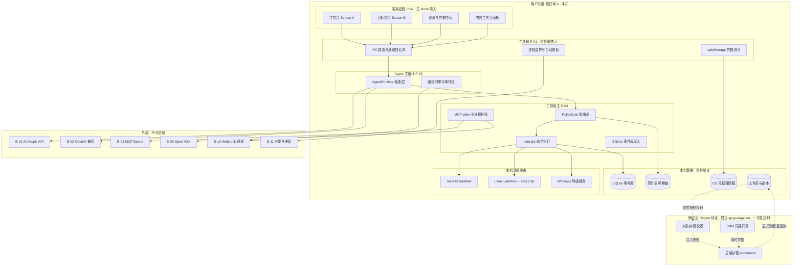
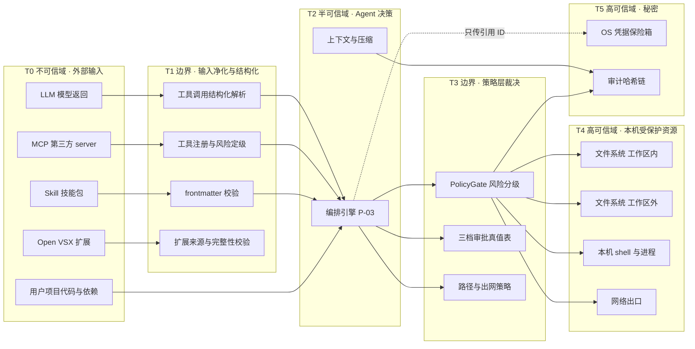
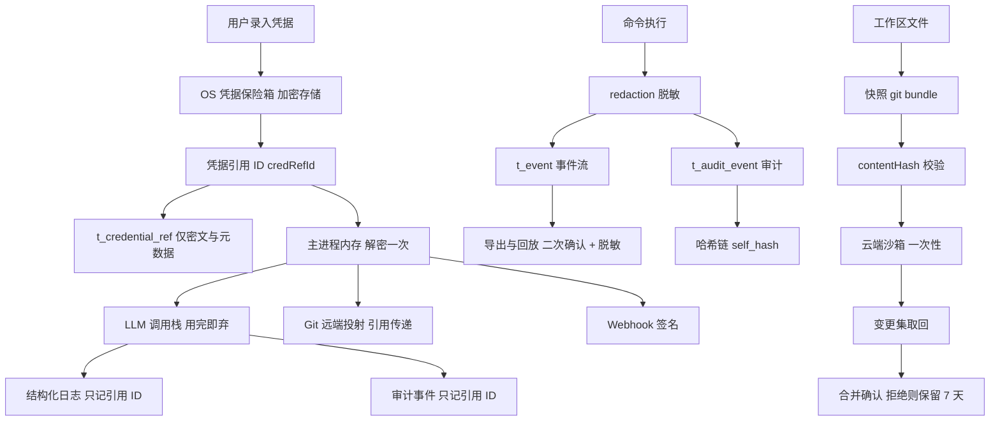

# AICoding 架构设计 · 安全设计 — openINTJ Agent Console

> 本文档为《AICoding 架构设计》核心产物之一，对应**《安全架构设计模版》**。
> 上游输入：《高层架构设计》v1.4（G3 已通过）、《系统设计》v1.1（G4 已通过）、《UserStory》v1.2（G4 已通过）、《行业调研报告》v1.2（G2 已通过）、《资料摘要》（G1 已通过）。
> 阶段门：**G5**（与《部署设计》共同放行）。

**上游承接声明**：本文档**不重新裁决**任何已冻结事项。产品形态 X1、桌面壳层 IC-01、IDE 嵌入形态 IC-02、云端沙箱自建 IC-03、云厂商腾讯云 IC-04、MVP 范围 IC-05、双协议 UI 承载位 IC-06、目标契约硬闸门 IC-07、三档审批策略 IC-08、主副本关系 IC-09、L0 占比偏离 IC-10、消息通道仅 Webhook IC-11、并行度上限 IC-12，以及《高层架构设计》§6.1 的 In-Scope（S1 ~ S12 + N1 ~ N3）与 Out-of-Scope（O1 ~ O6）、§6.6 的对外承诺 C1 ~ C8，全部作为**既定输入**直接消费。凡本文档出现与上游不一致处，以上游为准。

**本文档的核心命题（务必先读）**：本产品是**单机单用户桌面应用**——无公网入口、无服务端、无账号体系（高层架构 §6.1 O3）。因此模板中依赖服务端语义的安全能力（抗 DDoS / WAF / 堡垒机 / 云防火墙 / SOC / KMS 服务）在本系统内**大部分不适用**。本系统的安全重心不在「用户登录」，而在两句：

1. **本机资源访问的裁决与留痕**——Agent 每一次触碰本机文件系统、shell、进程、网络的行为，都必须先经策略层裁决、后落不可篡改审计；
2. **凭据保护**——LLM API Key、Git 远端凭据、云账号凭证、消息通道签名密钥，**明文永不出 OS 凭据保险箱**，跨进程只传引用 ID。

本文档对模板中每一条不适用的要求，一律**显式标注「不适用」并给出理由与替代机制**，不留空、不伪装为已部署、不为填满模板而编造内容。

**证据标注约定（全文适用）**：

| 标注 | 含义 |
| --- | --- |
| 冻结 | 直接来自 X1、IC-01 ~ IC-12、《高层架构设计》C1 ~ C8 或《系统设计》已冻结章节，本文档不得推翻 |
| 事实 | 可追溯到 `research_report.md` 的 R / SB / U / D 条目，或 `material_digest.md` 的 D 编号章节 |
| 设计 | 本阶段在冻结边界内做出的安全决策，均已写明决策依据与取舍 |
| 待确认 | 已通过中间确认协议上报主理人，等待用户裁决；本文档按推荐项落稿并显式标注 |

**书写约定（影响全文）**：本文档需通过模板占位符自动校验，该校验禁止尖括号与「示例」前缀。因此全文不出现尖括号、不出现未决占位标记与日期占位符，图示一律采用 Mermaid（与《系统设计》《高层架构设计》《UserStory》三份上游文档一致），签名与类型一律用具名类型书写。

---

## 0. 元信息：修订记录

```yaml
标题: openINTJ Agent Console - 安全设计 v1.0
版本: v1.0
状态: Reviewing   # Draft | Reviewing | Approved | Deprecated
创建日期: 2026-10-21
最后更新: 2026-10-21
作者: security-architect（安全架构师 - 严守正）
评审人:
  - team-lead（主理人）
  - platform-architect（部署架构师 - 重叠区对账方）
  - 用户（G5 人工审核）

关联文档:
  上游输入:
    - 高层架构设计: .workbuddy/output/高层架构设计.md（v1.4，G3 已通过）
    - 系统设计: .workbuddy/output/系统设计.md（v1.1，G4 已通过）
    - UserStory: .workbuddy/output/UserStory.md（v1.2，G4 已通过）
    - 行业调研报告: .workbuddy/output/research_report.md（v1.2，G2 已通过）
    - 资料摘要: .workbuddy/output/material_digest.md（G1 已通过）
  下游产出:
    - 部署设计: 部署设计.md（G5，与本文档共同放行）
    - 编码实现: Phase 7（安全基线与安全测试用例的来源）

已冻结裁决（本文档不得推翻）:
  - X1    产品形态 = 桌面客户端（非 Web 应用）
  - IC-01 桌面壳层 = Electron
  - IC-02 IDE 嵌入 = 内嵌 VSCodium（Code-OSS 的 MIT 构建，遥测已移除）+ Open VSX
  - IC-03 云端沙箱供给 = 自建（自有云账号）
  - IC-04 云厂商 = 腾讯云（CVM / 轻量 + COS + VPC + CAM），Region 待定 · 假定 ap-guangzhou
  - IC-05 MVP 范围 = 14 项能力原子全部进 MVP
  - IC-06 双协议 UI 承载位 = 独立「设置与凭据中心」页
  - IC-07 目标契约 = 执行前硬闸门
  - IC-08 审批在环 = 按风险分级三档（宽松 / 标准 / 严格），默认「标准」
  - IC-09 主副本关系 = 本地唯一主副本 + 云端按需独立副本，不做持续同步
  - IC-10 L0 一级功能占比 41% 有意偏离模板 30% 上限（已获用户批准）
  - IC-11 Q5 消息通道 = 仅 Webhook（MVP）
  - IC-12 并行子 Agent 数上限 = 8

本文档必须继承的安全基线（《系统设计》已冻结）:
  - 三档审批状态机 + 可配置命令风险分级表（R0 ~ R5，R4 内置规则不可降级不可删除）
  - 审批不串行化并行子 Agent（泳道隔离 + 任务级单飞 + 批量审批卡片）
  - 审计六要素 + 风险六要素 + 哈希链防篡改
  - 凭据只存引用 ID，明文仅在 OS 保险箱，保险箱不可用即 fail-stop
  - 进程隔离 P-01 ~ P-07，进程间一律 MessagePort，不开本地 HTTP 端口
```

| 文档版本 | 发布日期 | 修订人 | 修订说明 |
| --- | --- | --- | --- |
| v1.0 | 2026-10-21 | `security-architect` | 初稿：七章正文 + 附录 A ~ D。§1 安全总体架构（组件适用性判定 + STRIDE 威胁模型 + 威胁—缓解映射）；§2 IAM（无账号体系下的认证替代 + PBAC 授权 + 三档审批安全论证）；§3 数据安全（L1 ~ L4 分级 + 传输/存储/使用 + 备份容灾 + 隐私合规 + 投射数据流 + 无后台同步通道正面声明）；§4 应用安全（OWASP Top 10 + 提示词注入 + 供应链 + 桌面端特有攻击面）；§5 网络与基础设施安全（三区划分 + 出网白名单 + 本机沙箱三平台差异 + 消息通道）；§6 密钥与凭证管理（五类分级 + AKSK 防护 + 红线 + 全生命周期）；§7 运行时安全（监控 + 审计五维度 + 应急五类预案 + 发版门禁）。发起中间确认 1 项（云端投射前敏感内容审查强度） |
| v1.1 | 2026-10-21 | 主理人（G5 收尾 + Phase 6 术语统一） | ① **IC-13 裁决落盘**（方案 A 阻断式）：§3.3.8 敏感内容审查整节定稿——扫描范围扩为三类载体全覆盖（含 `git bundle` 可达的**全部历史 blob**，覆盖「历史中曾提交后又删除的密钥」）、模式清单拆为「精确文件名/目录名」与「内容特征正则」两类、**豁免改为仅本次投射生效且落审计（不持久化、不记忆）**、命中清单不回显明文只给路径+规则名+指纹前缀；T-20 由「待确认」改为「已缓解」，§1.2 覆盖率自检中信息泄露类残余风险归零；② **TBD 自我指涉修正**：开头书写约定中字面含 `TBD` 被校验判为残留占位符，改为「未决占位标记」；③ **档位中文命名统一**：「自治档」→「宽松档」5 处（代码枚举与裁决原文不动） | Draft |

**未启用章节说明**：模板七章与全部二级 / 三级子节**一节未删**（主理人要求骨架不得删减）。凡本产品不适用的条目，一律保留章节号并写入「不适用 + 理由 + 替代机制」三要素，不因不适用而留空。

---

## 1. 安全总体架构

### 1.1 安全总体架构图

> **总览**：1 张图，叠加展示——本机信任分区、进程间通信面、对外出网面、凭据与审计落点、云端一次性投射面。
>
> **说明**：模板原表按服务端形态给出「DDoS / WAF / 云防火墙 / 主机安全 / 数据安全审计 / KMS / 堡垒机 / NAT / SOC」九类常见组件。下表逐项判定其在本系统的适用性；**不适用的 5 项全部给出替代机制**，方案引入而模板未覆盖的 4 项（IPC 通道白名单、策略层裁决、OS 凭据保险箱、本地沙箱原语适配）已补充。

| 组件 / 机制 | 模板中的作用 | 本系统是否启用 | 判定理由与替代机制 |
| --- | --- | --- | --- |
| DDoS 高防 | 抵御流量攻击 | **不适用** | 桌面单机应用，本机进程不监听任何外部端口，无公网入口可被攻击；云端侧由腾讯云 IaaS 侧能力保障，具体策略在 Q4 补齐后由《部署设计》定义 |
| WAF | 防御 Web 应用层攻击、CC、防篡改 | **不适用** | UI 为本地渲染进程，与外部无 HTTP 交互面；等效防护由 §2.2.2 的 IPC 通道白名单 + `preload` 上下文隔离 + CSP 锁定承担 |
| 云防火墙（南北向 / 东西向） | 互联网与 VPC 边界流量管控 | **不适用（桌面侧）** | 桌面侧无 VPC；出网管控下沉为 §5.2.2 的**条目级出网白名单 + 默认禁网**（默认禁网原则，SB-04）。云端侧防火墙与安全组规则由《部署设计》在 Q4 补齐后定义 |
| 主机安全 | 资产梳理、漏洞修补、恶意文件检测 | **自实现四件套**（承《系统设计》§7.1） | ① 进程最小权限（渲染进程 `nodeIntegration = false` + `contextIsolation = true` + CSP 锁定）；② 出网白名单默认禁网；③ 命令风险分级与三档审批；④ 工作区根目录约束 + 危险命令黑名单 |
| 数据安全审计 | 数据加密、脱敏、安全审计 | **自实现** | `t_audit_event` 哈希链（`prev_hash` / `self_hash`）+ 禁止删除 + 每次启动校验最近 1000 条；覆盖权限裁决、命令执行、工具调用、Hook、凭据访问、档位切换六类 |
| KMS | 敏感数据加密 + AKSK 白盒保护 | **不自建 KMS**，改用 OS 凭据保险箱 | 单机应用引入密钥管理服务收益为负；密钥托管由 macOS Keychain / Windows DPAPI / Linux libsecret 承担，经 Electron `safeStorage` 统一访问。云端侧由腾讯云 CAM 凭据托管（用户自有账号）承担，与桌面侧**不共用密钥** |
| 堡垒机 | 保护与管理运维通道 | **不适用** | 本系统不需要、也不提供远程登录本机的能力；无运维跳板机场景。替代机制：全量本地审计 + 不开放任何入站监听 |
| NAT 网关 | 隐藏内部网络架构、SNAT / DNAT | **不适用** | 桌面端出口即用户机器网络，无 NAT 边界需要隐藏；云端侧出口策略待 Q4 补齐后由《部署设计》定义 |
| SOC（安全运营中心） | 资产管理、配置扫描、告警运营 | **不适用** | 单机应用无集中日志汇聚与运营中心；替代机制为本地告警面板（AL-01 ~ AL-14）+ 可选崩溃上报（用户显式开启，默认关闭） |
| **IPC 通道白名单**（补充） | 替代 WAF 的等效边界 | **启用** | `preload` 仅暴露已登记通道，未登记通道在 `preload` 层直接拒绝；通道名即《系统设计》§3.5.5 的接口路径 |
| **策略层裁决 `PolicyGatePort`**（补充） | Agent 侧访问控制的唯一收口 | **启用** | 内置工具、MCP 工具、Skill 注册工具、内嵌终端命令**四条来源统一过同一裁决口**，无旁路 |
| **OS 凭据保险箱**（补充） | 替代 KMS 的密钥托管 | **启用** | 明文不出保险箱；库内只存 `credential_ref_id` 引用；保险箱不可用即 fail-stop |
| **本地沙箱原语适配**（补充） | 执行不可信生成代码的第一道防线 | **启用（macOS / Linux）；Windows 恒等降级** | macOS Seatbelt、Linux Landlock + seccomp、Windows 降级为审批在环 + 命令白名单 + 工作区根目录约束（C1） |

**安全总体架构图**：



**图中四条硬边界（对开发是硬约束）**：

1. **渲染进程 → 主进程**：只经 `contextBridge` 暴露的白名单通道，渲染进程无任何 Node 能力；
2. **主进程 → OS 保险箱**：明文只在此处解密一次，随即以引用 ID 形式在进程树内流动；
3. **工具宿主 → 本机资源**：必经 `PolicyGate` 裁决，裁决结果落审计后才允许触碰 shell / 文件系统 / 网络；
4. **本机 → 外部（含云端）**：只有显式出网白名单条目与「用户显式授权的一次性投射」两条通路，其余一律默认拒绝。

### 1.2 威胁模型

> **方法**：采用 **STRIDE** 六类（仿冒 Spoofing、篡改 Tampering、否认 Repudiation、信息泄露 Information Disclosure、拒绝服务 Denial of Service、权限提升 Elevation of Privilege）逐类枚举，并叠加本产品形态特有的 **Agent 特有威胁子类**（提示词注入、第三方能力投毒、供应链）。
> **纪律**：每条威胁必须映射到本文档 §2 ~ §7 的具体缓解措施，形成「威胁—缓解映射表」（§1.2.5），不留无缓解的悬空威胁。

#### 1.2.1 资产清单

| 资产编号 | 资产 | 分级 | 所在信任域 | 丧失后的后果 |
| --- | --- | --- | --- | --- |
| AS-01 | LLM API Key（Anthropic / OpenAI 兼容） | L4 | OS 保险箱 | 他人冒用产生费用、调用历史泄露 |
| AS-02 | 云账号凭证（腾讯云 AKSK / 临时凭据） | L4 | OS 保险箱 | 云资源被滥用、投射内容被读取 |
| AS-03 | Git 远端凭据（投射用） | L4 | OS 保险箱 | 用户自有仓库被读写 |
| AS-04 | 消息通道签名密钥（Webhook） | L4 | OS 保险箱 | 外送通道被伪造或劫持 |
| AS-05 | 用户代码与工作区文件 | L3 | 本机文件系统 | 源码泄露或被篡改 |
| AS-06 | 事件流与检查点（执行轨迹） | L3 | SQLite 事件库 | 行为轨迹泄露；被篡改则丧失可追溯性 |
| AS-07 | 审计事件与哈希链 | L3 | SQLite 审计表 | 丧失不可否认性，越权行为无法复核 |
| AS-08 | 命令执行能力（shell / CLI） | — | 本机 | 本机被任意命令控制 |
| AS-09 | 策略层配置（档位 / 风险分级表 / 出网白名单） | L2 | SQLite 配置 | 防线被静默放宽 |
| AS-10 | 云端沙箱实例与投射快照 | L3 | 云端（ephemeral） | 代码出本机后被留存 |
| AS-11 | 客户端二进制与内嵌 VSCodium 二进制 | L2 | 本机安装目录 | 供应链植入，全线失守 |

#### 1.2.2 信任边界



**五条边界的判定口径**：

| 边界 | 跨越方向 | 判定口径 |
| --- | --- | --- |
| T0 → T1 | 外部内容进入系统 | 一切外部内容一律视为**数据**，不具备指令效力；只有结构化工具调用（tool_use JSON）才具备执行效力 |
| T1 → T2 | 能力进入 Agent 上下文 | 工具注册需过风险定级与契约 toolset 取交集；Skill 包非法即禁用，不进上下文 |
| T2 → T3 | 决策转为动作 | 每一次动作必经 `PolicyGate`，无旁路；缺 `RiskDecisionContext` 六要素即拒绝执行（错误码 B100003） |
| T3 → T4 | 动作作用于本机资源 | 默认拒绝；工作区外写入、危险命令、出网一律逐次审批 |
| 任意 → T5 | 触碰秘密 | 只经引用 ID；保险箱不可用即 fail-stop，绝不回退明文 |

#### 1.2.3 敏感数据流



**敏感数据流的六条红线（与《系统设计》§7.2.3 一致）**：

1. 凭据明文**只存在于两处**：用户录入瞬间的内存、OS 保险箱内；
2. 跨进程**只传引用 ID**，明文仅在 P-01 主进程内解密一次并通过 `MessagePort` 直传调用栈；
3. 事件流 `t_event`、审计 `t_audit_event`、任何日志文件**只记引用 ID**，禁止明文；
4. 命令输出与工具返回**落盘前经 `redaction` 脱敏**，禁止明文全文落库；
5. 外送（Webhook）内容**不含任何 L4**，不含未授权外送的代码内容；
6. 投射快照以 `contentHash` 校验完整性，取回时哈希不一致即拒绝合入。

#### 1.2.4 STRIDE 威胁清单

> 下表按 STRIDE 六类枚举。编号 `T-xx` 为本文档自有的威胁编号空间，不与上游 S / F / M / O / R / SB / IC 撞车。

**S — 仿冒（Spoofing）**

| 编号 | 威胁 | 攻击路径 | 影响资产 | 缓解措施（章节） | 状态 |
| --- | --- | --- | --- | --- | --- |
| T-01 | LLM API Key 被窃取后冒用 | 本机恶意软件读取保险箱；或凭据被写入日志 / 事件流后被外带 | AS-01 | §6.1 密钥分级；§6.3 红线（禁止入日志 / 事件流）；§3.3.1 OS 保险箱托管；§6.4 轮换与吊销 | 已缓解 |
| T-02 | 云账号 AKSK 冒用 | 长期 AKSK 被写入配置文件或随崩溃报告外带 | AS-02 | §6.2.2 CAM 最小权限策略 + 临时凭据优先；§6.3 红线；§2.3.1 禁止主账号 AKSK | 已缓解 |
| T-03 | Webhook 接收端被伪造或外送被中间人劫持 | 攻击者伪造端点或劫持明文 http 外送 | AS-04 / AS-06 | §3.2.1 强制 https；§3.2.4 HMAC-SHA256 签名 + nonce + timestamp 防重放；§5.5 外送内容边界 | 已缓解 |
| T-04 | 第三方 MCP server 冒充可信工具 | 恶意 server 注册同名工具诱导 Agent 调用 | AS-08 | §2.2.2 接口级权限（命名空间 `mcp.{server}.{tool}`）；§4.4 第三方能力评估；§4.3.6 工具调用仍过 `PolicyGate` | 已缓解 |
| T-05 | 更新包被替换为恶意安装包 | 差分更新通道被劫持或 CDN 被污染 | AS-11 | §4.5 自动更新签名与证书校验；§3.2.4 更新包签名校验 | 已缓解 |

**T — 篡改（Tampering）**

| 编号 | 威胁 | 攻击路径 | 影响资产 | 缓解措施（章节） | 状态 |
| --- | --- | --- | --- | --- | --- |
| T-06 | 审计记录被篡改以掩盖越权 | 直接改写 SQLite 审计表并重算链 | AS-07 | §7.2 哈希链（`prev_hash` / `self_hash`）+ 禁止删除 + 每次启动校验最近 1000 条 + 断链告警 AL-11 | 已缓解 |
| T-07 | 策略层配置被静默放宽 | 篡改档位或风险分级表，使危险命令自动放行 | AS-09 | §2.2.5 档位切换二次确认 + 版本号乐观锁 + 落 `PolicyTierSwitched` 审计；§2.2.5 R4 规则禁止降级与删除 | 已缓解 |
| T-08 | 工作区副本被跨副本写入覆盖 | 子 Agent 写入他人 worktree 副本 | AS-05 | §2.2.4 副本独占（`ownerSubAgentId` 强绑定）+ M10 拒绝跨副本写入并留痕 | 已缓解 |
| T-09 | 取回的云端产出被替换 | 云端侧变更集被篡改后取回合入 | AS-05 | §3.3.8 `contentHash` 校验不一致即拒绝合入并告警 AL-09；取回落新 worktree 隔离后再确认 | 已缓解 |
| T-10 | 本机客户端二进制被植入后门 | 安装目录被写入恶意 asar 或原生模块 | AS-11 | §4.4 供应链加固；§4.5 asar 完整性校验与安装目录权限；§5.3.1 主机最小化 | 已缓解 |
| T-11 | 提示词注入篡改 Agent 行为 | 模型返回或文件内容含指令性文本，诱导放宽约束 | AS-08 / AS-09 | §4.3.6 模型输出不可信 + 结构性隔离（纯文本永不解析为命令）+ 约束不可被模型单方修改 | 已缓解 |

**R — 否认（Repudiation）**

| 编号 | 威胁 | 攻击路径 | 影响资产 | 缓解措施（章节） | 状态 |
| --- | --- | --- | --- | --- | --- |
| T-12 | 越权行为无留痕，事后无法归责 | 绕过 `PolicyGate` 直接执行；或执行了但没留痕 | AS-07 | §7.2 审计 100% 留痕（N3 / V2）；三条留痕任一失败即视为执行失败；工具调用统一过 `PolicyGatePort` 无旁路 | 已缓解 |
| T-13 | 档位切换无留痕，事后无法解释防线被放宽的原因 | 切换不落审计或审计缺前后档位 | AS-09 | §2.2.5 切换必须落 `PolicyTierSwitched`，含前后档位、scope、撤销的授权数 | 已缓解 |
| T-14 | 凭据轮换与吊销不可追溯 | 轮换不落审计，旧 Key 何时失效无据可查 | AS-01 ~ 04 | §6.4 轮换 / 吊销均落审计事件（不含明文）；`t_credential_ref` 状态机四态可回溯 | 已缓解 |
| T-15 | 投射动作否认「我曾授权上云」 | 投射不留授权证据 | AS-10 | §3.3.8 `acknowledged = true` 为硬前置，未授权一律不投射；投射落 `CloudProjected` 事件与审计（含体积与内容清单） | 已缓解 |

**I — 信息泄露（Information Disclosure）**

| 编号 | 威胁 | 攻击路径 | 影响资产 | 缓解措施（章节） | 状态 |
| --- | --- | --- | --- | --- | --- |
| T-16 | 凭据明文出现在日志 / 事件流 / 崩溃报告 | 日志打印请求头；崩溃堆栈携带明文 | AS-01 ~ 04 | §6.3 红线；§7.2 日志只记引用 ID；§4.2.2 调试信息与崩溃报告脱敏 | 已缓解 |
| T-17 | 命令输出含密钥并被落库展示 | 执行 `cat .env` 后原文入库 | AS-01 / AS-05 | §3.3.1 输出经 `redaction` 后落盘；§3.1 敏感字段处理策略表；§3.3.5 展示脱敏 | 已缓解 |
| T-18 | 审计导出 / 轨迹回放导出含凭据 | 导出未脱敏 | AS-01 / AS-07 | §3.3.5 导出强制脱敏（凭据类整列剔除）+ 二次确认 + 水印；US-23 AC-5 | 已缓解 |
| T-19 | Webhook 外送把代码或命令原文送出本机 | 订阅事件含完整 diff | AS-05 / AS-06 | §5.5 外送内容边界（默认仅元数据，不含 L4，不含未授权外送的代码内容） | 已缓解 |
| T-20 | 本机私钥 / 密钥随投射快照上云 | 快照含 `.env` 或私钥文件 | AS-01 ~ 03 / AS-05 | §3.3.8 投射前敏感内容审查（**已裁决 IC-13：方案 A 阻断式**）+ 清单展示 + `includeUncommitted` 二次确认 | 已缓解 |
| T-21 | 云端快照长期留存导致代码出本机 | 投射后未随沙箱销毁 | AS-05 / AS-10 | §3.3.8 云端 ephemeral，任务结束即销毁；孤儿实例夜巡回收（SB-03）；优先形态为推送到用户自有 Git 远端，云端不持久化代码 | 已缓解 |
| T-22 | 内嵌终端绕过策略层读取敏感目录 | 终端直连 shell 不经裁决 | AS-01 / AS-03 | §2.2.2 内嵌终端命令同样过 `PolicyGate`；R4-06 访问凭据目录命中即危险类；§4.5 终端不是绕过通道 | 已缓解 |
| T-23 | 本地预览服务对外暴露 | 预览绑定 `0.0.0.0` | AS-05 | §5.2.3 预览仅绑定 `127.0.0.1`，禁止 `0.0.0.0` | 已缓解 |

**D — 拒绝服务（Denial of Service）**

| 编号 | 威胁 | 攻击路径 | 影响资产 | 缓解措施（章节） | 状态 |
| --- | --- | --- | --- | --- | --- |
| T-24 | 命令执行拖垮本机（CPU / 内存 / 磁盘） | 长跑命令不终止；并行 8 个子 Agent 同时构建 | AS-08 / 本机 | §4.3.2 执行超时默认 300s（上限 1800s）+ 终止整个进程树；P-03 / P-04 内存软限额；§5.5.4 水位降级 BD-06 | 已缓解 |
| T-25 | 审计与事件流写满本机磁盘 | 审计禁止删除 + 保留 365 天撑爆磁盘 | AS-07 | §3.3.6 热数据 90 天、365 天转冷存归档；归档文件仍保留链式哈希；磁盘超限触发 AL-09 与水位降级；归档仅限**本机其他路径或用户指定外部路径**，绝不自动上云 | 已缓解 |
| T-26 | LLM 调用失控导致费用与配额耗尽 | 循环调用、重试风暴 | 成本 | §4.3.2 限流与预算熔断（SB-05 口径，阈值待 Q4）；§7.1 用量异常告警 | 已缓解 |
| T-27 | 审批弹窗风暴使客户端不可用 | 大量 `PER_CALL_PROMPT` 同时触发 | 可用性 | §2.2.6 泳道隔离 + >3 条聚合为批量审批卡片 + AL-13 弹窗风暴告警 | 已缓解 |
| T-28 | 外部依赖不可达导致主链路阻塞 | 供应商 5xx、MCP server 挂起 | 可用性 | §4.3.2 超时与重试基线；MCP 连续 3 次失败摘除（BD-09）+ AL-06 / AL-08 | 已缓解 |

**E — 权限提升（Elevation of Privilege）**

| 编号 | 威胁 | 攻击路径 | 影响资产 | 缓解措施（章节） | 状态 |
| --- | --- | --- | --- | --- | --- |
| T-29 | 渲染进程获得 Node 能力进而控制本机 | `nodeIntegration` 被误开；CSP 被绕过 | AS-08 | §2.2.4 纵向越权防护：`contextIsolation = true` + `nodeIntegration = false` + CSP 锁定 + 通道白名单 | 已缓解 |
| T-30 | 命令提权（sudo / runas / UAC） | Agent 通过提权命令获取更高权限 | AS-08 | §2.2.5 R4-03 提权类规则命中即 `PER_CALL_PROMPT`，未批准进程不启动 | 已缓解 |
| T-31 | 工作区外写入（水平越权 / 路径越权） | 写入用户主目录或系统目录 | AS-05 | §2.2.5 R3 工作区外写入默认拒绝并弹窗请求显式授权（C8） | 已缓解 |
| T-32 | 权限放宽类命令（chmod 777 / chown -R） | 破坏本机权限模型以绕过后续约束 | AS-08 | §2.2.5 R4-08 权限放宽类规则命中即危险类 | 已缓解 |
| T-33 | Windows 侧因无 OS 级沙箱导致约束可被绕过 | world-writable 目录写入无法被 OS 层拦截（R-04） | AS-05 | §5.3.3 Windows 恒等降级 + 四处文案明示 + 无关闭开关 + 宽松档默认禁用（C1） | 已缓解（强度弱于 macOS，已明示） |
| T-34 | 云端沙箱容器逃逸（若隔离原语降级为容器） | 共享内核下的逃逸 | AS-10 | §5.3.2 降级即明示（C5）+ 容器补偿控制；U-05 未核实前不承诺隔离强度 | 部分缓解（依赖 U-05） |
| T-35 | Skill 声明 `allowed-tools` 自我授权 | 恶意 Skill 包声明宽泛工具集并据此获得权限 | AS-08 | §4.4 `allowedTools` **不作权限判定依据**（R-08）；Skill 附带脚本注册为工具时风险定级与内置工具一致 | 已缓解 |
| T-36 | 云端跨租户访问 | 一个租户读取另一个租户的沙箱或快照 | AS-10 | §2.2.3 `tenantId` 资源归属键 + 租户级凭据隔离 + 用户自有云账号边界（SB-06） | 已缓解 |
| T-37 | 归档 / 备份数据被其他本机用户读取 | 备份目录权限过宽 | AS-05 / AS-07 | §3.3.3 本机库与备份目录权限 600 / 700；备份与生产库物理隔离 | 已缓解 |

#### 1.2.5 威胁—缓解措施映射表（索引）

> 完整映射见附录 B。此表给出 STRIDE 六类的**覆盖率自检**：六类全部有条目，且除 T-34（依赖 U-05 核实）外（T-20 已按 IC-13 裁决缓解），全部已有明确缓解章节。

| STRIDE 类别 | 威胁条目 | 已缓解 | 待确认 / 部分缓解 | 主要缓解章节 |
| --- | --- | --- | --- | --- |
| S 仿冒 | T-01 ~ T-05（5 条） | 5 | 0 | §6 密钥与凭证、§3.2 传输安全、§4.4 供应链 |
| T 篡改 | T-06 ~ T-11（6 条） | 6 | 0 | §7.2 审计、§2.2.5 审批策略、§4.3.6 注入防护 |
| R 否认 | T-12 ~ T-15（4 条） | 4 | 0 | §7.2 审计留痕、§6.4 凭据生命周期 |
| I 信息泄露 | T-16 ~ T-23（8 条） | 7 | 0 | §3.1 数据分级、§3.3 存储与使用、§5.5 外送边界 |
| D 拒绝服务 | T-24 ~ T-28（5 条） | 5 | 0 | §4.3.2 限流与超时、§5.5.4 水位降级 |
| E 权限提升 | T-29 ~ T-37（9 条） | 8 | 1（T-34 依赖 U-05） | §2.2 授权、§5.3 主机与沙箱、§2.2.3 多租户隔离 |
| **合计** | **37 条** | **35** | **2** | — |

---

## 2. 身份与访问管理（IAM）

> **本章前提**：本系统**无账号体系、无登录、无角色分级**（高层架构 §6.1 O3 已冻结；UserStory §6.4.1 已判定模板「安全密码设置」项不适用）。因此本章的处理方式是——**模板每一项都保留章节号，逐项写明「本系统的等价物是什么」**，而不是删除。

### 2.1 身份认证（Authentication）

#### 2.1.1 用户登录

**模板项（多种登录方式 / 图形验证码 / MFA）在本系统的判定**：

| 模板要求 | 本系统判定 | 理由 | 替代机制 |
| --- | --- | --- | --- |
| 账号密码登录 | **不适用** | O3 已冻结：单机单用户桌面应用不做账号系统；本机单用户，身份即「当前 OS 登录用户」 | 可选**本地应用锁**：启动时校验本机口令或系统生物识别（macOS Touch ID / Windows Hello），默认关闭 |
| 手机号 / 邮箱验证码 | **不适用** | 本系统不采集手机号与邮箱（《系统设计》§7.2.2 明确不适用），无从发送验证码 | 无 |
| 第三方互联（OAuth 2.0 / OIDC / SAML / CAS） | **不适用（本系统侧）** | 无自有账号体系，不需要也不提供联邦登录 | 外部系统的认证由各外部系统自行承担：云端侧身份为用户**自有腾讯云账号**（CAM 子账号），本系统不介入、不代管 |
| 扫码登录 | **不适用** | 无服务端会话可扫码绑定 | 无 |
| 图形验证码强制场景 | **不适用** | 无登录与验证码获取入口，不存在撞库与短信轰炸场景 | 针对「本地口令暴力破解」改用失败锁定（§2.1.2） |
| MFA / 2FA | **不适用（本系统侧）** | 无账号体系，无从绑定第二因子 | ① 本地应用锁可选绑定系统生物识别（Touch ID / Windows Hello），构成「本机口令 + 生物特征」的二要素形态；② 云端侧 MFA 由用户云账号自身策略决定；③ 高敏动作统一走**二次确认**（§4.3.5） |

**身份模型（本系统的实际身份口径）**：

| 身份主体 | 身份来源 | 认证方式 | 认证强度基线 |
| --- | --- | --- | --- |
| 本机用户（人类） | 当前 OS 登录用户 | OS 会话 + 可选本地应用锁（口令 / 系统生物识别），默认关闭 | 应用锁口令最小长度 8 位；失败 5 次锁定 15 分钟 |
| 云端资源调用者 | 用户自有腾讯云账号 | CAM 子账号凭据（优先临时凭据 STS；长期 AKSK 仅作兜底且需用户显式确认） | 禁止主账号 AKSK（§2.3.1） |
| Agent（子 Agent） | 系统内部分配的 `subAgentId` | 无独立凭据；其权限由策略层按 `runId` + `parallelLaneId` + 契约 toolset 动态计算 | 无凭据即无可仿冒面 |
| MCP server / Skill | 用户登记的外部能力 | 用户显式登记即视为授权引入；其每次调用仍过策略层裁决 | 不采信其自我声明（§4.4） |

#### 2.1.2 密码策略（量化阈值）

> 本系统**没有应用账号密码**，但有两处需要口令强度约束：**本地应用锁口令**与**外部凭据录入强度**。二者分别给出阈值，不混用。

| 项 | 本地应用锁口令 | 外部凭据录入（API Key / 云账号 / Webhook 签名密钥 / Git 凭据） | 依据 |
| --- | --- | --- | --- |
| 最小长度 | **≥ 8 位** | 由各供应商决定，本系统**不代为生成、不降低要求**；录入界面明示「8 位以上大小写字母 + 数字 + 特殊字符」的强度要求（UserStory §6.4.1） | 冻结（UserStory §6.4.1 / US-01 AC-4 / US-19 AC-8） |
| 复杂度 | 大小写 + 数字，符号可选 | 同上（对外部凭据为**提示性要求**，因本系统无权改写供应商的 Key 格式） | 冻结 |
| 加密传输 | 不涉及（不上传） | 全部走 https；禁止明文 http 回退 | §3.2.1 |
| 加密存储 | **不落库**：仅用于本地解锁，口令不上传、不落库、不以明文形态持久化 | OS 凭据保险箱密文；库内只存引用 ID | 冻结（《系统设计》§7.2.1 / §7.2.3） |
| 派生与校验 | argon2id 加盐哈希（内存硬编码下限 64 MiB、迭代次数下限 3、并行度 1）；**禁止 MD5 / SHA1 明文**；派生密钥仅驻留内存，用于应用锁会话与（可选）审计链密钥化 | 不适用（外部凭据需可逆取用，故用保险箱而非哈希） | 设计 |
| 更换周期 | 不强制；用户可随时在设置中修改 | 轮换提示周期基线 **90 天**（`rotateAfterDays` 缺省 90） | 冻结 |
| 重复限制 | 不允许使用最近 5 次的口令（本地哈希比对） | 不适用（外部 Key 由供应商保证唯一性） | 设计 |
| 失败锁定 | 连续失败 **5 次锁定 15 分钟**；锁定期间仅保留「清除本地数据」显式入口（需二次确认），防止暴力破解本地库 | 不适用（外部凭据失败表现为 401，由连通性自检捕获） | 冻结 |
| 自动登出 / 上锁 | 空闲 **30 分钟**自动上锁 | 不适用 | 冻结 |
| 注册策略 | 不允许隐式注册；应用锁由用户显式设置 | 不允许本系统代为生成凭据；改密钥需重新录入并重新自检 | 冻结 |

#### 2.1.3 会话管理

**模板项（Token / 互踢 / 风险登录）在本系统的判定与替代**：

| 模板要求 | 本系统判定 | 替代机制与取值 |
| --- | --- | --- |
| Token 类型（JWT / Session ID） | **不适用** —— 无服务端会话，因此不存在访问 / 刷新 Token | 会话 = 客户端实例生命周期；关闭客户端即结束会话（任务状态落库，可从检查点续跑） |
| 禁止 URL 携带 token | **适用且升级为红线** —— 本系统无 URL 携带 token 的场景；红线扩展为「**禁止在 URL / 日志 / IPC 载荷 / 崩溃报告中携带任何凭据明文**」 | §3.2.5 传参禁忌；§6.3 红线 |
| Token 有效期 | **不适用（本系统侧）** | 外部凭据有效期由各供应商决定：LLM API Key 长期有效、由用户自行轮换；云端临时凭据（STS）有效期由腾讯云侧决定，**本系统只存引用不存明文** |
| 互踢机制 | **适用（改写为单实例约束）** | **单实例单会话**：同一数据目录仅允许一个客户端实例，第二实例启动时聚焦已有窗口。理由：多实例并发写同一事件库会破坏事件流的单一事实来源与审计哈希链顺序（`uk_seq` 唯一索引） |
| 异地 / 异常登录二次验证 | **改写为「异常解锁与异常动作二次验证」** | ① 应用锁连续失败达阈值即锁定并留痕；② 高敏动作（档位切换、凭据写入 / 轮换 / 删除、投射、取回合入、导出）一律二次确认并落审计（§4.3.5） |
| 会话级授权（Agent 侧） | **本系统特有，必须显式定义** | `SessionGrant` 以 `runId` 为会话边界（一次 TaskRun = 一个会话）；**任务结束或档位切换即失效**；收紧档位强制撤销全部会话级授权，放宽档位保留已有授权；撤销动作落 `PolicyTierSwitched` 审计 |

**会话与授权生命周期状态机（`SessionGrant`）**：

| 起始状态 | 触发事件 | 终止状态 | 触发条件 / 校验 | 副作用 |
| --- | --- | --- | --- | --- |
| — | grant | `ACTIVE` | 用户在任务开始时一次性授权（任务级单飞） | 记录 `grantId`、`riskClass`、`scope`、`pathPrefix` |
| `ACTIVE` | reuse | `ACTIVE` | 同 `runId` 下同 `riskClass` 的后续调用 | 放行并记录 `grantId`，不重复弹窗 |
| `ACTIVE` | run_end | `EXPIRED` | TaskRun 结束 | 清理该 `runId` 下全部授权 |
| `ACTIVE` | tier_tighten | `REVOKED` | 档位收紧（自治 → 标准 / 严格，标准 → 严格） | **强制撤销**；正在执行的命令不中断 |
| `ACTIVE` | tier_loosen | `ACTIVE` | 档位放宽 | 保留已有授权，新命令按新档位裁决 |
| `ACTIVE` | revoke_all | `REVOKED` | 用户显式撤销全部会话级授权 | 后续同类调用重新走 `PER_CALL_PROMPT` |

### 2.2 授权与权限控制（Authorization）

#### 2.2.1 权限模型

**本系统选择 PBAC（基于策略的访问控制），不选择 RBAC0 / RBAC1 / ABAC 单独形态**（承《系统设计》§7.2.5 已冻结结论，本节给出安全侧的补充论证）。

| 候选模型 | 是否采用 | 理由 |
| --- | --- | --- |
| RBAC0（用户—角色—权限） | **不采用** | 本系统只有一类人类用户（O3 无账号体系、无多角色），引入 RBAC0 是**无角色可分的空转**；且真正的访问控制对象不是人类，而是 Agent 与其工具调用 |
| RBAC1（角色继承） | **不采用** | 同上，且角色继承会让「权限边界」变成静态树，无法表达「同一条命令在不同风险等级下处置不同」这一核心需求 |
| ABAC（纯属性） | **部分采用（作为 PBAC 的属性来源）** | 属性（命令原文、目标路径、网络目标、档位、沙箱模式、泳道、任务 ID）是判定的**输入**，但属性本身不构成策略 |
| **PBAC（基于策略）** | **采用** | 权限由「三档审批档位 × 命令风险分级 × 沙箱模式 × 路径与出网策略」**四张策略表动态计算**得出，本质是 PBAC；属性作为输入，真值表作为判定依据 |

**权限判定的四张策略表（唯一事实来源）**：

| 策略表 | 内容 | 是否用户可改 | 变更管控 |
| --- | --- | --- | --- |
| 表一：档位 × 风险分级真值表 `TierDecisionMatrix` | 6 类风险 × 3 档 → `AUTO_APPROVE` / `SESSION_GRANT` / `PER_CALL_PROMPT` / `DENY` | **档位语义不可改**；用户只可切换档位 | 切换需二次确认 + 版本号乐观锁 + 落审计 |
| 表二：命令风险分级表 `RiskRuleTable` | R0 ~ R5 六类 + 匹配规则（exec-prefix / regex / path-outside-workspace / network-host / tool-name） | 可增删改**除 R4 之外**的规则；R4 允许新增但**禁止降级或删除**，`priority` 恒置顶 | 编辑需二次确认 + 版本号乐观锁 + 落审计；内置规则允许禁用但不允许删除（保证可回溯） |
| 表三：沙箱模式表 `SandboxMode` | `read-only` / `workspace-write` / `danger-full-access` 三档 | 用户可配；`never` 审批策略仅允许与 `read-only` 组合且需二次确认 | 与表一正交可配 |
| 表四：路径与出网策略 | `workspaceRoot` / `readonlyPaths` / `forbiddenPaths` / `networkPolicy.defaultDeny` / `allowHosts` | 用户可配；但 `defaultDeny` 恒为 `true`（默认禁网，SB-04） | 新增出网目标必须先登记并走一次裁决 |

> **权限模块的实现红线**：权限模块只做「取配置 → 匹配 → 查真值表」，**不得内联任何命令字面量**（承《系统设计》§3.2.M10）。

#### 2.2.2 权限维度

模板给出接口级 / 数据级 / 功能级三个维度，本系统逐一落地：

**接口级**

| 要求 | 本系统落地 |
| --- | --- |
| API 网关统一鉴权 | **不适用**（无 API 网关，接口为进程内 IPC 通道）→ 替代：**`preload` 通道白名单统一鉴权**，未登记通道在 `preload` 层直接拒绝 |
| 接口签名（HMAC-SHA256） | 进程内 IPC **不适用**（同一信任域、无网络栈，签名不带来收益）。**对外接口适用**：Webhook 外送签名、差分更新包签名校验（§3.2.4） |
| 每个接口标注鉴权级别 | **适用**：《系统设计》§3.2 各模块接口表的「鉴权」列四值——本地调用 / 本地调用 + 用户确认 / 本地调用 + 策略层裁决 / 本地调用 + 二次确认。本安全设计补充一条硬约束：**所有写接口必须携带幂等键**（§4.3.4） |

**数据级**

| 要求 | 本系统落地 |
| --- | --- |
| 行级（按归属人 / 租户） | `tenant_id`（桌面侧恒为本地租户标识）+ `workspace_id` 双层隔离字段（《系统设计》§4.1）；副本行级独占由 `ownerSubAgentId` 强绑定 |
| 列级（字段脱敏） | 凭据类列**整列剔除**（导出时）；命令原文与命令输出列经 `redaction` 后落盘；事件流中涉密字段标记 `redaction = secret` |
| 跨工作区不可互相读取 | 隔离粒度 = 供应商 × 协议 × 工作区；跨工作区不可互相读取凭据（《系统设计》§3.2.M15 Step 3 红线） |

**功能级**

| 功能入口 | 授权方式 | 授权依据 |
| --- | --- | --- |
| 内嵌终端任意命令 | 与主控台编排**同一套裁决规则**，不因入口不同而降低标准 | §2.2.5 + T-22 |
| 并行子 Agent 工具调用 | 与其他调用方走同一套裁决规则，不因并行而自动放行 | US-08 AC-9 |
| MCP 工具调用 | 与内置工具同等受控，每次调用过 `PolicyGate` | §4.4 |
| Skill 注册的可执行脚本 | 风险定级与权限判定**与内置工具完全一致**，不因来自 Skill 而降低标准 | §4.4 + T-35 |
| 云端投射 / 取回 | `acknowledged = true` 显式授权 + 告知目标位置（C8） | §3.3.8 |
| 事件外送订阅 | 用户显式订阅 + 二次确认；关闭即停止外送 | §5.5 |

#### 2.2.3 多租户隔离

**本系统选择逻辑隔离，不选择物理隔离**（承《系统设计》§7.2.5 结论；模板「私有化部署默认物理隔离」对本产品形态需改写）。

| 层面 | 隔离方式 | 理由与隔离字段 |
| --- | --- | --- |
| 桌面侧 | **逻辑隔离**：单机单租户，`tenant_id` 恒为本地租户标识 | 桌面单机应用不存在多租户共用实例的场景；物理隔离（一租户一套客户端）在此形态下无意义。隔离字段：`tenant_id` + `workspace_id` 双层 |
| 工作区之间 | **逻辑隔离 + 文件系统级独占** | 并行子 Agent 通过 Git worktree 副本独占（`ownerSubAgentId` 强绑定）；跨副本写入由 M10 拒绝并留痕 |
| 凭据之间 | **逻辑隔离**：隔离粒度 = 供应商 × 协议 × 工作区 | 跨工作区不可互相读取；`scopes` 字段承载隔离粒度 |
| 云端侧 | **账号边界隔离 + 逻辑隔离** | 云端多租户隔离由**用户自有云账号边界**承担，本系统不做跨用户数据聚合；沙箱侧以 `SandboxSpec.tenantId` 作为资源归属的唯一依据，配租户级凭据隔离与租户间网络隔离（SB-06） |

**云端侧隔离强度声明（C5 / SB-06，必须原样呈现）**：云端沙箱的隔离原语取决于腾讯云 CVM 是否透传 `/dev/kvm`（调研 U-05，**待核实**）：若透传则走 Firecracker microVM（每沙箱独立内核，硬件级隔离）；若不透传则只能退回容器（共享内核，隔离弱于 microVM）。**该降级必须在设计文档、UI 文案与对外文档中显式承认，不得对隔离强度做无保留承诺**。U-05 核实前，本文档不给出云端隔离强度的结论性表述。

#### 2.2.4 越权防护

| 越权类型 | 本系统的具体形态 | 防护措施 | 留痕 |
| --- | --- | --- | --- |
| **水平越权（IDOR）· 副本越界** | 子 Agent A 写入子 Agent B 的 worktree 副本 | 副本与 `ownerSubAgentId` 强绑定；任何指向其他副本路径的写入由 M10 拒绝 | 落 `DENIED` 裁决 + 审计 |
| **水平越权 · 跨工作区** | 一个工作区的任务读取另一个工作区的凭据或文件 | 凭据隔离粒度 = 供应商 × 协议 × 工作区；路径策略以 `workspaceRoot` 为边界 | 落 `DENIED` 裁决 + 审计 |
| **水平越权 · 路径越权** | 写入落点在 `workspaceRoot` 之外 | R3 工作区外写入默认拒绝并弹窗请求显式授权（C8） | 落裁决 + 审计（含 `matchedRuleId`） |
| **垂直越权 · 渲染进程提权** | 渲染进程尝试获得 Node 能力 | `contextIsolation = true` + `nodeIntegration = false` + CSP 锁定 + 通道白名单；渲染进程无任何 Node 能力 | 未登记通道在 `preload` 层直接拒绝并留痕 |
| **垂直越权 · 进程越权** | P-03 / P-04 之间互相越界调用 | P-03 / P-04 之间不共享内存，跨进程调用必须经 P-01 分发的 `MessagePort`；禁止硬编码端口或路径做进程间通信 | 通道级留痕 |
| **垂直越权 · 命令提权** | 通过 `sudo` / `runas` / UAC 提权类命令越权 | R4-03 命中即危险类，逐次弹窗且未批准进程不启动 | 落裁决 + 审计 |
| **垂直越权 · 权限放宽** | `chmod 777` / `chown -R` / `Set-ExecutionPolicy` 破坏本机权限模型 | R4-08 命中即危险类 | 落裁决 + 审计 |
| **接口越权 · 绕过策略层** | 内嵌终端或 MCP 工具试图绕过 `PolicyGate` | 工具调用统一过 `PolicyGatePort`，**无旁路**；内嵌终端不是绕过通道（US-15 AC-2） | 绕过尝试本身即落 `DENIED` |

#### 2.2.5 三档审批与命令风险分级的安全论证

> 本节是对 IC-08 裁决的**安全侧论证**，不重新评估档位语义本身（已冻结）。论证目标是回答两个问题：① 为什么这套分级能守住底线；② Windows 侧的风险敞口到底有多大、如何补偿。

**命令风险分级表（承《系统设计》§3.2.M10，六类）**：

| 风险等级 | 代码 | UserStory 对应档 | 判定口径 | 出厂内置匹配规则 |
| --- | --- | --- | --- | --- |
| R1 只读 | `READ_ONLY` | L0 | 不产生写入、不产生副作用、不访问凭据目录 | `exec-prefix` 白名单（`ls` / `cat` / `head` / `rg` / `git status` / `git log` / `git diff`）+ 只读工具声明 |
| R2 工作区内写入 | `WORKSPACE_WRITE` | L1 | 写入路径全部落在当前工作区根内 | `path-outside-workspace` 取反；`tool-name` = write / edit |
| R3 工作区外写入 | `OUTSIDE_WRITE` | L2 | 写入路径部分或全部落在 `workspaceRoot` 之外 | `path-outside-workspace` 命中 |
| R4 危险命令 | `DANGEROUS` | L3 | 具备不可逆破坏、提权、外联或凭据暴露风险 | R4-01 ~ R4-08（见下表） |
| R5 网络访问 | `NETWORK` | 表外动作 | 任意出网（依赖安装、包管理器、API 调用） | `network-host` 需命中 `allowHosts`，否则按 `defaultDeny` 处理（SB-04） |
| R0 无法归类 | `UNKNOWN` | 保守默认 | 无法匹配任何规则的命令 | 恒按**最严格档**处理（`PER_CALL_PROMPT`） |

**R4 危险命令内置规则集（出厂内置，允许禁用但不允许删除，禁止降级）**：

| 规则 ID | 匹配方式 | 模式 | 防护目标 | 对应威胁 |
| --- | --- | --- | --- | --- |
| R4-01 | `regex` | 递归强制删除类（`rm` 带递归与强制参数） | 不可逆破坏 | T-31 |
| R4-02 | `exec-prefix` | 磁盘 / 分区格式化（`mkfs` / `diskutil eraseDisk` / `diskpart` / `format`） | 不可逆破坏 | T-31 |
| R4-03 | `exec-prefix` | 提权执行（`sudo` / `su` / `runas` / `gsudo`） | 权限提升 | T-30 |
| R4-04 | `regex` | 监听端口（`nc` / `ncat` / `socat` 带监听参数） | 对外暴露本机 | T-23 |
| R4-05 | `exec-prefix` | 起本地服务（`python -m http.server` / `serve` / `http-server`） | 长期驻留 + 暴露端口 | T-23 |
| R4-06 | `regex` | 访问凭据目录（`.ssh` / `.aws` / `.gnupg` / `.config/gcloud` / `.kube`） | 凭据暴露 | T-22 |
| R4-07 | `regex` | 管道直执行远程脚本（`curl` / `wget` 管道给 shell） | 远程代码执行 | T-11 |
| R4-08 | `exec-prefix` | 权限放宽类破坏性操作（`chmod 777` / `chown -R` / `Set-ExecutionPolicy`） | 破坏本机权限模型 | T-32 |

**档位 × 风险分级真值表（承《系统设计》§3.2.M10，本文档不改写）**：

| 风险等级 | 严格 `strict` | 标准 `standard`（默认） | 自治 / 宽松 `autonomous` |
| --- | --- | --- | --- |
| R1 只读 | `AUTO_APPROVE` | `AUTO_APPROVE` | `AUTO_APPROVE` |
| R2 工作区内写入 | `PER_CALL_PROMPT` | `SESSION_GRANT`（任务开始时一次性授权） | `AUTO_APPROVE` |
| R3 工作区外写入 | `PER_CALL_PROMPT` | `PER_CALL_PROMPT` | `PER_CALL_PROMPT`（**不可关闭**） |
| R4 危险命令 | `PER_CALL_PROMPT` | `PER_CALL_PROMPT` | `PER_CALL_PROMPT`（**不可关闭**） |
| R5 网络访问 | `PER_CALL_PROMPT` | `PER_CALL_PROMPT` | `PER_CALL_PROMPT` |
| R0 无法归类 | `PER_CALL_PROMPT` | `PER_CALL_PROMPT` | `PER_CALL_PROMPT` |

**安全论证一：为什么这套分级守得住底线**

1. **底线不可关闭**：R3 / R4 / R5 / R0 四类中，除 R5 与 R0 在三档下均为 `PER_CALL_PROMPT` 外，R3 / R4 在宽松档下**明文标注「不可关闭」**。这意味着即使档位放到最松，**工作区外写入与危险命令仍逐次弹窗**，用户永远保有最后一道人工闸门。这是 C1 / C8 / N3 的底线，不提供「全部放行」开关。
2. **保守默认**：R0（无法归类）恒按最严格档处理。分级表是「先分类后处置」，分类失败不意味着放行，而是意味着升级。
3. **取严原则**：一条命令同时命中多类时取**最高**风险等级（UserStory §5.8.4.1）。
4. **兜底四段与风险分级叠加取严**：危险命令黑名单 → 命令白名单与作用域 → 路径策略 → 出网策略，四段顺序不可颠倒，任一命中即升级处置。
5. **规则不可被降级**：R4 类规则允许用户新增，但**禁止将已有 R4 规则降级或删除**，且 `priority` 恒置顶。内置规则允许禁用但不允许删除，保证任何时刻都能审计回溯到规则 ID。

**安全论证二：Windows 侧的风险敞口与补偿（兑现 C1）**

| 项 | 取值 | 依据 |
| --- | --- | --- |
| Windows 上是否可切到自治 / 宽松档 | **否**（`autonomousBlocked = true`，UI 置灰并给出原因） | Windows 无 OS 级隔离兜底（O1），唯一防线就是审批在环；宽松档会把 R2 从「会话授权」降为「自动放行」，在 Windows 上等于撤掉唯一防线 |
| 敞口本质 | 在 Windows 上，R2（工作区内写入）若被自动放行，**没有任何 OS 层机制能阻止越界写入**；已知限制是无法阻止对 world-writable 目录的写入（调研 R-04） | 事实（R-04 已核实） |
| 用户强行尝试的处理 | 允许用户在设置中**显式确认风险**后解锁（`scope = global` 时需二次确认 + 输入确认词） | 尊重用户自主权，但必须显式知情 |
| 解锁后的四项补偿措施 | ① 强制开启工作区根目录约束；② 命令黑名单（R4 恒生效）；③ 每次会话开始时的风险横幅提示；④ 审计留痕升级为全量（含命令原文） | 冻结（《系统设计》§3.2.M10） |
| macOS / Linux | 自治 / 宽松档正常可用，但仍受 R3 / R4 / R5 / R0 逐次审批约束；Seatbelt / Landlock 提供 OS 级兜底 | 冻结 |
| 文案纪律（C1） | 四处文案（沙箱状态徽标、首次启用确认浮层、权限与审批档位区常驻提示、关于页与安装说明）**均明示且均不出现等价类表述**，且**不存在关闭开关** | 冻结（US-09 AC-4 / AC-5 / AC-7） |

**档位切换的安全语义（承《系统设计》§3.2.M10 Step 6）**：

| 切换方向 | 已有会话级授权处置 | 正在执行的命令 | 留痕 |
| --- | --- | --- | --- |
| 收紧（自治 → 标准 / 严格，标准 → 严格） | **强制撤销**全部 `SESSION_GRANT` | 不中断（不中断正在执行的命令，避免半途破坏文件系统状态） | 落 `PolicyTierSwitched`，含前后档位、scope、撤销的授权数 |
| 放宽（严格 → 标准 / 自治） | 保留已有授权（不撤销），新命令按新档位裁决 | 不中断 | 同上 |
| Windows 上切到自治 | 需显式风险确认 + 二次确认 + 输入确认词 | 不中断 | 同上 + 写入 `windowsNotice` + 全量审计升级 |
| 任务级覆盖 | `scope = current-run`，仅内存，任务结束回落 | 不中断 | 不写库（避免并发任务互相干扰） |

#### 2.2.6 审批不串行化并行子 Agent 的安全论证

> 这是本系统最容易「为了安全而牺牲架构」的点：若把审批做成全局串行队列，并行度 8（IC-12）会退化为 1，直接违背 S3 与 US-06 AC-1。本节论证「不串行化」**不降低安全强度**。

| 裁决模式 | 是否阻塞调用方 | 并行安全性论证 |
| --- | --- | --- |
| `AUTO_APPROVE` | 零等待 | 只读类不产生副作用，放行不改变安全边界；不占用任何全局锁 |
| `SESSION_GRANT`（已授权） | 零等待 | 已有授权的后续同类调用只做 `grantId` 记录，不做策略重算外的任何阻塞 |
| `SESSION_GRANT`（未授权，任务级首次） | 仅首次 | **任务级单飞**：第一个到达的泳道触发授权请求，其余泳道订阅同一 future，**不重复弹窗、不排队**。安全性等价——用户只需做一次决策，覆盖面相同 |
| `PER_CALL_PROMPT` | 同步等待 UI（唯一允许同步等待的模式） | **泳道内串行、泳道间并行**：审批队列按 `parallelLaneId` 隔离，A 泳道等待不阻塞 B 泳道继续执行；同一泳道内的串行是命令语义本身决定的（该命令依赖裁决结果） |
| `DENY` | 零等待 | 直接拒绝并落审计 |

**反模式禁令（写入发版门禁）**：**明确禁止「用全局审批队列串行处理」这一做法**。任何使并行度从 8 退化为 1 的审批实现视为安全设计违约。

**弹窗风暴的处置（可用性与安全的平衡）**：同一时刻 `PER_CALL_PROMPT` 请求数 > 3 时，UI 聚合为**批量审批卡片**，一次交互裁决多条。批量卡片必须**逐条展示命令原文与风险等级**，不允许「全选放行」的单键操作（避免批量放行退化为一键放行）。同时 AL-13 在 5 分钟内弹窗超过 10 次时提示用户可收紧策略或调整风险分级表。

### 2.3 云账号与云资源访问

#### 2.3.1 账号策略

| 模板要求 | 本系统的落地（云端侧全部为**用户自有腾讯云账号**） |
| --- | --- |
| 使用子账号访问腾讯云，**禁止直接使用主账号** | **适用且强化**：本系统引导用户使用 CAM 子账号；凭据中心在录入长期 AKSK 时**弹出风险提示并建议改用临时凭据（STS）** |
| 禁止为主账号创建访问密钥 | **适用**：文档与 UI 明示「不要为主账号创建访问密钥」；若用户坚持录入主账号 AKSK，系统**提示但不阻断**（用户自有账号的最终处置权归用户），并落一条审计事件 |
| 禁止业务直连 root / 高权限账号 | **适用（映射）**：云端侧按最小权限授予，仅授予投射 / 取回 / 预览三类动作所需的最小动作集（见 §2.3.3） |
| 本系统自身的存储纪律 | **只存引用 ID**：`credentialRefId` 进 `t_credential_ref`，密文与句柄在 OS 保险箱；**本系统不代持长期 AKSK**，优先临时凭据，长期 AKSK 仅作兜底且需用户显式确认 |

#### 2.3.2 权限分离

| 分离维度 | 本系统的落地 |
| --- | --- |
| 人员权限 vs 服务权限分离 | 云端侧：用户在腾讯云控制台的操作走「控制台账号（密码 + MFA，由用户云账号策略决定）」；本系统客户端调用云 API 走「应用凭据（临时 STS 优先）」。二者不共用同一份凭据 |
| 开发 / 测试 / 生产环境隔离 | 四环境 dev / int / uat / prod 各自独立（《系统设计》§5.1）；**禁止跨环境共用密钥**（《系统设计》§7.2.3 红线第 3 条） |
| 协议与供应商隔离 | 至少可配置两套凭据（Anthropic 原生一套 + OpenAI 兼容一套）；两套互不共享、互不影响 |
| 工作区隔离 | 凭据隔离粒度 = 供应商 × 协议 × 工作区；跨工作区不可互相读取 |
| 进程隔离 | 凭据明文仅在 P-01 主进程内解密一次；P-03 / P-04 只见到引用 ID |

#### 2.3.3 高敏权限分离

> 模板要求「高敏操作账号权限与低敏操作隔离」。本系统云端侧只有三类动作需要权限，逐一给出最小权限建议（**策略模板，不含数值**；具体策略在 Q4 补齐后由《部署设计》落地）。

| 动作 | 所需最小权限范围 | 隔离要求 | 是否需二次确认 |
| --- | --- | --- | --- |
| 投射（本地 → 云端快照存储） | 仅对象存储的**写入**权限，且限本系统前缀的桶路径 | 与读取其他用户数据的权限隔离；**不授予列举全桶权限** | 是（C8 显式授权 + 告知目标位置） |
| 取回（云端 → 本地变更集与产物） | 仅对象存储的**读取**权限（限同一前缀）与沙箱实例的读取权限 | 与写入权限分离，避免取回路径被用作写入通道 | 是（合并确认） |
| 沙箱供给与销毁 | 仅计算实例的**创建 / 销毁**权限，限带本系统标签的资源 | **不授予跨资源组的实例管理权限**；销毁权限与创建权限成对授予，避免孤儿实例 | 创建需云账号已配置；销毁随任务结束自动触发 |
| 云端预览 | 仅临时环境与临时路由的创建 / 回收权限 | 与投射 / 取回权限分离 | 首次使用需云账号配置前置 |

**高敏动作的统一管控**：上表四类动作全部满足「显式授权 + 目标位置告知（Region 待定 · 假定 ap-guangzhou）+ 落审计 + 可撤销」四项要求；撤销路径为「在设置与凭据中心删除云端账号凭据」+「主动触发孤儿实例回收」。

---

## 3. 数据安全

### 3.1 数据分级

> 本系统的分级沿用《系统设计》§7.2.2 已冻结的 L1 ~ L4 四级；本节补充**处置策略的可执行条目**（加密、脱敏、导出、销毁、审计）。

| 等级 | 类别 | 本系统的数据 | 处理策略（加密 / 脱敏 / 导出 / 审计） |
| --- | --- | --- | --- |
| **L1** | 公开 | 用量统计、版本号、公开的产品文案 | 无特殊管控要求；明文存储、完整展示、不限导出 |
| **L2** | 内部 | 任务目标、目标契约正文、成功判据、约束清单、上下文摘要、工作区绝对路径、策略配置 | 需本机鉴权访问（单实例 + 可选应用锁）；明文存储（本机即边界）；完整展示；不限制导出 |
| **L3** | 敏感 | 用户代码内容与 diff、命令原文、命令输出 / 工具返回、事件流负载、执行轨迹、快照与变更集、云端沙箱中间态 | 传输强制 TLS；落盘前经 `redaction` 脱敏；展示按脱敏后形态；**导出需二次确认 + 强制脱敏 + 水印**；外送默认不含（§5.5）；关键操作落审计 |
| **L4** | 高敏 | LLM API Key、Git 远端凭据、云端账号凭证、Webhook 签名密钥、本地应用锁口令派生材料 | **仅存 OS 保险箱密文**，库内只存引用 ID；**永不展示明文**（仅掩码与后 4 位）；**禁止导出**（导出时整列剔除）；**禁止写入事件流 / 审计 / 任何日志**；每次访问落审计（只记引用 ID） |

**敏感字段处理策略表（承《系统设计》§7.2.2，本文档补充「审计要求」列）**：

| 字段 | 分级 | 存储策略 | 展示策略 | 导出策略 | 审计要求 |
| --- | --- | --- | --- | --- | --- |
| LLM API Key（Anthropic / OpenAI 兼容） | L4 | 仅 OS 保险箱密文；库内仅 `credential_ref_id` | 永不展示明文，仅掩码与后 4 位 | 禁止导出（整列剔除） | 写入 / 轮换 / 吊销 / 访问均落审计，只记引用 ID |
| Git 远端凭据（投射用） | L4 | 同上；`git_credential_ref_id` 仅存引用 | 永不展示明文 | 禁止导出 | 同上 |
| 云端账号凭证（腾讯云 AKSK / STS） | L4 | 同上；**用户自有账号，本系统不代持长期 AKSK**，优先临时凭据 | 永不展示明文 | 禁止导出 | 同上 |
| 消息通道签名密钥（Webhook） | L4 | 同上；`secretRefId` 仅存引用 | 永不展示明文 | 禁止导出 | 同上 |
| 命令输出 / 工具返回中可能含的密钥 | L3 | 落盘前经 `redaction` 脱敏；库内存摘要或外挂指针，**禁止明文全文落库** | 按模式匹配脱敏后再展示 | 脱敏后可导出 | 落命令执行留痕（经脱敏） |
| 用户代码内容与 diff | L3 | 明文存本机（工作区文件由用户文件系统管理）；事件流中仅存引用与摘要 | 正常展示（本机用户即为所有者） | 可导出但需二次确认 | 外送默认不含（§5.5） |
| 命令原文（含可能敏感的参数） | L3 | 经 `redaction` 后落 `t_permission_decision` | 展示时保持脱敏后形态 | 脱敏后可导出 | **每条裁决必带 `RiskDecisionContext` 六要素** |
| 事件流与检查点 | L3 | 明文落本机库（需高频 append 与范围查询，不做全库加密）；涉密字段标记 `redaction` | 按脱敏后形态 | 二次确认 + 脱敏 + 水印 | 全量落盘；压缩只影响模型上下文，不删改落盘事件 |
| 审计事件与哈希链 | L3 | 独立文件组；`detail` 经 redaction | 按脱敏后形态 | 二次确认 + 脱敏 + 水印 | 自身即审计；禁止删除 |
| 工作区绝对路径 | L2 | 明文存储 | 完整展示 | 不限制 | 路径越权裁决落审计 |
| 任务目标、契约、上下文摘要 | L2 | 明文存储 | 完整展示 | 不限制 | 契约确认与干预落审计 |
| 用量、花费、版本号 | L1 | 明文存储 | 完整展示 | 不限制 | 不强制 |
| 手机号 / 身份证号 / 银行卡号 / 住址 | **不适用** | **本系统不采集、不存储、不传输**（O3 无账号体系，无支付功能） | 不适用 | 不适用 | 不适用 |

### 3.2 数据传输安全

#### 3.2.1 公网访问

| 要求 | 本系统取值 |
| --- | --- |
| 协议与版本 | 全链路 **HTTPS / TLS 1.2+**；禁用 SSLv3、TLS 1.0 / 1.1 |
| 明文回退 | **禁止明文 http 回退**。OpenAI 兼容供应商端点、MCP 远程端点、Webhook 端点一律要求 https；登记阶段即校验，明文 http 直接拒绝（MCP 登记返回错误码 A080202） |
| 证书校验 | **禁止关闭证书校验**（rejectUnauthorized 恒为 true）；自签证书场景需用户显式信任并留痕 |
| TLS 终结点 | 无本地 TLS 终结点；对外 HTTPS 由对端（LLM Provider / Open VSX / 云端 API / 消息通道）终结 |
| 统一出网封装 | 所有出网请求必须走统一的 HTTP 客户端封装，以便统一注入代理、超时、`traceId` 与证书策略 |

#### 3.2.2 服务内部访问

| 场景 | 取值 | 理由 |
| --- | --- | --- |
| 进程间通信 | **不启用 mTLS** | 进程内通信走 `MessagePort` 结构化克隆，**无网络栈**；启用 mTLS 会引入证书生命周期管理而不带来收益 |
| 进程间通信的安全替代 | ① 通道白名单（`preload` 只暴露已登记通道）；② 结构化克隆禁止传递函数与原生句柄；③ 单帧载荷上限 8MB，超限分片；④ 跨进程调用透传幂等键与 `traceId` | 与《系统设计》§6.3 完全一致 |
| MCP stdio 子进程 | 行协议 JSON-RPC，无网络栈；`envAllow` **默认空**（不透传任何环境变量），防凭据经 MCP 子进程泄漏 | 冻结（《系统设计》§3.2.M8 Step 1） |
| 未来若引入本地 HTTP 通道 | **必须重新评估本节并更新**，届时需启用本机回环 + 令牌鉴权；当前架构明确「不开本地 HTTP 端口」 | 设计约束 |

#### 3.2.3 数据库连接

| 模板要求 | 本系统判定与落地 |
| --- | --- |
| 低敏感内部访问可明文传输 | **不适用**（无跨机数据库连接） |
| 高敏感跨租户访问启用 SSL（MySQL / MongoDB 内置功能） | **不适用** —— 本系统数据库为**本机 SQLite 文件库**，无网络传输环节，故不存在数据库传输加密需求 |
| 替代机制（本机库访问控制） | ① 库文件位于客户端数据目录，权限设为仅当前 OS 用户可读写（600 / 700）；② 备份目录与生产库**物理隔离**（优先独立磁盘分区，至少为独立目录）；③ 备份文件同样设为仅当前用户可读写；④ 归档审计文件继承同等权限 |
| 账号最小权限 | 不适用（SQLite 无账号体系）；替代为**操作系统文件权限 + 单实例约束** |
| 慢查询日志与审计 | **适用**：慢查询日志（阈值 100ms）保留 30 天；审计表独立文件组并独立归档 |
| 备份加密 | **适用**：全量快照与增量导出若指定到外部路径，导出时对 L3 内容做脱敏，且**不随备份导出任何 L4**（L4 根本不在库中） |

#### 3.2.4 接口签名

> 模板给出「HMAC-SHA256 + nonce + timestamp 防重放」的参考方案。本系统仅在**对外接口**采用（进程内 IPC 不适用，见 §3.2.2）。

| 对外接口 | 签名方案 | 密钥来源 | 防重放 |
| --- | --- | --- | --- |
| Webhook 事件外送（E-10） | `HMAC-SHA256(secret, timestamp + nonce + body)`，签名置于请求头 | `secretRefId` 指向 OS 保险箱中的签名密钥；**不明文存储、不落日志** | 接收端校验 timestamp 时间窗 + nonce 去重；本系统侧每次外送生成新 nonce |
| 差分更新包（E-11） | 发布方签名 + 客户端校验签名与证书链 | 发布签名密钥由发布流程持有；**客户端侧不持有任何签名私钥** | 版本单调性校验（禁止降级安装） |
| 云端 API 调用（E-09） | 腾讯云 API 自有签名机制 | 凭据引用 ID → 主进程内存解密一次 | 由云侧机制保证 |
| 进程内 IPC | **不适用**（同一信任域、无网络栈） | — | — |

#### 3.2.5 传参禁忌

> 模板给出「禁止 URL 携带 token、AKSK、手机号」的参考清单。本系统按形态扩展为**五条传参红线**（覆盖 URL、日志、IPC 载荷、事件流、崩溃报告五个载体）。

| 载体 | 禁止携带的内容 | 强制替代 |
| --- | --- | --- |
| URL / Query String | 任何凭据明文、API Key、云账号 AKSK、手机号 | 一律使用引用 ID；本系统无服务端 URL，故该载体仅存在于外部调用（LLM 端点、Webhook 端点），端点是配置而非参数 |
| 日志（结构化 JSONL） | L4 凭据明文（**只记引用 ID**）；L3 内容按 `redaction` 降级 | `credentialRefId` / `secretRefId` |
| IPC 载荷（`MessagePort`） | 凭据明文跨进程广播 | 跨进程**只传引用 ID**；明文仅在 P-01 主进程内解密一次并直传调用栈，用完即弃 |
| 事件流 `t_event` / 审计 `t_audit_event` | 任何凭据明文 | 只记引用 ID；`detail` 字段经 redaction |
| 崩溃报告与错误堆栈 | 任何凭据明文、完整的请求与响应正文 | 红线第 4 条：禁止在错误堆栈与崩溃报告中携带明文；崩溃报告默认关闭上报，用户显式开启后仍需脱敏 |

### 3.3 数据存储安全

#### 3.3.1 加密存储（仅敏感数据需要）

| 层级 | 本系统的选择 | 理由 |
| --- | --- | --- |
| **L4 凭据** | **OS 凭据保险箱**：macOS Keychain / Windows DPAPI / Linux libsecret，统一经 Electron `safeStorage` 访问 | 明文不出保险箱；库内只存 `cipher_ref` 引用；**不落配置文件、不落数据库、不自建 KMS** |
| **SQLite 主库** | **不启用 TDE / 全库加密** | 理由（承《系统设计》§7.2.2）：事件流需高频 append 与范围查询，全库加密会带来可观的写入放大并影响 P95 ≤ 500ms 时延基线；真正的秘密（凭据）根本不入库，故全库加密的边际收益低于其性能代价 |
| **敏感字段级** | **字段级加密 + 脱敏**：L4 走保险箱；L3 走 `redaction` 后落盘 | 与数据分级表一致 |
| **工作区文件** | 由用户操作系统文件系统权限管理，本系统**不接管、不改写**用户文件的权限位 | 避免破坏用户既有的文件权限与 Git 元数据 |
| **备份文件** | 全量快照与增量导出继承库文件的脱敏策略；**不导出任何 L4** | 与 §3.3.3 一致 |
| **对称 / 非对称算法** | 对称加密由 OS 保险箱实现（平台原生，算法随平台）；本系统侧涉及的哈希与摘要一律 **SHA-256 及以上**；口令派生用 **argon2id**；**禁止 MD5 / SHA1 用于任何安全目的** | 设计 |
| **密钥管理** | KMS 托管（云端侧，用户自有账号） + OS 保险箱（桌面侧）；**禁止硬编码到代码或配置文件** | §6.1 / §6.3 |

#### 3.3.2 敏感字段单向哈希加盐

| 字段 | 处理方式 | 理由 |
| --- | --- | --- |
| 本地应用锁口令 | **argon2id 加盐哈希**（内存下限 64 MiB、迭代下限 3、并行度 1）；仅存哈希与盐，**口令本身不落库、不上传** | 不可逆转，符合口令存储最佳实践 |
| 凭据（API Key / 云账号 / Git 凭据 / Webhook 签名密钥） | **不做哈希**，改用 OS 保险箱可逆加密 | 凭据需原样取用（调用 LLM 必须出示明文 Key），哈希会使其不可用；安全强度由保险箱承担 |
| 快照与变更集完整性 | **SHA-256 内容哈希**（`contentHash`） | 取回时校验完整性，不一致即拒绝合入 |
| 审计防篡改 | **SHA-256 哈希链**：`self_hash = SHA-256(prev_hash + 规范化内容)` | §7.2 |
| 工具入参去重 / 幂等键 | SHA-256 摘要 | 避免完整入参入库 |

#### 3.3.3 数据库安全

| 模板要求 | 本系统落地 |
| --- | --- |
| 账号最小权限；禁止业务直连 root；运维使用单独账号 | **改写**：SQLite 无账号体系 → 替代为①**操作系统文件权限**（库文件仅当前用户可读写）；②**单实例约束**（同一数据目录仅允许一个客户端实例）；③ 应用锁可选开启 |
| 开启慢查询日志、审计日志 | **适用**：慢查询日志（阈值 100ms）保留 30 天；审计日志独立表 + 独立文件组，保留 ≥ 1 年 |
| 日志独立存储 | **适用**：审计表与事件库同库但**独立文件组**，备份独立导出到 `archive/` 归档目录 |
| 启用 SSL 连接 | **不适用**（本机文件库，无网络传输）；替代见 §3.2.3 |
| 备份加密 | **适用**：备份目录与生产库物理隔离；备份文件权限仅当前用户；**不导出任何 L4** |
| 禁止删除审计 | **适用且强化**：`t_audit_event` 禁止软删与物理删；归档只做冷存不删除；归档文件保留链式哈希 |

#### 3.3.4 文件存储安全

| 文件类型 | 安全要求 |
| --- | --- |
| 工作区用户文件 | 由用户 OS 文件系统权限管理；本系统只做**路径约束**（默认限工作区内）与**裁决留痕** |
| 投射快照（`git bundle` / `git archive` / 目录归档） | 生成时登记 `contentHash`；投射前展示内容清单与体积；**优先形态为推送到用户自有 Git 远端**（云端不持久化用户代码）；降级形态为整体快照上传，任务结束随沙箱销毁（ephemeral） |
| 导出文件（事件流 / 审计 / 诊断包） | 二次确认 + 强制脱敏（L4 整列剔除、L3 降级）+ 水印；导出路径默认限于用户指定目录 |
| 备份文件 | 全量快照 30 天滚动、增量 180 天、归档 365 天；与生产库物理隔离；权限仅当前用户 |
| 归档审计文件 | JSONL 按月分片，**保留 `prev_hash` / `self_hash`**，归档后仍可校验链完整性 |
| 上传 / 下载的类型校验 | 涉及外部获取的文件（扩展包、更新包、Skill 包、MCP 返回的资源）一律做**魔数 + 扩展名 + 大小**三重校验；扩展包与更新包另做签名校验 |
| 病毒扫描 | **不适用（本机不引入杀毒引擎）**；替代：外部获取的可执行内容（扩展、更新包、Skill 附带脚本）一律**不自动执行**，需用户显式启用 / 安装并经策略层裁决 |
| 私有桶 + 预签名 URL | **云端侧适用**：投射快照所在对象存储为私有权限；取回使用短有效期预签名地址（具体有效期待 Q4 补齐后由《部署设计》定义） |
| 防盗链 | 云端侧由对象存储的 Referer 与访问策略承担，具体规则待 Q4 补齐后定义 |

#### 3.3.5 数据使用安全

**展示脱敏**：

| 数据类型 | 脱敏形态 |
| --- | --- |
| LLM API Key / Git 凭据 / 云账号 / Webhook 签名密钥 | **永不展示明文**；仅展示掩码与后 4 位（`****abcd`） |
| 命令输出 / 工具返回中的疑似密钥串 | 按模式匹配（`sk-` 前缀、私钥 PEM 头、长 base64 串等）替换为 `[REDACTED]` 后展示 |
| 命令原文 | 展示时保持脱敏后形态（与落盘形态一致，避免「看到的是明文、存的是脱敏」的不一致） |
| 手机号 / 身份证 / 银行卡 / 住址 | **不适用**（本系统不采集） |

**数据导出管控（三类导出全部适用）**：

| 导出类型 | 前置条件 | 脱敏要求 | 水印 | 行数 / 体积限制 | 审计 |
| --- | --- | --- | --- | --- | --- |
| 事件流导出（轨迹回放） | 用户二次确认 | L4 整列剔除；L3 按 `redaction` 降级 | 文件头写入导出元信息水印 | 按时间范围与任务范围限定；超大范围提示分批 | 落导出审计事件 |
| 审计导出 | 用户二次确认 | 同上 | 同上 | 同上 | 落导出审计事件 |
| 诊断包导出（排障） | 用户二次确认 + 明示「可能包含本机路径与版本信息」 | 同上；**默认不含工作区代码内容** | 同上 | 体积上限由客户端提示，超限需缩小范围 | 落导出审计事件 |

> **水印口径（单机单用户形态的适配）**：模板要求水印含「操作人 + 时间」。本系统无账号体系，故水印中的「操作人」取值为**本机用户标识（OS 登录用户名脱敏后）+ 客户端实例标识**，并附导出时间、客户端版本、导出范围（时间区间与 `traceId` 集合）、审计哈希链起止 `seq`。水印写入导出文件头部且**参与文件哈希**，防止被剥离后声称未导出。

**数据销毁策略**：

| 数据 | 销毁触发 | 销毁方式 | 保留期 |
| --- | --- | --- | --- |
| 凭据密文 | 轮换宽限期结束（默认 24 小时）转 `REVOKED`，软删保留 90 天 | 物理删除库内 `cipher_ref`，**同步删除 OS 保险箱中对应条目**，避免残留 | 吊销后 90 天 |
| 事件流与检查点 | 用户清除本地数据 / 卸载 | 逻辑删除 + 物理清理（用户显式确认） | 增量导出 180 天、归档 365 天 |
| 审计事件 | **不销毁**（禁止删除） | 仅冷存归档（本机其他路径或用户指定外部路径），归档后仍保留链式哈希 | ≥ 1 年 |
| 云端快照与沙箱 | 任务结束 / TTL 到期 | 销毁实例并释放关联存储与网络资源；失败标记孤儿，夜巡 `reclaimOrphans` 强制回收（SB-03） | ephemeral，**不做跨会话保留** |
| 取回被拒绝的产出 | 用户拒绝合入 | **保留在临时目录 7 天**（可手动清理），**不静默丢弃** | 7 天 |
| 备份文件 | 超保留期 | 滚动覆盖 | 全量 30 天 / 增量 180 天 |

#### 3.3.6 数据备份与异地容灾

| 存储类型 | 备份策略 | 备注 |
| --- | --- | --- |
| SQLite 事件库（本机） | 全量：`VACUUM INTO` 快照，每日 1 次；增量：每次任务结束导出该运行的事件与检查点 JSONL | 承《系统设计》§4.3.2 |
| Redis | **不适用**（不引入独立 Redis；缓存为进程内内存 + SQLite 物化统计） | 承《系统设计》§4.4 |
| 对象存储 / 云端重要数据 | **不适用（不做云端备份）** —— 云端沙箱为 ephemeral，方案 A 下**不存在云端持续副本**，故无云端备份对象 | 见下方「异地容灾口径」 |
| 审计归档 | 按月分片 JSONL，保留 `prev_hash` / `self_hash` | 与 §7.2 保留期一致 |

**RPO / RTO（承《系统设计》§4.3.2 与 §5.3，本文档不改写数值）**：

| 场景 | RPO（数据丢失容忍） | RTO（恢复时间目标） |
| --- | --- | --- |
| 进程崩溃 | ≤ 200 毫秒（事件流 WAL 每 200ms 或每 64 条事件刷盘，取先到者） | ≤ 10 秒（P-01 监护重启 P-03 并从最近检查点续跑） |
| 整机 / 磁盘故障 | ≤ 24 小时（依赖每日全量快照） | ≤ 30 分钟（重装客户端 + 还原最近全量快照） |
| 云端侧 | **RPO 不适用**（云端无持久状态需要保护，唯一事实来源在本机主副本） | **RTO 不适用**（不做实例恢复，改为**重新投射一次**） |

**异地容灾口径（IC-09 方案 A 的直接结论）**：

1. 本系统**不做跨地域容灾**——唯一事实来源在本机，容灾手段是「本机全量快照 + 用户可指定的外部路径」；
2. 归档与备份**仅落本机其他路径或用户自行指定的外部路径（如移动硬盘、用户自有网盘）**，**本系统绝不自动把备份或归档上云**；任何上云行为必须是用户显式触发的投射动作；
3. 恢复演练频率**每季度 1 次**，演练内容含全量快照还原、事件哈希链校验、从检查点续跑三项。

#### 3.3.7 隐私合规

> 模板要求覆盖「个人信息保护（GDPR、《个人信息保护法》、《数据安全法》）+ 用户同意机制 + 数据最小化 + 可被遗忘权 + 数据出境合规评估」。本系统逐项判定如下（**不适用项给出事实依据，不空泛声明「已合规」**）。

| 法规 / 要求 | 适用性判定 | 判定依据与落地 |
| --- | --- | --- |
| **《个人信息保护法》· 个人信息采集** | **核心条款不适用** | 本系统**不采集、不存储、不传输**个人信息：无账号体系（O3），不采集手机号 / 身份证 / 银行卡 / 住址（《系统设计》§7.2.2 已明确不适用），无支付功能。因此「告知—同意」「敏感个人信息单独同意」等以采集为前提的条款，在本系统内**无适用对象** |
| **《个人信息保护法》· 用户同意机制** | **改写适用** | 同意对象不是「个人信息处理」，而是**「本机资源访问授权」与「数据出本机授权」**：① 每次越界 / 危险 / 出网动作的逐次审批即同意机制；② 云端投射的 `acknowledged` 即数据出本机的明示同意；③ 事件外送订阅即外送同意。三者均需用户显式动作并落审计 |
| **《个人信息保护法》· 数据最小化** | **适用且已落地** | ① 不采集与功能无关的个人信息；② 日志只记引用 ID 不记明文；③ LLM 调用日志**只记模型、用量、耗时、错误码，不记请求与响应正文**，防代码与凭据外泄；④ 外送默认仅元数据（§5.5） |
| **《个人信息保护法》· 可被遗忘权（删除请求）** | **适用且已落地** | 本机形态下删除请求即「用户自助删除」：提供「清除本地数据」显式入口（需二次确认）；凭据删除立即移除密文引用；工作区删除由用户自行处置。无服务端残留需要跨域通知 |
| **《数据安全法》· 数据分类分级** | **适用且已落地** | 本文档 §3.1 的 L1 ~ L4 分级即分类分级落地；L4 走 OS 保险箱、L3 走脱敏 + 审计，与分级一一对应 |
| **GDPR** | **不适用** | 无欧盟境内数据主体：无账号体系、不采集个人数据、不提供面向欧盟用户的在线服务；桌面软件由用户自行安装于其自有设备，本系统不接触任何可识别自然人身份的数据 |
| **数据出境合规评估** | **当前不适用；设一条硬约束以防未来越界** | 当前不适用：投射目标 Region 恒标注「待定 · 假定 ap-guangzhou」（C7），属境内；且投射是用户显式触发的一次性动作。**硬约束**：若 Q4 落定的 Region 为境外（含港澳台），则云端投射功能**必须先完成数据出境合规评估方可启用**，未完成评估期间云端入口保持置灰并说明原因——此约束写入《部署设计》交接清单 |
| **用户同意机制（隐私政策 + 明示同意）** | **适用（形态改写）** | 本系统不采集个人信息，故不需要以「个人信息处理」为标的的隐私政策；但需要**「本机资源访问与数据出本机」的明示同意机制，该机制即三档审批 + 投射授权 + 外送订阅**三套，且三套均落审计 |
| **数据驻留声明** | **适用且已落地** | MVP 基线承诺为「本地沙箱为主、代码不出本机」（C8）：用户代码、提示词与执行轨迹**默认留在本机**；任何上云行为须显式授权并在 UI 告知目标位置（Region 待定 · 假定 ap-guangzhou） |

#### 3.3.8 云端投射与取回的数据流向安全（IC-09 方案 A）

> 本节是 C8「代码不出本机」与 IC-09「本地唯一主副本」在数据流向上的技术兑现点。

**投射（本地 → 云端）的四道闸门**：

| 闸门 | 内容 | 失败处置 |
| --- | --- | --- |
| 闸门一：凭据前置 | 云端账号凭据已配置；**未配置引导至设置与凭据中心**，不创建任何云端资源 | 入口置灰并说明原因 |
| 闸门二：显式授权 + 目标告知 | `acknowledged = true` 为硬前置；UI 明示目标位置（Region 待定 · 假定 ap-guangzhou）并展示**将上传的内容清单与体积** | `acknowledged = false` 一律拒绝投射 |
| 闸门三：内容审查 | 见下方「敏感内容审查」（**IC-13 已裁决：方案 A 阻断式**） | 命中即阻断投射，用户逐项豁免后方可继续 |
| 闸门四：未提交改动二次确认 | `includeUncommitted = true` 时须二次确认（可能含敏感中间态） | 未确认则不包含未提交改动 |

**敏感内容审查（IC-13 已裁决：方案 A 阻断式）**：

| 项 | 内容 |
| --- | --- |
| 论题与裁决 | 云端投射执行前是否对快照做敏感内容扫描并在命中时阻断。**2026-10-21 用户裁决：方案 A（阻断式）**——命中即阻断投射，列出命中清单，用户逐项排除或显式豁免后方可投射 |
| 为什么值得做 | 投射是本产品**唯一一次让本机数据离开本机**的动作（其余出网通道均已被白名单与默认禁网关掉），误把私钥 / 密钥传上云端是本产品最高危的一条数据泄露路径（威胁 T-20） |
| 扫描范围（分层，三类载体全覆盖） | ① 走 `git bundle create` 时：扫描 bundle 可达的**全部 commit 所涉及的 blob 内容**，含历史中曾提交后又删除的密钥——只扫工作区当前文件会漏掉这条路，且恰是最危险的一条；② 走 `git archive` 或目录归档时：扫描归档内全部文件；③ 三类载体结果合并去重后统一呈现 |
| 模式清单 · 第一类：精确文件名 / 目录名 | `.env` 与 `.env.*`、`*.pem`、`*.key`、`*.p12`、`*.pfx`、`*.keystore`、`*.jks`、`*.kdbx`、私钥类文件名（`id_rsa` / `id_ed25519` / `id_ecdsa` 等）、`.npmrc`、`.netrc`、`.git-credentials`；云厂商凭据文件（`credentials`、`config`）**仅在其位于 `~/.aws/`、`~/.tencentcloud/` 等凭据目录下**才判敏感 |
| 模式清单 · 第二类：内容特征正则 | 对未命中第一类的**文本类文件**再扫内容：`-----BEGIN [A-Z ]*PRIVATE KEY-----`、`AKIA[0-9A-Z]{16}`、`sk-[A-Za-z0-9]{20,}`、`ghp_[A-Za-z0-9]{36}`、`xox[baprs]-`、腾讯云 `AKID[A-Za-z0-9]{13,}`。**跳过二进制文件**；单文件大小与扫描总量设上限，避免扫描本身成为性能问题（阈值由实现冻结） |
| 误拦控制 | 第一类按精确名 / 扩展名匹配、第二类按内容特征匹配，两者判定语义**分离**——避免 `key.ts`、`credentials.ts` 这类普通源文件被文件名规则误拦 |
| 豁免机制（本机制唯一的绕过口，必须钉死） | 逐项豁免而非持久化排除：每次豁免落一条审计事件（豁免项路径、命中规则 ID、豁免时间、操作者）；**豁免仅对本次投射生效，不持久化、不记忆**，下次投射同样内容需重新豁免；一次性豁免全部命中项需**二次确认**，不与单项豁免同一交互权重 |
| 命中清单呈现 | **不回显文件内容或密钥明文**，只给路径 + 命中规则名 + 文件指纹前缀；清单本身若含明文即构成新的泄露面 |
| 豁免后的边界 | 豁免只解决「能不能传」，不解决「传上去之后能不能出网」——被豁免条目在云端侧仍受 §5 网络策略与 SB-04 出网白名单约束 |
| 状态 | **已裁决并定稿（IC-13）**，G5 人工审核时一并追溯；可判定断言见下条 |

**凭据传递的安全关键路径（承《系统设计》§3.2.M11 Step 5.2 红线）**：

1. 凭据**只以引用 ID 形式**跨进程传递（`credentialRefId` / `gitCredentialRefId`）；
2. 明文仅在 P-01 主进程内由 `safeStorage` 解密一次，通过 `MessagePort` 直传 P-04 的上传调用栈；
3. 凭据明文**禁止**写入 `t_event` / `t_audit_event` / 任何日志文件；日志只记引用 ID；
4. **优先形态**：push 到用户自己的 Git 远端（push-branch），云端从远端拉取 → **云端不持久化用户代码**；
5. **降级形态**：整体快照上传（云账号对象存储），任务结束随沙箱销毁（ephemeral）。

**取回（云端 → 本地）的三道校验**：

| 校验 | 内容 | 失败处置 |
| --- | --- | --- |
| 完整性校验 | `contentHash` 与投射时登记的哈希比对 | 不一致 → **拒绝合入**并告警 AL-09（威胁 T-09） |
| 落地隔离 | 默认落到**新 worktree**（与主工作区物理隔离）；`direct` 模式落到临时目录且需二次确认 | 隔离失败则中止取回 |
| 合并确认 | 本地自投射以来无新改动且无路径重叠 → `NOT_REQUIRED` 快进合入；否则 → `PENDING` 弹出合并确认（逐条 diff + 冲突路径高亮） | 用户拒绝 → `REJECTED`，**产出保留在临时目录 7 天，不静默丢弃** |

**云端侧的三条硬约束**：

1. **ephemeral**：云端沙箱随任务结束销毁，不做备份、不做快照、不做跨会话保留；失败策略是「重新投射」而非「修复实例」；
2. **默认禁网 + 白名单**：`NetworkPolicyVO.defaultDeny` 恒为 `true`，按需逐次授权（SB-04）；租户间网络隔离开启；
3. **租户归属**：`SandboxSpec.tenantId` 为资源归属的唯一依据；租户级凭据隔离；跨租户不可见（SB-06）。

#### 3.3.9 无后台同步通道的正面声明（IC-09 方案 A 的安全论据）

> 本节是把 IC-09 裁决转化为**可直接引用的安全论据**。下游《部署设计》与对外文档可直接引用本节全文。

本系统**正面声明**：

1. **无同步引擎** —— 本地与云端之间不存在任何持续同步机制，不存在同步位点、同步队列、同步心跳；
2. **无冲突检测与自动合并引擎** —— 不做 CRDT / OT / 三向自动合并；本地与云端副本之间不存在「冲突」这一概念，只有「取回时的合并确认」；
3. **无后台同步通道** —— 本机不存在任何常驻的云端同步进程或长连接同步通道；投射与取回均为**用户显式触发的一次性动作**，动作结束即通道关闭；
4. **无周期性云端出网** —— 出网白名单中**不包含、也永远不会包含任何「云端同步」条目**；E-09 与 E-12r 两条仅服务于投射与取回两个一次性动作。

**由此得出的攻击面收敛结论（四条）**：

| 收敛项 | 安全收益 |
| --- | --- |
| 无常驻同步进程 | 少一个常驻进程 = 少一个常驻攻击面；也消除了「同步进程凭据长期驻留内存」的风险 |
| 无长连接同步通道 | 消除长连接的中间人劫持与重放面；云端出网频次从「持续」降为「两次一次性动作」 |
| 无同步位点与冲突状态 | 消除「同步状态被篡改导致数据被覆盖」这一类威胁（本系统无对应的威胁条目） |
| 云端副本 ephemeral | 消除「云端持久副本被越权读取 / 长期留存」的风险（威胁 T-21 已由 ephemeral + 优先推远端缓解） |

---

## 4. 应用安全

### 4.1 输入安全

> 以 OWASP Top 10 为典型风险场景，逐项给出**本系统形态下的具体防护措施**（非「建议使用 WAF」这类泛化表述）。本系统无 Web 入口，因此注入类风险的落点已改写为「Electron 渲染面 + IPC 通道面 + 命令执行面 + 外部能力接入面」。

| 风险 | 本系统的具体攻击面 | 防护措施（落到机制与流程） |
| --- | --- | --- |
| **SQL 注入** | 事件库与审计库的查询（回放过滤、审计检索、按时间与动作统计） | ① **强制参数化查询**：`better-sqlite3` 预编译语句 + 绑定参数，禁止字符串拼接 SQL；② 动态排序字段（`order by` / `group by`）走**白名单映射**，不接受用户直传的字段名；③ 审计检索的输入（动作名、结果、时间范围）走枚举与类型校验；④ 回放过滤器与 UI 过滤条件在渲染侧构造，经 IPC 以结构化对象传递，不传 SQL 片段 |
| **XSS** | 渲染进程展示事件流、命令输出、模型返回、MCP 工具返回、Skill 内容 | ① **输出编码**：React 默认转义 + 禁止 `dangerouslySetInnerHTML`；确需富文本处走严格白名单 sanitize；② **CSP 锁定**（`default-src` 收敛到应用自身，禁止 `unsafe-inline` / `unsafe-eval`）；③ `contextIsolation = true` + `nodeIntegration = false`；④ 模型返回与外部工具返回视为**不可信 HTML**，一律以纯文本渲染 |
| **CSRF** | 无 Cookie 会话，传统 CSRF 面不存在；等价面为「恶意本地进程 / 恶意网页诱导已安装的客户端执行动作」 | ① 无服务端会话，故无 CSRF 面；② 等价防护：**所有改变状态的 IPC 通道必须携带幂等键并走二次确认**（高敏动作）；③ 不注册自定义 URL 协议处理器接收可执行指令（若未来注册，只接受导航类参数，不接受命令类参数） |
| **命令注入** | 本系统**核心风险面**：Agent 与内嵌终端都会产生命令 | ① **禁止字符串拼接命令**：命令以「可执行程序 + 参数数组」形式传递（`spawn` 参数数组），不经 shell 解释；② 必须经 shell 的场景（管道、重定向）走**命令白名单 + 风险分级**，且命中 R4 即逐次审批、未批准进程不启动；③ 命令原文先经风险分级表匹配，再查真值表，不直接执行；④ 参数中的路径先做规范化（`realpath`）再判是否落在 `workspaceRoot` 内，防 `..` 穿越与符号链接逃逸；⑤ R4-07 管道直执行远程脚本命中即危险类 |
| **反序列化** | MCP JSON-RPC 返回、Skill frontmatter YAML、外部工具返回、检查点与快照的 JSON | ① **禁用危险反序列化**：不启用任何「类型自描述」的反序列化（无 autoType / 无 `@class` 形态的动态类型构造）；② YAML 解析禁用自定义标签与任意对象构造，只产出纯数据；③ JSON 解析后按 JSON Schema 校验（`ToolSpec` 入参 schema、Skill frontmatter 六字段）；④ 检查点与快照反序列化前校验 `contentHash` |
| **SSRF** | 出网请求的目标由模型或用户项目决定；MCP 远程端点由用户登记 | ① **出网白名单 + 默认禁网**（`defaultDeny` 恒为 `true`），新增出网目标必须先登记并走一次裁决；② 网络类工具调用必须显式声明 `networkTarget`，未声明即拒绝；③ 内网地址段（回环、私有网段、链路本地、云元数据地址）列入**默认拒绝**清单，防止通过模型输出探测内网；④ MCP 远程端点必须 https 且经用户显式登记 |
| **文件上传** | 扩展包（Open VSX）、更新包、Skill 包、MCP 返回资源、用户拖入工作区的文件 | ① 类型校验：**魔数 + 扩展名 + 大小**三重校验；② 扩展名白名单；③ 随机重命名 + 隔离目录（下载与解压落在客户端数据目录内的隔离子目录，不在工作区直接落地）；④ 外部获取的可执行内容**不自动执行**——扩展需用户点击安装，Skill 需用户启用，脚本注册为工具需过策略层；⑤ 更新包做签名与证书链校验 + 版本单调性校验（禁止降级安装） |
| **XXE** | Skill frontmatter、可能的 XML 类项目文件解析 | ① 关闭 XML 外部实体解析（DTD），若引入 XML 解析器必须显式禁用外部实体与参数实体；② 本系统主数据格式为 JSON 与 YAML，不主动引入 XML 解析 |
| **开放重定向** | OAuth 类外部授权回调（MCP `auth = oauth`）、外部链接打开 | ① 跳转 / 打开外部链接走**白名单**（用户在设置中登记的端点）；② OAuth 回调使用固定回环地址与一次性 state，state 不匹配即拒绝；③ 禁止把用户可控参数直接拼进外部 URL |
| **提示词注入（本系统特有，OWASP LLM 类）** | 模型返回、网页 / 文件内容、MCP 工具返回、Skill 正文含指令性文本 | 见 §4.3.6 专项 |

### 4.2 输出安全

#### 4.2.1 统一异常处理

| 要求 | 本系统落地 |
| --- | --- |
| 错误码与信息提示统一 | 承《系统设计》§3.5.1 全局错误码体系：A 类（业务）/ B 类（系统）/ C 类（外部依赖）。裁决相关的关键码：**B100003 裁决上下文不完整**（`RiskDecisionContext` 六要素缺任一字段即拒绝执行）、**A080201 MCP 重名**、**A080202 MCP 端点非 https** |
| 禁止暴露堆栈、SQL、内部路径 | ① 用户对可见错误只展示错误码 + 用户可读原因 + 建议动作；② 完整堆栈只写本地日志（ERROR 级别），**不进 UI 响应、不进外送内容**；③ 内部路径在用户可见文案中做相对化或脱敏 |
| 失败语义不得被误读为成功 | 三类硬闸门（契约未确认、连通性自检未通过、云账号未配置）失败时**明确失败**，禁止「成功但无效」的软失败；**不存在使连通性自检恒为成功的 Mock 分支**（N2） |

#### 4.2.2 调试信息

| 要求 | 本系统落地 |
| --- | --- |
| 调试信息严禁出现在生产响应中 | ① 生产构建关闭 debug 通道与 devtools 快捷入口；② 渲染进程 CSP 锁定，禁止远程脚本注入；③ 诊断包导出为**用户显式触发**，默认不含完整请求与响应正文 |
| 崩溃报告脱敏 | ① 崩溃上报**默认关闭**，用户显式开启后才启用；② 上报前经脱敏：剔除凭据明文、剔除完整请求与响应正文、本机路径做脱敏；③ 上报内容与外送内容共用同一套脱敏管道（§5.5） |
| 日志级别管控 | 生产默认 INFO+；`trace` / `debug` 仅开发构建开启；ERROR 级别必须含完整堆栈 + 业务上下文（`runId` / `taskId` / `workspaceId` / `toolName`），但**堆栈中禁止出现凭据明文** |

### 4.3 业务逻辑安全

#### 4.3.1 越权防护

| 越权类型 | 校验位置 | 校验内容 |
| --- | --- | --- |
| 水平越权（IDOR） | 每个查询 / 修改接口必检资源归属 | ① 副本归属：`ownerSubAgentId` 与调用方 `subAgentId` 必须一致；② 工作区归属：`workspaceId` 必须与当前会话的工作区一致；③ 租户归属：`tenant_id` 一致；④ 投射归属：`projectionId` 必须属于该 `workspaceId` |
| 垂直越权 | RBAC 不适用（§2.2.1），改由 **PBAC 策略层 + 通道拦截器双层校验** | ① 第一层：`preload` 通道白名单，未登记通道直接拒绝；② 第二层：`PolicyGatePort` 裁决，任何工具调用无旁路；③ 第三层：OS 沙箱原语（macOS / Linux）或工作区根目录约束（Windows） |
| 路径越权 | 路径规范化后判定 | `realpath` 规范化 → 判是否落在 `workspaceRoot` 内 → 工作区外默认拒绝并弹窗请求显式授权（C8）；符号链接解析后再判定，防链接逃逸 |

#### 4.3.2 防刷防爬

> 模板项（限流 / 滑动验证码 / 设备指纹 / 人机识别）需按桌面单机形态改写。

| 模板项 | 本系统落地 |
| --- | --- |
| 限流（IP / 用户 / 接口三维度） | **改写为进程内五维限流**：承《系统设计》§3.5.3，按「任务 / 子 Agent / 工具 / 供应商 / 通道」五维计数；超限按限流红线处置并落审计 |
| 滑动验证码 / 设备指纹 / 人机识别 | **不适用** —— 无公网登录与注册入口，无撞库、无爬虫、无薅羊毛场景 |
| LLM 调用防刷（本系统真实需求） | **适用**：① 预算上限与熔断（SB-05 口径，阈值待 Q4）；② 单任务最大步数上限（缺省 200，上限 1000）；③ 重试退避上限，禁止无限重试；④ 用量异常告警 |
| 本机资源防刷（本系统真实需求） | **适用**：① 命令执行超时默认 300s（上限 1800s），超时终止整个进程树；② P-03 / P-04 内存软限额，超限触发上下文压缩而非整机 OOM；③ 并行度上限 8（IC-12）+ 水位降级 BD-06 |

#### 4.3.3 防薅羊毛

| 判定 | 说明 |
| --- | --- |
| **不适用** | 本系统无营销活动、无优惠券、无邀请奖励、无权益发放，不存在薅羊毛的业务面（O3 无账号体系、无支付功能）。此处如实标注不适用，**不做等价替换** |
| 相邻风险与替代机制 | 相邻的真实风险是「**API 费用被意外消耗**」，处置机制为 §4.3.2 的预算上限与熔断 + 用量告警；该机制的目标是防止用户自己的预算被失控调用耗尽，与薅羊毛的「黑产获利」性质不同，故不套用同一套风控术语 |

#### 4.3.4 幂等性

| 要求 | 本系统落地 |
| --- | --- |
| 防重复提交 | ① **所有写接口必须携带幂等键**（`X-Idempotency-Key`），承《系统设计》§3.5.2；② 进程内 `ui:idem:{key}` 缓存（TTL 24 小时）与库内唯一索引双保险；③ 跨进程调用必须在消息中透传幂等键与 `traceId` |
| 命令执行的幂等分类 | ① **幂等命令**（只读、可重复写入同一结果）超时可重试；② **非幂等命令**（删除、追加、网络提交）超时**不重试**，避免重复副作用；③ MCP 工具调用超时不重试（工具可能非幂等） |
| 投射 / 取回的幂等 | 幂等键 = `X-Idempotency-Key`；重复投射命中已有 `projectionId` 直接返回，**不重复计费**；取回失败保留 `projectionId` 支持重试 |
| 裁决与执行的原子性 | `t_permission_decision` + `t_command_execution` + `t_audit_event` **同一事务**；三条留痕任一失败即视为执行失败，禁止「执行了但没留痕」 |

#### 4.3.5 关键业务二次验证

> 模板要求「转账、删除、批量导出、密钥变更等需短信 / MFA 二次确认」。本系统无短信与 MFA（§2.1.1），二次确认的形态为**客户端内二次确认弹窗 + 明确告知后果**，且一律落审计。

**必须二次确认的动作清单（写入发版门禁）**：

| 序号 | 动作 | 二次确认要点 | 审计事件 |
| --- | --- | --- | --- |
| 1 | 审批档位切换（尤其放宽方向） | 明示新档位下哪几类风险会被自动放行 | `PolicyTierSwitched` |
| 2 | 命令风险分级表编辑 | 明示规则变更会影响哪些命令的处置；R4 类禁止降级与删除 | 规则变更审计 |
| 3 | 凭据写入 / 轮换 / 删除 | 明示轮换后宽限期（24 小时）与旧 Key 失效时点 | 凭据类审计（不含明文） |
| 4 | 云端投射 | 明示目标位置（Region 待定 · 假定 ap-guangzhou）+ 内容清单与体积 + `acknowledged` | `CloudProjected` |
| 5 | 云端取回与合并确认 | 逐条 diff + 冲突路径高亮；拒绝则保留 7 天 | `MergeConfirmed` / `MergeRejected` |
| 6 | 三类导出（事件流 / 审计 / 诊断包） | 明示导出范围与脱敏策略 | 导出审计 |
| 7 | 撤销全部会话级授权 | 明示后续同类调用将重新逐次弹窗 | 撤销审计 |
| 8 | 清除本地数据 | 明示不可逆；防暴力破解本地库（应用锁锁定时此为唯一保留入口） | 清除审计 |
| 9 | Windows 上解锁自治 / 宽松档 | 显式风险确认 + 输入确认词 | `PolicyTierSwitched` + `windowsNotice` |
| 10 | MCP server 登记 / 移除、Skill 启用 | 明示该能力将获得哪些工具与权限 | 能力变更审计 |
| 11 | 事件外送订阅 | 明示外送内容边界与端点 | 订阅审计 |

#### 4.3.6 提示词注入与模型输出不可信（本系统特有，核心）

> 本系统的最大特殊性在于：**执行意图来自模型输出**。因此必须把「模型输出」明确定义为**不可信输入**，并用结构性机制而非检测性机制来免疫。

**四层防护（结构性为主，检测为辅）**：

| 层 | 机制 | 说明 |
| --- | --- | --- |
| 层一：**结构性隔离**（主防线） | 模型输出**永远只作为数据进入编排层**；要执行的动作**只能**来自结构化工具调用（tool_use JSON）。模型返回的纯文本中出现的命令、路径、URL，**永不**被解析为命令或自动访问 | 这是最有效的一层：注入文本无论写得多么像指令，都缺乏「被执行」的通道 |
| 层二：**能力边界收口** | 工具集由「契约 `toolset` 约束 ∩ 已注册工具 ∩ 子 Agent `toolsetAllow`」三者取交集；注入文本无法凭空扩大工具集 | 取空则拒绝派发 |
| 层三：**策略层裁决** | 即使工具调用来自被注入的模型输出，其入参仍过 `PolicyGate`：路径越界、危险命令、出网三类仍逐次审批 | 注入 → 提权这条路在策略层被截断（T-11） |
| 层四：**外部内容标记与降级** | 网页 / 文件 / MCP 返回 / Skill 正文等外部内容进入上下文时打上「不可信来源」标记，UI 明示；模型若引用这些内容生成动作，动作仍需走层二与层三 | 与 UserStory §6.4.4「模型返回内容中若含指令性文本，不直接作为可执行命令」一致 |

**配套的禁止项（写入红线）**：

1. **禁止**把模型返回的纯文本内容直接喂给 shell；
2. **禁止**让模型单方修改目标契约中的约束（禁改目录 / 禁网 / 预算上限 / 可用工具集）——约束变更必须经用户干预并落 `Intervention`；
3. **禁止**把 Skill `allowed-tools` 声明当作权限依据（R-08，见 §4.4）；
4. **禁止**把 MCP server 的自我声明当作风险定级依据——风险定级按工具语义与用户提供值判定，**不采信 server 侧声明**；
5. **禁止**存在「审批自动通过」的隐藏分支：不存在使自检恒为成功的 Mock，也不存在使裁决恒为放行的后门。

### 4.4 第三方与供应链安全

| 管控对象 | 风险评估 | 防护措施 |
| --- | --- | --- |
| **C++ 原生模块：`node-pty`、`better-sqlite3`** | 原生模块具备完整本机能力，是**最高危的供应链节点**；二者还需按 Electron ABI 重建 | ① 版本**锁定 + 锁定文件（lockfile）纳入版本控制**；② 依赖来源使用**内网镜像 + 白名单**或官方 registry 锁定版本，避免被投毒；③ 构建期以 `@electron/rebuild` 重建并以 `ELECTRON_VERSION` 断言，构建期校验 `process.versions.modules` 一致，**不一致即 fail-fast**；④ 纳入定期漏洞扫描；⑤ asar unpack 规则显式列举，避免意外打包未审计的二进制 |
| **内嵌 VSCodium 二进制（E-06）** | 内嵌二进制是第二大供应链节点；完整性被破坏即全线失守 | ① 来源固定为 VSCodium 官方 MIT 构建（IC-02）；② **构建期固定版本并记录 SHA-256 清单**；③ **安装后首次启动与每次更新后校验二进制清单**，校验失败即拒绝启动 IDE 面板并告警；④ **不做每次冷启动的全量校验**（会违反 N1 的冷启动 P95 ≤ 3 秒基线），改为「首次 + 变更后」触发；⑤ 语言包与内置扩展按需下载，下载后同样校验完整性 |
| **Open VSX 扩展（E-05）** | 扩展具备工作区读写能力；微软专有扩展不可用（C2 / C3） | ① 不使用微软专有扩展（C3），可替代项给出开源替代，无法替代项列入 Out-of-Scope 并声明；② 扩展安装为**用户显式动作**，不自动安装；③ 扩展来源固定为 Open VSX（登记在出网白名单 E-05）；④ 安装前展示发布者信息与权限声明；⑤ 扩展运行在 VSCodium 子进程（P-05）内，与客户端主进程隔离 |
| **MCP 第三方 server（E-03）** | 恶意 server 可提供同名工具、返回诱导性内容、stdio 形态可拉起本机进程 | ① 登记为**用户显式动作**并落审计；② 远程端点必须 https（明文 http 直接拒绝，错误码 A080202）；③ stdio 命令**须经 M10 策略层裁决后才可拉起**；④ `envAllow` **默认空**，不透传任何环境变量，防凭据经 MCP 子进程泄漏；⑤ 工具命名空间 `mcp.{server}.{tool}`，避免与内置工具撞名；⑥ 风险定级**不采信 server 侧自我声明**；⑦ 每次调用过 `PolicyGate`；⑧ 连续 3 次失败摘除该 server 全部工具（BD-09）+ AL-08 |
| **Skill 技能包（E-04）** | 恶意 Skill 可注入指令性文本、注册可执行脚本 | ① frontmatter 严格限定在规范六字段内，越界字段提示移入 `metadata`；② **`allowedTools` 仅作展示，不作权限判定依据**（R-08 实验性字段）；③ 非法包默认禁用并提示，**不进入上下文、不注册为工具**；④ 扫描深度上限 6 层、单次上限 500 个包，跳过 `node_modules` 与隐藏目录，防异常目录拖垮启动；⑤ Skill 附带的可执行脚本若注册为工具，风险定级与权限判定**与内置工具完全一致** |
| **npm 依赖** | 依赖树庞大，存在投毒与漏洞风险 | ① 依赖漏洞扫描纳入 **CICD 强制门禁**；② lockfile 锁定；③ 镜像源白名单；④ 定期复评与升级 |
| **开源协议合规** | GPL / AGPL 的商业风险 | ① 开源协议审查纳入发版门禁；② 内嵌 VSCodium 为 MIT 构建（IC-02），商标与命名一律使用 VSCodium / Code-OSS 表述（C2）；③ 引入新依赖前做协议审查 |
| **供应商管理（云端侧）** | 云服务商与自建能力的边界 | ① 云端为**用户自有腾讯云账号**（IC-03 / IC-04），本系统不代持长期 AKSK；② 云端能力可用性依赖用户自有账号与配额（C4），对外不出数值型承诺；③ 云端隔离原语降级必须显式承认（C5） |

### 4.5 桌面端特有攻击面（方案引入、模板未覆盖）

> 模板按服务端形态组织，未覆盖 Electron 桌面端特有的攻击面。本节补充，作为 §4 的收口。

| 攻击面 | 防护措施 |
| --- | --- |
| 渲染进程提权 | `contextIsolation = true` + `nodeIntegration = false` + CSP 锁定（三重，缺一不可）；渲染进程无任何 Node 能力 |
| IPC 通道滥用 | `preload` 仅暴露已登记通道，**新增通道必须先登记**；未登记通道在 `preload` 层直接拒绝；通道名即《系统设计》§3.5.5 的接口路径；单条载荷上限 2MB，超限改用 `MessagePort` 分片 |
| 本地 HTTP 端口暴露 | **架构级禁止**：进程间一律 `MessagePort` 结构化克隆，**不开本地 HTTP 端口**；本地预览子进程（P-07）只绑定 `127.0.0.1`，**禁止绑定 `0.0.0.0`** |
| asar 与安装目录篡改 | 安装目录权限收敛；asar 内原生模块按白名单 unpack；完整性校验（与 VSCodium 二进制共用同一套清单校验机制） |
| 自动更新通道（E-11） | ① 差分更新包做**签名与证书链校验**；② **版本单调性校验，禁止降级安装**（防止通过降级引入已知漏洞版本）；③ 更新端点 https；④ 更新失败可回退全量包 |
| 自定义协议处理器 | 当前**不注册**接收可执行指令的协议处理器；若未来注册，只接受导航类参数，不接受命令类参数（防通过外部链接驱动本机执行） |
| 多实例并发写库 | **单实例单会话**约束（§2.1.3）；第二实例启动时聚焦已有窗口，避免并发写破坏事件流单一事实来源与审计哈希链顺序 |
| 剪贴板与拖放 | 拖入文件走与文件上传相同的类型校验；剪贴板内容进入上下文时打「不可信来源」标记（§4.3.6 层四） |
| 内嵌终端不是绕过通道 | 内嵌终端发起的命令与主控台编排**走同一套裁决规则**（US-15 AC-2）；终端不获得策略层之外的特权 |

---

## 5. 网络与基础设施安全

### 5.1 网络分区

> 模板按「DMZ VPC / 业务 VPC（int / uat / prod）/ DevOps VPC」三段划分。本系统为桌面客户端，无服务端网段；本节逐项判定后给出**本系统实际的三区划分**。

| 模板分区 | 本系统判定 | 理由 |
| --- | --- | --- |
| DMZ VPC（对外暴露） | **不适用** | 桌面客户端无对外暴露面，不存在需要隔离到 DMZ 的服务 |
| 业务 VPC（int / uat / prod 隔离） | **不适用（桌面侧）** | 无服务端网段；桌面侧的等效隔离是**四环境（dev / int / uat / prod）通过独立发布通道与独立数据目录隔离**（《系统设计》§5.1） |
| DevOps VPC（CICD / 运维） | **不适用（本系统侧）** | 无运维通道；构建与发布流水线的网络安全由研发侧基础设施保障，不在本产品安全设计范围内 |
| CIDR 规划与冲突检查 | **不适用（桌面侧）** | 无 VPC 与容器网段；云端侧 VPC / 子网 / CIDR 与安全组规则**由《部署设计》在 Q4 补齐后定义**，本文档不越权设计 |

**本系统实际的三区划分（承《系统设计》§6.1）**：

| 网络区 | 用途 | 访问策略 | 安全约束 |
| --- | --- | --- | --- |
| **LOOPBACK（本机回环）** | 本地预览服务监听 | 仅绑定 `127.0.0.1`；仅本机浏览器与内嵌预览面板可访问 | **禁止绑定 `0.0.0.0`**；预览子进程运行在 P-07，与客户端主进程隔离 |
| **HOST（用户机器网络）** | 客户端对外通信的唯一出口 | 全部出网为客户端主动发起；**无入站监听** | 由本机防火墙与系统代理策略约束；本系统**不接管、不配置**用户防火墙 |
| **CLOUD-VPC（云端，待定）** | 云端沙箱与云端预览的网络承载 | Region 待定 · 假定 ap-guangzhou；网段、子网与安全组**待 Q4 补齐后由《部署设计》定义** | 默认禁网 + 出网白名单 + 租户间网络隔离（SB-04 / SB-06） |

**三区之间的唯一通路**：HOST → 外部（出网白名单条目）与 HOST → CLOUD-VPC（投射 / 取回两个一次性动作）。**不存在**从外部到 LOOPBACK 或 HOST 的入站通路。

### 5.2 流量管控（南北向 + 东西向）

#### 5.2.1 公网入口防护

| 模板项 | 本系统判定 | 理由与替代机制 |
| --- | --- | --- |
| DDoS 高防 | **不适用** | 无公网入口，本机进程不监听任何外部端口；云端侧由腾讯云 IaaS 侧能力保障，具体策略待 Q4 补齐后定义 |
| WAF | **不适用** | 无 Web 应用层入口；等效防护由 IPC 通道白名单 + `preload` 上下文隔离 + CSP 锁定承担 |
| CLB / Ingress（仅暴露 443，80 跳 443） | **不适用** | 无服务端入口，无负载均衡与 Ingress |
| API 网关 / Ingress 鉴权 | **不适用** | 接口为进程内 IPC 通道，不经网关；鉴权位置为 `preload` 通道白名单（业务自鉴权） |
| **等效结论** | 本系统的「入口防护」等价于**「根本没有入口」**：无监听 + 无入站 + 通道白名单。这是桌面形态带来的结构性收益，应作为对外承诺的一部分如实表述 | — |

#### 5.2.2 网络边界防护

> 本系统无传统网络边界墙，出网管控下沉为**条目级出网白名单 + 默认禁网**（承《系统设计》§6.2.2 与调研 SB-04）。

**出网白名单（条目级，承《系统设计》§6.2.2）**：

| 编号 | 目标 | 用途 | 默认放行 | 安全约束 |
| --- | --- | --- | --- | --- |
| E-01 | Anthropic API 端点（用户配置的 base URL） | 模型推理与工具调用 | 是（配置后） | 必须 https；端点由用户在设置与凭据中心填写并登记 |
| E-02 | OpenAI 兼容供应商端点（用户自填） | 同上 | 是（配置后） | 必须 https |
| E-05 | Open VSX Registry 端点 | 内嵌 IDE 扩展安装 | 是 | 用户主动触发；安装后校验完整性 |
| E-11 | 分发与更新通道端点 | 差分更新 | 是 | 签名 + 证书链 + 版本单调性校验 |
| E-10 | 消息通道端点（用户自填） | 任务事件外送 | 是（订阅后） | Webhook 必须 https；HMAC 签名；外送内容边界见 §5.5 |
| E-09 | 腾讯云 API 端点（Region 待定 · 假定 ap-guangzhou） | **仅用于投射与取回两个一次性动作** | 是（云账号配置后） | 具体端点待 Q4 补齐后登记 |
| E-12r | 用户自有 Git 远端（用户登记的 remote URL） | **投射的首选载体**：以 push-branch 形式推送快照 | 否（需逐次授权） | 必须 https 或 ssh；凭据只走引用 ID；**非同步用途** |
| E-03 | MCP 远程 server 端点（用户自填） | MCP 工具调用 | 否（需逐次授权） | 必须 https；stdio 形态不出网 |
| — | 用户项目自身发起的出网（依赖安装、构建） | 执行用户代码 | **否（需逐次授权）** | 由 M10 按 `allowHosts` 逐次裁决并留痕 |

**三条硬约束**：

1. **默认禁网**：`networkPolicy.defaultDeny` 恒为 `true`（SB-04 第一原则）；网络类工具调用必须显式声明 `networkTarget`；
2. **新增出网目标必须先登记并走一次裁决**——不允许出现未登记的出网目标；未登记目标一律拒绝并留痕；
3. **内网地址段默认拒绝**：回环地址、私有网段、链路本地地址、云厂商元数据服务地址列入默认拒绝清单，防 SSRF（§4.1）。

> **与 IC-09 的关系（正面结论）**：本白名单**不包含、也永远不会包含任何「云端同步」条目**。E-09 与 E-12r 两条仅服务于投射与取回两个一次性动作，动作结束后不再有任何周期性出网。

#### 5.2.3 主机流量防护

| 模板要求 | 本系统落地 |
| --- | --- |
| 安全组 + ACL：默认拒绝 + 显式放通 | 云端侧由《部署设计》在 Q4 补齐后定义（安全组规则属部署侧权威）；桌面侧不适用安全组 |
| 禁止 `0.0.0.0/0` 开放 22 / 23 / 3306 / 6379 等敏感端口 | 桌面侧**结构性满足**：① 本机不监听任何外部端口；② 本地预览只绑定 `127.0.0.1`；③ 不引入 Redis / MySQL 等需监听端口的中间件（SQLite 为文件库）；④ 进程间不开本地 HTTP 端口 |
| 主机防火墙 | 由用户操作系统自带防火墙承担，本系统**不接管、不修改**用户防火墙配置 |
| 入站面 | **零入站**：无监听端口、无远程登录能力、无内网穿透（§5.5 明确禁止内网穿透） |

#### 5.2.4 运维通道防护

| 模板要求 | 本系统判定与替代 |
| --- | --- |
| 堡垒机：运维日志、文件传输日志、数据库操作日志全量记录 | **不适用** —— 无运维通道；本系统不需要、也不提供远程登录本机的能力，无跳板机场景 |
| 替代机制 | ① **不提供任何远程运维入口**（无 SSH / 无远程桌面 / 无反向 Shell / 无内网穿透）；② 本机全部关键动作由 `t_audit_event` 全量留痕（§7.2），其留痕覆盖面**超过**堡垒机在服务端形态下的覆盖面（因为堡垒机只覆盖运维动作，本系统覆盖全部执行与裁决动作）；③ 排障通过本地诊断包导出（用户显式触发 + 脱敏），而非远程接入 |
| 对开发的硬约束 | 禁止在代码中引入任何形式的远程控制、远程调试监听端口或内网穿透能力；开发构建允许远程调试，但**生产构建必须关闭** |

### 5.3 主机与容器安全

#### 5.3.1 主机安全

> 本系统的「主机」即**用户自己的机器**，这是与服务端形态最大的差异：本系统**不能也不应该**接管用户主机的安全配置。因此本节分为「本系统自身的约束」与「不对用户主机做的事」两部分。

**本系统自身的约束**：

| 项 | 约束 |
| --- | --- |
| 最小化安装与依赖 | 仅引入运行必需的依赖；原生模块限定为 `node-pty` 与 `better-sqlite3` 两个（并显式登记理由）；VSCodium 资源按需解压，冷启动路径不触碰 |
| 进程最小权限 | ① 渲染进程 `nodeIntegration = false` + `contextIsolation = true` + CSP 锁定；② P-03 / P-04 设内存软限额；③ 关闭未使用的 Chromium 特性；④ 渲染进程设老生代上限与后台节流 |
| 账号管控 | 不适用（无服务端账号）；本机层面以 OS 文件权限 + 单实例约束替代 |
| 登录 / 解锁安全 | 可选本地应用锁（口令或系统生物识别），默认关闭；失败 5 次锁定 15 分钟（§2.1.2） |
| 补丁与更新 | 差分更新 + 签名校验 + 版本单调性；依赖漏洞扫描纳入 CICD 门禁 |
| 主机安全组件（洋葱类） | **不适用** —— 本系统不安装、不接管用户机器上的主机安全agent；由用户自行决定其本机安全软件 |
| 恶意文件检测 | **不适用（不引入杀毒引擎）**；替代：外部获取的可执行内容一律不自动执行（§3.3.4） |

**本系统明确不对用户主机做的事（写入产品边界）**：

1. 不修改用户防火墙配置；
2. 不修改用户文件的权限位；
3. 不安装系统级服务、守护进程或开机自启项（预览与子进程均为按需拉起）；
4. 不接管用户的凭据保险箱策略，只在其上存取本系统自己的条目；
5. 不提供远程登录本机的能力。

#### 5.3.2 容器 / K8s 安全

| 模板项 | 本系统判定 |
| --- | --- |
| K8s RBAC 最小化、NetworkPolicy、Pod 安全策略 | **不适用（MVP 桌面侧无容器、无 K8s）** |
| 容器镜像扫描 | **不适用（桌面侧）**；**云端侧适用**：镜像与快照（SB-01）纳入版本管理与漏洞扫描，具体由《部署设计》在 Q4 补齐后定义 |
| 异常进程监控、容器逃逸检测、K8s API 异常请求监控 | 桌面侧不适用；**云端侧适用**，由《部署设计》定义告警与回收策略 |
| 不在镜像中打包密钥 | **适用且强化**：本系统在任何形态下都不打包密钥——桌面侧走 OS 保险箱，云端侧走临时凭据；**禁止将凭据打进镜像、快照或更新包** |
| 禁止特权容器、高权限容器 | **云端侧适用**：沙箱实例禁止特权模式；若隔离原语降级为容器（C5），必须补充下列补偿控制 |

**云端沙箱隔离原语的降级处置（兑现 C5）**：

| 情形 | 隔离原语 | 是否降级 | 必须做的事 |
| --- | --- | --- | --- |
| CVM 透传 `/dev/kvm`（U-05 核实为支持） | Firecracker microVM（每沙箱独立内核，硬件级隔离） | 否 | 正常启用；`SandboxCapabilities.degraded = false` |
| CVM 不透传 `/dev/kvm`（U-05 核实为不支持） | 容器（共享内核，隔离弱于 microVM） | **是** | ① `degraded = true`；② `degradeNotice` **必须在 UI 与对外文档原样展示**（C5）；③ 补充补偿控制（见下）；④ **不得对隔离强度做无保留承诺** |
| U-05 未核实（当前状态） | 未知 | 未知 | 本文档与产品文案一律标注「待定」，**不给出隔离强度结论**；云端入口在 Q4 未补齐时置灰 |

**容器降级形态下的四项补偿控制**：

1. **禁止特权容器**：`--privileged` 禁用，不挂载宿主敏感路径（`/` / `/proc` / `/var/run/docker.sock` 等）；
2. **强制资源限额**：CPU / 内存 / PID / 磁盘配额强制设置，防单沙箱拖垮宿主；
3. **网络隔离强化**：默认禁网 + 租户间网络隔离 + DNS 策略受限（`dnsPolicy = restricted`）；
4. **生命周期收敛**：ephemeral + TTL + 夜巡孤儿回收（SB-03），把驻留时间压到最短。

#### 5.3.3 本机沙箱三平台差异（兑现 C1）

| 平台 | OS 原语 | MVP 状态 | 降级方案 | 对外明示文案要点 |
| --- | --- | --- | --- | --- |
| **macOS** | Seatbelt（`sandbox-exec` + 自研 profile） | **启用** | 原语不可用时降级为审批 + 白名单 + 工作区根目录约束 | 系统级隔离可用 |
| **Linux** | Landlock + seccomp（支持但不承诺，Q8 / U-07） | **启用（不专门适配与测试）** | 内核不支持时降级同上 | 系统级隔离可用，但**不做专门适配与测试** |
| **Windows** | 受限令牌 + AppContainer + Job Object | **MVP 不做**（高层架构 §6.1 O1） | **恒等降级**为审批在环 + 命令白名单 + 工作区根目录约束 | **隔离强度弱于 macOS，不得承诺等价**（C1） |

**C1 的四条兑现纪律（写入发版门禁，逐条可测）**：

| 序号 | 纪律 | 验收口径 |
| --- | --- | --- |
| 1 | 四处文案均明示 | 沙箱状态徽标、首次启用确认浮层、权限与审批档位区常驻提示、关于页与安装说明——四处均出现「审批在环 + 命令白名单 + 工作区根目录约束」表述 |
| 2 | 均不出现等价类表述 | 四处文案中**不出现**「与 macOS 等价」「同等级隔离」「一样的隔离强度」等表述 |
| 3 | **不存在关闭开关** | 隔离强度差异状态位为**必显**，不允许被 UI 主题、配置项或命令行参数关闭 |
| 4 | world-writable 场景提示 | Windows 侧检测到涉及 world-writable 目录的操作时，UI 提示该场景下 Windows 侧无法阻止写入（对齐调研 R-04） |

**Windows 侧自治 / 宽松档的额外敞口处置**：见 §2.2.5（默认禁用 `autonomousBlocked = true`、解锁需显式风险确认 + 输入确认词、解锁后四项补偿措施）。

### 5.4 中间件安全

#### 5.4.1 网络隔离

| 中间件 | 本系统的形态 | 网络隔离结论 |
| --- | --- | --- |
| 数据库 | 本机 SQLite 文件库（C-01） | **无网络暴露面**（文件库，不经网络） |
| 缓存 | 进程内内存缓存 + SQLite 物化统计（**不引入独立 Redis**） | **无网络暴露面** |
| 消息队列 | 不引入；外送走本地持久化队列（至少一次送达） | **无网络暴露面**（队列在本机，出网由 E-10 条目管控） |
| OS 凭据保险箱 | macOS Keychain / Windows DPAPI / Linux libsecret（C-12） | **无网络暴露面**（OS 原生） |
| 对象存储 / 计算实例（云端） | 腾讯云 COS / CVM（C-05 / C-06） | 经 E-09 条目管控；私有权限 + 短有效期预签名地址；具体规则待 Q4 补齐后由《部署设计》定义 |

#### 5.4.2 强制鉴权

| 模板要求 | 本系统落地 |
| --- | --- |
| 数据库、Redis、MQ 等中间件强制鉴权，修改默认账号，开启 SSL | **改写**：SQLite 无账号体系、无网络传输，故「强制鉴权 / 修改默认账号 / 开启 SSL」三项**均不适用**。替代机制：① **OS 文件权限**（库文件仅当前用户可读写）；② **单实例约束**（防并发写破坏一致性）；③ **备份目录物理隔离**（防备份成为旁路） |
| 云端中间件鉴权 | **适用**：① 云端资源走 CAM 凭据（临时 STS 优先）；② 对象存储为私有权限 + 预签名短有效期地址；③ 禁止授予列举全桶权限（§2.3.3） |
| MCP 远程端点鉴权 | **适用**：`auth` 支持 `none` / `header` / `oauth` 三种；凭据走引用 ID，不明文存储；端点必须 https |

#### 5.4.3 审计

| 要求 | 本系统落地 |
| --- | --- |
| 启用审计日志 | **适用**：`t_audit_event` 覆盖权限裁决、命令执行、工具调用、Hook、凭据访问、档位切换六类 |
| 关键中间件接入数据安全审计（DBAudit） | **不适用**（无外部数据库服务，且无集中审计平台）；替代：**SQLite 慢查询日志**（阈值 100ms，保留 30 天）+ **审计表哈希链**（每次启动校验最近 1000 条） |
| 数据访问审计 | **适用**：凭据访问（只记引用 ID）、工作区越界尝试、投射与取回、导出与外送全部落审计 |

### 5.5 消息通道（仅 Webhook）安全（IC-11）

> IC-11 已裁决：MVP 消息通道**仅 Webhook**。本节定义该通道的安全边界。

| 维度 | 取值 | 依据 |
| --- | --- | --- |
| 通道形态 | **仅 Webhook**（IM Bot 与 MQ 适配器待 Q5 明确后再补） | 冻结（IC-11） |
| 传输 | **必须 https**；禁止明文 http 端点 | §3.2.1 |
| 签名 | `HMAC-SHA256(secret, timestamp + nonce + body)`；密钥走 `secretRefId` 引用，**不明文存储、不落日志** | §3.2.4 |
| 防重放 | 每次外送生成新 nonce；接收端校验 timestamp 时间窗与 nonce 去重 | §3.2.4 |
| **不暴露本机端口** | **采用安全网关代理方式，不通过内网穿透暴露本机端口** | 冻结（US-21 AC-3） |
| 外送内容边界 | 见下表 | C8 |
| 送达语义 | 本地持久化队列，至少一次送达；失败按退避重试，达上限转死信并告警 AL-11，恢复后补送 | 《系统设计》§3.2.M14 |
| 关闭通道 | 用户关闭后该通道不再收到任何事件；订阅与关闭均落审计 | US-21 AC-6 |

**外送内容边界（核心，兑现 C8）**：

| 内容类别 | 是否外送 | 说明 |
| --- | --- | --- |
| **L4 凭据明文** | **永不外送** | 硬约束（US-21 AC-4）；外送管道统一经脱敏，凭据类字段整列剔除 |
| 事件元数据（事件类型 / 时间 / 任务与里程碑 ID / 结果状态 / 风险等级 / 用量摘要） | **默认外送** | 这是外送的本体 |
| 命令原文、代码 diff、文件内容 | **默认不外送** | 属 L3 内容；遵循 C8「代码不出本机」——**未授权外送的代码内容一律不外送**。若用户确需外送摘要，须显式订阅「含摘要」档并二次确认，且内容仍经 `redaction` 脱敏 |
| 工作区绝对路径 | **默认外送但脱敏** | 路径可能含用户名等本机信息，外送前做脱敏处理 |
| 云端投射与取回相关 | 外送事件类型与结果，不含快照与变更集内容 | §3.3.8 |

> **判定口径**：默认档下，外送内容 = **事件元数据 + 脱敏后的简短摘要，不含凭据明文、不含命令原文与代码内容**。任何扩大范围的订阅都必须显式勾选并二次确认，订阅记录落审计。

---

## 6. 密钥与凭证管理

### 6.1 密钥分级与存储

> 模板给出五类密钥（数据库密码、第三方 AppKey、云 AKSK、服务间通信密钥、用户密码、API Key / Token）。本系统逐类判定，**不适用项给出替代机制**，并补充本系统特有的类别。

| 密钥类型 | 本系统的对应物 | 存储 / 管理方式 | 是否可逆 | 轮换 |
| --- | --- | --- | --- | --- |
| **数据库密码** | **不适用** —— 本机 SQLite 文件库无账号密码 | 替代机制：① OS 文件权限（库文件仅当前用户可读写）；② 单实例约束；③ 备份目录物理隔离。**禁止**为兼容模板而引入一个库口令（引入后反而会产生「口令存哪里」的新问题） | 不适用 | 不适用 |
| **第三方 AppKey / 云 AKSK** | 腾讯云账号凭证（AKSK / STS） | **OS 凭据保险箱密文** + 库内只存 `credential_ref_id`；**优先临时凭据（STS）**，长期 AKSK 仅作兜底且需用户显式确认；**本系统不代持长期 AKSK**；云端侧另走腾讯云 CAM 凭据托管（用户自有账号） | 是（需原样取用） | 轮换提示 90 天；云端临时凭据按云侧有效期 |
| **服务间通信密钥** | ① Webhook 签名密钥；② 更新包验签公钥（客户端侧只有公钥） | Webhook 签名密钥：**OS 保险箱** + 库内 `secretRefId` 引用；更新包验签公钥随客户端分发，**私钥由发布流程持有，客户端永不持有** | 是（签名密钥需取用） | Webhook 签名密钥支持用户轮换；更新包公钥随版本升级 |
| **用户密码** | 本地应用锁口令 | **argon2id 加盐哈希**（内存下限 64 MiB、迭代下限 3、并行度 1）；**口令不上传、不落库**；派生密钥仅驻留内存 | **不可逆** | 用户可随时修改；不强制周期 |
| **API Key / Token** | ① LLM API Key（Anthropic / OpenAI 兼容）；② Git 远端凭据 | **OS 凭据保险箱** + 库内只存引用 ID；**永不展示明文**（仅掩码与后 4 位）；**禁止导出**；隔离粒度 = 供应商 × 协议 × 工作区 | 是（需原样取用） | 轮换提示 90 天；轮换后旧 Key 保留 24 小时宽限期 |
| **快照与完整性校验哈希**（补充） | `contentHash` / 审计 `self_hash` / 二进制 SHA-256 清单 | 存库（非秘密）+ 归档文件保留链式哈希 | 不适用 | 随内容生成 |
| **本地派生密钥**（补充） | 应用锁口令派生的 argon2id 密钥（可选用于审计链密钥化，见 §7.2 演进项） | **不落盘**，仅在应用锁解锁期间驻留内存；锁定即清除 | 不适用 | 随口令修改 |

**存储后端随平台自动选择**（承《系统设计》§7.2.3）：

| 平台 | 后端 | 说明 |
| --- | --- | --- |
| macOS | Keychain | 经 Electron `safeStorage` 统一访问 |
| Windows | DPAPI | 同上 |
| Linux | libsecret | 同上；若 libsecret 不可用即视为保险箱不可用，走 fail-stop |

### 6.2 AKSK 泄露防护

#### 6.2.1 方案 A：KMS 白盒密钥

**本系统不采用，判定为不适用**。

| 判定 | 说明 |
| --- | --- |
| 模板方案 | 使用 KMS 白盒密钥功能加密 SecretId / SecretKey；业务模块通过 KMS SDK 解密拿到 AKSK 明文，再调用 SSM 接口获取凭据内容 |
| 本系统判定 | **不适用** —— 单机桌面应用引入自建 KMS 收益为负：① KMS 本身需要服务端与网络依赖，违背「无服务端」形态；② 白盒密钥解决的是「服务端代码仓库里的 AKSK 硬编码」问题，而本系统**根本不持有服务端代码**；③ 引入 KMS 会新增一个需要保护的密钥（KMS 访问凭据），净收益为负 |
| 替代机制（三层，等价或更强） | ① **OS 保险箱托管**：明文不出保险箱，库内只存引用 ID；② **临时凭据优先**：云端调用优先使用 STS 临时凭据，长期 AKSK 仅作兜底且需用户显式确认；③ **只传引用 ID**：跨进程与日志层面均只传引用，明文仅在主进程内存解密一次 |
| 云端侧 | 由腾讯云 CAM 凭据托管承担（用户自有账号），与桌面侧**不共用密钥** |

#### 6.2.2 方案 B：CAM 策略限制

**本系统采用**（作为云端侧 AKSK 防护的主方案）。

| 落地项 | 内容 |
| --- | --- |
| 最小权限策略 | 按 §2.3.3 的高敏权限分离表授予：投射（只写）、取回（只读）、沙箱供给与销毁（限标签资源）、预览（限临时资源）四类动作各自独立、互不越界 |
| 禁止主账号 AKSK | 引导使用 CAM 子账号；录入长期 AKSK 时弹出风险提示并建议改用临时凭据 |
| 资源边界 | 对象存储权限限本系统前缀的桶路径，**不授予列举全桶权限**；实例权限限带本系统标签的资源，**不授予跨资源组管理权限** |
| 人员 / 服务权限分离 | 控制台操作（密码 + MFA，由用户云账号策略决定）与应用调用（临时 STS）不共用凭据（§2.3.2） |
| 环境隔离 | dev / int / uat / prod 各自独立，**禁止跨环境共用密钥** |
| 具体策略文本 | 待 Q4（账号 / Region / 配额 / 预算四项）补齐后由《部署设计》落地；本文档只给策略模板与边界，不给具体策略文档 |

#### 6.2.3 本系统采用的三层防护（汇总）

| 层 | 防护 | 覆盖的泄露路径 |
| --- | --- | --- |
| 层一：**不持有** | 优先临时凭据；不代持长期 AKSK；更新的私钥永不进客户端 | 从源头减少长期密钥的存在 |
| 层二：**不落地** | 明文只在 OS 保险箱；库内只存引用 ID；禁止入库 / 入代码 / 入配置文件 / 入日志 / 入事件流 / 入错误堆栈 / 入崩溃报告 | 防止通过读库、读日志、读事件流、读崩溃报告拿到明文 |
| 层三：**不外带** | 跨进程只传引用 ID；外送内容不含任何 L4；导出整列剔除；投射快照不含凭据（§3.3.8 敏感审查） | 防止通过 IPC、Webhook、导出、云端投射外带明文 |

### 6.3 密钥使用红线

**六条红线（写入发版门禁，逐条可测）**：

| 序号 | 红线 | 可测口径 |
| --- | --- | --- |
| 1 | **严禁**凭据明文出现在源码、Git 仓库、前端代码、日志、错误堆栈、URL、配置文件 | 上线前对客户端数据目录与源码做凭据模式全量检索，**明文出现处数 = 0**（对齐 US-01 AC-4、US-23 AC-5） |
| 2 | **严禁**凭据明文写入事件流 `t_event`、审计 `t_audit_event` 与任何日志文件 | 导出审计与事件流后做凭据模式检索，**出现处数 = 0**；审计中只出现 `credentialRefId` |
| 3 | **禁止**多业务 / 多环境共用同一份密钥 | dev / int / uat / prod 各自独立；供应商 × 协议 × 工作区隔离 |
| 4 | **保险箱不可用即 fail-stop，绝不回退明文文件存储** | 注入保险箱不可用故障后，凭据写入必须失败且**磁盘上不产生任何明文文件**（对齐 AL-12） |
| 5 | **禁止**在崩溃报告与诊断包中携带凭据明文与完整请求响应正文 | 诊断包导出后检索，**出现处数 = 0** |
| 6 | **禁止**把密钥打包进镜像、快照、更新包与安装产物 | 构建期对产物做凭据模式扫描（CICD 门禁） |

**上线 checklist（含密钥扫描项）**：

| 检查项 | 门禁位置 | 失败处置 |
| --- | --- | --- |
| 代码与产物凭据硬编码扫描 | CICD 流水线 | 阻断发布 |
| 依赖漏洞扫描 | CICD 流水线 | 高危漏洞阻断发布 |
| 开源协议审查 | CICD 流水线 | 协议冲突阻断发布 |
| 原生模块 ABI 一致性断言 | 构建期 | fail-fast |
| VSCodium 二进制清单校验 | 构建期 + 安装后首次启动 | 校验失败拒绝启动 IDE 面板 |
| 安全配置基线检查（`contextIsolation` / CSP / 凭据存储加密 / 沙箱原语启用状态） | 发版前人工 + 自动化 | 基线不达标阻断发布 |
| 四项发版必测（硬闸门 / 越权拦截 / 凭据不明文 / 审计留痕 100%） | 发版前 | 任一不通过阻断发布（§7.4） |

**每份凭据的登记要求（对齐模板「明确所有人、用途、存储位置、轮换日期」）**：

| 登记项 | 载体 |
| --- | --- |
| 所有人 | 用户（本系统不代持）；`label` 字段由用户标注用途（主 Key / 备用 Key） |
| 用途 | `protocol` + `scopes`（供应商 × 协议 × 工作区） |
| 存储位置 | `storage` 字段（`os-keychain` / `os-dpapi` / `os-libsecret`）；**永不为明文文件** |
| 轮换日期 | `rotate_after_days`（缺省 90）+ `rotateDue` 布尔位 + AL-12 告警 |
| 生命周期 | `status` 四态：`ACTIVE` → `ROTATE_DUE` → `GRACE` → `REVOKED` |

### 6.4 凭据全生命周期

**状态机（承《系统设计》§3.2.M15，本文档补充安全侧要求）**：

| 起始状态 | 触发事件 | 终止状态 | 触发条件 / 校验 | 副作用 |
| --- | --- | --- | --- | --- |
| — | write | `ACTIVE` | 保险箱可用 + 二次确认 + 录入强度提示 | 加密存储；事务写 `t_credential_ref`；落审计（**无明文**） |
| `ACTIVE` | rotate_due | `ROTATE_DUE` | 到达 `rotateAfterDays`（缺省 90 天） | UI 提示轮换，不阻断；AL-12 告警 |
| `ROTATE_DUE` | rotate | `GRACE` | 新 Key 写入成功 | 旧 Key 进入宽限期（**默认 24 小时**），避免正在飞的请求因轮换失败而中断 |
| `GRACE` | grace_expired | `REVOKED` | 宽限期结束 | 删除旧凭据（库内引用 + OS 保险箱条目）；落审计 |
| `ACTIVE` | revoke | `REVOKED` | 用户删除或供应商停用 | 删除密文；落审计；软删保留 90 天后物理清理 |
| `ACTIVE` | vault_unavailable | `ACTIVE`（不变） | 保险箱不可用 | **拒绝写入，不回退明文**（红线第 4 条） |

**各阶段的安全要求**：

| 阶段 | 要求 |
| --- | --- |
| **录入** | ① 录入界面明示强度要求「**8 位以上大小写字母 + 数字 + 特殊字符**」；② 本系统**不代为生成、不降低要求、不明文落盘**；③ 默认掩码显示；④ 录入后必须经连通性自检（US-01 AC-3 硬闸门）才标记可用 |
| **存储** | ① 明文仅在内存中存在一次，随即交 OS 保险箱加密；② 事务写入 `t_credential_ref`（仅密文与元数据）+ 审计事件（**无明文**）；③ **不经 IPC 明文传输到渲染进程之外的任何进程** |
| **使用** | ① 明文仅在 P-01 主进程内解密一次，通过 `MessagePort` 直传调用栈；② **用完即弃，不缓存、不落盘、不跨进程广播**；③ 日志与事件流只记引用 ID；④ LLM 调用日志只记模型、用量、耗时、错误码，**不记请求与响应正文** |
| **轮换** | ① 提示轮换不强制轮换，周期基线 90 天；② 轮换**不需要停机**（换 Key 后新建的 LLM 请求即生效，在飞请求不受影响）；③ 支持为同一供应商配置多套 Key（主 / 备），切换不需要重新引导 |
| **宽限期** | 新 Key 写入成功后旧 Key 保留 **24 小时**宽限期再删除，避免正在飞的请求失败 |
| **吊销** | ① 用户删除或供应商停用即吊销；② 删除库内引用**并同步删除 OS 保险箱中对应条目**，避免残留；③ 软删保留 90 天后由夜巡物理清理；④ 吊销落审计（不含明文） |
| **fail-stop** | 保险箱不可用时**拒绝写入并提示**，**绝不回退为明文文件存储**（红线第 4 条）；同时触发 AL-12 告警 |
| **访问留痕** | 凭据的写入 / 轮换 / 吊销 / 访问均落审计，审计**只记引用 ID**，不含任何明文 |

---

## 7. 运行时安全：监控、审计、应急

### 7.1 安全事件监控

> 模板给出四类（入侵检测 / 敏感操作 / 登录异常 / 权限异常）。本系统逐类落地，并补充「凭据异常」一类（本系统最高价值的监控对象）。

| 监控类别 | 本系统的监控项 | 检测机制 | 告警映射 |
| --- | --- | --- | --- |
| **入侵检测（IDS / IPS）** | ① 主机安全告警 —— **不适用**（不接管用户主机的安全agent）；② WAF 攻击日志 —— **不适用**（无 WAF）；③ SOC 告警 —— **不适用**（无运营中心） | 替代机制：**本机行为基线检测**——① 客户端二进制与 VSCodium 清单完整性校验失败；② 审计哈希链断链；③ 未登记 IPC 通道调用尝试；④ 工作区外写入尝试；⑤ 危险命令命中 | AL-11（审计断链，P2）；完整性校验失败走 P1 客户端强提示 |
| **敏感操作** | ① 数据导出（事件流 / 审计 / 诊断包）；② 批量删除与不可逆命令；③ **凭据变更（写入 / 轮换 / 吊销）**；④ **审批档位切换**；⑤ **云端投射与取回**；⑥ **事件外送订阅变更** | 全部落 `t_audit_event`；高危项（凭据变更、档位切换、投射）额外触发 UI 提示 | 投射 / 取回连续 3 次失败 → AL-14（P2） |
| **登录异常** | 无登录；等价项为**本地解锁异常**：① 应用锁连续失败；② 失败锁定触发；③ 凭据被标记为待轮换；④ **保险箱不可用** | ① 连续失败 5 次锁定 15 分钟并留痕；② `rotateDue` 与保险箱不可用 → AL-12（P3） | AL-12（P3） |
| **权限异常** | ① 越权请求（跨副本写入、跨工作区访问、路径越界）；② 敏感接口高频调用（逐次弹窗风暴）；③ 非常规权限提升（R4-03 / R4-08 命中）；④ 出网白名单外目标访问尝试；⑤ 未登记 IPC 通道调用 | ① 越权请求落 `DENIED` 裁决 + 审计，UI 以告警辉光标记（US-23 AC-4）；② 5 分钟内弹窗 > 10 次 → AL-13（P3） | AL-13（P3） |
| **凭据异常**（补充） | ① `rotateDue = true`；② OS 保险箱不可用（BD-08）；③ 凭据轮换后旧 Key 仍在宽限期内被使用；④ LLM 调用返回 401（Key 失效或被吊销） | ① AL-12；② 401 走 LLM 调用错误率告警 | AL-12（P3）、AL-04（P1） |
| **资源与可用性异常**（补充，安全相关） | ① 磁盘 60% ~ 80% 水位（审计与事件库撑爆风险）；② 并行度被迫下调；③ 事件库不可写 | 水位与降级检测 | AL-09（P2）、AL-10（P2）、AL-01（P0） |

**监控的落点形态（桌面端适配）**：无集中式 SOC，全部告警落地为**客户端内置告警面板 + 系统通知 + 可选 Webhook 外送**（用户已订阅 E-10 时）。告警分级 P0 ~ P3 与《系统设计》§8.4 的 AL-01 ~ AL-14 一一对应，每条均含 Owner 与 Runbook 路径。

### 7.2 审计日志

> 模板给出五个维度（云资源 / 业务操作 / 数据库 / 堡垒机 / WAF）。本系统逐一判定适用性，**不适用的三个维度给出替代机制**（不留空），并补充本系统特有的维度。

| 模板维度 | 本系统判定 | 落地内容 |
| --- | --- | --- |
| **云资源审计日志**（事件名称、区域、时间、事件源、源 IP、请求 ID、操作者） | **部分适用** —— 桌面侧无云资源；**云端侧适用** | 云端侧投射 / 取回 / 沙箱创建与销毁 / 预览创建与回收四类动作落本机审计（含 Region 标注「待定 · 假定 ap-guangzhou」、动作 ID、`traceId`）；云端自身的云审计（云 API 调用侧）由腾讯云侧能力提供，具体接入待 Q4 补齐后由《部署设计》定义 |
| **业务操作审计**（操作时间、来源应用、来源类型、来源 IP、操作者、事件名称、读写类型、扩展字段） | **适用（改写）** | 因无 IP 与多应用来源，"来源 IP" 改为**来源进程 `source`（P-01 ~ P-04）+ `traceId`**；其余字段（时间、事件名称、读写类型、扩展字段）全部保留 |
| **数据库审计**（SQL、执行人、客户端 IP、时间、影响行数） | **不适用（无外部数据库服务）** | 替代机制：① **SQLite 慢查询日志**（阈值 100ms，保留 30 天）；② **审计表哈希链**（每次启动校验最近 1000 条）；③ 事件库写入失败即视为执行失败（N3 硬约束）。理由：本系统的数据库审计需求由「审计表 + 事件流」承担，其覆盖面**高于** SQL 审计（SQL 审计只能看到写了什么 SQL，审计表能看到「谁、为什么、依据哪条规则」） |
| **堡垒机日志**（主机 / 数据库运维日志、文件传输日志） | **不适用** | 无运维通道（§5.2.4）。替代机制：全部关键动作由 `t_audit_event` 全量留痕，覆盖面超过堡垒机（堡垒机只覆盖运维动作） |
| **WAF / 防火墙日志**（攻击日志、访问日志、拦截记录） | **不适用** | 无 WAF 与网络防火墙（§5.2.1）。替代机制：**策略层拦截日志**——每一次 `DENIED` / `DOWNGRADED` 裁决即一条"拦截记录"，含命令原文、风险等级、档位、裁决依据、命中规则，信息量**高于** WAF 日志（WAF 只有请求特征，本系统有语义级判定依据） |
| **权限裁决审计**（补充，本系统核心） | **适用** | 六要素 + 风险六要素（见下） |
| **命令执行审计**（补充） | **适用** | `t_command_execution`，与裁决、审计同一事务 |
| **档位切换审计**（补充） | **适用** | `PolicyTierSwitched`，含前后档位、scope、撤销的授权数 |

**审计内容（六要素 + 风险六要素，承《系统设计》§7.2.4）**：

| 组 | 要素 | 字段 |
| --- | --- | --- |
| **审计六要素** | 谁 | `actor_kind`（user / agent / system / tool）+ `actor_id` |
| | 何时 | `at`（ISO-8601 UTC 毫秒）+ `at_ms` |
| | 对什么资源 | `resource_type` + `resource_id` + 路径 / `targetHost` |
| | 做了什么 | `action`（如 `policy.decide` / `credential.write` / `workspace.project`）+ 命令原文或工具与入参摘要 |
| | 结果如何 | `result`（allow / deny / downgrade / success / failure） |
| | 来源 | `source`（P-01 ~ P-04）+ `trace_id` |
| **风险六要素（IC-08）** | 命令原文 | `RiskDecisionContext.commandText`（经 redaction） |
| | 风险等级 | `riskClass`（R0 ~ R5 六类） |
| | 档位 | `tier`（strict / standard / autonomous） |
| | 裁决结果 | `outcome`（APPROVED / DENIED / REQUIRE_APPROVAL） |
| | 裁决依据 | `basis`（如「命中内置规则 R4-01」） |
| | 命中规则 | `matchedRuleId` |

> **硬约束**：`RiskDecisionContext` 六要素**缺任一字段即拒绝执行**，并落错误码 **B100003（裁决上下文不完整）**。这是「审计留痕 100%」在字段级的技术兑现（V2 / N3）。

**审计的不可篡改保障（四条）**：

1. **哈希链**：`prev_hash` / `self_hash` 串联（`self_hash = SHA-256(prev_hash + 规范化内容)`），任一条被篡改即断链可检出；
2. **物理隔离**：审计表与事件库同库但**独立文件组**，备份独立导出；
3. **禁止删除**：`t_audit_event` 禁止软删与物理删，归档只做冷存不删除；`deleted_at` 恒为 NULL；
4. **完整性校验**：每次启动与每次归档时校验最近 1000 条链；断点即告警 **AL-11**（P2）。

**保留期**：**≥ 1 年（365 天）**；热数据 90 天，365 天内转冷存归档目录 `archive/`；归档文件按月分片并保留链式哈希，归档后仍可校验链完整性。与《系统设计》§7.2.4 与 §8.2.1 数值一致。

**100% 留痕的三条硬约束（N3 / V2）**：

| 约束 | 内容 |
| --- | --- |
| 一 | 每条执行请求**有且仅有一条**对应裁决事件，策略层拦截与留痕完整率 = 100%（US-08 AC-6 / US-23 AC-1） |
| 二 | `t_permission_decision` + `t_command_execution` + `t_audit_event` **同一事务**；三条留痕任一失败即视为执行失败，禁止「执行了但没留痕」 |
| 三 | 工具调用统一过 `PolicyGatePort`，**无旁路**；内嵌终端、MCP 工具、Skill 脚本、并行子 Agent 四条来源一律同等受控 |

**演进项（不写入当前基线，仅登记）**：在本地应用锁启用且用户同意的前提下，可把审计哈希链升级为**口令派生的 HMAC 密钥链**（密钥不落盘，仅驻留内存），使哈希链具备「需持有口令才能重算」的性质。当前基线仍为《系统设计》§7.2.4 冻结的无密钥 SHA-256 链；该演进不降低现有基线，故不单独立项。

### 7.3 应急响应

> 模板要求覆盖五类预案：漏洞响应、数据泄露、被攻击、密钥泄露、勒索病毒。本系统逐类给出**单机桌面形态下可执行的预案**。

| 预案类别 | 本系统的典型触发 | 处置流程 | 责任方 | 恢复与验证 |
| --- | --- | --- | --- | --- |
| **漏洞响应** | ① 依赖或原生模块（`node-pty` / `better-sqlite3`）曝出高危漏洞；② Electron / Chromium 曝出远程代码执行类漏洞；③ VSCodium 二进制漏洞；④ 本系统自身逻辑漏洞（如策略层被绕过） | ① 定级（P0 ~ P3，对齐 §7.1）；② 定位受影响版本区间与受影响平台；③ 修复并出差分更新包（签名 + 版本单调性）；④ **对 P0 级漏洞提供强制更新提示**，并在 UI 明示风险；⑤ 若漏洞允许绕过策略层，**临时缓解措施为提示用户收紧档位至「严格」**；⑥ 事后复盘并纳入发版门禁 | `@研发团队-平台与安全组` + 客户端组 | 更新后验证：`contextIsolation` / CSP 基线、四项发版必测全部通过 |
| **数据泄露（本机数据外泄）** | ① 凭据明文出现在日志 / 导出 / 崩溃报告；② 代码内容经 Webhook 外送；③ 快照含私钥被投射上云 | ① 立即停止相关通道（关闭外送订阅 / 暂停投射）；② 定位泄露范围（按 `traceId` 与审计 `seq` 区间检索）；③ **凭据类泄露 → 立即走密钥泄露预案**（下表）；④ 代码类泄露 → 提示用户审视该代码仓库的敏感级别并自行处置（本系统不代持用户代码）；⑤ 修复脱敏管道并重跑导出验证 | `@研发团队-平台与安全组` + 用户（自助） | 重新导出并做凭据模式检索，**明文出现处数 = 0** |
| **被攻击（提示词注入 / MCP 恶意工具 / 恶意 Skill）** | ① Agent 被诱导执行越界或危险动作；② 第三方 MCP server 提供恶意工具；③ Skill 包注入指令性文本 | ① **立即暂停该任务**（保留现场与检查点，不删除事件流）；② 按 `traceId` 回放定位被注入的入口（模型返回 / 文件内容 / MCP 返回 / Skill 正文）；③ 摘除相关 MCP server（BD-09）或禁用相关 Skill；④ **收紧档位至「严格」**并撤销全部会话级授权；⑤ 检查并回滚被越权写入的文件（依审计与 Git 变更集）；⑥ 复核审计链完整性（防止攻击者顺带篡改审计） | `@研发团队-Agent 组` + 用户（自助） | 审计链校验通过；受影响路径已回滚；相关能力已摘除并落审计 |
| **密钥泄露** | ① LLM API Key 泄露；② 云账号 AKSK 泄露；③ Git 远端凭据泄露；④ Webhook 签名密钥泄露 | ① **立即在设置与凭据中心吊销该凭据**（`revoke`），并**同步删除 OS 保险箱条目**；② **立即到供应商侧或腾讯云控制台吊销 / 轮换**（本系统只能吊销本地引用，**供应商侧的吊销必须由用户执行**——UI 必须明示这一点并给出直达链接或操作指引）；③ 写入新 Key 并重新自检；④ 复核该凭据被访问的审计记录（只记引用 ID，可定位访问时间与来源进程）；⑤ 若云账号 AKSK 泄露，额外核查云端资源是否被创建异常实例（孤儿回收） | 用户（自助）+ `@研发团队-客户端组` | 新凭据自检通过；旧凭据已 `REVOKED`；审计链完整 |
| **勒索病毒** | 用户机器感染勒索软件，加密客户端数据目录或工作区 | ① 本系统**不提供解密能力**，不做任何"能恢复加密数据"的承诺；② 处置路径为**从备份恢复**：还原最近全量快照（每日 1 次）+ 增量导出；③ 恢复后**必须校验审计哈希链完整性**，确认备份未被污染；④ 凭据不存在备份中（只存引用 ID，密文在 OS 保险箱），故**凭据不会随备份泄露**，但保险箱若被破坏需用户重新录入；⑤ 提示用户先处置其本机的勒索软件，避免在恶意进程活跃时恢复数据导致二次加密 | 用户（自助）+ `@平台与安全组`（提供恢复指引） | 全量快照还原成功 + 哈希链校验通过 + 从检查点续跑成功（三项即《系统设计》§4.3.2 的演练内容） |

**应急响应的共性要求**：

1. **不删事件流与审计**：任何应急场景下都不得删除 `t_event` 与 `t_audit_event`，现场是复盘的唯一依据；
2. **优先保审计链**：任何恢复动作后必须重跑哈希链校验（AL-11）；
3. **凭据侧吊销必须由用户到供应商侧执行**：本系统只能吊销本地引用，UI 必须明示这一边界，不得让用户误以为「在客户端里删了就等于 Key 失效了」；
4. **恢复演练**：频率每季度 1 次，演练内容含全量快照还原、事件哈希链校验、从检查点续跑三项（承《系统设计》§4.3.2）。

### 7.4 安全测试与发版门禁

> 承 UserStory §6.4.5：硬闸门、越权拦截、凭据不明文、审计留痕 100% 四项列为**发版必测**。本节把四项落到可执行的测试用例口径。

**四项发版必测（不通过即阻断发布）**：

| 序号 | 必测项 | 测试用例口径 | 判定标准 |
| --- | --- | --- | --- |
| 1 | **硬闸门** | ① 目标契约未确认 → 不得进入执行态；② 连通性自检未通过 → 不得进入主控台；③ 云账号未配置 → 不得创建云端资源；④ 使用无效 Key 自检 → **必须失败**（不存在使自检恒为成功的 Mock 分支，N2） | 四条全部拦截成功 |
| 2 | **越权拦截** | ① 工作区外写入未授权 → 默认拒绝并弹窗，不执行；② 危险命令（`rm -rf` / 格式化 / 提权 / 监听端口 / 访问凭据目录）→ 未批准前进程不启动；③ 跨副本写入 → 拒绝并留痕；④ 取消 IPC 通道调用 → 在 `preload` 层拒绝；⑤ 并行子 Agent 发起危险命令 → 与其他调用方同规则，不因并行而自动放行 | 五条全部拦截且全部留痕 |
| 3 | **凭据不明文** | ① 对客户端数据目录做凭据模式全量检索 → **明文出现处数 = 0**；② 导出审计与事件流后检索 → **出现处数 = 0**；③ 诊断包导出后检索 → **出现处数 = 0**；④ 日志与崩溃报告中检索 → **出现处数 = 0**；⑤ 注入保险箱不可用故障 → **拒绝写入且磁盘上不产生明文文件**（fail-stop） | 五项全部为 0（第五项为 fail-stop 生效） |
| 4 | **审计留痕 100%** | ① 一批执行请求完成后统计 → 每条执行请求有且仅有一条裁决事件，留痕完整率 = 100%；② 每条裁决记录必含 `RiskDecisionContext` 六要素，缺任一字段即拒绝执行（B100003）；③ 哈希链校验（最近 1000 条）→ 不断链；④ 上下文压缩发生后回放 → 与压缩前一致 | 四项全部通过 |

**安全配置基线检查项（发版前必查）**：

| 基线项 | 期望值 |
| --- | --- |
| `contextIsolation` | `true` |
| `nodeIntegration` | `false` |
| CSP | 已锁定，无 `unsafe-inline` / `unsafe-eval` |
| 本地预览绑定地址 | `127.0.0.1`（禁止 `0.0.0.0`） |
| 本地 HTTP 端口 | 无（进程间一律 `MessagePort`） |
| 凭据存储 | OS 保险箱；库内只存引用 ID |
| 出网默认策略 | `defaultDeny = true` |
| R4 规则完整性 | R4-01 ~ R4-08 全部存在且未被降级或删除 |
| Windows 隔离文案 | 四处文案均明示、无等价类表述、**无关闭开关** |
| 审计保留期 | ≥ 365 天；禁止删除 |

**安全扫描项（定期 + CICD 门禁）**：依赖组件（npm 依赖树）、内嵌二进制（Electron / VSCodium / `node-pty` / `better-sqlite3`）、镜像与快照（云端侧）纳入定期扫描；CICD 强制门禁含凭据硬编码扫描、依赖漏洞扫描、开源协议审查、原生模块 ABI 断言、二进制清单校验五项。

### 7.5 待裁决与待核实事项（不伪装为已定）

| 编号 | 事项 | 本文档的处置 | 影响的下游环节 | 何时必须确认 |
| --- | --- | --- | --- | --- |
| **IC-13（已裁决）** | 云端投射执行前的敏感内容审查强度（方案 A 阻断式 / B 提示不阻断 / C 不扫描） | **2026-10-21 用户裁决：方案 A（阻断式）**。已落盘于 §3.3.8：分层扫描范围（含 Git 历史可达 blob）、两类模式清单（精确文件名 / 内容特征正则）、豁免仅本次生效并落审计、命中清单不回显明文 | 《系统设计》M11 Step 5.1 需增扫描子步、UI 需增命中清单与豁免浮层、《部署设计》云端数据流向 | **已裁决，无需再确认** |
| **U-05（待核实）** | 腾讯云 CVM 是否透传 `/dev/kvm`，决定云端隔离原语为 microVM 或容器 | 本文档**不给出云端隔离强度结论**；已在 §2.2.3 与 §5.3.2 写明两种情形的处置与 C5 降级声明义务 | 《部署设计》隔离原语选型、对外文档的隔离强度承诺 | Q4 补齐后由 `platform-architect` 核实；若核实为不支持，须就「隔离强度降级」再走一次对外可感知的确认 |
| **Q4（待补齐）** | 腾讯云账号、Region、实例规格、配额阈值四项 | 本文档云端相关条目**一律不出数值**；Region 恒标注「待定 · 假定 ap-guangzhou」 | 《部署设计》VPC / 子网 / CIDR / 安全组 / CAM 策略文本 | Phase 5 云端编码前 |
| **Q8 / U-07（待明确）** | Linux Landlock 适配范围、Windows 侧是否接受 WSL2 作为补充隔离层 | 本文档按现状落笔：Linux「启用但不专门适配与测试」；Windows「恒等降级 + 四项补偿」。若 WSL2 进入范围，§5.3.3 需重写 | 《安全设计》§5.3.3、《部署设计》平台矩阵 | 后续演进阶段 |

---

## 附录 A：对外承诺 C1 ~ C8 追溯表

> 用途：证明本文档每一处关键安全设计都能回溯到《高层架构设计》§6.6 的对外承诺，逐条可核。

| 承诺 | 承诺内容（摘要） | 本文档的兑现位置 | 兑现方式 |
| --- | --- | --- | --- |
| **C1** | Windows 沙箱隔离强度不得承诺等价 macOS；UI 与文档必须明示差异 | §2.2.5（Windows 宽松档默认禁用与四项补偿）、§5.3.3（三平台差异表 + C1 四条兑现纪律）、§7.4（基线检查项）、§1.2.4 T-33 | ① 明示 Windows 恒等降级为「审批在环 + 命令白名单 + 工作区根目录约束」；② 四处文案均明示且**无关闭开关**；③ 明确写出 world-writable 场景无法阻止写入（R-04）；④ 全篇无「与 macOS 等价」类表述 |
| **C2** | 商标与命名合规：一律使用 VSCodium / Code-OSS 表述，不得使用 Visual Studio Code 或 VS Code 商标 | §4.4（开源协议合规行）、§1.1（内嵌二进制来源） | 全文使用 VSCodium / Code-OSS 表述；未出现微软商标 |
| **C3** | 微软专有扩展不得承诺可得 | §4.4（Open VSX 扩展行） | 明示不使用微软专有扩展，可替代项给出开源替代，无法替代项列入 Out-of-Scope 并声明 |
| **C4** | 云端三项不得给出数值型承诺 | §3.3.8、§5.3.2、§7.5（Q4 行） | 云端配额 / 容量 / TTL / 成本 / 预签名有效期**全部只给接口与边界，不给数值**；可用性表述为「待定 · 不出数值」 |
| **C5** | 自建沙箱隔离原语可能由 microVM 降级为容器，必须显式承认 | §2.2.3（云端隔离强度声明）、§5.3.2（降级处置表 + 四项补偿控制）、§7.5（U-05 行） | ① 明确写出两种情形；② 降级时 `degraded = true` 且 `degradeNotice` 必须原样展示；③ U-05 未核实前**不给出隔离强度结论** |
| **C6** | 自建工程量不得沿用旧直觉 | 不在本文档范围（属《部署设计》工作量估算） | 本文档不估算工程量 |
| **C7** | Region 与预算标注纪律：一律标注「待定 · 假定 ap-guangzhou」 | §3.3.7（数据出境硬约束）、§3.3.8（投射闸门二）、§5.1（CLOUD-VPC 行）、§7.2（云资源审计行）、§7.5（Q4 行） | 全文凡涉及 Region 处一律标注「待定 · 假定 ap-guangzhou」，未写成已确认事实 |
| **C8** | 本地沙箱为主、代码不出本机；上云须显式授权并在 UI 告知目标位置 | §3.3.7（数据驻留声明）、§3.3.8（投射四道闸门 + 外送边界）、§3.3.9（无后台同步通道正面声明）、§5.5（外送内容边界）、§7.3（数据泄露预案） | ① 投射 `acknowledged` 硬前置 + 目标位置展示；② 外送默认不含命令原文与代码内容；③ 正面声明无同步引擎 / 无后台同步通道 / 无周期性云端出网；④ 审计导出与外送均脱敏 |
| **N3 / V2** | 执行与权限裁决 100% 审计留痕 | §1.2.4 T-12、§7.2（100% 留痕三条硬约束 + 风险六要素 + 哈希链）、§7.4（必测项 4） | ① 三表同一事务，任一失败即视为执行失败；② 缺 `RiskDecisionContext` 任一字段即拒绝执行（B100003）；③ 哈希链 + 禁止删除 + 每次启动校验 |

## 附录 B：STRIDE 威胁—缓解措施映射索引（完整版）

| 威胁 | STRIDE 类 | 缓解章节 | 缓解措施摘要 | 残余风险 |
| --- | --- | --- | --- | --- |
| T-01 LLM API Key 被窃取冒用 | S | §6.1 / §6.3 / §3.3.1 | OS 保险箱托管；只传引用 ID；禁止入日志事件流；轮换与吊销 | 本机已被完全控制时，OS 保险箱依赖于 OS 会话；缓解为应用锁与轮换周期 |
| T-02 云账号 AKSK 冒用 | S | §6.2.2 / §2.3.1 / §6.3 | CAM 最小权限；临时凭据优先；禁止主账号 AKSK；只存引用 | 用户自行录入长期 AKSK 时依赖用户侧的吊销响应 |
| T-03 Webhook 被伪造或劫持 | S | §3.2.1 / §3.2.4 / §5.5 | 强制 https；HMAC-SHA256 + nonce + timestamp | 接收端侧的重放校验由用户端点实现（本系统提供 nonce 与 timestamp） |
| T-04 第三方 MCP server 冒充可信工具 | S | §2.2.2 / §4.4 / §4.3.6 | 命名空间隔离；登记落审计；每次调用过 `PolicyGate`；风险定级不采信自我声明 | 同名诱导仍可能发生；缓解为 UI 展示 server 来源 |
| T-05 更新包被替换 | S | §4.5 / §3.2.4 | 签名与证书链校验；版本单调性（禁止降级） | — |
| T-06 审计被篡改 | T | §7.2 | 哈希链 + 禁止删除 + 每次启动校验 + AL-11 | 具备本机写权限者可整库重算；演进项为口令派生 HMAC 链（§7.2 演进项） |
| T-07 策略配置被静默放宽 | T | §2.2.5 | 切换二次确认 + 乐观锁 + 落审计；R4 禁止降级删除 | — |
| T-08 跨副本写入覆盖 | T | §2.2.4 | `ownerSubAgentId` 强绑定；M10 拒绝并留痕 | — |
| T-09 云端产出被替换 | T | §3.3.8 | `contentHash` 校验不一致即拒绝合入 + AL-09 | — |
| T-10 客户端二进制被植入后门 | T | §4.4 / §4.5 | 供应链加固；二进制清单校验；安装目录权限 | — |
| T-11 提示词注入篡改行为 | T | §4.3.6 | 结构性隔离（纯文本永不解析为命令）+ 能力边界收口 + 策略层裁决 + 外部内容标记 | 无法 100% 消除注入文本进入上下文；但注入文本无执行通道 |
| T-12 越权行为无留痕 | R | §7.2 / §4.3.1 | 100% 留痕；三表同一事务；`PolicyGate` 无旁路 | — |
| T-13 档位切换无留痕 | R | §2.2.5 | `PolicyTierSwitched` 含前后档位、scope、撤销授权数 | — |
| T-14 凭据轮换不可追溯 | R | §6.4 | 轮换 / 吊销落审计；状态机四态可回溯 | — |
| T-15 否认曾授权上云 | R | §3.3.8 | `acknowledged` 硬前置；`CloudProjected` 事件留痕 | — |
| T-16 凭据明文入日志 / 崩溃报告 | I | §6.3 / §7.2 / §4.2.2 | 只记引用 ID；崩溃报告脱敏；红线可测 | — |
| T-17 命令输出含密钥落库 | I | §3.1 / §3.3.1 | 输出经 `redaction` 脱敏后落盘 | 脱敏依赖模式匹配，可能漏检；缓解为定期更新模式库 |
| T-18 导出含凭据 | I | §3.3.5 | 整列剔除 + 二次确认 + 水印 | — |
| T-19 Webhook 外送代码内容 | I | §5.5 | 默认仅元数据；不含命令原文与代码内容 | 用户显式订阅「含摘要」档后仍可能外送脱敏摘要 |
| T-20 本机私钥随快照上云 | I | §3.3.8 | 投射前敏感内容审查（**IC-13 方案 A 阻断式**）+ 清单展示 + 未提交改动二次确认 | **已缓解**（IC-13 已裁决方案 A） |
| T-21 云端快照长期留存 | I | §3.3.8 / §3.3.9 | ephemeral；优先推用户自有 Git 远端；孤儿夜巡回收 | 依赖云端回收成功；失败走 AL-10 闭环 |
| T-22 内嵌终端绕过策略层 | I | §2.2.2 / §4.5 | 终端与编排同规则；R4-06 凭据目录命中即危险类 | — |
| T-23 本地预览对外暴露 | I | §5.2.3 | 仅绑定 `127.0.0.1`；禁止 `0.0.0.0` | — |
| T-24 命令拖垮本机 | D | §4.3.2 | 超时 300s（上限 1800s）+ 终止进程树；内存软限额；并行度 8 | — |
| T-25 审计写满磁盘 | D | §3.3.6 | 热 90 天 / 冷 365 天；归档限本机或用户指定外部路径；AL-09 + 水位降级 | 归档目标磁盘同样可能写满；缓解为 UI 明示与用户指定路径 |
| T-26 LLM 调用失控 | D | §4.3.2 | 预算熔断 + 步数上限 + 重试退避上限 | 阈值待 Q4（SB-05） |
| T-27 审批弹窗风暴 | D | §2.2.6 | 泳道隔离 + >3 条聚合批量卡片 + AL-13 | 批量卡片禁止「全选放行」单键操作 |
| T-28 外部依赖不可达 | D | §4.3.2 | 超时与重试基线；MCP 连续 3 次失败摘除 | — |
| T-29 渲染进程提权 | E | §2.2.4 / §4.5 | `contextIsolation` + `nodeIntegration = false` + CSP + 通道白名单 | — |
| T-30 命令提权 | E | §2.2.4 / §2.2.5 | R4-03 命中即危险类，未批准进程不启动 | — |
| T-31 工作区外写入 | E | §2.2.4 / §2.2.5 | R3 默认拒绝并弹窗请求显式授权（C8） | Windows 侧无 OS 层兜底（T-33） |
| T-32 权限放宽类命令 | E | §2.2.4 / §2.2.5 | R4-08 命中即危险类 | — |
| T-33 Windows 侧约束可被绕过 | E | §2.2.5 / §5.3.3 | 恒等降级 + 四处文案明示 + 无关闭开关 + 宽松档默认禁用（C1） | **强度弱于 macOS，已明示、不承诺等价** |
| T-34 云端容器逃逸 | E | §5.3.2 | 降级即明示（C5）+ 四项补偿控制 | **依赖 U-05 核实**；未核实前不承诺隔离强度 |
| T-35 Skill `allowed-tools` 自我授权 | E | §4.4 | 不作权限判定依据（R-08）；脚本定级与内置工具一致 | — |
| T-36 云端跨租户访问 | E | §2.2.3 / §3.3.8 | `tenantId` 资源归属键 + 租户级凭据隔离 + 自有账号边界 | 具体隔离强度依赖 U-05 |
| T-37 备份 / 归档被其他本机用户读取 | E | §3.3.3 / §3.2.3 | 文件权限 600 / 700；备份与生产库物理隔离 | 依赖用户 OS 的账户隔离 |

## 附录 C：中间确认自检报告

> 按公共协议 §2.4，本阶段在四个关键节点插入自检：§1 威胁建模后、§2 IAM 后、§3 数据分级与隐私合规后、§6 密钥与凭证管理后。每次自检先按 §2.1 判定，再按 §2.3 反向验证 3 问。

### C.1 第一次自检（§1 威胁建模与 STRIDE 映射完成后）

**§2.1 判定**：

| 决策点 | 是否存在 ≥2 合理方案 | 是否影响下游 | 上游是否已明确选择 | 结论 |
| --- | --- | --- | --- | --- |
| 威胁建模方法（STRIDE vs 攻击树） | 是 | 否（仅影响本文档结构） | 否 | 单方可裁，选 STRIDE（模板要求）+ 叠加 Agent 特有子类。未达触发门槛 |
| 是否把「提示词注入」单列为独立威胁类 | 是 | 否 | 部分（UserStory §6.4.4 已要求「不直接作为可执行命令」） | 上游已定方向，本文档只做落地。未命中 |
| **云端投射前敏感内容审查强度** | **是（A 阻断 / B 提示 / C 不扫描）** | **是（M11 流程 + UI + 部署设计数据流向）** | **否（上游只有 `acknowledged` 与未提交改动二次确认，未涉及内容扫描）** | **命中 §2.1 → 已发起，申请编号 IC-13** |

**§2.3 反向验证 3 问（对未命中项）**：

| 问题 | 答案与证据 |
| --- | --- |
| Q1 若 3 个月后被推翻，返工成本可控吗？ | **可控**。威胁建模方法若更换，返工范围 = 本文档 §1.2 一节（约 60 行，占全文约 5%），切换成本 ≈ 0.2 人月；STRIDE 六类与「威胁—缓解映射表」的结构与《系统设计》§7 的安全能力全景可对齐，不会牵动数据结构与接口。**未命中 §2.2(1)** |
| Q2 用户 / 客户 / 监管能感知到吗？ | **感知不到**。威胁建模方法是**内部工程方法**，不出现在任何 UI 文案、对外文档或合同条款中；用户看不到「用 STRIDE 还是攻击树」，只看到最终的控制点（三档审批、凭据不明文、审计留痕），而这些控制点全部由上游已冻结条款决定。判断依据：本文档 §1.2 的内容不进入 About 页、安装说明与任何对外承诺。**未命中 §2.2(2)** |
| Q3 与用户原始诉求中显式提及的能力是否一致？ | **一致**。用户原始诉求为「给我开发 openINTJ 的程序」（`material_digest.md` X4），14 项能力原子（Agent SDK、桌面客户端、VSCode 嵌入、终端嵌入、工作区、MCP、Skill、云端工作区、云端沙箱 + 消息通道、本地 shell 调用、本地系统权限、本地沙箱、本地部署测试预览、云端部署测试预览）中**无一条提及威胁建模方法**；本文档未因此新增或删减任何能力。**未命中 §2.2(3)** |

### C.2 第二次自检（§2 身份与访问管理完成后）

**§2.1 判定**：

| 决策点 | 是否存在 ≥2 合理方案 | 是否影响下游 | 上游是否已明确选择 | 结论 |
| --- | --- | --- | --- | --- |
| 权限模型 RBAC0 / RBAC1 / ABAC / PBAC | 是 | 是 | **是** —— 《系统设计》§7.2.5 已明确「选 PBAC，不选 RBAC」并给出二选一理由 | 已冻结，本文档只做安全侧补充论证。**未命中**（协议 §6 禁止就已裁决论题重复发起） |
| 本地应用锁默认关闭 vs 默认开启 | 是 | 是 | **是** —— 《系统设计》§7.2.1 已定「可选开启，默认关闭」 | 已冻结。**未命中** |
| 会话级授权的边界（任务级 vs 全局） | 是 | 是 | **是** —— 《系统设计》§3.2.M10 已定「会话 = 一次 TaskRun，任务结束或档位切换即失效」 | 已冻结。**未命中** |

**§2.3 反向验证 3 问（以「权限模型选 PBAC」为代表）**：

| 问题 | 答案与证据 |
| --- | --- |
| Q1 若 3 个月后被推翻，返工成本可控吗？ | **不可控但无需评估** —— 该决策点由《系统设计》§7.2.5 冻结，本文档无权推翻；即便评估：返工范围 = 《系统设计》§3.2.M10 权限与沙箱策略层全部 + 本文档 §2.2 全部 + UserStory US-08 / US-09 审批类 AC，切换成本 ≈ 1.5 人月，属月级。但因已冻结，本文档按协议 §6 直接采用回注结论，不重新裁决。**未命中（已冻结）** |
| Q2 用户 / 客户 / 监管能感知到吗？ | **用户可感知，但感知的是上游已裁决的结果而非本文档的新选择**。感知点：三档审批的交互路径（§2.2.5 档位切换 UI）与「权限与审批」区的功能入口。该感知在《系统设计》v1.1 定稿与 UserStory §6.4.3 三档定义表落盘时已经发生，本文档未新增交互路径。**未命中 §2.2(2)**（本文档未引入新的用户可见行为） |
| Q3 与用户原始诉求中显式提及的能力是否一致？ | **一致，且直接来自用户裁决原文**。IC-08 裁决原文为「按风险分级，三档（宽松 / 标准 / 严格）可切换，默认档位标准」；UserStory §6.4.3 已把该裁决落盘为三档定义表。本文档 §2.2.5 逐格继承该真值表，未改写任何一格。**未命中 §2.2(3)** |

### C.3 第三次自检（§3 数据分级与隐私合规完成后）

**§2.1 判定**：

| 决策点 | 是否存在 ≥2 合理方案 | 是否影响下游 | 上游是否已明确选择 | 结论 |
| --- | --- | --- | --- | --- |
| 数据分级 L1 ~ L4 的归属 | 是 | 是 | **是** —— 《系统设计》§7.2.2 已给出四级定义与敏感字段处理策略表 | 已冻结。**未命中** |
| 合规框架适用范围（PIPL / GDPR / 数据出境） | 是（保守声明 vs 预设出境评估流程） | 是 | 部分 —— 事实基础已冻结（O3 无账号体系；§7.2.2 不采集个人数据；C7 Region 境内待定） | 见下方反向验证。**判定为未命中** |
| 云端投射前敏感内容审查强度 | 是 | 是 | 否 | **命中 §2.1 → IC-13（已在 C.1 发起，此处不重复发起）** |

**§2.3 反向验证 3 问（对「合规框架适用范围」）**：

| 问题 | 答案与证据 |
| --- | --- |
| Q1 若 3 个月后被推翻，返工成本可控吗？ | **可控**。返工范围 = 本文档 §3.3.7 一节（约 30 行）+ §3.1 敏感字段处理策略表中「手机号 / 身份证」一行（该行已标注不适用）；**不涉及任何数据结构、表字段或接口契约变更**（因为结论是「不采集」，不需要新增采集或同意相关的字段）。切换成本 ≈ 0.1 人月。**未命中 §2.2(1)** |
| Q2 用户 / 客户 / 监管能感知到吗？ | **监管在理论上可见，但本决策不改变任何对外承诺的属性方向**。感知点若存在，应为「本系统是否处理个人信息」这一属性。本文档的结论是**「不采集、不存储、不传输个人信息」**——这是**保守方向**（比「采集并履行告知同意义务」更强的保护），且不出现在客户合同或 SLA 条款中（本产品无对外 SLA 与合同模板，§5.3 的 SLA 为客户端自测口径）。判断依据：结论直接由已冻结事实推导——O3 无账号体系、《系统设计》§7.2.2 明确「手机号 / 身份证号 / 银行卡号 / 住址：不适用，本系统不采集、不存储、不传输」、C7 把 Region 冻结为境内待定。**未命中 §2.2(2)**（本文档未跨越任何感知边界，只是把已冻结事实写成合规结论） |
| Q3 与用户原始诉求中显式提及的能力是否一致？ | **一致；且用户诉求未显式提及合规框架，本文档也未因此改变产品形态**。直接引用：`material_digest.md` §2.4 的 14 项能力原子中**无一条提及隐私合规、GDPR 或数据出境**；用户原始诉求为「给我开发 openINTJ 的程序」（X4，D1 §1.3）。本文档 §3.3.7 的处理是「逐条判定适用性并给出事实依据」，且额外写入一条**硬约束**（若 Q4 落定的 Region 为境外，则投射功能必须先完成出境评估方可启用），该硬约束是**收紧**而非放宽，不改变产品形态。**未命中 §2.2(3)** |

### C.4 第四次自检（§6 密钥与凭证管理完成后，最后一次完整复核）

**§2.1 判定**：

| 决策点 | 是否存在 ≥2 合理方案 | 是否影响下游 | 上游是否已明确选择 | 结论 |
| --- | --- | --- | --- | --- |
| 密钥托管方式（自建 KMS vs OS 保险箱） | 是 | 是 | **是** —— 《系统设计》§7.2.3 已定「不自建 KMS，用 OS 凭据保险箱」并给出理由（单机应用引入 KMS 收益为负） | 已冻结。**未命中** |
| 审计哈希链是否升级为口令派生 HMAC 链 | 是 | 是 | **是** —— 《系统设计》§7.2.4 已冻结为 `SHA-256(prev_hash + 规范化内容)` 无密钥链 | 已冻结；本文档仅把升级列为**演进项**且不降低现有基线。**未命中** |
| 凭据轮换宽限期取值 | 是 | 否 | **是** —— 《系统设计》§3.2.M15 已定默认 24 小时 | 已冻结。**未命中** |
| 本地应用锁口令哈希算法 | 是（argon2id vs bcrypt vs scrypt） | 否（客户端内部实现） | 否 | 见下方反向验证。**判定为未命中** |

**§2.3 反向验证 3 问（对「口令哈希算法选 argon2id」）**：

| 问题 | 答案与证据 |
| --- | --- |
| Q1 若 3 个月后被推翻，返工成本可控吗？ | **可控**。返工范围 = 本文档 §2.1.2「派生与校验」一行 + §6.1「用户密码」行 + 应用锁口令派生的**一个工具函数**（`hashAppLockSecret` 及其参数常量）；**不涉及表结构变更**（只存哈希与盐，算法切换只需一次重新哈希，用户下次改口令或重新启用应用锁即完成迁移）。切换成本 ≈ 0.1 人月。**未命中 §2.2(1)** |
| Q2 用户 / 客户 / 监管能感知到吗？ | **感知不到**。算法选择是客户端内部实现细节，不进入 UI 文案、不进入关于页、不进入任何对外承诺；用户在设置应用锁时**不会看到算法名**，只会看到长度与复杂度要求。判断依据：《系统设计》§7.2.1 对应用锁的用户可见口径只规定了「最小长度 8 位、复杂度大小写 + 数字、失败 5 次锁定 15 分钟」，未涉及算法。**未命中 §2.2(2)** |
| Q3 与用户原始诉求中显式提及的能力是否一致？ | **一致；诉求未显式提及**。直接引用：`material_digest.md` §2.4 的 14 项能力原子中**无一条提及本地应用锁或口令算法**；《高层架构设计》§6.1 的 O3（无账号体系）与《系统设计》§7.2.1（可选本地应用锁，默认关闭）是该项的唯一依据。本文档选择 argon2id 是**行业内对口令存储的通行做法**，且未因此新增或删减任何用户可见功能。**未命中 §2.2(3)** |

### C.5 自检结论汇总

| 自检节点 | 命中 §2.1 | 命中 §2.2 | 处置 |
| --- | --- | --- | --- |
| C.1（§1 威胁建模后） | **是（1 项：云端投射前敏感内容审查强度）** | 未命中 | **已发起中间确认，申请编号 IC-13**；阻塞范围仅限 §3.3.8，其余章节并行推进 |
| C.2（§2 IAM 后） | 否（三个决策点均已被《系统设计》冻结） | 未命中（Q1 可控 / Q2 感知的是上游已裁决结果 / Q3 与 IC-08 裁决原文一致） | 直接采用回注结论，不重复发起（协议 §6） |
| C.3（§3 数据分级与隐私合规后） | 否 | 未命中（Q1 ≈ 0.1 人月 / Q2 结论为保守方向且不改变对外承诺 / Q3 诉求未提及且未改变形态） | 不发起 |
| C.4（§6 密钥与凭证后，末次复核） | 否 | 未命中（Q1 ≈ 0.1 人月 / Q2 算法为内部实现细节 / Q3 诉求未提及） | 不发起 |

**与 `platform-architect` 的重叠区对账结论**：重叠区 6 项（VPC / 安全组 / KMS / 密钥分级 / 审计字段与保留期 / WAF）中，本文档为**权威方**的有 3 项——**密钥分级**（本文档 §6.1，桌面侧与云端侧分级与托管方式）、**审计字段与保留期**（本文档 §7.2，六要素 + 风险六要素 + 365 天 + 哈希链）、**WAF**（本文档 §1.1 与 §5.2.1 判定为不适用并给出替代机制）；由《部署设计》为权威方的有 3 项——**VPC 与子网 CIDR**（本文档 §5.1 明确「待 Q4 补齐后由《部署设计》定义」）、**安全组**（本文档 §5.2.3 同上）、**KMS**（本文档 §6.2.1 判定桌面侧不适用，云端侧 CAM 凭据托管的具体策略文本由《部署设计》落地）。本文档已在对应小节显式标注权威方，不越权设计。

## 附录 D：硬指标达成对照表

| 硬指标 | 要求 | 本文档达成 | 位置 |
| --- | --- | --- | --- |
| STRIDE 六类全覆盖 | 仿冒 / 篡改 / 否认 / 信息泄露 / DoS / 权限提升 | **六类全覆盖**，共 37 条威胁（S 5 / T 6 / R 4 / I 8 / D 5 / E 9），无空行、无悬空威胁 | §1.2.4 |
| 每条威胁映射到缓解措施 | 100% | **100%**（35 条已缓解，2 条标注残余风险并给出依赖条件） | §1.2.5 + 附录 B |
| 认证方式 ≥ 2 种 | ≥ 2 | **4 种**：本机口令（应用锁）、系统生物识别（Touch ID / Windows Hello）、云端 CAM 子账号凭据（含临时 STS）、OS 会话 | §2.1.1 |
| 数据分级 L1 ~ L4 齐全 | 四级齐全 | **齐全**，且每级给出处理策略（加密 / 脱敏 / 导出 / 审计） | §3.1 |
| OWASP Top 10 每项有明确防护措施（非泛化） | 10 项 | **10 项全覆盖**，每项给出「本系统的具体攻击面 + 落到机制与流程的防护措施」，无「建议使用 WAF」类表述 | §4.1 |
| 密钥分级含 5 类 | 5 类 | **5 类全覆盖**（数据库密码 / 云 AKSK / 服务间通信密钥 / 用户密码 / API Key），不适用项给出替代机制，另补充 2 类 | §6.1 |
| 审计日志含 5 维度 | 5 维度 | **5 维度逐一判定**（云资源 / 业务操作 / 数据库 / 堡垒机 / WAF），不适用维度给出替代机制与理由，另补充 3 个本系统特有维度 | §7.2 |
| 应急响应预案含 5 类 | 5 类 | **5 类全覆盖**（漏洞 / 数据泄露 / 被攻击 / 密钥泄露 / 勒索病毒），每类给出触发、流程、责任方、恢复与验证 | §7.3 |
| 模板章节骨架不删减 | 七章 + 全部子节 | **一节未删**；不适用的条目保留章节号并写入「不适用 + 理由 + 替代机制」三要素 | 全文 |
| C1 ~ C8 对外承诺 | 8 条 | **8 条全部兑现并逐条可核** | 附录 A |
| 无残留占位符 | 零残留 | 无尖括号、无日期占位符、无英文待定缩写、无「示例」前缀 | 全文 |

