# AICoding 架构设计 · 系统设计 — openINTJ Agent Console

> 本文档为《AICoding 架构设计》核心产物之一，对应**系统架构设计模版**。
> 上游输入：《高层架构设计》v1.4（G3 已通过，冻结业务边界 / 角色 / MVP 范围 / 模块全景 / 对外承诺）；
> 下游输出：用于驱动《部署设计》《安全设计》与 Phase 7 编码实现。
> 阶段门：**G4**。

**上游承接声明**：本文档**不重新裁决**任何已冻结事项。产品形态 X1、桌面壳层 IC-01、IDE 嵌入形态 IC-02、云端沙箱自建 IC-03、云厂商腾讯云 IC-04、MVP 范围 IC-05、双协议 UI 承载位 IC-06、目标契约硬闸门 IC-07，以及《高层架构设计》§6.1 的 In-Scope（S1 ~ S12 + N1 ~ N3）与 Out-of-Scope（O1 ~ O6）、§6.6 的对外承诺 C1 ~ C8，全部作为**既定输入**直接消费。凡本文档出现与上游不一致处，以上游为准，并以本文档 §0 修订记录追溯。

**编号引用纪律（承 G3 §6.1 编号体系声明）**：`高层架构 §6.1 In-Scope S…` 为范围清单编号空间，`高层架构 §6.3 F…` 为功能清单编号空间，二者不可混用。本文档所有上游引用一律带章节前缀；本文档自身新增的编号空间为 `M`（模块）、`O`（核心业务对象）、`E`（外部依赖）、`C`（云组件）、`UC`（用例）、`BF`（业务流程）、`SQ`（时序图）、`AL`（告警），均不与上游 S / F / N / O1~O6 / SB / R / IC 撞车。

**证据标注约定**（全文适用）：

| 标注 | 含义 |
| --- | --- |
| 冻结 | 直接来自 X1、IC-01 ~ IC-07 或《高层架构设计》已冻结章节，本文档不得推翻 |
| 事实 | 可追溯到 `material_digest.md` 的 D 编号章节、`research_report.md` 的 SR / R / SB / U 条目 |
| 设计 | 本阶段在冻结边界内做出的技术决策，均已写明决策依据与取舍 |
| 已裁决（IC-08 / IC-09） | 经中间确认协议发起、已由用户于 2026-10-20 裁决并冻结的条目：IC-08 三档审批策略（方案 C + 默认标准）、IC-09 主副本关系（方案 A 本地主副本 + 云端按需副本）。本文档**当前无待裁决条目** |

**类型签名书写约定（重要，影响全文代码可读性）**：本文档需通过模板占位符自动校验，该校验禁止尖括号。因此全文 TypeScript 签名一律**用具名类型展开泛型**，例如以 `SandboxSessionResult` 表达"异步返回 SandboxSession 的结果联合类型"，以 `EventEnvelope[]` 表达数组（数组语法不含尖括号，可正常使用）。**实现阶段按标准 TS 泛型书写，本文档的具名类型仅用于规避文档校验，不代表实现约束。**

---

## 0. 元信息：修订记录

> 记录文档版本、变更内容、修订人、修订时间，确保设计文档的可追溯。

```yaml
标题: openINTJ Agent Console - 系统设计 v1.0
版本: v1.0
状态: Reviewing   # Draft | Reviewing | Approved | Deprecated
创建日期: 2026-10-21
最后更新: 2026-10-21
作者: system-architect（系统架构师 - 高见远）
评审人:
  - team-lead（主理人）
  - 用户（G4 人工审核）

关联文档:
  上游输入:
    - 高层架构设计: .workbuddy/output/高层架构设计.md（v1.4，G3 已通过）
    - 行业调研报告: .workbuddy/output/research_report.md（v1.2，T1~T12 / SB-01~SB-06 / R-01~R-12 / U-01~U-08）
    - 资料摘要: .workbuddy/output/material_digest.md（D1~D6 共 48 条，X1~X4，Q1~Q13）
  下游产出:
    - 部署设计: 部署设计.md（G5）
    - 安全设计: 安全设计.md（G5）

已冻结裁决（本文档不得推翻）:
  - X1   产品形态 = 桌面客户端（非 Web 应用）
  - IC-01 桌面壳层 = Electron
  - IC-02 IDE 嵌入 = 内嵌 VSCodium（Code-OSS 的 MIT 构建，遥测已移除）+ Open VSX
  - IC-03 云端沙箱供给 = 自建（自有云账号）
  - IC-04 云厂商 = 腾讯云（CVM / 轻量 + COS + VPC + CAM），Region 待定 · 假定 ap-guangzhou
  - IC-05 MVP 范围 = 14 项能力原子全部进 MVP
  - IC-06 双协议 UI 承载位 = 独立「设置与凭据中心」页
  - IC-07 目标契约 = 执行前硬闸门
  - LLM  = 直连真实 API，Anthropic 原生 + OpenAI 兼容双协议并行，模型层不接 Mock

本阶段消费的中间确认（均已裁决并冻结，不再重复发起）:
  - IC-08 审批在环的交互粒度（由 product-story-designer 发起）
      # 裁决: 方案 C + 默认「标准」；裁决人: 用户；裁决时间: 2026-10-20
      # 落地: §3.2.M10 三档审批策略、命令风险分级表、并行不串行化、审计携带风险等级
  - IC-09 本地工作区与云端工作区的主副本关系（由 system-architect 发起）
      # 裁决: 方案 A（本地为主副本 + 云端按需独立副本，不做持续同步）；裁决人: 用户；裁决时间: 2026-10-20
      # 落地: §3.2.M11 投射/取回接口、§4.2 t_workspace / t_worktree、§4.3 备份、§5.3 SLA、§6.2 出网白名单
```

| 文档版本 | 发布日期 | 修订人 | 修订说明 |
| --- | --- | --- | --- |
| v1.0 | 2026-10-21 | `system-architect` | 初稿：八章正文 + 附录 A/B。§1 引言与术语表；§2 业务架构（7 业务域 / 7 限界上下文 / 8 条上下文映射）；§3 应用架构（进程模型、15 个模块五段式、双协议归一化契约、领域事件与状态模型）；§4 数据库设计（12 张表五段式 + 15 张表 DDL 汇总）；§5 部署与 SLA；§6 网络架构；§7 安全机制基线；§8 可观测设计。未启用：§4.5 数据迁移与兼容性（理由：绿地项目，无存量数据迁移）。发起中间确认 IC-09（主副本关系）一项 |
| v1.1 | 2026-10-21 | `system-architect` | 消费两项裁决并定稿：① **IC-08**（三档审批策略，方案 C + 默认标准）落地于 §3.2.M10——新增三档状态机、可配置命令风险分级表（R0~R5 + R4-01~R4-08 内置规则）、档位 × 风险真值表、审批不串行化并行子 Agent（泳道级裁决 + 任务级授权单飞 + 批量审批卡片）、审计六要素风险字段、宽松档在 Windows 上的禁用与解锁策略；② **IC-09**（方案 A 本地主副本 + 云端按需副本）解除原 5 处阻塞并定稿——§3.2.M11 新增投射 / 取回双接口与流程、§4.2 两表改为副本关系字段且不新增同步字段、§4.3 云端按 ephemeral 设计、§5.3 云端 SLA 改口径、§6.2 移除云端同步出网条目；同步声明「无同步引擎 / 无冲突检测 / 无后台同步通道」。补齐 §7 安全设计与 §8 可观测设计两章，并新增附录 C 中间确认自检报告 |
| v1.2 | 2026-10-21 | 主理人（Phase 6 术语统一） | ① **档位中文命名统一**：正文「自治档」→「宽松档」共 16 处，代码枚举 `autonomous` **不变**（枚举值稳定，仅中文表述统一）；§3.2.M10 的 IC-08 裁决引用处补**命名映射说明**（裁决原文中的「自治」档 = 正文「宽松」档 = 枚举 `autonomous`），引文本身逐字未动；② 说明：本次为**纯术语统一**，不改任何状态机、真值表、接口契约或审计字段 | Draft |

**未启用章节说明**：§4.5 数据迁移与兼容性整节略过（模板 §0 约定允许），原 §4.5 后续无章节，故不影响编号连续性；全文跨章节引用已同步核对，无指向 §4.5 的悬空引用。

---

## 1. 引言

### 1.1 文档目标

- **一句话定位**：本文档定义 **openINTJ Agent Console** 在交付物中的所有系统架构设计产物——把《高层架构设计》冻结的业务边界、角色场景、MVP 范围与模块全景，翻译成可直接编码的进程模型、模块拆分、接口契约、数据设计、部署与安全机制基线与可观测设计。
- **读者对象**：架构师 / 客户端研发 / Agent 平台研发 / 平台与安全研发 / 评审委员会。
- **设计范围**：业务架构 + 应用架构 + 数据库设计 + 部署架构 + 网络架构 + 安全设计（机制与基线）+ 可观测设计。
- **不在本文档范围**：资源预算与发布策略（归《部署设计》）；完整威胁模型与 IAM 策略片段（归《安全设计》）；业务价值与产品目标（归《高层架构设计》）；故事级验收标准（归《UserStory》）。

### 1.2 关联文档清单

| 输入类型 | 内容要点 | 在本文档中的用途 | 形式（外部文档 / 本文档自带） |
| --- | --- | --- | --- |
| 业务需求 | 5 类核心角色、9 条痛点 P1~P9、9 条期待目标 V1~V9、14 项能力原子 | §2 业务架构；§2.5 质量目标与可验证场景 | 外部文档《高层架构设计》§2、§6.1 |
| 范围边界 | In-Scope 15 条（S1~S12 + N1~N3）、Out-of-Scope 6 条（O1~O6） | §2.4 业务范围与边界（直接承接，不重编号） | 外部文档《高层架构设计》§6.1 |
| 功能清单 | F1~F39 共 39 项功能、优先级与 MVP / 完整版标记 | §2.4.1 功能模块清单；§3.2 各模块的接口来源 | 外部文档《高层架构设计》§6.3 |
| 模块全景 | 22 个模块的三层归属（接入层 / 业务能力层 / 基础能力层）与上下游 | §3.1.2 系统模块图；§3.2 模块清单 | 外部文档《高层架构设计》§6.2 |
| 对外承诺 | C1~C8 八条承诺（Windows 隔离强度明示、商标合规、云端不出数值等） | §3.2.M10 权限与沙箱策略层；§7 安全设计；§8 告警文案 | 外部文档《高层架构设计》§6.6 |
| 非功能性需求 | 冷启动 P95 ≤ 3 秒、空闲内存 ≤ 300MB、执行流呈现 P95 ≤ 500ms、恢复重放 ≤ 5 步、审计留痕 100% | §2.5.1 质量目标；§3.1.1 进程模型；§5.3 SLA | 外部文档《高层架构设计》§6.1 N1~N3、§6.4 |
| 系统定位与边界 | 桌面为主 + 云端自建双轨、本机上下游依赖清单与接入方式 | §3.1.1 系统上下文；§3.1.3 集成架构 | 外部文档《高层架构设计》§4.2、§5.2 |
| 外部系统 API | Anthropic Messages 原生协议、OpenAI Chat Completions 兼容协议、MCP 2025-06-18、agentskills.io 开放标准 | §3.2.M6 双协议适配层；§3.2.M8 MCP 网关；§3.2.M9 Skill 加载器 | 外部文档《调研报告》§4.3 T5 / T6 / T7 |
| 云组件 / 中间件清单 | 腾讯云 CVM / COS / VPC / CAM（Region 待定）、SQLite、OS 凭据保险箱 | §3.1.3 云组件清单 C-01~C-12；§4.3 数据部署 | 外部文档《调研报告》§4.4；**云端四项数值待定，本文档不出数值** |
| 技术选型参考 | T1~T12 十二个论题的加权评分与推荐方案 | §3.1.5 技术选型表的选型理由列 | 外部文档《调研报告》§3.1.2、§4.3 |
| 风险与待核实项 | R-01~R-12、U-05（CVM 是否透传 /dev/kvm）、Q4 剩余四项 | §3.1.5、§3.2.M14、§5.2、§7.2 | 外部文档《调研报告》§5.1、§5.2 |
| 团队 / 行业规范 | 命名、数据库、安全、部署规范 | §4.1 全局数据约定；§3.1.4 工程结构；§7 | 本文档自带（绿地项目，无既有工程规范可继承，见 D5 §5.3） |
| 界面资产 | Screen A 八模块 / Screen B 七模块、视觉系统三款字体与玻璃卡片规格 | §3.5.5 前端路由清单；§8.1 Dashboard 清单的呈现约束 | 外部文档《高层架构设计》§6.4、§6.5 |

**填写说明**：上述 12 条输入中，10 条由外部文档承载，2 条（团队与行业规范、界面资产的工程化落地）在本文档对应章节直接补全，已在上表"形式"列标明。

### 1.3 名词与术语表

> 本表是 **业务名 ↔ 代码对象 ↔ 数据表** 三层映射的唯一索引。§2 业务架构出现的所有名词、§3 模块名与核心业务对象名、§4 数据表所代表的核心实体，全部可在下表查到且只有一个标准名。

| 业务术语 | 业务定义（≤ 30 字） | 应用层核心对象（§3.3 O-xx） | 数据库表名（§4.2） |
| --- | --- | --- | --- |
| 目标契约 | 目标 / 成功判据 / 约束三段式，执行前硬闸门 | `GoalContract`（O-01） | `t_goal_contract` |
| 成功判据 | 可判定的验收条件，Critic 评分基准 | `SuccessCriterion`（O-02） | `t_success_criterion` |
| 约束 | 禁改目录 / 禁网 / 预算上限 / 可用工具集 | `GoalConstraint`（O-03） | `t_constraint` |
| 三层拆解 | Goal-Milestone-Task 三层可执行结构 | `GoalNode`（O-04） | `t_goal_node` |
| 任务运行 | 一次契约确认后的完整执行实例 | `TaskRun`（O-05） | `t_task_run` |
| 执行事件 | 事件流最小单位，Action / Observation 封闭词表 | `EventEnvelope`（O-06） | `t_event` |
| 检查点 | 可续跑的状态快照，落在 Milestone 边界 | `Checkpoint`（O-07） | `t_checkpoint` |
| 上下文摘要 | 被压缩的远期事件的结构化摘要 | `ContextSummary`（O-08） | `t_context_summary` |
| 子 Agent 运行 | 并行子 Agent 的一次执行实例 | `SubAgentRun`（O-09） | `t_sub_agent_run` |
| Critic 评分 | 里程碑级自检评分与逐条判据得分 | `CriticScore`（O-10）、`CriterionScore`（O-11） | `t_critic_score`、`t_criterion_score` |
| 干预记录 | 用户暂停 / 改判据 / 改约束的可追溯留痕 | `Intervention`（O-12） | `t_intervention` |
| 工具规格 | 工具名 + 描述 + JSON Schema，注册到抽象层 | `ToolSpec`（O-13） | 不落表（进程内注册表） |
| 工具调用 | 一次工具调用的入参、裁决与结果留痕 | `ToolInvocation`（O-14） | `t_tool_invocation` |
| 权限裁决 | 策略层对一次执行请求的批准 / 拒绝 / 降级 | `PermissionDecision`（O-15） | `t_permission_decision` |
| 命令执行 | 一次本地 shell / CLI 调用的完整留痕 | `CommandExecution`（O-16） | `t_command_execution` |
| 归一化消息 | 双协议归一化后的内部消息模型 | `UnifiedMessage`（O-17） | 不落表（协议层） |
| 归一化事件 | 双协议归一化后的流式事件 | `UnifiedStreamEvent`（O-18） | 不落表（协议层） |
| 协议适配器 | Anthropic / OpenAI 两套原生实现的公共接口 | `LlmProtocolAdapter`（O-19） | 不落表（ACL） |
| 模型引用 | 供应商 + 协议 + 模型名 + 上下文窗口 | `ModelRef`（O-20） | 嵌入 `t_llm_provider_config` |
| 工作区 | 用户代码与数据的根目录，本地为主副本 | `Workspace`（O-21） | `t_workspace` |
| 工作区副本 | 子 Agent 独占的 Git worktree 副本 | `Worktree`（O-22） | `t_worktree` |
| 预览会话 | 一次本地或云端预览的生命周期实例 | `PreviewSession`（O-23） | `t_preview_session` |
| MCP 服务绑定 | 已接入的 MCP server 与其传输方式 | `McpServerBinding`（O-24） | `t_mcp_server` |
| 技能包 | 按 agentskills.io 标准扫描到的 Skill | `SkillPackage`（O-25） | `t_skill_package` |
| 凭据引用 | API Key 的密文句柄，明文不出 OS 保险箱 | `CredentialRef`（O-26） | `t_credential_ref` |
| 供应商配置 | 供应商 + 协议 + 端点 + 模型的配置条目 | `LlmProviderConfig`（O-27） | `t_llm_provider_config` |
| 云端沙箱会话 | 云端沙箱实例的一次会话 | `SandboxSession`（O-28） | `t_cloud_sandbox_session` |
| 通道订阅 | 任务事件外送到外部通道的订阅关系 | `ChannelSubscription`（O-29） | `t_channel_subscription` |
| 审计事件 | 合规留痕的最小单位，哈希链防篡改 | `AuditEvent`（O-30） | `t_audit_event` |
| 应用设置 | 客户端级键值配置（L1~L4 分层） | `AppSetting`（O-31） | `t_app_setting` |
| 用量 | 输入 / 输出 / 缓存写 / 缓存读 token 与费用 | `TokenUsage`（O-32） | 嵌入 `t_task_run`、`t_critic_score` |
| 权限作用域 | 读 / 工作区写 / 全局写 / 网络四档 | `PermissionScope`（O-33，共享枚举） | 落表为 `scope VARCHAR(24)` |
| 沙箱模式 | 只读 / 工作区写 / 完全访问三档 | `SandboxMode`（O-34，共享枚举） | 落表为 `sandbox_mode VARCHAR(24)` |
| 运行状态 | 任务运行的生命周期状态 | `RunStatus`（O-35，共享枚举） | 落表为 `status VARCHAR(24)` |
| 沙箱供给方 | 本地 / 云端两种沙箱实现的可插拔接口 | `SandboxProvider`（O-38，防腐层） | 不落表（接口） |
| 预览供给方 | 本地 / 云端两种预览实现的可插拔接口 | `PreviewProvider`（O-39，防腐层） | 不落表（接口） |
| Agent 运行时端口 | SDK 可替换的内部抽象层端口 | `AgentRuntimePort`（O-40，接口） | 不落表（接口） |

**术语裁决记录**：`ternimal` 按 G3 已裁决为 `terminal`（终端）笔误，全文统一使用"内嵌终端"；`openINTJ Agent Console` 为标准产品名，`openINTJ` 为产品名兼项目代号（Q12 建议，是否开源待用户确认，不影响本文档）。

---

## 2. 业务架构

> **本章回答**：系统服务什么业务、业务由哪些场景构成、业务的关键流程长什么样。
> **本章不回答**：用什么技术、怎么部署、表怎么建。

### 2.1 业务架构概览

#### 2.1.1 业务全景图

> 系统级业务全景图。以**业务域分块**展示系统的业务结构，块与块之间用箭头标注业务上下游、依赖、衍生关系。

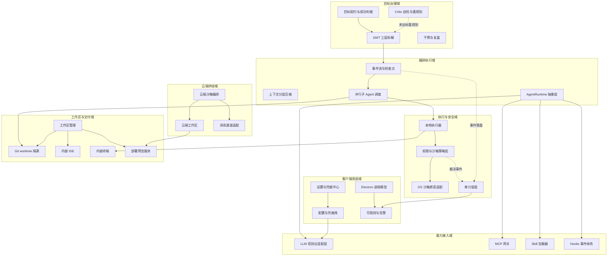

**业务域清单**：

| 业务域 | 核心场景 | 涉及角色 | 与其他业务域的关系 |
| --- | --- | --- | --- |
| 目标治理域 | 目标契约录入与确认 / 成功判据定义 / GMT 三层拆解 / Critic 自检评分 / 干预记录 | 主控台操作者（最终用户 A）、子 Agent 委派与审阅者（最终用户 B） | 下游 编排执行域；消费 编排执行域的事件产出做评分 |
| 编排执行域 | 事件流落盘 / 检查点与恢复 / 上下文分层压缩 / 并行子 Agent 调度与结果归并 / AgentRuntime 抽象 | 最终用户 A、最终用户 B | 上游 目标治理域；下游 执行与安全域、工作区与交付域 |
| 执行与安全域 | 本地 shell / CLI 调用 / 权限审批在环 / OS 沙箱隔离 / 执行与裁决 100% 审计留痕 | 最终用户 A、受影响方：本机环境 | 上游 编排执行域；下游 本机 shell 与文件系统；旁路上报 客户端壳层域 |
| 能力接入域 | LLM 双协议接入与归一化 / MCP client 与 server / Skill 扫描与渐进加载 / Hooks 事件 | 甲方决策者、最终用户 A | 为 编排执行域 供给模型与工具能力；上游依赖两家 LLM Provider、MCP Server、Skill 包 |
| 工作区与交付域 | 工作区创建与切换 / Git worktree 隔离 / 内嵌 IDE / 内嵌终端 / 本地与云端预览 | 最终用户 A、最终用户 B | 上游 编排执行域与执行与安全域；下游 云端供给域（云端预览） |
| 云端供给域 | 云端工作区投射 / 云端沙箱会话编排 / 消息通道外送 | 甲方决策者、受影响方：合规与成本 | 上游 工作区与交付域；Region 待定 · 假定 ap-guangzhou，Q4 补齐前只出接口 |
| 客户端壳层域 | 桌面进程编排 / 设置与凭据中心 / 凭据加密存储 / 日志指标追踪与告警 | 甲方决策者、最终用户 A | 横向支撑全部业务域；不持有业务状态 |

**业务域数量 7 个**（模板要求 3~7 个），与 §3.2 模块划分、§4.2 数据库分组严格一一对应。

### 2.2 领域关系映射

#### 2.2.1 限界上下文清单

| 限界上下文 | 对应业务域 | 域类型 | 覆盖的核心业务实体 | 上下文边界（属于本域 vs 不属于） |
| --- | --- | --- | --- | --- |
| 目标治理 BC | 目标治理域 | **核心域** | 目标契约 / 成功判据 / 约束 / Goal-Milestone-Task / Critic 评分 / 干预记录 | 属于：契约是否可被确认、评分是否达标、重规划与干预的语义；不属于：具体怎么执行某个 Task、工具怎么调用 |
| 编排执行 BC | 编排执行域 | **核心域** | 任务运行 / 执行事件 / 检查点 / 上下文摘要 / 子 Agent 运行 | 属于：事件词表、事件顺序与位点、检查点时机与恢复语义；不属于：目标是否达成（归目标治理）、命令能否执行（归执行与安全） |
| 执行与安全 BC | 执行与安全域 | **核心域** | 工具调用 / 权限裁决 / 命令执行 / 审计事件 | 属于：审批策略与沙箱模式的判定、OS 原语的选择与降级、留痕；不属于：业务上该不该做这个动作（归目标治理） |
| 能力接入 BC | 能力接入域 | **支撑域** | 归一化消息 / 归一化事件 / 工具规格 / MCP 服务绑定 / 技能包 / Hooks | 属于：协议差异的归一化与工具注册；不属于：Agent 何时调用哪个工具（归编排执行） |
| 工作区与交付 BC | 工作区与交付域 | **支撑域** | 工作区 / 工作区副本 / 预览会话 | 属于：工作区根与副本的生命周期、预览端口与回收；不属于：副本里跑什么任务（归编排执行） |
| 云端供给 BC | 云端供给域 | **支撑域** | 云端沙箱会话 / 通道订阅 | 属于：沙箱实例的供给与回收、事件外送适配；不属于：沙箱内跑的业务逻辑（归编排执行） |
| 客户端壳层 BC | 客户端壳层域 | **通用域** | 应用设置 / 凭据引用 / 进程拓扑 / 可观测信号 | 属于：进程编排、配置分层、凭据保护、信号采集；不属于：任何业务语义 |

**域类型说明**：

| 域类型 | 含义 | 投入策略 | 本系统的落点 |
| --- | --- | --- | --- |
| 核心域（Core） | 业务护城河，差异化竞争力所在 | 投入最多资源自研 | 目标治理 BC、编排执行 BC、执行与安全 BC——"目标先契约化再自治执行 + 可续跑 + 可裁决"三项差异点全部落在这三个域，且 11 家标杆中未见同等一等公民能力（调研 §3.2 末段，属推断） |
| 支撑域（Supporting） | 必要但非差异化 | 可自研可外采 | 能力接入 BC（协议侧复用 MCP 官方 TS SDK 与 agentskills.io 标准，归一化与双角色自研）、工作区与交付 BC（复用 VSCodium / xterm.js / node-pty / 本机 git）、云端供给 BC（IC-03 冻结为自建，故必须自研） |
| 通用域（Generic） | 通用能力 | 优先复用 / 外采 | 客户端壳层 BC（复用 Electron、OS 凭据保险箱、OpenTelemetry、pino） |

#### 2.2.2 上下文映射（Context Mapping）

| 关系编号 | 上游上下文 | 下游上下文 | 关系模式 | 同步方式 | 选择理由 |
| --- | --- | --- | --- | --- | --- |
| C-01 | 目标治理 BC | 编排执行 BC | Customer/Supplier | 进程内同步调用 + 事件异步 | 编排引擎必须按契约与判据的形状推进，目标治理侧需按编排反馈调整拆解粒度，属强协作、下游可影响上游迭代节奏 |
| C-02 | 两家 LLM Provider（Anthropic 原生 / OpenAI 兼容） | 能力接入 BC | **ACL 防腐层** | 进程内适配器 + 同步流式 | 两套线协议差异巨大（system 位置、content block、tool_use 形态、流式事件、stop_reason、缓存机制），且外部模型随时演进；必须用 ACL 把外部模型挡在内部消息模型之外，禁止外部 DTO 贯穿到编排层 |
| C-03 | 编排执行 BC + 执行与安全 BC + 客户端壳层 BC | 三方共享 | **Shared Kernel** | 共享 DTO / 枚举 / 常量包 | `EventEnvelope`、`RunStatus`、`PermissionScope`、`TokenUsage`、`traceId` 五个概念若在三个上下文各自定义，事件流与审计留痕会立刻漂移；这一小块共享内核是必要的，且概念稳定 |
| C-04 | MCP 规范（modelcontextprotocol 2025-06-18） | 能力接入 BC | **Conformist** | 直接遵循对方模型 | MCP 已成事实标准，本系统无议价能力也无必要定义私有工具协议（对齐 V7：标准协议接入占比 100%） |
| C-05 | agentskills.io 开放标准 | 能力接入 BC | **Conformist** | 直接遵循对方模型 | 同 C-04；30+ 平台支持，自定义格式无收益（调研 T7 打分 5.00，差值 1.55） |
| C-06 | 编排执行 BC | 客户端壳层 BC + 云端供给 BC（消息通道） | **Published Language** | 事件流事件（封闭词表 + 版本化 Schema） | 主控台 UI、告警、消息通道外送、审计回放四个下游共同消费同一份事件流，必须以标准化事件 Schema 对外发布，而不是各自回调 |
| C-07 | 云端供给 BC | 工作区与交付 BC（预览）与编排执行 BC（沙箱） | **Open Host Service** | 稳定接口 `SandboxProvider` / `PreviewProvider` | 云端实现在 Q4 补齐前不可设计数值（C4 / C7），本地实现先落；以标准接口对外提供服务，使云端实现可后插而不改动消费方（对齐演进纪律） |
| C-08 | 本机操作系统与本机 Git | 执行与安全 BC + 工作区与交付 BC | **ACL 防腐层** | 平台适配层 | macOS Seatbelt / Windows 受限令牌 + AppContainer + Job Object / Linux Landlock + seccomp 三套原语能力不等价（D-05），必须由 ACL 统一成一套策略表达并把降级显式化 |

**关系模式说明**：

| 关系模式 | 适用场景 | 本系统使用处 |
| --- | --- | --- |
| Customer/Supplier | 上下游强协作，下游能影响上游迭代节奏 | C-01 目标治理 → 编排执行 |
| Conformist | 顺从者，下游完全遵循上游模型 | C-04 MCP 规范、C-05 agentskills.io |
| ACL（Anticorruption Layer） | 建一层适配，外部模型变化不影响本域 | C-02 两家 LLM Provider、C-08 本机 OS 与 Git |
| Shared Kernel | 多上下文共享一小块代码 / 模型；维护成本高，慎用 | C-03 事件封套与共享枚举（刻意控制在 5 个概念内） |
| Published Language | 上游以标准协议（事件 / Schema）对外暴露，多下游消费 | C-06 事件流事件 Schema |
| Open Host Service | 上游提供标准 API 接口，类似 Published Language 但通过 RPC | C-07 `SandboxProvider` / `PreviewProvider` |

#### 2.2.3 跨域协作原则

| 原则编号 | 原则 | 在本系统的具体落点 |
| --- | --- | --- |
| P-01 | 核心域 → 支撑域 / 通用域：禁止反向依赖（核心域不依赖支撑域的内部模型） | 编排执行 BC 只依赖 `AgentRuntimePort`（O-40）与 `LlmProtocolAdapter`（O-19）两个接口，不依赖任何具体 SDK 或具体协议的 DTO；更换 SDK 时核心域零改动（对齐 R-05） |
| P-02 | 核心域之间：禁止直接耦合，必须通过事件 / API 解耦 | 目标治理 BC 与执行与安全 BC 之间只通过编排执行 BC 的事件流通信，不允许 Critic 直接读取命令执行细节 |
| P-03 | 对接外部不可控系统：必须建 ACL 防腐层，禁止把外部模型贯穿到本域 | Anthropic / OpenAI 两套线协议的原始响应一律在能力接入 BC 内被 `LlmProtocolAdapter` 转换为 `UnifiedStreamEvent`（O-18）后才可上行；MCP 的工具 Schema 统一转为 `ToolSpec`（O-13）后才可注册 |
| P-04 | 共享内核只放"稳定且必须一致"的概念，且变更须走全上下文评审 | Shared Kernel 仅 5 个概念（事件封套、运行状态、权限作用域、用量、traceId），新增须由三个上下文 Owner 共同确认 |
| P-05 | 云端能力一律经 `Provider` 接口访问，禁止业务代码直接引用云厂商 SDK | 云端沙箱 / 云端工作区 / 云端预览三者全部经 C-07 的两个接口访问；业务层不出现任何云厂商 SDK 的 import |

### 2.3 详细业务架构

#### 2.3.1 用例图

> 体现"角色 — 用例 — 系统边界"。每个一级业务场景一张用例图。

**用例图清单**：

| 编号 | 用例图标题 | 涉及业务域 | 源文件位置 |
| --- | --- | --- | --- |
| UC-01 | 目标契约化与启动执行 | 目标治理域、编排执行域 | `docs/uml/uc-01-goal-contract.puml` |
| UC-02 | 长程任务执行与干预续跑 | 编排执行域、执行与安全域 | `docs/uml/uc-02-run-and-intervene.puml` |
| UC-03 | 并行子 Agent 委派与结果归并 | 编排执行域、工作区与交付域 | `docs/uml/uc-03-sub-agent.puml` |
| UC-04 | 本地执行裁决与凭据管理 | 执行与安全域、能力接入域、客户端壳层域 | `docs/uml/uc-04-policy-and-credential.puml` |
| UC-05 | 交付预览与云端沙箱作业 | 工作区与交付域、云端供给域 | `docs/uml/uc-05-preview-and-sandbox.puml` |

**UC-01 目标契约化与启动执行（用例图本体）**：

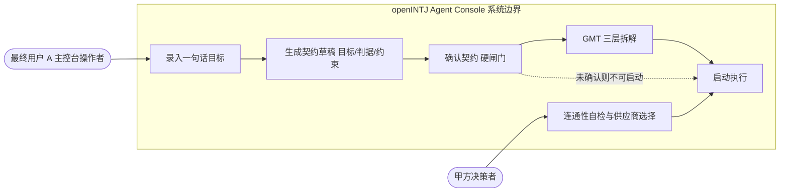

#### 2.3.2 业务流程图

> 关键业务以**角色泳道图**描述核心流程。判定节点必须有明确的分支条件文字标注。

**关键流程清单**（核心业务覆盖度 ≥ 80%：下表 5 条流程覆盖《高层架构设计》§5.3 主链路 8 环节中的 7 个环节与 5 条反馈回路中的 4 条）：

| 流程编号 | 流程名 | 起点 | 终点 | 涉及业务域 | 源文件位置 |
| --- | --- | --- | --- | --- | --- |
| BF-01 | 目标契约化与执行启动 | 用户录入一句话目标 | 首个 Milestone 开始执行 | 目标治理域、编排执行域 | `docs/uml/bf-01.puml` |
| BF-02 | 长程任务执行与检查点恢复 | Milestone 开始执行 | 交付或重规划 | 编排执行域、执行与安全域 | `docs/uml/bf-02.puml` |
| BF-03 | 本地执行权限裁决 | 执行器发起调用请求 | 执行 / 拒绝 / 降级并记录留痕 | 执行与安全域 | `docs/uml/bf-03.puml` |
| BF-04 | 并行子 Agent 派发与归并 | 编排引擎派发子任务 | 变更集合并或冲突上报 | 编排执行域、工作区与交付域 | `docs/uml/bf-04.puml` |
| BF-05 | 交付预览与生命周期回收 | 用户点击预览 | 预览进程数归零 | 工作区与交付域、云端供给域 | `docs/uml/bf-05.puml` |

**BF-01 目标契约化与执行启动（角色泳道图）**：

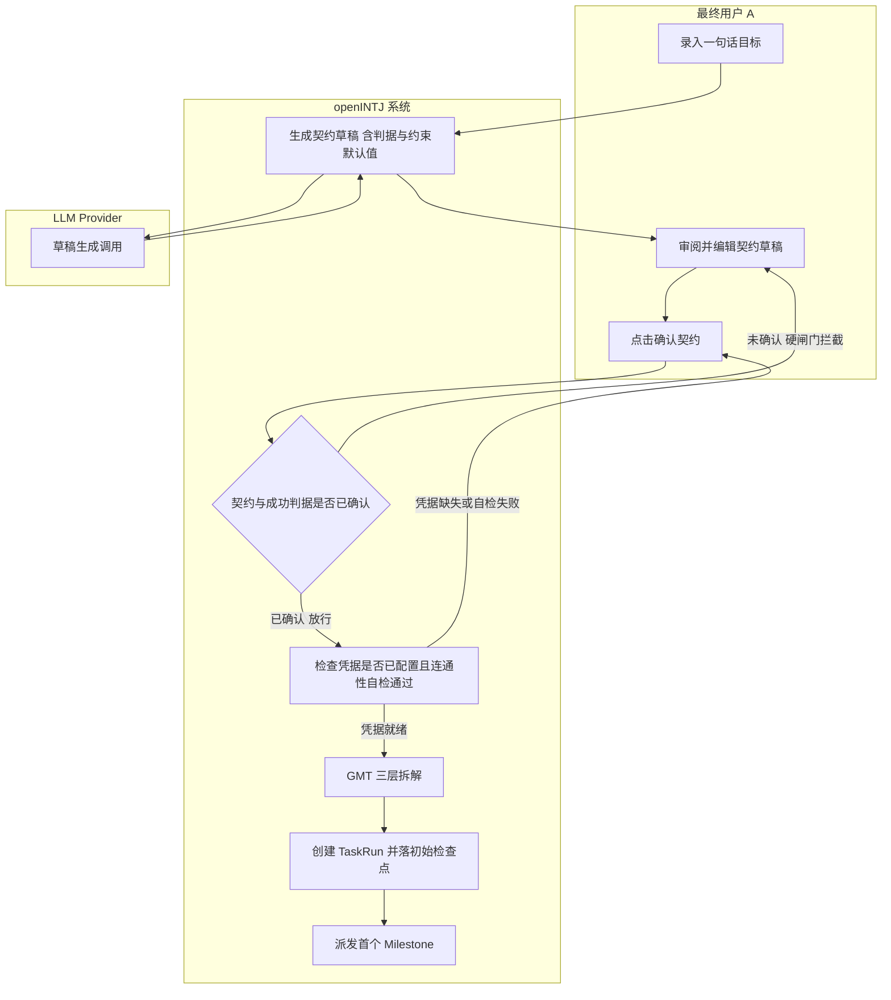

**BF-03 本地执行权限裁决（角色泳道图，含 Windows 降级明示）**：

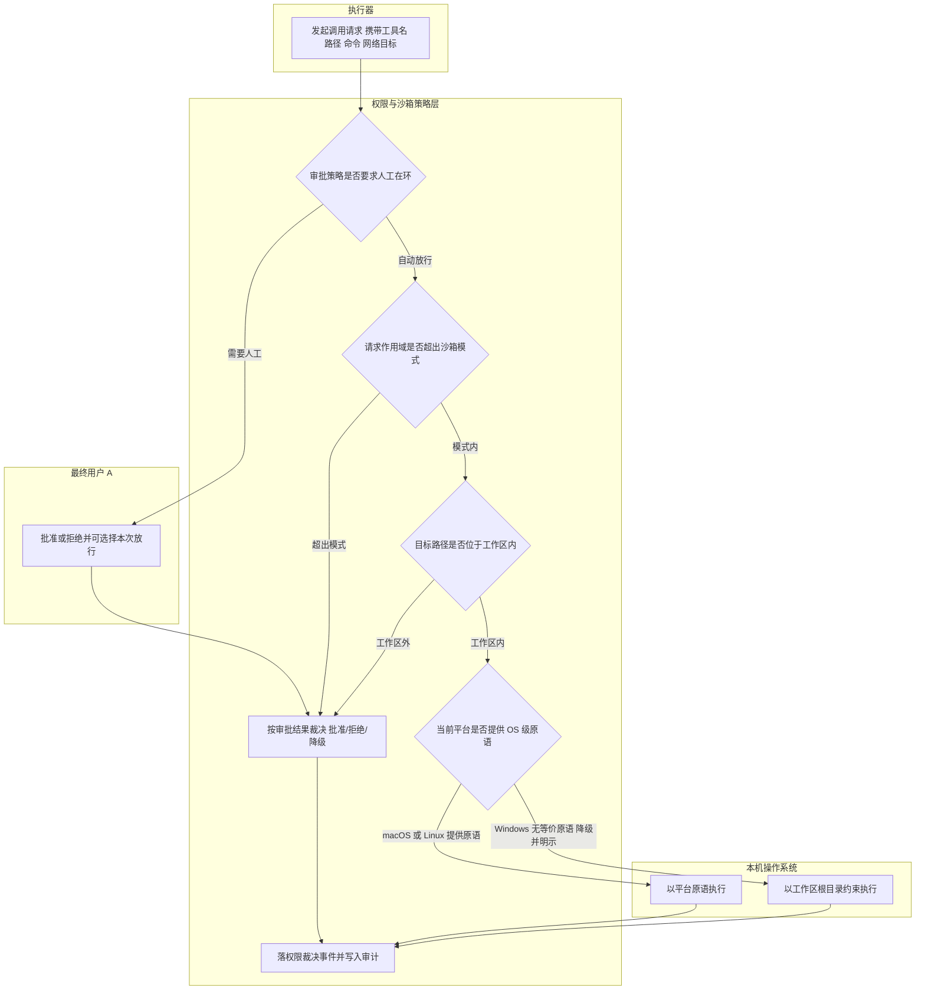

### 2.4 业务范围与边界

> **本节回答**：本期到底要做哪些功能、不做哪些功能，避免"边界蔓延"。

#### 2.4.1 功能模块清单

> **编号说明**：本表**直接承接《高层架构设计》§6.3 功能清单的 F 编号空间**（F1 ~ F39），不另建编号，以消除跨文档引用歧义。实现状态列中凡标注 `[MOCK]` 或 `[简化]` 的，均附完整版替换路径；凡标注「接口先行」的，指 Q4 未补齐前只交付接口与抽象、不交付数值。

| 编号 | 一级功能名 | 子功能描述 | 对应业务域 | 实现状态 |
| --- | --- | --- | --- | --- |
| F1 | 目标契约面板 | 目标契约录入与确认，含 IC-07 硬闸门 | 目标治理域 | 完整实现 |
| F2 | 目标契约面板 | 成功判据定义，作为 Critic 评分基准 | 目标治理域 | 完整实现 |
| F3 | 目标契约面板 | 约束声明（禁改目录 / 禁网 / 预算上限 / 可用工具集） | 目标治理域 | 完整实现 |
| F4 | 目标拆解引擎 | Goal-Milestone-Task 三层自动拆解 | 目标治理域 | 完整实现 |
| F5 | 编排引擎 | 事件流落盘（Action / Observation 封闭词表） | 编排执行域 | 完整实现 |
| F6 | 编排引擎 | 检查点与恢复，Milestone 边界与关键节点强制落点 | 编排执行域 | 完整实现 |
| F7 | 编排引擎 | 上下文分层压缩（近期原始事件 + 远期摘要） | 编排执行域 | 完整实现 |
| F8 | Critic 自检与重规划 | 里程碑级 Critic 评分 | 目标治理域 | 完整实现 |
| F9 | Critic 自检与重规划 | 未达标自动重规划并从最近检查点续跑 | 目标治理域 | 完整实现 |
| F10 | Critic 自检与重规划 | 干预记录与人工重规划入口 | 目标治理域 | 完整实现 |
| F11 | 子 Agent 调度器 | 并行子 Agent 集群，各自绑定独立工作区副本 | 编排执行域 | 完整实现 |
| F12 | 子 Agent 调度器 | 子 Agent 结果归并，含变更集冲突检测 | 编排执行域 | 完整实现 |
| F13 | 工作区管理 | 本地工作区创建与切换、Git 仓库绑定 | 工作区与交付域 | 完整实现 |
| F14 | 工作区管理 | Git worktree 隔离（非 Git 仓库降级为目录副本） | 工作区与交付域 | 完整实现（含降级分支） |
| F15 | 执行器 | shell / CLI 调用，经策略层裁决后执行 | 执行与安全域 | 完整实现 |
| F16 | 执行器 | 应用程序唤起与生命周期回收 | 执行与安全域 | ❌ 完整版（F16 在 G3 §6.3 标为完整版） |
| F17 | 权限与沙箱策略层 | 审批在环 + 命令白名单双轴权限 | 执行与安全域 | 完整实现 |
| F18 | 权限与沙箱策略层 | macOS Seatbelt / Linux Landlock + seccomp | 执行与安全域 | 完整实现 |
| F19 | 权限与沙箱策略层 | Windows OS 级隔离 | 执行与安全域 | ❌ 不做（高层架构 §6.1 O1）；降级为审批 + 白名单 + 工作区根目录约束，并在 UI 明示 |
| F20 | LLM 双协议适配层 | Anthropic 原生协议接入（原生实现后归一化） | 能力接入域 | 完整实现 |
| F21 | LLM 双协议适配层 | OpenAI 兼容协议接入（原生实现后归一化） | 能力接入域 | 完整实现 |
| F22 | 设置与凭据中心 | 供应商选择 / 协议切换 / API Key 管理 / 连通性自检 | 客户端壳层域 | 完整实现 |
| F23 | MCP 网关 | MCP client，stdio + Streamable HTTP（保留旧 SSE 兼容探测） | 能力接入域 | 完整实现 |
| F24 | MCP 网关 | MCP server（对外暴露能力） | 能力接入域 | ❌ 完整版 |
| F25 | Skill 加载器 | SKILL.md 扫描与渐进加载 | 能力接入域 | 完整实现 |
| F26 | Skill 加载器 | 用户自定义 Skill 创建 | 能力接入域 | ❌ 完整版 |
| F27 | 内嵌 IDE | VSCodium 启动 / 打开 / 聚焦 / 工作区同步 | 工作区与交付域 | 完整实现（最小集成） |
| F28 | 内嵌 IDE | Open VSX 扩展安装与管理，含缺失扩展替代建议 | 工作区与交付域 | 完整实现 |
| F29 | 内嵌终端 | xterm.js + node-pty 终端面板，命令执行前经策略层裁决 | 工作区与交付域 | 完整实现 |
| F30 | 预览服务 | 本地 preview server 与端口管理，任务结束自动回收 | 工作区与交付域 | 完整实现 |
| F31 | 预览服务 | 云端 ephemeral preview（泛域名证书 + 临时反代 + 自动回收） | 云端供给域 | 接口先行 + 实现待 Q4（数值不出） |
| F32 | 审计与日志 | 执行轨迹回放（事件时间轴） | 执行与安全域 | 完整实现 |
| F33 | 审计与日志 | 成本归因报表 | 客户端壳层域 | ❌ 完整版 |
| F34 | 工作区管理 | 云端工作区，与本地共用同一套工作区抽象 | 云端供给域 | 接口先行 + 实现待 Q4（数值不出） |
| F35 | 云端沙箱编排 | 镜像与快照 SB-01 + 预热池 SB-02 + 实例回收 SB-03 | 云端供给域 | 接口先行 + 实现待 Q4（数值不出） |
| F36 | 云端沙箱编排 | 网络策略 SB-04（默认禁网 + 按需白名单 + 租户隔离） | 云端供给域 | 接口先行 + 实现待 Q4（数值不出） |
| F37 | 云端沙箱编排 | 配额与成本模型 SB-05（阈值在 Q4 补齐后填入） | 云端供给域 | 接口先行（**仅接口，阈值一律不出数值**） |
| F38 | 云端沙箱编排 | 多租户隔离 SB-06（隔离原语待 U-05 核实后定） | 云端供给域 | 接口先行（隔离原语待 U-05） |
| F39 | 消息通道 | 统一 Channel Adapter（Webhook + IM Bot + MQ 事件归一化） | 云端供给域 | 完整实现 Webhook 适配器；IM Bot 与 MQ 适配器待 Q5 确认后补 |
| N1 | 客户端基线 | 冷启动到可交互 P95 ≤ 3 秒、空闲内存 ≤ 300MB | 客户端壳层域 | 完整实现（含 R-09 四条优化方向） |
| N2 | 模型接入基线 | 双协议并行直连真实大模型 API，模型层不接 Mock | 能力接入域 | 完整实现（硬约束） |
| N3 | 审计基线 | 事件流全量落盘，执行与权限裁决 100% 审计留痕 | 执行与安全域 | 完整实现 |

**编号规则**：

| 规则项 | 取值 |
| --- | --- |
| 一级编号 | 沿用《高层架构设计》§6.3 的 `F1 ~ F39` 与 §6.1 的 `N1 ~ N3`；本文档不新增 F 编号 |
| 子功能编号 | 沿用上游，互不重叠 |
| 降级 / 简化标注 | F14 标注降级分支；F19 标注不做并给出降级替代；F31 / F34 ~ F38 标注「接口先行」并注明解锁条件 |
| Mock 标注 | **全文无 `[MOCK]` 条目**——N2 明确模型层不接 Mock，任何模型调用均为真实链路 |

**In-Scope（本期必做，直接承接高层架构 §6.1，共 15 条）**：

| 编号 | 本期必做的事项 |
| --- | --- |
| 高层架构 §6.1 In-Scope S1 | 目标契约工作台：契约 / 判据 / 约束录入与确认 + GMT 三层拆解 |
| 高层架构 §6.1 In-Scope S2 | 主控台与长程任务编排：Screen A 八模块 + 事件流与检查点 + Critic 自检与重规划 + 干预记录 |
| 高层架构 §6.1 In-Scope S3 | 并行子 Agent 集群调度与结果归并 |
| 高层架构 §6.1 In-Scope S4 | 本地工作区管理与 Git worktree 隔离 |
| 高层架构 §6.1 In-Scope S5 | 本地执行器 + 权限与沙箱策略层；Windows 降级为审批 + 白名单 + 工作区根目录约束 |
| 高层架构 §6.1 In-Scope S6 | 内嵌 IDE：VSCodium + Open VSX 最小集成 |
| 高层架构 §6.1 In-Scope S7 | 内嵌终端：xterm.js + node-pty |
| 高层架构 §6.1 In-Scope S8 | MCP 标准协议：client 与 server 双角色，stdio + Streamable HTTP |
| 高层架构 §6.1 In-Scope S9 | Skill 标准协议：agentskills.io 开放标准 |
| 高层架构 §6.1 In-Scope S10 | 部署、测试与预览服务：本地 preview server + 云端 ephemeral preview 双轨 |
| 高层架构 §6.1 In-Scope S11 | 云端工作区：自建于腾讯云 CVM / COS / VPC / CAM |
| 高层架构 §6.1 In-Scope S12 | 云端沙箱与消息通道：自建沙箱编排层（SB-01 ~ SB-06）+ 统一 Channel Adapter |
| 高层架构 §6.1 In-Scope N1 | 桌面客户端基线：冷启动 P95 ≤ 3 秒、空闲内存 ≤ 300MB |
| 高层架构 §6.1 In-Scope N2 | 双协议并行直连真实大模型 API，模型层不接 Mock |
| 高层架构 §6.1 In-Scope N3 | 事件流全量落盘，执行与权限裁决 100% 审计留痕 |

**Out-of-Scope（本期不做，直接承接高层架构 §6.1，共 6 条）**：

| 编号 | 不做的事项 | 不做的原因 | 未来归属 |
| --- | --- | --- | --- |
| 高层架构 §6.1 O1 | Windows 平台 OS 级本地沙箱 | Windows 原生沙箱为实验特性，已知无法阻止 world-writable 目录写入（调研 R-04） | 后续演进（完整版评估 WSL2 补充隔离层，须先确认 Q8 / U-07） |
| 高层架构 §6.1 O2 | 微软专有扩展能力（C/C++、C# Dev Kit、Remote 系列） | IC-02 冻结为内嵌 VSCodium + Open VSX，微软市场条款不允许再分发 | 部分由开源替代（clangd / BasedPyright / Open Remote 系列）+ 部分永不做（C# Dev Kit） |
| 高层架构 §6.1 O3 | 面向团队协作的多租户产品能力 | 14 项能力原子不含团队协作与席位；云端沙箱的多租户隔离属沙箱层资源隔离，不是产品能力 | 不做（本产品为个人与小团队单机工作台） |
| 高层架构 §6.1 O4 | 自研 LLM、模型训练与模型托管 | 用户明确要求直连真实大模型 API（D2 §2.2） | 不做（由 LLM Provider 承担） |
| 高层架构 §6.1 O5 | Web 端形态与浏览器访问 | X1 已裁决桌面客户端 | 不做 |
| 高层架构 §6.1 O6 | 移动端 / 远程访问形态 | 用户原话仅覆盖 Windows 与 macOS 桌面端（D2 §2.1） | 不做 |

### 2.5 质量与柔性可用

#### 2.5.1 服务质量目标

> 按 ISO 25010 选出本系统**最重要的 5 个**质量目标（已排序），并落到可验证场景。

**质量目标 Top 5**：

| 优先级 | 质量目标 | 业务驱动 | 受影响的关键章节 |
| --- | --- | --- | --- |
| Q1 | 可靠性：任意检查点可恢复，恢复后重放步数 ≤ 5 步（高层架构 V1） | 痛点 P1 长程任务跑偏且中断即前功尽弃 | §3.2.M2 编排引擎、§3.2.M3 子 Agent 调度器、§4.2 t_checkpoint、§8.4 告警 |
| Q2 | 安全性：本地执行与权限裁决 100% 经策略层且 100% 留痕（高层架构 V2 + N3） | 痛点 P2 本地执行越权；§2.1「受影响方：本机环境」Top1 关心点 | §3.2.M10 执行与安全、§3.2.M5 Hooks、§4.2 t_permission_decision / t_audit_event、§7 |
| Q3 | 性能效率：冷启动到可交互 P95 ≤ 3 秒、空闲内存 ≤ 300MB、执行流呈现 P95 ≤ 500ms（高层架构 V6 / N1） | 痛点 P6 桌面壳层资源代价，用户已在 IC-01 中接受该代价并转为验收指标 | §3.1.1 进程模型、§3.1.5 技术选型、§5.3 SLA、§8.1 客户端资源大盘 |
| Q4 | 成本效率：单任务上下文 token 峰值较全量事件回放下降 ≥ 60%（高层架构 V5） | 痛点 P5；甲方决策者 Top1 关心点「单次长程任务花费可预测、可中途熔断」 | §3.2.M2 上下文分层压缩、§3.2.M7 缓存策略、§8.1 模型调用与成本大盘、§8.4 预算熔断告警 |
| Q5 | 可维护性：AgentRuntime 抽象层之上更换模型 SDK 的成本上限 ≤ 5 人日（调研 R-05 的量化表达） | 痛点 P7 与 R-05；双协议与 14 项能力原子属长周期工程 | §3.2.M4 AgentRuntime 抽象层、§3.1.4 工程结构、§7.2.5 |

**可验证质量场景**（参考 SEI ATAM 方法）：

| 场景编号 | 关联目标 | 触发源 | 触发条件 | 期望响应 | 度量指标 |
| --- | --- | --- | --- | --- | --- |
| QS-01 | Q1 | 进程崩溃 / 用户中断 / 断电 | 任务运行在任意 Milestone 中途被终止 | 从最近检查点恢复，恢复后重放步数 ≤ 5 步，恢复成功率 100% | 重放步数中位数 ≤ 5；恢复成功率 = 100% |
| QS-02 | Q2 | 执行器发起越权写入 | Agent 请求写入工作区根目录之外的路径 | 默认拒绝并弹出授权确认，同时落一条权限裁决事件与一条审计事件 | 拦截与留痕完整率 = 100%；工作区外默认拒绝率 = 100% |
| QS-03 | Q3 | 用户双击启动客户端 | 冷启动（进程不存在、磁盘缓存已预热过一次） | 3 秒内到达可交互状态；空闲 5 分钟后常驻内存 ≤ 300MB | 冷启动 P95 ≤ 3 秒；空闲内存 ≤ 300MB |
| QS-04 | Q4 | 长程任务累计事件 | 累计 prompt token 达到模型上下文窗口的 60% | 自动触发分层压缩，并在 Milestone 边界强制落检查点 | token 峰值较全量回放下降 ≥ 60%；压缩后任务不中断 |
| QS-05 | Q5 | 技术栈演进 | 需把模型调用层从当前 SDK 换成另一 SDK | 仅替换 `AgentRuntimePort` 的模型调用实现，编排 / 工具 / 权限 / 事件流零改动 | 改动文件数 ≤ 3 个包内文件；总成本 ≤ 5 人日 |
| QS-06 | Q3 | 执行中高频事件 | 单次任务每秒产生 50 条事件并持续 60 秒 | 执行流从事件产生到 UI 呈现 P95 ≤ 500ms，UI 主线程不掉帧 | 呈现 P95 ≤ 500ms；渲染进程长任务（> 50ms）次数 = 0 |

#### 2.5.2 业务柔性可用策略

> 故障态下"保住什么、放弃什么"的取舍清单。核心业务永不降级；外围功能优先牺牲；用户感知必须显式可控。

**业务功能优先级分层**（§2.4.1 中每个一级功能均显式标注一个层级）：

| 层级 | 含义 | 故障态下的处置方向 | 用户感知 | 本系统落点（一级功能） |
| --- | --- | --- | --- | --- |
| L0 核心业务 | 系统的生命线，挂掉等于业务停摆 | 不降级；优先消耗所有资源保障 | 无 / 极轻微 | F1 ~ F7（契约、拆解、事件流、检查点、上下文压缩）、F17 ~ F18（权限与沙箱）、F20 ~ F21（双协议）、N1 ~ N3 |
| L1 重要业务 | 不影响主链路但用户高频使用 | 限流 + 排队 + 异步化 | 变慢 / 排队提示 | F8 ~ F12（Critic 评分、重规划、干预、并行子 Agent）、F15（shell 调用）、F25 / F29（Skill / 终端） |
| L2 辅助业务 | 提升体验但非必要 | 关闭 / 返回兜底数据 | 部分功能不可用 + 友好提示 | F13 ~ F14（工作区创建与 worktree）、F23（MCP client）、F27 ~ F28（内嵌 IDE）、F30（本地预览）、F32（轨迹回放） |
| L3 附加业务 | 长尾 / 数据类 / 统计类 | 直接关闭 + 异步补偿 | 通常无感 | F31 / F34 ~ F38（云端三项，接口先行且 Q4 阻塞）、F39（消息通道外送）、F16（应用唤起） |

L0 一级功能共 16 项，占 §2.4.1 一级功能总数 39 项的 41%。**说明**：模板要求 L0 数量 ≤ 总功能数的 30%，本系统 L0 占比达 41%，原因是 N2（模型层不接 Mock）与 N3（100% 审计留痕）为不可降级的合规与承诺基线，且 F17 / F18 直接承担《高层架构设计》§6.6 C1 与 C8 两条对外承诺——**该偏离为有意保留，不在本文档擅自下调**，请 G4 人工审核确认。

**业务降级清单**：

| 编号 | 关联功能 | 触发条件 | 降级动作 | 用户感知 | 决策类型 |
| --- | --- | --- | --- | --- | --- |
| BD-01 | F15 本地 shell / CLI 调用 | 权限与沙箱策略层不可用或超时（连续 3 次裁决超时） | 转为"全部转人工审批"，不再自动放行 | "需要你逐条确认命令，执行会慢一些" | 自动 |
| BD-02 | F18 macOS / Linux OS 级沙箱 | 当前平台不支持对应原语（如老版本 macOS 或内核未开启 Landlock） | 降级为审批在环 + 命令白名单 + 工作区根目录约束，并在 UI 明示隔离强度下降 | "当前系统不支持系统级隔离，已改用执行前确认来保障安全" | 自动 |
| BD-03 | F19 Windows OS 级隔离 | Windows 平台恒等触发（高层架构 §6.1 O1） | 恒等降级为审批 + 白名单 + 工作区根目录约束，UI 与文档明示弱于 macOS | "在 Windows 上，隔离强度弱于 macOS，我们会在每次执行前请你确认" | 自动（出厂即生效，非故障降级） |
| BD-04 | F7 上下文分层压缩 | 压缩用的辅助模型调用连续失败 3 次 | 退化为规则压缩（按事件类型保留最近 N 条 + 丢弃远期冗余观察），不阻塞主链路 | "长任务已进入省流量模式，早期步骤会被精简" | 自动 |
| BD-05 | F8 Critic 自检 | 评分调用超时或失败 | 跳过本轮自动评分，标记该 Milestone 为"待人工评审"，任务继续执行下一 Milestone | "这一步的自动评分没跑完，已交给你人工评审" | 自动 |
| BD-06 | F11 并行子 Agent | 本机内存水位 > 85% 或 CPU 持续 > 90% 达 60 秒 | 并行度自动下调至 1，排队执行 | "机器负载较高，已改为逐个执行" | 自动 |
| BD-07 | F30 / F31 预览服务 | 端口分配失败或云端预览创建超时 | 本地预览切换端口重试 1 次；云端预览转异步创建并提示等待 | "预览正在准备，稍后会自动打开" | 自动 |
| BD-08 | F39 消息通道外送 | 外部通道不可达 | 事件转本地持久化队列，恢复后补送（至少一次送达） | "外部通知暂时发不出去，恢复后会补发" | 自动 |
| BD-09 | F23 MCP client | 某个 MCP server 连续 3 次调用失败 | 摘除该 server 的工具注册，保留其余 server | "某个外部工具暂时不可用，已从可用工具中移除" | 自动 |
| BD-10 | F20 / F21 模型调用 | 单任务累计花费达到用户设定的预算上限 | 触发预算熔断，暂停执行并提示用户选择续跑或终止 | "已达到你设定的花费上限，任务已暂停等你决定" | 自动（阈值由用户在契约中设定，属用户决策） |
| BD-11 | F27 内嵌 IDE | VSCodium 子进程启动失败或超时 10 秒 | 禁用 IDE 面板，保留终端与执行流，并在面板内给出重试入口 | "代码面板暂时打不开，其他功能不受影响" | 自动 |
| BD-12 | F34 ~ F38 云端三项 | Q4 未补齐或云账号不可用 | 云端入口置灰并说明原因，本地链路照常 | "云端功能需要你先完成云账号配置" | 手动（由用户在设置与凭据中心完成配置后解锁） |

**用户感知列说明**：全部 12 条降级的用户感知均以用户视角措辞表达，未使用熔断 / 兜底 / 降级等技术词。

---

## 3. 应用架构

> **本章回答**：系统由哪些模块组成、模块与外部系统怎么集成、每个模块的内部交互链路是什么。
> **本章是系统设计的核心**。

### 3.1 应用架构概览

#### 3.1.1 系统上下文

本系统作为**中心节点**，周围辐射出"用户角色 + 外部业务系统 + 上游 / 下游平台"关系。

**系统上下文要素清单**：

| 节点类型 | 节点名 | 与本系统的关系 | 关系语义 |
| --- | --- | --- | --- |
| 角色 | 甲方决策者（本人 / 自付 API 费用者） | 使用 | 配置供应商与协议、设定预算上限、审阅成本与干预分布 |
| 角色 | 最终用户 A（主控台操作者） | 使用 | 下达目标、审阅契约、干预与验收 |
| 角色 | 最终用户 B（子 Agent 委派与审阅者） | 使用 | 派发子任务、审阅 Critic 评分趋势、批准干预 |
| 角色 | 受影响方：本机环境 | 被影响 | 文件系统 / 进程 / 已安装应用 / 凭据被 Agent 调用 |
| 角色 | 受影响方：合规与成本 | 被影响 | 审计执行轨迹、轮换凭据、审阅沙箱出网策略 |
| 上游平台 | E-01 Anthropic Messages API | 本系统 → 调用 | 消息推理 / 工具调用 / 流式返回（Anthropic 原生协议） |
| 上游平台 | E-02 OpenAI 兼容 Chat Completions API | 本系统 → 调用 | 同上（OpenAI 兼容协议） |
| 外部业务系统 | E-03 MCP Server | 双向 | 消费其工具与资源；本系统亦以 MCP server 角色对外暴露（F24，完整版） |
| 外部业务系统 | E-04 Skill 包仓库 | 消费 → 本系统 | 扫描并渐进加载能力扩展 |
| 上游平台 | E-05 Open VSX 扩展源 | 本系统 → 调用 | 内嵌 IDE 的扩展安装 |
| 上游平台 | E-06 VSCodium 二进制 | 内嵌 + 双向 IPC | IDE 内核与工作区同步 |
| 下游平台 | E-07 本机 shell / CLI / 应用程序 | 本系统 → 调用 | 命令执行与进程管理，必经策略层裁决 |
| 下游平台 | E-08 本机文件系统 | 双向 | 默认限工作区内；工作区外写入需显式授权并留痕 |
| 下游平台 | E-09 腾讯云 CVM / COS / VPC / CAM | 本系统 → 调用 | 云端工作区与沙箱供给（Region 待定 · 假定 ap-guangzhou） |
| 下游平台 | E-10 外部消息通道（Webhook / IM Bot / MQ） | 本系统 → 推送 | 任务事件外送 |
| 下游平台 | E-12 本机 Git | 本系统 → 调用 | worktree 隔离与变更集 |
| 外部业务系统 | E-11 桌面分发与更新通道 | 消费 → 本系统 | 差分更新包分发（对齐 R-09 第四条优化方向） |

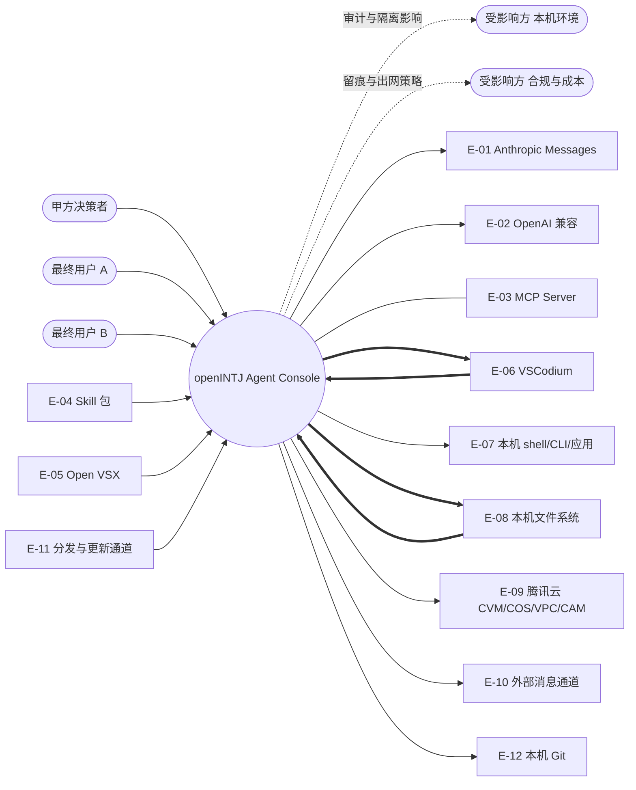

##### 3.1.1.1 进程模型（承接调研 D-01）

> IC-01 冻结 Electron 后，进程模型是第一层设计约束。本小节是全章其余部分的前置基线。

**进程清单与职责**：

| 进程编号 | 进程类型 | 承载内容 | 崩溃影响面 | 是否常驻 |
| --- | --- | --- | --- | --- |
| P-01 | Electron 主进程 | 应用生命周期、窗口与 `WebContentsView` 管理、原生模块宿主登记、`safeStorage` 凭据访问、IPC 路由与通道白名单、自动更新、进程监护与重启 | 整个客户端不可用 | 是 |
| P-02 | Electron 渲染进程 | React UI：Screen A 主控台、Screen B 目标契约、设置与凭据中心、内嵌工作台面板、预览面板；`contextIsolation = true`、`nodeIntegration = false`、CSP 锁定 | 仅 UI 不可用，P-03 任务继续跑 | 是 |
| P-03 | Utility Process：`agent-host` | **Agent 主循环所在**：AgentRuntime 抽象层实例、编排引擎、事件流写入、检查点生成、上下文压缩、Critic 调度、LLM 调用（经 E-01 / E-02） | 当前任务中断，可从最近检查点恢复；UI 与其他进程不受影响 | 是（首个任务启动时按需拉起） |
| P-04 | Utility Process：`tool-host` | `node-pty` 终端与命令执行、`better-sqlite3` 事件库写入、MCP stdio 子进程托管、本地预览子进程托管、Git CLI 调用 | 工具执行中断，Agent 主循环存活并可降级重试 | 按需 |
| P-05 | VSCodium 子进程 | 内嵌 IDE workbench，与 P-01 通过 stdio + IPC 桥接，UI 由 `WebContentsView` 呈现 | IDE 面板不可用（BD-11） | 按需（懒加载） |
| P-06 | MCP Server 子进程 | 由 P-04 以 stdio 拉起的外部 MCP server，生命周期由 MCP 网关管理 | 该 server 工具被摘除（BD-09） | 按需 |
| P-07 | 本地预览子进程 | 用户项目进程（如 dev server），只绑定回环地址 | 预览不可用（BD-07） | 按需 |

**Agent 主循环为什么放在 P-03 Utility Process**（四项理由）：

1. **长跑不阻塞 UI**：Agent 主循环是同步流式 + 工具等待的长周期循环，放在渲染进程会阻塞 UI 线程并直接违反 QS-06（渲染进程长任务次数 = 0）；放在主进程则会拖慢窗口响应与 IPC 路由。
2. **崩溃隔离与可恢复**：Utility Process 崩溃不会带走 UI 与已落盘的事件流；P-01 监听到退出后按最近检查点重启 P-03 并续跑，直接支撑 QS-01。
3. **Node 原生能力可用**：Utility Process 具备完整 Node 运行时，可加载 `better-sqlite3` 等原生模块，无需绕道主进程做 IPC 转发，事件落盘路径最短。
4. **资源限额可控**：可对 P-03 单独设置内存与 CPU 限额，避免长程任务的上下文膨胀拖垮整机。

**进程拓扑图**：

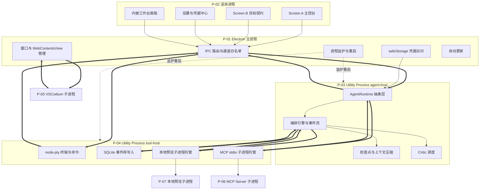

**IPC 通道约定**：

| 通道 | 方向 | 机制 | 载荷上限 | 说明 |
| --- | --- | --- | --- | --- |
| 渲染 ↔ 主 | 双向 | `ipcRenderer.invoke` + `contextBridge` 暴露的 `openintj.*` 白名单 API | 单条 ≤ 2MB，超限时改用 `MessagePort` 分片 | 渲染进程无任何 Node 能力，通道名即 §3.2 的接口路径 |
| 主 ↔ P-03 / P-04 | 双向 | `utilityProcess` + `MessageChannelMain` 建立 `MessagePort` | 分片传输，单帧 ≤ 8MB | 结构化克隆，禁止传递函数与原生句柄 |
| 事件流推送 | P-03 → 主 → 渲染 | 订阅式 `MessagePort` + 渲染侧节流（合并窗口 50ms） | 峰值 50 条/秒 | 保障 QS-06：呈现 P95 ≤ 500ms |
| 主 ↔ P-05 | 双向 | stdio 行协议 + `WebContentsView` 呈现 | — | 工作区路径与 P-03 保持一致 |
| P-04 ↔ P-06 | 双向 | MCP stdio（JSON-RPC 行协议） | — | 2025-06-18 规范 |

**原生模块与打包约束（承接调研 R-07）**：

| 约束项 | 取值 |
| --- | --- |
| 需重建 ABI 的原生模块 | `node-pty`、`better-sqlite3`（二者均为 C++ 原生模块） |
| 重建工具 | `@electron/rebuild`，以 `ELECTRON_VERSION` 断言，构建期校验 `process.versions.modules` 一致，不一致即 fail-fast |
| asar unpack 规则 | `**/*.node`、`**/node_modules/node-pty/build/Release/spawn-helper*`、`**/node_modules/better-sqlite3/**`、`vendor/vscodium/**` |
| 打包工具 | Electron Forge（内置 asar 与 unpack 配置）+ `electron-builder` 产出平台安装包 |
| 三平台冒烟 | CI 对 Windows / macOS / Linux 分别构建，冒烟项含：pty 可 spawn、SQLite 可写、VSCodium 子进程可启动 |

**冷启动与常驻基线（承接调研 R-09 的四条优化方向，对齐 N1 / Q3）**：

| 优化方向 | 本系统落点 | 验收口径 |
| --- | --- | --- |
| 一、按需加载与延迟初始化 | P-05 VSCodium、P-04 `tool-host`、P-07 预览子进程一律按需拉起；P-03 `agent-host` 在首个任务启动时才初始化；Screen A 的非首屏模块（成本、审计回放）走路由级懒加载 | 首屏 JS 体积预算 ≤ 2MB；冷启动链路不加载原生工具进程 |
| 二、VSCodium 二进制与语言包裁剪懒加载 | `vendor/vscodium` 只保留运行必需的内核与本项目目标语言的基础扩展；语言包与内置扩展按工作区语言按需下载；不在冷启动路径上解压 | 冷启动路径不触碰 VSCodium 资源；首次打开 IDE 面板时才解压 |
| 三、关闭不必要的 Electron 特性并对渲染进程设资源限额 | 关闭未使用的 Chromium 特性；渲染进程设 `--js-flags` 老生代上限与后台节流策略；P-03 / P-04 设内存软限额；`contextIsolation = true` + CSP 锁定 | 空闲内存 ≤ 300MB；P-03 内存超限触发上下文压缩而非整机 OOM |
| 四、安装器差分更新 | 采用差分更新通道（blockmap 差分包），仅下载变更块 | 小版本更新包体积显著小于全量包；失败时可回退全量包 |

#### 3.1.2 系统模块图

- 分层架构图，每一层标出关键组件与协议方向
- **接入层**：主控台 / 目标契约面板 / 指令输入 / 内嵌 IDE / 内嵌终端 / 设置与凭据中心
- **应用层**：覆盖业务模块全景（M1 ~ M15）
- **中间件层**：本地 SQLite 事件库、进程内事件总线、OS 凭据保险箱、本地文件系统、可观测采集（C-01 ~ C-04、C-09 ~ C-11）
- **集成对接层**：两家 LLM Provider、MCP Server、Skill 包、Open VSX、VSCodium、本机 shell / 文件系统 / Git、腾讯云、外部消息通道（E-01 ~ E-12）

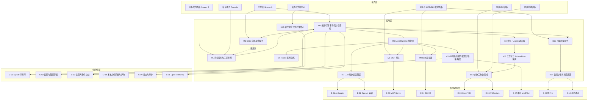

**分层组件清单**：

| 层次 | 内容 | 数据来源 |
| --- | --- | --- |
| 接入层 | 主控台（Screen A 八模块）、目标契约面板（Screen B 七模块）、指令输入、设置与凭据中心、内嵌 IDE 面板、内嵌终端面板、预览与 MCP/Skill 管理面板 | 《高层架构设计》§6.2 接入层 6 模块 + §6.5 的第二触点端；Screen A/B 模块清单来自 D3 §3.2 / §3.3 |
| 应用层 | M1 ~ M15 共 15 个模块，与 §3.2 一一对应 | 《高层架构设计》§6.2 业务能力层 10 模块 + 基础能力层 6 模块，按系统设计粒度重划 |
| 中间件层 | C-01 SQLite 事件库、C-02 设置与配置存储、C-03 进程内事件总线、C-04 本地文件系统与产物、C-09 日志与审计、C-11 OpenTelemetry | §3.1.3 云组件清单 |
| 集成对接层 | E-01 ~ E-12 全部外部依赖 | §3.1.3 外部依赖清单 |

#### 3.1.3 集成架构

> **核心区分**：**外部依赖（E-xx）** = 跟别人协作，本系统通过 API / SDK / 消息与之集成的业务系统、第三方平台、内部友邻系统；**云组件（C-xx）** = 自己用的资源，本系统运行所需的中间件与云资源。

##### 外部依赖清单

| ID | 外部系统 | 归属团队 / 供应商 | 类别 | 使用方式 | 集成方式 | 协议 / 版本 | 功能定位（≤ 30 字） | 联系人 |
| --- | --- | --- | --- | --- | --- | --- | --- | --- |
| E-01 | Anthropic Messages API | Anthropic | 第三方业务平台 | 消费 | HTTPS + SSE 流式 | Anthropic Messages 原生协议，`anthropic-version: 2023-06-01` | Anthropic 原生协议推理与工具调用 | `@架构` |
| E-02 | OpenAI 兼容 Chat Completions API | 用户在设置与凭据中心自填的兼容供应商 | 第三方业务平台 | 消费 | HTTPS + SSE 流式 | OpenAI Chat Completions 兼容协议 | OpenAI 兼容协议推理与工具调用 | `@架构` |
| E-03 | MCP Server | 第三方或本地进程 | 第三方业务平台 | 双向 | stdio 子进程 + Streamable HTTP | MCP 规范 2025-06-18（保留旧 HTTP+SSE 兼容探测） | 工具与资源的标准协议接入 | `@架构` |
| E-04 | Skill 包仓库 | 本地目录 / Git 仓库 | 第三方业务平台 | 消费 | 文件系统扫描 + 渐进加载 | agentskills.io 开放标准（SKILL.md + frontmatter 六字段） | 能力扩展包扫描与渐进加载 | `@架构` |
| E-05 | Open VSX 扩展源 | Open VSX 社区 | 第三方业务平台 | 消费 | HTTPS | Open VSX Registry API | 内嵌 IDE 扩展安装与覆盖度盘点 | `@架构` |
| E-06 | VSCodium 二进制 | VSCodium 社区构建 | 第三方业务平台 | 消费 | 内嵌二进制 + stdio/IPC | MIT 构建；版本锁定策略见 U-06 | IDE 内核与工作区同步 | `@架构` |
| E-07 | 本机 shell / CLI / 应用程序 | 用户机器 | 本机系统能力 | 消费 | 子进程（node-pty / child_process） | 平台原生（Windows ConPTY / POSIX forkpty） | 命令执行与进程管理，必经策略层 | `@架构` |
| E-08 | 本机文件系统 | 用户机器 | 本机系统能力 | 双向 | 文件 API | 平台原生 | 默认限工作区内，工作区外需授权 | `@架构` |
| E-09 | 腾讯云 CVM / COS / VPC / CAM | 腾讯云 | 第三方业务平台 | 消费 | HTTPS + SDK | 云服务无本地版本号，以官方 API 版本为准（待核实） | 云端工作区与沙箱供给 | `@架构` |
| E-10 | 外部消息通道（Webhook / IM Bot / MQ） | 用户自配 | 通知推送 | 生产 | Webhook / Bot SDK / MQ 客户端 | Webhook HTTP；IM Bot 与 MQ 待 Q5 确认 | 任务事件外送与归一化 | `@架构` |
| E-11 | 桌面分发与更新通道 | 项目自有对象存储（Region 待定 · 假定 ap-guangzhou） | 桌面分发 | 消费 | HTTPS 差分更新 | blockmap 差分协议 | 安装器差分更新与版本分发 | `@运维` |
| E-12 | 本机 Git | 用户机器 | 本机系统能力 | 消费 | CLI 调用（simple-git） | 本机 git 版本随用户环境 | worktree 隔离与变更集管理 | `@架构` |

**类别取值说明**：模板类别为封闭枚举（身份认证 / 业务协作 / 支付 / 通知推送 / 埋点 / 第三方业务平台 / 监控审计 / 文件导出）。本系统为桌面客户端，其依赖中包含"本机系统能力"与"桌面分发"两类无法归入原八类的条目（E-07 / E-08 / E-12 与 E-11）。**本文档在模板枚举基础上扩展 2 个取值并在本表显式声明**，其余条目沿用原枚举，不做其他扩展。

##### 云组件 / 基础设施清单

| ID | 组件类别 | 选型 | 部署形态 | 规格量级 | 容量预估 | 提供方 / SLA | 用途 |
| --- | --- | --- | --- | --- | --- | --- | --- |
| C-01 | 本地关系型存储 | SQLite 3.45（`better-sqlite3` 11.5，同步 API + WAL） | 嵌入 P-04 进程，单文件 | 单库文件，无独立进程 | 单任务事件 5 千 ~ 5 万行；单库上限 8GB；日均写入 ≤ 50MB | 本机；随客户端分发，无外部 SLA | 事件流、检查点、审计、任务元数据 |
| C-02 | 本地 KV / 配置存储 | 设置文件（JSON，敏感项经 `safeStorage` 加密）+ 应用层内存缓存 | 本机文件 | 单文件 ≤ 1MB | 配置项 ≤ 500 条 | 本机 | L2 配置中心与 L4 密态配置 |
| C-03 | 本地消息总线 | 进程内 `EventEmitter` + Electron `MessagePort` | 进程内 + 跨进程 | 无独立进程 | 峰值 50 条/秒，单条 ≤ 8MB | 本机 | 模块解耦与事件流推送 |
| C-04 | 本地对象 / 产物存储 | 本机文件系统（工作区目录 + 客户端数据目录） | 本机目录 | 随用户磁盘 | 单工作区 ≤ 20GB | 本机 | 工作区、产物、预览静态资源 |
| C-05 | 云端对象存储 | 腾讯云 COS | 多 AZ（云侧） | **待定 · 不出数值（Q4 阻塞）** | **待定 · 不出数值** | 腾讯云；SLA 以官方为准 | 镜像、快照、构建产物与预览静态资源 |
| C-06 | 云端计算 | 腾讯云 CVM / 轻量应用服务器 | 单 Region（待定 · 假定 ap-guangzhou） | **待定 · 不出数值（Q4 阻塞）** | **待定 · 不出数值** | 腾讯云；SLA 以官方为准 | 沙箱宿主实例 |
| C-07 | 云端网络 | 腾讯云 VPC | 单 Region（待定 · 假定 ap-guangzhou） | 网段与安全组待定 | 租户网络隔离 + 出网白名单 | 腾讯云；SLA 以官方为准 | 租户隔离与出网策略 |
| C-08 | 云端身份与权限 | 腾讯云 CAM | 单账号 | 策略粒度待定 | 子账号与角色 ≤ 10 个 | 腾讯云；SLA 以官方为准 | 子账号、最小权限策略、审计 |
| C-09 | 日志与审计 | 本地结构化日志（pino，JSON）+ `t_audit_event`（哈希链） | 本机文件 + 本地库 | 日志单文件 64MB 轮转，保留 15 个 | 日志 30 天热 + 1 年冷；审计 ≥ 1 年 | 本机 | 应用日志与合规审计 |
| C-10 | 监控与告警 | 进程内指标采集 + 本地指标库；对外告警经 E-10 通道外送 | 本机 | 指标序列 ≤ 200 条 | 原始指标保留 30 天，聚合指标保留 1 年 | 本机 | 四层指标采集与 P0~P3 告警 |
| C-11 | 链路追踪 | OpenTelemetry（`@opentelemetry/sdk-node` 0.53） | 进程内 + 本地导出 | Span 导出到本地文件，可选 OTLP | 采样后 ≤ 5000 Span/天 | 本机 | 端到端追踪，错误 100% 采样 |
| C-12 | 密钥管理 | OS 凭据保险箱（macOS Keychain / Windows DPAPI / Linux libsecret，经 Electron `safeStorage`）；云端侧 KMS 待定 | 本机 + 云端 | 凭据条目 ≤ 20 条 | 每供应商每协议至少 1 套 Key | OS / 腾讯云（待定） | API Key 加密存储与轮换 |

**云端四项（C-05 ~ C-08）不出数值的依据**：《高层架构设计》§6.6 C4 与 C7 明确——在 Q4 剩余四项（账号 / Region / 配额 / 预算上限）补齐前，云端三项一律不得给出数值型承诺，Region 一律标注"待定 · 假定 ap-guangzhou"。本表据此留空并标注，待 G5 部署设计在 Q4 补齐后填入。

##### 组件依赖关系

以**矩阵形式**呈现"哪个业务模块用了哪些外部依赖"，分析依赖关系及故障传导风险：

| 业务模块（§3.2） | 依赖的外部系统（E-xx） | 依赖的云组件（C-xx） | 故障传导风险 |
| --- | --- | --- | --- |
| M1 目标契约与三层拆解 | E-01, E-02 | C-01, C-03 | 双协议均不可用 → 无法生成契约草稿，降级为纯手工填写（契约仍可确认，主链路不中断） |
| M2 编排引擎（事件流与检查点） | E-01, E-02 | C-01, C-03, C-11 | C-01 写失败 → 事件不可落盘，立即停止推进并提示（违反 N3 宁停不写脏数据） |
| M3 并行子 Agent 调度器 | E-01, E-02, E-12 | C-01, C-03 | E-12 不可用（非 Git 仓库）→ 降级为目录副本隔离（F14 降级分支） |
| M4 AgentRuntime 抽象层 | E-01, E-02, E-03, E-04 | C-03 | E-03 不可用 → 摘除对应工具（BD-09），不影响主循环 |
| M5 Hooks 事件体系 | — | C-03, C-09 | Hook 脚本失败 → 按 Hook 类型决定阻断或仅告警，失败一律留痕 |
| M6 Critic 自检与重规划 | E-01, E-02 | C-01 | 评分调用失败 → 跳过本轮，标记待人工评审（BD-05） |
| M7 LLM 双协议适配层 | E-01, E-02 | C-12 | 单供应商 429 / 5xx → 指数退避重试；两套凭据互不影响，可切换供应商 |
| M8 MCP 网关 | E-03 | C-01 | 单个 server 故障 → 摘除该 server（BD-09）；传输握手失败 → 回退旧 SSE 探测 |
| M9 Skill 加载器 | E-04 | C-01, C-04 | Skill 目录损坏 → 跳过该包并告警，不阻塞启动 |
| M10 本地执行器与权限沙箱策略层 | E-07, E-08 | C-09, C-12 | 策略层不可用 → 全部转人工审批（BD-01）；OS 原语缺失 → BD-02 / BD-03 |
| M11 工作区与 Git worktree 隔离 | E-08, E-12 | C-04 | worktree 创建失败 → 阻断该子 Agent 并上报，主任务继续 |
| M12 内嵌工作台集成 | E-05, E-06, E-07 | C-04 | VSCodium 启动失败 → 禁用 IDE 面板（BD-11）；Open VSX 不可达 → 扩展安装不可用，提示手工 .vsix |
| M13 部署预览服务 | E-07, E-09 | C-04, C-05 | 端口分配失败 → 换端口重试 1 次（BD-07）；云端不可达 → 转异步创建（BD-07） |
| M14 云端沙箱与消息通道 | E-09, E-10 | C-05, C-06, C-07, C-08 | Q4 未补齐或云账号不可用 → 云端入口置灰（BD-12），本地链路照常 |
| M15 客户端壳层与凭据中心 | E-01, E-02, E-11 | C-02, C-09, C-10, C-11, C-12 | 凭据不可用 → 阻断任务启动并引导到设置页；更新通道不可达 → 仅提示，不阻断 |

#### 3.1.4 工程结构

- 明确项目的物理组织方式
- 公共模块（`common` / `domain` / `runtime`）与业务服务的依赖方向必须清晰：**业务服务依赖 common 与 domain，禁止反向**

```
openintj/
├── apps/
│   └── desktop/                     # Electron 桌面端（P-01 / P-02）
│       ├── src/
│       │   ├── main/                # 主进程：窗口、IPC 路由、进程监护、safeStorage、更新
│       │   ├── preload/             # contextBridge 白名单（通道即 §3.2 接口路径）
│       │   └── renderer/            # 渲染进程：React 页面与状态
│       └── forge.config.ts          # asar / unpack 规则（R-07）
├── packages/
│   ├── common/                      # 公共模块：Result / UnifiedError / 常量 / 断言 / 工具
│   │                                #   依赖方向：被所有包依赖，不依赖任何业务包
│   ├── domain/                      # 领域模型：聚合根 / 实体 / 值对象 / 共享枚举（O-01~O-35）
│   │                                #   依赖方向：只依赖 common
│   ├── runtime/                     # AgentRuntime 抽象层（O-40）：工具注册 / Hooks / 权限判定入口
│   │                                #   依赖方向：依赖 common + domain；不依赖任何具体 SDK
│   ├── llm/                         # 双协议适配层：anthropic / openai-compatible / 归一化 / 缓存计划
│   │                                #   依赖方向：依赖 common + domain + runtime 的端口定义
│   ├── orchestration/               # 编排引擎 / 检查点 / 上下文压缩 / 子 Agent 调度 / Critic
│   ├── policy/                      # 权限与沙箱策略层 + 三平台 OS 原语适配（ACL）
│   ├── workspace/                   # 工作区管理 / Git worktree 隔离 / 变更集
│   ├── capability/                  # MCP 网关（client + server）/ Skill 加载器
│   ├── delivery/                    # 预览服务：本地 preview server + PreviewProvider 云端实现
│   ├── cloud/                       # SandboxProvider / Channel Adapter（云端抽象，Q4 前只出接口）
│   ├── persistence/                 # SQLite 仓储 / 迁移 / 事件流与审计写入
│   ├── observability/               # 日志 / 指标 / 追踪 / 告警规则
│   └── ui/                          # React 组件、页面、状态与视觉系统（承接 D3 视觉规格）
├── vendor/
│   └── vscodium/                    # 内嵌 VSCodium 二进制（裁剪 + 懒加载，R-09 方向二）
├── docs/
│   └── uml/                         # §2.3 的用例图与业务流程图源文件
└── migrations/                      # SQLite 迁移脚本（版本号递增，禁止改历史迁移）
```

**依赖方向红线**（由 CI 静态检查强制）：`common` ← `domain` ← `runtime` ← 其余业务包；`ui` 只能经 `preload` 白名单访问进程能力；任何包不得反向依赖 `apps/desktop`；`cloud` 不得被 `orchestration` 直接 import，只能经 `runtime` 暴露的 `SandboxProvider` 端口访问（P-05）。

#### 3.1.5 技术选型（版本约束）

| 技术分类 | 选型 | 版本 | 备注 / 选型理由 |
| --- | --- | --- | --- |
| 桌面壳层 | Electron | 33.2.0 | IC-01 已冻结。为什么选 Electron 不选 Tauri 2：4 项能力原子（node-pty、内嵌 IDE、shell 调用、系统权限）需 Node 原生能力同处一个 TS 进程树，Tauri 需 sidecar 编排且 Rust 侧重写宿主，进程模型完全不同（调研 D-01）。代价（包体 / 内存 / 冷启动）已由用户接受，转 R-09 四条优化 |
| 运行时 | Node（Electron 内置） | 20.18 | 由 Electron 33.2.0 内置版本决定，构建期用 `process.versions.modules` 断言，不一致即 fail-fast。为什么不在外层再装一套 Node：避免 ABI 不一致导致原生模块重建失败（R-07） |
| 后端 / 前端语言 | TypeScript | 5.6 | `strict` 全开。为什么不用 JavaScript：事件封闭词表、双协议归一化、检查点结构三处强依赖类型收敛，动态类型下回归成本不可控 |
| 主 / 渲染进程框架 | Electron 原生 IPC + `utilityProcess` | 33.2.0 | 为什么不用本地 HTTP 服务做进程通信：会在用户机器上开端口，违反 C8「代码默认不出本机」的最小暴露原则；`MessagePort` 无端口、无网络栈 |
| UI 框架 | React | 18.3 | 为什么选 React 不选 Vue：xterm.js 与内嵌 IDE 面板的生态示例以 React 为主，且团队为 TS 全栈（D2 §2.1） |
| UI 状态管理 | Zustand | 4.5 | 为什么选 Zustand 不选 Redux Toolkit：桌面端单用户无时间旅行调试诉求，Redux 的样板代码与体积在本场景无收益 |
| 前端构建 | Vite | 5.4 | 为什么选 Vite 不选 Webpack：渲染进程冷启动构建与 HMR 速度，直接关联 §3.1.1.1 的按需加载落地成本 |
| 打包与分发 | Electron Forge + electron-builder | 7.5 / 24.13 | 为什么不用裸 electron-packager：asar unpack 规则与差分更新需要 Forge 的钩子（R-07、R-09 方向四） |
| 差分更新 | electron-updater | 6.3 | R-09 方向四的落点；为什么不用自研更新器：签名校验与回滚已被该库覆盖 |
| 终端 | xterm.js + node-pty | 5.5 / 1.0 | 调研 T3 打分 4.55，与 VS Code 集成终端同底座，跨平台支持 Windows ConPTY 与 POSIX forkpty。为什么不复用 VSCodium 集成终端：需深度进程托管与策略层前置拦截，复用会受限于其插件沙箱 |
| 内嵌 IDE | VSCodium（Code-OSS 的 MIT 构建，遥测已移除）+ Open VSX | 版本锁定策略见 U-06（构建期固定一个 LTS 构建） | IC-02 已冻结。为什么不选 VS Code 扩展形态（打分 4.45 更高）：无法达成"一体化桌面客户端内嵌 IDE"这一产品形态承诺 |
| 模型调用层 | Vercel AI SDK | 4.0 | 调研 T4 打分 4.40。**仅限模型调用层**，且必须位于 `AgentRuntimePort`（O-40）之下可替换。为什么不用 Claude Agent SDK：仅支持 Claude，与 N2 双协议硬冲突；为什么不用 OpenAI Agents SDK：Python 优先 |
| 双协议适配 | 自研（Anthropic 原生 + OpenAI 兼容各自原生实现后归一化） | — | 调研 T5 打分 4.55。为什么不用"单一 OpenAI 兼容层 + 网关转换"（4.10）：会丢失 Anthropic 的显式 `cache_control` 与 thinking block，直接损害 V5（token 峰值下降 ≥ 60%） |
| MCP | `@modelcontextprotocol/sdk`（TS） | 1.12 | 调研 T6 打分 4.85；规范版本 2025-06-18。为什么不自研 JSON-RPC：违反 V7 标准协议接入 100% |
| Skill | agentskills.io 开放标准 | 规范版本在实现时固定并写入文档 | 调研 T7 打分 5.00（差值 1.55）。为什么不用自定义 YAML 约定：无任何收益且丧失跨产品可移植性 |
| 本地关系型存储 | SQLite（`better-sqlite3`） | 3.45 / 11.5 | 为什么选 SQLite 不选 PGlite / sql.js：后两者为 WASM 单线程，在每秒数十条事件的高频写入下吞吐不足且内存占用翻倍；为什么不选纯 JSONL 文件：无法按 Milestone 做索引查询与幂等去重，事件回放与审计检索会退化为全表扫描 |
| Git 操作 | simple-git（调用本机 git CLI） | 3.27 | 为什么不用 isomorphic-git：worktree 语义与本机 git 行为一致性要求高，纯 JS 实现在钩子、稀疏检出等边界行为上易漂移 |
| 日志 | pino | 9.4 | 为什么不用自研：结构化 JSON 与异步写入已覆盖；pino 的 redaction 能力直接支撑 §7.2.2 的敏感字段不出日志 |
| 契约校验 | zod | 3.23 | 为什么要在协议层加校验：外部模型返回的 tool_use 参数必须经 Schema 校验后才可交由工具执行，否则不可信输入直连本地执行 |
| 链路追踪 | `@opentelemetry/sdk-node` | 0.53 | 为什么不用自研埋点：跨进程（P-01 ~ P-07）上下文传播需要标准 `traceparent` 语义 |
| 测试 | Vitest + Playwright | 2.1 / 1.47 | 为什么不用 Jest：与 Vite 构建共享配置；Playwright 用于 Electron 端到端冒烟 |

**版本基线说明**：上表版本号为设计基线，实现阶段在 `package.json` 中锁定，CI 用 lockfile 校验；升级需走 §0 修订记录。凡涉及云产品（E-09 / C-05 ~ C-08）的条目一律不出版本号以外的其他数值。

### 3.2 模块详细设计

> **核心方法论**：模块详细设计要画的是**业务逻辑在角色和系统之间流动的过程**，不是接口实现细节。
> **组织原则**：先在 §3.2.1 / §3.2.2 给出跨模块共享约束与模块清单；§3.2.3 给出"单模块设计模板（五段式）"；之后**每个模块在 §3.2.M{N} 下独立成节**，按模板展开。

#### 3.2.1 模块公共约束（Common）

**通信方式约束**：

| 约束项 | 取值 |
| --- | --- |
| 接口路径风格 | RESTful（资源化路径）——本系统为桌面客户端，**不对外暴露公网 HTTP 接口**；§3.2 各模块的"路径"是 **Electron IPC 通道路径**，由 `preload` 的 `contextBridge` 封装为 `openintj.{domain}.{action}()`，路径命名仍严格遵循 RESTful 规范，便于前后端对齐与审计 |
| 协议 | IPC（`ipcRenderer.invoke` / `MessagePort`）用于进程间；HTTPS 仅用于 E-01 / E-02 / E-05 / E-09 / E-10 / E-11；stdio 用于 E-03 / E-12 |
| 数据格式 | JSON（进程内与 IPC）；结构化克隆语义 |
| 字符编码 | UTF-8 |
| 进程归属 | 每个接口在§3.2 模块表中标注"承载进程"（P-01 ~ P-04），决定其可用能力边界 |

**通用基础结构**：

| 基类 / 结构 | 用途 | 包路径 |
| --- | --- | --- |
| `BaseRequest` | 多态请求对象基类（含 `traceId` / `tenantId` / `actor`） | `packages/common/src/dto` |
| `BaseResponse` | 多态响应对象基类（含 `code` / `msg` / `traceId` / `timestamp`） | `packages/common/src/dto` |
| `PageRequest` | 分页请求（`cursor` + `limit`，大事件流一律用游标不用偏移） | `packages/common/src/dto` |
| `PageResponse` | 分页响应（`items` + `nextCursor` + `hasMore`） | `packages/common/src/dto` |
| `Result` | 统一返回结构（`ok` 判别式联合，成功分支带 `data`，失败分支带 `error`） | `packages/common/src/dto` |
| `UnifiedError` | 统一错误（6 位错误码 + 重试建议 + 用户文案 + 是否可重试） | `packages/common/src/error` |

> 说明：本系统以判别式联合 `{ ok: true; data: T } | { ok: false; error: UnifiedError }` 表达结果，不使用异常穿透进程边界；跨进程错误一律序列化为 `UnifiedError`。

#### 3.2.2 模块清单与编号规则

**模块清单**：

| 编号 | 模块名 | 业务域（§2.1） | 模块负责人 | 关联子领域 | 承载进程 |
| --- | --- | --- | --- | --- | --- |
| M1 | 目标契约与三层拆解 | 目标治理域 | `@Agent 平台组` | 契约、成功判据、约束、GMT 拆解、硬闸门 | P-03 |
| M2 | 编排引擎（事件流与检查点） | 编排执行域 | `@Agent 平台组` | 事件流、检查点、上下文压缩、任务运行 | P-03 |
| M3 | 并行子 Agent 调度器 | 编排执行域 | `@Agent 平台组` | 子 Agent 派发、结果归并、冲突检测 | P-03 |
| M4 | AgentRuntime 抽象层 | 编排执行域 | `@Agent 平台组` | AgentRuntimePort、工具注册、权限判定入口、SDK 可替换 | P-03 |
| M5 | Hooks 事件体系 | 执行与安全域 | `@Agent 平台组` | Hook 注册、matcher 匹配、阻断 / 仅告警 | P-03 |
| M6 | Critic 自检与重规划 | 目标治理域 | `@Agent 平台组` | 评分、重规划、干预记录 | P-03 |
| M7 | LLM 双协议适配层 | 能力接入域 | `@Agent 平台组` | 两套原生实现、归一化、缓存计划、用量归集 | P-03 |
| M8 | MCP 网关 | 能力接入域 | `@Agent 平台组` | client / server 双角色、stdio + Streamable HTTP、旧 SSE 探测 | P-04 |
| M9 | Skill 加载器 | 能力接入域 | `@Agent 平台组` | SKILL.md 扫描、frontmatter 校验、渐进加载 | P-04 |
| M10 | 本地执行器与权限沙箱策略层 | 执行与安全域 | `@平台与安全组` | shell/CLI 调用、双轴策略、OS 原语适配、审计 | P-04 |
| M11 | 工作区与 Git worktree 隔离 | 工作区与交付域 | `@平台与安全组` | 工作区根、worktree 副本、非 Git 降级、云端投射 | P-04 |
| M12 | 内嵌工作台集成（IDE + 终端） | 工作区与交付域 | `@客户端组` | VSCodium 编排、Open VSX、xterm.js + node-pty | P-01 / P-04 |
| M13 | 部署预览服务 | 工作区与交付域 | `@平台与安全组` | 本地 preview server、端口管理、云端 ephemeral preview | P-04 |
| M14 | 云端沙箱与消息通道 | 云端供给域 | `@平台与安全组` | SandboxProvider、SB-01~SB-06 接口、Channel Adapter | P-03（接口）+ 云端 |
| M15 | 客户端壳层与凭据中心 | 客户端壳层域 | `@客户端组` | 进程编排、设置与凭据中心、配置分层、可观测采集 | P-01 / P-02 |

**编号规则**：

- 模块编号 `M{N}` 全局唯一，与 §2.1 业务域一一对应（多个模块可同属一个业务域）；
- 每个模块在 §3.2 下独立成节，编号 `§3.2.M{N}`；
- 节内五段式编号 `§3.2.M{N}.1` ~ `§3.2.M{N}.5`，顺序与 §3.2.3 模板一致；
- 模块编号同时是 §3.5.1 错误码的"模块段"（M1 → `01`，M15 → `15`）。

#### 3.2.3 单模块设计模板（五段式）

> 本节定义"每个模块在 §3.2.M{N} 下五段各应该产出什么内容、遵守什么格式"。**本节本身不是任何模块的内容**，各 §3.2.M{N} 下直接写该模块特有的业务内容，不再重复声明本节的共性要求。

| 段 | 编号 | 产出物 |
| --- | --- | --- |
| 一 | §3.2.M{N}.1 | 模块概述：在业务流程中的位置 / 涉及的角色 / 涉及的内外部系统 |
| 二 | §3.2.M{N}.2 | 接口清单：按子领域分组的真实接口（方法 / 路径 / 用途 / 请求 DTO / 响应 VO / 幂等 / 鉴权） |
| 三 | §3.2.M{N}.3 | 关键结构定义：DTO / VO 代码 + 关键字段定义表 |
| 四 | §3.2.M{N}.4 | 模块逻辑时序图：时序图清单 + 时序图本体（含异常分支、事务边界、幂等键传递） |
| 五 | §3.2.M{N}.5 | 关键流程逻辑：复杂事务 / 状态机 / 跨多步异步的伪代码与状态迁移表 |

**跨段共性约束**（各模块下只体现、不重复声明）：默认超时与重试见 §3.5.4；幂等键来源见 §3.5.2；鉴权标签见 §7.2.5；错误码见 §3.5.1；日志必含 `traceId` + `tenantId` 见 §8.2.2。

---

#### 3.2.M1 目标契约与三层拆解

##### §3.2.M1.1 模块概述

M1 覆盖「目标录入 → 契约草稿 → 契约确认 → Goal-Milestone-Task 三层拆解」这一段业务流程，业务逻辑在**最终用户 A（主控台操作者）**与**甲方决策者（设定预算上限与约束默认值）**之间流动，同时涉及 **E-01 / E-02（LLM Provider，生成草稿与拆解）**、**P-03 agent-host**、**C-01 事件库** 等内外部系统的数据流动。本模块是《高层架构设计》§6.3 的 F1 ~ F4 的落点，并承担 IC-07「执行前硬闸门」的兑现点——**契约未确认则「开始执行」不可点击**。

##### §3.2.M1.2 接口清单

| 子领域 | 方法 | 路径 | 用途（≤ 20 字） | 请求 DTO | 响应 VO | 幂等 | 鉴权 |
| --- | --- | --- | --- | --- | --- | --- | --- |
| 契约 | POST | `/api/v1/goal-contracts/draft` | 由一句话目标生成契约草稿 | `DraftRequest` | `GoalContractDraftVO` | 否（生成类） | 本地调用 + 已配置凭据 |
| 契约 | POST | `/api/v1/goal-contracts` | 创建目标契约 | `GoalContractCreateRequest` | `GoalContractVO` | 是（`X-Idempotency-Key`） | 本地调用 |
| 契约 | PUT | `/api/v1/goal-contracts/{contractId}` | 编辑契约与判据与约束 | `GoalContractUpdateRequest` | `GoalContractVO` | 是（id + version） | 本地调用 |
| 契约 | POST | `/api/v1/goal-contracts/{contractId}/confirm` | 确认契约（硬闸门） | `ContractConfirmRequest` | `ContractConfirmResult` | 是（`X-Idempotency-Key`） | 本地调用 + 二次确认 |
| 契约 | GET | `/api/v1/goal-contracts/{contractId}` | 查询契约详情 | — | `GoalContractDetailVO` | 天然 | 本地调用 |
| 拆解 | POST | `/api/v1/goal-contracts/{contractId}/decompose` | 触发 GMT 三层拆解 | `DecomposeRequest` | `GoalNodeTreeVO` | 是（contractId + version） | 本地调用 + 契约已确认 |
| 拆解 | GET | `/api/v1/goal-nodes` | 查询三层结构树 | — | `GoalNodeTreeVO` | 天然 | 本地调用 |
| 拆解 | PATCH | `/api/v1/goal-nodes/{nodeId}` | 人工调整节点（增删改） | `GoalNodePatchRequest` | `GoalNodeVO` | 是（id + version） | 本地调用 |
| 模板 | GET | `/api/v1/contract-templates` | 查询沉淀的约束模板 | — | `ContractTemplateListVO` | 天然 | 本地调用 |
| 模板 | POST | `/api/v1/contract-templates` | 把当前约束沉淀为模板 | `TemplateCreateRequest` | `ContractTemplateVO` | 是（`X-Idempotency-Key`） | 本地调用 |

##### §3.2.M1.3 关键结构定义（DTO）

```ts
// ===== packages/domain/src/goal =====
// 类型签名遵循 §0 的书写约定：泛型用具名类型展开，数组用 T[]

interface GoalContractCreateRequest {
  // ===== 必填 =====
  goalText: string;                 // 用户的一句话目标；长度 1 ~ 2000
  criteria: SuccessCriterionInput[]; // 成功判据；至少 1 条
  // ===== 可选 =====
  constraints?: GoalConstraintInput[]; // 约束；缺省采用模板默认值
  templateId?: string;              // 复用模板时传入
}

interface SuccessCriterionInput {
  text: string;                     // 判据描述；长度 1 ~ 500
  weight: number;                   // 权重；0 ~ 100，全部判据权重和须为 100
  check: 'model-graded' | 'command' | 'file-exists' | 'test-suite';
  checkSpec?: string;               // check 为 command / test-suite 时的命令或套件名
  threshold: number;                // 单条达标阈值；0 ~ 100，默认 60
}

interface GoalConstraintInput {
  kind: 'readonly-path' | 'forbidden-path' | 'network' | 'budget' | 'toolset';
  value: string;                    // 路径 / 域名 / 金额 / 工具名列表
  mode: 'deny' | 'allow';           // 白名单或黑名单
}

interface ContractConfirmRequest {
  contractId: string;
  version: number;                  // 乐观锁；与服务端不一致返回 C010409
  confirmedBy: string;              // 操作者标识（本机用户）
  budgetUsd?: number;               // 预算上限；缺省继承模板
  acknowledge: boolean;             // 用户已阅读并接受判据与约束；false 直接拒绝
}

interface ContractConfirmResult {
  ok: boolean;
  contractId: string;
  confirmedAt: string;              // ISO-8601 UTC 毫秒
  eventId: string;                  // 契约确认事件的 ID（F1 硬闸门留痕）
  gatePassed: boolean;              // false 表示未通过硬闸门，TaskRun 不可创建
}

interface GoalNodeTreeVO {
  nodes: GoalNodeVO[];
  version: number;
}

interface GoalNodeVO {
  nodeId: string;
  parentId: string;                 // GOAL 层为空串
  level: 'GOAL' | 'MILESTONE' | 'TASK';
  title: string;
  order: number;
  status: 'PLANNED' | 'IN_PROGRESS' | 'SCORED' | 'ACCEPTED' | 'REJECTED' | 'BLOCKED';
  ownerSubAgentId?: string;         // TASK 层可指定或由调度器分配
  dependsOn: string[];              // 前置节点 ID
}
```

| DTO / VO 名 | 字段名 | 类型 | 必填 | 业务含义 | 约束 / 默认值 |
| --- | --- | --- | --- | --- | --- |
| `GoalContractCreateRequest` | `goalText` | string | 是 | 用户的一句话目标 | 长度 1 ~ 2000 |
| `GoalContractCreateRequest` | `criteria` | `SuccessCriterionInput[]` | 是 | 成功判据集合 | ≥ 1 条；权重和 = 100 |
| `SuccessCriterionInput` | `check` | 枚举 | 是 | 判定方式 | `model-graded` / `command` / `file-exists` / `test-suite` |
| `SuccessCriterionInput` | `threshold` | number | 是 | 单条达标阈值 | 0 ~ 100；默认 60 |
| `GoalConstraintInput` | `kind` | 枚举 | 是 | 约束类型 | `readonly-path` / `forbidden-path` / `network` / `budget` / `toolset` |
| `ContractConfirmRequest` | `version` | number | 是 | 乐观锁版本号 | 不一致返回 C010409 |
| `ContractConfirmRequest` | `acknowledge` | boolean | 是 | 用户已阅读并接受 | `false` 时拒绝确认 |
| `ContractConfirmResult` | `gatePassed` | boolean | 是 | 硬闸门是否放行 | `false` 时不得创建 TaskRun |
| `GoalNodeVO` | `level` | 枚举 | 是 | 三层层级 | `GOAL` / `MILESTONE` / `TASK` |
| `GoalNodeVO` | `status` | 枚举 | 是 | 节点状态 | `PLANNED` / `IN_PROGRESS` / `SCORED` / `ACCEPTED` / `REJECTED` / `BLOCKED` |

##### §3.2.M1.4 模块逻辑时序图

| 编号 | 标题 | 场景类别 | 是否包含异常分支 |
| --- | --- | --- | --- |
| SQ-M1-01 | 目标契约与三层拆解 - 契约确认与硬闸门放行 | 核心实体的创建 / 配置 / 发布 | 是 |
| SQ-M1-02 | 目标契约与三层拆解 - 拆解失败与人工接管 | 异常 / 补偿 / 回滚 | 是 |

**SQ-M1-01 契约确认与硬闸门放行**：

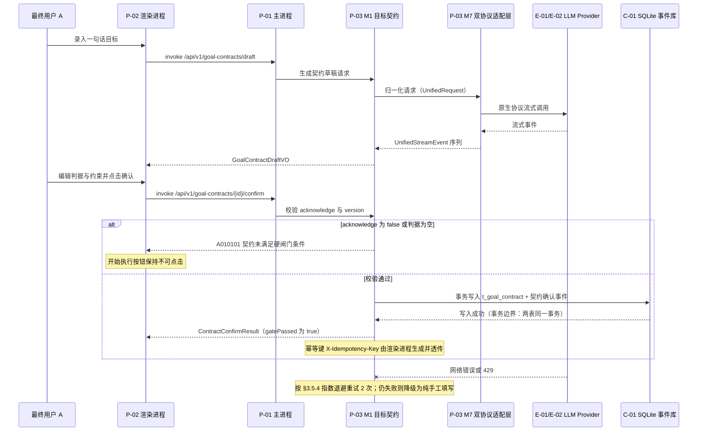

##### §3.2.M1.5 关键流程逻辑

**触发**：用户点击「确认契约」。

```
Step 1: 硬闸门校验（同步）
  ├── 校验：criteria 至少 1 条且权重和 = 100 → 失败返回 A010101
  ├── 校验：acknowledge = true → 失败返回 A010102
  ├── 校验：version 与库内一致（乐观锁） → 失败返回 C010409
  ├── 校验：凭据已配置且最近一次连通性自检通过 → 失败返回 A010103 并引导至设置与凭据中心
  └── 状态变更：GoalContract.status: DRAFT → CONFIRMED

Step 2: 落契约确认事件（同步，事务）
  ├── 事务边界：t_goal_contract 状态更新 + t_event 写入 GoalContractConfirmed 事件，同一事务
  ├── 幂等键：X-Idempotency-Key；重复提交返回首次结果，不产生第二条事件
  └── [硬约束] IC-07：未产生 GoalContractConfirmed 事件，则 M2 拒绝创建 TaskRun

Step 3: 三层拆解（异步，可重入）
  ├── 调用 M7 归一化接口生成 GMT 三层
  ├── 校验：每个 Milestone 至少映射 1 条成功判据 → 未映射的判据标记为「未被覆盖」并提示用户
  ├── 失败处理：连续 3 次失败 → 转人工拆解入口，用户可直接在树上增删节点
  └── 状态变更：GoalNode 全部置 PLANNED

Step 4: 回流（异步）
  └── 复盘结论（有效约束）沉淀为 ContractTemplate，供下次契约的默认约束使用（对齐 §5.3 主链路的反馈回路）
```

**状态机迁移表**：

| 起始状态 | 触发事件 | 终止状态 | 触发条件 / 校验 | 副作用 |
| --- | --- | --- | --- | --- |
| `DRAFT` | edit | `DRAFT` | 字段校验通过 | 更新 `version`，不落事件 |
| `DRAFT` | confirm | `CONFIRMED` | 判据非空 + 权重和为 100 + acknowledge + 凭据就绪 | 落 `GoalContractConfirmed` 事件；放行硬闸门 |
| `DRAFT` | confirm | `DRAFT` | 任一校验失败 | 返回 A010101 / A010102 / A010103 / C010409，不落事件 |
| `CONFIRMED` | decompose | `CONFIRMED` | 已确认 | 生成 `GoalNode` 树；落 `GoalDecomposed` 事件 |
| `CONFIRMED` | revise | `CONFIRMED` | 已确认且任务未启动 | 落 `InterventionRecorded` 事件，`version` 递增 |
| `CONFIRMED` | archive | `ARCHIVED` | 任务已交付或放弃 | 保留事件流，禁止再启动 |

---

#### 3.2.M2 编排引擎（事件流与检查点）

##### §3.2.M2.1 模块概述

M2 覆盖「任务运行创建 → 事件流推进 → 检查点生成 → 上下文压缩 → 任务结束」这一段业务流程，是《高层架构设计》§6.3 的 F5 ~ F7 与 N3 的落点。业务逻辑在**最终用户 A**（观察与干预）与**系统自身**（推进）之间流动，涉及 **P-03 agent-host**、**M3 子 Agent 调度器**、**M4 AgentRuntime 抽象层**、**M6 Critic 自检**、**M10 执行与安全**、**C-01 SQLite 事件库**、**E-01 / E-02** 等内外部系统的数据流动。**事件流是状态的单一事实来源**：任何 UI 呈现、检查点恢复、轨迹回放、审计留痕，一律从事件流重建，不另设可变状态副本（对齐 OpenHands 事件流即内存，调研 T11）。

##### §3.2.M2.2 接口清单

| 子领域 | 方法 | 路径 | 用途（≤ 20 字） | 请求 DTO | 响应 VO | 幂等 | 鉴权 |
| --- | --- | --- | --- | --- | --- | --- | --- |
| 任务运行 | POST | `/api/v1/task-runs` | 创建任务运行（需契约已确认） | `TaskRunCreateRequest` | `TaskRunVO` | 是（`X-Idempotency-Key`） | 本地调用 + 契约已确认 |
| 任务运行 | GET | `/api/v1/task-runs/{runId}` | 查询运行状态与进度 | — | `TaskRunDetailVO` | 天然 | 本地调用 |
| 任务运行 | POST | `/api/v1/task-runs/{runId}/pause` | 暂停执行 | `PauseRequest` | `TaskRunVO` | 是（runId + 序号） | 本地调用 + 用户确认 |
| 任务运行 | POST | `/api/v1/task-runs/{runId}/resume` | 从最近检查点续跑 | `ResumeRequest` | `TaskRunVO` | 是（`X-Idempotency-Key`） | 本地调用 |
| 任务运行 | POST | `/api/v1/task-runs/{runId}/abort` | 终止执行 | `AbortRequest` | `TaskRunVO` | 是（runId + 序号） | 本地调用 + 二次确认 |
| 事件流 | GET | `/api/v1/task-runs/{runId}/events` | 游标分页查询事件流 | `PageRequest` | `EventPageVO` | 天然 | 本地调用 |
| 事件流 | subscribe | `/api/v1/task-runs/{runId}/events/stream` | 订阅实时事件流 | — | `EventEnvelope` 流 | 天然 | 本地调用 |
| 检查点 | GET | `/api/v1/task-runs/{runId}/checkpoints` | 查询检查点列表 | — | `CheckpointListVO` | 天然 | 本地调用 |
| 检查点 | POST | `/api/v1/checkpoints/{checkpointId}/restore` | 从指定检查点恢复 | `RestoreRequest` | `RestoreResult` | 是（`X-Idempotency-Key`） | 本地调用 |
| 上下文 | POST | `/api/v1/task-runs/{runId}/context/compact` | 手动触发上下文压缩 | `CompactRequest` | `CompactResult` | 否（副作用受控） | 本地调用 |
| 上下文 | GET | `/api/v1/task-runs/{runId}/context` | 查询当前上下文分层状态 | — | `ContextStateVO` | 天然 | 本地调用 |
| 回放 | GET | `/api/v1/task-runs/{runId}/replay` | 按时间轴回放（F32） | `ReplayRequest` | `ReplayPageVO` | 天然 | 本地调用 |

##### §3.2.M2.3 关键结构定义（DTO）

```ts
// ===== packages/domain/src/orchestration =====

// ——— 事件封套：Shared Kernel 的 5 个概念之一，跨 M2 / M10 / M15 共享 ———
interface EventEnvelope {
  // ===== 基本信息 =====
  eventId: string;        // ULID，26 字符，可按字典序排序
  seq: number;            // 任务内单调自增，事件流位点
  taskId: string;         // 目标契约 / 任务 ID
  runId: string;          // 任务运行 ID
  // ===== 追踪与隔离 =====
  traceId: string;        // W3C TraceContext，进程间与对外调用透传
  tenantId: string;       // 桌面单机态：local-{installId}；云端态：真实租户 ID
  workspaceId: string;
  // ===== 业务字段 =====
  actor: { kind: 'user' | 'agent' | 'system' | 'tool'; id: string };
  at: string;             // ISO-8601 UTC 毫秒
  kind: 'action' | 'observation';
  type: string;           // 封闭词表取值，见本节下方词表
  payload: JsonObject;    // 按 type 收敛，由 zod Schema 校验
  // ===== 关联与治理 =====
  causationId?: string;   // 直接触发本事件的事件 ID
  correlationId?: string; // 同一次 LLM 调用 / 工具调用链共享
  checkpointId?: string;
  redaction: 'none' | 'secret' | 'partial'; // 敏感字段脱敏级别
  schemaVersion: number;  // 事件 Schema 版本，用于回放兼容
}

// ——— Action 封闭词表（MVP 共 16 项，新增须走全上下文评审 P-04）———
type ActionType =
  | 'GoalContractConfirmed'   // IC-07 硬闸门事件
  | 'GoalDecomposed'
  | 'MilestonePlanned'
  | 'TaskDispatched'
  | 'SubAgentSpawned'
  | 'ModelInvoked'
  | 'ToolCallRequested'
  | 'CommandExecuted'
  | 'FileWriteRequested'
  | 'CheckpointCreated'
  | 'ContextCompressed'
  | 'CriticScored'
  | 'ReplanRequested'
  | 'InterventionRecorded'
  | 'PreviewStarted'
  | 'PreviewStopped';

// ——— Observation 封闭词表（MVP 共 7 项）———
type ObservationType =
  | 'ModelObservation'        // 含 stop_reason 与 TokenUsage
  | 'ToolResultObservation'
  | 'CommandOutputObservation'
  | 'FileDiffObservation'
  | 'ErrorObservation'
  | 'ApprovalObservation'     // 用户批准 / 拒绝 / 降级
  | 'CriticScoreObservation';

// ——— 检查点 ———
interface Checkpoint {
  checkpointId: string;
  taskId: string;
  runId: string;
  seq: number;                 // 对应事件流位点
  scope: 'milestone-boundary' | 'pre-tool-call' | 'manual' | 'pre-compaction';
  milestoneId?: string;
  goalState: {
    contractVersion: number;
    gmtSnapshot: GoalNodeVO[];
    pendingTaskIds: string[];
  };
  runtimeState: {
    pendingToolCalls: PendingToolCall[];
    openFiles: string[];
    lastStopReason: StopReason;
  };
  workspaceRef: {
    kind: 'local' | 'cloud';
    workspaceId: string;
    worktreePath: string;
    gitHead: string;
    dirty: boolean;
  };
  contextState: {
    l0Resident: string;        // 常驻层：契约 + 判据 + 约束（永不压缩）
    l1TailSeq: number;         // 近期原始事件的起始位点
    l2SummaryIds: string[];    // 中期 Milestone 摘要
    l3IndexRef: string;        // 远期索引
  };
  createdAt: string;
  resumeCost: { replaySteps: number }; // 目标 ≤ 5，见 QS-01
}

// ——— 上下文分层状态 ———
interface ContextStateVO {
  windowTokens: number;        // 模型上下文窗口上限
  usedTokens: number;          // 当前累计
  l0Tokens: number;            // 常驻层
  l1Events: number;            // 近期原始事件条数
  l2Summaries: number;         // 中期摘要条数
  l3Indexed: number;           // 远期已索引条数
  lastCompactAt: string;
  peakReductionPct: number;    // 较全量回放的 token 峰值下降幅度，目标 ≥ 60
}

interface RestoreResult {
  ok: boolean;
  runId: string;
  checkpointId: string;
  replaySteps: number;         // 本次恢复实际重放步数
  restoredAt: string;
}
```

| DTO / VO 名 | 字段名 | 类型 | 必填 | 业务含义 | 约束 / 默认值 |
| --- | --- | --- | --- | --- | --- |
| `EventEnvelope` | `eventId` | string | 是 | 事件唯一标识（ULID） | 26 字符，字典序可排 |
| `EventEnvelope` | `seq` | number | 是 | 任务内事件位点 | 单调自增，断点续接依据 |
| `EventEnvelope` | `tenantId` | string | 是 | 租户隔离字段 | 单机态 `local-{installId}`；云端态真实租户 |
| `EventEnvelope` | `type` | string | 是 | 事件类型 | 必须落在 Action / Observation 封闭词表内 |
| `EventEnvelope` | `redaction` | 枚举 | 是 | 脱敏级别 | `none` / `secret` / `partial`；`secret` 事件禁止落明文 |
| `EventEnvelope` | `schemaVersion` | number | 是 | 事件 Schema 版本 | 回放时按版本选择解析器 |
| `Checkpoint` | `scope` | 枚举 | 是 | 检查点落点类型 | `milestone-boundary` / `pre-tool-call` / `manual` / `pre-compaction` |
| `Checkpoint` | `resumeCost.replaySteps` | number | 是 | 恢复需重放步数 | 目标 ≤ 5（QS-01） |
| `ContextStateVO` | `peakReductionPct` | number | 是 | token 峰值下降幅度 | 目标 ≥ 60（V5 / QS-04） |
| `RestoreResult` | `replaySteps` | number | 是 | 本次恢复实际重放步数 | 告警阈值 > 5 |

##### §3.2.M2.4 模块逻辑时序图

| 编号 | 标题 | 场景类别 | 是否包含异常分支 |
| --- | --- | --- | --- |
| SQ-M2-01 | 编排引擎 - 一次工具调用的完整闭环（含检查点） | 核心动作的执行 / 触发 / 回调 | 是 |
| SQ-M2-02 | 编排引擎 - 崩溃后从最近检查点恢复 | 异常 / 补偿 / 回滚 | 是 |
| SQ-M2-03 | 编排引擎 - 上下文分层压缩触发 | 核心动作的执行 / 触发 | 是 |

**SQ-M2-01 一次工具调用的完整闭环（含检查点）**：

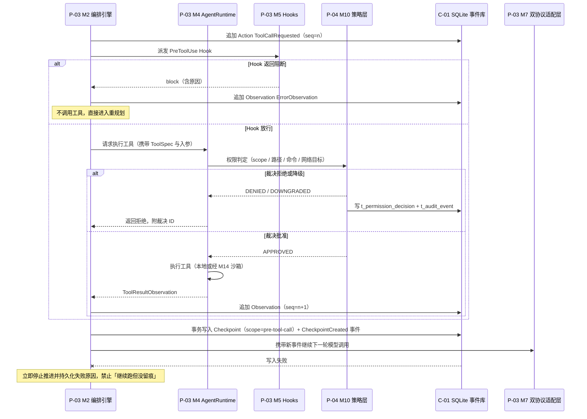

**SQ-M2-02 崩溃后从最近检查点恢复**：

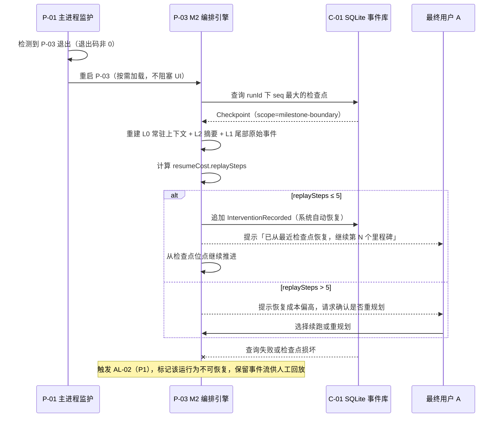

##### §3.2.M2.5 关键流程逻辑

**触发一：事件写入（最高频路径）**

```
Step 1: 构造 EventEnvelope（同步）
  ├── 分配 eventId（ULID）与 seq（任务内自增，由事件库事务保证单调）
  ├── 注入 traceId / tenantId / workspaceId（来自 Shared Kernel）
  ├── 按 type 用 zod Schema 校验 payload → 校验失败拒绝写入并返回 B020001
  └── 依据字段敏感度设定 redaction（含凭据、Token、密钥片段一律 secret）

Step 2: 持久化（同步，事务）
  ├── 事务边界：t_event 单行插入；WAL 模式，同步刷盘策略见 §4.3.2
  ├── [硬约束 N3] 写失败 → 立即停止推进（fail-stop），禁止「继续跑但没留痕」
  └── 写成功后才递增 seq 并向订阅端推送

Step 3: 推送（异步）
  ├── 经 MessagePort 推给 P-01，再推给 P-02
  └── 渲染侧合并窗口 50ms，保障 QS-06（呈现 P95 ≤ 500ms）
```

**触发二：检查点生成**

```
Step 1: 判定是否落点
  ├── Milestone 边界 → 强制落点（scope=milestone-boundary）
  ├── 每次工具调用前 → 落点（scope=pre-tool-call），这是 replaySteps ≤ 5 的关键
  ├── 上下文压缩前 → 落点（scope=pre-compaction）
  └── 用户手动 → 落点（scope=manual）

Step 2: 组装快照
  ├── goalState：契约版本 + GMT 快照 + 待办 Task
  ├── runtimeState：未完成工具调用 + 打开文件 + 上次 stop_reason
  ├── workspaceRef：工作区类型 + worktree 路径 + gitHead + dirty 标记
  └── contextState：L0 常驻文本 + L1 起始位点 + L2 摘要 + L3 索引

Step 3: 事务写入并计算恢复成本
  ├── 事务边界：t_checkpoint 插入 + t_event 追加 CheckpointCreated，同一事务
  └── resumeCost.replaySteps = 未完成工具调用数 + 重建上下文步数（目标 ≤ 5）
```

**触发三：上下文分层压缩（R-06 / V5 / QS-04）**

```
Step 1: 阈值判定
  ├── 累计 prompt token ≥ 模型上下文窗口的 60% → 触发
  └── Milestone 边界 → 无条件先落检查点再压缩

Step 2: 四层归置
  ├── L0 常驻（永不压缩）：目标契约 + 成功判据 + 约束 + 当前 Milestone 的 GMT 摘要
  ├── L1 近期：最近 24 条事件（或 token 预算 30%，取先到者）保留原始事件
  ├── L2 中期：按 Milestone 聚合的结构化摘要（模型生成 + 固定模板）
  ├── L3 远期：仅保留事件 ID + 一行摘要 + 变更集指针
  └── 度量：peakReductionPct = 1 - 压缩后 token 峰值 / 全量回放 token 峰值（目标 ≥ 60%）

Step 3: 失败退化（BD-04）
  └── 压缩模型连续失败 3 次 → 退化为规则压缩（按事件类型保留最近 N 条 + 丢弃冗余 Observation），主链路不中断

Step 4: 落事件
  └── 追加 ContextCompressed 事件，记录压缩前后 token 与丢弃事件区间
```

**状态机迁移表（TaskRun）**：

| 起始状态 | 触发事件 | 终止状态 | 触发条件 / 校验 | 副作用 |
| --- | --- | --- | --- | --- |
| — | create | `CONTRACT_PENDING` | 契约存在但未确认 | 不创建运行 |
| `CONTRACT_PENDING` | confirm | `CONFIRMED` | 存在 `GoalContractConfirmed` 事件（IC-07 硬闸门） | 初始化 GMT 树 |
| `CONFIRMED` | start | `RUNNING` | 凭据就绪 + 工作区就绪 | 落初始检查点；启动 P-03 |
| `RUNNING` | pause | `PAUSED` | 用户请求 | 落干预事件；保留在飞工具调用 |
| `RUNNING` | crash | `INTERRUPTED` | P-03 异常退出 | 由 P-01 监护捕获；告警 AL-03 |
| `PAUSED` / `INTERRUPTED` | resume | `RUNNING` | 存在可恢复检查点 | 重放 ≤ 5 步；落恢复事件 |
| `RUNNING` | milestone_done | `CRITIC_REVIEW` | 一个 Milestone 完成 | 触发 M6 评分 |
| `CRITIC_REVIEW` | pass | `RUNNING` | 评分达标 | 推进下一 Milestone |
| `CRITIC_REVIEW` | fail | `REPLANNING` | 评分未达标 | 从最近检查点续跑；重规划轮次 +1 |
| `REPLANNING` | replanned | `RUNNING` | 生成新方案 | 落 `ReplanRequested` 事件 |
| `CRITIC_REVIEW` | all_done | `DELIVERED` | 全部 Milestone 接受 | 触发 M13 交付预览 |
| `RUNNING` | budget_exceeded | `PAUSED` | 累计花费达到预算上限 | 预算熔断（BD-10），等用户决定 |
| 任意 | abort | `ABORTED` | 用户终止 | 落终止事件；保留全部事件流 |
| 任意 | fatal | `FAILED` | 不可恢复错误 | 告警 AL-01；保留事件流供回放 |

---

#### 3.2.M3 并行子 Agent 调度器

##### §3.2.M3.1 模块概述

M3 覆盖「子任务派发 → 子 Agent 拉起与隔离 → 并行推进 → 结果归并 → 冲突检测」这一段业务流程，是《高层架构设计》§6.3 的 F11 / F12 与 V3 的落点。业务逻辑在**最终用户 B（子 Agent 委派与审阅者）**与**系统自身**之间流动，涉及 **M2 编排引擎**、**M11 工作区与 Git worktree 隔离**、**M4 AgentRuntime 抽象层**、**E-12 本机 Git**、**C-01 事件库** 等内外部系统的数据流动。**每个并行子 Agent 必须独占一份工作区副本**，写入互不覆盖（V3，对齐 Cursor 的 worktree 隔离范式）。

##### §3.2.M3.2 接口清单

| 子领域 | 方法 | 路径 | 用途（≤ 20 字） | 请求 DTO | 响应 VO | 幂等 | 鉴权 |
| --- | --- | --- | --- | --- | --- | --- | --- |
| 派发 | POST | `/api/v1/task-runs/{runId}/sub-agents` | 派发一个子 Agent | `SubAgentDispatchRequest` | `SubAgentRunVO` | 是（`X-Idempotency-Key`） | 本地调用 + 契约已确认 |
| 派发 | POST | `/api/v1/task-runs/{runId}/sub-agents/batch` | 批量派发（受并行度约束） | `SubAgentBatchRequest` | `SubAgentRunListVO` | 是（`X-Idempotency-Key`） | 本地调用 |
| 运行 | GET | `/api/v1/sub-agents/{subAgentId}` | 查询子 Agent 状态 | — | `SubAgentRunDetailVO` | 天然 | 本地调用 |
| 运行 | POST | `/api/v1/sub-agents/{subAgentId}/cancel` | 取消子 Agent | `CancelRequest` | `SubAgentRunVO` | 是（id + 序号） | 本地调用 |
| 归并 | POST | `/api/v1/task-runs/{runId}/merge` | 归并子 Agent 产出 | `MergeRequest` | `MergeResult` | 是（`X-Idempotency-Key`） | 本地调用 + 用户确认 |
| 归并 | GET | `/api/v1/task-runs/{runId}/conflicts` | 查询变更集冲突 | — | `ConflictListVO` | 天然 | 本地调用 |
| 调度 | GET | `/api/v1/scheduler/parallelism` | 查询当前并行度与水位 | — | `ParallelismVO` | 天然 | 本地调用 |
| 调度 | PUT | `/api/v1/scheduler/parallelism` | 设置并行度上限 | `ParallelismUpdateRequest` | `ParallelismVO` | 是（版本号） | 本地调用 |

##### §3.2.M3.3 关键结构定义（DTO）

```ts
// ===== packages/domain/src/orchestration =====

interface SubAgentDispatchRequest {
  taskNodeId: string;              // 被派发的 TASK 层节点
  modelRef: ModelRef;              // 该子 Agent 使用的模型（可不同于主 Agent）
  toolsetAllow: string[];          // 可用工具白名单（与契约约束取交集）
  budgetUsd?: number;              // 子 Agent 预算上限；缺省继承契约
  maxSteps?: number;               // 最大步数；缺省 200
  isolation: 'worktree' | 'directory-copy'; // 隔离方式；worktree 为首选
}

interface SubAgentRunVO {
  subAgentId: string;
  runId: string;
  taskNodeId: string;
  status: 'PENDING' | 'BOOTSTRAPPING' | 'RUNNING' | 'MERGING' | 'MERGED' | 'CONFLICT' | 'FAILED' | 'CANCELLED';
  isolation: 'worktree' | 'directory-copy';
  worktreeId?: string;             // 指向 M11 的 worktree 副本
  modelRef: ModelRef;
  steps: number;
  tokenUsage: TokenUsage;
  startedAt: string;
  endedAt: string;
  failureReason?: string;
}

interface MergeResult {
  ok: boolean;
  mergedNodeIds: string[];
  conflicts: ConflictVO[];
  changesetId: string;             // 归并后的变更集 ID，供 M13 预览与 F32 回放
}

interface ConflictVO {
  path: string;                    // 冲突文件路径
  kind: 'both-modified' | 'delete-vs-modify' | 'binary';
  oursSubAgentId: string;
  theirsSubAgentId: string;
  resolvableBy: 'user' | 'semantic-diff' | 'manual';
}

interface ParallelismVO {
  configured: number;              // 用户配置上限
  effective: number;               // 当前生效值（受水位降级影响，见 BD-06）
  running: number;
  queued: number;
  reason?: string;                 // effective 低于 configured 时的原因文案
}
```

| DTO / VO 名 | 字段名 | 类型 | 必填 | 业务含义 | 约束 / 默认值 |
| --- | --- | --- | --- | --- | --- |
| `SubAgentDispatchRequest` | `isolation` | 枚举 | 是 | 隔离方式 | `worktree` 首选；`directory-copy` 为非 Git 仓库降级分支 |
| `SubAgentDispatchRequest` | `toolsetAllow` | string[] | 是 | 工具白名单 | 与契约 `toolset` 约束取交集，取空则拒绝派发 |
| `SubAgentDispatchRequest` | `maxSteps` | number | 否 | 最大步数 | 缺省 200；上限 1000 |
| `SubAgentRunVO` | `status` | 枚举 | 是 | 子 Agent 状态 | 8 个取值，见状态机表 |
| `MergeResult` | `changesetId` | string | 是 | 归并后变更集 ID | 供预览与回放引用 |
| `ConflictVO` | `resolvableBy` | 枚举 | 是 | 冲突解决方式 | `user` / `semantic-diff` / `manual` |
| `ParallelismVO` | `effective` | number | 是 | 当前生效并行度 | 受 BD-06 水位降级影响 |

##### §3.2.M3.4 模块逻辑时序图

| 编号 | 标题 | 场景类别 | 是否包含异常分支 |
| --- | --- | --- | --- |
| SQ-M3-01 | 并行子 Agent 调度器 - 派发与隔离启动 | 核心动作的执行 / 触发 | 是 |
| SQ-M3-02 | 并行子 Agent 调度器 - 归并遇冲突 | 异常 / 补偿 / 回滚 | 是 |

**SQ-M3-01 派发与隔离启动**：

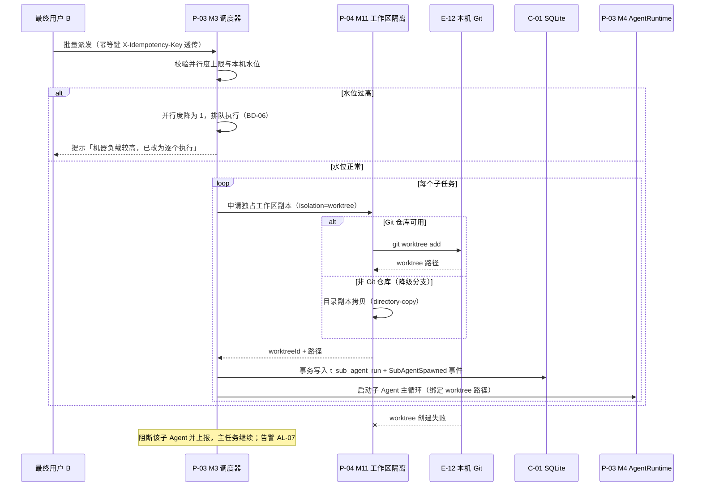

**SQ-M3-02 归并遇冲突**：

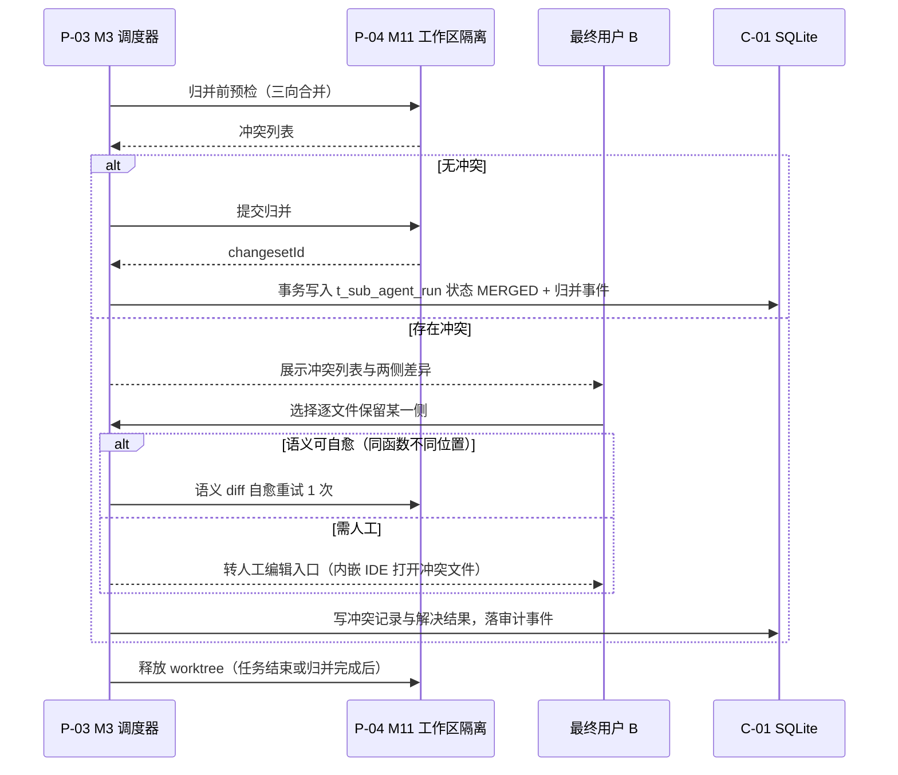

##### §3.2.M3.5 关键流程逻辑

**触发：批量派发**

```
Step 1: 准入校验（同步）
  ├── 校验：契约已确认（存在 GoalContractConfirmed 事件） → 否则拒绝
  ├── 校验：toolsetAllow 与契约 toolset 约束取交集非空 → 空则拒绝（返回 A030301）
  ├── 校验：并行度上限（默认 8，对齐 Cursor 的 8 并行 Agent 量级；上限可由用户在设置调整）
  └── 校验：本机水位（内存 > 85% 或 CPU > 90% 持续 60 秒） → 自动降为 1（BD-06）

Step 2: 隔离与拉起（异步，每个子任务独立）
  ├── 向 M11 申请独占副本：首选 Git worktree，非 Git 仓库降级为目录副本
  ├── 事务写入 t_sub_agent_run + SubAgentSpawned 事件（幂等键防重复拉起）
  └── 每个子 Agent 绑定自己的 worktree 路径，禁止跨副本写入

Step 3: 结果归并（异步）
  ├── 预检三向合并 → 生成冲突列表
  ├── 无冲突 → 提交归并，生成 changesetId
  ├── 有冲突 → 语义 diff 自愈 1 次；仍冲突转人工，内嵌 IDE 打开冲突文件
  └── [硬约束 V3] 任一子 Agent 的写入不得落到其他副本路径；越界写入由 M10 拒绝并留痕

Step 4: 回收（异步）
  └── 任务结束或归并完成后释放 worktree；失败时由夜巡任务兜底回收（对齐 SB-03 的孤儿回收思想）

Step 5: 审批与并行的关系（**经 IC-08 裁决，硬约束**）
  ├── [硬约束] 并行度 1~8 是硬指标，审批机制不得把并行度退化为 1
  ├── 每个子 Agent 的裁决请求必须携带 parallelLaneId + allowAsyncPrompt（见 §3.2.M10 Step 2.5）
  ├── 只读（R1）与已授权的工作区内写入（R2）→ 零等待返回，不占用全局锁
  ├── 任务级一次性授权 → 仅在首个到达的泳道触发一次，其余泳道订阅同一 future（任务级单飞）
  ├── 逐次弹窗（R3 / R4 / R5 / R0）→ 泳道内串行、泳道间并行；> 3 条聚合为批量审批卡片
  └── 反模式（明令禁止）：用一个全局审批队列串行处理全部子 Agent 的裁决请求
```

**状态机迁移表（SubAgentRun）**：

| 起始状态 | 触发事件 | 终止状态 | 触发条件 / 校验 | 副作用 |
| --- | --- | --- | --- | --- |
| — | dispatch | `PENDING` | 准入校验通过 | 排队等待并行度空位 |
| `PENDING` | acquire | `BOOTSTRAPPING` | 获得并行度空位 | 向 M11 申请副本 |
| `BOOTSTRAPPING` | ready | `RUNNING` | worktree 或目录副本就绪 | 落 `SubAgentSpawned` 事件 |
| `BOOTSTRAPPING` | fail | `FAILED` | 副本创建失败 | 告警 AL-07；主任务继续 |
| `RUNNING` | done | `MERGING` | 步数未超限且无致命错误 | 触发预检归并 |
| `RUNNING` | cancel | `CANCELLED` | 用户取消或预算超支 | 释放副本 |
| `MERGING` | no_conflict | `MERGED` | 三向合并无冲突 | 生成 `changesetId` |
| `MERGING` | conflict | `CONFLICT` | 存在冲突 | 转人工或语义自愈 |
| `CONFLICT` | resolved | `MERGED` | 冲突全部解决 | 落解决结果并审计 |
| `RUNNING` | fatal | `FAILED` | 不可恢复错误 | 保留事件流；副本保留至人工确认后回收 |

---

#### 3.2.M4 AgentRuntime 抽象层

##### §3.2.M4.1 模块概述

> **本模块是调研 R-05 的硬约束落点，不是可选项。**

M4 位于「模型调用层」与「业务编排层」之间，覆盖「工具注册 → 权限判定入口 → Hooks 挂载 → 事件流出口 → 模型调用」这一段业务流程。业务逻辑在**编排引擎 M2** 与**外部 SDK / 协议实现**之间流动，涉及 **M7 双协议适配层**、**M5 Hooks**、**M8 MCP 网关**、**M9 Skill 加载器**、**M10 策略层**、**M14 云端沙箱** 等内外部系统的数据流动。本层的核心义务是：**工具注册、权限判定、Hooks、事件流全部位于抽象层之上，任何单一 SDK 都只能作为可替换件位于抽象层之下**（Claude Agent SDK 仅支持 Claude、OpenAI Agents SDK 为 Python 优先，均不可作为 Agent 层全部实现）。

| 要素 | 内容 |
| --- | --- |
| 模块在业务流程中的位置 | 编排执行域的中枢；上承 M2 编排引擎，下接 M7 / M8 / M9 / M10 / M14 |
| 涉及的角色 | 最终用户 A（间接受其权限裁决影响）、甲方决策者（间接受其可替换性保障影响） |
| 涉及的内外部系统 | M2、M5、M7、M8、M9、M10、M14、E-01、E-02、E-03、C-03 事件总线 |

##### §3.2.M4.2 接口清单

| 子领域 | 方法 | 路径 / 端口 | 用途（≤ 20 字） | 请求 DTO | 响应 VO | 幂等 | 鉴权 |
| --- | --- | --- | --- | --- | --- | --- | --- |
| 端口 | — | `AgentRuntimePort`（进程内接口） | 抽象层对外统一端口 | — | — | — | 进程内 |
| 工具注册 | POST | `/api/v1/runtime/tools` | 注册工具（MCP / 内置 / Skill） | `ToolRegistrationRequest` | `ToolSpecVO` | 是（工具名唯一） | 本地调用 + 契约 toolset 约束 |
| 工具注册 | DELETE | `/api/v1/runtime/tools/{name}` | 注销工具 | — | `Result` | 天然 | 本地调用 |
| 工具注册 | GET | `/api/v1/runtime/tools` | 查询已注册工具 | — | `ToolSpecListVO` | 天然 | 本地调用 |
| 工具调用 | POST | `/api/v1/runtime/tools/{name}/invoke` | 执行工具（经权限判定） | `ToolInvokeRequest` | `ToolInvocationVO` | 视工具而定（见 §3.5.2） | 本地调用 + 策略层裁决 |
| 模型调用 | POST | `/api/v1/runtime/model/stream` | 经抽象层发起模型流式调用 | `RuntimeModelRequest` | `UnifiedStreamEvent` 流 | 否（生成类） | 本地调用 + 凭据就绪 |
| 运行循环 | POST | `/api/v1/runtime/loop/start` | 启动一次 Agent 循环 | `LoopStartRequest` | `LoopHandleVO` | 是（`X-Idempotency-Key`） | 本地调用 |
| 运行循环 | POST | `/api/v1/runtime/loop/{loopId}/interrupt` | 中断循环（干预） | `InterruptRequest` | `Result` | 是（loopId + 序号） | 本地调用 + 用户确认 |

##### §3.2.M4.3 关键结构定义（DTO）

```ts
// ===== packages/runtime/src/port =====
// AgentRuntimePort 是抽象层对上暴露的唯一端口；更换 SDK 不得改动本文件

interface AgentRuntimePort {
  // ===== 工具 =====
  registerTool(spec: ToolSpec): RegisterOutcome;      // 返回 ok / 重名冲突 / Schema 非法
  unregisterTool(name: string): Result;
  listTools(): ToolSpec[];
  invokeTool(req: ToolInvokeRequest): ToolInvocationOutcome; // 内部必经权限判定入口

  // ===== 模型（可替换件，当前实现为 Vercel AI SDK + 自研双协议适配层）=====
  streamModel(req: RuntimeModelRequest): ModelStreamHandle;

  // ===== 循环 =====
  startLoop(req: LoopStartRequest): LoopHandleOutcome;
  interruptLoop(loopId: string, reason: string): Result;

  // ===== 横切 =====
  hooks: HookRegistryPort;         // 由 M5 实现并注入
  policy: PolicyGatePort;          // 由 M10 实现并注入
  events: EventSinkPort;           // 由 M2 实现并注入
  sandbox: SandboxProviderPort;    // 由 M14 实现并注入
}

// ===== 工具规格：MCP / 内置 / Skill 三方统一为此结构 =====
interface ToolSpec {
  // ===== 基本信息 =====
  name: string;                    // 全局唯一，命名空间形如 mcp.{server}.{tool}
  description: string;
  origin: 'builtin' | 'mcp' | 'skill';
  // ===== 业务字段 =====
  jsonSchema: JsonObject;          // 入参 JSON Schema；来自 MCP 或内置定义
  riskLevel: 'read' | 'workspace-write' | 'global-write' | 'network' | 'elevated';
  idempotent: boolean;             // 决定是否需要幂等键（见 §3.5.2）
  timeoutMs: number;               // 单次调用超时；缺省取 §3.5.4
  // ===== 扩展 =====
  metadata: JsonObject;            // 来源 server、版本号等；不参与权限判定
}

interface ToolInvokeRequest {
  toolName: string;
  argsJson: string;                // 未经校验的原始入参；由本层用 jsonSchema 校验
  runId: string;
  subAgentId?: string;
  traceId: string;
  idempotencyKey?: string;         // idempotent=false 的工具必填，否则拒绝执行
  decisionId?: string;             // 已获批准的权限裁决 ID（审批在环场景回填）
}

// ===== 具名结果类型（§0 书写约定：等价于判别式联合，不含尖括号）=====
interface ToolInvocationOutcome {
  ok: boolean;
  invocationId?: string;
  observation?: ToolResultObservation;
  error?: UnifiedError;
  decisionId?: string;             // 关联的权限裁决 ID，供审计追溯
}
```

| DTO / VO 名 | 字段名 | 类型 | 必填 | 业务含义 | 约束 / 默认值 |
| --- | --- | --- | --- | --- | --- |
| `ToolSpec` | `name` | string | 是 | 工具全局唯一名 | 命名空间前缀 `mcp.` / `builtin.` / `skill.` |
| `ToolSpec` | `riskLevel` | 枚举 | 是 | 风险等级 | `read` / `workspace-write` / `global-write` / `network` / `elevated` |
| `ToolSpec` | `idempotent` | boolean | 是 | 是否幂等 | `false` 的写入类工具调用必须携带幂等键 |
| `ToolSpec` | `origin` | 枚举 | 是 | 工具来源 | `builtin` / `mcp` / `skill` |
| `ToolInvokeRequest` | `argsJson` | string | 是 | 原始入参 | 必须经 `jsonSchema` 校验后才可执行 |
| `ToolInvokeRequest` | `idempotencyKey` | string | 条件必填 | 幂等键 | `idempotent=false` 时必填 |
| `ToolInvocationOutcome` | `decisionId` | string | 否 | 权限裁决 ID | 审批在环场景必回填，供 N3 审计 |

**可替换性验收口径（QS-05）**：把模型调用层从当前 SDK 换成另一 SDK 时，改动范围**仅限** `packages/llm` 与 `packages/runtime` 内的模型调用实现文件，`packages/orchestration`、`packages/policy`、`packages/persistence` 零改动；改动文件数 ≤ 3，总成本 ≤ 5 人日。CI 增加一条架构守卫测试：断言 `packages/orchestration` 的 import 图中不出现任何第三方 Agent SDK 的包名。

##### §3.2.M4.4 模块逻辑时序图

| 编号 | 标题 | 场景类别 | 是否包含异常分支 |
| --- | --- | --- | --- |
| SQ-M4-01 | AgentRuntime 抽象层 - 一次工具调用的判定链 | 核心动作的执行 / 触发 | 是 |
| SQ-M4-02 | AgentRuntime 抽象层 - 更换模型 SDK 的边界验证 | 异常 / 补偿 / 回滚 | 是 |

**SQ-M4-01 一次工具调用的判定链**：

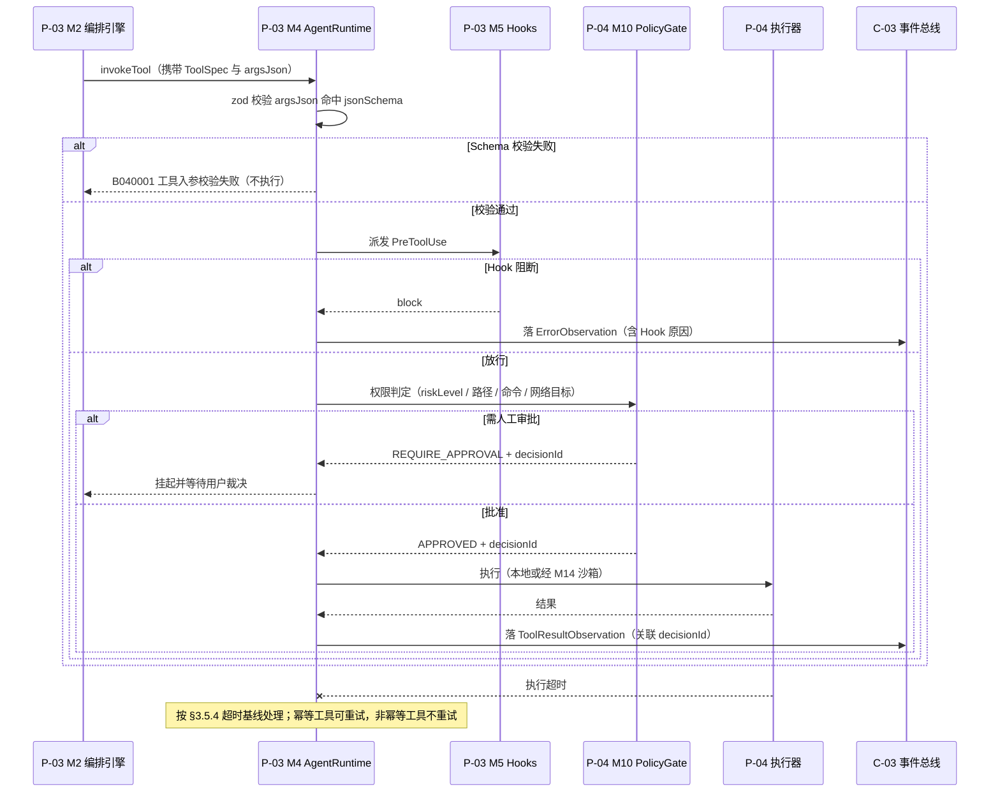

##### §3.2.M4.5 关键流程逻辑

**触发：工具注册**

```
Step 1: 来源归一化（同步）
  ├── MCP 工具 → 由 M8 转为 ToolSpec（jsonSchema 来自 MCP tools/list）
  ├── Skill → 由 M9 转为 ToolSpec（**allowed-tools 不作为权限依据**，见调研 R-08）
  └── 内置工具 → 直接声明 ToolSpec

Step 2: 注册校验
  ├── 校验：name 全局唯一 → 重名返回 A040201
  ├── 校验：jsonSchema 可被 zod 编译 → 失败返回 A040202
  ├── 风险定级：由 origin + 工具语义 + 用户提供值共同定级，**不由 Skill 的 allowed-tools 决定**
  └── 与契约的 toolset 约束取交集：不在允许集内的工具不注册（返回 A040203）

Step 3: 生效与注销
  ├── 注册成功后进入进程内注册表，并对 M2 可见
  └── 注销时必须先中断在飞调用；在飞调用未结束时注销返回 A040204
```

**抽象层边界红线（架构守卫，CI 强制）**：

| 红线 | 判定方式 |
| --- | --- |
| 编排层不出现任何第三方 Agent SDK 的 import | 静态 import 图扫描，命中即失败 |
| 协议层原始 DTO 不上行到编排层 | 类型守卫：`packages/orchestration` 不得引用 `packages/llm` 的 wire 类型 |
| 工具执行必经权限判定入口 | 运行时断言：所有 `invokeTool` 调用栈中必须出现 `PolicyGatePort`，否则抛错并留痕 |
| 事件流出口唯一 | 运行时断言：所有事件必须经 `EventSinkPort` 写入，直连仓储写入视为违规 |
| 沙箱访问必经 Provider 端口 | 静态扫描：`packages/orchestration` 不得 import 云厂商 SDK |

---

#### 3.2.M5 Hooks 事件体系

##### §3.2.M5.1 模块概述

M5 覆盖「Hook 注册 → 事件匹配 → 执行 → 结果影响编排」这一段业务流程，是《高层架构设计》§2.4 借鉴 Claude Code Hooks 事件体系的落点（调研 B1，限定借鉴其能力模型与协议约定，不借鉴闭源运行时）。业务逻辑在**最终用户 A（配置 Hook）**与**编排引擎 M2** 之间流动，涉及 **M4 AgentRuntime 抽象层**、**M10 策略层**、**C-09 日志与审计** 等内外部系统的数据流动。Hook 的定位是**在权限判定之前或之后插入用户自定义策略**，与权限层是"补充"而非"替代"关系——**Hook 放行不等于权限放行**。

##### §3.2.M5.2 接口清单

| 子领域 | 方法 | 路径 | 用途（≤ 20 字） | 请求 DTO | 响应 VO | 幂等 | 鉴权 |
| --- | --- | --- | --- | --- | --- | --- | --- |
| 注册 | POST | `/api/v1/hooks` | 注册一个 Hook | `HookRegistrationRequest` | `HookVO` | 是（事件 + matcher 唯一） | 本地调用 + 用户确认 |
| 注册 | PUT | `/api/v1/hooks/{hookId}` | 修改 Hook | `HookUpdateRequest` | `HookVO` | 是（id + version） | 本地调用 |
| 注册 | DELETE | `/api/v1/hooks/{hookId}` | 删除 Hook | — | `Result` | 天然 | 本地调用 |
| 注册 | GET | `/api/v1/hooks` | 查询 Hook 列表 | — | `HookListVO` | 天然 | 本地调用 |
| 执行 | POST | `/api/v1/hooks/{hookId}/dry-run` | 以样例事件试跑 Hook | `HookDryRunRequest` | `HookOutcomeVO` | 否（只读试跑） | 本地调用 |
| 执行 | GET | `/api/v1/hooks/executions` | 查询 Hook 执行留痕 | `PageRequest` | `HookExecutionPageVO` | 天然 | 本地调用 |

##### §3.2.M5.3 关键结构定义（DTO）

```ts
// ===== packages/runtime/src/hooks =====

type HookEvent =
  | 'PreToolUse'      // 工具调用前，可阻断
  | 'PostToolUse'     // 工具调用后，不可阻断（仅告警或改写观察）
  | 'PreModelCall'    // 模型调用前，可阻断
  | 'PostModelCall'   // 模型调用后，不可阻断
  | 'PreCompact'      // 上下文压缩前，可阻断
  | 'OnCheckpoint'    // 检查点生成后，不可阻断
  | 'OnStop'          // 任务结束（成功 / 失败 / 中断），不可阻断
  | 'OnError';        // 错误发生，不可阻断

interface HookRegistrationRequest {
  event: HookEvent;
  matcher: string;                 // 匹配表达式：工具名通配或路径前缀；* 表示全部
  kind: 'command' | 'prompt';      // 命令型（本机可执行）或提示词型（注入模型）
  command?: string;                // kind=command 时必填
  timeoutMs: number;               // 缺省 10_000；上限 60_000
  onFailure: 'block' | 'warn';     // 执行失败时是阻断还是仅告警
  enabled: boolean;
}

interface HookOutcomeVO {
  hookId: string;
  event: HookEvent;
  outcome: 'allow' | 'block' | 'warn';
  exitCode?: number;               // 命令型 Hook 的退出码
  reason?: string;
  durationMs: number;
}

interface HookExecutionRecord {
  executionId: string;
  hookId: string;
  runId: string;
  event: HookEvent;
  outcome: 'allow' | 'block' | 'warn' | 'timeout' | 'error';
  exitCode?: number;
  stdoutDigest?: string;           // 仅存摘要，禁止明文存命令输出（防凭据外泄）
  stderrDigest?: string;
  traceId: string;
  at: string;
}
```

| DTO / VO 名 | 字段名 | 类型 | 必填 | 业务含义 | 约束 / 默认值 |
| --- | --- | --- | --- | --- | --- |
| `HookRegistrationRequest` | `event` | 枚举 | 是 | 挂载的事件点 | 8 个取值；`PreToolUse` / `PreModelCall` / `PreCompact` 可阻断 |
| `HookRegistrationRequest` | `matcher` | string | 是 | 匹配表达式 | 工具名通配或路径前缀；`*` 表示全部 |
| `HookRegistrationRequest` | `onFailure` | 枚举 | 是 | 执行失败时的处置 | `block`（阻断）/ `warn`（仅告警） |
| `HookRegistrationRequest` | `timeoutMs` | number | 是 | 单次执行超时 | 缺省 10000；上限 60000 |
| `HookOutcomeVO` | `outcome` | 枚举 | 是 | 判定结果 | `allow` / `block` / `warn` |
| `HookExecutionRecord` | `stdoutDigest` | string | 否 | 输出摘要 | **禁止存明文**，防凭据外泄（§7.2.2） |

##### §3.2.M5.4 模块逻辑时序图

| 编号 | 标题 | 场景类别 | 是否包含异常分支 |
| --- | --- | --- | --- |
| SQ-M5-01 | Hooks 事件体系 - PreToolUse 阻断链 | 核心动作的执行 / 触发 | 是 |
| SQ-M5-02 | Hooks 事件体系 - 命令型 Hook 超时 | 异常 / 补偿 / 回滚 | 是 |

**SQ-M5-01 PreToolUse 阻断链**：

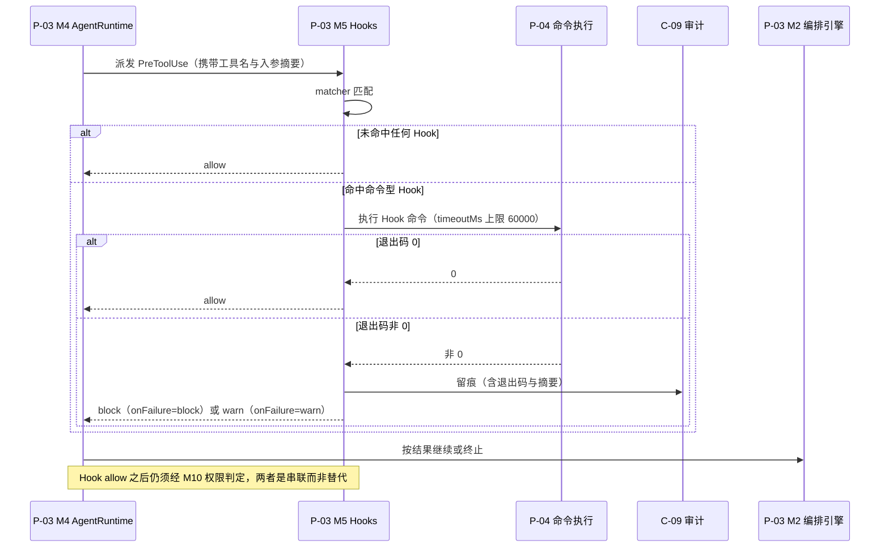

**SQ-M5-02 命令型 Hook 超时**：

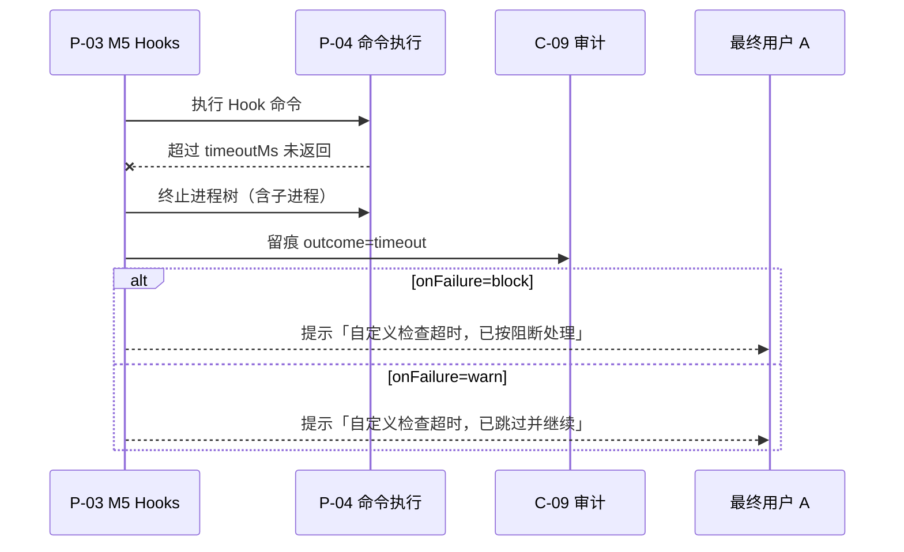

##### §3.2.M5.5 关键流程逻辑

**触发：事件派发**

```
Step 1: 匹配（同步）
  ├── 按 event 取候选 Hook 列表（仅 enabled）
  ├── matcher 匹配：工具名通配（如 Bash(git*)）或路径前缀
  └── 多 Hook 命中时按注册顺序串行执行，任一 block 即短路

Step 2: 执行（同步，有超时上限）
  ├── kind=command：在 P-04 以最小权限执行；**Hook 命令本身也须经 M10 策略层裁决**
  ├── kind=prompt：把提示词注入模型调用上下文，不执行本机命令
  ├── 超时：timeoutMs（缺省 10 秒，上限 60 秒）；超时终止进程树并记 outcome=timeout
  └── 失败处置：onFailure=block → 阻断；onFailure=warn → 仅告警并继续

Step 3: 留痕（同步，N3）
  ├── 每次 Hook 执行写一条 t_hook_execution 与一条 t_audit_event
  ├── 只存 stdout/stderr 摘要，**禁止明文存储**（防凭据外泄）
  └── Hook 阻断是一个可被用户观察的事件，UI 明示阻断原因

Step 4: 与权限层的串联关系
  └── Hook allow ≠ 权限放行：Hook 通过后仍必须经 M10 的 PolicyGate 判定；反之亦然
```

**状态机迁移表（HookExecution）**：

| 起始状态 | 触发事件 | 终止状态 | 触发条件 / 校验 | 副作用 |
| --- | --- | --- | --- | --- |
| — | dispatch | `MATCHED` | matcher 命中 | 记录候选与顺序 |
| — | dispatch | `SKIPPED` | 未命中任何 Hook | 不留执行记录（避免噪声） |
| `MATCHED` | run | `RUNNING` | 通过策略层裁决 | 启动命令或注入提示词 |
| `RUNNING` | exit0 | `ALLOW` | 退出码 0 | 留痕；编排继续 |
| `RUNNING` | exitN | `BLOCK` / `WARN` | 退出码非 0，按 onFailure 决定 | 留痕；block 时编排终止该动作 |
| `RUNNING` | timeout | `TIMEOUT` | 超过 timeoutMs | 终止进程树；按 onFailure 决定阻断或告警 |
| `RUNNING` | crash | `ERROR` | 进程异常 | 留痕；告警 AL-08 |

---

#### 3.2.M6 Critic 自检与重规划

##### §3.2.M6.1 模块概述

M6 覆盖「Milestone 完成 → 按成功判据评分 → 达标或触发重规划 → 人工干预留痕」这一段业务流程，是《高层架构设计》§6.3 的 F8 ~ F10 与差异化定位（目标先契约化、再自治执行）的兑现点。业务逻辑在**最终用户 A**（审阅评分趋势、在重规划面板干预）与**系统自身**（自检与重规划）之间流动，涉及 **M2 编排引擎**、**M1 目标契约**、**M7 双协议适配层**、**C-01 事件库** 等内外部系统的数据流动。本模块承载 Screen B 的「Critic 评分趋势」与「干预记录」两个 UI 模块的语义落点（调研 D-06）。

##### §3.2.M6.2 接口清单

| 子领域 | 方法 | 路径 | 用途（≤ 20 字） | 请求 DTO | 响应 VO | 幂等 | 鉴权 |
| --- | --- | --- | --- | --- | --- | --- | --- |
| 评分 | POST | `/api/v1/milestones/{milestoneId}/critic/score` | 触发一次 Critic 评分 | `CriticScoreRequest` | `CriticScoreVO` | 是（milestoneId + round） | 本地调用 |
| 评分 | GET | `/api/v1/task-runs/{runId}/critic/scores` | 查询评分趋势（时间序） | — | `CriticScoreSeriesVO` | 天然 | 本地调用 |
| 评分 | GET | `/api/v1/critic-scores/{scoreId}` | 查询单次评分详情 | — | `CriticScoreDetailVO` | 天然 | 本地调用 |
| 重规划 | POST | `/api/v1/task-runs/{runId}/replan` | 自动重规划（未达标触发） | `ReplanRequest` | `ReplanResult` | 是（runId + 轮次） | 本地调用 |
| 重规划 | GET | `/api/v1/task-runs/{runId}/replans` | 查询重规划历史 | — | `ReplanListVO` | 天然 | 本地调用 |
| 干预 | POST | `/api/v1/task-runs/{runId}/interventions` | 记录一次人工干预 | `InterventionCreateRequest` | `InterventionVO` | 是（`X-Idempotency-Key`） | 本地调用 + 用户确认 |
| 干预 | GET | `/api/v1/task-runs/{runId}/interventions` | 查询干预记录 | — | `InterventionListVO` | 天然 | 本地调用 |
| 干预 | POST | `/api/v1/task-runs/{runId}/criteria` | 修改成功判据（干预的一种） | `CriteriaUpdateRequest` | `GoalContractVO` | 是（id + version） | 本地调用 + 二次确认 |

##### §3.2.M6.3 关键结构定义（DTO）

```ts
// ===== packages/domain/src/goal =====
// Critic 评分数据结构：对齐 Screen B 的「Critic 评分趋势」UI 语义

interface CriticScore {
  // ===== 基本信息 =====
  scoreId: string;                 // ULID
  taskId: string;
  runId: string;
  milestoneId: string;
  // ===== 业务字段 =====
  round: number;                   // 第几轮自检（重规划后递增）
  criteria: CriterionScore[];      // 逐条成功判据的得分
  overall: number;                 // 加权总分 0 ~ 100
  threshold: number;               // 达标阈值，来自目标契约
  verdict: 'pass' | 'fail' | 'partial';
  // ===== 证据与来源 =====
  evidenceRefs: string[];          // 指向事件 ID / 变更集 ID，供回放追溯
  scoredBy: { kind: 'model' | 'deterministic' | 'hybrid'; modelRef?: ModelRef };
  scoredAt: string;
  // ===== 成本 =====
  cost: { inputTokens: number; outputTokens: number; usd?: number };
}

interface CriterionScore {
  criterionId: string;
  text: string;                    // 判据原文
  weight: number;                  // 权重，全部权重和为 100
  score: number;                   // 单条得分 0 ~ 100
  verdict: 'pass' | 'fail';
  check: 'model-graded' | 'command' | 'file-exists' | 'test-suite';
  evidenceRefs: string[];
  rationale: string;               // 评分理由，UI 直接展示
}

interface ReplanRequest {
  runId: string;
  reason: 'critic-fail' | 'user-request' | 'budget-pressure';
  fromCheckpointId: string;        // 从哪个检查点续跑
  constraintsPatch?: GoalConstraintInput[]; // 重规划时可追加约束
  maxRounds: number;               // 最大重规划轮次，缺省 3，防止无限循环
}

interface ReplanResult {
  ok: boolean;
  round: number;
  newNodes: GoalNodeVO[];
  fromCheckpointId: string;
  estimatedReplaySteps: number;
}

interface InterventionCreateRequest {
  runId: string;
  kind: 'pause' | 'resume' | 'abort' | 'modify-criteria' | 'modify-constraints' | 'approve' | 'reject';
  payload: JsonObject;             // 按 kind 收敛
  reason?: string;                 // 用户填写的干预理由，UI 展示于干预记录
  atSeq: number;                   // 干预发生时的事件流位点，保证可精确定位
}
```

| DTO / VO 名 | 字段名 | 类型 | 必填 | 业务含义 | 约束 / 默认值 |
| --- | --- | --- | --- | --- | --- |
| `CriticScore` | `overall` | number | 是 | 加权总分 | 0 ~ 100；`>= threshold` 判 pass |
| `CriticScore` | `verdict` | 枚举 | 是 | 总体判定 | `pass` / `fail` / `partial` |
| `CriticScore` | `round` | number | 是 | 自检轮次 | 从 1 起；重规划后递增 |
| `CriterionScore` | `weight` | number | 是 | 判据权重 | 全部权重和 = 100 |
| `CriterionScore` | `check` | 枚举 | 是 | 判定方式 | `model-graded` / `command` / `file-exists` / `test-suite` |
| `CriterionScore` | `evidenceRefs` | string[] | 是 | 证据引用 | 指向事件 ID 或变更集 ID |
| `ReplanRequest` | `maxRounds` | number | 是 | 最大重规划轮次 | 缺省 3；超限转人工 |
| `InterventionCreateRequest` | `atSeq` | number | 是 | 干预时的事件位点 | 保证干预可精确定位到时间轴 |

**评分口径约定**：`overall = Σ(criterion.score × criterion.weight) / 100`；`verdict` 为 `pass` 当且仅当 `overall >= threshold` 且**不存在权重 ≥ 30 的判据 fail**（防止高权重判据失败被其他判据稀释）；其余为 `partial`，`overall &lt; threshold` 且无高权重失败亦判 `fail` 以触发重规划。

##### §3.2.M6.4 模块逻辑时序图

| 编号 | 标题 | 场景类别 | 是否包含异常分支 |
| --- | --- | --- | --- |
| SQ-M6-01 | Critic 自检与重规划 - 里程碑评分与未达标重规划 | 核心动作的执行 / 触发 / 回调 | 是 |
| SQ-M6-02 | Critic 自检与重规划 - 人工干预与记录 | 核心动作的执行 / 触发 | 是 |

**SQ-M6-01 里程碑评分与未达标重规划**：

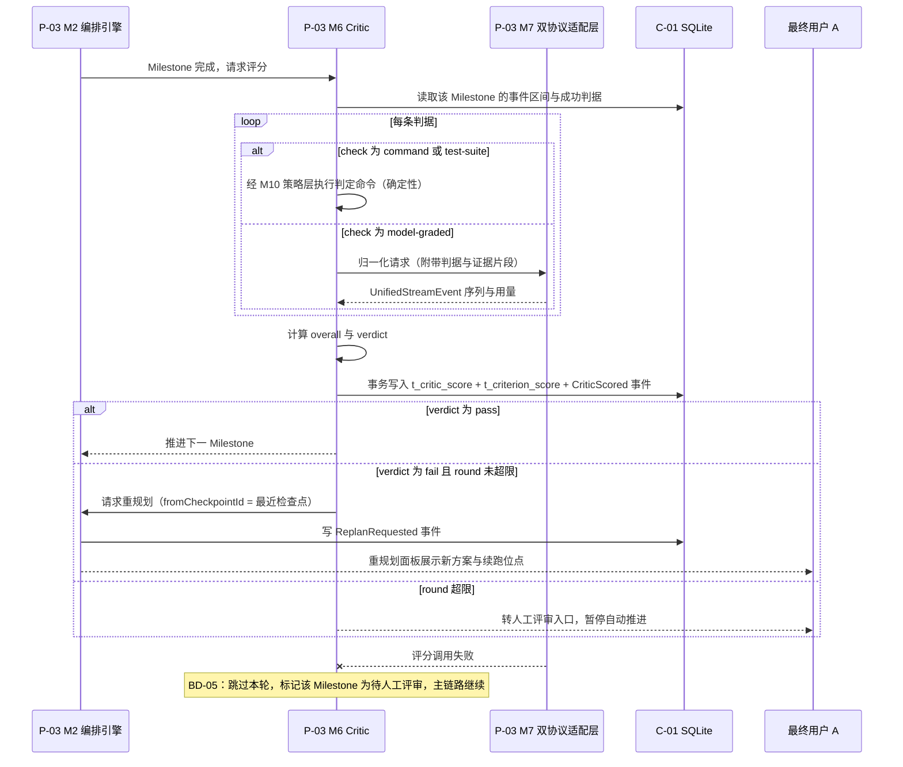

**SQ-M6-02 人工干预与记录**：

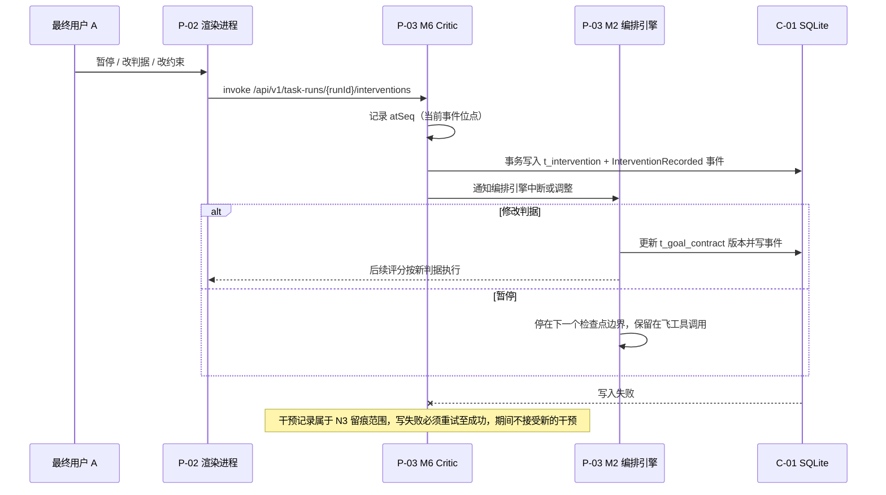

##### §3.2.M6.5 关键流程逻辑

**触发一：Milestone 完成（自动评分）**

```
Step 1: 取证据（同步）
  ├── 读取该 Milestone 区间的事件（按 seq 区间）
  ├── 读取成功判据（来自契约当前版本）
  └── 组装证据片段（变更集 diff + 关键命令输出 + 文件存在性）

Step 2: 逐条判定（同步 / 异步混合）
  ├── check = command / test-suite / file-exists → 确定性判定，经 M10 策略层执行
  ├── check = model-graded → 经 M7 归一化接口调用模型，返回 score + rationale + evidenceRefs
  └── 任一条判定失败（非"判据未达标"，而是"判定过程出错"）→ 标记该条为未判定，不阻塞其余

Step 3: 汇总与落库（同步，事务）
  ├── overall = 加权求和；verdict 按 §3.2.M6.3 的口径判定
  ├── 事务边界：t_critic_score + t_criterion_score + CriticScored 事件，同一事务
  └── 成本归集：把本次评分的 TokenUsage 累加到 t_task_run（支撑成本归因回路）

Step 4: 达标与未达标分支
  ├── pass → 推进下一 Milestone
  ├── fail 且 round &lt; maxRounds → 从最近检查点续跑，重规划轮次 +1，落 ReplanRequested 事件
  ├── fail 且 round >= maxRounds → 转人工评审，暂停自动推进
  └── 评分调用失败 → BD-05：跳过本轮，标记待人工评审，主链路不中断
```

**触发二：人工干预**

```
Step 1: 记录（同步，最高优先级写入）
  ├── atSeq 记录干预发生时的事件位点，保证可精确定位到时间轴
  ├── 事务边界：t_intervention + InterventionRecorded 事件 + t_audit_event，同一事务
  └── [硬约束 N3] 干预记录属留痕范围，写失败必须重试至成功，期间不接受新干预

Step 2: 生效（同步）
  ├── modify-criteria → 契约版本递增，后续评分按新判据执行（已完成的评分不回溯）
  ├── modify-constraints → 立即对在飞工具调用生效，越界调用被 M10 拒绝
  ├── pause → 停在下一个检查点边界，保留在飞工具调用
  └── abort → 终止并保留全部事件流

Step 3: 呈现（异步）
  └── Screen B 的「干预记录」模块按时间轴展示，每条可跳转到 atSeq 对应的事件
```

**状态机迁移表（Milestone + Critic）**：

| 起始状态 | 触发事件 | 终止状态 | 触发条件 / 校验 | 副作用 |
| --- | --- | --- | --- | --- |
| `PLANNED` | start | `IN_PROGRESS` | 前置依赖已完成 | 落 `MilestonePlanned` 事件 |
| `IN_PROGRESS` | done | `SCORED` | 该 Milestone 的 Task 全部完成 | 触发评分（SQ-M6-01） |
| `SCORED` | pass | `ACCEPTED` | `verdict = pass` | 推进下一 Milestone |
| `SCORED` | fail | `REJECTED` | `verdict = fail` 或 `partial` | 触发重规划或转人工 |
| `REJECTED` | replan | `IN_PROGRESS` | 轮次未超限 + 有可用检查点 | 落 `ReplanRequested`；续跑 |
| `REJECTED` | manual | `BLOCKED` | 轮次超限 | 转人工评审，暂停 |
| `BLOCKED` | resume | `IN_PROGRESS` | 用户调整判据或约束后 | 轮次计数重置 |

---

#### 3.2.M7 LLM 双协议适配层

##### §3.2.M7.1 模块概述

> **本模块承接调研 D-03：两套协议必须各自原生实现再做归一化。**

M7 覆盖「归一化请求 → 线协议转换 → 流式调用 → 流式事件归一化 → 用量归集 → 错误归一」这一段业务流程，是《高层架构设计》§6.3 的 F20 / F21 与 V4、N2 的落点。业务逻辑在**编排引擎 M2** 与**两家 LLM Provider（E-01 Anthropic 原生 / E-02 OpenAI 兼容）**之间流动，涉及 **M15 凭据中心（C-12）**、**C-01 事件库（用量落库）**、**C-11 追踪（Span 透传）** 等内外部系统的数据流动。本模块以 **ACL 防腐层**（C-02）形态存在：两套协议的原始 DTO 一律不得上行到编排层。

##### §3.2.M7.2 接口清单

| 子领域 | 方法 | 路径 | 用途（≤ 20 字） | 请求 DTO | 响应 VO | 幂等 | 鉴权 |
| --- | --- | --- | --- | --- | --- | --- | --- |
| 归一化 | POST | `/api/v1/llm/stream` | 发起一次归一化流式调用 | `UnifiedRequest` | `UnifiedStreamEvent` 流 | 否（生成类） | 本地调用 + 凭据就绪 |
| 归一化 | POST | `/api/v1/llm/count-tokens` | 估算 token（压缩前后对比） | `UnifiedRequest` | `TokenUsageVO` | 天然 | 本地调用 |
| 归一化 | GET | `/api/v1/llm/protocols` | 查询已实现的协议与能力矩阵 | — | `ProtocolCapabilityListVO` | 天然 | 本地调用 |
| 供应商 | GET | `/api/v1/llm/providers` | 查询供应商与协议配置 | — | `LlmProviderConfigListVO` | 天然 | 本地调用 |
| 供应商 | POST | `/api/v1/llm/providers/{providerId}/probe` | 连通性自检 | `ProbeRequest` | `ProbeResult` | 否（探测类） | 本地调用 + 二次确认 |
| 缓存 | POST | `/api/v1/llm/cache/plan` | 生成缓存计划（断点布局） | `CachePlanRequest` | `CachePlanVO` | 天然 | 本地调用 |
| 用量 | GET | `/api/v1/llm/usage` | 查询用量与费用归集 | `UsageQueryRequest` | `UsageSummaryVO` | 天然 | 本地调用 |

##### §3.2.M7.3 关键结构定义（DTO）

**两套协议的实质差异（必须各自原生实现的依据）**：

| 差异维度 | Anthropic Messages 原生协议（E-01） | OpenAI Chat Completions 兼容协议（E-02） | 归一化处理 |
| --- | --- | --- | --- |
| system 字段位置 | 请求顶层 `system`，可为 string 或 block 数组，可挂 `cache_control` | `messages` 数组中 `role=system` 的消息，可多条、散布在数组中 | 归一化模型把 system 提升为 `UnifiedRequest.system`（`ContentPart[]`）；下发时由适配器放回各自位置 |
| content block 结构 | `content` 恒为 block 数组（text / tool_use / tool_result / thinking / image），工具调用**嵌在 content 内** | `content` 为 string 或 part 数组；工具调用在消息级的 `tool_calls` 字段，**不在 content 内** | 统一为 `UnifiedMessage.parts`；`tool_call` / `tool_result` 归一化为一等 `ContentPart` |
| tool_use 形态 | `{ type: 'tool_use', id, name, input }`，`input` 为对象 | `{ id, type: 'function', function: { name, arguments } }`，`arguments` 为 **JSON 字符串**（流式时增量拼接） | 统一为 `{ kind: 'tool_call', callId, name, argsJson, argsPartial }`；适配层负责把对象序列化 / 把增量拼接为完整 JSON 并做 zod 校验 |
| tool_result 形态 | 一条 `role=user` 消息，content 内含 `{ type: 'tool_result', tool_use_id, content, is_error }` | 一条 `role=tool` 消息，字段为 `tool_call_id` 与 `content` | 统一为 `{ kind: 'tool_result', callId, output, isError }`，`callId` 是唯一关联键 |
| 流式事件类型 | SSE：`message_start` / `content_block_start` / `content_block_delta`（`text_delta` / `input_json_delta` / `thinking_delta`）/ `content_block_stop` / `message_delta`（含 `stop_reason` 与 `usage`）/ `message_stop` / `ping` / `error` | SSE chunk：`choices[0].delta.content`（文本增量）、`delta.tool_calls[index].function.arguments`（参数增量，需按 index 累积）、`finish_reason`；用量需 `stream_options.include_usage` 才在末尾返回 | 统一为 `UnifiedStreamEvent` 判别式联合（见下方代码）；适配层负责"按 index 累积 tool_call 参数"这类协议特有状态机 |
| `stop_reason` 取值 | `end_turn` / `max_tokens` / `stop_sequence` / `tool_use` / `pause_turn` / `refusal` | `stop` / `length` / `tool_calls` / `content_filter` / `function_call`（已废弃） | 统一为 `StopReason` 枚举（`end_turn` / `max_tokens` / `stop_sequence` / `tool_use` / `refusal` / `content_filter` / `pause_turn`）；`function_call` 归一为 `tool_use` |
| 缓存机制 | **显式**：在任意 block 上打 `cache_control: { type: 'ephemeral' }`，最多 4 个断点；返回 `cache_creation_input_tokens` / `cache_read_input_tokens` | **隐式**：prompt 前缀超过最小长度后自动命中前缀缓存；返回 `usage.prompt_tokens_details.cached_tokens`；**无显式控制字段** | 归一化 `CacheStrategy`（`explicit-breakpoints` / `implicit-prefix`）与 `CachePlan`；OpenAI 侧的策略退化为"保证前缀稳定"，并在用量中同样记入 `cacheRead` |
| 工具定义 Schema | `{ name, description, input_schema }` | `{ type: 'function', function: { name, description, parameters } }` | 统一为 `ToolSpec.jsonSchema`；下发时由适配器包成各自形状 |
| 长度参数命名 | `max_tokens`（必填） | `max_completion_tokens`（新版）/ `max_tokens`（兼容实现） | 统一为 `UnifiedRequest.maxTokens`；适配器按供应商能力探测结果选择字段名 |
| 停止序列 | `stop_sequences`（数组） | `stop`（数组或字符串） | 统一为 `UnifiedRequest.stop` 数组 |
| 用量字段 | `input_tokens` / `output_tokens` | `prompt_tokens` / `completion_tokens` | 统一为 `TokenUsage`（`input` / `output` / `cacheWrite` / `cacheRead` / `total`） |

**归一化内部消息模型（Shared Kernel 之外，仅本模块与 M4 之间流通）**：

```ts
// ===== packages/llm/src/unified =====

type Role = 'system' | 'user' | 'assistant' | 'tool';

type ContentPart =
  | { kind: 'text'; text: string }
  | { kind: 'thinking'; text: string; redacted?: boolean }      // Anthropic thinking block
  | { kind: 'tool_call'; callId: string; name: string; argsJson: string; argsPartial: boolean }
  | { kind: 'tool_result'; callId: string; output: string; isError: boolean }
  | { kind: 'image'; mime: string; b64: string }
  | { kind: 'cache_breakpoint' };   // Anthropic 显式断点；OpenAI 侧降级为无操作

interface UnifiedMessage { role: Role; parts: ContentPart[]; name?: string; }

interface ModelRef {
  providerId: string;
  protocol: 'anthropic.messages' | 'openai.chat-completions';
  model: string;
  contextWindow: number;           // 上下文窗口上限，用于压缩阈值计算
  maxOutputTokens: number;
  capabilities: {
    thinking: boolean;
    explicitCache: boolean;
    vision: boolean;
    parallelToolCalls: boolean;
  };
}

interface UnifiedRequest {
  // ===== 基本信息 =====
  requestId: string;               // ULID，用于幂等与追踪
  modelRef: ModelRef;
  traceId: string;
  tenantId: string;
  // ===== 业务字段 =====
  system: ContentPart[];           // 归一化后 system 提升为顶层
  messages: UnifiedMessage[];
  tools: ToolSpec[];
  toolChoice: 'auto' | 'none' | 'required' | { name: string };
  // ===== 参数 =====
  maxTokens: number;
  temperature?: number;
  stop?: string[];
  // ===== 缓存 =====
  cacheStrategy: CacheStrategy;
  cachePlan?: CachePlan;
}

interface CacheStrategy {
  mode: 'explicit-breakpoints' | 'implicit-prefix';
  maxBreakpoints: number;          // Anthropic 侧上限 4
}

// 缓存断点的语义位置（具名类型展开，避免泛型与内联对象类型）
type CacheBreakpointAt = 'system-tail' | 'tools-tail' | 'summary-boundary' | 'milestone-start';

interface CacheBreakpoint {
  at: CacheBreakpointAt;
  ref: string;                     // 断点锚定的内容引用（如 system 块哈希、工具定义哈希）
}

interface CachePlan {
  // 四个断点的语义位置；OpenAI 侧仅用于保证前缀稳定，不下发任何字段
  breakpoints: CacheBreakpoint[];
  stablePrefixHash: string;        // 前缀稳定性校验：内容变化即视为缓存失效
}

// ===== 归一化流式事件（判别式联合，不含尖括号）=====
interface UnifiedStreamEvent {
  type: 'message_start' | 'text_delta' | 'thinking_delta' | 'tool_call_start'
      | 'tool_call_args_delta' | 'tool_call_end' | 'stop' | 'usage' | 'error';
  messageId?: string;
  index?: number;                  // content block 或 tool_call 的下标
  text?: string;
  callId?: string;
  name?: string;
  partialJson?: string;
  reason?: StopReason;
  usage?: TokenUsage;
  error?: UnifiedError;
}

type StopReason = 'end_turn' | 'max_tokens' | 'stop_sequence' | 'tool_use'
                | 'refusal' | 'content_filter' | 'pause_turn';

interface TokenUsage {
  input: number;
  output: number;
  cacheWrite: number;              // Anthropic: cache_creation_input_tokens
  cacheRead: number;               // Anthropic: cache_read_input_tokens；OpenAI: cached_tokens
  total: number;
}

// ===== 协议适配器接口：两套协议各自实现，禁止共用一套转换 =====
interface LlmProtocolAdapter {
  readonly protocol: 'anthropic.messages' | 'openai.chat-completions';
  readonly apiVersion: string;     // 如 anthropic-version: 2023-06-01
  toWire(req: UnifiedRequest, credential: CredentialHandle): WireRequest;
  fromWireChunk(chunk: WireChunk, state: StreamState): UnifiedStreamEvent[];
  fromWireStop(chunk: WireChunk): StopReason;
  normalizeUsage(wireUsage: JsonObject): TokenUsage;
  applyCachePlan(req: UnifiedRequest, plan: CachePlan): UnifiedRequest;
  translateError(status: number, body: string): UnifiedError;
  probe(credential: CredentialHandle): ProbeOutcome;   // 连通性自检
}
```

| DTO / VO 名 | 字段名 | 类型 | 必填 | 业务含义 | 约束 / 默认值 |
| --- | --- | --- | --- | --- | --- |
| `UnifiedRequest` | `system` | `ContentPart[]` | 否 | 归一化后的 system 段 | 两套协议 system 位置不同的收敛点 |
| `UnifiedRequest` | `cacheStrategy.mode` | 枚举 | 是 | 缓存模式 | Anthropic 用 `explicit-breakpoints`；OpenAI 用 `implicit-prefix` |
| `ContentPart`（`tool_call`） | `argsPartial` | boolean | 是 | 参数是否仍在流式拼接中 | 为 `true` 时禁止执行工具 |
| `UnifiedStreamEvent` | `type` | 枚举 | 是 | 归一化事件类型 | 9 个取值；两套协议的原生事件全部收敛到此 |
| `StopReason` | — | 枚举 | 是 | 停止原因 | 7 个取值；OpenAI 的 `function_call` 归一为 `tool_use` |
| `TokenUsage` | `cacheRead` | number | 是 | 缓存读取 token | Anthropic 与 OpenAI 均有对应字段，据此度量 V5 |
| `ModelRef` | `capabilities.explicitCache` | boolean | 是 | 是否支持显式缓存 | 决定 `CacheStrategy.mode` 的选择 |
| `CachePlan` | `stablePrefixHash` | string | 是 | 前缀稳定性校验 | 内容变化即视为缓存失效并告警 AL-09 |

**缓存策略（对齐 V5：token 峰值下降 ≥ 60%）**：

| 协议 | 断点布局（Anthropic 显式 `cache_control`） | 前缀稳定策略（OpenAI 隐式） |
| --- | --- | --- |
| Anthropic 原生 | 4 个断点：`system-tail`（system 段末尾）、`tools-tail`（工具定义末尾）、`summary-boundary`（最近一次压缩摘要边界）、`milestone-start`（当前 Milestone 起点） | 不适用 |
| OpenAI 兼容 | 不适用（无 `cache_control` 字段，下发时忽略断点 Part） | 保持 `system` + 工具定义 + 历史消息前缀逐字稳定；**禁止在中间插入或改写历史消息**；用 `stablePrefixHash` 校验，变化即视为缓存失效并告警 AL-09；用量从 `prompt_tokens_details.cached_tokens` 归集到 `cacheRead` |

##### §3.2.M7.4 模块逻辑时序图

| 编号 | 标题 | 场景类别 | 是否包含异常分支 |
| --- | --- | --- | --- |
| SQ-M7-01 | LLM 双协议适配层 - 一次含工具调用的流式闭环 | 核心动作的执行 / 触发 / 回调 | 是 |
| SQ-M7-02 | LLM 双协议适配层 - 429 与 5xx 的退避与切换 | 异常 / 补偿 / 回滚 | 是 |

**SQ-M7-01 一次含工具调用的流式闭环**：

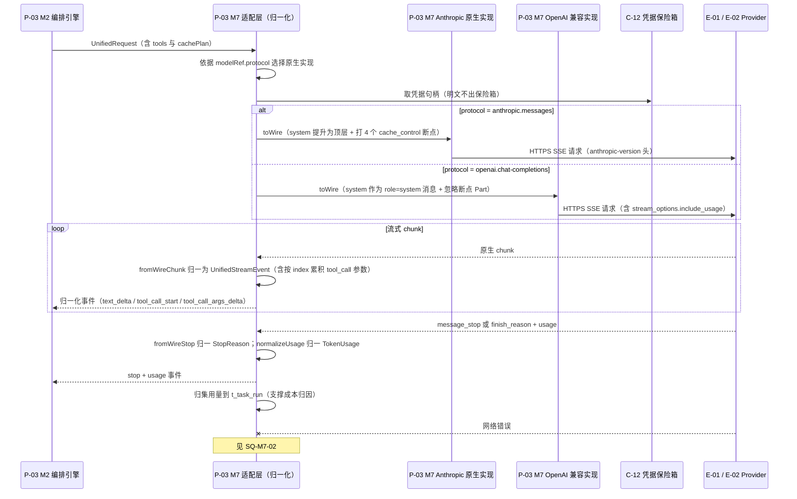

**SQ-M7-02 429 与 5xx 的退避与切换**：

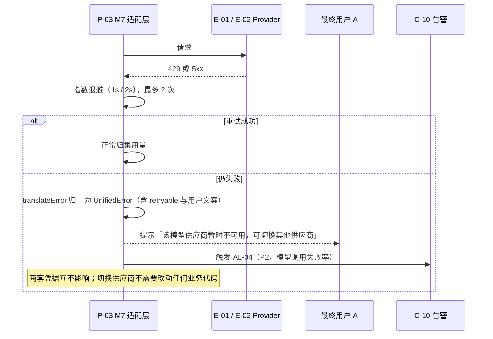

##### §3.2.M7.5 关键流程逻辑

**触发：一次归一化流式调用**

```
Step 1: 归一化装配（同步）
  ├── 校验：modelRef.protocol 必须有一个已注册的原生实现 → 未注册返回 B070001
  ├── 校验：tools 的 jsonSchema 可编译 → 失败返回 B070002
  ├── 缓存计划：按 protocol 生成 CachePlan（Anthropic 4 断点 / OpenAI 前缀稳定哈希）
  └── 取凭据：经 C-12 取句柄，**明文不出 OS 保险箱**，请求头在适配层内组装

Step 2: 线协议转换（同步）
  ├── Anthropic 原生实现：system → 顶层字段；tool_call → content 内 tool_use block；
  │                       cache_breakpoint Part → cache_control: { type: 'ephemeral' }
  └── OpenAI 兼容实现：system → role=system 消息；tool_call → 消息级 tool_calls；
                       cache_breakpoint Part → 忽略（仅保留前缀稳定约束）

Step 3: 流式归一（异步）
  ├── Anthropic：按 content_block_start / delta / stop 的三段式状态机驱动
  ├── OpenAI：按 delta.tool_calls[index] 累积 arguments，**index 维状态机必须逐 index 维护**
  ├── 统一产出 UnifiedStreamEvent；`argsPartial = true` 的事件禁止触发工具执行
  └── 每个 chunk 的处理耗时计入 §8.1 的应用指标

Step 4: 结束与归集（同步）
  ├── fromWireStop 归一 StopReason（OpenAI 的 function_call → tool_use）
  ├── normalizeUsage 归一 TokenUsage（两侧字段名不同但语义统一）
  ├── 用量累加到 t_task_run，并写入 t_event 的 ModelObservation
  └── 缓存命中率 = cacheRead / (cacheRead + input)，纳入 AL-09 监控

Step 5: 错误归一（异常分支）
  ├── 网络错误 / 429 / 5xx → 指数退避 1s / 2s，最多 2 次；仍失败归一为 UnifiedError
  ├── 401 / 403 → 不可重试，归一为凭据错误并引导至设置与凭据中心（不重试，避免锁定）
  ├── 400 → 不可重试，归一为请求错误并记录 wire 摘要（**禁止记录含凭据的请求体**）
  └── 超时：首字节 30s；整体空闲超时 120s（见 §3.5.4）
```

**状态机迁移表（流式调用）**：

| 起始状态 | 触发事件 | 终止状态 | 触发条件 / 校验 | 副作用 |
| --- | --- | --- | --- | --- |
| `IDLE` | send | `STREAMING` | 凭据就绪 + 协议实现已注册 | 建立 SSE；记录首字节时间戳 |
| `STREAMING` | chunk | `STREAMING` | 收到合法 chunk | 归一事件并上行；累计用量 |
| `STREAMING` | tool_call_end | `STREAMING` | 参数累积完成 | 产出可执行的 tool_call（经 M4 / M10） |
| `STREAMING` | stop | `COMPLETED` | 收到 `message_stop` 或 `finish_reason` | 归一 stop_reason 与 usage；落 ModelObservation |
| `STREAMING` | error | `RETRYING` | 网络错误 / 429 / 5xx 且重试次数 &lt; 2 | 指数退避 1s / 2s |
| `RETRYING` | success | `STREAMING` | 重试成功 | 重新建立 SSE |
| `RETRYING` | exhausted | `FAILED` | 重试次数用尽 | 归一 `UnifiedError`；告警 AL-04 |
| `STREAMING` | idle_timeout | `FAILED` | 空闲超过 120s | 归一超时错误；告警 AL-04 |

---

#### 3.2.M8 MCP 网关

##### §3.2.M8.1 模块概述

M8 覆盖「MCP server 登记 → 传输握手 → 工具与资源发现 → 工具注册到抽象层 → 调用与结果归一」这一段业务流程，是《高层架构设计》§6.3 的 F23（client）与 F24（server，完整版）与 V7 的落点。业务逻辑在**最终用户 A（在管理面板添加 server）**与**外部 MCP Server（E-03）**之间流动，涉及 **M4 AgentRuntime 抽象层**、**M10 策略层（MCP 工具同样受权限裁决）**、**P-04 tool-host** 等内外部系统的数据流动。本模块以 **Conformist**（C-04）形态对接 MCP 规范，禁止引入私有工具协议（V7：标准协议接入占比 100%）。

##### §3.2.M8.2 接口清单

| 子领域 | 方法 | 路径 | 用途（≤ 20 字） | 请求 DTO | 响应 VO | 幂等 | 鉴权 |
| --- | --- | --- | --- | --- | --- | --- | --- |
| 登记 | POST | `/api/v1/mcp/servers` | 登记一个 MCP server | `McpServerCreateRequest` | `McpServerVO` | 是（端点 + 名称唯一） | 本地调用 + 用户确认 |
| 登记 | DELETE | `/api/v1/mcp/servers/{serverId}` | 移除 server | — | `Result` | 天然 | 本地调用 |
| 登记 | GET | `/api/v1/mcp/servers` | 查询已登记 server 与状态 | — | `McpServerListVO` | 天然 | 本地调用 |
| 连接 | POST | `/api/v1/mcp/servers/{serverId}/connect` | 建立连接并发现工具 | `McpConnectRequest` | `McpConnectResult` | 是（serverId + 版本号） | 本地调用 |
| 连接 | POST | `/api/v1/mcp/servers/{serverId}/disconnect` | 断开连接 | — | `Result` | 天然 | 本地调用 |
| 工具 | GET | `/api/v1/mcp/servers/{serverId}/tools` | 查询该 server 暴露的工具 | — | `ToolSpecListVO` | 天然 | 本地调用 |
| 工具 | POST | `/api/v1/mcp/servers/{serverId}/tools/{toolName}/invoke` | 调用 MCP 工具（经裁决） | `ToolInvokeRequest` | `ToolInvocationVO` | 视工具而定 | 本地调用 + 策略层裁决 |
| 服务端 | POST | `/api/v1/mcp/expose/enable` | 对外暴露本系统能力（F24） | `McpExposeRequest` | `McpExposeResult` | 是（版本号） | 本地调用 + 用户确认 |

##### §3.2.M8.3 关键结构定义（DTO）

```ts
// ===== packages/capability/src/mcp =====

interface McpServerCreateRequest {
  name: string;                    // 用户可读名称，同时作为工具命名空间
  transport: 'stdio' | 'streamable-http' | 'legacy-sse';
  // stdio 形态：命令与参数由用户填写，且**命令本身须经 M10 策略层裁决后才可拉起**
  command?: string;
  args?: string[];
  envAllow?: string[];             // 允许透传的环境变量名白名单，默认不透传任何变量
  // 远程形态
  endpoint?: string;               // https 端点，必须 https，禁止明文 http
  auth?: { kind: 'none' | 'header' | 'oauth'; credentialRefId?: string };
  autoConnect: boolean;
}

interface McpServerVO {
  serverId: string;
  name: string;
  transport: 'stdio' | 'streamable-http' | 'legacy-sse';
  specVersion: string;             // MCP 规范版本，当前 2025-06-18
  status: 'DISCONNECTED' | 'CONNECTING' | 'CONNECTED' | 'DEGRADED' | 'FAILED';
  toolCount: number;
  registeredToolNames: string[];
  lastError?: string;
  degradedReason?: string;         // 如「已回退到旧 SSE 传输」
}

interface McpConnectResult {
  ok: boolean;
  serverId: string;
  transportUsed: 'stdio' | 'streamable-http' | 'legacy-sse';
  fallbackApplied: boolean;        // 是否发生从 Streamable HTTP 到旧 SSE 的回退
  tools: ToolSpec[];
}
```

| DTO / VO 名 | 字段名 | 类型 | 必填 | 业务含义 | 约束 / 默认值 |
| --- | --- | --- | --- | --- | --- |
| `McpServerCreateRequest` | `transport` | 枚举 | 是 | 传输方式 | `stdio` / `streamable-http` / `legacy-sse`（仅兼容探测用，不主动选择） |
| `McpServerCreateRequest` | `envAllow` | string[] | 否 | 环境变量透传白名单 | 默认空（不透传任何变量），防凭据泄漏 |
| `McpServerCreateRequest` | `endpoint` | string | 条件必填 | 远程端点 | 远程形态必填；**必须 https** |
| `McpServerVO` | `specVersion` | string | 是 | 规范版本 | 当前 2025-06-18 |
| `McpServerVO` | `status` | 枚举 | 是 | 连接状态 | 5 个取值；`DEGRADED` 表示回退到旧传输 |
| `McpConnectResult` | `fallbackApplied` | boolean | 是 | 是否发生传输回退 | `true` 时 UI 明示「已回退到旧传输方式」 |

**传输选择规则**：本地 server 优先 `stdio`（规范对本地场景的推荐）；远程 server 优先 `streamable-http`（2025-06-18 的标准远程传输）；**`legacy-sse` 仅作为兼容探测结果**，当 `streamable-http` 握手失败且服务返回旧 SSE 特征时自动回退，并在 UI 明示（SSE 已在 2025-06-18 中被标记废弃）。

##### §3.2.M8.4 模块逻辑时序图

| 编号 | 标题 | 场景类别 | 是否包含异常分支 |
| --- | --- | --- | --- |
| SQ-M8-01 | MCP 网关 - 登记、连接与工具发现 | 核心实体的创建 / 配置 / 发布 | 是 |
| SQ-M8-02 | MCP 网关 - 调用失败与 server 摘除 | 异常 / 补偿 / 回滚 | 是 |

**SQ-M8-01 登记、连接与工具发现**：

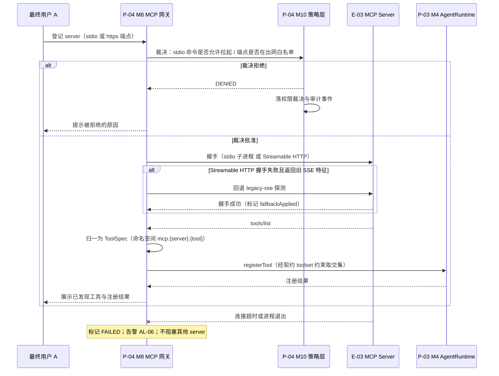

**SQ-M8-02 调用失败与 server 摘除**：

```mermaid
sequenceDiagram
    participant RT as P-03 M4 AgentRuntime
    participant G as P-04 M8 MCP 网关
    participant S as E-03 MCP Server
    participant U as 最终用户 A
    RT->>G: invoke（携带 ToolSpec 与 argsJson）
    G->>S: tools/call
    alt 成功
        S-->>G: 结果
        G-->>RT: ToolResultObservation
    else 连续失败达 3 次
        S--xG: 失败
        G->>G: 摘除该 server 的全部工具注册（BD-09）
        G-->>U: 提示「某个外部工具暂时不可用，已从可用工具中移除」
        G->>G: 落审计事件与告警 AL-06
    end
```

##### §3.2.M8.5 关键流程逻辑

**触发：登记并连接一个 MCP server**

```
Step 1: 登记校验（同步）
  ├── 校验：name 与端点唯一 → 重名返回 A080201
  ├── 校验：远程端点必须 https → 明文 http 直接拒绝（返回 A080202）
  ├── 校验：stdio 命令须经 M10 策略层裁决（命令白名单 + 人工在环）
  └── envAllow 默认空：不透传任何环境变量，防凭据经 MCP 子进程泄漏

Step 2: 传输握手（异步）
  ├── stdio：由 P-04 拉起子进程，JSON-RPC 行协议；子进程生命周期随 server 绑定
  ├── streamable-http：直接握手；失败且返回旧 SSE 特征 → 回退 legacy-sse 并标记
  └── 握手超时 15s；超时标记 FAILED，不阻塞其他 server

Step 3: 工具发现与注册（同步）
  ├── tools/list 归一为 ToolSpec，命名空间 `mcp.{server}.{tool}`
  ├── 风险定级：按工具语义与用户提供值定级，**不采信 server 侧的自我声明**
  └── 与契约 toolset 约束取交集后注册到 M4；未通过的不注册并提示

Step 4: 调用与容错（异步）
  ├── 每次调用必经 M10 策略层裁决（MCP 工具与内置工具同等受控）
  ├── 单次调用超时 60s（见 §3.5.4）；超时不重试（工具可能非幂等）
  └── 连续 3 次失败 → 摘除该 server 全部工具（BD-09），告警 AL-06
```

**状态机迁移表（McpServer）**：

| 起始状态 | 触发事件 | 终止状态 | 触发条件 / 校验 | 副作用 |
| --- | --- | --- | --- | --- |
| — | register | `DISCONNECTED` | 登记校验通过 | 落配置，不拉起进程 |
| `DISCONNECTED` | connect | `CONNECTING` | 策略层批准 | 握手（stdio 或 HTTP） |
| `CONNECTING` | handshake_ok | `CONNECTED` | 握手成功 | tools/list 并注册到 M4 |
| `CONNECTING` | sse_fallback | `CONNECTED` | Streamable HTTP 失败且命中旧 SSE 特征 | 标记 `DEGRADED`，UI 明示 |
| `CONNECTED` | degrade | `DEGRADED` | 传输回退或能力缺失 | 保留可用工具，提示用户 |
| `CONNECTED` / `DEGRADED` | call_fail_x3 | `FAILED` | 连续 3 次调用失败 | 摘除工具（BD-09）；告警 AL-06 |
| `FAILED` | reconnect | `CONNECTING` | 用户手动重试 | 重新握手 |
| 任意 | remove | `DISCONNECTED` | 用户移除 | 注销全部工具并终止子进程 |

---

#### 3.2.M9 Skill 加载器

##### §3.2.M9.1 模块概述

M9 覆盖「技能目录扫描 → frontmatter 校验 → 渐进式加载 → 注入上下文 / 注册为能力」这一段业务流程，是《高层架构设计》§6.3 的 F25 与 V7 的落点。业务逻辑在**最终用户 A（指定技能目录、启用或禁用 Skill）**与**本地技能包（E-04）**之间流动，涉及 **M4 AgentRuntime 抽象层**、**M2 编排引擎**、**C-04 文件系统** 等内外部系统的数据流动。本模块以 **Conformist**（C-05）形态采纳 agentskills.io 开放标准。

##### §3.2.M9.2 接口清单

| 子领域 | 方法 | 路径 | 用途（≤ 20 字） | 请求 DTO | 响应 VO | 幂等 | 鉴权 |
| --- | --- | --- | --- | --- | --- | --- | --- |
| 扫描 | POST | `/api/v1/skills/scan` | 扫描技能目录 | `SkillScanRequest` | `SkillScanResult` | 否（扫描类，结果可重放） | 本地调用 |
| 包 | GET | `/api/v1/skills` | 查询已发现的技能包 | — | `SkillPackageListVO` | 天然 | 本地调用 |
| 包 | GET | `/api/v1/skills/{skillId}` | 查询技能包详情 | — | `SkillPackageDetailVO` | 天然 | 本地调用 |
| 包 | PUT | `/api/v1/skills/{skillId}/enabled` | 启用或禁用技能包 | `SkillToggleRequest` | `SkillPackageVO` | 是（id + version） | 本地调用 |
| 加载 | POST | `/api/v1/skills/{skillId}/load` | 渐进加载第 N 层 | `SkillLoadRequest` | `SkillLoadResult` | 天然 | 本地调用 |
| 加载 | GET | `/api/v1/skills/loaded` | 查询当前已加载内容 | — | `SkillLoadedStateVO` | 天然 | 本地调用 |

##### §3.2.M9.3 关键结构定义（DTO）

```ts
// ===== packages/capability/src/skill =====
// 采纳 agentskills.io 开放标准：SKILL.md + YAML frontmatter 六字段

interface SkillFrontmatter {
  // ===== 规范六字段（严格限定，扩展信息一律放入 metadata）=====
  name: string;                    // 必填；小写字母数字与连字符
  description: string;             // 必填；触发判断的唯一依据
  license?: string;
  compatibility?: string;
  metadata?: JsonObject;           // 扩展信息的唯一合法位置
  allowedTools?: string[];         // 【实验性字段，不作权限判定依据，见调研 R-08】
}

interface SkillPackageVO {
  skillId: string;
  name: string;
  description: string;
  version: string;                 // 来自目录或 metadata，缺省为目录哈希
  rootPath: string;                // 技能包根目录（工作区内或用户指定目录）
  loadLevel: 'none' | 'meta' | 'instruction' | 'resource';
  enabled: boolean;
  specVersion: string;             // agentskills.io 规范版本，实现时固定并写入文档
  validation: { valid: boolean; errors: string[] };
}

interface SkillLoadRequest {
  skillId: string;
  target: 'meta' | 'instruction' | 'resource';
}

interface SkillLoadResult {
  ok: boolean;
  skillId: string;
  loadLevel: 'meta' | 'instruction' | 'resource';
  injectedTokens: number;          // 本次注入的 token 数，纳入 V5 度量
  registeredToolNames: string[];   // 若该 Skill 附带可执行脚本并注册为工具
}
```

| DTO / VO 名 | 字段名 | 类型 | 必填 | 业务含义 | 约束 / 默认值 |
| --- | --- | --- | --- | --- | --- |
| `SkillFrontmatter` | `name` | string | 是 | 技能名 | 必填；小写字母数字与连字符 |
| `SkillFrontmatter` | `description` | string | 是 | 技能描述 | **触发判断的唯一依据** |
| `SkillFrontmatter` | `metadata` | `JsonObject` | 否 | 扩展信息 | 扩展字段的唯一合法位置 |
| `SkillFrontmatter` | `allowedTools` | string[] | 否 | 建议可用工具 | **实验性字段，不作权限判定依据**（调研 R-08） |
| `SkillPackageVO` | `loadLevel` | 枚举 | 是 | 渐进加载层级 | `none` / `meta` / `instruction` / `resource` |
| `SkillPackageVO` | `validation.valid` | boolean | 是 | frontmatter 是否合法 | 非法包默认禁用并提示 |
| `SkillLoadResult` | `injectedTokens` | number | 是 | 本次注入 token | 纳入 V5 的上下文预算核算 |

**渐进加载三层**（对齐 R-06 的上下文膨胀控制）：

| 层级 | 加载内容 | 触发时机 | 预算 |
| --- | --- | --- | --- |
| `meta` | 仅 `name` + `description` | 扫描后常驻，用于判断是否相关 | 每包 ≤ 100 token |
| `instruction` | `SKILL.md` 正文 | 命中相关性判断后加载 | 单包 ≤ 4000 token |
| `resource` | 附带的脚本、模板、参考文件 | 执行到相关步骤时按需加载 | 按需，计入上下文预算并可被压缩 |

##### §3.2.M9.4 模块逻辑时序图

| 编号 | 标题 | 场景类别 | 是否包含异常分支 |
| --- | --- | --- | --- |
| SQ-M9-01 | Skill 加载器 - 扫描与渐进加载 | 核心实体的创建 / 配置 / 发布 | 是 |
| SQ-M9-02 | Skill 加载器 - frontmatter 非法包的处理 | 异常 / 补偿 / 回滚 | 是 |

**SQ-M9-01 扫描与渐进加载**：

```mermaid
sequenceDiagram
    participant U as 最终用户 A
    participant L as P-04 M9 Skill 加载器
    participant F as C-04 文件系统
    participant RT as P-03 M4 AgentRuntime
    participant A as P-03 M2 编排引擎
    U->>L: 指定技能目录并扫描
    L->>F: 递归查找 SKILL.md（跳过 node_modules 与隐藏目录）
    F-->>L: 候选路径列表
    loop 每个候选
        L->>L: 解析 YAML frontmatter
        alt frontmatter 合规
            L->>L: 记入 t_skill_package，loadLevel = meta
            L->>RT: 注册 description 用于相关性判断（不注册为工具）
        else 不合规
            L-->>U: 标记非法并禁用，提示具体错误
        end
    end
    A->>L: 相关性命中，请求加载 instruction
    L->>F: 读取 SKILL.md 正文
    L-->>A: 注入上下文（injectedTokens 计入预算）
    A->>L: 执行到相关步骤，请求 resource
    L->>F: 读取附带资源
    L-->>A: 注入或注册为工具
```

**SQ-M9-02 frontmatter 非法包的处理**：

```mermaid
sequenceDiagram
    participant L as P-04 M9 Skill 加载器
    participant U as 最终用户 A
    participant AU as C-09 审计
    L->>L: 解析失败（缺 description / 字段越界 / YAML 语法错误）
    L->>L: 标记 enabled = false，记录 errors
    L->>AU: 留痕（技能包路径 + 错误原因摘要，**不落技能正文**）
    L-->>U: 提示「某个技能包格式不合规，已禁用」，并给出修复建议
    Note over L: 非法包绝不进入上下文，也绝不注册为工具
```

##### §3.2.M9.5 关键流程逻辑

**触发：扫描技能目录**

```
Step 1: 发现（同步）
  ├── 递归查找 SKILL.md；跳过 node_modules、隐藏目录与符号链接环
  └── 深度上限 6 层，单次扫描上限 500 个包，防止异常目录拖垮启动

Step 2: 校验（同步）
  ├── frontmatter 必须含 name 与 description → 缺失即非法
  ├── 字段严格限定在规范六字段内 → 越界字段提示移入 metadata
  ├── allowedTools 仅作展示，**不作权限判定依据**（调研 R-08）
  └── 非法包默认禁用并提示，不进入上下文、不注册为工具

Step 3: 渐进加载（异步）
  ├── meta 层常驻（每包 ≤ 100 token），用于相关性判断
  ├── instruction 层命中后加载（单包 ≤ 4000 token）
  └── resource 层按需加载，计入上下文预算并可被 M2 压缩

Step 4: 权限（同步）
  └── Skill 附带的可执行脚本若注册为工具，其风险定级与权限判定**与内置工具完全一致**，
      不因来自 Skill 而降低标准（allowed-tools 不参与判定）
```

**状态机迁移表（SkillPackage）**：

| 起始状态 | 触发事件 | 终止状态 | 触发条件 / 校验 | 副作用 |
| --- | --- | --- | --- | --- |
| — | scan | `DISCOVERED` | 找到 SKILL.md | 解析 frontmatter |
| `DISCOVERED` | validate_ok | `AVAILABLE`（`meta`） | 六字段合规 | 注册 description 供相关性判断 |
| `DISCOVERED` | validate_fail | `INVALID` | 缺字段或越界 | 禁用 + 提示 + 留痕 |
| `AVAILABLE` | relevant | `LOADED`（`instruction`） | 相关性命中 | 注入正文，计入 token 预算 |
| `LOADED` | need_resource | `FULL`（`resource`） | 执行到相关步骤 | 注入资源或注册工具 |
| `FULL` / `LOADED` | compact | `LOADED` | 上下文压缩触发 | 释放 resource 层，保留 instruction |
| 任意 | toggle_off | `DISABLED` | 用户禁用 | 从上下文中移除 |

---

#### 3.2.M10 本地执行器与权限沙箱策略层

##### §3.2.M10.1 模块概述

M10 覆盖「执行请求 → 双轴策略判定 → OS 原语选择 → 执行 → 结果回传 → 审计留痕」这一段业务流程，是《高层架构设计》§6.3 的 F15 / F17 / F18 与 V2、N3、对外承诺 C1 / C8 的落点。业务逻辑在**最终用户 A（批准或拒绝）**与**本机 shell / CLI / 文件系统（E-07 / E-08）**之间流动，涉及 **M4 AgentRuntime 抽象层**、**M5 Hooks**、**M14 云端沙箱**、**C-09 审计**、**C-12 凭据** 等内外部系统的数据流动。**本模块是 C1（Windows 隔离强度明示）与 C8（本地沙箱为主、代码不出本机）两条对外承诺的技术兑现点**。

| 要素 | 内容 |
| --- | --- |
| 模块在业务流程中的位置 | 执行与安全域的核心；上承 M4，下接本机 OS 与文件系统 |
| 涉及的角色 | 最终用户 A（批准 / 拒绝 / 降级）、受影响方：本机环境（被保护对象） |
| 涉及的内外部系统 | M2、M4、M5、M11、M14、E-07、E-08、C-01、C-09、C-12 |

##### §3.2.M10.2 接口清单

| 子领域 | 方法 | 路径 | 用途（≤ 20 字） | 请求 DTO | 响应 VO | 幂等 | 鉴权 |
| --- | --- | --- | --- | --- | --- | --- | --- |
| 裁决 | POST | `/api/v1/policy/decisions` | 提交一次裁决请求 | `PolicyDecisionRequest` | `PolicyDecisionVO` | 是（`X-Idempotency-Key`） | 本地调用 |
| 裁决 | POST | `/api/v1/policy/decisions/{decisionId}/resolve` | 用户对裁决做出选择 | `DecisionResolveRequest` | `PolicyDecisionVO` | 是（decisionId + 序号） | 本地调用 + 用户确认 |
| 裁决 | GET | `/api/v1/policy/decisions` | 查询裁决历史 | `PageRequest` | `PolicyDecisionPageVO` | 天然 | 本地调用 |
| 执行 | POST | `/api/v1/exec/commands` | 执行一条命令（经裁决） | `CommandExecuteRequest` | `CommandExecutionVO` | 视命令而定 | 本地调用 + 裁决批准 |
| 执行 | POST | `/api/v1/exec/commands/{execId}/interrupt` | 中断执行中的命令 | `InterruptRequest` | `Result` | 天然 | 本地调用 |
| 执行 | GET | `/api/v1/exec/commands/{execId}` | 查询执行结果与输出 | — | `CommandExecutionDetailVO` | 天然 | 本地调用 |
| 策略 | GET | `/api/v1/policy/profile` | 查询当前双轴策略配置 | — | `PolicyProfileVO` | 天然 | 本地调用 |
| 策略 | PUT | `/api/v1/policy/profile` | 修改双轴策略配置 | `PolicyProfileUpdateRequest` | `PolicyProfileVO` | 是（版本号） | 本地调用 + 二次确认 |
| 档位 | GET | `/api/v1/policy/tier` | 查询当前审批档位与会话授权 | — | `ApprovalTierVO` | 天然 | 本地调用 |
| 档位 | PUT | `/api/v1/policy/tier` | 运行时切换审批档位 | `ApprovalTierSwitchRequest` | `ApprovalTierVO` | 是（版本号） | 本地调用 + 二次确认 |
| 档位 | GET | `/api/v1/policy/risk-rules` | 查询命令风险分级表（可配置） | — | `RiskRuleTableVO` | 天然 | 本地调用 |
| 档位 | PUT | `/api/v1/policy/risk-rules` | 编辑命令风险分级表 | `RiskRuleTableUpdateRequest` | `RiskRuleTableVO` | 是（版本号） | 本地调用 + 二次确认 |
| 档位 | DELETE | `/api/v1/policy/session-grants` | 撤销全部会话级授权 | — | `Result` | 是（版本号） | 本地调用 + 二次确认 |
| 沙箱 | GET | `/api/v1/policy/capabilities` | 查询当前平台沙箱能力与降级 | — | `SandboxCapabilityVO` | 天然 | 本地调用 |

##### §3.2.M10.3 关键结构定义（DTO）

```ts
// ===== packages/domain/src/policy =====
// 双轴权限模型：审批策略 × 沙箱模式 正交可配（借鉴 Codex CLI，调研 T9）

type ApprovalPolicy = 'untrusted' | 'on-request' | 'on-failure' | 'never';
// untrusted  : 一律需要人工批准
// on-request : 由工具或命令自行声明需要批准时才打断
// on-failure : 自动执行，失败后才请求人工介入
// never      : 永不打断（仅限只读沙箱模式，UI 需强警示）

type SandboxMode = 'read-only' | 'workspace-write' | 'danger-full-access';
// read-only          : 只读，任何写入被拒绝
// workspace-write    : 仅允许工作区（含 worktree 副本）内写入
// danger-full-access : 允许工作区外写入，须逐次显式授权并留痕

type PermissionScope = 'read' | 'workspace-write' | 'global-write' | 'network' | 'elevated';

// ===== 三档审批策略（经中间确认 IC-08 裁决：方案 C + 默认「标准」）=====
// 档位是审批轴的「用户可见形态」，ApprovalPolicy 是其在策略引擎内部的映射结果。
type ApprovalTier = 'strict' | 'standard' | 'autonomous';
// strict     : 严格 —— 除只读命令外一律逐次弹窗；会话级授权不生效
// standard   : 标准（默认）—— 只读自动放行；工作区内写入任务开始时一次性会话授权；
//              工作区外写入与危险命令逐次弹窗
// autonomous : 自治 —— 只读与工作区内写入自动放行；工作区外写入与危险命令仍逐次弹窗（不可关闭）

// 命令风险分级（可配置，禁止硬编码在权限模块内）
type CommandRiskClass =
  | 'READ_ONLY'            // R1 只读：ls / cat / git status / rg ...
  | 'WORKSPACE_WRITE'      // R2 工作区内写入：写文件、mkdir、git commit（限工作区根目录内）
  | 'OUTSIDE_WRITE'        // R3 工作区外写入：任何落点在 workspaceRoot 之外的写入
  | 'DANGEROUS'            // R4 危险命令：rm -rf / 格式化 / 提权 / 监听端口 / 访问凭据目录
  | 'NETWORK'              // R5 网络访问：默认禁网，需逐次授权（SB-04）
  | 'UNKNOWN';             // R0 无法归类：按最严格档处理（保守默认）

type RiskDecisionMode = 'AUTO_APPROVE' | 'SESSION_GRANT' | 'PER_CALL_PROMPT' | 'DENY';

interface RiskRule {
  ruleId: string;
  riskClass: CommandRiskClass;
  matchers: RiskMatcher[];      // 命令原文的匹配规则（可配置）
  priority: number;             // 数值越小优先级越高；R4 黑名单恒为最高优先级
  enabled: boolean;
  builtIn: boolean;             // true 表示出厂内置规则，允许禁用但不允许删除
  description: string;
}

interface RiskMatcher {
  kind: 'exec-prefix' | 'regex' | 'path-outside-workspace' | 'network-host' | 'tool-name';
  pattern: string;              // exec-prefix / regex 用字符串；path / host 用 glob
  caseSensitive: boolean;
}

interface RiskRuleTableVO {
  version: number;              // 乐观锁；每次编辑 +1
  rules: RiskRule[];
  updatedAt: string;
  updatedBy: string;
}

// 档位 × 风险分级 → 裁决方式（唯一真值表，配置驱动，见 §3.2.M10.5 Step 1.5）
interface ApprovalTierVO {
  tier: ApprovalTier;
  previousTier?: ApprovalTier;
  matrix: TierDecisionMatrix;   // 6 类风险 × 3 档的具体裁决方式
  sessionGrants: SessionGrant[]; // 当前生效的会话级授权
  windowsNotice?: string;       // 仅 Windows 平台：宽松档风险敞口提示（C1）
  autonomousBlocked: boolean;   // true 表示当前平台禁止切到宽松档
  autonomousBlockReason?: string;
  version: number;
}

interface TierDecisionMatrix {
  READ_ONLY:       TierModes;
  WORKSPACE_WRITE: TierModes;
  OUTSIDE_WRITE:   TierModes;
  DANGEROUS:       TierModes;
  NETWORK:         TierModes;
  UNKNOWN:         TierModes;
}

// 某一风险等级在三档下的裁决方式（以具名类型展开，避免泛型书写）
interface TierModes {
  strict: RiskDecisionMode;
  standard: RiskDecisionMode;
  autonomous: RiskDecisionMode;
}

interface SessionGrant {
  grantId: string;
  runId: string;                // 会话 = 一次 TaskRun；任务结束或档位切换即失效
  riskClass: CommandRiskClass;
  scope: PermissionScope;
  pathPrefix?: string;          // 授权的路径前缀（工作区根目录）
  grantedAt: string;
  grantedBy: 'user' | 'policy';
  expiresAt?: string;
  revokedAt?: string;
}

interface ApprovalTierSwitchRequest {
  targetTier: ApprovalTier;
  scope: 'global' | 'current-run';   // 全局生效或仅当前任务生效
  revokeExistingGrants: boolean;     // 是否撤销已有会话授权
  version: number;                   // 乐观锁
  traceId: string;
}

interface PolicyProfileVO {
  approvalPolicy: ApprovalPolicy;
  sandboxMode: SandboxMode;
  commandAllowlist: string[];      // 命令白名单（可执行前缀）
  commandDenylist: string[];       // 危险命令黑名单，**优先级高于白名单**
  networkPolicy: { defaultDeny: boolean; allowHosts: string[] };
  pathPolicy: { workspaceRoot: string; readonlyPaths: string[]; forbiddenPaths: string[] };
  platformCapabilities: SandboxCapabilityVO;
  version: number;
}

interface SandboxCapabilityVO {
  platform: 'darwin' | 'win32' | 'linux';
  osPrimitive: 'seatbelt' | 'restricted-token-appcontainer-job' | 'landlock-seccomp' | 'none';
  available: boolean;              // false 表示降级为审批 + 白名单 + 工作区根目录约束
  degraded: boolean;
  degradeReason?: string;          // 如「Windows 原生沙箱为实验特性，无法阻止 world-writable 写入」
  uiNotice: string;                // 必须原样展示给用户的隔离强度说明
}

interface PolicyDecisionRequest {
  runId: string;
  subAgentId?: string;
  toolName: string;
  scope: PermissionScope;
  targetPath?: string;             // 文件操作的目标路径
  command?: string;                // 命令原文（用于白名单 / 黑名单与风险分级匹配）
  networkTarget?: string;          // 网络目标主机（用于出网白名单）
  riskLevel: ToolSpec['riskLevel'];
  traceId: string;
  // —— IC-08 新增：风险分级与档位上下文 ——
  parallelLaneId?: string;         // 并行子 Agent 泳道标识；用于审批不串行化（见 Step 2.5）
  allowAsyncPrompt: boolean;       // 调用方是否允许异步等待（子 Agent 并行时恒为 true）
}

interface PolicyDecisionVO {
  decisionId: string;
  outcome: 'APPROVED' | 'DENIED' | 'DOWNGRADED' | 'REQUIRE_APPROVAL' | 'TIMEOUT';
  approvalPolicy: ApprovalPolicy;
  sandboxMode: SandboxMode;
  osPrimitiveUsed: string;
  degraded: boolean;               // 本次是否以降级方式执行
  reason: string;                  // 用户可见的裁决理由
  decidedBy: 'policy' | 'user' | 'system';
  decidedAt: string;
  // —— IC-08 新增：审计必须携带的风险分级字段（V2 + N3）——
  risk: RiskDecisionContext;
}

interface RiskDecisionContext {
  commandText?: string;            // 命令原文（经 redaction，凭据类脱敏后留存）
  riskClass: CommandRiskClass;     // 风险等级分类
  riskClassSource: 'rule' | 'default' | 'tool-declared'; // 裁决依据来源
  matchedRuleId?: string;          // 命中的风险规则 ID（可回溯到用户自定义配置）
  tier: ApprovalTier;              // 裁决时生效的档位
  decisionMode: RiskDecisionMode;  // 该档位下该类风险应采取的裁决方式
  outcome: 'APPROVED' | 'DENIED' | 'REQUIRE_APPROVAL';  // 裁决结果（放行 / 拒绝 / 待人工）
  basis: string;                   // 裁决依据（用户可读，如「命中内置规则 R4-01 rm -rf」）
  grantId?: string;                // 若由会话级授权放行，记录授权 ID
}
```

| DTO / VO 名 | 字段名 | 类型 | 必填 | 业务含义 | 约束 / 默认值 |
| --- | --- | --- | --- | --- | --- |
| `PolicyProfileVO` | `approvalPolicy` | 枚举 | 是 | 审批策略轴 | `untrusted` / `on-request` / `on-failure` / `never` |
| `PolicyProfileVO` | `sandboxMode` | 枚举 | 是 | 沙箱模式轴 | `read-only` / `workspace-write` / `danger-full-access` |
| `PolicyProfileVO` | `commandDenylist` | string[] | 是 | 危险命令黑名单 | **优先级高于白名单**，命中一律拒绝 |
| `SandboxCapabilityVO` | `available` | boolean | 是 | 平台原语是否可用 | `false` 时降级并在 UI 明示 |
| `SandboxCapabilityVO` | `uiNotice` | string | 是 | 隔离强度说明 | **必须原样展示**，兑现 C1 |
| `PolicyDecisionVO` | `outcome` | 枚举 | 是 | 裁决结果 | 5 个取值；`DOWNGRADED` 表示以更低权限执行 |
| `PolicyDecisionVO` | `degraded` | boolean | 是 | 是否降级执行 | `true` 时必须在 UI 明示原因 |
| `ApprovalTierVO` | `tier` | 枚举 | 是 | 当前审批档位 | `strict` / `standard`（默认）/ `autonomous` |
| `ApprovalTierVO` | `autonomousBlocked` | boolean | 是 | 当前平台是否禁止宽松档 | Windows 平台恒为 `true`（见下方「宽松档平台策略」） |
| `RiskRule` | `priority` | number | 是 | 规则优先级 | 数值越小越优先；R4 危险类恒置顶，用户配置不得覆盖 |
| `RiskRule` | `builtIn` | boolean | 是 | 是否出厂内置 | 内置规则允许**禁用但不允许删除**，保证可被审计回溯 |
| `RiskDecisionContext` | `riskClass` | 枚举 | 是 | 本次裁决的风险等级 | 6 类；审计事件必带（V2 + N3） |
| `RiskDecisionContext` | `basis` | string | 是 | 裁决依据 | 必须可回溯到具体规则 ID 或「默认保守处理」 |

**平台原语与降级矩阵（兑现 C1 / C8）**：

| 平台 | OS 原语 | 状态 | 降级方案 | 对外明示文案要点 |
| --- | --- | --- | --- | --- |
| macOS | Seatbelt（`sandbox-exec` + 自研 profile） | MVP 启用 | 原语不可用时降级为审批 + 白名单 + 工作区根目录约束 | 系统级隔离可用 |
| Linux | Landlock + seccomp（支持但不承诺，Q8 / U-07） | MVP 启用（不专门适配与测试） | 内核不支持时降级同上 | 系统级隔离可用，但不做专门适配与测试 |
| Windows | 受限令牌 + AppContainer + Job Object | **MVP 不做**（高层架构 §6.1 O1） | 恒等降级为审批在环 + 命令白名单 + 工作区根目录约束 | **隔离强度弱于 macOS，不得承诺等价**（C1） |

**三档审批策略（经中间确认 IC-08 裁决：方案 C + 默认「标准」）**：

> 裁决来源：product-story-designer 在 Phase 4 发起论题 IC-08「审批在环的交互粒度」，用户于 2026-10-20 裁决为**方案 C（按风险分级三档可切换：严格 / 标准 / 自治，默认标准）**（**命名映射**：上述裁决原文中的「自治」档即本文档正文与《UserStory》《安全设计》统一使用的「宽松」档，代码枚举为 `autonomous`；为避免被误读为「免审批」，正文一律称「宽松」档）。本节为该裁决的技术落地，不重新评估。

**命令风险分级表（可配置，禁止硬编码）**：

| 风险等级 | 代码 | 典型命令 / 操作 | 判定优先级 | 出厂内置匹配示例 |
| --- | --- | --- | --- | --- |
| R1 只读 | `READ_ONLY` | `ls` / `cat` / `head` / `rg` / `git status` / `git log` / `git diff` | 低 | `exec-prefix` 白名单；只读工具声明（read 类工具） |
| R2 工作区内写入 | `WORKSPACE_WRITE` | 写文件、`mkdir` / `touch` / `mv`（落点在工作区内）、`git add` / `git commit` | 中 | `path-outside-workspace` 取反；`tool-name` = write/edit |
| R3 工作区外写入 | `OUTSIDE_WRITE` | 任何落点在 `workspaceRoot` 之外的写入、删除、移动 | **高** | `path-outside-workspace` 命中 |
| R4 危险命令 | `DANGEROUS` | `rm -rf` / `rm -fr`、格式化（`mkfs` / `diskutil eraseDisk` / `format`）、提权（`sudo` / `su` / `runas` / `Set-ExecutionPolicy`）、监听端口（`nc -l` / `python -m http.server` / 长期驻留服务）、访问凭据目录（`~/.ssh` / `~/.aws` / `~/.config` / `safeStorage` 落盘目录）、`curl \| sh` 类管道执行 | **最高（不可被用户配置降级）** | `regex` 规则集 R4-01 ~ R4-08（见下表） |
| R5 网络访问 | `NETWORK` | 任意出网（依赖安装、包管理器、API 调用） | 中 | `network-host` 需命中 `allowHosts`，否则按 `defaultDeny` 处理（SB-04） |
| R0 无法归类 | `UNKNOWN` | 无法匹配任何规则的命令 | 保守默认 | 恒按**最严格档**处理（`PER_CALL_PROMPT`） |

**R4 危险命令内置规则集（出厂内置，允许禁用但不允许删除）**：

| 规则 ID | 匹配方式 | 模式 | 说明 |
| --- | --- | --- | --- |
| R4-01 | `regex` | `rm\s+(-[a-zA-Z]*[rf][a-zA-Z]*\s+|\s+.*-rf)` | 递归强制删除 |
| R4-02 | `exec-prefix` | `mkfs` / `diskutil eraseDisk` / `diskpart` / `format` | 磁盘 / 分区格式化 |
| R4-03 | `exec-prefix` | `sudo` / `su` / `runas` / `gsudo` | 提权执行 |
| R4-04 | `regex` | `(nc|ncat|socat)\s+.*-l` | 监听端口（对外暴露本机） |
| R4-05 | `exec-prefix` | `python -m http.server` / `serve` / `http-server` | 起本地服务（长期驻留 + 暴露端口） |
| R4-06 | `regex` | `(\.ssh|\.aws|\.gnupg|\.config/gcloud|\.kube)(/|$)` | 访问凭据目录 |
| R4-07 | `regex` | `(curl|wget)[^\|]*\|\s*(bash|sh|zsh|powershell)` | 管道直执行远程脚本 |
| R4-08 | `exec-prefix` | `chmod 777` / `chown -R` / `Set-ExecutionPolicy` | 权限放宽类破坏性操作 |

> **可配置性约束**：风险分级表以配置形式存于 `t_policy_profile`（JSON 列）并暴露 `/api/v1/policy/risk-rules` 读写接口，用户在设置与凭据中心（M15）中可增删改**除 R4 之外的**规则；R4 类规则允许用户**新增**，但**不允许将已有 R4 规则降级或删除**，且 `priority` 恒置顶。权限模块只做「取配置 → 匹配 → 查真值表」，不得内联任何命令字面量。

**档位 × 风险分级真值表（`TierDecisionMatrix`，用户不可改档位语义，只可改风险分级归属）**：

| 风险等级 | 严格 `strict` | 标准 `standard`（默认） | 自治 `autonomous` |
| --- | --- | --- | --- |
| R1 只读 | `AUTO_APPROVE` | `AUTO_APPROVE` | `AUTO_APPROVE` |
| R2 工作区内写入 | `PER_CALL_PROMPT` | `SESSION_GRANT`（任务开始时一次性授权） | `AUTO_APPROVE` |
| R3 工作区外写入 | `PER_CALL_PROMPT` | `PER_CALL_PROMPT` | `PER_CALL_PROMPT`（**不可关闭**） |
| R4 危险命令 | `PER_CALL_PROMPT` | `PER_CALL_PROMPT` | `PER_CALL_PROMPT`（**不可关闭**） |
| R5 网络访问 | `PER_CALL_PROMPT` | `PER_CALL_PROMPT` | `PER_CALL_PROMPT` |
| R0 无法归类 | `PER_CALL_PROMPT` | `PER_CALL_PROMPT` | `PER_CALL_PROMPT` |

> 设计要点：宽松档**不等于**无审批。R3 / R4 / R5 / R0 在宽松档下仍逐次弹窗，这是 C1 / C8 与 N3 的底线，不提供「全部放行」开关。

**宽松档在 Windows 上的处理（O1 + C1）**：

| 项 | 取值 | 依据 |
| --- | --- | --- |
| Windows 上是否可切到宽松档 | **否**（`autonomousBlocked = true`，UI 置灰并给出原因） | Windows 无 OS 级隔离兜底（高层架构 §6.1 O1），唯一防线就是审批在环；宽松档会把 R2 从「会话授权」降为「自动放行」，在 Windows 上等于撤掉唯一防线 |
| 用户强行尝试的处理 | 允许用户在设置中**显式确认风险**后解锁（`scope = global` 时需二次确认 + 输入确认词） | 尊重用户自主权，但必须显式知情 |
| 解锁后的补偿措施 | 强制开启：① 工作区根目录约束；② 命令黑名单（R4 恒生效）；③ 每次会话开始时的风险横幅提示；④ 审计留痕升级为全量（含命令原文） | 与 BD-03（Windows 降级）联动 |
| macOS / Linux | 宽松档正常可用，但仍受 R3 / R4 / R5 / R0 逐次审批约束 | Seatbelt / Landlock 提供 OS 级兜底 |

##### §3.2.M10.4 模块逻辑时序图

| 编号 | 标题 | 场景类别 | 是否包含异常分支 |
| --- | --- | --- | --- |
| SQ-M10-01 | 本地执行器与策略层 - 一次命令执行的完整裁决链 | 核心动作的执行 / 触发 / 回调 | 是 |
| SQ-M10-02 | 本地执行器与策略层 - 用户拒绝与工作区外写入 | 异常 / 补偿 / 回滚 | 是 |

**SQ-M10-01 一次命令执行的完整裁决链**：

```mermaid
sequenceDiagram
    participant RT as P-03 M4 AgentRuntime
    participant PG as P-04 M10 PolicyGate
    participant U as 最终用户 A
    participant OS as E-07 本机 shell / OS 原语
    participant AU as C-09 审计
    participant A as P-03 M2 编排引擎
    RT->>PG: PolicyDecisionRequest（scope / command / path / networkTarget）
    PG->>PG: 1. 黑名单匹配（命中即拒绝）
    PG->>PG: 2. 白名单与作用域匹配
    PG->>PG: 3. 路径与出网策略匹配
    alt 需人工批准（untrusted 或 on-request）
        PG->>U: 弹出裁决确认（含命令原文、目标路径、风险等级）
        alt 用户批准
            U-->>PG: APPROVED（可勾选本次放行）
        else 用户拒绝
            U-->>PG: DENIED
            PG->>AU: 落裁决 + 审计事件（DENIED）
            PG-->>RT: 返回拒绝，附裁决 ID
            Note over PG: 不执行任何命令
        end
    else 策略自动放行
        PG->>PG: 按 approvalPolicy 自动判定
    end
    PG->>PG: 4. 选择 OS 原语（Windows 恒等降级，标记 degraded）
    PG->>OS: 以选定原语执行命令（timeout 默认 300s）
    OS-->>PG: 退出码与输出
    PG->>AU: 落 t_permission_decision + t_command_execution + t_audit_event（同一事务）
    PG-->>RT: ApprovalObservation + 执行结果
    RT-->>A: 落 CommandExecuted 与 CommandOutputObservation
    OS--xPG: 执行超时
    Note over PG: 终止进程树；幂等命令可重试，非幂等命令不重试；落超时事件
```

**SQ-M10-02 用户拒绝与工作区外写入**：

```mermaid
sequenceDiagram
    participant PG as P-04 M10 PolicyGate
    participant U as 最终用户 A
    participant AU as C-09 审计
    participant RT as P-03 M4 AgentRuntime
    PG->>PG: 检出目标路径位于工作区根目录之外
    alt 用户未显式授权
        PG-->>U: 弹出授权确认并明示「该路径在工作区之外」
        U-->>PG: 拒绝
        PG->>AU: 落裁决（DENIED）+ 审计事件
        PG-->>RT: 返回拒绝，主链路继续（不中断任务）
    else 用户显式授权
        U-->>PG: 授权（记录授权范围与有效期）
        PG->>PG: 以 danger-full-access 模式执行，标记 degraded
        PG->>AU: 落裁决（APPROVED，含授权范围）+ 审计事件
    end
```

##### §3.2.M10.5 关键流程逻辑

**触发：一次执行请求**

```
Step 1: 风险分级（同步，IC-08 裁决落地）
  ├── 1.0) 取当前生效的 RiskRuleTable（配置驱动，优先级升序匹配）
  ├── 1.1) R4 危险命令规则 → 命中即 riskClass = DANGEROUS，且 decisionMode 恒为 PER_CALL_PROMPT
  ├── 1.2) 路径判定 → 落点在 workspaceRoot 之外 → OUTSIDE_WRITE
  ├── 1.3) 网络目标判定 → 命中 networkTarget 且不在 allowHosts → NETWORK
  ├── 1.4) 只读 / 写入判定 → READ_ONLY 或 WORKSPACE_WRITE
  └── 1.5) 查 TierDecisionMatrix（档位 × 风险等级）→ decisionMode = AUTO_APPROVE / SESSION_GRANT / PER_CALL_PROMPT / DENY

Step 1.6: 四段兜底判定（同步，顺序不可颠倒，与风险分级叠加取严）
  ├── 1) 危险命令黑名单 → 命中即拒绝（优先级最高，不受白名单与档位影响）
  ├── 2) 命令白名单与 PermissionScope → 不在允许集内按 approvalPolicy 决定打断或拒绝
  ├── 3) 路径策略 → 工作区内放行；工作区外默认拒绝并弹出授权确认（C8）
  └── 4) 出网策略 → 默认禁网；不在 allowHosts 内的网络目标一律拒绝

Step 2: 按档位执行裁决（同步或异步，取决于 decisionMode）
  ├── AUTO_APPROVE    → 直接放行，不阻塞任何调用方（含并行子 Agent）
  ├── SESSION_GRANT   → 检查 runId 下是否已有该 riskClass 的有效会话授权
  │                     ├── 有 → 放行，记录 grantId
  │                     └── 无 → 任务开始时向用户请求一次性授权（**整个 TaskRun 一次，不是每条命令一次**）
  ├── PER_CALL_PROMPT → 逐次弹窗；**此模式是唯一允许同步等待 UI 的模式**
  └── DENY            → 直接拒绝并落审计
  注：ApprovalPolicy 四值（untrusted / on-request / on-failure / never）是档位在引擎内部的映射结果，
      保留该抽象是为了兼容 Codex CLI 双轴模型（调研 T9），用户可见形态只有三档。
      never 仅允许与 read-only 沙箱组合，UI 强警示并要求二次确认。

Step 2.5: 审批不得串行化并行子 Agent（硬要求，承接高层架构 §6.1 S3）
  ├── [硬约束] 并行度是硬指标：M3 调度器并行度 1~8，审批机制不得将其退化为 1
  ├── 裁决请求携带 parallelLaneId + allowAsyncPrompt；M10 为每个泳道维护**独立**的裁决上下文
  ├── AUTO_APPROVE / SESSION_GRANT（已授权）/ DENY → 立即返回，零等待，不占用任何全局锁
  ├── SESSION_GRANT（未授权）→ 仅在**任务级首次**触发一次，且为**任务级单飞**：
  │     第一个到达的泳道触发授权请求，其余泳道订阅同一 future，不重复弹窗、不排队
  └── PER_CALL_PROMPT → 允许同步等待 UI，但：
        ├── 审批队列按泳道隔离，A 泳道等待不阻塞 B 泳道继续执行（泳道内串行、泳道间并行）
        ├── 同一泳道内的 PER_CALL_PROMPT 才真正串行（该命令本身依赖裁决结果）
        ├── [Mock 标注] M10 提供 `policy.decideAsync` 异步裁决接口，供 M3 以 await 方式挂起单个子 Agent，
        │     而非挂起整个调度器；实现阶段以「泳道级 Promise + 共享授权 future」落地
        └── 若同一时刻 PER_CALL_PROMPT 请求数 > 3，UI 聚合为「批量审批卡片」，一次交互裁决多条，避免弹窗风暴

Step 3: OS 原语选择（同步）
  ├── macOS → Seatbelt；Linux → Landlock + seccomp
  ├── Windows → 恒等降级（审批 + 白名单 + 工作区根目录约束），标记 degraded = true
  └── 任何平台原语不可用 → 降级并写入 SandboxCapabilityVO.degradeReason（BD-02 / BD-03）

Step 4: 执行（异步）
  ├── 默认超时 300s，可配置上限 1800s；超时终止整个进程树
  ├── 输出流经 redaction 后再落盘与回传（防凭据外泄）
  └── 幂等命令可重试，非幂等命令不重试（见 §3.5.2）

Step 5: 留痕（同步，事务，N3 / C8 / V2 / IC-08）
  ├── 事务边界：t_permission_decision + t_command_execution + t_audit_event，同一事务
  ├── [硬约束 N3] 三条留痕任一失败 → 视为执行失败，禁止「执行了但没留痕」
  ├── [硬约束 V2 + IC-08] 每条裁决记录必须携带 RiskDecisionContext 六要素：
  │     ① 命令原文 commandText（经 redaction）② 风险等级 riskClass ③ 档位 tier
  │     ④ 裁决结果 outcome（放行 / 拒绝 / 待人工）⑤ 裁决依据 basis ⑥ 命中规则 matchedRuleId
  │     缺任一字段 → 拒绝执行并落 B 类错误码（B100003 裁决上下文不完整）
  └── 审计事件写入哈希链（见 §7.2.4），保证不可篡改

Step 6: 档位切换（运行时，可热切换）
  ├── 切换路径：设置与凭据中心（M15）→ PUT /api/v1/policy/tier，scope = global | current-run
  ├── 是否需要重新授权：**是**。档位切换后已有会话级授权（SessionGrant）按 revokeExistingGrants 处置：
  │     ├── 收紧（autonomous → standard / strict、standard → strict）→ **强制撤销**全部 SESSION_GRANT，
  │     │     已授权会话的后续写入重新走 PER_CALL_PROMPT；正在执行的命令不受影响（不中断）
  │     ├── 放宽（strict → standard / autonomous）→ 保留已有授权（不撤销），新命令按新档位裁决
  │     └── Windows 上切到 autonomous → 需要显式风险确认 + 二次确认（见上方「宽松档在 Windows 上的处理」）
  ├── 切换必须留痕：落 t_audit_event（事件类型 PolicyTierSwitched），含前后档位、scope、撤销的授权数
  └── 切换是配置级变更，版本号 +1 走乐观锁；并发切换以最后一次为准并记录冲突告警
```

**状态机迁移表（PermissionDecision）**：

| 起始状态 | 触发事件 | 终止状态 | 触发条件 / 校验 | 副作用 |
| --- | --- | --- | --- | --- |
| — | request | `REQUESTED` | 收到裁决请求 | 落裁决请求记录 |
| `REQUESTED` | denylist_hit | `DENIED` | 命中危险命令黑名单 | 不留执行记录；落审计 |
| `REQUESTED` | policy_pass | `APPROVED` | 策略自动放行 | 选择 OS 原语并执行 |
| `REQUESTED` | need_human | `REQUIRE_APPROVAL` | approvalPolicy 要求打断 | 弹窗等待用户 |
| `REQUIRE_APPROVAL` | user_approve | `APPROVED` | 用户批准 | 执行；记录授权范围 |
| `REQUIRE_APPROVAL` | user_reject | `DENIED` | 用户拒绝 | 落审计；主链路继续 |
| `REQUIRE_APPROVAL` | timeout | `TIMEOUT` | 超过裁决等待时长（默认 300s） | 视为拒绝；落审计 |
| `REQUESTED` | scope_exceeded | `DOWNGRADED` | 超出沙箱模式但可降级执行 | 以更低权限执行并明示 |
| `APPROVED` | exec_timeout | `APPROVED` | 执行超时 | 终止进程树；落超时事件 |

**状态机迁移表（ApprovalTier，运行时档位）**：

| 起始状态 | 触发事件 | 终止状态 | 触发条件 / 校验 | 副作用 |
| --- | --- | --- | --- | --- |
| `standard`（初始默认） | switch | `strict` | 用户在设置中收紧 | 撤销全部 SESSION_GRANT；落审计 |
| `standard`（初始默认） | switch | `autonomous` | 用户在设置中放宽；Windows 需额外风险确认 | 保留已有授权；落审计 |
| `strict` | switch | `standard` | 用户在设置中放宽 | 保留已有授权；R2 首次触发一次性授权 |
| `strict` | switch | `autonomous` | 同上；Windows 需额外风险确认 | 同上 |
| `autonomous` | switch | `strict` / `standard` | 用户在设置中收紧 | **强制撤销**全部 SESSION_GRANT；落审计 |
| `*` | switch（Windows → autonomous） | `autonomous` | 需显式风险确认 + 二次确认 | 写入 `windowsNotice`；全量审计升级 |
| `*` | run_end | `standard`（回落到持久化档位） | TaskRun 结束 | 清理该 runId 下全部 SessionGrant |

> 说明：三档状态是**持久化配置**（存 `t_policy_profile`）叠加**任务级覆盖**（`scope = current-run`，仅内存，任务结束回落）。任务级覆盖不写库，避免并发任务互相干扰。

---

#### 3.2.M11 工作区与 Git worktree 隔离

##### §3.2.M11.1 模块概述

M11 覆盖「工作区创建与切换 → Git 仓库绑定 → worktree 副本分配 → 副本回收 → 云端投射」这一段业务流程，是《高层架构设计》§6.3 的 F13 / F14 / F34 与 V3 的落点。业务逻辑在**最终用户 A（选择工作区）**与**子 Agent（独占副本）**之间流动，涉及 **M3 子 Agent 调度器**、**M12 内嵌 IDE**、**M10 策略层**、**M14 云端沙箱**、**E-08 文件系统**、**E-12 本机 Git** 等内外部系统的数据流动。

> **已裁决标注（经中间确认 IC-09）**：本模块的「云端投射 / 取回」按 **方案 A：本地主副本 + 云端按需独立副本** 定稿。裁决人：用户；裁决时间：2026-10-20；原文口径：「本地是唯一主副本；云端按需显式创建（以工作区快照 + Git 远端一次性投射），云端任务在沙箱内闭环，产出以『变更集 + 产物』显式取回本地并走一次合并确认。不做持续同步，省掉同步引擎与冲突检测整个子系统，云端沙箱保持 ephemeral。」
>
> **本模块明确「不做」的三件事**（供下游《部署设计》与《安全设计》直接引用）：
> 1. **无同步引擎**：本地与云端之间不存在任何持续同步机制，不存在同步位点、同步队列、同步心跳；
> 2. **无冲突检测与自动合并引擎**：不做 CRDT / OT / 三向自动合并；本地与云端副本之间不存在"冲突"这一概念，只有"取回时的合并确认"；
> 3. **无后台同步通道**：本机不存在任何常驻的云端同步进程或长连接同步通道；投射与取回均为**用户显式触发的一次性动作**，动作结束即通道关闭。安全设计可据此正面声明「无后台同步通道」。
>
> **与 C8 的自洽**：C8「本地沙箱为主、代码不出本机」在方案 A 下完全成立——代码默认只存在于本机；上云必须由用户显式触发投射动作，且投射前必须告知目标位置（Region 待定 · 假定 ap-guangzhou）。

##### §3.2.M11.2 接口清单

| 子领域 | 方法 | 路径 | 用途（≤ 20 字） | 请求 DTO | 响应 VO | 幂等 | 鉴权 |
| --- | --- | --- | --- | --- | --- | --- | --- |
| 工作区 | POST | `/api/v1/workspaces` | 创建或绑定本地工作区 | `WorkspaceCreateRequest` | `WorkspaceVO` | 是（根路径唯一） | 本地调用 + 用户确认 |
| 工作区 | GET | `/api/v1/workspaces` | 查询工作区列表 | — | `WorkspaceListVO` | 天然 | 本地调用 |
| 工作区 | POST | `/api/v1/workspaces/{workspaceId}/activate` | 切换当前工作区 | `ActivateRequest` | `WorkspaceVO` | 是（版本号） | 本地调用 |
| 副本 | POST | `/api/v1/workspaces/{workspaceId}/worktrees` | 申请独占副本 | `WorktreeAcquireRequest` | `WorktreeVO` | 是（`X-Idempotency-Key`） | 本地调用 |
| 副本 | DELETE | `/api/v1/worktrees/{worktreeId}` | 释放副本 | `WorktreeReleaseRequest` | `Result` | 天然 | 本地调用 |
| 副本 | GET | `/api/v1/workspaces/{workspaceId}/worktrees` | 查询副本列表与占用方 | — | `WorktreeListVO` | 天然 | 本地调用 |
| 变更 | GET | `/api/v1/workspaces/{workspaceId}/changeset` | 查询工作区变更集 | — | `ChangesetVO` | 天然 | 本地调用 |
| 云端 | POST | `/api/v1/workspaces/{workspaceId}/cloud/project` | 投射到云端工作区 | `CloudProjectRequest` | `CloudProjectResult` | 是（`X-Idempotency-Key`） | 本地调用 + 显式授权 + 告知位置 |
| 云端 | POST | `/api/v1/workspaces/{workspaceId}/cloud/retrieve` | 取回云端产出 | `CloudRetrieveRequest` | `CloudRetrieveResult` | 是（`X-Idempotency-Key`） | 本地调用 + 合并确认 |

##### §3.2.M11.3 关键结构定义（DTO）

```ts
// ===== packages/domain/src/workspace =====

interface WorkspaceVO {
  workspaceId: string;
  name: string;
  kind: 'local' | 'cloud';
  rootPath: string;                // 本地工作区的绝对路径；云端工作区为远端路径
  gitRepo: boolean;                // 是否为 Git 仓库；false 时副本降级为目录拷贝
  defaultBranch?: string;
  status: 'ACTIVE' | 'INACTIVE' | 'ARCHIVED';
  isolationDefault: 'worktree' | 'directory-copy';
  createdAt: string;
}

interface WorktreeVO {
  worktreeId: string;
  workspaceId: string;
  path: string;                    // 副本的绝对路径
  isolation: 'worktree' | 'directory-copy';
  ownerSubAgentId: string;         // 独占归属
  branch?: string;                 // worktree 形态下的分支名
  baseCommit?: string;             // 副本的基线提交
  status: 'CREATING' | 'READY' | 'IN_USE' | 'RELEASING' | 'RELEASED' | 'FAILED';
  createdAt: string;
  releasedAt?: string;
}

interface WorktreeAcquireRequest {
  workspaceId: string;
  ownerSubAgentId: string;
  isolation: 'worktree' | 'directory-copy';
  branchPrefix?: string;           // 缺省 openintj/sub-{subAgentId}
  fromCommit?: string;             // 缺省当前 HEAD
}

// ===== IC-09 方案 A：投射（本地→云端）与取回（云端→本地）=====

interface CloudProjectRequest {
  workspaceId: string;
  targetRegionNote: string;        // 恒为「待定 · 假定 ap-guangzhou」，出网前展示给用户
  includeUncommitted: boolean;     // 是否包含未提交改动；true 时须二次确认
  acknowledged: boolean;           // 用户已确认数据将被投射到云端（C8 要求显式授权）
  snapshotRef?: string;            // 复用既有快照；缺省则现场生成
  gitRemote?: GitRemoteRef;        // Git 远端投射目标；缺省则走快照整体上传
  credentialRefId: string;         // 云端账号凭据引用 ID（**只传引用，不传明文**）
  gitCredentialRefId?: string;     // Git 远端凭据引用 ID；仅在 gitRemote 存在时必填
}

// 快照来源（对应调研 SB-01：以 Git 远端为投射载体的两种形态）
interface SnapshotRef {
  snapshotId: string;
  workspaceId: string;
  source: 'git-bundle' | 'git-archive' | 'directory-archive';
  // git-bundle        : git bundle create（保留完整提交历史，首选）
  // git-archive       : git archive（仅某一 commit 的树，无历史）
  // directory-archive : 非 Git 工作区的目录归档（降级形态）
  baseCommit?: string;
  sizeBytes: number;
  contentHash: string;             // 用于取回时校验完整性
  createdAt: string;
}

interface GitRemoteRef {
  remoteUrl: string;
  branch: string;
  pushMode: 'push-branch' | 'push-mirror';
}

interface CloudProjectResult {
  projectionId: string;            // 投射动作 ID（ULID）
  workspaceId: string;
  cloudWorkspaceRef: string;       // 云端副本的逻辑引用（非本地路径）
  snapshot: SnapshotRef;
  regionNote: string;              // 恒为「待定 · 假定 ap-guangzhou」
  status: 'PROJECTING' | 'PROJECTED' | 'FAILED';
  sizeBytes?: number;
  startedAt: string;
  finishedAt?: string;
  failureReason?: string;
}

interface CloudRetrieveRequest {
  workspaceId: string;
  projectionId: string;            // 从哪一次投射取回
  retrieveMode: 'changeset' | 'changeset-and-artifacts' | 'artifacts-only';
  targetIntegration: 'worktree' | 'direct';  // 落到新 worktree 还是直接合入主工作区
  acknowledged: boolean;           // 用户已确认将云端产出取回本地
  traceId: string;
}

// 变更集：云端产出相对投射基线的差异表示（**不是**同步 diff，是一次性取回载荷）
interface ChangesetVO {
  changesetId: string;
  projectionId: string;
  baseCommit: string;
  headCommit: string;
  entries: ChangesetEntry[];
  stats: { added: number; modified: number; deleted: number; renamed: number };
  contentHash: string;
  createdAt: string;
}

interface ChangesetEntry {
  path: string;
  kind: 'added' | 'modified' | 'deleted' | 'renamed';
  fromPath?: string;               // renamed 专用
  diff?: string;                   // unified diff；二进制文件为 null
  binary: boolean;
  sizeBytes: number;
}

interface ArtifactVO {
  artifactId: string;
  name: string;
  kind: 'build-output' | 'preview-bundle' | 'log' | 'report' | 'other';
  mimeType: string;
  sizeBytes: number;
  contentHash: string;
  downloadUrlNote: string;         // 取回地址说明；具体端点待 Q4
}

interface CloudRetrieveResult {
  retrieveId: string;
  projectionId: string;
  changeset: ChangesetVO;
  artifacts: ArtifactVO[];
  targetPath: string;              // 落地路径（worktree 或临时目录）
  mergeStatus: MergeConfirmationStatus;  // 取回后必须走一次合并确认
  status: 'RETRIEVING' | 'RETRIEVED' | 'MERGE_PENDING' | 'MERGED' | 'REJECTED' | 'FAILED';
  startedAt: string;
  finishedAt?: string;
}

// 合并确认：复用 IC-07 的确认机制骨架，但**不是**目标契约流程
type MergeConfirmationStatus =
  | 'NOT_REQUIRED'        // 工作区无本地新改动，可直接快进合入
  | 'PENDING'             // 需要用户确认（存在本地改动或冲突路径）
  | 'CONFIRMED'           // 用户已确认合入
  | 'REJECTED';           // 用户拒绝，云端产出保留在临时目录不丢弃
```

| DTO / VO 名 | 字段名 | 类型 | 必填 | 业务含义 | 约束 / 默认值 |
| --- | --- | --- | --- | --- | --- |
| `WorkspaceVO` | `kind` | 枚举 | 是 | 工作区类型 | `local` / `cloud` |
| `WorkspaceVO` | `gitRepo` | boolean | 是 | 是否 Git 仓库 | `false` 时副本降级为目录拷贝 |
| `WorktreeVO` | `isolation` | 枚举 | 是 | 隔离方式 | `worktree`（首选）/ `directory-copy`（降级） |
| `WorktreeVO` | `ownerSubAgentId` | string | 是 | 独占归属 | 保证 V3：写入互不覆盖 |
| `WorktreeAcquireRequest` | `branchPrefix` | string | 否 | 分支前缀 | 缺省 `openintj/sub-{subAgentId}` |
| `CloudProjectRequest` | `acknowledged` | boolean | 是 | 用户已确认上云 | `false` 时拒绝投射（C8 显式授权） |
| `CloudProjectRequest` | `targetRegionNote` | string | 是 | 目标位置说明 | 恒为「待定 · 假定 ap-guangzhou」 |
| `CloudProjectRequest` | `credentialRefId` | string | 是 | 云端账号凭据引用 | **只传引用 ID，禁止传明文**；由 M15 凭据中心在内存中解引用后直传，不入日志 |
| `SnapshotRef` | `source` | 枚举 | 是 | 快照来源（对应调研 SB-01） | `git-bundle`（首选）/ `git-archive` / `directory-archive` |
| `SnapshotRef` | `contentHash` | string | 是 | 快照内容哈希 | 取回时校验完整性，不一致则拒绝合入 |
| `ChangesetVO` | `baseCommit` / `headCommit` | string | 是 | 变更集基线 / 终点 | 变更集 = 相对**投射基线**的差异，不是与本地当前状态的差异 |
| `CloudRetrieveResult` | `mergeStatus` | 枚举 | 是 | 合并确认状态 | `NOT_REQUIRED` / `PENDING` / `CONFIRMED` / `REJECTED` |

##### §3.2.M11.4 模块逻辑时序图

| 编号 | 标题 | 场景类别 | 是否包含异常分支 |
| --- | --- | --- | --- |
| SQ-M11-01 | 工作区与隔离 - 申请与释放独占副本 | 核心实体的创建 / 配置 / 发布 | 是 |
| SQ-M11-02 | 工作区与隔离 - 非 Git 仓库的降级分支 | 异常 / 补偿 / 回滚 | 是 |
| SQ-M11-03 | 工作区与隔离 - 云端投射与取回（IC-09 方案 A） | 跨系统 / 外部集成 | 是 |
| SQ-M11-04 | 工作区与隔离 - 三档审批下并行子 Agent 不串行化（IC-08） | 并发与人工在环 | 是 |

**SQ-M11-01 申请与释放独占副本**：

```mermaid
sequenceDiagram
    participant S as P-03 M3 调度器
    participant W as P-04 M11 工作区隔离
    participant G as E-12 本机 Git
    participant F as C-04 文件系统
    participant D as C-01 SQLite
    S->>W: 申请独占副本（幂等键透传）
    W->>D: 查询工作区与现有副本
    alt Git 仓库可用
        W->>G: git worktree add（分支 openintj/sub-{id}）
        G-->>W: 路径与 baseCommit
        W->>D: 事务写入 t_worktree（status=READY）
    else 非 Git 仓库（降级分支）
        W->>F: 目录拷贝（排除 .git、node_modules 等）
        F-->>W: 副本路径
        W->>D: 事务写入 t_worktree（isolation=directory-copy）
    end
    W-->>S: worktreeId + path + ownerSubAgentId
    Note over W: 副本与 ownerSubAgentId 强绑定；跨副本写入由 M10 拒绝
    S->>W: 任务结束，释放副本
    W->>G: git worktree remove（或删除目录副本）
    W->>D: 更新 status=RELEASED
    G--xW: 创建或释放失败
    Note over W: 阻断该子 Agent 并上报（AL-07）；孤儿副本由夜巡任务兜底回收
```

**SQ-M11-03 云端投射与取回（IC-09 方案 A：本地主副本 + 云端按需独立副本）**：

```mermaid
sequenceDiagram
    participant U as 最终用户 A
    participant W as P-04 M11 工作区
    participant CR as P-01 M15 凭据中心
    participant G as E-12 本机 Git
    participant SB as P-03 M14 云端沙箱
    participant AU as C-09 审计
    Note over U,W: ==== 投射（本地 → 云端）====
    U->>W: POST /cloud/project（acknowledged=true, credentialRefId）
    W->>CR: 按引用 ID 解引用（明文仅在主进程内存一次）
    CR-->>W: 临时凭据句柄（不落盘、不进日志）
    W->>G: git bundle create（SB-01 首选形态）
    G-->>W: 快照 + contentHash
    W->>SB: 创建云端沙箱并注入快照（Region 待定 · 假定 ap-guangzhou）
    SB-->>W: cloudWorkspaceRef + projectionId
    W->>AU: 落 CloudProjected + 审计（含投射体积与内容清单）
    W-->>U: 投射完成；**此后不做任何持续同步**
    Note over U,SB: 云端任务在沙箱内闭环，中间过程本地不可见
    Note over U,W: ==== 取回（云端 → 本地）====
    U->>W: POST /cloud/retrieve（projectionId, targetIntegration=worktree）
    W->>SB: 请求变更集与产物
    SB-->>W: ChangesetVO + ArtifactVO[]
    W->>W: contentHash 校验
    alt 哈希不一致
        W-->>U: 拒绝合入并告警 AL-09
    else 校验通过
        W->>W: 落到新 worktree（与主工作区物理隔离）
        alt 本地自投射以来有新改动或路径重叠
            W->>U: 弹出合并确认（逐条 diff + 冲突路径高亮）
            U-->>W: 确认合入
        else 无重叠
            W->>W: mergeStatus=NOT_REQUIRED，快进合入
        end
        W->>AU: 落 MergeConfirmed + 审计
        W->>SB: 销毁云端沙箱（ephemeral）
    end
    SB--xW: 取回超时或失败
    Note over W: 保留 projectionId，支持重试（幂等键相同）；不外抛凭据
```

**SQ-M11-04 三档审批下并行子 Agent 不串行化（IC-08）**：

```mermaid
sequenceDiagram
    participant S as P-03 M3 调度器（并行度 8）
    participant A1 as 子 Agent L1
    participant A2 as 子 Agent L2
    participant A3 as 子 Agent L3
    participant PG as P-04 M10 PolicyGate
    participant U as 最终用户 A
    S->>A1: 派发（parallelLaneId=L1）
    S->>A2: 派发（parallelLaneId=L2）
    S->>A3: 派发（parallelLaneId=L3）
    par 泳道 L1 —— 只读命令
        A1->>PG: decide(riskClass=READ_ONLY, allowAsyncPrompt=true)
        PG-->>A1: AUTO_APPROVE（零等待）
    and 泳道 L2 —— 工作区内写入（首次）
        A2->>PG: decide(riskClass=WORKSPACE_WRITE, allowAsyncPrompt=true)
        PG->>U: 任务级一次性授权（**任务级单飞**，L3 订阅同一 future）
        U-->>PG: 授权本任务
        PG-->>A2: APPROVED（grantId）
    and 泳道 L3 —— 工作区内写入（复用 L2 的授权 future）
        A3->>PG: decide(riskClass=WORKSPACE_WRITE, allowAsyncPrompt=true)
        PG-->>A3: APPROVED（复用 grantId，不重复弹窗）
    end
    Note over PG,U: 只有 PER_CALL_PROMPT（R3/R4/R5/R0）才同步等待 UI
    A1->>PG: decide(riskClass=DANGEROUS, allowAsyncPrompt=true)
    A2->>PG: decide(riskClass=OUTSIDE_WRITE, allowAsyncPrompt=true)
    PG->>U: 批量审批卡片（>3 条聚合为一次交互）
    U-->>PG: 逐条裁决
    PG-->>A1: DENIED
    PG-->>A2: APPROVED
    Note over S: 审批按**泳道隔离**：L1 等待不阻塞 L2/L3 继续执行，并行度不退化
```

##### §3.2.M11.5 关键流程逻辑

**触发：申请独占副本**

```
Step 1: 判定（同步）
  ├── 工作区是否为 Git 仓库 → 是则走 worktree，否则降级为目录拷贝
  └── 副本配额：单工作区同时存活副本上限 = 并行度上限（默认 8）

Step 2: 创建（异步）
  ├── worktree：git worktree add，分支名 openintj/sub-{subAgentId}，基线为当前 HEAD 或指定 commit
  ├── directory-copy：目录拷贝，排除 .git / node_modules / 构建产物目录
  └── 事务写入 t_worktree；创建失败阻断该子 Agent 并告警 AL-07，主任务继续

Step 3: 独占约束（同步，V3）
  ├── 副本与 ownerSubAgentId 强绑定
  ├── 任何指向其他副本路径的写入由 M10 拒绝并留痕
  └── 副本内的 Git 操作（commit / checkout）不触碰主工作区的当前分支

Step 4: 释放与回收（异步）
  ├── 任务结束或归并完成后释放；失败时由夜巡任务兜底回收（对齐 SB-03 的孤儿回收思想）
  └── 含未提交改动的副本释放前必须提示用户，避免静默丢弃工作

Step 5: 云端投射（本地 → 云端，异步，**经 IC-09 裁决：方案 A**）
  触发条件（必须全部满足，任一不满足即拒绝）：
  ├── 用户在设置与凭据中心已配置云端账号凭据，且本次显式选择投射（acknowledged = true）
  ├── UI 已明示目标位置：Region 待定 · 假定 ap-guangzhou，并展示将上传的内容清单与体积
  └── [硬约束 C8] 无用户显式授权 → 一律不投射；代码默认不出本机

  5.1 快照生成（对应调研 SB-01）
  ├── Git 仓库 → 首选 `git bundle create`（保留完整提交历史，单文件，体积小）
  │             降级：`git archive`（仅某一 commit 的树，无历史）
  ├── 非 Git 仓库 → `directory-archive` 目录归档（排除 .git / node_modules / 构建产物）
  ├── includeUncommitted = true → 额外生成未提交改动补丁包，且必须二次确认（可能含敏感中间态）
  └── 生成 contentHash 并登记 t_workspace_projection（快照元信息以列形式落在投射主表，不单独建快照表）

  5.2 Git 远端凭据传递（安全关键路径）
  ├── [红线] 凭据**只以引用 ID 形式**跨进程传递（credentialRefId / gitCredentialRefId）
  ├── 明文仅在 P-01 主进程内由 safeStorage 解密一次，通过 MessagePort 直传 P-04 的上传调用栈
  ├── [红线] 凭据明文**禁止**写入 t_event / t_audit_event / 任何日志文件；日志只记引用 ID
  ├── 优先形态：push 到用户自己的 Git 远端（push-branch），云端从远端拉取 → 云端不持久化用户代码
  └── 降级形态：整体快照上传（云账号 COS 对象），任务结束随沙箱销毁（ephemeral）

  5.3 投射执行
  ├── 调 M14 SandboxProviderPort 创建云端沙箱并注入快照（具体端点与 Region 待 Q4 补齐）
  ├── 幂等键 = X-Idempotency-Key；重复投射命中已有 projectionId 直接返回，不重复计费
  └── 落 CloudProjected 事件与 t_cloud_sandbox_session；UI 展示「已在云端创建独立副本」

Step 6: 云端取回（云端 → 本地，异步，**经 IC-09 裁决：方案 A**）
  6.1 产出表示：变更集 + 产物（**不是**文件同步）
  ├── 变更集 ChangesetVO：相对**投射基线**（baseCommit）的差异，含每条 entry 的 unified diff
  ├── 产物 ArtifactVO：构建输出 / 预览包 / 日志 / 报告等，独立下载
  └── 校验：contentHash 与投射时登记的哈希链比对，不一致 → 拒绝合入并告警

  6.2 落地位置
  ├── targetIntegration = worktree（默认）→ 落到新 worktree，与主工作区物理隔离后再确认
  └── targetIntegration = direct → 落到临时目录，确认后才写入主工作区（风险更高，需二次确认）

  6.3 合并确认（关键：复用 IC-07 的确认机制骨架，但**不是**目标契约流程）
  ├── 判定：本地自投射以来无新改动且无路径重叠 → mergeStatus = NOT_REQUIRED，可快进合入
  ├── 否则 → mergeStatus = PENDING，弹出合并确认（展示变更集逐条 diff + 冲突路径高亮）
  ├── 确认机制复用：与 IC-07 契约确认共用同一套 ConfirmationGate 组件与 t_goal_contract 的
  │     确认事件语义（落 MergeConfirmed / MergeRejected 事件并进事件流），但确认对象是「变更集」
  │     而非「目标契约」，二者在 UI 与审计上严格区分，不得混用同一条契约记录
  ├── 用户拒绝 → REJECTED，产出保留在临时目录（默认保留 7 天，可手动清理），**不静默丢弃**
  └── 确认后写入 t_workspace_merge 并落审计；合入失败支持回滚到合入前 commit

  6.4 收尾
  ├── 云端沙箱随任务结束销毁（ephemeral，对应 SB-03 孤儿回收思想）
  └── [硬约束] 全程无后台同步通道：投射与取回均为一次性显式动作，动作结束即关闭连接
```

**状态机迁移表（Worktree）**：

| 起始状态 | 触发事件 | 终止状态 | 触发条件 / 校验 | 副作用 |
| --- | --- | --- | --- | --- |
| — | acquire | `CREATING` | 配额未满 | 创建副本（worktree 或目录拷贝） |
| `CREATING` | ready | `READY` | 创建成功 | 绑定 ownerSubAgentId |
| `CREATING` | fail | `FAILED` | 创建失败 | 告警 AL-07；阻断该子 Agent |
| `READY` | use | `IN_USE` | 子 Agent 开始执行 | 记录执行开始 |
| `IN_USE` | done | `RELEASING` | 任务结束或已归并 | 检查是否有未提交改动 |
| `IN_USE` | dirty_release | `RELEASING` | 含未提交改动 | 先提示用户确认，避免静默丢弃 |
| `RELEASING` | released | `RELEASED` | 清理完成 | 释放磁盘；更新事件 |
| `RELEASING` | fail | `FAILED` | 清理失败 | 标记孤儿，夜巡兜底回收 |

---

#### 3.2.M12 内嵌工作台集成（IDE + 终端）

##### §3.2.M12.1 模块概述

M12 覆盖「内嵌 IDE 懒启动 → 工作区与编排引擎路径同步 → 扩展安装 → 内嵌终端拉起 → 命令经策略层执行并回显」这一段业务流程，是《高层架构设计》§6.3 的 F27 ~ F29 与 V1 的落点。业务逻辑在**最终用户 A（查看与编辑代码、在终端执行命令）**与**VSCodium 子进程 / node-pty**之间流动，涉及 **M11 工作区**、**M10 策略层**、**E-05 Open VSX**、**E-06 VSCodium**、**E-07 本机 shell** 等内外部系统的数据流动。MVP 仅做最小集成：启动 / 打开 / 聚焦 / 工作区同步 / 扩展安装（高层架构 §6.1 In-Scope S6）。

##### §3.2.M12.2 接口清单

| 子领域 | 方法 | 路径 | 用途（≤ 20 字） | 请求 DTO | 响应 VO | 幂等 | 鉴权 |
| --- | --- | --- | --- | --- | --- | --- | --- |
| IDE | POST | `/api/v1/ide/sessions` | 启动内嵌 IDE 会话（懒加载） | `IdeSessionCreateRequest` | `IdeSessionVO` | 是（workspaceId 唯一） | 本地调用 |
| IDE | POST | `/api/v1/ide/sessions/{sessionId}/focus` | 聚焦到指定文件与行列 | `IdeFocusRequest` | `Result` | 天然 | 本地调用 |
| IDE | GET | `/api/v1/ide/sessions/{sessionId}` | 查询 IDE 会话状态 | — | `IdeSessionVO` | 天然 | 本地调用 |
| IDE | POST | `/api/v1/ide/sessions/{sessionId}/dispose` | 关闭 IDE 会话 | — | `Result` | 天然 | 本地调用 |
| 扩展 | GET | `/api/v1/ide/extensions` | 查询已安装扩展与覆盖度 | — | `ExtensionListVO` | 天然 | 本地调用 |
| 扩展 | POST | `/api/v1/ide/extensions/install` | 从 Open VSX 安装扩展 | `ExtensionInstallRequest` | `ExtensionVO` | 是（扩展标识） | 本地调用 + 用户确认 |
| 终端 | POST | `/api/v1/terminal/sessions` | 创建终端会话 | `TerminalSessionCreateRequest` | `TerminalSessionVO` | 是（`X-Idempotency-Key`） | 本地调用 |
| 终端 | POST | `/api/v1/terminal/sessions/{sessionId}/input` | 写入终端输入 | `TerminalInputRequest` | `Result` | 否（流式输入） | 本地调用 + 策略层裁决 |
| 终端 | POST | `/api/v1/terminal/sessions/{sessionId}/resize` | 调整终端尺寸 | `TerminalResizeRequest` | `Result` | 天然 | 本地调用 |
| 终端 | DELETE | `/api/v1/terminal/sessions/{sessionId}` | 关闭终端并回收 pty | — | `Result` | 天然 | 本地调用 |

##### §3.2.M12.3 关键结构定义（DTO）

```ts
// ===== packages/ui/src/workbench =====

interface IdeSessionCreateRequest {
  workspaceId: string;
  worktreePath?: string;           // 指向某个子 Agent 副本时传入
  openFiles?: string[];
  languagePacks?: string[];        // 按需加载的语言包，缺省按工作区语言自动推断
}

interface IdeSessionVO {
  sessionId: string;
  workspaceId: string;
  worktreePath: string;
  status: 'STARTING' | 'RUNNING' | 'FAILED' | 'DISPOSED';
  vscodiumBuild: string;           // 内嵌构建标识；对外表述只用 VSCodium / Code-OSS（C2）
  extensionSource: 'open-vsx';     // 恒为 Open VSX（IC-02）
  startedAt: string;
  failureReason?: string;
}

interface ExtensionVO {
  identifier: string;              // publisher.name
  version: string;
  source: 'open-vsx';
  coverage: 'covered' | 'replaced' | 'missing'; // 覆盖度盘点结果（调研 R-11）
  replacement?: string;            // coverage=replaced 时的开源替代建议
  notice?: string;                 // coverage=missing 时的不可用说明（C3）
}

interface TerminalSessionVO {
  sessionId: string;
  workspaceId: string;
  cwd: string;                     // 工作目录，恒在工作区或其副本内
  shell: string;                   // 平台默认 shell
  status: 'STARTING' | 'RUNNING' | 'DISPOSED';
  policyProfileVersion: number;    // 该终端会话绑定策略版本
}
```

| DTO / VO 名 | 字段名 | 类型 | 必填 | 业务含义 | 约束 / 默认值 |
| --- | --- | --- | --- | --- | --- |
| `IdeSessionVO` | `vscodiumBuild` | string | 是 | 内嵌构建标识 | 对外表述只用 VSCodium / Code-OSS，禁用 VS Code 商标（C2） |
| `IdeSessionVO` | `extensionSource` | string | 是 | 扩展源 | 恒为 `open-vsx` |
| `ExtensionVO` | `coverage` | 枚举 | 是 | 覆盖度盘点结果 | `covered` / `replaced` / `missing` |
| `ExtensionVO` | `replacement` | string | 否 | 开源替代建议 | 如 clangd 替代 C/C++、BasedPyright 替代 Python（C3） |
| `TerminalSessionVO` | `cwd` | string | 是 | 工作目录 | 恒在工作区或其副本内，不得指向工作区之外 |
| `TerminalSessionVO` | `policyProfileVersion` | number | 是 | 绑定策略版本 | 终端命令执行前必须经 M10 裁决 |

**Open VSX 覆盖度盘点（承接调研 R-11，MVP 必须完成一次）**：

| 盘点结果 | 处置 | 对外表述 |
| --- | --- | --- |
| `covered` | 直接使用 Open VSX 上的扩展 | 正常承诺 |
| `replaced` | 给出开源替代（clangd 替代 C/C++、BasedPyright 替代 Python、Open Remote-SSH / Open Remote-WSL 替代 Remote 系列） | 承诺替代方案 |
| `missing` | 提供 .vsix 手工安装或自建扩展源镜像兜底；无法替代的（如 C# Dev Kit）**明确列入 Out-of-Scope 并在关于页与文档中声明** | 明确不做（C3） |

##### §3.2.M12.4 模块逻辑时序图

| 编号 | 标题 | 场景类别 | 是否包含异常分支 |
| --- | --- | --- | --- |
| SQ-M12-01 | 内嵌工作台 - IDE 懒启动与工作区同步 | 核心实体的创建 / 配置 / 发布 | 是 |
| SQ-M12-02 | 内嵌工作台 - 终端命令的裁决与回显 | 核心动作的执行 / 触发 | 是 |

**SQ-M12-01 IDE 懒启动与工作区同步**：

```mermaid
sequenceDiagram
    participant U as 最终用户 A
    participant M as P-01 主进程
    participant V as P-05 VSCodium 子进程
    participant W as P-04 M11 工作区
    participant OX as E-05 Open VSX
    U->>M: 打开代码面板（懒加载触发，不在冷启动路径上）
    M->>W: 取当前工作区或副本路径
    W-->>M: 路径
    M->>V: 拉起子进程并传入工作区路径（首次解压裁剪后的二进制）
    alt 启动成功
        V-->>M: 就绪
        M-->>U: 以 WebContentsView 呈现 IDE 面板
        opt 用户安装扩展
            M->>OX: 查询并安装（仅 Open VSX）
            OX-->>M: 扩展包与覆盖度信息
        end
    else 启动失败或超时 10s
        V--xM: 失败
        M-->>U: 禁用 IDE 面板并给出重试入口（BD-11）
    end
```

**SQ-M12-02 终端命令的裁决与回显**：

```mermaid
sequenceDiagram
    participant U as 最终用户 A
    participant T as P-04 终端会话
    participant PG as P-04 M10 策略层
    participant PT as E-07 node-pty / shell
    participant AU as C-09 审计
    U->>T: 输入命令并回车
    T->>PG: 提交裁决（命令原文 + cwd）
    alt 裁决拒绝
        PG-->>T: DENIED + 原因
        PG->>AU: 落裁决与审计
        T-->>U: 终端内明示被拒绝的原因，不执行
    else 裁决批准
        PG-->>T: APPROVED + decisionId
        T->>PT: 经 pty 执行（超时默认 300s）
        PT-->>T: 输出流
        T-->>U: 回显（敏感内容按 redaction 脱敏）
        PG->>AU: 落执行与审计（关联 decisionId）
    end
    PT--xT: 执行超时
    Note over T: 支持用户中断（Ctrl+C 等价）；终止进程树并落超时事件
```

##### §3.2.M12.5 关键流程逻辑

**触发一：打开内嵌 IDE（懒加载，R-09 方向二）**

```
Step 1: 懒启动（异步）
  ├── 仅在用户首次打开代码面板时解压并拉起 VSCodium（不在冷启动路径上）
  ├── 传入当前工作区或指定副本路径，与 M2 编排引擎持有同一路径
  └── 启动超时 10s → BD-11：禁用面板，保留终端与执行流，给出重试入口

Step 2: 工作区同步（同步）
  ├── IDE 的工作区路径 = M11 的当前工作区或子 Agent 副本路径
  ├── 子 Agent 副本切换时 IDE 同步切换，并在 UI 明示当前查看的是哪个副本
  └── 禁止 IDE 指向工作区之外的根目录

Step 3: 扩展管理（异步）
  ├── 仅从 Open VSX 安装；禁止 Microsoft Marketplace
  ├── 安装前展示覆盖度盘点结果（covered / replaced / missing）
  └── 商标合规：UI、文档、关于页一律使用 VSCodium / Code-OSS，禁用 VS Code 商标（C2）
```

**触发二：终端会话**

```
Step 1: 创建（同步）
  ├── pty 由 P-04 托管（node-pty 已按 Electron ABI 重建，见 §3.1.1.1）
  ├── cwd 恒为工作区或其副本内
  └── 绑定当前策略版本，命令执行前必须经 M10 裁决

Step 2: 执行（异步）
  ├── 每条命令提交裁决；拒绝时在终端内明示原因，不静默失败
  ├── 输出流经 redaction 后回显（防凭据外泄）
  └── 支持中断（终止进程树）与 resize

Step 3: 回收（同步）
  └── 会话关闭即回收 pty；任务结束时残留 pty 数必须为 0（纳入 V8 的验收口径）
```

**状态机迁移表（IdeSession / TerminalSession）**：

| 起始状态 | 触发事件 | 终止状态 | 触发条件 / 校验 | 副作用 |
| --- | --- | --- | --- | --- |
| — | open | `STARTING` | 用户首次打开面板 | 解压并拉起 VSCodium |
| `STARTING` | ready | `RUNNING` | 子进程就绪 | 呈现面板；同步工作区路径 |
| `STARTING` | timeout | `FAILED` | 超过 10s | BD-11：禁用面板并给重试入口 |
| `RUNNING` | switch_worktree | `RUNNING` | 切换子 Agent 副本 | IDE 路径同步切换并明示 |
| `RUNNING` | dispose | `DISPOSED` | 关闭面板 | 终止子进程，释放资源 |
| 终端 — | create | `STARTING` | 创建会话 | 申请 pty 与策略版本 |
| 终端 `STARTING` | ready | `RUNNING` | pty 就绪 | 可接收输入 |
| 终端 `RUNNING` | dispose | `DISPOSED` | 关闭会话 | 回收 pty；残留数归零 |

---

#### 3.2.M13 部署预览服务

##### §3.2.M13.1 模块概述

M13 覆盖「一键预览 → 端口分配 → 本地服务拉起 / 云端环境创建 → 访问呈现 → 生命周期回收」这一段业务流程，是《高层架构设计》§6.3 的 F30 / F31 与 V8 的落点。业务逻辑在**最终用户 A（点击预览、查看结果）**与**本地 preview server / 云端 ephemeral preview**之间流动，涉及 **M2 编排引擎**、**M10 策略层**、**M14 云端沙箱**、**C-04 文件系统** 等内外部系统的数据流动。本模块以 `PreviewProvider`（O-39）接口承载本地与云端双轨实现，**MVP 两条轨道都要交付**（高层架构 §6.1 In-Scope S10），但云端轨道在 Q4 补齐前只出接口与抽象、不出数值。

##### §3.2.M13.2 接口清单

| 子领域 | 方法 | 路径 | 用途（≤ 20 字） | 请求 DTO | 响应 VO | 幂等 | 鉴权 |
| --- | --- | --- | --- | --- | --- | --- | --- |
| 会话 | POST | `/api/v1/previews` | 创建预览会话（一键） | `PreviewCreateRequest` | `PreviewSessionVO` | 是（`X-Idempotency-Key`） | 本地调用 |
| 会话 | GET | `/api/v1/previews/{sessionId}` | 查询预览状态与访问地址 | — | `PreviewSessionVO` | 天然 | 本地调用 |
| 会话 | DELETE | `/api/v1/previews/{sessionId}` | 停止预览并回收 | — | `Result` | 天然 | 本地调用 |
| 会话 | GET | `/api/v1/previews` | 查询当前预览会话列表 | — | `PreviewSessionListVO` | 天然 | 本地调用 |
| 端口 | GET | `/api/v1/previews/ports` | 查询端口占用与分配策略 | — | `PortAllocationVO` | 天然 | 本地调用 |
| 云端 | POST | `/api/v1/previews/cloud` | 创建云端临时预览环境 | `CloudPreviewCreateRequest` | `PreviewSessionVO` | 是（`X-Idempotency-Key`） | 本地调用 + 云账号已配置 |
| 回收 | POST | `/api/v1/previews/reclaim` | 手动触发残留回收（运维入口） | — | `ReclaimResult` | 否（运维动作） | 本地调用 + 用户确认 |

##### §3.2.M13.3 关键结构定义（DTO）

```ts
// ===== packages/delivery/src/preview =====

type PreviewProviderPort = {
  readonly kind: 'local' | 'cloud-tencent';
  create(spec: PreviewSpec): PreviewCreateOutcome;
  status(sessionId: string): PreviewStatusOutcome;
  stop(sessionId: string): Result;
  reclaimOrphans(): ReclaimOutcome;    // 孤儿回收，对齐 SB-03 的夜巡思想
};

interface PreviewCreateRequest {
  workspaceId: string;
  worktreePath?: string;
  kind: 'local' | 'cloud-tencent';
  command: string;                     // 启动命令，**须经 M10 策略层裁决**
  portHint?: number;                   // 建议端口；实际由分配器决定
  ttlMinutes?: number;                 // 存活时长；缺省 60，上限 480
}

interface PreviewSessionVO {
  sessionId: string;
  kind: 'local' | 'cloud-tencent';
  status: 'STARTING' | 'RUNNING' | 'STOPPING' | 'STOPPED' | 'EXPIRED' | 'FAILED';
  url: string;                         // 本地为回环地址；云端为临时域名（Region 待定）
  bindAddress: string;                 // 本地恒为 127.0.0.1，禁止绑定 0.0.0.0
  port?: number;
  pid?: number;                        // 本地子进程 PID，用于回收
  ttlMinutes: number;
  startedAt: string;
  expiresAt: string;
  regionNote?: string;                 // 云端会话恒为「待定 · 假定 ap-guangzhou」
}

interface ReclaimOutcome {
  ok: boolean;
  scanned: number;
  reclaimed: number;                   // 本次回收的残留会话数
  failed: number;
}
```

| DTO / VO 名 | 字段名 | 类型 | 必填 | 业务含义 | 约束 / 默认值 |
| --- | --- | --- | --- | --- | --- |
| `PreviewCreateRequest` | `command` | string | 是 | 启动命令 | **必须经 M10 策略层裁决后才可执行** |
| `PreviewCreateRequest` | `ttlMinutes` | number | 否 | 存活时长 | 缺省 60；上限 480 |
| `PreviewSessionVO` | `bindAddress` | string | 是 | 绑定地址 | 本地恒为 `127.0.0.1`，**禁止绑定 0.0.0.0** |
| `PreviewSessionVO` | `status` | 枚举 | 是 | 会话状态 | 6 个取值；`EXPIRED` 由 TTL 触发 |
| `PreviewSessionVO` | `regionNote` | string | 否 | 云端位置说明 | 恒为「待定 · 假定 ap-guangzhou」（C7） |
| `ReclaimOutcome` | `reclaimed` | number | 是 | 本次回收数 | 目标：任务结束后残留进程数 = 0（V8） |

**本地与云端双轨对比**：

| 维度 | 本地 preview server | 云端 ephemeral preview |
| --- | --- | --- |
| 供给方 | 本机子进程（P-04 托管） | 自建于腾讯云（COS + VPC + 自建反代），`PreviewProvider` 云端实现 |
| 访问地址 | `127.0.0.1:{port}`（**禁止绑定 0.0.0.0**） | 临时域名 + 泛域名证书 + 临时反代路由 |
| 三要素 | 端口自动分配 + 生命周期随任务结束回收 | 泛域名证书 + 临时反代路由 + 用完自动回收（调研 §4.4） |
| 生命周期 | TTL 缺省 60 分钟；任务结束立即回收 | TTL 同上；会话结束 / 超时 / 异常时销毁，孤儿实例夜巡兜底 |
| 状态 | MVP 交付 | MVP 交付，但 Q4 补齐前只出接口与抽象、不出数值（C4） |

##### §3.2.M13.4 模块逻辑时序图

| 编号 | 标题 | 场景类别 | 是否包含异常分支 |
| --- | --- | --- | --- |
| SQ-M13-01 | 部署预览服务 - 本地一键预览与自动回收 | 核心动作的执行 / 触发 | 是 |
| SQ-M13-02 | 部署预览服务 - 端口冲突与残留回收 | 异常 / 补偿 / 回滚 | 是 |

**SQ-M13-01 本地一键预览与自动回收**：

```mermaid
sequenceDiagram
    participant U as 最终用户 A
    participant PV as P-04 M13 预览服务
    participant PG as P-04 M10 策略层
    participant P as P-07 预览子进程
    participant A as P-03 M2 编排引擎
    U->>PV: 点击预览（操作步骤 ≤ 1）
    PV->>PG: 裁决启动命令（命令白名单 + 工作区内）
    alt 裁决拒绝
        PG-->>PV: DENIED
        PV-->>U: 明示拒绝原因
    else 裁决批准
        PV->>PV: 分配端口（回环地址，避开已占用端口）
        PV->>P: 拉起子进程（cwd 为工作区或副本）
        P-->>PV: 监听就绪
        PV-->>U: 呈现预览面板与访问地址
        PV->>A: 落 PreviewStarted 事件
    end
    A->>PV: 任务结束或被用户停止
    PV->>P: 终止进程树（含子进程）
    PV->>PV: 释放端口，落 PreviewStopped 事件
    Note over PV: 回收后残留进程数必须为 0（V8 验收口径）
```

**SQ-M13-02 端口冲突与残留回收**：

```mermaid
sequenceDiagram
    participant PV as P-04 M13 预览服务
    participant U as 最终用户 A
    participant AL as C-10 告警
    PV->>PV: 探测端口占用
    alt 端口冲突
        PV->>PV: 换端口重试 1 次（BD-07）
        PV-->>U: 提示已改用其他端口
    else 仍冲突
        PV-->>U: 提示端口不足，可手动指定或先停止其他预览
    end
    PV->>PV: 夜巡扫描孤儿会话（对齐 SB-03）
    alt 发现残留
        PV->>PV: 强制回收并落事件
        PV->>AL: 告警 AL-10（残留预览会话 > 0）
    end
```

##### §3.2.M13.5 关键流程逻辑

**触发一：创建预览（一键，操作步骤 ≤ 1）**

```
Step 1: 裁决（同步）
  ├── 启动命令必须经 M10 策略层裁决（命令白名单 + 工作区内）
  └── 云端轨道额外校验：云账号已配置（否则引导至设置与凭据中心，BD-12）

Step 2: 分配与拉起（异步）
  ├── 本地：分配端口（回环地址 127.0.0.1，禁止绑定 0.0.0.0），拉起子进程
  ├── 云端：经 PreviewProvider 云端实现创建临时环境（泛域名证书 + 临时反代 + TTL）
  └── 端口冲突 → 换端口重试 1 次（BD-07）；仍冲突则提示用户

Step 3: 呈现与留痕（同步）
  ├── 呈现访问地址与运行状态；落 PreviewStarted 事件
  └── 云端会话在 UI 明示 Region（待定 · 假定 ap-guangzhou）与到期时间（C7）

Step 4: 回收（异步，V8）
  ├── 任务结束 / TTL 到期 / 用户停止 → 终止进程树或销毁云端环境，落 PreviewStopped 事件
  ├── 夜巡扫描孤儿会话并强制回收（对齐 SB-03 的孤儿回收思想）
  └── [硬约束 V8] 任务结束后残留进程数 = 0；残留 > 0 触发告警 AL-10
```

**状态机迁移表（PreviewSession）**：

| 起始状态 | 触发事件 | 终止状态 | 触发条件 / 校验 | 副作用 |
| --- | --- | --- | --- | --- |
| — | create | `STARTING` | 裁决通过 + 端口可用 | 分配端口或云端环境 |
| `STARTING` | ready | `RUNNING` | 服务监听就绪 | 落 `PreviewStarted` 事件；呈现地址 |
| `STARTING` | port_conflict | `STARTING` | 端口冲突 | 换端口重试 1 次（BD-07） |
| `STARTING` | fail | `FAILED` | 重试仍失败或云端创建超时 | 提示用户；云端轨道转异步创建 |
| `RUNNING` | stop | `STOPPING` | 用户停止或任务结束 | 终止进程树 / 销毁云端环境 |
| `STOPPING` | done | `STOPPED` | 回收完成 | 释放端口；落 `PreviewStopped` 事件 |
| `RUNNING` | ttl_expired | `EXPIRED` | 超过 TTL | 自动回收并提示 |
| 任意 | reclaim | `STOPPED` | 夜巡发现孤儿 | 强制回收；告警 AL-10 |

---

#### 3.2.M14 云端沙箱与消息通道

##### §3.2.M14.1 模块概述

> **Q4 剩余四项与 U-05 补齐前，本模块只出接口与抽象，不出数值**（《高层架构设计》§4.3 演进纪律与 §6.6 C4 / C7）。

M14 覆盖「沙箱会话供给 → 云端工作区托管 → 事件外送」这一段业务流程，是《高层架构设计》§6.3 的 F34 ~ F39 与 V9、调研 SB-01 ~ SB-06 的落点。业务逻辑在**甲方决策者（审阅配额与成本）**与**腾讯云（E-09）**之间流动，涉及 **M2 编排引擎**、**M11 工作区**、**M13 预览服务**、**E-10 消息通道** 等内外部系统的数据流动。本模块以 `SandboxProvider`（O-38）与 `PreviewProvider`（O-39）两个接口使 SB-01 ~ SB-06 六项能力可后插，**Region 一律标注「待定 · 假定 ap-guangzhou」，全文不出现任何腾讯云实例规格、单价或配额数值**。

##### §3.2.M14.2 接口清单

| 子领域 | 方法 | 路径 | 用途（≤ 20 字） | 请求 DTO | 响应 VO | 幂等 | 鉴权 |
| --- | --- | --- | --- | --- | --- | --- | --- |
| 沙箱 | POST | `/api/v1/cloud/sandboxes` | 创建云端沙箱会话 | `SandboxCreateRequest` | `SandboxSessionVO` | 是（`X-Idempotency-Key`） | 本地调用 + 云账号已配置 |
| 沙箱 | GET | `/api/v1/cloud/sandboxes/{sessionId}` | 查询会话状态与健康 | — | `SandboxSessionVO` | 天然 | 本地调用 |
| 沙箱 | DELETE | `/api/v1/cloud/sandboxes/{sessionId}` | 销毁会话（SB-03） | — | `Result` | 天然 | 本地调用 |
| 沙箱 | POST | `/api/v1/cloud/sandboxes/reclaim` | 孤儿实例回收（SB-03） | — | `ReclaimOutcome` | 否（运维动作） | 本地调用 + 用户确认 |
| 网络 | GET | `/api/v1/cloud/network/policy` | 查询出网白名单与默认策略 | — | `NetworkPolicyVO` | 天然 | 本地调用 |
| 网络 | PUT | `/api/v1/cloud/network/policy` | 修改出网白名单（SB-04） | `NetworkPolicyUpdateRequest` | `NetworkPolicyVO` | 是（版本号） | 本地调用 + 二次确认 |
| 配额 | GET | `/api/v1/cloud/quota` | 查询配额与用量（SB-05） | — | `QuotaVO` | 天然 | 本地调用 |
| 配额 | PUT | `/api/v1/cloud/quota/budget` | 设置预算上限与熔断（SB-05） | `BudgetUpdateRequest` | `QuotaVO` | 是（版本号） | 本地调用 + 二次确认 |
| 通道 | POST | `/api/v1/channels/subscriptions` | 订阅任务事件外送 | `ChannelSubscribeRequest` | `ChannelSubscriptionVO` | 是（端点 + 事件类型唯一） | 本地调用 + 用户确认 |
| 通道 | DELETE | `/api/v1/channels/subscriptions/{subId}` | 取消订阅 | — | `Result` | 天然 | 本地调用 |
| 通道 | GET | `/api/v1/channels/deliveries` | 查询外送记录与重试 | `PageRequest` | `DeliveryPageVO` | 天然 | 本地调用 |

##### §3.2.M14.3 关键结构定义（DTO）

```ts
// ===== packages/cloud/src/provider =====
// 可后插的供给接口：本地实现先落，云端实现在 Q4 补齐后插入，消费方零改动

interface SandboxProviderPort {
  readonly kind: 'local' | 'cloud-tencent';
  createSession(spec: SandboxSpec): SandboxCreateOutcome;
  exec(sessionId: string, req: SandboxExecRequest): SandboxExecOutcome;
  health(sessionId: string): SandboxHealthOutcome;
  release(sessionId: string): Result;
  reclaimOrphans(): ReclaimOutcome;         // SB-03 孤儿实例回收
  capabilities(): SandboxCapabilities;      // 暴露隔离原语与是否降级（SB-06）
}

interface SandboxSpec {
  imageRef: string;                 // SB-01 镜像引用；版本化管理
  workspaceRef: { kind: 'snapshot' | 'git-remote'; ref: string };
  networkPolicy: NetworkPolicyVO;   // SB-04
  ttlMinutes: number;
  tenantId: string;                 // SB-06 多租户隔离的资源归属键
}

interface SandboxCapabilities {
  isolationPrimitive: 'microvm' | 'container' | 'unknown'; // 取决于 U-05 核实结果
  degraded: boolean;                // true 表示退回容器，隔离弱于 microVM
  degradeNotice: string;            // 必须在 UI 与对外文档原样展示（C5）
  regionNote: string;               // 恒为「待定 · 假定 ap-guangzhou」（C7）
  supportedSb: string[];           // 'SB-01' ~ 'SB-06' 六个调研结论编号（见《调研报告》§5）
}

interface NetworkPolicyVO {
  defaultDeny: boolean;             // 默认禁网（SB-04 第一原则）
  allowHosts: string[];             // 按需出网白名单
  dnsPolicy: 'system' | 'restricted';
  tenantIsolation: boolean;         // 租户间网络隔离
  version: number;
}

interface QuotaVO {
  // 【Q4 阻塞】以下三项在 Q4 补齐前一律不返回数值，仅返回 null 与阻塞说明
  concurrencyLimit: number | null;
  sessionTtlLimitMinutes: number | null;
  budgetUsd: number | null;
  blockedReason?: string;           // 如「Q4 剩余四项未补齐，阈值不可设计」
  meteringUnit: 'second' | 'vcpu-hour';  // 计量口径已定，阈值待定
}

interface ChannelSubscribeRequest {
  kind: 'webhook' | 'im-bot' | 'mq';
  endpoint: string;                 // webhook 必须 https
  eventTypes: string[];             // 取自 §3.2.M2 的封闭词表
  secretRefId?: string;             // 签名密钥的凭据引用 ID，不明文存储
  retryPolicy: { maxAttempts: number; backoffSeconds: number[] };
}
```

| DTO / VO 名 | 字段名 | 类型 | 必填 | 业务含义 | 约束 / 默认值 |
| --- | --- | --- | --- | --- | --- |
| `SandboxSpec` | `tenantId` | string | 是 | 租户归属键 | 多租户资源隔离的唯一依据（SB-06） |
| `SandboxCapabilities` | `isolationPrimitive` | 枚举 | 是 | 隔离原语 | `microvm` / `container` / `unknown`，取决于 U-05 |
| `SandboxCapabilities` | `degradeNotice` | string | 是 | 降级说明 | **必须在 UI 与对外文档原样展示**（C5） |
| `SandboxCapabilities` | `regionNote` | string | 是 | Region 说明 | 恒为「待定 · 假定 ap-guangzhou」（C7） |
| `NetworkPolicyVO` | `defaultDeny` | boolean | 是 | 默认禁网 | 恒为 `true`；按需逐次授权（SB-04） |
| `QuotaVO` | `concurrencyLimit` | number 或 null | 是 | 并发上限 | **Q4 阻塞，补齐前为 null** |
| `QuotaVO` | `budgetUsd` | number 或 null | 是 | 预算上限 | **Q4 阻塞，补齐前为 null** |
| `ChannelSubscribeRequest` | `endpoint` | string | 是 | 外送端点 | webhook 必须 https |

**SB-01 ~ SB-06 与本模块接口的映射（六项能力可后插的证据）**：

| 自建能力 | 本模块的承载接口 | 当前状态 |
| --- | --- | --- |
| SB-01 镜像与快照 | `SandboxSpec.imageRef` + `SandboxSpec.workspaceRef`（`snapshot` 形态） | 接口已定义，实现待 Q4 |
| SB-02 预热池 | `SandboxProviderPort.createSession` 的内部实现策略（预热命中对调用方透明） | 接口已定义，**不出任何池规模数值** |
| SB-03 实例回收 | `release` + `reclaimOrphans`（夜巡兜底，覆盖工作流中途失败） | 接口已定义；本地轨道已实现等价的孤儿回收 |
| SB-04 网络策略 | `NetworkPolicyVO`（默认禁网 + 按需白名单 + 租户隔离 + DNS 策略） | 接口已定义；本地轨道映射为 M10 的出网策略 |
| SB-05 配额与成本模型 | `QuotaVO`（并发上限 / 存活时长 / 预算熔断 / 计量口径） | 接口已定义；**阈值一律为 null 直到 Q4 补齐** |
| SB-06 多租户隔离 | `SandboxSpec.tenantId` + `SandboxCapabilities.isolationPrimitive` | 接口已定义；原语取决于 U-05 核实结果（C5） |

##### §3.2.M14.4 模块逻辑时序图

| 编号 | 标题 | 场景类别 | 是否包含异常分支 |
| --- | --- | --- | --- |
| SQ-M14-01 | 云端沙箱与消息通道 - 沙箱会话供给与回收 | 核心实体的创建 / 配置 / 发布 | 是 |
| SQ-M14-02 | 云端沙箱与消息通道 - 事件外送失败与补送 | 异常 / 补偿 / 回滚 | 是 |

**SQ-M14-01 沙箱会话供给与回收**：

```mermaid
sequenceDiagram
    participant A as P-03 M2 编排引擎
    participant SP as P-03 M14 SandboxProvider
    participant C as E-09 腾讯云
    participant U as 最终用户 A
    A->>SP: createSession（含 tenantId 与 networkPolicy）
    alt Q4 未补齐或云账号不可用
        SP-->>A: 返回不可用（含 blockedReason）
        SP-->>U: 云端入口置灰并说明原因（BD-12）
    else 可用
        SP->>C: 申请实例（Region 待定 · 假定 ap-guangzhou）
        C-->>SP: 实例就绪（命中预热池则更快）
        SP->>SP: 应用网络策略（默认禁网 + 白名单）
        SP-->>A: sessionId + capabilities（含 isolationPrimitive 与 degradeNotice）
        Note over SP: 若 isolationPrimitive 为 container，degraded=true，UI 必须明示（C5）
    end
    A->>SP: 任务结束，release
    SP->>C: 销毁实例并释放关联存储与网络资源
    C-->>SP: 已销毁
    SP->>SP: 落会话结束事件（含计量口径，阈值待定）
    C--xSP: 销毁失败
    Note over SP: 标记孤儿；夜巡 reclaimOrphans 强制回收（SB-03）
```

**SQ-M14-02 事件外送失败与补送**：

```mermaid
sequenceDiagram
    participant A as P-03 M2 编排引擎
    participant CH as P-03 M14 Channel Adapter
    participant Q as 本地持久化队列
    participant X as E-10 外部通道
    A->>CH: 事件（取自封闭词表）
    CH->>CH: 归一化为通道无关的外送事件
    CH->>Q: 入队（至少一次送达）
    CH->>X: 外送（签名密钥取自凭据引用，不明文）
    alt 成功
        X-->>CH: 2xx
        CH->>Q: 出队并落送达记录
    else 失败
        X--xCH: 失败
        CH->>Q: 保留并按退避策略重试（上限见 retryPolicy）
        CH->>CH: 达上限后转死信并告警 AL-11，恢复后补送（BD-08）
    end
```

##### §3.2.M14.5 关键流程逻辑

**触发一：创建云端沙箱会话**

```
Step 1: 前置校验（同步）
  ├── 校验：云账号已配置 → 未配置引导至设置与凭据中心（BD-12）
  ├── 校验：Q4 剩余四项是否补齐 → 未补齐时 QuotaVO 三项均为 null，且云端入口置灰
  └── 校验：用户已显式授权并已告知目标位置（C8），未授权不投射任何数据

Step 2: 供给（异步）
  ├── 经 SandboxProvider 云端实现申请实例（优先命中预热池 SB-02）
  ├── 应用网络策略：默认禁网 + 按需出网白名单 + 租户间隔离（SB-04）
  ├── 返回 capabilities：isolationPrimitive 与 degraded
  └── [硬约束 C5] 若原语为 container（U-05 核实为不支持嵌套虚拟化），
      degraded = true 且 degradeNotice 必须在 UI 与对外文档原样展示

Step 3: 回收（异步，SB-03）
  ├── 会话结束 / TTL 到期 / 异常 → 销毁实例并释放关联存储与网络资源
  ├── 销毁失败 → 标记孤儿，夜巡 reclaimOrphans 强制回收
  └── 回收必须覆盖「工作流中途失败」的情形，不能只依赖正常结束钩子
```

**触发二：事件外送**

```
Step 1: 归一化（同步）
  ├── 事件取自 §3.2.M2 的封闭词表，归一化为通道无关的外送事件
  └── 签名密钥经 C-12 凭据引用获取，不明文存储、不落日志

Step 2: 可靠投递（异步）
  ├── 入本地持久化队列，保证至少一次送达
  ├── 按 retryPolicy 退避重试；达上限转死信并告警 AL-11
  └── 通道不可达时事件不出队，恢复后补送（BD-08）

Step 3: 适配器范围（MVP）
  ├── 已实现：Webhook 适配器（Q5 未明确前的默认实现）
  └── 待 Q5 确认后补：IM Bot 与 MQ 适配器（统一 Channel Adapter 三适配器并行是唯一不返工的做法）
```

**状态机迁移表（SandboxSession）**：

| 起始状态 | 触发事件 | 终止状态 | 触发条件 / 校验 | 副作用 |
| --- | --- | --- | --- | --- |
| — | create | `PROVISIONING` | 云账号已配置 + 用户已授权 | 申请实例 |
| `PROVISIONING` | blocked | `UNAVAILABLE` | Q4 未补齐或账号不可用 | BD-12：入口置灰并说明原因 |
| `PROVISIONING` | ready | `READY` | 实例就绪（预热池命中更快） | 应用网络策略；返回 capabilities |
| `READY` | exec | `RUNNING` | 收到执行请求 | 在沙箱内执行，结果回传 |
| `RUNNING` | done | `RELEASING` | 任务结束或 TTL 到期 | 销毁实例 |
| `RELEASING` | released | `RELEASED` | 销毁成功 | 释放存储与网络资源；落计量事件 |
| `RELEASING` | fail | `ORPHAN` | 销毁失败 | 标记孤儿；夜巡强制回收（SB-03） |
| `ORPHAN` | reclaim | `RELEASED` | 夜巡回收成功 | 告警 AL-10 闭环 |

---

#### 3.2.M15 客户端壳层与凭据中心

##### §3.2.M15.1 模块概述

M15 覆盖「首次启动引导 → 供应商与协议配置 → API Key 录入与加密存储 → 连通性自检 → 凭据轮换 → 客户端配置分层 → 可观测采集」这一段业务流程，是《高层架构设计》§6.3 的 F22 / F33 与 N1、IC-06、冲突 X2 的落点。业务逻辑在**甲方决策者（配置供应商与预算）**与**OS 凭据保险箱（C-12）**之间流动，涉及 **M7 双协议适配层**、**E-01 / E-02**、**C-02 配置存储**、**C-09 / C-10 / C-11 可观测** 等内外部系统的数据流动。本模块同时承接 IC-06 的独立「设置与凭据中心」页与首次启动必填引导（选供应商 → 选协议 → 填 Key → 连通性自检）。

##### §3.2.M15.2 接口清单

| 子领域 | 方法 | 路径 | 用途（≤ 20 字） | 请求 DTO | 响应 VO | 幂等 | 鉴权 |
| --- | --- | --- | --- | --- | --- | --- | --- |
| 引导 | GET | `/api/v1/onboarding/state` | 查询首次启动引导状态 | — | `OnboardingStateVO` | 天然 | 本地调用 |
| 引导 | POST | `/api/v1/onboarding/complete` | 完成引导 | `OnboardingCompleteRequest` | `OnboardingStateVO` | 是（`X-Idempotency-Key`） | 本地调用 |
| 供应商 | POST | `/api/v1/settings/providers` | 新增供应商与协议配置 | `ProviderCreateRequest` | `LlmProviderConfigVO` | 是（供应商 + 协议唯一） | 本地调用 + 用户确认 |
| 供应商 | PUT | `/api/v1/settings/providers/{providerId}` | 修改配置（模型、端点） | `ProviderUpdateRequest` | `LlmProviderConfigVO` | 是（id + version） | 本地调用 |
| 供应商 | DELETE | `/api/v1/settings/providers/{providerId}` | 删除配置与其凭据 | — | `Result` | 天然 | 本地调用 + 二次确认 |
| 凭据 | POST | `/api/v1/settings/credentials` | 写入或轮换 API Key | `CredentialWriteRequest` | `CredentialRefVO` | 是（`X-Idempotency-Key`） | 本地调用 + 二次确认 |
| 凭据 | DELETE | `/api/v1/settings/credentials/{credRefId}` | 删除凭据 | — | `Result` | 天然 | 本地调用 + 二次确认 |
| 凭据 | GET | `/api/v1/settings/credentials` | 查询凭据引用（不含明文） | — | `CredentialRefListVO` | 天然 | 本地调用 |
| 自检 | POST | `/api/v1/settings/providers/{providerId}/probe` | 连通性自检 | `ProbeRequest` | `ProbeResult` | 否（探测类） | 本地调用 |
| 设置 | GET | `/api/v1/settings` | 查询应用设置（按层级） | — | `AppSettingListVO` | 天然 | 本地调用 |
| 设置 | PUT | `/api/v1/settings/{key}` | 修改应用设置 | `AppSettingUpdateRequest` | `AppSettingVO` | 是（版本号） | 本地调用 |
| 可观测 | GET | `/api/v1/observability/health` | 查询客户端健康与水位 | — | `ClientHealthVO` | 天然 | 本地调用 |

##### §3.2.M15.3 关键结构定义（DTO）

```ts
// ===== packages/domain/src/settings =====

interface ProviderCreateRequest {
  displayName: string;
  protocol: 'anthropic.messages' | 'openai.chat-completions';
  baseUrl?: string;                // OpenAI 兼容供应商必填；必须 https
  defaultModel: string;
  contextWindow: number;           // 用于压缩阈值计算
  maxOutputTokens: number;
  credential: CredentialWriteRequest;
}

interface CredentialWriteRequest {
  providerId: string;
  // 明文只在内存中存在一次，随即交 C-12 加密；**不经 IPC 明文传输到渲染进程之外的任何进程**
  secret: string;
  label?: string;                  // 如「主 Key」「备用 Key」
  scopes: string[];                // 隔离粒度：可按工作区或用途划分
  rotateAfterDays: number;         // 轮换提示周期，缺省 90
}

interface CredentialRefVO {
  credRefId: string;
  providerId: string;
  protocol: 'anthropic.messages' | 'openai.chat-completions';
  label?: string;
  scopes: string[];
  storage: 'os-keychain' | 'os-dpapi' | 'os-libsecret';  // 随平台自动选择
  createdAt: string;
  lastUsedAt?: string;
  rotateAfterDays: number;
  rotateDue: boolean;              // 到达轮换周期
  // 【红线】本 VO 不含任何明文字段；明文永不出现在响应、日志与事件流中
}

// 首次启动引导的四步（IC-06：首次启动必填引导）
type OnboardingStepName = 'select-provider' | 'select-protocol' | 'fill-key' | 'self-check';

interface OnboardingStep {
  step: OnboardingStepName;
  done: boolean;
}

interface OnboardingStateVO {
  required: boolean;               // 是否需要引导（未配置任何供应商时为 true）
  completed: boolean;
  steps: OnboardingStep[];
  canStartTask: boolean;           // false 时主链路不可启动
}

// 进程健康快照中的单个进程条目
interface ProcessHealthEntry {
  pid: number;
  kind: string;                    // 对应 §3.1.1.1 的 P-01 ~ P-07
  memoryMb: number;
  status: string;
}

interface ClientHealthVO {
  coldStartP95Ms: number;          // 冷启动到可交互的 P95（目标 ≤ 3000）
  idleMemoryMb: number;            // 空闲内存（目标 ≤ 300）
  processes: ProcessHealthEntry[];
  eventStoreSizeMb: number;
  diskUsagePct: number;            // 事件库所在磁盘水位，用于 §5.5.4 水位线
}
```

| DTO / VO 名 | 字段名 | 类型 | 必填 | 业务含义 | 约束 / 默认值 |
| --- | --- | --- | --- | --- | --- |
| `ProviderCreateRequest` | `protocol` | 枚举 | 是 | 协议类型 | `anthropic.messages` / `openai.chat-completions` |
| `ProviderCreateRequest` | `baseUrl` | string | 条件必填 | 兼容供应商端点 | OpenAI 兼容必填；**必须 https** |
| `CredentialWriteRequest` | `secret` | string | 是 | API Key 明文 | **仅内存中一次**，随即交 C-12 加密；不入日志与事件流 |
| `CredentialWriteRequest` | `rotateAfterDays` | number | 是 | 轮换提示周期 | 缺省 90 |
| `CredentialRefVO` | `storage` | 枚举 | 是 | 存储后端 | 随平台自动选择；**永不为明文文件** |
| `CredentialRefVO` | `rotateDue` | boolean | 是 | 是否到期 | 到期在 UI 提示轮换，不阻断 |
| `OnboardingStateVO` | `canStartTask` | boolean | 是 | 是否可启动任务 | `false` 时硬闸门不放行（IC-07 的前置） |
| `ClientHealthVO` | `coldStartP95Ms` | number | 是 | 冷启动 P95 | 目标 ≤ 3000（N1 / Q3） |
| `ClientHealthVO` | `idleMemoryMb` | number | 是 | 空闲内存 | 目标 ≤ 300（N1 / Q3） |

##### §3.2.M15.4 模块逻辑时序图

| 编号 | 标题 | 场景类别 | 是否包含异常分支 |
| --- | --- | --- | --- |
| SQ-M15-01 | 客户端壳层与凭据中心 - 首次启动引导与连通性自检 | 核心实体的创建 / 配置 / 发布 | 是 |
| SQ-M15-02 | 客户端壳层与凭据中心 - 凭据写入与轮换 | 核心动作的执行 / 触发 | 是 |

**SQ-M15-01 首次启动引导与连通性自检**：

```mermaid
sequenceDiagram
    participant U as 甲方决策者
    participant R as P-02 设置与凭据中心
    participant M as P-01 主进程
    participant V as C-12 OS 凭据保险箱
    participant L as P-03 M7 适配层
    participant P as E-01 / E-02 Provider
    U->>R: 首次启动，进入必填引导
    R->>M: 选供应商 → 选协议 → 填 Key
    M->>V: safeStorage 加密写入（明文不出保险箱）
    V-->>M: credRefId
    M->>L: 发起连通性自检（最小请求，控制成本）
    L->>P: 原生协议探测请求
    alt 自检成功
        P-->>L: 200
        L-->>M: ProbeResult（ok，含模型与能力探测）
        M-->>R: 引导完成，canStartTask = true
    else 自检失败
        P--xL: 401 / 网络错误 / 超时
        L-->>M: ProbeResult（含可重试与原因）
        M-->>R: 停留在填写步骤并给出具体原因
        Note over R: 未通过自检不得完成引导（IC-06 引导流程的第四步）
    end
```

**SQ-M15-02 凭据写入与轮换**：

```mermaid
sequenceDiagram
    participant U as 甲方决策者
    participant M as P-01 主进程
    participant V as C-12 OS 凭据保险箱
    participant D as C-01 SQLite
    participant AU as C-09 审计
    U->>M: 提交新 Key（二次确认）
    M->>V: 加密存储（平台原生保险箱）
    V-->>M: 句柄与密文
    M->>D: 事务写入 t_credential_ref（仅密文与元数据，无明文）
    M->>AU: 落审计事件（写入 / 轮换，**不含任何明文**）
    M-->>U: 展示凭据引用（掩码）与轮换周期
    Note over M: 旧 Key 在轮换后保留一个宽限期再删除，避免正在飞的请求失败
    V--xM: 保险箱不可用
    Note over M: 拒绝写入并提示；**绝不回退为明文文件存储**（§7.2.3 红线）
```

##### §3.2.M15.5 关键流程逻辑

**触发一：首次启动引导（IC-06）**

```
Step 1: 判定（同步）
  ├── 未配置任何供应商 → required = true，进入必填引导
  └── 引导四步：选供应商 → 选协议 → 填 Key → 连通性自检；任一步未完成 canStartTask = false

Step 2: 写入（同步）
  ├── 明文仅在内存中存在一次，随即交 C-12 加密
  └── 事务写入 t_credential_ref（仅密文与元数据）+ 审计事件（无明文）

Step 3: 自检（异步）
  ├── 经 M7 发起最小请求探测（控制成本），校验连通性与模型能力
  ├── 成功 → 引导完成；失败 → 停留在填写步骤并给出具体原因（401 / 网络错误 / 超时）
  └── 自检失败不得完成引导（IC-06 的第四步是硬要求）

Step 4: 双协议并行
  └── 至少可配置两套凭据（Anthropic 原生一套 + OpenAI 兼容一套）；两套互不共享、互不影响
```

**触发二：凭据轮换**

```
Step 1: 到期判定（定时）
  ├── rotateAfterDays 缺省 90 天；到期在 UI 提示轮换，不阻断使用
  └── 支持为同一供应商配置多套 Key（主 / 备），切换不需要重新引导

Step 2: 轮换（同步）
  ├── 新 Key 写入成功后，旧 Key 保留一个宽限期（默认 24 小时）再删除
  └── 避免正在飞的请求因轮换失败而中断

Step 3: 红线（§7.2.3）
  ├── 禁止明文落盘 / 入日志 / 入事件流；事件流中涉密字段 redaction = secret
  ├── 保险箱不可用时拒绝写入，**绝不回退为明文文件存储**
  └── 隔离粒度 = 供应商 × 协议 × 工作区；跨工作区不可互相读取
```

**状态机迁移表（CredentialRef）**：

| 起始状态 | 触发事件 | 终止状态 | 触发条件 / 校验 | 副作用 |
| --- | --- | --- | --- | --- |
| — | write | `ACTIVE` | 保险箱可用 + 二次确认 | 加密存储；落审计（无明文） |
| `ACTIVE` | rotate_due | `ROTATE_DUE` | 到达 `rotateAfterDays` | UI 提示轮换，不阻断 |
| `ROTATE_DUE` | rotate | `GRACE` | 新 Key 写入成功 | 旧 Key 进入宽限期（默认 24h） |
| `GRACE` | grace_expired | `REVOKED` | 宽限期结束 | 删除旧凭据；落审计 |
| `ACTIVE` | revoke | `REVOKED` | 用户删除或供应商停用 | 删除密文；落审计 |
| `ACTIVE` | vault_unavailable | `ACTIVE` | 保险箱不可用 | **拒绝写入，不回退明文**（§7.2.3 红线） |

### 3.3 核心业务对象清单

> **本节定位**：研发落地的关键索引——业务方关心 §2 业务实体，研发人员关心本节。模块开发时，公共共享的领域对象、值对象、共享 DTO / 枚举全部在此登记。

#### 3.3.1 对象定义

| 编号 | 对象名（代码类名） | 对象类型 | 包路径 | 模块归属 | 被哪些模块复用 | 实例化策略 | 序列化约定 | 持久化策略 |
| --- | --- | --- | --- | --- | --- | --- | --- | --- |
| O-01 | `GoalContract` | 聚合根 | `packages/domain/src/goal` | M1 | M1 / M2 / M6 | 工厂方法 `GoalContractFactory.create()` | JSON | 落表 → `t_goal_contract` |
| O-02 | `SuccessCriterion` | 实体 | `packages/domain/src/goal` | M1 | M1 / M6 | 由聚合根创建 | JSON | 落表 → `t_success_criterion` |
| O-03 | `GoalConstraint` | 值对象 | `packages/domain/src/goal` | M1 | M1 / M10 / M3 | new（不可变） | JSON | 落表 → `t_constraint` |
| O-04 | `GoalNode` | 聚合根 | `packages/domain/src/goal` | M1 | M1 / M2 / M3 / M6 | Builder（树结构） | JSON | 落表 → `t_goal_node` |
| O-05 | `TaskRun` | 聚合根 | `packages/domain/src/orchestration` | M2 | M2 / M3 / M6 / M13 | 工厂方法 | JSON | 落表 → `t_task_run` |
| O-06 | `EventEnvelope` | 实体（Shared Kernel） | `packages/domain/src/event` | M2 | M2 / M10 / M15 / 全部 | 工厂方法（ULID + seq 由仓储分配） | JSON | 落表 → `t_event`（append-only） |
| O-07 | `Checkpoint` | 实体 | `packages/domain/src/orchestration` | M2 | M2 / M6 / M11 | 由 TaskRun 创建 | JSON | 落表 → `t_checkpoint` |
| O-08 | `ContextSummary` | 值对象 | `packages/domain/src/orchestration` | M2 | M2 / M6 | new（不可变） | JSON | 落表 → `t_context_summary` |
| O-09 | `SubAgentRun` | 实体 | `packages/domain/src/orchestration` | M3 | M3 / M11 / M2 | 由调度器创建 | JSON | 落表 → `t_sub_agent_run` |
| O-10 | `CriticScore` | 实体 | `packages/domain/src/goal` | M6 | M6 / M2 | 由评分流程创建 | JSON | 落表 → `t_critic_score` |
| O-11 | `CriterionScore` | 值对象 | `packages/domain/src/goal` | M6 | M6 | new（不可变） | JSON | 落表 → `t_criterion_score` |
| O-12 | `Intervention` | 实体 | `packages/domain/src/goal` | M6 | M6 / M2 / M1 | 工厂方法 | JSON | 落表 → `t_intervention` |
| O-13 | `ToolSpec` | 值对象 | `packages/runtime/src/tool` | M4 | M4 / M7 / M8 / M9 | new（不可变） | JSON | 不落表（进程内注册表，启动时由来源重建） |
| O-14 | `ToolInvocation` | 实体 | `packages/runtime/src/tool` | M4 | M4 / M10 | 由调用流程创建 | JSON | 落表 → `t_tool_invocation` |
| O-15 | `PermissionDecision` | 实体 | `packages/domain/src/policy` | M10 | M10 / M4 / M12 | 工厂方法 | JSON | 落表 → `t_permission_decision` |
| O-16 | `CommandExecution` | 实体 | `packages/domain/src/policy` | M10 | M10 / M12 | 由执行流程创建 | JSON | 落表 → `t_command_execution` |
| O-17 | `UnifiedMessage` | 共享 DTO | `packages/llm/src/unified` | M7 | M7 / M4 | new | JSON | 不落表（协议层瞬时） |
| O-18 | `UnifiedStreamEvent` | 共享 DTO | `packages/llm/src/unified` | M7 | M7 / M4 | new | JSON | 不落表（协议层瞬时） |
| O-19 | `LlmProtocolAdapter` | 防腐层 ACL | `packages/llm/src/adapter` | M7 | M7 | 由工厂按 protocol 选择 | — | 不落表（瞬时转换） |
| O-20 | `ModelRef` | 值对象 | `packages/llm/src/unified` | M7 | M7 / M4 / M3 / M6 | new（不可变） | JSON | 嵌入字段 → `t_llm_provider_config` |
| O-21 | `Workspace` | 聚合根 | `packages/domain/src/workspace` | M11 | M11 / M12 / M3 / M13 | 工厂方法 | JSON | 落表 → `t_workspace` |
| O-22 | `Worktree` | 实体 | `packages/domain/src/workspace` | M11 | M11 / M3 / M12 | 由 Workspace 创建 | JSON | 落表 → `t_worktree` |
| O-23 | `PreviewSession` | 聚合根 | `packages/delivery/src/preview` | M13 | M13 / M2 | 工厂方法 | JSON | 落表 → `t_preview_session` |
| O-24 | `McpServerBinding` | 实体 | `packages/capability/src/mcp` | M8 | M8 / M4 | 工厂方法 | JSON | 落表 → `t_mcp_server` |
| O-25 | `SkillPackage` | 实体 | `packages/capability/src/skill` | M9 | M9 / M4 | 由扫描流程创建 | JSON | 落表 → `t_skill_package` |
| O-26 | `CredentialRef` | 实体 | `packages/domain/src/settings` | M15 | M15 / M7 | 工厂方法（明文仅存内存一次） | JSON（**永不含明文**） | 落表 → `t_credential_ref`（仅密文与元数据） |
| O-27 | `LlmProviderConfig` | 实体 | `packages/domain/src/settings` | M15 | M15 / M7 | 工厂方法 | JSON | 落表 → `t_llm_provider_config` |
| O-28 | `SandboxSession` | 聚合根 | `packages/cloud/src/sandbox` | M14 | M14 / M2 / M11 | 由 Provider 创建 | JSON | 落表 → `t_cloud_sandbox_session` |
| O-29 | `ChannelSubscription` | 实体 | `packages/cloud/src/channel` | M14 | M14 | 工厂方法 | JSON | 落表 → `t_channel_subscription` |
| O-30 | `AuditEvent` | 实体 | `packages/domain/src/audit` | M15（跨域） | 全部模块 | 工厂方法（哈希链串联） | JSON | 落表 → `t_audit_event`（不可篡改） |
| O-31 | `AppSetting` | 实体 | `packages/domain/src/settings` | M15 | M15 / 全部 | 工厂方法 | JSON | 落表 → `t_app_setting` |
| O-32 | `TokenUsage` | 值对象（Shared Kernel） | `packages/domain/src/event` | M7 | M7 / M2 / M6 / M15 | new（不可变） | JSON | 嵌入字段 → `t_task_run` / `t_critic_score` |
| O-33 | `PermissionScope` | 共享枚举 | `packages/domain/src/policy` | M10 | M10 / M4 / M3 | — | String | 落表为 `scope VARCHAR(24)` |
| O-34 | `SandboxMode` | 共享枚举 | `packages/domain/src/policy` | M10 | M10 / M12 / M3 | — | String | 落表为 `sandbox_mode VARCHAR(24)` |
| O-35 | `RunStatus` | 共享枚举（Shared Kernel） | `packages/domain/src/event` | M2 | M2 / M3 / M6 / M15 | — | String | 落表为 `status VARCHAR(24)` |
| O-36 | `AnthropicWireAdapter` | 防腐层 ACL | `packages/llm/src/adapter/anthropic` | M7 | M7 | new + 适配 | — | 不落表，瞬时转换 |
| O-37 | `OpenAIWireAdapter` | 防腐层 ACL | `packages/llm/src/adapter/openai` | M7 | M7 | new + 适配 | — | 不落表，瞬时转换 |
| O-38 | `SandboxProvider` | 防腐层接口 | `packages/cloud/src/provider` | M14 | M14 / M2 / M10 | 工厂按 kind 选择 | — | 不落表（接口） |
| O-39 | `PreviewProvider` | 防腐层接口 | `packages/delivery/src/preview` | M13 | M13 / M2 | 工厂按 kind 选择 | — | 不落表（接口） |
| O-41 | `WorkspaceProjection` | 实体 | `packages/domain/src/workspace` | M11 | M11 / M14 | 工厂方法 | JSON | 落表 → `t_workspace_projection` |
| O-42 | `WorkspaceMerge` | 实体 | `packages/domain/src/workspace` | M11 | M11 / M1（确认机制） | 工厂方法 | JSON | 落表 → `t_workspace_merge` |
| O-43 | `ApprovalTier` | 共享枚举 + 配置实体 | `packages/domain/src/policy` | M10 | M10 / M15 / M3 | — | String / JSON | 落表为 `t_app_setting` 的 JSON 列 + `t_permission_decision.tier` |
| O-44 | `RiskRule` | 配置实体（可编辑） | `packages/domain/src/policy` | M10 | M10 / M15 | 工厂方法 + 版本号乐观锁 | JSON | 落表为 `t_app_setting` 的 JSON 列（`policy.riskRules`） |
| O-45 | `RiskDecisionContext` | 值对象 | `packages/domain/src/policy` | M10 | M10 / M4 / C-09 | new（不可变） | JSON | 嵌入字段 → `t_permission_decision` / `t_audit_event` |
| O-40 | `AgentRuntimePort` | 接口（抽象层端口） | `packages/runtime/src/port` | M4 | M2 / M3 / M6 | 依赖注入 | — | 不落表（接口） |

**对象类型说明**：

| 类型 | 含义 |
| --- | --- |
| 聚合根（Aggregate Root） | 业务一致性边界；外部引用必须通过聚合根 ID；跨聚合修改禁止 |
| 实体（Entity） | 有标识、生命周期独立，但归属某个聚合根 |
| 值对象（Value Object） | 无标识、不可变 |
| 共享 DTO | 跨模块传输用的数据结构，无业务行为 |
| 共享枚举 | 跨模块的状态值 / 类型值 |
| 防腐层 ACL | 对接外部系统时的转换层（与 §2.2 上下文映射中的 C-02 / C-04 / C-05 / C-07 / C-08 呼应） |

**Shared Kernel 边界声明**（原则 P-04）：Shared Kernel 仅包含 5 个概念——`EventEnvelope`（O-06）、`RunStatus`（O-35）、`PermissionScope`（O-33）、`TokenUsage`（O-32）、`traceId` 传播约定。新增须由 M2 / M10 / M15 三个上下文共同评审，防止内核膨胀。

#### 3.3.2 命名漂移登记表

> 仅登记"业务实体名 / 代码类名 / 数据表名"**三者不一致**的对象，治理跨层命名漂移。命名一致的对象无需登记。

| 业务实体（§2） | 代码类名（§3.3.1） | 数据表名（§4.2） | 漂移原因 |
| --- | --- | --- | --- |
| 子 Agent 工作区副本 | `Worktree` | `t_worktree` | 业务侧称"工作区副本"，代码侧沿用 Git 术语 `worktree` 以贴合底层原语；非 Git 仓库时该对象仍叫 `Worktree`（`isolation` 字段区分实际形态） |
| 云端沙箱 | `SandboxSession` | `t_cloud_sandbox_session` | 业务侧统称"云端沙箱"，代码侧强调"一次会话"的生命周期语义；表名加 `cloud_` 前缀以与本地执行区分 |
| API Key / 凭据 | `CredentialRef` | `t_credential_ref` | 业务侧称 API Key，代码侧一律用"凭据引用"命名，强制提醒实现者：**该对象永不含明文**，避免误加明文字段 |
| 主控台（Screen A） | `AgentConsole`（UI 聚合视图，非领域对象） | 不落表 | UI 侧模块名沿用设计资产 Screen A 的"主控台"，其状态由 `TaskRun` + `EventEnvelope` + `CriticScore` 三个聚合投影得出，不单独落表 |
| 目标契约的三段式 | `GoalContract` + `SuccessCriterion` + `GoalConstraint` | `t_goal_contract` + `t_success_criterion` + `t_constraint` | 业务单一实体"目标契约"在代码层拆为聚合根 + 子实体 + 值对象，以支撑判据的独立评分与约束的独立裁决 |
| 预览 | `PreviewSession` | `t_preview_session` | 业务侧"本地预览 / 云端预览"是两种说法，代码侧统一为一个对象 + `kind` 字段，避免两套状态机 |

### 3.4 跨模块公共能力

> 仅登记**横切多个模块、以 SDK / 拦截器 / 共享 Bean 形式提供**的能力——这些能力没有独立业务边界，靠"约定接入"被多个模块共享。

**公共能力清单**：

| 公共能力 | 简述 | 提供方（SDK / 切面 / 包装器） | 被哪些模块复用 | 接入方式 |
| --- | --- | --- | --- | --- |
| 审计留痕 | 关键操作留痕（N3 合规）；写入哈希链，不可篡改 | `AuditSink`（`packages/observability/src/audit`）+ `withAudit()` 包装器 | M1、M3、M6、M10、M11、M12、M13、M15 | 包装器 `withAudit(fn, meta)`；执行与权限裁决路径强制接入，写失败即 fail-stop |
| 权限裁决 | 统一权限判定入口，禁止绕过；**按三档审批 + 命令风险分级表裁决（IC-08）**，裁决结果必带风险六要素 | `PolicyGate`（`packages/policy/src/gate`），经 `AgentRuntimePort.policy` 注入 | M4、M5、M8、M9、M12、M13、M14 | 所有工具 / 命令 / MCP / Skill 脚本调用前调用 `PolicyGate.decide(req)`；运行时断言拦截绕过 |
| 事件发布 | 事件流唯一出口，保证顺序与位点 | `EventSink`（`packages/orchestration/src/event-sink`） | 全部业务模块 | `EventSink.append(envelope)`；直连仓储写入视为违规（架构守卫） |
| 追踪 | 跨进程 Span 与 `traceId` 传播 | `Tracer`（`packages/observability/src/tracer`，基于 OpenTelemetry）+ `withSpan()` 包装器 | 全部业务模块 | 包装器 `withSpan(name, fn)`；跨进程经 `MessagePort` 传播 `traceparent` |
| 结构化日志 | 日志必含 `traceId` + `tenantId`，敏感字段自动脱敏 | `Logger`（pino 封装，`packages/observability/src/logger`） | 全部业务模块 | `Logger.child({ module, traceId, tenantId })`；redaction 路径统一配置 |
| 凭据访问 | 凭据读取的唯一通道，明文不出 OS 保险箱 | `CredentialVault`（`packages/observability/../settings/src/vault`，实为 `packages/domain/src/settings/vault`） | M7、M15、M14 | `CredentialVault.use(credRefId, fn)` 回调式；**禁止把明文传出回调作用域** |
| 运行时配置 | 阈值 / 开关 / 策略（业务侧），支持 L2 热更新 | `RuntimeConfig`（`packages/common/src/config`，DB + 内存缓存） | M2、M10、M13、M14、M15 | `RuntimeConfig.get(key)` + `RuntimeConfig.onChange(key, cb)`；变更回调必须幂等 |
| 错误归一 | 统一错误码与用户文案 | `UnifiedError`（`packages/common/src/error`）+ `toUnified(e)` | 全部业务模块 | `toUnified(e)` 转换后跨进程传递；禁止抛原生异常穿透进程边界 |
| 幂等 | 写入类操作的幂等键校验与结果复用 | `IdempotencyGuard`（`packages/common/src/idempotency`） | M1、M2、M3、M6、M10、M11、M13、M15 | 装饰器 `@Idempotent(keyFrom)`；命中重复请求直接返回首次结果 |
| 指标采集 | 四层指标的埋点与聚合 | `Metrics`（`packages/observability/src/metrics`） | 全部业务模块 | `Metrics.counter(...)` / `Metrics.histogram(...)`；指标名规范见 §8.1 |

**填写说明**：上表 10 项横切能力的"提供方"全部给出具体类名与包路径；"接入方式"全部说明研发怎么用（包装器 / 装饰器 / 回调 / 注入），便于评估接入成本。

### 3.5 接口契约

> 本系统对外暴露的接口（含同步 IPC、跨进程消息、对外 HTTPS）在错误码、幂等、限流、超时上的全局约定。**所有接口必须遵守，不在每个接口下重复声明**。

#### 3.5.1 全局错误码体系

**错误码格式**：

| 项 | 取值 |
| --- | --- |
| 错误码格式 | 6 位：`1 位类别 + 2 位模块 + 3 位错误序号`，例 `A010001` |
| 类别取值 | `A` = 业务错误（语义失败，可正常返回）/ `B` = 系统错误（内部故障，可重试）/ `C` = 客户端错误（参数、鉴权、限流、冲突） |
| 模块段 | `01` ~ `15` 对应 M1 ~ M15；`99` 为全局 |
| 序号段 | `001` ~ `999`，模块内递增 |

**错误响应统一结构**：

```json
{
  "ok": false,
  "error": {
    "code": "A010001",
    "msg": "目标契约的判据为空，未满足硬闸门条件",
    "msgI18n": { "zh-CN": "目标契约的判据为空，未满足硬闸门条件", "en-US": "Contract has no criterion" },
    "retryable": false,
    "userHint": "请先至少填写一条成功判据，再确认契约",
    "detailRef": "https://docs.openintj.local/errors/A010001"
  },
  "traceId": "4bf92f3577b34da6a3ce929d0e0e4736",
  "timestamp": "2026-10-21T03:04:05.678Z"
}
```

**错误码注册表**：

| 错误码 | HTTP 状态等价 | 所属模块 | 含义 | 重试建议 | 用户文案 |
| --- | --- | --- | --- | --- | --- |
| A010001 | 200 | M1 | 判据为空或权重和不是 100，未满足硬闸门 | 不重试 | 请先至少填写一条成功判据，再确认契约 |
| A010002 | 200 | M1 | 用户未勾选确认（acknowledge 为 false） | 不重试 | 请先阅读并确认判据与约束 |
| A010003 | 200 | M1 | 凭据未配置或连通性自检未通过 | 不重试 | 请先完成模型供应商配置并通过自检 |
| A010101 | 200 | M1 | 契约未确认，不得创建任务运行（IC-07 硬闸门） | 不重试 | 目标契约还没确认，暂时不能开始执行 |
| B020001 | 500 | M2 | 事件写入失败（违反 N3，fail-stop） | 可重试（修复存储后） | 记录执行过程时出错了，任务已暂停以保证留痕完整 |
| B020002 | 500 | M2 | 检查点损坏或不可解析 | 不重试 | 这个恢复点读不出来，已改为从头重规划 |
| A020003 | 200 | M2 | 恢复所需重放步数超过 5 步 | 不重试 | 从最近恢复点继续需要重放较多步骤，请确认是否改走重规划 |
| A030301 | 200 | M3 | 工具集与契约约束取交集后为空 | 不重试 | 当前约束下没有可用工具，请放宽工具集约束 |
| A030302 | 200 | M3 | 并行度已达上限或本机水位过高 | 退避后重试 | 机器负载较高，已改为逐个执行 |
| B040001 | 500 | M4 | 工具入参 Schema 校验失败 | 不重试 | 模型给出的参数不合规，已拦下并不执行 |
| A040201 | 200 | M4 | 工具重名 | 不重试 | 已有同名工具，请换一个名字 |
| A040202 | 200 | M4 | 工具 Schema 不可编译 | 不重试 | 这个工具的参数格式有问题，已忽略 |
| A040203 | 200 | M4 | 工具不在契约允许的工具集内 | 不重试 | 当前目标不允许使用这个工具 |
| A040204 | 200 | M4 | 存在在飞调用时尝试注销工具 | 退避后重试 | 还有调用正在执行，请稍后再移除 |
| A050301 | 200 | M5 | Hook 命令被策略层拒绝 | 不重试 | 自定义检查命令没有通过安全确认 |
| A050302 | 200 | M5 | Hook 执行超时 | 退避后重试 | 自定义检查超时了，已按你的设置处理 |
| A060401 | 200 | M6 | 重规划轮次已达上限 | 不重试 | 自动重规划次数已用完，请人工评审 |
| A060402 | 200 | M6 | 评分调用失败，本轮跳过（BD-05） | 可重试 | 这一步的自动评分没跑完，已交给你人工评审 |
| A070101 | 200 | M7 | 凭据未配置或已吊销 | 不重试 | 请先配置该供应商的 API Key |
| A070102 | 200 | M7 | 供应商不可达（网络错误 / 429 / 5xx 重试耗尽） | 退避后重试 | 该模型供应商暂时不可用，可切换其他供应商 |
| A070103 | 200 | M7 | 单任务累计花费达到预算上限（BD-10） | 不重试 | 已达到你设定的花费上限，任务已暂停等你决定 |
| B070001 | 500 | M7 | 协议实现未注册 | 不重试 | 暂不支持该协议，请检查配置 |
| B070002 | 500 | M7 | 工具 Schema 不可编译为线协议格式 | 不重试 | 工具定义无法转换，已拦下 |
| A080201 | 200 | M8 | MCP server 重名 | 不重试 | 已有同名服务，请换一个名字 |
| A080202 | 200 | M8 | 远程端点不是 https | 不重试 | 为了安全，只接受加密地址 |
| A080203 | 200 | M8 | server 连续失败已被摘除（BD-09） | 退避后重试 | 某个外部工具暂时不可用，已从可用工具中移除 |
| A090301 | 200 | M9 | 技能包 frontmatter 不合规 | 不重试 | 某个技能包格式不合规，已禁用 |
| A090302 | 200 | M9 | 技能包体积超出上下文预算 | 不重试 | 这个技能包内容过长，已跳过加载 |
| A100101 | 200 | M10 | 命中危险命令黑名单 | 不重试 | 这条命令在禁用的命令清单里，已拦下 |
| A100102 | 200 | M10 | 工作区外写入未获得授权 | 不重试 | 目标位置在工作区之外，需要先取得你的授权 |
| A100103 | 200 | M10 | 出网目标不在白名单 | 不重试 | 这个网络地址不在允许清单里，已拦下 |
| A100104 | 200 | M10 | 裁决等待超时 | 退避后重试 | 等你确认太久了，已按拒绝处理 |
| A110201 | 200 | M11 | 工作区副本创建失败 | 退避后重试 | 这个并行任务的独立目录没建好，已跳过它 |
| A110202 | 200 | M11 | 副本含未提交改动，需确认后释放 | 不重试 | 这个并行目录里还有未提交的改动，请先确认是否保留 |
| A110203 | 200 | M11 | 未取得上云授权（C8） | 不重试 | 需要先明确授权并确认目标位置，才会把数据送到云端 |
| A120301 | 200 | M12 | VSCodium 启动失败或超时（BD-11） | 退避后重试 | 代码面板暂时打不开，其他功能不受影响 |
| A120302 | 200 | M12 | 扩展在 Open VSX 缺失且无替代（C3） | 不重试 | 这个扩展暂不可用，建议在外部编辑器里完成 |
| A130301 | 200 | M13 | 端口分配失败 | 退避后重试 | 端口不够用了，请先停止其他预览 |
| A130302 | 200 | M13 | 预览残留进程未回收 | 不重试 | 检测到有预览进程没退干净，已帮你清理 |
| A140101 | 200 | M14 | 云端能力不可用（Q4 未补齐） | 不重试 | 云端功能需要你先完成云账号配置 |
| A140102 | 200 | M14 | 云账号未配置 | 不重试 | 请先在设置与凭据中心完成云账号配置 |
| A140103 | 200 | M14 | 沙箱隔离原语降级（C5） | 不重试 | 云端隔离强度低于硬件级，已在选择时明示 |
| A150101 | 200 | M15 | 凭据保险箱不可用，拒绝明文回退 | 不重试 | 系统凭据服务不可用，已拒绝保存以保证安全 |
| A150102 | 200 | M15 | 引导未完成，不可启动任务 | 不重试 | 请先完成首次启动的配置引导 |
| B999001 | 500 | 全局 | 系统内部错误 | 可重试 | 系统繁忙，请稍后再试 |
| C400001 | 400 | 全局 | 参数校验失败 | 不重试 | 参数错误 |
| C401001 | 401 | 全局 | 未配置凭据或未通过自检 | 不重试 | 请重新配置模型凭据 |
| C403001 | 403 | 全局 | 无权限（裁决拒绝或作用域超限） | 不重试 | 无权执行该操作 |
| C404001 | 404 | 全局 | 资源不存在 | 不重试 | 找不到该资源 |
| C409001 | 409 | 全局 | 版本冲突（乐观锁不一致） | 不重试 | 数据已被修改，请刷新后重试 |
| C429001 | 429 | 全局 | 触发限流 | 退避后重试 | 操作太频繁，请稍后再试 |

#### 3.5.2 幂等性约定

> 本节只回答"哪些接口需要幂等、幂等键怎么来"，**不锁定具体实现技术**。

| 接口类型 | 是否要求幂等 | 幂等键来源（建议） |
| --- | --- | --- |
| 写入类（POST 创建） | 视业务而定：涉及"重复执行有副作用"的，**必须幂等**（任务运行创建、契约确认、子 Agent 派发、预览创建、凭据写入、投射与取回） | Header `X-Idempotency-Key`（UUID，调用方生成，跨进程透传） |
| 更新类（PUT / PATCH） | 必须幂等 | 资源 ID + 版本号（乐观锁，冲突返回 C409001） |
| 删除类（DELETE） | 天然幂等 | — |
| 查询类（GET） | 天然幂等 | — |
| 工具调用（M4 / M8） | **视工具而定**：`ToolSpec.idempotent = false` 的工具调用**必须携带幂等键**，否则拒绝执行 | 业务侧请求号 `biz_req_no`（由调用方按语义生成） |
| 资金 / 花费类（模型调用计费、预算熔断、云端资源创建） | **强制幂等** | 业务侧请求号 `biz_req_no` + 供应商侧请求 ID |
| 干预与裁决（M6 / M10） | **强制幂等**（重复执行会重复留痕，违反 N3 的"一次动作一条留痕"） | `runId` + `atSeq`（干预发生时的事件位点） |
| 事件写入（M2） | 天然幂等（按 `seq` 位点去重） | `eventId`（ULID）作为唯一键 |

**幂等设计的五个问题与本系统的答案**：

| 问题维度 | 本系统取值 |
| --- | --- |
| 幂等键的生命周期 | 短期防抖 24 小时；涉及资金与云端资源的键保留 90 天用于对账；事件写入按 `eventId` 永久去重 |
| 重复请求的语义 | 返回首次执行的相同结果（不返回"重复提交"错误），并在响应中标记 `replayed: true` |
| 执行中态的处理 | 第一个请求未返回时，第二个相同键请求返回"处理中"（不拒绝、不重复执行），由前端轮询或订阅结果 |
| 失败请求的可重试性 | 失败后允许同一幂等键重试；重试必须携带相同键，服务端据此识别为同一次业务动作 |
| 存储兜底 | 数据库唯一索引作为最终防线（`uk_idem_key`），避免缓存丢失导致重复执行；云端资源创建另以供应商侧请求 ID 兜底 |

#### 3.5.3 限流约定

> **桌面端适配说明**：本系统为单机桌面应用，模板的"全局 QPS / 单 IP QPS"在单机场景下不成立。下表按**桌面端的五类真实瓶颈维度**给出等价约束，维度数量与"触发动作 + 调整方式"三列与模板一致。

| 维度 | 默认值 | 触发动作 | 调整方式 |
| --- | --- | --- | --- |
| 客户端级并发任务数 | ≤ 4 个并发任务运行 | 返回 C429001 并排队 | 设置与凭据中心 · 性能 |
| 单供应商 LLM 请求 | ≤ 60 次/分钟 | 返回 C429001 + 退避（`Retry-After`） | 设置与凭据中心 · 供应商 |
| 单任务 LLM 调用并发 | ≤ 1（串行，避免上下文竞争） | 排队，不拒绝 | 不可调整（上下文一致性硬约束） |
| 单工作区工具调用并发 | ≤ 8 | 返回 C429001 并排队 | 设置与凭据中心 · 性能 |
| 重保接口（凭据校验 / 连通性自检 / 云端会话创建） | 单供应商 5 次/分钟，失败锁定 15 分钟 | 返回 C429001 + 锁定提示 | 设置与凭据中心 · 供应商 |

**降级策略**：

| 策略项 | 内容 |
| --- | --- |
| 前端退避 | 触发限流后，前端必须按 `Retry-After` 退避重试，禁止立即重试 |
| 后端记录 | 触发限流的写入类接口同时记录一条审计事件与一条限流指标（见 §8.1） |
| 红线联动 | 限流红线值与 §5.5.4 容量水位线的"红线"一致；本机资源水位触发的限流优先于供应商侧限流 |
| 预算熔断 | 花费类限流不与 QPS 限流共用计数器：预算上限由用户契约设定，触发即暂停任务（BD-10），不返回 C429001 |

#### 3.5.4 默认超时与重试基线

> 全局**单一来源**——本节定义跨模块、跨调用类型的默认超时与重试策略。各模块接口清单通过引用本节继承默认值，仅在特殊业务场景下覆盖并显式说明理由。

| 调用类型 | 默认超时 | 默认重试 | 重试条件 / 说明 |
| --- | --- | --- | --- |
| 进程内同步调用 | 1s | 0 次 | 超时视为缺陷，必须告警 |
| 跨进程 IPC（渲染 ↔ 主 ↔ Utility） | 3s | 0 次 | 长耗时操作一律改为异步 + 订阅，禁止同步长等待 |
| 外部 LLM 流式调用（E-01 / E-02） | 首字节 30s；整体空闲超时 120s | 2 次（指数退避 1s / 2s） | 仅网络错误 / 429 / 5xx；401 / 403 / 400 不重试；重试必须携带相同幂等键 |
| MCP 工具调用（E-03） | 60s | 0 次 | 工具可能非幂等，超时不自动重试；由用户决定是否重发 |
| 本地命令执行（E-07） | 300s（可配置，上限 1800s） | 0 次 | 幂等命令可由用户手动重试；超时终止整个进程树 |
| Hook 命令执行 | 10s（可配置，上限 60s） | 0 次 | 超时按 `onFailure` 决定阻断或告警 |
| 云端沙箱 API（E-09） | 15s | 2 次（指数退避 1s / 2s） | 仅网络错误 / 5xx；配额类错误不重试 |
| 消息通道外送（E-10） | 10s | 按订阅的 `retryPolicy`（默认 5 次） | 失败转本地持久化队列，恢复后补送（BD-08） |
| 扩展源请求（E-05） | 15s | 2 次 | 仅网络错误 / 5xx |
| 本地 Git 操作（E-12） | 60s | 0 次 | 超时由用户决定是否重试 |
| 定时任务（孤儿回收 / 备份 / 指标聚合） | 5min | 3 次 | 失败告警 |

**填写说明**：超时值无"无限"项；所有重试均有上限；重试不产生副作用（依赖 §3.5.2 幂等性）。

#### 3.5.5 路由设计规范

**API 路由规范**（本系统为 IPC 通道路径，命名与语义完全对齐 RESTful）：

| 维度 | 取值 |
| --- | --- |
| 风格 | RESTful（资源化路径） |
| 版本控制 | `/api/v1/...`（路径版本） |
| 命名 | 小写 + 中划线（kebab-case） |
| 资源命名 | 名词复数（`/api/v1/goal-contracts`） |
| 子资源 | `/api/v1/task-runs/{runId}/checkpoints` |
| 动作类接口 | `/api/v1/{resource}/{id}/{action}`（POST），如 `/confirm`、`/restore`、`/release` |
| 通道白名单 | `preload` 仅暴露本规范登记过的通道；未登记通道一律拒绝（防渲染进程越权调用） |

**前端页面路由清单**：

| 路径 | 页面 / 功能 | 入口角色（§2.3） | 鉴权要求 | 关联模块（§3.2.M{N}） |
| --- | --- | --- | --- | --- |
| `/onboarding` | 首次启动必填引导（选供应商 → 选协议 → 填 Key → 自检） | 甲方决策者 | 公开（本地） | M15 |
| `/console` | 主控台主页（Screen A 八模块） | 最终用户 A / B | 已登录（引导完成）+ 凭据就绪 | M2、M3、M6 |
| `/console/task/:runId` | 长程任务执行详情（执行图谱 / 实时执行流 / 检查点与恢复） | 最终用户 A / B | 已登录 + 数据归属校验 | M2、M3 |
| `/goal` | 目标契约页（Screen B 七模块） | 最终用户 A | 已登录 + 凭据就绪 | M1 |
| `/goal/:contractId/contract` | 契约编辑与确认（硬闸门） | 最终用户 A | 已登录 + 二次确认 | M1 |
| `/goal/:runId/replan` | 重规划面板与干预记录 | 最终用户 A | 已登录 + 数据归属校验 | M6 |
| `/workbench/ide` | 内嵌 IDE 面板 | 最终用户 A | 已登录 + 工作区已激活 | M12 |
| `/workbench/terminal` | 内嵌终端面板 | 最终用户 A | 已登录 + 策略裁决批准 | M12、M10 |
| `/workbench/preview` | 预览面板（本地 / 云端） | 最终用户 A | 已登录；云端另需云账号已配置 | M13、M14 |
| `/settings/credentials` | 设置与凭据中心（供应商 / 协议 / API Key） | 甲方决策者 | 已登录 + 二次确认 | M15、M7 |
| `/settings/policy` | 权限与沙箱策略配置 | 甲方决策者 | 已登录 + 二次确认 | M10 |
| `/settings/mcp` | MCP server 管理 | 最终用户 A | 已登录 + 用户确认 | M8 |
| `/settings/skills` | Skill 包管理 | 最终用户 A | 已登录 | M9 |
| `/settings/cloud` | 云账号与配额（Q4 补齐前为置灰态） | 甲方决策者 | 已登录 + 二次确认 | M14 |
| `/settings/hooks` | Hooks 配置 | 甲方决策者 | 已登录 + 二次确认 | M5 |
| `/audit/trace` | 执行轨迹回放（F32） | 最终用户 A / 合规与成本 | 已登录 + 数据归属校验 | M2、M15 |

**前端路由约定**（项目级一次性决策）：

| 维度 | 取值 | 理由 |
| --- | --- | --- |
| 路由模式 | **Hash**（二选一锁定） | Electron 渲染进程以 `file://` 加载，History 模式在无服务端重写时刷新即 404；Hash 模式零依赖 |
| 命名风格 | 小写 + 中划线（kebab-case） | 与 API 路径风格统一 |
| 动态参数 | `/console/task/:runId`、`/goal/:contractId/contract` | 与后端资源 ID 一一对应 |
| 鉴权方式 | 路由元信息 `meta.requireAuth = true` + `meta.requires = ['credentials'] `，由全局路由守卫拦截 | 桌面端无组织角色体系，`requires` 表达的是"前置条件"而非角色 |
| 嵌套路由 | 主控台 → 任务详情 → 检查点详情；目标契约 → 契约编辑 → 判据编辑 | 与 Screen A / Screen B 的模块层级一致 |

---

## 4. 数据库设计

> **本章回答**：每个模块的状态用什么表存、表怎么建、数据怎么清理、缓存怎么用。
> **核心方法论**：**数据库按业务域组织**，业务域与第 2 章 / 第 3 章保持一致。

**存储形态总说明**：本系统 MVP 为桌面单机应用，数据库为**嵌入进程的本地 SQLite 单文件**（C-01），无独立数据库进程、无网络访问。因此本章的所有 DDL 均为 SQLite 方言；凡与传统 C/S 数据库不同的取舍（如时间类型的落地方式、金额类型的落地方式），均在 §4.1 中显式说明语义等价关系，保证后续若迁移到服务端数据库时语义不漂移。云端部分（腾讯云）在 Q4 补齐前**只出接口不出数值**，故本章不含任何云端库表的规格与容量数值。

### 4.1 全局数据约定

| 约定项 | 取值 | 说明 |
| --- | --- | --- |
| 命名规范（表名） | `t_{entity}` 业务主表；`t_{entity}_ext` 扩展表；`t_{A}_{B}_rel` N:N 关联表（按字母序） | 全项目统一前缀 `t_` |
| 命名规范（字段名） | 小写 + 下划线（snake_case） | 禁止驼峰 |
| 主键类型 | `CHAR(26)`（ULID 字符串） | 全项目统一。选 ULID 而非自增：其一，事件与检查点需在渲染进程与 Utility Process 两侧生成 ID 而不回查；其二，ULID 字典序即时间序，事件流位点排序无需额外索引；其三，便于后续云端工作区与本地工作区的 ID 合并而不冲突 |
| 字符集 / 排序 | UTF-8 / `BINARY` 排序 | SQLite 默认 UTF-8；排序规则统一为 `BINARY`，避免大小写敏感差异 |
| 时间字段类型 | `DATETIME(3)` 语义（毫秒精度，UTC 统一时区）；SQLite 落地为 `TEXT`（ISO-8601 UTC 毫秒串，形如 `2026-10-21T03:04:05.678Z`）+ 影子列 `{col}_ms INTEGER`（Unix epoch 毫秒）用于范围查询与排序 | 统一精度（毫秒）；统一时区（UTC）；影子列由写入侧维护，读取侧按语义列展示 |
| 软删除字段 | `deleted_at DATETIME(3) NULL` | 二选一锁定为 `deleted_at`（不用 `deleted` 标志位）；`NULL` 表示未删除 |
| 审计字段 | `created_by` / `created_time` / `updated_by` / `updated_time` | 命名锁定，全项目统一 |
| 隔离字段（多租户） | `tenant_id TEXT NOT NULL` + `workspace_id TEXT NOT NULL` | 桌面单机态 `tenant_id` 固定为 `local-{installId}`；云端态为真实租户 ID。所有索引首列必须是 `tenant_id`（多租户场景）或 `workspace_id`（工作区场景） |
| 业务唯一标识 | `biz_id VARCHAR(100)` | 与外部系统对齐时使用（如云端资源 ID、MCP server 端点） |
| 状态枚举 | `VARCHAR` 字符串 | 二选一并锁定为字符串；DDL 注释列出全部取值 |
| 金额字段 | `DECIMAL(18,6)` 语义；SQLite 落地为 `INTEGER`（最小货币单位的百万分之一，即 micro 单位） | 禁止用 `FLOAT` / `DOUBLE`；字段名以 `_micros` 结尾以肉眼可辨 |
| 布尔字段 | `INTEGER`（0 / 1） | SQLite 无原生布尔；禁止用字符串 |
| 大对象字段 | 事件 `payload` 等大 JSON 落 `TEXT`，单条上限 1MB；超限部分写入工作区目录下的外挂文件，表内只存指针 | 防止单表膨胀拖慢查询 |
| 手机号 / 身份证 / 银行卡存储 | **不适用** | 本系统不采集手机号、身份证号、银行卡号，该三项约定不启用；敏感数据仅涉及 API Key（见 §7.2.2） |

**填写说明**：每条约定均给出具体取值，无"两种都行"；一旦锁定，所有表必须遵循；后续变更需在 §0 修订记录中明示。

### 4.2 单表设计

#### 4.2.0 库表清单

> 全部库表按 §2.1 的 7 个业务域分组登记。标注「五段式」的表在 §4.2.1 ~ §4.2.12 完整展开；标注「DDL 汇总」的表在 §4.2.13 给出 DDL 与关键约束（因字段较少或结构同构，不重复五段式展开，避免文档冗余）。

| 业务域 | 表名 | 业务含义（≤ 30 字） | 对应核心对象（§3.3） | 模块归属（§3.2） | 展开方式 |
| --- | --- | --- | --- | --- | --- |
| 目标治理域 | `t_goal_contract` | 目标契约主表（目标 / 状态 / 版本） | O-01 | M1 | 五段式 §4.2.1 |
| 目标治理域 | `t_success_criterion` | 成功判据，Critic 评分基准 | O-02 | M1 / M6 | DDL 汇总 §4.2.13 |
| 目标治理域 | `t_constraint` | 约束声明（禁改 / 禁网 / 预算 / 工具集） | O-03 | M1 | DDL 汇总 §4.2.13 |
| 目标治理域 | `t_goal_node` | GMT 三层结构树 | O-04 | M1 | 五段式 §4.2.2 |
| 目标治理域 | `t_critic_score` | 里程碑级 Critic 评分主表 | O-10 | M6 | 五段式 §4.2.3 |
| 目标治理域 | `t_criterion_score` | 逐条判据得分 | O-11 | M6 | DDL 汇总 §4.2.13 |
| 目标治理域 | `t_intervention` | 人工干预记录 | O-12 | M6 | DDL 汇总 §4.2.13 |
| 编排执行域 | `t_task_run` | 任务运行主表（状态 / 用量 / 花费） | O-05 | M2 | 五段式 §4.2.4 |
| 编排执行域 | `t_event` | 事件流（append-only，单一事实来源） | O-06 | M2 | 五段式 §4.2.5 |
| 编排执行域 | `t_checkpoint` | 检查点快照 | O-07 | M2 | 五段式 §4.2.6 |
| 编排执行域 | `t_context_summary` | 上下文压缩摘要 | O-08 | M2 | DDL 汇总 §4.2.13 |
| 编排执行域 | `t_sub_agent_run` | 并行子 Agent 运行 | O-09 | M3 | DDL 汇总 §4.2.13 |
| 执行与安全域 | `t_permission_decision` | 权限裁决留痕（N3） | O-15 | M10 | 五段式 §4.2.7 |
| 执行与安全域 | `t_command_execution` | 命令执行留痕（N3） | O-16 | M10 | DDL 汇总 §4.2.13 |
| 执行与安全域 | `t_tool_invocation` | 工具调用留痕（N3） | O-14 | M4 | DDL 汇总 §4.2.13 |
| 执行与安全域 | `t_hook_execution` | Hook 执行留痕 | — | M5 | DDL 汇总 §4.2.13 |
| 能力接入域 | `t_llm_provider_config` | 供应商与协议配置（不含明文） | O-27 / O-20 | M15 / M7 | DDL 汇总 §4.2.13 |
| 能力接入域 | `t_mcp_server` | MCP server 绑定与状态 | O-24 | M8 | DDL 汇总 §4.2.13 |
| 能力接入域 | `t_skill_package` | Skill 包与加载层级 | O-25 | M9 | DDL 汇总 §4.2.13 |
| 工作区与交付域 | `t_workspace` | 工作区（本地 / 云端） | O-21 | M11 | 五段式 §4.2.9 |
| 工作区与交付域 | `t_worktree` | 子 Agent 独占副本 | O-22 | M11 | 五段式 §4.2.10 |
| 工作区与交付域 | `t_workspace_projection` | 云端投射动作台账（IC-09 方案 A） | O-41 | M11 | DDL 汇总 §4.2.13 |
| 工作区与交付域 | `t_workspace_merge` | 取回后的合并确认台账（IC-09 方案 A） | O-42 | M11 | DDL 汇总 §4.2.13 |
| 工作区与交付域 | `t_preview_session` | 预览会话（本地 / 云端双轨） | O-23 | M13 | DDL 汇总 §4.2.13 |
| 云端供给域 | `t_cloud_sandbox_session` | 云端沙箱会话（接口先行） | O-28 | M14 | 五段式 §4.2.11 |
| 云端供给域 | `t_channel_subscription` | 消息通道订阅 | O-29 | M14 | DDL 汇总 §4.2.13 |
| 客户端壳层域 | `t_credential_ref` | 凭据引用（仅密文与元数据） | O-26 | M15 | 五段式 §4.2.8 |
| 客户端壳层域 | `t_audit_event` | 审计事件（哈希链，不可篡改） | O-30 | M15（跨域） | 五段式 §4.2.12 |
| 客户端壳层域 | `t_app_setting` | 应用设置（L1~L4 分层） | O-31 | M15 | DDL 汇总 §4.2.13 |

**表总数 29 张**：其中 12 张五段式完整展开、17 张在 §4.2.13 给出 DDL 与关键约束，全部覆盖 §3.3 的 O-01 ~ O-31 / O-41 / O-42 中需要落表的 29 个对象（O-13 / O-17 / O-18 / O-19 / O-32 ~ O-40 / O-43 ~ O-45 为不落表对象，已在 §3.3.1 标注）。

> **IC-09 补充**：`t_workspace_projection`（O-34）与 `t_workspace_merge`（O-35）是方案 A「投射 / 取回」两个显式动作的台账。**注意这两张表不是同步状态表**——`t_workspace_projection` 只记录一次投射动作的结果（快照来源、内容哈希、云端引用），`t_workspace_merge` 只记录一次取回的合并确认结果；二者均**不含同步位点、不含心跳、不含冲突检测字段**，这是「无同步引擎」在数据模型上的体现。

#### 4.2.1 t_goal_contract

##### 4.2.1.1 库表元信息

| 字段 | 取值 |
| --- | --- |
| 数据库类型 | SQLite 3.45（嵌入进程，C-01） |
| 库名 | `openintj`（单文件，位于客户端数据目录） |
| 表名 | `t_goal_contract` |
| 业务含义（≤ 50 字） | 存一次任务的目标契约：目标原文、状态、版本与预算上限 |
| 模块归属（§3.2） | M1 目标契约与三层拆解 |
| 对应核心对象（§3.3） | O-01 `GoalContract`（聚合根） |

##### 4.2.1.2 库表结构定义

| 列名 | 数据类型 | 可为空 | 约束 | 默认值 | 备注 |
| --- | --- | --- | --- | --- | --- |
| `id` | CHAR(26) | NOT NULL | PRIMARY KEY | — | 契约 ID（ULID） |
| `tenant_id` | TEXT | NOT NULL | — | — | 隔离字段；单机态 `local-{installId}`，查询必带 |
| `workspace_id` | TEXT | NOT NULL | — | — | 所属工作区 |
| `goal_text` | TEXT | NOT NULL | — | — | 用户的一句话目标；长度 1 ~ 2000 |
| `status` | VARCHAR(24) | NOT NULL | — | `DRAFT` | 状态：DRAFT / CONFIRMED / ARCHIVED |
| `version` | INTEGER | NOT NULL | — | 1 | 乐观锁版本号 |
| `budget_micros` | INTEGER | NULL | — | NULL | 预算上限（micro 单位）；NULL 表示不设上限 |
| `criteria_count` | INTEGER | NOT NULL | — | 0 | 成功判据条数（冗余，供列表页免 JOIN 展示） |
| `template_id` | CHAR(26) | NULL | — | NULL | 来源模板 ID |
| `confirmed_at_ms` | INTEGER | NULL | — | NULL | 确认时间影子列（epoch ms） |
| `confirmed_at` | TEXT | NULL | — | NULL | 确认时间（ISO-8601 UTC 毫秒）；NULL 表示未确认，硬闸门不放行 |
| `created_by` | VARCHAR(64) | NULL | — | NULL | 创建人（本机用户标识） |
| `created_time` | TEXT | NULL | — | CURRENT_TIMESTAMP | 创建时间 |
| `created_time_ms` | INTEGER | NULL | — | NULL | 创建时间影子列 |
| `updated_by` | VARCHAR(64) | NULL | — | NULL | 更新人 |
| `updated_time` | TEXT | NULL | — | CURRENT_TIMESTAMP | 更新时间 |
| `updated_time_ms` | INTEGER | NULL | — | NULL | 更新时间影子列 |
| `deleted_at` | TEXT | NULL | — | NULL | 软删除时间；NULL 表示未删除 |

##### 4.2.1.3 索引设计

| 索引名 | 索引类型 | 字段（含顺序） | 设计目的 | 关联查询场景 |
| --- | --- | --- | --- | --- |
| `PRIMARY` | 主键 | `id` | 唯一标识 | `GET /api/v1/goal-contracts/{contractId}` |
| `idx_tenant_workspace_status` | 普通索引 | `tenant_id, workspace_id, status` | 工作区内的契约列表筛选 | `GET /api/v1/goal-contracts?workspace=...&status=...` |
| `idx_tenant_confirmed_ms` | 普通索引 | `tenant_id, confirmed_at_ms` | 按确认时间倒序的近期契约 | 主控台「最近任务」列表 |
| `idx_template` | 普通索引 | `template_id` | 反查某模板被哪些契约复用 | 模板沉淀与回流分析 |

##### 4.2.1.4 DDL

```sql
CREATE TABLE t_goal_contract (
  id                CHAR(26)     NOT NULL COMMENT '契约 ID（ULID）',
  tenant_id         TEXT         NOT NULL COMMENT '租户隔离字段；单机态 local-{installId}',
  workspace_id      TEXT         NOT NULL COMMENT '所属工作区 ID',
  goal_text         TEXT         NOT NULL COMMENT '用户的一句话目标',
  status            VARCHAR(24)  NOT NULL DEFAULT 'DRAFT' COMMENT '状态：DRAFT/CONFIRMED/ARCHIVED',
  version           INTEGER      NOT NULL DEFAULT 1 COMMENT '乐观锁版本号',
  budget_micros     INTEGER      NULL     COMMENT '预算上限（micro 单位）；NULL 为不设上限',
  criteria_count    INTEGER      NOT NULL DEFAULT 0 COMMENT '成功判据条数（冗余）',
  template_id       CHAR(26)     NULL     COMMENT '来源模板 ID',
  confirmed_at      TEXT         NULL     COMMENT '确认时间（ISO-8601 UTC 毫秒）',
  confirmed_at_ms   INTEGER      NULL     COMMENT '确认时间影子列（epoch ms），用于索引与排序',
  created_by        VARCHAR(64)  NULL     COMMENT '创建人',
  created_time      TEXT         NULL     DEFAULT CURRENT_TIMESTAMP COMMENT '创建时间',
  created_time_ms   INTEGER      NULL     COMMENT '创建时间影子列',
  updated_by        VARCHAR(64)  NULL     COMMENT '更新人',
  updated_time      TEXT         NULL     DEFAULT CURRENT_TIMESTAMP COMMENT '更新时间',
  updated_time_ms   INTEGER      NULL     COMMENT '更新时间影子列',
  deleted_at        TEXT         NULL     COMMENT '软删除时间；NULL 为未删除',
  PRIMARY KEY (id)
) COMMENT='目标契约主表';

CREATE INDEX idx_tenant_workspace_status ON t_goal_contract (tenant_id, workspace_id, status);
CREATE INDEX idx_tenant_confirmed_ms     ON t_goal_contract (tenant_id, confirmed_at_ms);
CREATE INDEX idx_template                ON t_goal_contract (template_id);
```

##### 4.2.1.5 扩展逻辑（数据清理机制）

| 清理机制 | 适用场景 | 配置 |
| --- | --- | --- |
| 软删 | 用户在 UI 上删除契约 | 仅置 `deleted_at`；保留事件流与检查点，保证 N3 留痕完整 |
| 物理删除 | 软删且超过保留期的契约 | 软删后保留 90 天，由夜巡任务 `job.purge-deleted` 物理清理；**清理前必须确认其事件与检查点已归档** |
| 归档 | 已交付且超过 180 天的契约 | 契约主表行导出为 JSON 归档到客户端数据目录的 `archive/` 子目录后物理删除；事件流不归档（永久保留） |
| 分区策略 | 不适用 | 单机 SQLite 单文件，数据量级不构成分区必要性；若单库超过 8GB 触发归档提示 |

#### 4.2.2 t_goal_node

##### 4.2.2.1 库表元信息

| 字段 | 取值 |
| --- | --- |
| 数据库类型 | SQLite 3.45 |
| 库名 | `openintj` |
| 表名 | `t_goal_node` |
| 业务含义（≤ 50 字） | 存 Goal-Milestone-Task 三层结构树与每个节点的状态与归属 |
| 模块归属（§3.2） | M1（生成与调整）、M2 / M3 / M6（消费与状态推进） |
| 对应核心对象（§3.3） | O-04 `GoalNode`（聚合根） |

##### 4.2.2.2 库表结构定义

| 列名 | 数据类型 | 可为空 | 约束 | 默认值 | 备注 |
| --- | --- | --- | --- | --- | --- |
| `id` | CHAR(26) | NOT NULL | PRIMARY KEY | — | 节点 ID（ULID） |
| `tenant_id` | TEXT | NOT NULL | — | — | 隔离字段 |
| `contract_id` | CHAR(26) | NOT NULL | — | — | 所属目标契约 |
| `parent_id` | CHAR(26) | NULL | — | NULL | 父节点；GOAL 层为空 |
| `level` | VARCHAR(16) | NOT NULL | — | — | 层级：GOAL / MILESTONE / TASK |
| `title` | TEXT | NOT NULL | — | — | 节点标题 |
| `order_no` | INTEGER | NOT NULL | — | 0 | 同级排序号 |
| `status` | VARCHAR(24) | NOT NULL | — | `PLANNED` | 状态：PLANNED / IN_PROGRESS / SCORED / ACCEPTED / REJECTED / BLOCKED |
| `owner_sub_agent_id` | CHAR(26) | NULL | — | NULL | 独占的子 Agent 运行 ID |
| `depends_on` | TEXT | NULL | — | NULL | 前置节点 ID 列表（JSON 数组） |
| `version` | INTEGER | NOT NULL | — | 1 | 乐观锁版本号 |
| `created_time` | TEXT | NULL | — | CURRENT_TIMESTAMP | 创建时间 |
| `created_time_ms` | INTEGER | NULL | — | NULL | 创建时间影子列 |
| `updated_time` | TEXT | NULL | — | CURRENT_TIMESTAMP | 更新时间 |
| `updated_time_ms` | INTEGER | NULL | — | NULL | 更新时间影子列 |
| `deleted_at` | TEXT | NULL | — | NULL | 软删除时间 |

##### 4.2.2.3 索引设计

| 索引名 | 索引类型 | 字段（含顺序） | 设计目的 | 关联查询场景 |
| --- | --- | --- | --- | --- |
| `PRIMARY` | 主键 | `id` | 唯一标识 | `PATCH /api/v1/goal-nodes/{nodeId}` |
| `uk_contract_parent_order` | 唯一索引 | `contract_id, parent_id, order_no` | 同一父节点下排序号唯一，防重排冲突 | 拆解与人工调整节点顺序 |
| `idx_tenant_contract_level` | 普通索引 | `tenant_id, contract_id, level` | 按契约与层级取整棵树 | `GET /api/v1/goal-nodes` |
| `idx_owner_sub_agent` | 普通索引 | `owner_sub_agent_id` | 反查某子 Agent 负责的节点 | 子 Agent 结果与归并 |
| `idx_tenant_status` | 普通索引 | `tenant_id, status` | 全局筛选在办节点 | 主控台「进行中任务」视图 |

##### 4.2.2.4 DDL

```sql
CREATE TABLE t_goal_node (
  id                 CHAR(26)    NOT NULL COMMENT '节点 ID（ULID）',
  tenant_id          TEXT        NOT NULL COMMENT '租户隔离字段',
  contract_id        CHAR(26)    NOT NULL COMMENT '所属目标契约 ID',
  parent_id          CHAR(26)    NULL     COMMENT '父节点 ID；GOAL 层为空',
  level              VARCHAR(16) NOT NULL COMMENT '层级：GOAL/MILESTONE/TASK',
  title              TEXT        NOT NULL COMMENT '节点标题',
  order_no           INTEGER     NOT NULL DEFAULT 0 COMMENT '同级排序号',
  status             VARCHAR(24) NOT NULL DEFAULT 'PLANNED' COMMENT '状态：PLANNED/IN_PROGRESS/SCORED/ACCEPTED/REJECTED/BLOCKED',
  owner_sub_agent_id CHAR(26)    NULL     COMMENT '独占的子 Agent 运行 ID',
  depends_on         TEXT        NULL     COMMENT '前置节点 ID 列表（JSON 数组）',
  version            INTEGER     NOT NULL DEFAULT 1 COMMENT '乐观锁版本号',
  created_time       TEXT        NULL     DEFAULT CURRENT_TIMESTAMP COMMENT '创建时间',
  created_time_ms    INTEGER     NULL     COMMENT '创建时间影子列',
  updated_time       TEXT        NULL     DEFAULT CURRENT_TIMESTAMP COMMENT '更新时间',
  updated_time_ms    INTEGER     NULL     COMMENT '更新时间影子列',
  deleted_at         TEXT        NULL     COMMENT '软删除时间',
  PRIMARY KEY (id)
) COMMENT='Goal-Milestone-Task 三层结构树';

CREATE UNIQUE INDEX uk_contract_parent_order ON t_goal_node (contract_id, parent_id, order_no);
CREATE INDEX idx_tenant_contract_level       ON t_goal_node (tenant_id, contract_id, level);
CREATE INDEX idx_owner_sub_agent             ON t_goal_node (owner_sub_agent_id);
CREATE INDEX idx_tenant_status               ON t_goal_node (tenant_id, status);
```

##### 4.2.2.5 扩展逻辑（数据清理机制）

| 清理机制 | 适用场景 | 配置 |
| --- | --- | --- |
| 软删 | 用户在重规划面板删除节点 | 仅置 `deleted_at`；**已完成的节点不软删**（评分与回放需要） |
| 物理删除 | 随所属契约一并清理 | 契约物理清理时同步清理；清理前事件流中的节点引用改为只读快照引用 |
| 归档 | 随契约归档 | 随 §4.2.1.5 的契约归档一并导出 |
| 分区策略 | 不适用 | 同 §4.2.1.5 |

#### 4.2.3 t_critic_score

##### 4.2.3.1 库表元信息

| 字段 | 取值 |
| --- | --- |
| 数据库类型 | SQLite 3.45 |
| 库名 | `openintj` |
| 表名 | `t_critic_score` |
| 业务含义（≤ 50 字） | 存每个 Milestone 每轮自检的总体评分、判定与证据引用 |
| 模块归属（§3.2） | M6 Critic 自检与重规划 |
| 对应核心对象（§3.3） | O-10 `CriticScore`（实体） |

##### 4.2.3.2 库表结构定义

| 列名 | 数据类型 | 可为空 | 约束 | 默认值 | 备注 |
| --- | --- | --- | --- | --- | --- |
| `id` | CHAR(26) | NOT NULL | PRIMARY KEY | — | 评分 ID（ULID） |
| `tenant_id` | TEXT | NOT NULL | — | — | 隔离字段 |
| `task_id` | CHAR(26) | NOT NULL | — | — | 目标契约 ID |
| `run_id` | CHAR(26) | NOT NULL | — | — | 任务运行 ID |
| `milestone_id` | CHAR(26) | NOT NULL | — | — | 里程碑节点 ID |
| `round` | INTEGER | NOT NULL | — | 1 | 第几轮自检（重规划后递增） |
| `overall` | INTEGER | NOT NULL | — | 0 | 加权总分 0 ~ 100 |
| `threshold` | INTEGER | NOT NULL | — | 60 | 达标阈值（来自契约） |
| `verdict` | VARCHAR(16) | NOT NULL | — | — | 判定：pass / fail / partial |
| `scored_by_kind` | VARCHAR(16) | NOT NULL | — | — | 评分来源：model / deterministic / hybrid |
| `scored_by_model` | TEXT | NULL | — | NULL | 评分模型标识 |
| `evidence_refs` | TEXT | NULL | — | NULL | 证据引用（JSON 数组，指向事件 ID 或变更集 ID） |
| `input_tokens` | INTEGER | NOT NULL | — | 0 | 本次评分输入 token |
| `output_tokens` | INTEGER | NOT NULL | — | 0 | 本次评分输出 token |
| `cost_micros` | INTEGER | NULL | — | NULL | 本次评分费用（micro 单位，可为空） |
| `scored_at` | TEXT | NULL | — | NULL | 评分时间（ISO-8601 UTC 毫秒） |
| `scored_at_ms` | INTEGER | NULL | — | NULL | 评分时间影子列 |
| `created_time` | TEXT | NULL | — | CURRENT_TIMESTAMP | 创建时间 |
| `deleted_at` | TEXT | NULL | — | NULL | 软删除时间 |

##### 4.2.3.3 索引设计

| 索引名 | 索引类型 | 字段（含顺序） | 设计目的 | 关联查询场景 |
| --- | --- | --- | --- | --- |
| `PRIMARY` | 主键 | `id` | 唯一标识 | `GET /api/v1/critic-scores/{scoreId}` |
| `uk_run_milestone_round` | 唯一索引 | `run_id, milestone_id, round` | 同一里程碑同一轮次只产生一条评分（幂等） | 评分重复提交去重 |
| `idx_tenant_run_scored` | 普通索引 | `tenant_id, run_id, scored_at_ms` | 按时间序取评分趋势 | Screen B 的「Critic 评分趋势」 |
| `idx_tenant_verdict` | 普通索引 | `tenant_id, verdict` | 筛选未达标评分 | 复盘与告警统计 |

##### 4.2.3.4 DDL

```sql
CREATE TABLE t_critic_score (
  id              CHAR(26)    NOT NULL COMMENT '评分 ID（ULID）',
  tenant_id       TEXT        NOT NULL COMMENT '租户隔离字段',
  task_id         CHAR(26)    NOT NULL COMMENT '目标契约 ID',
  run_id          CHAR(26)    NOT NULL COMMENT '任务运行 ID',
  milestone_id    CHAR(26)    NOT NULL COMMENT '里程碑节点 ID',
  round           INTEGER     NOT NULL DEFAULT 1 COMMENT '自检轮次',
  overall         INTEGER     NOT NULL DEFAULT 0 COMMENT '加权总分 0~100',
  threshold       INTEGER     NOT NULL DEFAULT 60 COMMENT '达标阈值',
  verdict         VARCHAR(16) NOT NULL COMMENT '判定：pass/fail/partial',
  scored_by_kind  VARCHAR(16) NOT NULL COMMENT '来源：model/deterministic/hybrid',
  scored_by_model TEXT        NULL     COMMENT '评分模型标识',
  evidence_refs   TEXT        NULL     COMMENT '证据引用（JSON 数组）',
  input_tokens    INTEGER     NOT NULL DEFAULT 0 COMMENT '输入 token',
  output_tokens   INTEGER     NOT NULL DEFAULT 0 COMMENT '输出 token',
  cost_micros     INTEGER     NULL     COMMENT '本次评分费用（micro 单位）',
  scored_at       TEXT        NULL     COMMENT '评分时间（ISO-8601 UTC 毫秒）',
  scored_at_ms    INTEGER     NULL     COMMENT '评分时间影子列',
  created_time    TEXT        NULL     DEFAULT CURRENT_TIMESTAMP COMMENT '创建时间',
  deleted_at      TEXT        NULL     COMMENT '软删除时间',
  PRIMARY KEY (id)
) COMMENT='Critic 自检评分主表';

CREATE UNIQUE INDEX uk_run_milestone_round ON t_critic_score (run_id, milestone_id, round);
CREATE INDEX idx_tenant_run_scored         ON t_critic_score (tenant_id, run_id, scored_at_ms);
CREATE INDEX idx_tenant_verdict            ON t_critic_score (tenant_id, verdict);
```

##### 4.2.3.5 扩展逻辑（数据清理机制）

| 清理机制 | 适用场景 | 配置 |
| --- | --- | --- |
| 无 | 评分数据是复盘与趋势分析的基础，**永久保留** | — |
| 物理删除 | 仅随所属契约的物理清理一并删除 | 契约物理清理时同步 |
| 归档 | 超过 365 天的评分导出为 JSON | 归档到 `archive/` 目录，主表保留最近 365 天 |
| 触发器 | 不适用 | 评分与 `t_criterion_score` 的联动由应用层事务保证，不用数据库触发器（避免隐式行为） |

#### 4.2.4 t_task_run

##### 4.2.4.1 库表元信息

| 字段 | 取值 |
| --- | --- |
| 数据库类型 | SQLite 3.45 |
| 库名 | `openintj` |
| 表名 | `t_task_run` |
| 业务含义（≤ 50 字） | 存一次任务运行的生命周期状态、累计用量与花费 |
| 模块归属（§3.2） | M2 编排引擎（创建与推进）、M6 / M13（消费） |
| 对应核心对象（§3.3） | O-05 `TaskRun`（聚合根） |

##### 4.2.4.2 库表结构定义

| 列名 | 数据类型 | 可为空 | 约束 | 默认值 | 备注 |
| --- | --- | --- | --- | --- | --- |
| `id` | CHAR(26) | NOT NULL | PRIMARY KEY | — | 运行 ID（ULID） |
| `tenant_id` | TEXT | NOT NULL | — | — | 隔离字段 |
| `workspace_id` | TEXT | NOT NULL | — | — | 所属工作区 |
| `contract_id` | CHAR(26) | NOT NULL | — | — | 所属目标契约（必须已确认） |
| `status` | VARCHAR(24) | NOT NULL | — | `CONTRACT_PENDING` | 状态：CONTRACT_PENDING / CONFIRMED / RUNNING / PAUSED / INTERRUPTED / CRITIC_REVIEW / REPLANNING / DELIVERED / ABORTED / FAILED |
| `last_seq` | INTEGER | NOT NULL | — | 0 | 当前事件流位点（断点续接依据） |
| `last_checkpoint_id` | CHAR(26) | NULL | — | NULL | 最近检查点 ID |
| `replan_round` | INTEGER | NOT NULL | — | 0 | 已发生的重规划轮次 |
| `intervention_count` | INTEGER | NOT NULL | — | 0 | 人工干预次数（对应 V1 的度量） |
| `input_tokens` | INTEGER | NOT NULL | — | 0 | 累计输入 token |
| `output_tokens` | INTEGER | NOT NULL | — | 0 | 累计输出 token |
| `cache_read_tokens` | INTEGER | NOT NULL | — | 0 | 累计缓存读取 token（V5 度量） |
| `cost_micros` | INTEGER | NOT NULL | — | 0 | 累计费用（micro 单位） |
| `budget_micros` | INTEGER | NULL | — | NULL | 预算上限；NULL 为不设上限（BD-10 判定依据） |
| `peak_tokens` | INTEGER | NOT NULL | — | 0 | 上下文 token 峰值（V5 度量） |
| `started_at_ms` | INTEGER | NULL | — | NULL | 开始时间影子列 |
| `ended_at_ms` | INTEGER | NULL | — | NULL | 结束时间影子列 |
| `created_by` | VARCHAR(64) | NULL | — | NULL | 创建人 |
| `created_time` | TEXT | NULL | — | CURRENT_TIMESTAMP | 创建时间 |
| `created_time_ms` | INTEGER | NULL | — | NULL | 创建时间影子列 |
| `updated_time` | TEXT | NULL | — | CURRENT_TIMESTAMP | 更新时间 |
| `updated_time_ms` | INTEGER | NULL | — | NULL | 更新时间影子列 |
| `deleted_at` | TEXT | NULL | — | NULL | 软删除时间 |

##### 4.2.4.3 索引设计

| 索引名 | 索引类型 | 字段（含顺序） | 设计目的 | 关联查询场景 |
| --- | --- | --- | --- | --- |
| `PRIMARY` | 主键 | `id` | 唯一标识 | `GET /api/v1/task-runs/{runId}` |
| `idx_tenant_status_started` | 普通索引 | `tenant_id, status, started_at_ms` | 按状态与时间筛选在办任务 | 主控台任务列表 |
| `idx_tenant_contract` | 普通索引 | `tenant_id, contract_id` | 反查某契约下的全部运行 | 契约详情与回放 |
| `idx_last_checkpoint` | 普通索引 | `last_checkpoint_id` | 恢复时快速定位最近检查点 | 崩溃恢复路径（QS-01） |
| `idx_tenant_cost` | 普通索引 | `tenant_id, cost_micros` | 成本归因与花费分布统计 | 复盘与预算分析 |

##### 4.2.4.4 DDL

```sql
CREATE TABLE t_task_run (
  id                 CHAR(26)    NOT NULL COMMENT '运行 ID（ULID）',
  tenant_id          TEXT        NOT NULL COMMENT '租户隔离字段',
  workspace_id       TEXT        NOT NULL COMMENT '所属工作区 ID',
  contract_id        CHAR(26)    NOT NULL COMMENT '所属目标契约 ID（必须已确认）',
  status             VARCHAR(24) NOT NULL DEFAULT 'CONTRACT_PENDING' COMMENT '状态：CONTRACT_PENDING/CONFIRMED/RUNNING/PAUSED/INTERRUPTED/CRITIC_REVIEW/REPLANNING/DELIVERED/ABORTED/FAILED',
  last_seq           INTEGER     NOT NULL DEFAULT 0 COMMENT '当前事件流位点',
  last_checkpoint_id CHAR(26)    NULL     COMMENT '最近检查点 ID',
  replan_round       INTEGER     NOT NULL DEFAULT 0 COMMENT '已发生的重规划轮次',
  intervention_count INTEGER     NOT NULL DEFAULT 0 COMMENT '人工干预次数',
  input_tokens       INTEGER     NOT NULL DEFAULT 0 COMMENT '累计输入 token',
  output_tokens      INTEGER     NOT NULL DEFAULT 0 COMMENT '累计输出 token',
  cache_read_tokens  INTEGER     NOT NULL DEFAULT 0 COMMENT '累计缓存读取 token',
  cost_micros        INTEGER     NOT NULL DEFAULT 0 COMMENT '累计费用（micro 单位）',
  budget_micros      INTEGER     NULL     COMMENT '预算上限；NULL 为不设上限',
  peak_tokens        INTEGER     NOT NULL DEFAULT 0 COMMENT '上下文 token 峰值',
  started_at_ms      INTEGER     NULL     COMMENT '开始时间影子列',
  ended_at_ms        INTEGER     NULL     COMMENT '结束时间影子列',
  created_by         VARCHAR(64) NULL     COMMENT '创建人',
  created_time       TEXT        NULL     DEFAULT CURRENT_TIMESTAMP COMMENT '创建时间',
  created_time_ms    INTEGER     NULL     COMMENT '创建时间影子列',
  updated_time       TEXT        NULL     DEFAULT CURRENT_TIMESTAMP COMMENT '更新时间',
  updated_time_ms    INTEGER     NULL     COMMENT '更新时间影子列',
  deleted_at         TEXT        NULL     COMMENT '软删除时间',
  PRIMARY KEY (id)
) COMMENT='任务运行主表';

CREATE INDEX idx_tenant_status_started ON t_task_run (tenant_id, status, started_at_ms);
CREATE INDEX idx_tenant_contract       ON t_task_run (tenant_id, contract_id);
CREATE INDEX idx_last_checkpoint       ON t_task_run (last_checkpoint_id);
CREATE INDEX idx_tenant_cost           ON t_task_run (tenant_id, cost_micros);
```

##### 4.2.4.5 扩展逻辑（数据清理机制）

| 清理机制 | 适用场景 | 配置 |
| --- | --- | --- |
| 软删 | 用户删除任务记录 | 仅置 `deleted_at`；**事件流与检查点不删除**（N3 与 V1 要求） |
| 物理删除 | 软删且超过保留期 | 软删后保留 90 天，由夜巡任务清理 |
| 归档 | 已结束且超过 180 天的运行 | 运行主表行导出为 JSON 归档；累计用量字段在归档时并入成本聚合表（供 F33 完整版使用） |
| 分区策略 | 不适用 | 同 §4.2.1.5 |

#### 4.2.5 t_event

##### 4.2.5.1 库表元信息

| 字段 | 取值 |
| --- | --- |
| 数据库类型 | SQLite 3.45 |
| 库名 | `openintj` |
| 表名 | `t_event` |
| 业务含义（≤ 50 字） | 事件流主表，append-only，是系统状态的单一事实来源 |
| 模块归属（§3.2） | M2 编排引擎（唯一写入出口）、M15（审计与回放消费） |
| 对应核心对象（§3.3） | O-06 `EventEnvelope`（Shared Kernel 实体） |

##### 4.2.5.2 库表结构定义

| 列名 | 数据类型 | 可为空 | 约束 | 默认值 | 备注 |
| --- | --- | --- | --- | --- | --- |
| `id` | CHAR(26) | NOT NULL | PRIMARY KEY | — | 事件 ID（ULID，字典序即时间序） |
| `seq` | INTEGER | NOT NULL | — | — | 任务内单调自增位点 |
| `tenant_id` | TEXT | NOT NULL | — | — | 隔离字段 |
| `workspace_id` | TEXT | NOT NULL | — | — | 所属工作区 |
| `task_id` | CHAR(26) | NOT NULL | — | — | 目标契约 ID |
| `run_id` | CHAR(26) | NOT NULL | — | — | 任务运行 ID |
| `sub_agent_id` | CHAR(26) | NULL | — | NULL | 子 Agent 运行 ID（主 Agent 事件为空） |
| `trace_id` | VARCHAR(64) | NOT NULL | — | — | W3C TraceContext，必含 |
| `actor_kind` | VARCHAR(16) | NOT NULL | — | — | 行动者类型：user / agent / system / tool |
| `actor_id` | VARCHAR(64) | NULL | — | NULL | 行动者标识 |
| `kind` | VARCHAR(16) | NOT NULL | — | — | 事件大类：action / observation |
| `type` | VARCHAR(48) | NOT NULL | — | — | 封闭词表取值（见 §3.2.M2.3） |
| `payload` | TEXT | NULL | — | NULL | 事件载荷 JSON；单条上限 1MB，超限落外挂文件并在此存指针 |
| `causation_id` | CHAR(26) | NULL | — | NULL | 直接触发本事件的事件 ID |
| `correlation_id` | CHAR(26) | NULL | — | NULL | 同一次调用链共享 |
| `checkpoint_id` | CHAR(26) | NULL | — | NULL | 所属检查点 |
| `redaction` | VARCHAR(16) | NOT NULL | — | `none` | 脱敏级别：none / secret / partial |
| `schema_version` | INTEGER | NOT NULL | — | 1 | 事件 Schema 版本（回放兼容） |
| `at` | TEXT | NOT NULL | — | — | 事件时间（ISO-8601 UTC 毫秒） |
| `at_ms` | INTEGER | NOT NULL | — | — | 事件时间影子列（epoch ms），排序与范围查询用 |
| `created_time` | TEXT | NULL | — | CURRENT_TIMESTAMP | 落库时间 |

##### 4.2.5.3 索引设计

| 索引名 | 索引类型 | 字段（含顺序） | 设计目的 | 关联查询场景 |
| --- | --- | --- | --- | --- |
| `PRIMARY` | 主键 | `id` | 唯一标识与幂等去重 | 按事件 ID 回放与引用 |
| `uk_run_seq` | 唯一索引 | `run_id, seq` | 位点唯一，杜绝重复位点导致回放错乱 | 事件流断点续接（QS-01） |
| `idx_tenant_run_at` | 普通索引 | `tenant_id, run_id, at_ms` | 按时间序取事件流（游标分页） | `GET /api/v1/task-runs/{runId}/events`、F32 轨迹回放 |
| `idx_tenant_type` | 普通索引 | `tenant_id, type` | 按事件类型过滤 | 轨迹回放的按类型过滤 |
| `idx_trace` | 普通索引 | `trace_id` | 按 traceId 反查全部事件 | 排障与跨进程追踪 |

##### 4.2.5.4 DDL

```sql
CREATE TABLE t_event (
  id              CHAR(26)    NOT NULL COMMENT '事件 ID（ULID，字典序即时间序）',
  seq             INTEGER     NOT NULL COMMENT '任务内单调自增位点',
  tenant_id       TEXT        NOT NULL COMMENT '租户隔离字段',
  workspace_id    TEXT        NOT NULL COMMENT '所属工作区 ID',
  task_id         CHAR(26)    NOT NULL COMMENT '目标契约 ID',
  run_id          CHAR(26)    NOT NULL COMMENT '任务运行 ID',
  sub_agent_id    CHAR(26)    NULL     COMMENT '子 Agent 运行 ID',
  trace_id        VARCHAR(64) NOT NULL COMMENT 'W3C TraceContext',
  actor_kind      VARCHAR(16) NOT NULL COMMENT '行动者：user/agent/system/tool',
  actor_id        VARCHAR(64) NULL     COMMENT '行动者标识',
  kind            VARCHAR(16) NOT NULL COMMENT '事件大类：action/observation',
  type            VARCHAR(48) NOT NULL COMMENT '封闭词表取值',
  payload         TEXT        NULL     COMMENT '事件载荷 JSON；超限落外挂文件并存指针',
  causation_id    CHAR(26)    NULL     COMMENT '直接触发本事件的事件 ID',
  correlation_id  CHAR(26)    NULL     COMMENT '同一次调用链共享 ID',
  checkpoint_id   CHAR(26)    NULL     COMMENT '所属检查点 ID',
  redaction       VARCHAR(16) NOT NULL DEFAULT 'none' COMMENT '脱敏：none/secret/partial',
  schema_version  INTEGER     NOT NULL DEFAULT 1 COMMENT '事件 Schema 版本',
  at              TEXT        NOT NULL COMMENT '事件时间（ISO-8601 UTC 毫秒）',
  at_ms           INTEGER     NOT NULL COMMENT '事件时间影子列（epoch ms）',
  created_time    TEXT        NULL     DEFAULT CURRENT_TIMESTAMP COMMENT '落库时间',
  PRIMARY KEY (id)
) COMMENT='事件流主表（append-only，单一事实来源）';

CREATE UNIQUE INDEX uk_run_seq        ON t_event (run_id, seq);
CREATE INDEX idx_tenant_run_at        ON t_event (tenant_id, run_id, at_ms);
CREATE INDEX idx_tenant_type          ON t_event (tenant_id, type);
CREATE INDEX idx_trace                ON t_event (trace_id);
```

##### 4.2.5.5 扩展逻辑（数据清理机制）

| 清理机制 | 适用场景 | 配置 |
| --- | --- | --- |
| 无 | **事件流不删除、不更新**（append-only） | 这是 N3（100% 审计留痕）与 V1（可回放可恢复）的物理基础 |
| 归档 | 超过 180 天且所属运行已结束的事件 | 导出为 JSONL 归档到 `archive/events-{yyyyMM}/` 目录后，主表保留最近 180 天；归档文件与运行 ID 建立索引，回放时可透明读取 |
| 外挂大对象 | 单条 payload 超过 1MB | payload 写入工作区目录下的外挂文件，表内只存相对路径指针；外挂文件随事件归档一并处理 |
| 分区策略 | 按 `at_ms` 的月份做逻辑归档分片 | 归档文件按月分片，主表热数据保持 180 天 |

#### 4.2.6 t_checkpoint

##### 4.2.6.1 库表元信息

| 字段 | 取值 |
| --- | --- |
| 数据库类型 | SQLite 3.45 |
| 库名 | `openintj` |
| 表名 | `t_checkpoint` |
| 业务含义（≤ 50 字） | 存检查点快照，支撑从任意检查点恢复与续跑 |
| 模块归属（§3.2） | M2 编排引擎 |
| 对应核心对象（§3.3） | O-07 `Checkpoint`（实体） |

##### 4.2.6.2 库表结构定义

| 列名 | 数据类型 | 可为空 | 约束 | 默认值 | 备注 |
| --- | --- | --- | --- | --- | --- |
| `id` | CHAR(26) | NOT NULL | PRIMARY KEY | — | 检查点 ID（ULID） |
| `tenant_id` | TEXT | NOT NULL | — | — | 隔离字段 |
| `task_id` | CHAR(26) | NOT NULL | — | — | 目标契约 ID |
| `run_id` | CHAR(26) | NOT NULL | — | — | 任务运行 ID |
| `seq` | INTEGER | NOT NULL | — | — | 对应事件流位点 |
| `scope` | VARCHAR(24) | NOT NULL | — | — | 落点类型：milestone-boundary / pre-tool-call / manual / pre-compaction |
| `milestone_id` | CHAR(26) | NULL | — | NULL | 里程碑节点 ID |
| `contract_version` | INTEGER | NOT NULL | — | 1 | 契约版本（恢复时校验是否漂移） |
| `gmt_snapshot` | TEXT | NOT NULL | — | — | GMT 三层快照 JSON |
| `pending_task_ids` | TEXT | NULL | — | NULL | 待办 Task ID 列表（JSON 数组） |
| `runtime_state` | TEXT | NULL | — | NULL | 未完成工具调用与打开文件（JSON） |
| `workspace_kind` | VARCHAR(16) | NOT NULL | — | `local` | 工作区类型：local / cloud |
| `worktree_path` | TEXT | NULL | — | NULL | 副本路径 |
| `git_head` | VARCHAR(64) | NULL | — | NULL | 基线提交 |
| `dirty` | INTEGER | NOT NULL | — | 0 | 是否有未提交改动（0/1） |
| `context_state` | TEXT | NOT NULL | — | — | 上下文分层状态 JSON（L0 文本 / L1 起始位点 / L2 摘要 / L3 索引） |
| `replay_steps` | INTEGER | NOT NULL | — | 0 | 恢复需重放步数（目标 ≤ 5） |
| `created_at` | TEXT | NOT NULL | — | — | 创建时间（ISO-8601 UTC 毫秒） |
| `created_at_ms` | INTEGER | NOT NULL | — | — | 创建时间影子列 |
| `deleted_at` | TEXT | NULL | — | NULL | 软删除时间 |

##### 4.2.6.3 索引设计

| 索引名 | 索引类型 | 字段（含顺序） | 设计目的 | 关联查询场景 |
| --- | --- | --- | --- | --- |
| `PRIMARY` | 主键 | `id` | 唯一标识 | `POST /api/v1/checkpoints/{checkpointId}/restore` |
| `idx_tenant_run_seq` | 普通索引 | `tenant_id, run_id, seq` | 按位点倒序取最近检查点 | 崩溃恢复取 `seq` 最大的检查点（QS-01） |
| `idx_tenant_milestone` | 普通索引 | `tenant_id, milestone_id` | 按里程碑取检查点 | 重规划时定位续跑位点 |
| `idx_scope` | 普通索引 | `scope` | 按落点类型统计与分析 | 检查点密度与恢复成本分析 |

##### 4.2.6.4 DDL

```sql
CREATE TABLE t_checkpoint (
  id               CHAR(26)    NOT NULL COMMENT '检查点 ID（ULID）',
  tenant_id        TEXT        NOT NULL COMMENT '租户隔离字段',
  task_id          CHAR(26)    NOT NULL COMMENT '目标契约 ID',
  run_id           CHAR(26)    NOT NULL COMMENT '任务运行 ID',
  seq              INTEGER     NOT NULL COMMENT '对应事件流位点',
  scope            VARCHAR(24) NOT NULL COMMENT '落点：milestone-boundary/pre-tool-call/manual/pre-compaction',
  milestone_id     CHAR(26)    NULL     COMMENT '里程碑节点 ID',
  contract_version INTEGER     NOT NULL DEFAULT 1 COMMENT '契约版本（恢复时校验漂移）',
  gmt_snapshot     TEXT        NOT NULL COMMENT 'GMT 三层快照 JSON',
  pending_task_ids TEXT        NULL     COMMENT '待办 Task ID 列表（JSON 数组）',
  runtime_state    TEXT        NULL     COMMENT '未完成工具调用与打开文件（JSON）',
  workspace_kind   VARCHAR(16) NOT NULL DEFAULT 'local' COMMENT '工作区类型：local/cloud',
  worktree_path    TEXT        NULL     COMMENT '副本路径',
  git_head         VARCHAR(64) NULL     COMMENT '基线提交',
  dirty            INTEGER     NOT NULL DEFAULT 0 COMMENT '是否有未提交改动（0/1）',
  context_state    TEXT        NOT NULL COMMENT '上下文分层状态 JSON',
  replay_steps     INTEGER     NOT NULL DEFAULT 0 COMMENT '恢复需重放步数（目标 ≤ 5）',
  created_at       TEXT        NOT NULL COMMENT '创建时间（ISO-8601 UTC 毫秒）',
  created_at_ms    INTEGER     NOT NULL COMMENT '创建时间影子列',
  deleted_at       TEXT        NULL     COMMENT '软删除时间',
  PRIMARY KEY (id)
) COMMENT='检查点快照表';

CREATE INDEX idx_tenant_run_seq     ON t_checkpoint (tenant_id, run_id, seq);
CREATE INDEX idx_tenant_milestone   ON t_checkpoint (tenant_id, milestone_id);
CREATE INDEX idx_scope              ON t_checkpoint (scope);
```

##### 4.2.6.5 扩展逻辑（数据清理机制）

| 清理机制 | 适用场景 | 配置 |
| --- | --- | --- |
| 软删 | 用户手动删除某个检查点 | 仅置 `deleted_at`；**`milestone-boundary` 类型的检查点禁止删除**（恢复的下限保证） |
| 物理删除 | 随所属运行的物理清理 | 运行清理时同步；清理前检查 `t_task_run.last_checkpoint_id` 是否已转移 |
| 归档 | 超过 180 天的非里程碑边界检查点 | 导出为 JSON 归档，主表保留全部 `milestone-boundary` 检查点与最近 30 天的其他检查点 |
| 分区策略 | 不适用 | 同 §4.2.1.5 |

#### 4.2.7 t_permission_decision

##### 4.2.7.1 库表元信息

| 字段 | 取值 |
| --- | --- |
| 数据库类型 | SQLite 3.45 |
| 库名 | `openintj` |
| 表名 | `t_permission_decision` |
| 业务含义（≤ 50 字） | 存每一次权限裁决的请求、结果与理由，是 N3 留痕的核心表 |
| 模块归属（§3.2） | M10 本地执行器与权限沙箱策略层 |
| 对应核心对象（§3.3） | O-15 `PermissionDecision`（实体） |

##### 4.2.7.2 库表结构定义

| 列名 | 数据类型 | 可为空 | 约束 | 默认值 | 备注 |
| --- | --- | --- | --- | --- | --- |
| `id` | CHAR(26) | NOT NULL | PRIMARY KEY | — | 裁决 ID（ULID） |
| `tenant_id` | TEXT | NOT NULL | — | — | 隔离字段 |
| `run_id` | CHAR(26) | NULL | — | NULL | 任务运行 ID（非任务场景为空） |
| `sub_agent_id` | CHAR(26) | NULL | — | NULL | 子 Agent 运行 ID |
| `trace_id` | VARCHAR(64) | NOT NULL | — | — | W3C TraceContext |
| `tool_name` | VARCHAR(128) | NOT NULL | — | — | 工具名（命名空间形式） |
| `scope` | VARCHAR(24) | NOT NULL | — | — | 作用域：read / workspace-write / global-write / network / elevated |
| `risk_level` | VARCHAR(24) | NOT NULL | — | — | 风险等级：read / workspace-write / global-write / network / elevated |
| `target_path` | TEXT | NULL | — | NULL | 目标路径（文件操作） |
| `command` | TEXT | NULL | — | NULL | 命令原文（**经 redaction 后存储**） |
| `network_target` | VARCHAR(255) | NULL | — | NULL | 网络目标主机 |
| `outcome` | VARCHAR(24) | NOT NULL | — | — | 结果：APPROVED / DENIED / DOWNGRADED / REQUIRE_APPROVAL / TIMEOUT |
| `approval_policy` | VARCHAR(24) | NOT NULL | — | — | 审批策略：untrusted / on-request / on-failure / never |
| `sandbox_mode` | VARCHAR(24) | NOT NULL | — | — | 沙箱模式：read-only / workspace-write / danger-full-access |
| `os_primitive` | VARCHAR(48) | NOT NULL | — | — | 使用的 OS 原语，或 `none` 表示降级 |
| `degraded` | INTEGER | NOT NULL | — | 0 | 是否降级执行（0/1）；1 时 UI 必须明示（C1） |
| `decided_by` | VARCHAR(16) | NOT NULL | — | — | 裁决方：policy / user / system |
| `reason` | TEXT | NULL | — | NULL | 用户可见的裁决理由 |
| `decided_at` | TEXT | NOT NULL | — | — | 裁决时间（ISO-8601 UTC 毫秒） |
| `decided_at_ms` | INTEGER | NOT NULL | — | — | 裁决时间影子列 |
| `created_time` | TEXT | NULL | — | CURRENT_TIMESTAMP | 落库时间 |
| `deleted_at` | TEXT | NULL | — | NULL | **恒为 NULL**：审计留痕表禁止软删 |

##### 4.2.7.3 索引设计

| 索引名 | 索引类型 | 字段（含顺序） | 设计目的 | 关联查询场景 |
| --- | --- | --- | --- | --- |
| `PRIMARY` | 主键 | `id` | 唯一标识，供工具调用回填 `decisionId` | N3 审计追溯 |
| `idx_tenant_run_decided` | 普通索引 | `tenant_id, run_id, decided_at_ms` | 按时间序取某次运行的全部裁决 | F32 轨迹回放与安全审计回路 |
| `idx_tenant_outcome` | 普通索引 | `tenant_id, outcome` | 统计拒绝与降级次数 | V2 度量与告警 AL-05 |
| `idx_tenant_degraded` | 普通索引 | `tenant_id, degraded` | 统计降级执行次数 | C1 合规报告与 §8.1 安全大盘 |
| `idx_trace` | 普通索引 | `trace_id` | 按 traceId 反查 | 排障 |

##### 4.2.7.4 DDL

```sql
CREATE TABLE t_permission_decision (
  id              CHAR(26)     NOT NULL COMMENT '裁决 ID（ULID）',
  tenant_id       TEXT         NOT NULL COMMENT '租户隔离字段',
  run_id          CHAR(26)     NULL     COMMENT '任务运行 ID',
  sub_agent_id    CHAR(26)     NULL     COMMENT '子 Agent 运行 ID',
  trace_id        VARCHAR(64)  NOT NULL COMMENT 'W3C TraceContext',
  tool_name       VARCHAR(128) NOT NULL COMMENT '工具名（命名空间形式）',
  scope           VARCHAR(24)  NOT NULL COMMENT '作用域：read/workspace-write/global-write/network/elevated',
  risk_level      VARCHAR(24)  NOT NULL COMMENT '风险等级',
  target_path     TEXT         NULL     COMMENT '目标路径',
  command         TEXT         NULL     COMMENT '命令原文（经 redaction 后存储）',
  network_target  VARCHAR(255) NULL     COMMENT '网络目标主机',
  outcome         VARCHAR(24)  NOT NULL COMMENT '结果：APPROVED/DENIED/DOWNGRADED/REQUIRE_APPROVAL/TIMEOUT',
  approval_policy VARCHAR(24)  NOT NULL COMMENT '审批策略：untrusted/on-request/on-failure/never',
  sandbox_mode    VARCHAR(24)  NOT NULL COMMENT '沙箱模式：read-only/workspace-write/danger-full-access',
  os_primitive    VARCHAR(48)  NOT NULL COMMENT '使用的 OS 原语；none 表示降级',
  degraded        INTEGER      NOT NULL DEFAULT 0 COMMENT '是否降级执行（0/1）',
  decided_by      VARCHAR(16)  NOT NULL COMMENT '裁决方：policy/user/system',
  reason          TEXT         NULL     COMMENT '用户可见的裁决理由',
  decided_at      TEXT         NOT NULL COMMENT '裁决时间（ISO-8601 UTC 毫秒）',
  decided_at_ms   INTEGER      NOT NULL COMMENT '裁决时间影子列',
  created_time    TEXT         NULL     DEFAULT CURRENT_TIMESTAMP COMMENT '落库时间',
  deleted_at      TEXT         NULL     COMMENT '恒为 NULL：审计留痕表禁止软删',
  PRIMARY KEY (id)
) COMMENT='权限裁决留痕表（N3 核心）';

CREATE INDEX idx_tenant_run_decided ON t_permission_decision (tenant_id, run_id, decided_at_ms);
CREATE INDEX idx_tenant_outcome     ON t_permission_decision (tenant_id, outcome);
CREATE INDEX idx_tenant_degraded    ON t_permission_decision (tenant_id, degraded);
CREATE INDEX idx_trace              ON t_permission_decision (trace_id);
```

##### 4.2.7.5 扩展逻辑（数据清理机制）

| 清理机制 | 适用场景 | 配置 |
| --- | --- | --- |
| 无 | **审计留痕表禁止软删与物理删**（N3） | `deleted_at` 恒为 NULL，由应用层约束与只读触发器共同保证 |
| 归档 | 超过 365 天的裁决记录 | 导出为 JSONL 归档到 `archive/` 目录，主表保留最近 365 天；归档文件参与哈希链校验（见 §7.2.4） |
| 保留期 | 最低保留 1 年 | 与 §7.2.4、§8.2.1 一致；合规要求提升时随安全设计调整 |
| 分区策略 | 按月逻辑归档分片 | 同 §4.2.5.5 |

#### 4.2.8 t_credential_ref

##### 4.2.8.1 库表元信息

| 字段 | 取值 |
| --- | --- |
| 数据库类型 | SQLite 3.45 |
| 库名 | `openintj` |
| 表名 | `t_credential_ref` |
| 业务含义（≤ 50 字） | 存 API Key 的凭据引用：仅密文与元数据，永不含明文 |
| 模块归属（§3.2） | M15 客户端壳层与凭据中心 |
| 对应核心对象（§3.3） | O-26 `CredentialRef`（实体） |

##### 4.2.8.2 库表结构定义

| 列名 | 数据类型 | 可为空 | 约束 | 默认值 | 备注 |
| --- | --- | --- | --- | --- | --- |
| `id` | CHAR(26) | NOT NULL | PRIMARY KEY | — | 凭据引用 ID（ULID） |
| `tenant_id` | TEXT | NOT NULL | — | — | 隔离字段 |
| `provider_id` | CHAR(26) | NOT NULL | — | — | 所属供应商配置 |
| `protocol` | VARCHAR(32) | NOT NULL | — | — | 协议：anthropic.messages / openai.chat-completions |
| `label` | VARCHAR(64) | NULL | — | NULL | 用户可读标签（如主 Key / 备用 Key） |
| `storage` | VARCHAR(24) | NOT NULL | — | — | 存储后端：os-keychain / os-dpapi / os-libsecret |
| `cipher_ref` | TEXT | NOT NULL | — | — | OS 保险箱中的句柄与密文引用；**不含明文** |
| `scopes` | TEXT | NULL | — | NULL | 隔离粒度（JSON 数组：工作区 / 用途） |
| `status` | VARCHAR(16) | NOT NULL | — | `ACTIVE` | 状态：ACTIVE / ROTATE_DUE / GRACE / REVOKED |
| `rotate_after_days` | INTEGER | NOT NULL | — | 90 | 轮换提示周期（天） |
| `last_used_at_ms` | INTEGER | NULL | — | NULL | 最近使用时间影子列 |
| `revoked_at_ms` | INTEGER | NULL | — | NULL | 吊销时间影子列 |
| `created_time` | TEXT | NULL | — | CURRENT_TIMESTAMP | 创建时间 |
| `updated_time` | TEXT | NULL | — | CURRENT_TIMESTAMP | 更新时间 |
| `deleted_at` | TEXT | NULL | — | NULL | 软删除时间（吊销后保留 90 天再清理） |

##### 4.2.8.3 索引设计

| 索引名 | 索引类型 | 字段（含顺序） | 设计目的 | 关联查询场景 |
| --- | --- | --- | --- | --- |
| `PRIMARY` | 主键 | `id` | 唯一标识 | 凭据读取与轮换 |
| `uk_provider_label` | 唯一索引 | `provider_id, label` | 同一供应商下标签唯一，避免重复录入 | 设置与凭据中心列表 |
| `idx_tenant_status` | 普通索引 | `tenant_id, status` | 筛选待轮换与已吊销凭据 | 轮换提醒与告警 AL-12 |
| `idx_tenant_protocol` | 普通索引 | `tenant_id, protocol` | 按协议统计已配置凭据数 | V4 双协议端到端校验 |

##### 4.2.8.4 DDL

```sql
CREATE TABLE t_credential_ref (
  id                CHAR(26)    NOT NULL COMMENT '凭据引用 ID（ULID）',
  tenant_id         TEXT        NOT NULL COMMENT '租户隔离字段',
  provider_id       CHAR(26)    NOT NULL COMMENT '所属供应商配置 ID',
  protocol          VARCHAR(32) NOT NULL COMMENT '协议：anthropic.messages/openai.chat-completions',
  label             VARCHAR(64) NULL     COMMENT '用户可读标签',
  storage           VARCHAR(24) NOT NULL COMMENT '存储后端：os-keychain/os-dpapi/os-libsecret',
  cipher_ref        TEXT        NOT NULL COMMENT 'OS 保险箱句柄与密文引用；不含明文',
  scopes            TEXT        NULL     COMMENT '隔离粒度（JSON 数组）',
  status            VARCHAR(16) NOT NULL DEFAULT 'ACTIVE' COMMENT '状态：ACTIVE/ROTATE_DUE/GRACE/REVOKED',
  rotate_after_days INTEGER     NOT NULL DEFAULT 90 COMMENT '轮换提示周期（天）',
  last_used_at_ms   INTEGER     NULL     COMMENT '最近使用时间影子列',
  revoked_at_ms     INTEGER     NULL     COMMENT '吊销时间影子列',
  created_time      TEXT        NULL     DEFAULT CURRENT_TIMESTAMP COMMENT '创建时间',
  updated_time      TEXT        NULL     DEFAULT CURRENT_TIMESTAMP COMMENT '更新时间',
  deleted_at        TEXT        NULL     COMMENT '软删除时间',
  PRIMARY KEY (id)
) COMMENT='凭据引用表（仅密文与元数据，永不含明文）';

CREATE UNIQUE INDEX uk_provider_label  ON t_credential_ref (provider_id, label);
CREATE INDEX idx_tenant_status         ON t_credential_ref (tenant_id, status);
CREATE INDEX idx_tenant_protocol       ON t_credential_ref (tenant_id, protocol);
```

##### 4.2.8.5 扩展逻辑（数据清理机制）

| 清理机制 | 适用场景 | 配置 |
| --- | --- | --- |
| 软删 + 延迟物理清理 | 凭据轮换或吊销 | 进入 `GRACE` 宽限期（默认 24 小时）后转 `REVOKED`，软删保留 90 天再物理清理密文引用 |
| 物理删除 | 超过保留期的已吊销凭据 | 由夜巡任务清理；清理时必须同步删除 OS 保险箱中的对应条目，避免残留 |
| 归档 | 不适用 | 凭据不归档（密文引用与明文同样敏感，不进归档文件） |
| 触发器 | 状态变更联动 | 应用层事务保证：状态变更必须同时写一条 `t_audit_event`，**审计事件不含任何明文**（红线，§7.2.3） |

#### 4.2.9 t_workspace

##### 4.2.9.1 库表元信息

| 字段 | 取值 |
| --- | --- |
| 数据库类型 | SQLite 3.45 |
| 库名 | `openintj` |
| 表名 | `t_workspace` |
| 业务含义（≤ 50 字） | 存工作区（本地为主副本，云端为按需独立副本）与其 Git 绑定 |
| 模块归属（§3.2） | M11 工作区与 Git worktree 隔离 |
| 对应核心对象（§3.3） | O-21 `Workspace`（聚合根） |

> **已裁决标注（经中间确认 IC-09 · 方案 A）**：本表体现**副本关系与投射状态**，**不新增任何同步状态 / 同步位点 / 冲突检测字段**——方案 A 无持续同步，本地是唯一主副本，云端副本是按需创建的一次性独立副本，`cloud_ref` / `cloud_project_status` / `last_projection_id` 三个字段即可完整表达。**本表已冻结**，不随后续方案变更重新设计。

##### 4.2.9.2 库表结构定义

| 列名 | 数据类型 | 可为空 | 约束 | 默认值 | 备注 |
| --- | --- | --- | --- | --- | --- |
| `id` | CHAR(26) | NOT NULL | PRIMARY KEY | — | 工作区 ID（ULID） |
| `tenant_id` | TEXT | NOT NULL | — | — | 隔离字段 |
| `name` | VARCHAR(128) | NOT NULL | — | — | 工作区名称 |
| `kind` | VARCHAR(16) | NOT NULL | — | `local` | 类型：local / cloud |
| `root_path` | TEXT | NOT NULL | — | — | 本地绝对路径；云端为远端路径 |
| `git_repo` | INTEGER | NOT NULL | — | 0 | 是否 Git 仓库（0/1）；0 时副本降级为目录拷贝 |
| `default_branch` | VARCHAR(128) | NULL | — | NULL | 默认分支 |
| `isolation_default` | VARCHAR(16) | NOT NULL | — | `worktree` | 默认隔离方式：worktree / directory-copy |
| `status` | VARCHAR(16) | NOT NULL | — | `INACTIVE` | 状态：ACTIVE / INACTIVE / ARCHIVED |
| `cloud_ref` | TEXT | NULL | — | NULL | 云端工作区引用（投射后写入）；未投射为 NULL |
| `cloud_region_note` | VARCHAR(64) | NULL | — | NULL | 云端位置说明；恒为「待定 · 假定 ap-guangzhou」（C7） |
| `cloud_projected_at_ms` | INTEGER | NULL | — | NULL | 最近一次投射时间影子列 |
| `created_time` | TEXT | NULL | — | CURRENT_TIMESTAMP | 创建时间 |
| `created_time_ms` | INTEGER | NULL | — | NULL | 创建时间影子列 |
| `updated_time` | TEXT | NULL | — | CURRENT_TIMESTAMP | 更新时间 |
| `updated_time_ms` | INTEGER | NULL | — | NULL | 更新时间影子列 |
| `deleted_at` | TEXT | NULL | — | NULL | 软删除时间 |

##### 4.2.9.3 索引设计

| 索引名 | 索引类型 | 字段（含顺序） | 设计目的 | 关联查询场景 |
| --- | --- | --- | --- | --- |
| `PRIMARY` | 主键 | `id` | 唯一标识 | `POST /api/v1/workspaces/{workspaceId}/activate` |
| `uk_tenant_root_path` | 唯一索引 | `tenant_id, root_path` | 同一租户下根路径唯一，防重复绑定 | 工作区创建与切换 |
| `idx_tenant_status` | 普通索引 | `tenant_id, status` | 筛选当前激活工作区 | 状态栏展示与默认工作区解析 |
| `idx_tenant_kind` | 普通索引 | `tenant_id, kind` | 按类型筛选本地 / 云端工作区 | 云端投射入口的可用工作区列表 |

##### 4.2.9.4 DDL

```sql
CREATE TABLE t_workspace (
  id                    CHAR(26)     NOT NULL COMMENT '工作区 ID（ULID）',
  tenant_id             TEXT         NOT NULL COMMENT '租户隔离字段',
  name                  VARCHAR(128) NOT NULL COMMENT '工作区名称',
  kind                  VARCHAR(16)  NOT NULL DEFAULT 'local' COMMENT '类型：local/cloud',
  root_path             TEXT         NOT NULL COMMENT '本地绝对路径；云端为远端路径',
  git_repo              INTEGER      NOT NULL DEFAULT 0 COMMENT '是否 Git 仓库（0/1）',
  default_branch        VARCHAR(128) NULL     COMMENT '默认分支',
  isolation_default     VARCHAR(16)  NOT NULL DEFAULT 'worktree' COMMENT '默认隔离：worktree/directory-copy',
  status                VARCHAR(16)  NOT NULL DEFAULT 'INACTIVE' COMMENT '状态：ACTIVE/INACTIVE/ARCHIVED',
  cloud_ref             TEXT         NULL     COMMENT '云端工作区引用；未投射为 NULL',
  cloud_region_note     VARCHAR(64)  NULL     COMMENT '云端位置说明；恒为「待定 · 假定 ap-guangzhou」',
  cloud_projected_at_ms INTEGER      NULL     COMMENT '最近一次投射时间影子列',
  created_time          TEXT         NULL     DEFAULT CURRENT_TIMESTAMP COMMENT '创建时间',
  created_time_ms       INTEGER      NULL     COMMENT '创建时间影子列',
  updated_time          TEXT         NULL     DEFAULT CURRENT_TIMESTAMP COMMENT '更新时间',
  updated_time_ms       INTEGER      NULL     COMMENT '更新时间影子列',
  deleted_at            TEXT         NULL     COMMENT '软删除时间',
  PRIMARY KEY (id)
) COMMENT='工作区表（本地为主副本，云端为按需独立副本）';

CREATE UNIQUE INDEX uk_tenant_root_path ON t_workspace (tenant_id, root_path);
CREATE INDEX idx_tenant_status          ON t_workspace (tenant_id, status);
CREATE INDEX idx_tenant_kind            ON t_workspace (tenant_id, kind);
```

##### 4.2.9.5 扩展逻辑（数据清理机制）

| 清理机制 | 适用场景 | 配置 |
| --- | --- | --- |
| 软删 | 用户移除工作区绑定 | 仅置 `deleted_at`；**不删除磁盘上的工作区内容**（用户资产，卸载与删除由用户决定） |
| 物理删除 | 软删超过 30 天 | 仅删除绑定记录，不触碰磁盘文件 |
| 归档 | 不适用 | 工作区内容由用户自行管理，不做系统级归档 |
| 分区策略 | 不适用 | 数据量级小 |

#### 4.2.10 t_worktree

##### 4.2.10.1 库表元信息

| 字段 | 取值 |
| --- | --- |
| 数据库类型 | SQLite 3.45 |
| 库名 | `openintj` |
| 表名 | `t_worktree` |
| 业务含义（≤ 50 字） | 存子 Agent 独占的工作区副本与其占用方 |
| 模块归属（§3.2） | M11（创建与释放）、M3（申请与释放） |
| 对应核心对象（§3.3） | O-22 `Worktree`（实体） |

> **已裁决标注（经中间确认 IC-09 · 方案 A）**：本表**不含任何同步字段**（无同步位点、无同步状态、无冲突标记）。副本只有两种来源：本地 `git worktree add`（或目录拷贝）与云端取回落地的新 worktree —— 二者都是**一次性创建**的独立副本，创建后与主工作区之间不存在自动同步关系。本表为本地副本的台账；云端副本的生命周期由 `t_cloud_sandbox_session` 与 `t_workspace_projection` 承载，不在此表增加字段。**本表已冻结**。

##### 4.2.10.2 库表结构定义

| 列名 | 数据类型 | 可为空 | 约束 | 默认值 | 备注 |
| --- | --- | --- | --- | --- | --- |
| `id` | CHAR(26) | NOT NULL | PRIMARY KEY | — | 副本 ID（ULID） |
| `tenant_id` | TEXT | NOT NULL | — | — | 隔离字段 |
| `workspace_id` | CHAR(26) | NOT NULL | — | — | 所属工作区 |
| `path` | TEXT | NOT NULL | — | — | 副本绝对路径 |
| `isolation` | VARCHAR(16) | NOT NULL | — | `worktree` | 隔离方式：worktree / directory-copy |
| `owner_sub_agent_id` | CHAR(26) | NOT NULL | — | — | 独占归属（V3 的技术保证） |
| `branch` | VARCHAR(128) | NULL | — | NULL | worktree 形态下的分支名 |
| `base_commit` | VARCHAR(64) | NULL | — | NULL | 副本基线提交 |
| `status` | VARCHAR(16) | NOT NULL | — | `CREATING` | 状态：CREATING / READY / IN_USE / RELEASING / RELEASED / FAILED |
| `dirty` | INTEGER | NOT NULL | — | 0 | 是否有未提交改动（0/1）；释放前需确认 |
| `created_at_ms` | INTEGER | NULL | — | NULL | 创建时间影子列 |
| `released_at_ms` | INTEGER | NULL | — | NULL | 释放时间影子列 |
| `created_time` | TEXT | NULL | — | CURRENT_TIMESTAMP | 创建时间 |
| `updated_time` | TEXT | NULL | — | CURRENT_TIMESTAMP | 更新时间 |
| `deleted_at` | TEXT | NULL | — | NULL | 软删除时间 |

##### 4.2.10.3 索引设计

| 索引名 | 索引类型 | 字段（含顺序） | 设计目的 | 关联查询场景 |
| --- | --- | --- | --- | --- |
| `PRIMARY` | 主键 | `id` | 唯一标识 | 副本释放与状态查询 |
| `uk_owner_sub_agent` | 唯一索引 | `owner_sub_agent_id` | 一个子 Agent 同一时刻只能持有一个副本（V3） | 申请副本时的独占校验 |
| `idx_tenant_workspace_status` | 普通索引 | `tenant_id, workspace_id, status` | 查询工作区下的存活副本 | 副本配额与夜巡回收 |
| `idx_tenant_status_dirty` | 普通索引 | `tenant_id, status, dirty` | 筛选含未提交改动的待释放副本 | 释放前的用户确认提示 |

##### 4.2.10.4 DDL

```sql
CREATE TABLE t_worktree (
  id                 CHAR(26)     NOT NULL COMMENT '副本 ID（ULID）',
  tenant_id          TEXT         NOT NULL COMMENT '租户隔离字段',
  workspace_id       CHAR(26)     NOT NULL COMMENT '所属工作区 ID',
  path               TEXT         NOT NULL COMMENT '副本绝对路径',
  isolation          VARCHAR(16)  NOT NULL DEFAULT 'worktree' COMMENT '隔离：worktree/directory-copy',
  owner_sub_agent_id CHAR(26)     NOT NULL COMMENT '独占归属的子 Agent 运行 ID',
  branch             VARCHAR(128) NULL     COMMENT 'worktree 形态下的分支名',
  base_commit        VARCHAR(64)  NULL     COMMENT '副本基线提交',
  status             VARCHAR(16)  NOT NULL DEFAULT 'CREATING' COMMENT '状态：CREATING/READY/IN_USE/RELEASING/RELEASED/FAILED',
  dirty              INTEGER      NOT NULL DEFAULT 0 COMMENT '是否有未提交改动（0/1）',
  created_at_ms      INTEGER      NULL     COMMENT '创建时间影子列',
  released_at_ms     INTEGER      NULL     COMMENT '释放时间影子列',
  created_time       TEXT         NULL     DEFAULT CURRENT_TIMESTAMP COMMENT '创建时间',
  updated_time       TEXT         NULL     DEFAULT CURRENT_TIMESTAMP COMMENT '更新时间',
  deleted_at         TEXT         NULL     COMMENT '软删除时间',
  PRIMARY KEY (id)
) COMMENT='子 Agent 独占工作区副本表';

CREATE UNIQUE INDEX uk_owner_sub_agent        ON t_worktree (owner_sub_agent_id);
CREATE INDEX idx_tenant_workspace_status      ON t_worktree (tenant_id, workspace_id, status);
CREATE INDEX idx_tenant_status_dirty          ON t_worktree (tenant_id, status, dirty);
```

##### 4.2.10.5 扩展逻辑（数据清理机制）

| 清理机制 | 适用场景 | 配置 |
| --- | --- | --- |
| 软删 | 副本释放后 | 释放即置 `deleted_at`（副本已无业务价值） |
| 物理删除 | 释放且超过 7 天 | 由夜巡任务清理记录；**磁盘目录在释放时即删除**（不等 7 天） |
| 孤儿回收 | 进程崩溃导致的残留副本 | 夜巡任务扫描 `status` 停留在 `CREATING` / `IN_USE` 超过 24 小时的副本，强制回收并告警 AL-07（对齐 SB-03 的孤儿回收思想） |
| 分区策略 | 不适用 | 数据量级小 |

#### 4.2.11 t_cloud_sandbox_session

##### 4.2.11.1 库表元信息

| 字段 | 取值 |
| --- | --- |
| 数据库类型 | SQLite 3.45（本地记录）+ 云端侧状态由 Provider 持有 |
| 库名 | `openintj` |
| 表名 | `t_cloud_sandbox_session` |
| 业务含义（≤ 50 字） | 存云端沙箱会话的本地侧记录与隔离能力声明（接口先行） |
| 模块归属（§3.2） | M14 云端沙箱与消息通道 |
| 对应核心对象（§3.3） | O-28 `SandboxSession`（聚合根） |

> **Q4 阻塞说明**：本表**不含任何腾讯云实例规格、单价、配额数值**（C4 / C7）。隔离原语字段取值取决于 U-05 核实结果，Region 字段恒为「待定 · 假定 ap-guangzhou」。

##### 4.2.11.2 库表结构定义

| 列名 | 数据类型 | 可为空 | 约束 | 默认值 | 备注 |
| --- | --- | --- | --- | --- | --- |
| `id` | CHAR(26) | NOT NULL | PRIMARY KEY | — | 会话 ID（ULID，本地生成） |
| `tenant_id` | TEXT | NOT NULL | — | — | 租户隔离键（SB-06 的资源归属键） |
| `workspace_id` | CHAR(26) | NULL | — | NULL | 关联的工作区 |
| `run_id` | CHAR(26) | NULL | — | NULL | 关联的任务运行 |
| `provider_kind` | VARCHAR(24) | NOT NULL | — | `cloud-tencent` | 供给方：local / cloud-tencent |
| `biz_id` | VARCHAR(100) | NULL | — | NULL | 云端侧资源 ID（外部系统对齐用） |
| `status` | VARCHAR(16) | NOT NULL | — | `PROVISIONING` | 状态：PROVISIONING / READY / RUNNING / RELEASING / RELEASED / ORPHAN / UNAVAILABLE |
| `isolation_primitive` | VARCHAR(16) | NOT NULL | — | `unknown` | 隔离原语：microvm / container / unknown（取决于 U-05） |
| `degraded` | INTEGER | NOT NULL | — | 0 | 是否降级（0/1）；1 时 UI 必须明示（C5） |
| `degrade_notice` | TEXT | NULL | — | NULL | 降级说明原文，必须原样展示 |
| `region_note` | VARCHAR(64) | NULL | — | NULL | 恒为「待定 · 假定 ap-guangzhou」（C7） |
| `network_default_deny` | INTEGER | NOT NULL | — | 1 | 默认禁网（SB-04） |
| `ttl_minutes` | INTEGER | NULL | — | NULL | 存活时长上限；**Q4 补齐前不写入默认值** |
| `metering_unit` | VARCHAR(16) | NULL | — | NULL | 计量口径：second / vcpu-hour（阈值待定） |
| `blocked_reason` | TEXT | NULL | — | NULL | 不可用原因（如 Q4 未补齐） |
| `started_at_ms` | INTEGER | NULL | — | NULL | 开始时间影子列 |
| `released_at_ms` | INTEGER | NULL | — | NULL | 释放时间影子列 |
| `created_time` | TEXT | NULL | — | CURRENT_TIMESTAMP | 创建时间 |
| `updated_time` | TEXT | NULL | — | CURRENT_TIMESTAMP | 更新时间 |
| `deleted_at` | TEXT | NULL | — | NULL | 软删除时间 |

##### 4.2.11.3 索引设计

| 索引名 | 索引类型 | 字段（含顺序） | 设计目的 | 关联查询场景 |
| --- | --- | --- | --- | --- |
| `PRIMARY` | 主键 | `id` | 唯一标识 | 会话状态查询与释放 |
| `idx_tenant_status` | 普通索引 | `tenant_id, status` | 筛选存活与孤儿会话 | 孤儿夜巡回收（SB-03） |
| `idx_tenant_run` | 普通索引 | `tenant_id, run_id` | 反查某次运行的云端会话 | 任务详情与计量归集 |
| `idx_biz_id` | 普通索引 | `biz_id` | 按云端侧资源 ID 反查 | 云端资源对账 |
| `idx_tenant_degraded` | 普通索引 | `tenant_id, degraded` | 统计降级会话数 | C5 合规报告 |

##### 4.2.11.4 DDL

```sql
CREATE TABLE t_cloud_sandbox_session (
  id                   CHAR(26)     NOT NULL COMMENT '会话 ID（ULID，本地生成）',
  tenant_id            TEXT         NOT NULL COMMENT '租户隔离键（SB-06 资源归属）',
  workspace_id         CHAR(26)     NULL     COMMENT '关联工作区 ID',
  run_id               CHAR(26)     NULL     COMMENT '关联任务运行 ID',
  provider_kind        VARCHAR(24)  NOT NULL DEFAULT 'cloud-tencent' COMMENT '供给方：local/cloud-tencent',
  biz_id               VARCHAR(100) NULL     COMMENT '云端侧资源 ID',
  status               VARCHAR(16)  NOT NULL DEFAULT 'PROVISIONING' COMMENT '状态：PROVISIONING/READY/RUNNING/RELEASING/RELEASED/ORPHAN/UNAVAILABLE',
  isolation_primitive  VARCHAR(16)  NOT NULL DEFAULT 'unknown' COMMENT '隔离原语：microvm/container/unknown（待 U-05）',
  degraded             INTEGER      NOT NULL DEFAULT 0 COMMENT '是否降级（0/1）',
  degrade_notice       TEXT         NULL     COMMENT '降级说明原文，必须原样展示',
  region_note          VARCHAR(64)  NULL     COMMENT '恒为「待定 · 假定 ap-guangzhou」',
  network_default_deny INTEGER      NOT NULL DEFAULT 1 COMMENT '默认禁网（SB-04）',
  ttl_minutes          INTEGER      NULL     COMMENT '存活时长上限；Q4 补齐前不写入默认值',
  metering_unit        VARCHAR(16)  NULL     COMMENT '计量口径：second/vcpu-hour',
  blocked_reason       TEXT         NULL     COMMENT '不可用原因',
  started_at_ms        INTEGER      NULL     COMMENT '开始时间影子列',
  released_at_ms       INTEGER      NULL     COMMENT '释放时间影子列',
  created_time         TEXT         NULL     DEFAULT CURRENT_TIMESTAMP COMMENT '创建时间',
  updated_time         TEXT         NULL     DEFAULT CURRENT_TIMESTAMP COMMENT '更新时间',
  deleted_at           TEXT         NULL     COMMENT '软删除时间',
  PRIMARY KEY (id)
) COMMENT='云端沙箱会话表（接口先行，不含任何规格与配额数值）';

CREATE INDEX idx_tenant_status   ON t_cloud_sandbox_session (tenant_id, status);
CREATE INDEX idx_tenant_run      ON t_cloud_sandbox_session (tenant_id, run_id);
CREATE INDEX idx_biz_id          ON t_cloud_sandbox_session (biz_id);
CREATE INDEX idx_tenant_degraded ON t_cloud_sandbox_session (tenant_id, degraded);
```

##### 4.2.11.5 扩展逻辑（数据清理机制）

| 清理机制 | 适用场景 | 配置 |
| --- | --- | --- |
| 软删 | 会话释放后 | 释放即置 `deleted_at`；记录保留用于计量对账 |
| 物理删除 | 释放且超过 90 天 | 由夜巡任务清理；计量数据先聚合再删除 |
| 孤儿回收 | 状态停留在 `PROVISIONING` / `RUNNING` 超过 TTL 上限的会话 | 夜巡任务强制回收并告警 AL-10（SB-03 要求覆盖"工作流中途失败"） |
| 分区策略 | 不适用 | 数据量级小 |

#### 4.2.12 t_audit_event

##### 4.2.12.1 库表元信息

| 字段 | 取值 |
| --- | --- |
| 数据库类型 | SQLite 3.45 |
| 库名 | `openintj` |
| 表名 | `t_audit_event` |
| 业务含义（≤ 50 字） | 审计事件主表，哈希链串联，不可篡改，满足 N3 与合规留痕 |
| 模块归属（§3.2） | M15（跨域公共能力 `AuditSink` 的唯一落点） |
| 对应核心对象（§3.3） | O-30 `AuditEvent`（实体） |

##### 4.2.12.2 库表结构定义

| 列名 | 数据类型 | 可为空 | 约束 | 默认值 | 备注 |
| --- | --- | --- | --- | --- | --- |
| `id` | CHAR(26) | NOT NULL | PRIMARY KEY | — | 审计事件 ID（ULID） |
| `seq` | INTEGER | NOT NULL | — | — | 全局单调自增序号（哈希链顺序） |
| `tenant_id` | TEXT | NOT NULL | — | — | 隔离字段 |
| `trace_id` | VARCHAR(64) | NOT NULL | — | — | W3C TraceContext |
| `actor_kind` | VARCHAR(16) | NOT NULL | — | — | 行动者类型：user / agent / system / tool |
| `actor_id` | VARCHAR(64) | NULL | — | NULL | 行动者标识 |
| `action` | VARCHAR(64) | NOT NULL | — | — | 动作名（如 `policy.decide`、`credential.write`、`workspace.project`） |
| `resource_type` | VARCHAR(64) | NOT NULL | — | — | 资源类型（如 `command`、`file`、`credential`、`sandbox`） |
| `resource_id` | VARCHAR(128) | NULL | — | NULL | 资源标识 |
| `result` | VARCHAR(16) | NOT NULL | — | — | 结果：allow / deny / downgrade / success / failure |
| `reason` | TEXT | NULL | — | NULL | 原因（用户可见） |
| `source` | VARCHAR(32) | NOT NULL | — | — | 来源进程：P-01 / P-02 / P-03 / P-04 |
| `detail` | TEXT | NULL | — | NULL | 明细 JSON；**经 redaction 后存储，禁止含任何明文凭据** |
| `prev_hash` | VARCHAR(64) | NOT NULL | — | — | 上一条审计事件的哈希 |
| `self_hash` | VARCHAR(64) | NOT NULL | — | — | 本条哈希（`SHA-256(prev_hash + 规范化内容)`） |
| `at` | TEXT | NOT NULL | — | — | 事件时间（ISO-8601 UTC 毫秒） |
| `at_ms` | INTEGER | NOT NULL | — | — | 事件时间影子列 |
| `deleted_at` | TEXT | NULL | — | NULL | **恒为 NULL**：审计表禁止删除 |

##### 4.2.12.3 索引设计

| 索引名 | 索引类型 | 字段（含顺序） | 设计目的 | 关联查询场景 |
| --- | --- | --- | --- | --- |
| `PRIMARY` | 主键 | `id` | 唯一标识 | 审计检索 |
| `uk_seq` | 唯一索引 | `seq` | 哈希链顺序唯一，防插入与重排 | 完整性校验（§7.2.4） |
| `idx_tenant_at` | 普通索引 | `tenant_id, at_ms` | 按时间范围检索审计 | 合规审计与导出 |
| `idx_tenant_action_result` | 普通索引 | `tenant_id, action, result` | 按动作与结果统计 | V2 拦截与留痕完整率、告警 AL-05 |
| `idx_trace` | 普通索引 | `trace_id` | 按 traceId 串联一次动作的全链路留痕 | 排障 |

##### 4.2.12.4 DDL

```sql
CREATE TABLE t_audit_event (
  id            CHAR(26)     NOT NULL COMMENT '审计事件 ID（ULID）',
  seq           INTEGER      NOT NULL COMMENT '全局单调自增序号（哈希链顺序）',
  tenant_id     TEXT         NOT NULL COMMENT '租户隔离字段',
  trace_id      VARCHAR(64)  NOT NULL COMMENT 'W3C TraceContext',
  actor_kind    VARCHAR(16)  NOT NULL COMMENT '行动者：user/agent/system/tool',
  actor_id      VARCHAR(64)  NULL     COMMENT '行动者标识',
  action        VARCHAR(64)  NOT NULL COMMENT '动作名，如 policy.decide / credential.write',
  resource_type VARCHAR(64)  NOT NULL COMMENT '资源类型：command/file/credential/sandbox',
  resource_id   VARCHAR(128) NULL     COMMENT '资源标识',
  result        VARCHAR(16)  NOT NULL COMMENT '结果：allow/deny/downgrade/success/failure',
  reason        TEXT         NULL     COMMENT '原因（用户可见）',
  source        VARCHAR(32)  NOT NULL COMMENT '来源进程：P-01/P-02/P-03/P-04',
  detail        TEXT         NULL     COMMENT '明细 JSON（经 redaction，禁含明文凭据）',
  prev_hash     VARCHAR(64)  NOT NULL COMMENT '上一条审计事件哈希',
  self_hash     VARCHAR(64)  NOT NULL COMMENT '本条哈希 SHA-256(prev_hash + 规范化内容)',
  at            TEXT         NOT NULL COMMENT '事件时间（ISO-8601 UTC 毫秒）',
  at_ms         INTEGER      NOT NULL COMMENT '事件时间影子列',
  deleted_at    TEXT         NULL     COMMENT '恒为 NULL：审计表禁止删除',
  PRIMARY KEY (id)
) COMMENT='审计事件表（哈希链防篡改，N3 与合规基础）';

CREATE UNIQUE INDEX uk_seq                 ON t_audit_event (seq);
CREATE INDEX idx_tenant_at                 ON t_audit_event (tenant_id, at_ms);
CREATE INDEX idx_tenant_action_result      ON t_audit_event (tenant_id, action, result);
CREATE INDEX idx_trace                     ON t_audit_event (trace_id);
```

##### 4.2.12.5 扩展逻辑（数据清理机制）

| 清理机制 | 适用场景 | 配置 |
| --- | --- | --- |
| 无 | **审计表禁止软删与物理删** | 由应用层约束保证；完整性校验失败触发 P1 告警 AL-02 |
| 归档 | 超过 365 天的审计事件 | 导出为 JSONL 归档（含 `prev_hash` / `self_hash`，归档后仍可校验链完整性），主表保留最近 365 天 |
| 保留期 | 最低保留 1 年 | 与 §7.2.4、§8.2.1 一致 |
| 完整性校验 | 每次启动与每次归档时 | 夜巡任务校验 `self_hash` 链；断点即告警 AL-02（P1） |
| 分区策略 | 按月逻辑归档分片 | 归档文件按月分片并保留链式哈希 |

#### 4.2.13 其余库表 DDL 汇总

> §4.2.0 中标注「DDL 汇总」的 17 张表在此给出 DDL 与关键约束。字段较少或结构与主表同构，故不重复五段式展开；**索引设计原则、审计字段、隔离字段与清理机制一律遵循 §4.1 全局数据约定**，下表仅补充说明各表特有的清理与约束。

```sql
-- 目标治理域 ------------------------------------------------------------

CREATE TABLE t_success_criterion (
  id            CHAR(26)    NOT NULL COMMENT '判据 ID（ULID）',
  tenant_id     TEXT        NOT NULL COMMENT '租户隔离字段',
  contract_id   CHAR(26)    NOT NULL COMMENT '所属契约 ID',
  seq_no        INTEGER     NOT NULL COMMENT '判据序号',
  text          TEXT        NOT NULL COMMENT '判据原文',
  weight        INTEGER     NOT NULL COMMENT '权重 0~100；全部判据权重和须为 100',
  threshold     INTEGER     NOT NULL DEFAULT 60 COMMENT '单条达标阈值 0~100',
  check_kind    VARCHAR(16) NOT NULL COMMENT '判定方式：model-graded/command/file-exists/test-suite',
  check_spec    TEXT        NULL     COMMENT 'check 为 command/test-suite 时的命令或套件名',
  created_time  TEXT        NULL     DEFAULT CURRENT_TIMESTAMP COMMENT '创建时间',
  updated_time  TEXT        NULL     DEFAULT CURRENT_TIMESTAMP COMMENT '更新时间',
  deleted_at    TEXT        NULL     COMMENT '软删除时间',
  PRIMARY KEY (id)
) COMMENT='成功判据表（Critic 评分基准）';
CREATE UNIQUE INDEX uk_contract_seq  ON t_success_criterion (contract_id, seq_no);
CREATE INDEX idx_tenant_contract     ON t_success_criterion (tenant_id, contract_id);

CREATE TABLE t_constraint (
  id           CHAR(26)    NOT NULL COMMENT '约束 ID（ULID）',
  tenant_id    TEXT        NOT NULL COMMENT '租户隔离字段',
  contract_id  CHAR(26)    NOT NULL COMMENT '所属契约 ID',
  kind         VARCHAR(24) NOT NULL COMMENT '类型：readonly-path/forbidden-path/network/budget/toolset',
  value        TEXT        NOT NULL COMMENT '路径 / 域名 / 金额 / 工具名列表',
  mode         VARCHAR(8)  NOT NULL COMMENT '模式：deny/allow',
  created_time TEXT        NULL     DEFAULT CURRENT_TIMESTAMP COMMENT '创建时间',
  deleted_at   TEXT        NULL     COMMENT '软删除时间',
  PRIMARY KEY (id)
) COMMENT='目标约束表';
CREATE INDEX idx_tenant_contract_kind ON t_constraint (tenant_id, contract_id, kind);

CREATE TABLE t_criterion_score (
  id            CHAR(26)    NOT NULL COMMENT '逐条得分 ID（ULID）',
  tenant_id     TEXT        NOT NULL COMMENT '租户隔离字段',
  score_id      CHAR(26)    NOT NULL COMMENT '所属评分 ID',
  criterion_id  CHAR(26)    NOT NULL COMMENT '判据 ID',
  text          TEXT        NOT NULL COMMENT '判据原文快照（防判据后续被改导致评分不可追溯）',
  weight        INTEGER     NOT NULL COMMENT '权重快照',
  score         INTEGER     NOT NULL COMMENT '单条得分 0~100',
  verdict       VARCHAR(8)  NOT NULL COMMENT '判定：pass/fail',
  check_kind    VARCHAR(16) NOT NULL COMMENT '判定方式',
  evidence_refs TEXT        NULL     COMMENT '证据引用（JSON 数组）',
  rationale     TEXT        NULL     COMMENT '评分理由（UI 直接展示）',
  created_time  TEXT        NULL     DEFAULT CURRENT_TIMESTAMP COMMENT '创建时间',
  PRIMARY KEY (id)
) COMMENT='逐条判据得分表';
CREATE UNIQUE INDEX uk_score_criterion ON t_criterion_score (score_id, criterion_id);
CREATE INDEX idx_tenant_score          ON t_criterion_score (tenant_id, score_id);

CREATE TABLE t_intervention (
  id          CHAR(26)    NOT NULL COMMENT '干预记录 ID（ULID）',
  tenant_id   TEXT        NOT NULL COMMENT '租户隔离字段',
  run_id      CHAR(26)    NOT NULL COMMENT '任务运行 ID',
  at_seq      INTEGER     NOT NULL COMMENT '干预发生时的事件流位点',
  kind        VARCHAR(24) NOT NULL COMMENT '类型：pause/resume/abort/modify-criteria/modify-constraints/approve/reject',
  payload     TEXT        NULL     COMMENT '按 kind 收敛的载荷 JSON',
  reason      TEXT        NULL     COMMENT '用户填写的干预理由',
  actor_id    VARCHAR(64) NULL     COMMENT '操作者标识',
  created_at  TEXT        NOT NULL COMMENT '干预时间（ISO-8601 UTC 毫秒）',
  created_at_ms INTEGER   NULL     COMMENT '干预时间影子列',
  PRIMARY KEY (id)
) COMMENT='人工干预记录表（Screen B 干预记录模块的数据源）';
CREATE INDEX idx_tenant_run_seq ON t_intervention (tenant_id, run_id, at_seq);
CREATE INDEX idx_tenant_kind    ON t_intervention (tenant_id, kind);

-- 编排执行域 ------------------------------------------------------------

CREATE TABLE t_context_summary (
  id                CHAR(26)    NOT NULL COMMENT '摘要 ID（ULID）',
  tenant_id         TEXT        NOT NULL COMMENT '租户隔离字段',
  run_id            CHAR(26)    NOT NULL COMMENT '任务运行 ID',
  milestone_id      CHAR(26)    NULL     COMMENT '里程碑节点 ID',
  layer             VARCHAR(8)  NOT NULL COMMENT '层级：L2/L3',
  from_seq          INTEGER     NOT NULL COMMENT '被压缩区间的起始位点',
  to_seq            INTEGER     NOT NULL COMMENT '被压缩区间的结束位点',
  summary_text      TEXT        NOT NULL COMMENT '摘要正文',
  tokens_before     INTEGER     NOT NULL COMMENT '压缩前 token',
  tokens_after      INTEGER     NOT NULL COMMENT '压缩后 token',
  created_at_ms     INTEGER     NULL     COMMENT '创建时间影子列',
  PRIMARY KEY (id)
) COMMENT='上下文压缩摘要表（V5 度量基础）';
CREATE INDEX idx_tenant_run_layer ON t_context_summary (tenant_id, run_id, layer);

CREATE TABLE t_sub_agent_run (
  id              CHAR(26)    NOT NULL COMMENT '子 Agent 运行 ID（ULID）',
  tenant_id       TEXT        NOT NULL COMMENT '租户隔离字段',
  run_id          CHAR(26)    NOT NULL COMMENT '所属任务运行 ID',
  task_node_id    CHAR(26)    NOT NULL COMMENT '被派发的 TASK 节点 ID',
  status          VARCHAR(16) NOT NULL DEFAULT 'PENDING' COMMENT '状态：PENDING/BOOTSTRAPPING/RUNNING/MERGING/MERGED/CONFLICT/FAILED/CANCELLED',
  isolation       VARCHAR(16) NOT NULL DEFAULT 'worktree' COMMENT '隔离：worktree/directory-copy',
  worktree_id     CHAR(26)    NULL     COMMENT '副本 ID',
  provider_id     CHAR(26)    NULL     COMMENT '供应商配置 ID',
  model_name      VARCHAR(128) NULL    COMMENT '模型名',
  steps           INTEGER     NOT NULL DEFAULT 0 COMMENT '已执行步数',
  input_tokens    INTEGER     NOT NULL DEFAULT 0 COMMENT '输入 token',
  output_tokens   INTEGER     NOT NULL DEFAULT 0 COMMENT '输出 token',
  cost_micros     INTEGER     NOT NULL DEFAULT 0 COMMENT '费用（micro 单位）',
  failure_reason  TEXT        NULL     COMMENT '失败原因',
  started_at_ms   INTEGER     NULL     COMMENT '开始时间影子列',
  ended_at_ms     INTEGER     NULL     COMMENT '结束时间影子列',
  created_time    TEXT        NULL     DEFAULT CURRENT_TIMESTAMP COMMENT '创建时间',
  deleted_at      TEXT        NULL     COMMENT '软删除时间',
  PRIMARY KEY (id)
) COMMENT='并行子 Agent 运行表';
CREATE INDEX idx_tenant_run_status ON t_sub_agent_run (tenant_id, run_id, status);
CREATE INDEX idx_task_node         ON t_sub_agent_run (task_node_id);

-- 执行与安全域 ----------------------------------------------------------

CREATE TABLE t_command_execution (
  id            CHAR(26)     NOT NULL COMMENT '执行 ID（ULID）',
  tenant_id     TEXT         NOT NULL COMMENT '租户隔离字段',
  run_id        CHAR(26)     NULL     COMMENT '任务运行 ID',
  decision_id   CHAR(26)     NOT NULL COMMENT '关联的权限裁决 ID（N3 追溯）',
  command       TEXT         NOT NULL COMMENT '命令原文（经 redaction 后存储）',
  cwd           TEXT         NULL     COMMENT '工作目录',
  exit_code     INTEGER      NULL     COMMENT '退出码',
  stdout_digest TEXT         NULL     COMMENT '标准输出摘要（禁存明文全文）',
  stderr_digest TEXT         NULL     COMMENT '标准错误摘要（禁存明文全文）',
  output_ref    TEXT         NULL     COMMENT '完整输出的外挂文件指针（经 redaction）',
  duration_ms   INTEGER      NULL     COMMENT '执行耗时',
  timed_out     INTEGER      NOT NULL DEFAULT 0 COMMENT '是否超时（0/1）',
  started_at_ms INTEGER      NULL     COMMENT '开始时间影子列',
  ended_at_ms   INTEGER      NULL     COMMENT '结束时间影子列',
  PRIMARY KEY (id)
) COMMENT='命令执行留痕表（N3）';
CREATE INDEX idx_tenant_run_start ON t_command_execution (tenant_id, run_id, started_at_ms);
CREATE INDEX idx_decision         ON t_command_execution (decision_id);

CREATE TABLE t_tool_invocation (
  id            CHAR(26)     NOT NULL COMMENT '调用 ID（ULID）',
  tenant_id     TEXT         NOT NULL COMMENT '租户隔离字段',
  run_id        CHAR(26)     NULL     COMMENT '任务运行 ID',
  sub_agent_id  CHAR(26)     NULL     COMMENT '子 Agent 运行 ID',
  decision_id   CHAR(26)     NULL     COMMENT '关联的权限裁决 ID',
  tool_name     VARCHAR(128) NOT NULL COMMENT '工具名',
  origin        VARCHAR(16)  NOT NULL COMMENT '来源：builtin/mcp/skill',
  args_digest   TEXT         NULL     COMMENT '入参摘要（禁含明文凭据）',
  result_digest TEXT         NULL     COMMENT '结果摘要',
  status        VARCHAR(16)  NOT NULL COMMENT '状态：SUCCESS/FAILED/TIMEOUT/DENIED',
  duration_ms   INTEGER      NULL     COMMENT '耗时',
  created_at_ms INTEGER      NULL     COMMENT '创建时间影子列',
  PRIMARY KEY (id)
) COMMENT='工具调用留痕表（N3）';
CREATE INDEX idx_tenant_run_at    ON t_tool_invocation (tenant_id, run_id, created_at_ms);
CREATE INDEX idx_tenant_tool      ON t_tool_invocation (tenant_id, tool_name);
CREATE INDEX idx_invocation_decision ON t_tool_invocation (decision_id);

CREATE TABLE t_hook_execution (
  id            CHAR(26)    NOT NULL COMMENT '执行 ID（ULID）',
  tenant_id     TEXT        NOT NULL COMMENT '租户隔离字段',
  hook_id       CHAR(26)    NOT NULL COMMENT 'Hook ID',
  run_id        CHAR(26)    NULL     COMMENT '任务运行 ID',
  event         VARCHAR(24) NOT NULL COMMENT '事件点：PreToolUse/PostToolUse/PreModelCall/PostModelCall/PreCompact/OnCheckpoint/OnStop/OnError',
  outcome       VARCHAR(16) NOT NULL COMMENT '结果：allow/block/warn/timeout/error',
  exit_code     INTEGER     NULL     COMMENT '退出码（命令型）',
  stdout_digest TEXT        NULL     COMMENT '输出摘要（禁存明文）',
  stderr_digest TEXT        NULL     COMMENT '错误摘要（禁存明文）',
  duration_ms   INTEGER     NULL     COMMENT '耗时',
  trace_id      VARCHAR(64) NULL     COMMENT 'W3C TraceContext',
  created_at_ms INTEGER     NULL     COMMENT '创建时间影子列',
  PRIMARY KEY (id)
) COMMENT='Hook 执行留痕表';
CREATE INDEX idx_tenant_hook_at ON t_hook_execution (tenant_id, hook_id, created_at_ms);
CREATE INDEX idx_tenant_outcome ON t_hook_execution (tenant_id, outcome);

-- 能力接入域 ------------------------------------------------------------

CREATE TABLE t_llm_provider_config (
  id                CHAR(26)     NOT NULL COMMENT '配置 ID（ULID）',
  tenant_id         TEXT         NOT NULL COMMENT '租户隔离字段',
  display_name      VARCHAR(128) NOT NULL COMMENT '显示名',
  protocol          VARCHAR(32)  NOT NULL COMMENT '协议：anthropic.messages/openai.chat-completions',
  base_url          VARCHAR(512) NULL     COMMENT '兼容供应商端点；必须 https',
  default_model     VARCHAR(128) NOT NULL COMMENT '默认模型名',
  context_window    INTEGER      NOT NULL COMMENT '上下文窗口上限',
  max_output_tokens INTEGER      NOT NULL COMMENT '最大输出 token',
  api_version       VARCHAR(32)  NULL     COMMENT '线协议版本，如 anthropic-version',
  enabled           INTEGER      NOT NULL DEFAULT 1 COMMENT '是否启用（0/1）',
  version           INTEGER      NOT NULL DEFAULT 1 COMMENT '乐观锁版本号',
  created_time      TEXT         NULL     DEFAULT CURRENT_TIMESTAMP COMMENT '创建时间',
  updated_time      TEXT         NULL     DEFAULT CURRENT_TIMESTAMP COMMENT '更新时间',
  deleted_at        TEXT         NULL     COMMENT '软删除时间',
  PRIMARY KEY (id)
) COMMENT='LLM 供应商与协议配置表（不含任何明文凭据）';
CREATE UNIQUE INDEX uk_tenant_protocol_name ON t_llm_provider_config (tenant_id, protocol, display_name);
CREATE INDEX idx_tenant_enabled             ON t_llm_provider_config (tenant_id, enabled);

CREATE TABLE t_mcp_server (
  id              CHAR(26)     NOT NULL COMMENT 'Server ID（ULID）',
  tenant_id       TEXT         NOT NULL COMMENT '租户隔离字段',
  name            VARCHAR(128) NOT NULL COMMENT '名称（同时作为工具命名空间）',
  transport       VARCHAR(16)  NOT NULL COMMENT '传输：stdio/streamable-http/legacy-sse',
  command         TEXT         NULL     COMMENT 'stdio 命令（须经策略层裁决）',
  args            TEXT         NULL     COMMENT '命令参数（JSON 数组）',
  endpoint        VARCHAR(512) NULL     COMMENT '远程端点；必须 https',
  env_allow       TEXT         NULL     COMMENT '环境变量透传白名单（JSON 数组）',
  auth_kind       VARCHAR(16)  NOT NULL DEFAULT 'none' COMMENT '鉴权：none/header/oauth',
  spec_version    VARCHAR(32)  NOT NULL COMMENT 'MCP 规范版本',
  status          VARCHAR(16)  NOT NULL DEFAULT 'DISCONNECTED' COMMENT '状态：DISCONNECTED/CONNECTING/CONNECTED/DEGRADED/FAILED',
  fallback_applied INTEGER     NOT NULL DEFAULT 0 COMMENT '是否回退到旧 SSE（0/1）',
  tool_count      INTEGER      NOT NULL DEFAULT 0 COMMENT '已发现工具数',
  last_error      TEXT         NULL     COMMENT '最近错误摘要',
  created_time    TEXT         NULL     DEFAULT CURRENT_TIMESTAMP COMMENT '创建时间',
  updated_time    TEXT         NULL     DEFAULT CURRENT_TIMESTAMP COMMENT '更新时间',
  deleted_at      TEXT         NULL     COMMENT '软删除时间',
  PRIMARY KEY (id)
) COMMENT='MCP server 绑定表';
CREATE UNIQUE INDEX uk_tenant_name     ON t_mcp_server (tenant_id, name);
CREATE INDEX idx_tenant_status         ON t_mcp_server (tenant_id, status);

CREATE TABLE t_skill_package (
  id            CHAR(26)     NOT NULL COMMENT '技能包 ID（ULID）',
  tenant_id     TEXT         NOT NULL COMMENT '租户隔离字段',
  workspace_id  CHAR(26)     NULL     COMMENT '所属工作区（全局技能包为空）',
  name          VARCHAR(128) NOT NULL COMMENT '技能名',
  description   TEXT         NULL     COMMENT '描述（触发判断的唯一依据）',
  root_path     TEXT         NOT NULL COMMENT '技能包根目录',
  spec_version  VARCHAR(32)  NOT NULL COMMENT 'agentskills.io 规范版本',
  load_level    VARCHAR(16)  NOT NULL DEFAULT 'none' COMMENT '加载层级：none/meta/instruction/resource',
  enabled       INTEGER      NOT NULL DEFAULT 0 COMMENT '是否启用（0/1）',
  valid         INTEGER      NOT NULL DEFAULT 0 COMMENT 'frontmatter 是否合规（0/1）',
  errors        TEXT         NULL     COMMENT '校验错误列表（JSON 数组）',
  injected_tokens INTEGER    NOT NULL DEFAULT 0 COMMENT '已注入 token',
  created_time  TEXT         NULL     DEFAULT CURRENT_TIMESTAMP COMMENT '创建时间',
  updated_time  TEXT         NULL     DEFAULT CURRENT_TIMESTAMP COMMENT '更新时间',
  deleted_at    TEXT         NULL     COMMENT '软删除时间',
  PRIMARY KEY (id)
) COMMENT='Skill 包表（agentskills.io 开放标准）';
CREATE UNIQUE INDEX uk_tenant_workspace_name ON t_skill_package (tenant_id, workspace_id, name);
CREATE INDEX idx_tenant_enabled              ON t_skill_package (tenant_id, enabled);

-- 工作区与交付域 --------------------------------------------------------

CREATE TABLE t_preview_session (
  id            CHAR(26)     NOT NULL COMMENT '会话 ID（ULID）',
  tenant_id     TEXT         NOT NULL COMMENT '租户隔离字段',
  workspace_id  CHAR(26)     NOT NULL COMMENT '所属工作区 ID',
  run_id        CHAR(26)     NULL     COMMENT '关联任务运行 ID',
  kind          VARCHAR(16)  NOT NULL COMMENT '类型：local/cloud-tencent',
  status        VARCHAR(16)  NOT NULL DEFAULT 'STARTING' COMMENT '状态：STARTING/RUNNING/STOPPING/STOPPED/EXPIRED/FAILED',
  bind_address  VARCHAR(64)  NOT NULL DEFAULT '127.0.0.1' COMMENT '绑定地址；本地恒为 127.0.0.1',
  port          INTEGER      NULL     COMMENT '端口号（本地）',
  url           TEXT         NULL     COMMENT '访问地址',
  pid           INTEGER      NULL     COMMENT '本地子进程 PID（用于回收）',
  worktree_path TEXT         NULL     COMMENT '副本路径',
  ttl_minutes   INTEGER      NOT NULL DEFAULT 60 COMMENT '存活时长（分钟）',
  region_note   VARCHAR(64)  NULL     COMMENT '云端位置说明；恒为「待定 · 假定 ap-guangzhou」',
  started_at_ms INTEGER      NULL     COMMENT '开始时间影子列',
  expires_at_ms INTEGER      NULL     COMMENT '到期时间影子列',
  stopped_at_ms INTEGER      NULL     COMMENT '停止时间影子列',
  created_time  TEXT         NULL     DEFAULT CURRENT_TIMESTAMP COMMENT '创建时间',
  deleted_at    TEXT         NULL     COMMENT '软删除时间',
  PRIMARY KEY (id)
) COMMENT='预览会话表（本地与云端双轨）';
CREATE INDEX idx_tenant_status    ON t_preview_session (tenant_id, status);
CREATE INDEX idx_tenant_workspace ON t_preview_session (tenant_id, workspace_id);
CREATE INDEX idx_expires          ON t_preview_session (expires_at_ms);

-- 云端供给域 ------------------------------------------------------------

CREATE TABLE t_channel_subscription (
  id             CHAR(26)     NOT NULL COMMENT '订阅 ID（ULID）',
  tenant_id      TEXT         NOT NULL COMMENT '租户隔离字段',
  kind           VARCHAR(16)  NOT NULL COMMENT '通道：webhook/im-bot/mq',
  endpoint       VARCHAR(512) NOT NULL COMMENT '端点；webhook 必须 https',
  event_types    TEXT         NOT NULL COMMENT '订阅的事件类型（JSON 数组，取自封闭词表）',
  secret_ref_id  CHAR(26)     NULL     COMMENT '签名密钥的凭据引用 ID（不明文）',
  max_attempts   INTEGER      NOT NULL DEFAULT 5 COMMENT '最大重试次数',
  backoff_json   TEXT         NULL     COMMENT '退避策略（JSON 数组，秒）',
  enabled        INTEGER      NOT NULL DEFAULT 1 COMMENT '是否启用（0/1）',
  created_time   TEXT         NULL     DEFAULT CURRENT_TIMESTAMP COMMENT '创建时间',
  updated_time   TEXT         NULL     DEFAULT CURRENT_TIMESTAMP COMMENT '更新时间',
  deleted_at     TEXT         NULL     COMMENT '软删除时间',
  PRIMARY KEY (id)
) COMMENT='消息通道订阅表';
CREATE UNIQUE INDEX uk_tenant_endpoint ON t_channel_subscription (tenant_id, endpoint);
CREATE INDEX idx_tenant_enabled        ON t_channel_subscription (tenant_id, enabled);

-- 客户端壳层域 ----------------------------------------------------------

CREATE TABLE t_app_setting (
  id           CHAR(26)     NOT NULL COMMENT '配置 ID（ULID）',
  tenant_id    TEXT         NOT NULL COMMENT '租户隔离字段',
  config_key   VARCHAR(128) NOT NULL COMMENT '配置键（kebab-case）',
  config_value TEXT         NULL     COMMENT '配置值（JSON；敏感值仅存引用）',
  layer        VARCHAR(4)   NOT NULL COMMENT '层级：L1/L2/L3/L4',
  sensitive    INTEGER      NOT NULL DEFAULT 0 COMMENT '是否敏感（0/1）；1 时值必须为引用而非明文',
  version      INTEGER      NOT NULL DEFAULT 1 COMMENT '乐观锁版本号',
  updated_by   VARCHAR(64)  NULL     COMMENT '更新人',
  updated_time TEXT         NULL     DEFAULT CURRENT_TIMESTAMP COMMENT '更新时间',
  PRIMARY KEY (id)
) COMMENT='应用设置表（L1~L4 配置分层）';
CREATE UNIQUE INDEX uk_tenant_key ON t_app_setting (tenant_id, config_key);
CREATE INDEX idx_tenant_layer     ON t_app_setting (tenant_id, layer);

-- 工作区与交付域（IC-09 方案 A：投射 / 取回台账，非同步状态表）----------

CREATE TABLE t_workspace_projection (
  id                   CHAR(26)    NOT NULL COMMENT '投射动作 ID（ULID）',
  tenant_id            TEXT        NOT NULL COMMENT '租户隔离字段',
  workspace_id         CHAR(26)    NOT NULL COMMENT '所属工作区（本地主副本）',
  cloud_workspace_ref  TEXT        NULL     COMMENT '云端副本逻辑引用（非本地路径）',
  snapshot_source      VARCHAR(24) NOT NULL COMMENT '快照来源：git-bundle/git-archive/directory-archive（SB-01）',
  snapshot_size_bytes  INTEGER     NULL     COMMENT '快照体积（字节）',
  snapshot_hash        VARCHAR(128) NULL    COMMENT '快照内容哈希；取回时校验完整性',
  base_commit          VARCHAR(64) NULL     COMMENT '快照基线提交',
  include_uncommitted  INTEGER     NOT NULL DEFAULT 0 COMMENT '是否含未提交改动（0/1）',
  region_note          VARCHAR(64) NOT NULL DEFAULT '待定 · 假定 ap-guangzhou' COMMENT '目标位置说明（C7：Q4 前不出现真实 Region）',
  credential_ref_id    CHAR(26)    NOT NULL COMMENT '云端账号凭据引用 ID（**只存引用，禁明文**）',
  git_credential_ref_id CHAR(26)   NULL     COMMENT 'Git 远端凭据引用 ID',
  status               VARCHAR(16) NOT NULL DEFAULT 'PROJECTING' COMMENT '状态：PROJECTING/PROJECTED/FAILED',
  idempotency_key      VARCHAR(64) NULL     COMMENT '幂等键；重复投射直接返回已有记录',
  failure_reason       TEXT        NULL     COMMENT '失败原因（脱敏后）',
  created_time         TEXT        NULL     DEFAULT CURRENT_TIMESTAMP COMMENT '创建时间',
  updated_time         TEXT        NULL     DEFAULT CURRENT_TIMESTAMP COMMENT '更新时间',
  deleted_at           TEXT        NULL     COMMENT '软删除时间',
  PRIMARY KEY (id)
) COMMENT='云端投射动作台账（IC-09 方案 A：本地主副本 + 云端按需独立副本，无持续同步）';
CREATE UNIQUE INDEX uk_projection_idem  ON t_workspace_projection (tenant_id, idempotency_key);
CREATE INDEX idx_tenant_workspace       ON t_workspace_projection (tenant_id, workspace_id);
CREATE INDEX idx_tenant_status          ON t_workspace_projection (tenant_id, status);

CREATE TABLE t_workspace_merge (
  id                CHAR(26)    NOT NULL COMMENT '合并确认 ID（ULID）',
  tenant_id         TEXT        NOT NULL COMMENT '租户隔离字段',
  workspace_id      CHAR(26)    NOT NULL COMMENT '所属工作区（本地主副本）',
  projection_id     CHAR(26)    NOT NULL COMMENT '来源投射动作 ID',
  retrieve_id       CHAR(26)    NOT NULL COMMENT '取回动作 ID',
  base_commit       VARCHAR(64) NOT NULL COMMENT '变更集基线提交',
  head_commit       VARCHAR(64) NOT NULL COMMENT '变更集终点提交',
  changeset_stats   TEXT        NULL     COMMENT '变更统计 JSON：added/modified/deleted/renamed',
  changeset_hash    VARCHAR(128) NULL    COMMENT '变更集内容哈希',
  target_path       TEXT        NULL     COMMENT '落地路径（worktree 或临时目录）',
  target_integration VARCHAR(16) NOT NULL DEFAULT 'worktree' COMMENT '落地方式：worktree/direct',
  merge_status      VARCHAR(16) NOT NULL DEFAULT 'PENDING' COMMENT '合并确认：NOT_REQUIRED/PENDING/CONFIRMED/REJECTED',
  conflict_paths    TEXT        NULL     COMMENT '冲突路径列表 JSON（仅 PENDING 时有值）',
  confirmed_by      VARCHAR(64) NULL     COMMENT '确认人（本地用户标识）',
  confirmed_at_ms   INTEGER     NULL     COMMENT '确认时间影子列',
  rollback_commit   VARCHAR(64) NULL     COMMENT '合入前 commit，用于回滚',
  created_time      TEXT        NULL     DEFAULT CURRENT_TIMESTAMP COMMENT '创建时间',
  updated_time      TEXT        NULL     DEFAULT CURRENT_TIMESTAMP COMMENT '更新时间',
  PRIMARY KEY (id)
) COMMENT='取回后的合并确认台账（IC-09 方案 A：复用 IC-07 确认机制骨架，但对象为变更集而非目标契约）';
CREATE UNIQUE INDEX uk_merge_retrieve ON t_workspace_merge (tenant_id, retrieve_id);
CREATE INDEX idx_tenant_workspace     ON t_workspace_merge (tenant_id, workspace_id);
CREATE INDEX idx_tenant_status        ON t_workspace_merge (tenant_id, merge_status);
```

**其余库表的清理与约束补充说明**：

| 表名 | 特有清理机制 | 特有约束 |
| --- | --- | --- |
| `t_success_criterion` / `t_constraint` | 随所属契约归档一并导出；不单独清理 | 同一契约下判据权重和必须为 100（应用层事务校验，冲突返回 A010001） |
| `t_criterion_score` | 随 `t_critic_score` 一并保留满 365 天后归档 | 存判据原文与权重**快照**，防止判据后续被修改导致评分不可追溯 |
| `t_intervention` | **禁止软删与物理删**（N3 留痕范围） | `at_seq` 必须指向真实存在的事件位点 |
| `t_context_summary` | 随运行归档一并导出 | `from_seq` / `to_seq` 区间不得重叠，保证压缩可回放 |
| `t_sub_agent_run` | 运行结束后保留 180 天再归档 | `status` 为 `MERGED` 前不得释放其 `worktree_id` |
| `t_command_execution` / `t_tool_invocation` / `t_hook_execution` | **禁止软删与物理删**（N3 留痕范围）；保留 365 天后归档 | 输出与入参一律存摘要或外挂指针，**禁止明文全文落库**（防凭据外泄） |
| `t_llm_provider_config` | 删除配置时同步删除其全部 `t_credential_ref` | **本表不得出现任何明文字段**（红线，§7.2.3） |
| `t_mcp_server` | 移除时先断开连接并终止子进程 | `endpoint` 必须 https；`env_allow` 默认空 |
| `t_skill_package` | 目录扫描时按路径做存在性校验，消失则标记失效 | `valid = 0` 的包禁止进入上下文与注册为工具 |
| `t_workspace_projection` | 投射记录保留 180 天后归档；**云端沙箱销毁不影响本表**（台账在本机） | `credential_ref_id` / `git_credential_ref_id` **只存引用**；`region_note` 在 Q4 前恒为「待定 · 假定 ap-guangzhou」；**本表不含同步位点 / 心跳 / 冲突字段** |
| `t_workspace_merge` | `REJECTED` 的产出在临时目录保留 7 天后清理（可手动提前清理）；台账保留 365 天 | `merge_status = PENDING` 时不得写入主工作区；`rollback_commit` 非空才允许回滚；**本表不是冲突检测表**，冲突路径仅作展示用途，不做自动合并 |
| `t_preview_session` | 停止即软删；TTM 到期与夜巡双重回收 | 本地 `bind_address` 恒为 `127.0.0.1`，禁止 `0.0.0.0` |
| `t_channel_subscription` | 取消订阅即软删，外送记录保留 90 天 | `secret_ref_id` 必须指向 `t_credential_ref`，**禁止明文密钥** |
| `t_app_setting` | 不清理（配置基数小） | `sensitive = 1` 时 `config_value` 必须为引用而非明文 |

### 4.3 数据部署与备份

#### 4.3.1 存储清单

| 存储类型 | 用途 | 部署模式 | HA 方案 | 备份策略 | 日志 / 审计去向 |
| --- | --- | --- | --- | --- | --- |
| SQLite 事件库（C-01） | 事件流、检查点、任务元数据、审计、配置 | 嵌入 P-04 进程，单文件（WAL 模式） | 无进程级 HA；依赖本机磁盘与 §4.3.2 的备份恢复；进程崩溃由 P-01 监护重启 | 每日 1 次全量快照 + 每次任务结束增量导出；归档到客户端数据目录的 `backup/` 子目录（与生产库**物理隔离**：独立磁盘分区优先，至少独立目录且不在同一文件路径） | 应用日志 → 本地结构化日志（C-09）；审计 → `t_audit_event`（哈希链） |
| 本地结构化日志（C-09） | 应用日志、错误堆栈、慢操作 | 本地文件，64MB 轮转 15 个 | 无 | 随事件库快照一并打包；保留 30 天热 + 1 年冷 | 错误日志实时告警（§8.4） |
| 工作区与产物（C-04） | 用户代码、构建产物、外挂大对象 | 本机文件系统 | 用户自有（Git 版本管理） | **不由本系统备份**（用户资产，备份责任归用户）；本系统仅在副本释放前提示未提交改动 | 变更集指针 → `t_event` |
| OS 凭据保险箱（C-12） | API Key 密文 | 操作系统原生（Keychain / DPAPI / libsecret） | 随 OS | 随 OS 的凭据同步能力；**本系统不导出明文副本** | 凭据操作 → `t_audit_event`（无明文） |
| 云端对象存储（C-05） | 镜像、快照、预览静态资源 | 腾讯云 COS（Region 待定 · 假定 ap-guangzhou） | 云侧多 AZ | **Q4 补齐前不设计桶与生命周期策略** | 云端操作 → 本地 `t_audit_event` + 云端侧审计（CAM，待定） |
| 云端数据库 | **本系统不部署** | — | — | 云端沙箱为 ephemeral，无业务数据库落云 | — |

#### 4.3.2 备份与恢复

| 维度 | 取值 |
| --- | --- |
| 备份方式 | 全量（SQLite `VACUUM INTO` 快照，每日 1 次）+ 增量（每次任务结束导出该运行的事件与检查点 JSONL） |
| 备份位置 | 客户端数据目录下的 `backup/` 子目录；**与生产库物理隔离**（优先独立磁盘分区，至少为独立目录且不同文件路径），并支持用户指定外部路径 |
| 保留策略 | 全量快照保留 30 天（每日 1 份，滚动覆盖）；增量导出保留 180 天；归档事件与审计保留 365 天（归档目录 `archive/`） |
| **RPO（数据丢失容忍）** | **进程崩溃：≤ 200 毫秒**——事件流 WAL 每 200ms 或每 64 条事件（取先到者）同步刷盘；**整机 / 磁盘故障：≤ 24 小时**——依赖每日全量快照（单机桌面应用的可接受边界，UI 明示） |
| **RTO（恢复时间目标）** | **进程崩溃自愈：≤ 10 秒**——P-01 监护重启 P-03 并从最近检查点续跑；**整机重装恢复：≤ 30 分钟**——重装客户端 + 还原最近全量快照 |
| 恢复演练 | 频率：**每季度 1 次**；负责人：`@平台与安全组`；演练内容含全量快照还原、事件哈希链校验、从检查点续跑三项 |
| 云端部分（**经 IC-09 裁决：方案 A**） | 云端沙箱为 **ephemeral（一次性、随任务结束销毁）**，**备份策略不覆盖云端持续副本**——因为方案 A 下不存在云端持续副本。云端侧唯一需要备份的是 `t_workspace_projection` / `t_workspace_merge` 两张**本机台账**（已含在上方的全量 / 增量备份范围内）；云端沙箱内的中间态**不做备份、不做快照、不做跨会话保留**，任务结束即销毁（对应调研 SB-03 的孤儿回收思想）。云端侧的容量、并发、TTL 与成本模型仍受 Q4 阻塞，**补齐前一律不出数值**，Region 恒为「待定 · 假定 ap-guangzhou」 |

**与 §5.3 SLA 的自洽说明**：本表 RPO / RTO 与 §5.3 的"故障恢复目标"取值完全一致（进程崩溃 RTO ≤ 10 秒、整机恢复 RTO ≤ 30 分钟、RPO ≤ 24 小时），两处同源。

### 4.4 缓存与 Key 规范

> 本系统为桌面单机应用，缓存形态为**进程内内存缓存 + SQLite 侧的物化统计**，不引入独立 Redis 实例（引入独立进程会违背 §3.1.1.1 的最小暴露原则与冷启动基线）。本节按模板要求给出 Key 规范与策略，Key 的"命名空间"即进程内缓存的键前缀。

#### 4.4.1 Key 命名规范

| 规则项 | 取值 |
| --- | --- |
| 统一前缀 | 每个业务域使用统一前缀：`goal:` / `run:` / `policy:` / `llm:` / `ws:` / `cloud:` / `ui:` |
| 多级分隔符 | 用冒号 `:` 分层，禁止用下划线、点号 |
| 变量占位 | 用 `{}` 表示变量部分，如 `policy:decision:{toolName}:{scopeHash}` |
| 环境隔离 | 禁止用 Key 前缀做环境隔离（本系统单环境，多开实例按数据目录隔离） |

#### 4.4.2 缓存策略与一致性

| 维度 | 本系统的选择 |
| --- | --- |
| 读写策略 | **Cache-Aside**（读时先查缓存，未命中查 SQLite 并回填；写时先写 SQLite 再失效缓存）。理由：本系统写入路径（事件流）必须强持久，Write-Through 会把内存态变成事实来源，违反 §3.2.M2 的"事件流是单一事实来源" |
| 一致性级别 | **强一致（针对持久层）**：缓存仅为读加速，任何写操作后立即失效对应 Key；`t_event` 不缓存（append-only 且必须强一致） |
| 更新顺序 | 先更新 SQLite（事务提交成功）再失效缓存；并发场景以"失效而非更新"兜底，避免更新顺序颠倒导致的脏读 |
| 失效防护 | 击穿：热点 Key（如当前运行快照）用单飞（single-flight）重建；穿透：不存在的查询缓存空值 30 秒；雪崩：TTL 加 ±20% 抖动 |
| 降级策略 | 缓存不可用时直查 SQLite（缓存只是加速层）；SQLite 不可用时按 §2.5.2 的 BD-01 / fail-stop 处理，**不返回降级数据** |

#### 4.4.3 Key 清单

| Key 模式 | 类型 | TTL | 用途 | 写入位置 | 删除时机 |
| --- | --- | --- | --- | --- | --- |
| `run:snapshot:{runId}` | Object | 10s | 当前运行的状态快照；避免高频执行流每帧回查库（性能） | `M2.Orchestration.snapshot()` | TTL 自动 / 运行结束时主动删 |
| `run:events:tail:{runId}` | List | 5s | 事件流尾部 200 条，供 UI 增量拉取（性能） | `M2.EventSink.append()` | TTL 自动 |
| `goal:tree:{contractId}` | Object | 30s | GMT 三层结构树；拆解后高频读取且变更少（性能） | `M1.Decompose.loadTree()` | 节点变更时主动失效 |
| `goal:critic:series:{runId}` | List | 30s | Critic 评分趋势序列；Screen B 图表高频重绘（性能） | `M6.Critic.loadSeries()` | 新评分落库时主动失效 |
| `policy:profile:current` | Object | 60s | 当前生效的双轴策略配置；每次工具调用都要读取（性能） | `M10.Policy.loadProfile()` | 策略变更时主动失效 |
| `policy:decision:recent:{toolName}:{scopeHash}` | Object | 300s | 最近一次同类裁决结果，支撑「本会话放行」（跨进程通信，避免重复弹窗） | `M10.PolicyGate.decide()` | 用户撤销放行或会话结束时主动删 |
| `llm:usage:{runId}` | Counter | 60s | 累计用量与花费的读缓存；避免每次调用都做聚合（性能） | `M7.Usage.accumulate()` | TTL 自动（真值以库为准） |
| `llm:probe:{providerId}` | Object | 600s | 连通性自检结果；避免重复发起探测请求（性能 + 成本） | `M15.Onboarding.probe()` | 凭据变更时主动失效 |
| `ws:tree:{workspaceId}` | Object | 60s | 工作区副本占用表；申请副本前做配额校验（性能） | `M11.Workspace.loadWorktrees()` | 副本申请或释放时主动失效 |
| `cloud:quota:{tenantId}` | Object | 60s | 配额与预算的读缓存；**Q4 补齐前恒为 null**（跨进程通信） | `M14.Quota.load()` | Q4 状态变更时主动失效 |
| `cloud:caps:{providerKind}` | Object | 600s | 沙箱能力与降级声明；避免每次创建会话都探测（性能） | `M14.Sandbox.capabilities()` | 能力变更时主动失效 |
| `ui:idem:{key}` | String | 24h | 幂等去重（与库内 `uk_idem_key` 双保险） | `IdempotencyGuard.check()` | TTL 自动 |
| `ui:rl:{dim}:{id}` | Counter | 60s | 限流计数（对应 §3.5.3 的五维） | `RateLimiter.hit()` | TTL 自动 |

**填写说明**：每条 Key 均给出 TTL 数字；用途列明确"为什么用缓存而不直接查数据库"（性能 / 跨进程通信 / 限流 / 幂等）；写入位置写到方法级。

---

## 5. 部署架构

> **本章定位**：本章只承载**对开发产生约束的部署结论**——开发要据此设计容错、降级、限流、分片、连接池、外部访问。具体节点规格、CICD 流水线阶段、回滚 SOP 等施工细节见《系统部署文档》（G5）。

**桌面端适配说明**：本系统 MVP 为桌面单机应用，不存在传统意义上的集群、负载均衡与多副本。本章按"发布通道 + 进程编排 + 云端逻辑拓扑"三段组织，凡模板中依赖集群语义的条目（如 HPA、跨 AZ 切换），均改写为其桌面端等价物并显式标注，保证"环境数量 + 隔离方式"两项仍被锁定，而规格细节留给《部署设计》。

### 5.1 环境与集群划分

| 环境名称 | 环境定位 | 集群隔离 | 集群规格 |
| --- | --- | --- | --- |
| dev | 开发自测（本地构建，未签名） | 与其他环境共用开发者本机 | 最小规格：单进程，无代码签名，允许远程调试 |
| int | 联调（内部构建，签名但未发布） | 独立构建产物与独立数据目录 | 最小规格：与 dev 同规格，数据目录隔离 |
| uat | 预发 / 内测通道（内部发布通道，灰度用户可订阅） | 独立发布通道 + 独立数据目录 | 接近生产：开启全部遥测采集（默认关闭上报）与完整冒烟 |
| prod | 生产（正式发布通道，签名 + 公证） | 独立发布通道 | 生产规格：签名与公证齐全，差分更新开启，崩溃上报可选 |

**填写说明**：仅锁定"环境数量（4 个）+ 是否独立（发布通道与数据目录独立）"两项；安装包体积、签名证书、CDN 分发等施工细节见《系统部署文档》。云端沙箱环境（dev / prod 两套云侧环境）在 Q4 补齐后由《部署设计》定义，Region 待定 · 假定 ap-guangzhou。

**配置策略**：

| 配置层级 | 存放位置 | 适用内容 | 变更生效 | 对开发的约束 |
| --- | --- | --- | --- | --- |
| L1 代码内 | 代码仓库 | 默认值、枚举、事件 Schema 版本、不会变的常量 | 重新构建 | 禁止写入：环境差异、密码、地址 |
| L2 配置中心 | `t_app_setting`（SQLite + 内存缓存） | 业务开关、限流阈值、灰度规则、降级开关、策略配置 | 热更新（监听 + 回调） | 必须实现配置变更回调；变更必须幂等；回调失败不得静默 |
| L3 环境变量 / 启动参数 | 进程环境变量与命令行参数 | 环境差异（数据目录路径、发布通道标识、日志级别、是否允许调试） | 重启进程 | 启动失败 fail-fast，禁止跑默认值 |
| L4 Secret | OS 凭据保险箱（C-12），`t_credential_ref` 只存引用 | API Key、云端访问密钥、通道签名密钥 | 动态读取 | 禁止落日志、禁止入代码、内存中不缓存到生命周期外；明文不出保险箱 |

### 5.2 运行时高可用与弹性

#### 5.2.1 健康检查（进程级，替代传统负载均衡健康检查）

| 维度 | 取值 |
| --- | --- |
| 类型 | 进程级心跳（无 4 层 / 7 层负载均衡） |
| 健康检查方式 | P-03 / P-04 每 5 秒向 P-01 上报一次心跳，携带内存占用、当前任务数与最近错误计数 |
| 心跳判定 | 连续 3 次（即 15 秒）未上报视为不健康 |
| 恢复阈值 | 连续 2 次成功上报视为恢复健康 |
| 不健康处置 | P-01 终止并重启该 Utility Process；任务从最近检查点续跑（QS-01） |
| 会话保持 | 不适用（无多副本）；等价机制为"检查点续跑" |

#### 5.2.2 弹性伸缩（并行度自适应，替代副本伸缩）

| 维度 | 取值 |
| --- | --- |
| 触发指标 | 本机 CPU 使用率、可用内存、事件写入延迟 |
| 扩容（提升并行度） | CPU &lt; 60% 且可用内存 > 2GB 持续 60 秒 → 并行度向用户配置值回升 |
| 缩容（降低并行度） | CPU > 90% 或可用内存 &lt; 1GB 持续 60 秒 → 并行度下调，最低降至 1（BD-06） |
| 并行度区间 | min 1 / max 8（默认 4，可由用户在设置中调整，上限对齐 Cursor 的 8 并行 Agent 量级） |
| 冷却时间 | 提升并行度 60 秒 / 降低并行度 30 秒 |
| 云端弹性 | **Q4 补齐前不出数值**；`SandboxProvider` 接口预留 `capabilities()` 供后续暴露池容量策略 |

#### 5.2.3 容灾级别

| 维度 | 取值 |
| --- | --- |
| 容灾级别 | 单机单副本（桌面端）；云端侧为单 Region（待定 · 假定 ap-guangzhou） |
| 故障切换 RTO | **进程级 ≤ 10 秒**（P-01 监护重启 + 检查点续跑）；**整机级 ≤ 30 分钟**（重装 + 还原备份，见 §4.3.2） |
| 跨 Region 数据同步策略 | **不适用**：MVP 本地数据不出本机（C8），无跨 Region 同步；云端侧待 Q4 补齐后由《部署设计》定义 |
| 云端实例回收 | 会话结束 / TTL 到期 / 异常 → 销毁；孤儿实例夜巡强制回收（SB-03） |

#### 5.2.4 可用性来源拆分

| 可用性来源 | 范围 | 责任方 |
| --- | --- | --- |
| 用户机器与操作系统 | 电力、磁盘、OS 稳定性、系统资源 | 用户 |
| 云厂商 SLA 兜底 | 云端侧 IaaS（计算 / 网络 / 存储），Region 待定 · 假定 ap-guangzhou | 腾讯云（产品已定，SLA 以官方为准） |
| 本系统自身保障 | 进程监护与自愈、检查点续跑、事件流强持久、降级开关、fail-stop | 研发团队 |
| 强依赖外部（E-xx）故障策略 | LLM Provider：退避重试 + 切换供应商 + 排队；MCP Server：摘除并告警；云账号：云端入口置灰 | 研发团队 |

**对开发的约束**：

| 契约项 | 本系统取值 | 开发实现要求 |
| --- | --- | --- |
| 无状态化 | **有状态进程显式标注**：P-03（`agent-host`）与 P-04（`tool-host`）持有任务运行时状态；状态一律落 SQLite，进程内只保留可重建的缓存 | 有状态进程必须实现"重启后从持久化状态恢复"；禁止把状态只放在内存 |
| 优雅停机 | SIGTERM → 停止接受新任务 → 落一个检查点 → 处理在飞工具调用 → 退出；超时上限 30 秒 | 实现停机钩子；超时则强制落检查点后退出，保证可续跑 |
| Liveness 等价物 | 进程心跳（§5.2.1）；仅判进程存活 | 心跳丢失 → 重启进程 |
| Readiness 等价物 | 依赖就绪判定：SQLite 可写 + 凭据可用 + 工作区可访问 | 未就绪 → 不接受新任务（不杀进程），UI 明示未就绪原因 |
| 幂等性范围 | 全部写接口必须幂等（见 §3.5.2）；工具调用按 `ToolSpec.idempotent` 判定 | 幂等键来源、存储、有效期在 §3.5.2 已统一说明 |
| 超时与重试基线 | 默认值见 §3.5.4 | 跨进程与对外调用必须显式设置超时；任何重试必须配合幂等键 |

### 5.3 服务级别（SLA）

| SLA 指标项 | 指标定义 | 目标值 | 度量方式 |
| --- | --- | --- | --- |
| 系统开放时间 | 对外提供服务的时间窗口 | 7×24（受用户机器开机状态约束） | 客户端启动成功率统计 |
| 系统可用性 | 客户端可启动且主链路（契约 → 执行 → 检查点）可用的时长占比 | ≥ 99.0%（单机桌面应用口径；**云端三项不计入本指标**，因其依赖用户自有云账号且 Q4 阻塞） | 本地指标采集 + 崩溃上报（可选） |
| 云端沙箱可用性（**经 IC-09 裁决：方案 A 口径**） | 云端沙箱**不承诺可用性 SLA**。口径：ephemeral 一次性沙箱，每次投射新建、任务结束即销毁；失败时**重试新建**而非修复实例，故不存在"实例可用性"这一指标。可用性的替代口径为「投射成功率」——**Q4 补齐前不出数值**，Region 恒为「待定 · 假定 ap-guangzhou」 | 待定（Q4 阻塞，不给数字） | 投射动作成功率统计（本地台账 `t_workspace_projection`） |
| 云端 RPO / RTO（**经 IC-09 裁决：方案 A 口径**） | **云端 RPO = 不适用**（云端无持久状态需要保护，唯一事实来源在本机主副本）；**云端 RTO = 不适用**（不做实例恢复，改为重新投射一次，其耗时由《部署设计》在 Q4 补齐后给出） | 不适用 / 待定 | 与 §4.3「备份不覆盖云端持续副本」一致 |
| 冷启动到可交互 | 双击图标到主界面可交互 | P95 ≤ 3 秒（N1 / Q3） | 本地埋点，按启动分位数统计 |
| 空闲内存占用 | 启动后静置 5 分钟的常驻内存 | ≤ 300MB（N1 / Q3） | 进程内存采样 |
| 单接口分位响应时延 | 端到端响应（IPC 请求 → 结果返回） | P95 ≤ 500ms；P99 ≤ 1000ms | 本地指标直方图 |
| 执行流呈现时延 | 事件产生到 UI 呈现 | P95 ≤ 500ms（QS-06） | 事件时间戳与呈现时间戳差值 |
| 故障恢复目标（RTO、RPO） | 故障到恢复的时间 / 数据丢失容忍 | 进程级 RTO ≤ 10 秒；整机级 RTO ≤ 30 分钟；RPO ≤ 24 小时（进程崩溃场景 ≤ 200 毫秒） | 恢复演练验证（每季度 1 次） |
| 计划内停机窗口 | 升级 / 维护窗口 | **桌面端无集中停机窗口**（用户自行决定何时更新）；云端侧维护窗口待 Q4 补齐后定义 | 不适用 / 待定 |
| 不可用界定 | 何为"不可用" | 其一，客户端主进程连续 3 次启动失败；其二，主链路错误率 > 5% 持续 10 分钟；其三，事件库不可写（fail-stop） | 告警规则（§8.4） |

**判定合格**：可用性（≥ 99.0%）、RTO（10 秒 / 30 分钟）、RPO（24 小时 / 200 毫秒）、P99（≤ 1000ms）四项均有数字，且与 §4.3 备份恢复、§5.2 容灾级别自洽。

**云端口径说明（经 IC-09 裁决：方案 A）**：上表新增的两行按 **ephemeral 云端沙箱** 口径取值，明确**不按"持续同步副本"口径**——因为方案 A 下云端不存在需要保护的持久副本，代码与数据的唯一主副本在本机。因此：

- 云端**不承诺**可用性百分比、不承诺 RPO、不承诺 RTO（实例恢复这一概念本身不存在）；
- 云端的失败恢复策略是「**重新投射一次**」而非「修复实例」，这是方案 A 相对方案 B（双向同步）在运维复杂度上的核心收益；
- 上述三项在 Q4（腾讯云账号、Region、规格、配额四项）补齐后由《部署设计》给出具体数值，本文档**在此之前一律不给数字、不给 Region 真值**。

### 5.4 部署拓扑图

#### 5.4.1 部署拓扑图

> 完整覆盖接入网络拓扑、Region 地域划分、进程划分等部署细节。云端部分在 Q4 补齐前只出逻辑拓扑，不出 Region 与网段数值。

```mermaid
flowchart TB
    subgraph HOST[用户机器 Windows 或 macOS]
        subgraph PROC[客户端进程树]
            P01[P-01 主进程]
            P02[P-02 渲染进程]
            P03[P-03 agent-host]
            P04[P-04 tool-host]
            P05[P-05 VSCodium]
            P07[P-07 预览子进程]
        end
        subgraph DATA[本机数据]
            DB[(SQLite 事件库 C-01)]
            FS[(工作区与产物 C-04)]
            VAULT[(OS 凭据保险箱 C-12)]
            LOG[(结构化日志 C-09)]
        end
        P01 --- P02
        P01 --- P03
        P01 --- P04
        P01 --- P05
        P04 --- P07
        P04 --- DB
        P04 --- FS
        P01 --- VAULT
        P03 --- LOG
    end
    subgraph NET[出网方向]
        LLM[E-01 Anthropic / E-02 OpenAI 兼容]
        VSX[E-05 Open VSX]
        UPD[E-11 分发与更新通道]
        CH[E-10 消息通道]
    end
    subgraph CLOUD[腾讯云 Region 待定 假定 ap-guangzhou]
        CVM[C-06 CVM 或轻量]
        COS[C-05 COS]
        VPC[C-07 VPC]
        CAM[C-08 CAM]
    end
    P03 --> LLM
    P05 --> VSX
    P01 --> UPD
    P03 --> CH
    P03 -.经 SandboxProvider.-> CVM
    P04 -.经 PreviewProvider.-> COS
    CVM --- VPC
    CVM --- COS
    CAM -.鉴权.-> CVM
    DB -.备份.-> FS
    Note1[本地回环 127.0.0.1 仅供本机预览访问]
    P07 --- Note1
```

#### 5.4.2 拓扑要素清单

| 要素 | 取值 |
| --- | --- |
| 跨 Region 部署 | 否（本地）；云端侧单 Region，**待定 · 假定 ap-guangzhou** |
| 跨 AZ 部署 | 否（本地）；云端侧依赖腾讯云多 AZ 能力，规格待定 |
| 流量入口路径 | **桌面端无公网入口**：本地预览仅绑定 `127.0.0.1`；外部流量只有"客户端主动出网"一 |
| 内部调用路径 | 进程发现方式：P-01 统一创建并持有句柄（无服务注册中心）；协议：`MessagePort` 结构化克隆 + 行协议（stdio） |
| 数据库访问路径 | 单一 SQLite 文件，WAL 模式；连接池大小 1（SQLite 写入串行化），读连接 ≤ 4 |
| 云端调用路径 | 一律经 `SandboxProvider` / `PreviewProvider` 接口（P-05），业务代码不得直连云 SDK |

#### 5.4.3 故障域划分

| 故障域 | 影响范围 | 容错机制 | 预期 RTO |
| --- | --- | --- | --- |
| 单渲染进程（P-02） | 仅 UI 不可用，任务继续跑 | P-01 重建窗口；UI 从事件流重建状态 | &lt; 5 秒（用户可感，任务不中断） |
| 单 Utility Process（P-03 / P-04） | 当前任务中断或工具执行中断 | P-01 监护重启 + 从最近检查点续跑（QS-01） | ≤ 10 秒 |
| 单个 MCP Server（P-06） | 该 server 的工具不可用 | 摘除并告警（BD-09）；其余 server 正常 | 瞬时（用户可感为工具减少） |
| 单个预览子进程（P-07） | 预览不可用 | 换端口重试 1 次（BD-07）；夜巡回收 | &lt; 10 秒 |
| VSCodium（P-05） | IDE 面板不可用 | 禁用面板（BD-11）；终端与执行流不受影响 | &lt; 1 秒（面板置灰） |
| 主进程（P-01） | 整个客户端不可用 | 需用户重启客户端；重启后从检查点续跑 | ≤ 30 秒（含用户操作） |
| 本机磁盘 / 整机 | 全部本地数据与任务 | 依赖 §4.3.2 的备份与恢复 | ≤ 30 分钟 |
| 云端单实例 | 该沙箱会话失败 | 重建会话并续跑；孤儿实例夜巡回收（SB-03） | 待 Q4 补齐后定义 |
| 云端单 Region | 全部云端能力 | 云端入口置灰，本地链路照常（BD-12） | 待 Q4 补齐后定义 |

### 5.5 容量规划

#### 5.5.1 业务量预估

| 业务指标 | 当前值 | MVP 阶段值 | 生产阶段值 | 备注 |
| --- | --- | --- | --- | --- |
| 装机设备数 | 0（绿地项目，D5 §5.3） | 1 ~ 50 台（内部与早期用户设备） | 待真实装机数据 | 单机应用，无账号体系（O3），按设备数而非注册用户数计量 |
| 并发任务数 / 设备 | 0 | ≤ 4 | ≤ 4（可调，上限 8） | §3.5.3 限流维度一 |
| 并行子 Agent 数 / 设备 | 0 | ≤ 8 | ≤ 8 | §3.5.3 限流维度四；受本机水位自适应下调 |
| 峰值事件写入 | 0 | 单任务 50 条/秒；整机峰值 200 条/秒 | 同 MVP（单机上限） | 由并行度 × 单任务事件速率推算 |
| 峰值 LLM 请求 | 0 | ≤ 60 次/分钟 / 供应商 | 同 MVP | §3.5.3 限流维度二 |
| 数据写入量 / 天 | 0 | ≤ 200MB（事件 + 日志 + 检查点） | 同 MVP 量级 | 由 200 条/秒 × 有效执行时长推算后取上限 |
| 数据存量 | 0 | 单库上限 8GB | 单库上限 8GB，超出触发归档 | §4.2.1.5 的归档阈值来源 |

#### 5.5.2 资源容量推算

| 资源 | 推算公式 | 当前配置 | 生产阶段配置 |
| --- | --- | --- | --- |
| 空闲内存 | 客户端基线（渲染进程 + 主进程） | ≤ 300MB（N1 硬指标） | ≤ 300MB |
| 执行中内存 | 基线 + 单任务上下文与工具数 × 系数 | 基线 + 150 ~ 400MB | 基线 + 150 ~ 400MB；超过 1GB 触发并行度下调 |
| 磁盘（事件库） | 日增 ≤ 50MB × 保留 180 天 | 约 9GB → 触发 8GB 归档阈值 | 归档后热数据保持 ≤ 8GB |
| 磁盘（安装体积） | Electron 基线 + VSCodium 裁剪后 + 应用代码 | 80 ~ 150MB（IC-01 已接受的代价） | 同 MVP；差分更新降低分发带宽 |
| CPU | 空闲 ≤ 1%；执行中单核 30% ~ 70% | — | 超过 90% 持续 60 秒触发并行度下调 |
| 带宽（出网） | 并发任务 4 × 60 次/分钟 × 平均请求 8KB | 峰值上行约 32KB/s | 同 MVP；云端投射时为一次性大块传输 |

#### 5.5.3 扩容触发与路径

| 资源 | 扩容触发指标 | 扩容方式 | 扩容耗时 |
| --- | --- | --- | --- |
| 并行度（等价副本数） | CPU &lt; 60% 且可用内存 > 2GB 持续 60 秒 | 并行度向用户配置值回升（上限 8） | &lt; 1 秒（仅调度参数变更） |
| 内存超限 | 可用内存 &lt; 1GB | 触发上下文压缩；仍不足则降低并行度至 1 | &lt; 1 秒 |
| 事件库容量 | 单库 > 8GB | 归档超过 180 天的事件与检查点 | &lt; 5 分钟（离线归档，可后台执行） |
| 磁盘水位 | 事件库所在磁盘使用率 > 80% | 强制归档 + 提示用户清理 | &lt; 10 分钟 |
| 云端沙箱容量 | **Q4 补齐前不可设计** | 由 `SandboxProvider` 云端实现在 Q4 补齐后给出（对齐 SB-02 预热池与 SB-05 配额） | 待定 |

#### 5.5.4 容量水位线

| 水位 | 阈值 | 动作 | 对开发的约束 |
| --- | --- | --- | --- |
| 健康水位 | 磁盘 &lt; 60%、内存 &lt; 60%、CPU &lt; 60% | 无动作 | — |
| 预警水位 | 磁盘 60% ~ 80%、内存 60% ~ 80%、CPU 60% ~ 90% | 告警 AL-09（P3），提示归档与降低并行度 | 指标采集必须覆盖这三项 |
| 危险水位 | 磁盘 > 80%、内存 > 80%、CPU > 90% | 自动降低并行度；启动强制归档 | 降级动作必须幂等，且不得中断已落检查点的任务 |
| 红线 | 磁盘 > 95%、可用内存 &lt; 1GB | 停止接受新任务并提示用户；与 §3.5.3 的限流红线联动 | 限流红线值需与本表一致；降级开关预埋在 L2 配置中心（§5.1） |

**判定合格**：业务量预估覆盖当前 / MVP / 生产三档且含来源；红线水位 → §3.5.3 限流默认值 → §8.4 告警规则数值一致（均为 95% / 1GB 红线与 80% 危险位）。

---

## 6. 网络架构

> **本章定位**：本章只承载**对开发产生约束的网络结论**——开发要据此处理 HTTPS、限流位置、外部访问出口、进程间通信。云端 VPC / 子网 / CIDR 划分等运维施工细节见《系统部署文档》，且 Q4 补齐前一律不出数值。

### 6.1 网络环境规划

| 网络环境 | 用途 | 说明 / 访问策略 |
| --- | --- | --- |
| LOOPBACK（本机回环） | 本地预览服务监听 | 仅绑定 `127.0.0.1`；**禁止绑定 `0.0.0.0`**；仅本机浏览器与内嵌预览面板可访问 |
| HOST（用户机器网络） | 客户端对外通信的唯一出口 | 全部出网为客户端主动发起；无入站监听；由本机防火墙与系统代理策略约束 |
| CLOUD-VPC（云端，待定） | 云端沙箱与云端预览的网络承载 | Region 待定 · 假定 ap-guangzhou；网段、子网与安全组**待 Q4 补齐后由《部署设计》定义** |
| 传统 DMZ / INT / UAT / PROD 四段式 | **不适用** | 本系统为桌面客户端，无服务端网段划分；此处如实标注不适用，不虚构网络分区 |

### 6.2 流量入口与南北向流量

#### 6.2.1 入口流量链路

| 组件 | 作用 | 部署位置 |
| --- | --- | --- |
| DNS | 不适用（无自有服务端域名） | — |
| CDN | 仅用于安装包与差分更新包分发（E-11） | 公网（项目自有对象存储，Region 待定 · 假定 ap-guangzhou） |
| 抗 DDoS / WAF | **不适用** | 无公网入口，无需清洗与 WAF；云端侧待 Q4 补齐后由《部署设计》评估 |
| 公网 LB | **不适用** | 无服务端入口 |
| API 网关 / Ingress | **不适用** | 接口为进程内 IPC 通道，不经网关 |
| 业务服务 | 业务逻辑 | 用户机器进程树内 |

**入口决策（对开发的约束）**：

| 决策项 | 取值 | 对开发的约束 |
| --- | --- | --- |
| TLS 终结点 | 无本地 TLS 终结点；对外 HTTPS 由对端（LLM Provider / Open VSX / 云端 API / 消息通道）终结 | 客户端侧必须校验对端证书；**禁止关闭证书校验**；自签证书场景需用户显式信任并留痕 |
| 限流位置 | **业务自实现**（进程内 `RateLimiter`，见 §3.5.3） | 业务侧限流必须对接 §3.5.3 限流红线与 §5.5.4 水位线 |
| 鉴权位置 | **业务自鉴权**（渲染进程无 Node 能力，通道白名单在 `preload` 强制） | 与 §7.2.5 访问控制一致；未登记通道一律拒绝 |
| 真实客户端 IP 获取 | 不适用（无反向代理链） | 云端侧若经代理，由《部署设计》补充 |

#### 6.2.2 出口流量

| 决策项 | 取值 | 对开发的约束 |
| --- | --- | --- |
| 出口方式 | 用户机器直连；支持系统代理与显式 HTTP 代理配置 | 所有出网请求必须走统一的 HTTP 客户端封装，以便统一注入代理、超时与 `traceId` |
| 是否需要固定出口 IP | **否** | 桌面端出口 IP 随用户网络变化；对接 E-xx 时不得依赖固定 IP 白名单 |
| **出网白名单** | 见下方条目级清单 | 业务对接 E-xx 时必须使用白名单内的域名；**新增出网目标必须先登记并走一次裁决**（默认禁网原则，SB-04） |
| 默认策略 | **默认禁网**：Agent 发起的网络访问默认拒绝，逐次授权后放行 | M10 的 `networkPolicy.defaultDeny` 恒为 `true`；网络类工具调用必须显式声明 `networkTarget` |
| 跨地域 / 跨云出口 | 云端侧：Region 待定 · 假定 ap-guangzhou，届时走腾讯云公网或私网（待定） | 云端出口策略待 Q4 补齐后定义 |

**出网白名单（条目级）**：

| 编号 | 目标 | 用途 | 默认放行 | 备注 |
| --- | --- | --- | --- | --- |
| E-01 | Anthropic API 端点（用户在设置中配置的 base URL） | 模型推理与工具调用 | 是（配置后） | 必须 https；端点由用户在设置与凭据中心填写并登记 |
| E-02 | OpenAI 兼容供应商端点（用户自填） | 同上 | 是（配置后） | 必须 https |
| E-05 | Open VSX Registry 端点 | 内嵌 IDE 扩展安装 | 是 | 用户主动触发 |
| E-11 | 分发与更新通道端点 | 差分更新 | 是 | 启动时检查 |
| E-10 | 消息通道端点（用户自填） | 任务事件外送 | 是（订阅后） | Webhook 必须 https |
| E-09 | 腾讯云 API 端点（Region 待定 · 假定 ap-guangzhou） | **仅用于投射与取回两个一次性动作**（IC-09 方案 A） | 是（云账号配置后） | 具体端点待 Q4 补齐后登记 |
| E-12r | 用户自有 Git 远端（用户在设置中登记的 remote URL，如自建 / GitHub / GitLab） | **投射的首选载体**：以 push-branch 形式把工作区快照推送到用户自己的远端，云端从远端拉取 | 否（需逐次授权） | 必须 https 或 ssh；凭据只走引用 ID（§3.2.M11 Step 5.2）；**非同步用途** |
| E-03 | MCP 远程 server 端点（用户自填） | MCP 工具调用 | 否（需逐次授权） | 必须 https；stdio 形态不出网 |
| — | 用户项目自身发起的出网（如依赖安装、构建） | 执行用户代码 | 否（需逐次授权） | 由 M10 按 `allowHosts` 逐次裁决并留痕 |

> **出网白名单与 IC-09 的关系（方案 A 的正面结论）**：本白名单**不包含、也永远不会包含任何"云端同步"条目**——方案 A 无持续同步，因此不存在同步心跳、同步通道、增量同步推拉所需的常驻出网。上表 E-09 与 E-12r 两条仅服务于**投射**与**取回**两个用户显式触发的一次性动作，动作结束后不再有任何周期性出网。安全设计可据此正面声明：**本系统无后台同步通道、无周期性云端出网**。

### 6.3 内部互联（东西向流量）

| 决策项 | 取值 | 对开发的约束 |
| --- | --- | --- |
| 服务发现 | **无服务注册中心**：P-01 统一创建 P-03 / P-04 并持有 `MessagePort` 句柄 | 禁止硬编码任何端口或路径做进程间通信；跨进程一律走 P-01 分发的 `MessagePort` |
| 服务间通信协议 | 进程间用 `MessagePort` 结构化克隆（JSON 兼容）；子进程用 stdio 行协议（JSON-RPC） | 与 §3.5.4 超时重试基线对齐；单帧载荷上限 8MB，超限分片 |
| 内部 mTLS | **不启用**（进程内通信，无网络栈；启用会引入证书生命周期管理而不带来收益） | 若未来引入本地 HTTP 通道，必须重新评估并更新本节 |
| 跨 VPC 互联 | 云端侧待定（Q4 阻塞） | 云端调用走私网原则，禁止公网回环 |
| 跨账号互联 | 云端侧待定（Q4 阻塞） | 待《部署设计》定义 |
| 跨地域互联 | 云端侧待定（Q4 阻塞） | 待《部署设计》定义 |
| **跨进程调用幂等性** | 必须遵循 §3.5.2 幂等键传递 | 跨进程调用必须在消息中透传幂等键与 `traceId`（§8.3） |
| 通道白名单 | `preload` 仅暴露 §3.5.5 登记过的通道 | 新增通道必须先登记；未登记通道在 `preload` 层直接拒绝 |

**判定合格**：§6.1 / §6.2 / §6.3 所有决策项 100% 已锁定（不适用的已如实标注原因，未留空）；TLS 终结点、限流位置、鉴权位置三项与 §3.5 / §7 的位置一致；服务发现与进程间通信协议已锁定。云端侧的待定项均标注 Q4 阻塞，不伪装为已定。

---

## 7. 安全设计

> **本章回答**：本系统在安全维度做了哪些选择、对应到哪些安全能力域、关键机制如何落地。
> 本章承载"**机制选择 + 关键参数基线**"。更深的细节（完整 STRIDE 威胁模型、OWASP 防御对照、云端 IAM 策略片段、渗透测试与合规清单）整体移交 G5 的《系统安全设计》，本章不越权展开。
>
> **桌面端适配前提（务必先读）**：本系统 MVP 是**单机桌面应用**，无公网入口、无服务端、无账号体系（高层架构 §6.1 O3）。因此模板中依赖服务端语义的能力域（抗 DDoS / WAF / 堡垒机 / SOC）**在本系统内不适用**，本节逐一给出"不适用"的结论与替代机制，**不留空、不伪装为已部署**。

### 7.1 架构安全全景

| 能力域 | 选用产品 / 机制 | 作用范围 | 是否启用 |
| --- | --- | --- | --- |
| 抗 DDoS | **不适用**（无公网入口，本机进程不监听任何外部端口） | 公网入口 | 否（不适用：桌面单机应用无公网入口；云端侧由腾讯云 IaaS 侧能力保障，Region 待定 · 假定 ap-guangzhou，具体策略由《安全设计》在 Q4 补齐后定义） |
| WAF | **不适用**（无 Web 应用层入口；UI 为本地渲染进程，与外部无 HTTP 交互面） | Web 应用层 | 否（不适用；等效防护由 §7.2.5 的 IPC 通道白名单 + `preload` 上下文隔离承担） |
| 防火墙 / 安全组 | 桌面侧：**用户操作系统自带防火墙**（不接管、不配置）；云端侧：腾讯云安全组（C-07 VPC 内），**具体规则待 Q4 补齐后定义** | 主机 / VPC 两级（无子网级） | 是（云端侧启用；桌面侧由用户 OS 统一保障，本系统不越权修改用户防火墙） |
| 主机安全 | **自实现四件套**：① 进程最小权限（渲染进程 `nodeIntegration = false` + `contextIsolation = true` + CSP 锁定）；② 出网白名单默认禁网（§6.2.2，SB-04）；③ 命令风险分级与三档审批（§3.2.M10，IC-08）；④ 工作区根目录约束 + 危险命令黑名单 | 全部本机进程 | 是 |
| 容器安全 | **不适用（MVP 无容器）**；云端沙箱的隔离原语取决于 U-05 裁决（microvm / container / unknown） | 云端沙箱 | 待定（Q4 + U-05 阻塞）；若为 container 则 `degraded = true` 且必须原样展示降级声明（C5） |
| 数据安全审计 | **自实现**：`t_audit_event` 哈希链（`prev_hash` / `self_hash`）不可篡改 + 禁止删除；覆盖权限裁决、命令执行、工具调用、Hook、凭据访问、档位切换六类 | 关键数据（事件库 + 审计库） | 是 |
| 密钥管理（KMS） | 桌面侧：**OS 凭据保险箱**（macOS Keychain / Windows DPAPI / Linux libsecret，经 Electron `safeStorage` 封装）；**不引入自建 KMS**（单机应用引入密钥管理服务收益为负）。云端侧：腾讯云 CAM 凭据托管（C-08），**用户自有账号** | 敏感数据加密 / API Key 保护 | 是（桌面侧与云端侧各自启用，二者不共用密钥） |
| 安全运营中心（SOC） | **不适用**（单机桌面应用，无集中日志汇聚与运营中心）；替代机制：本地告警面板 + 可选崩溃与异常上报（用户显式开启，默认关闭） | 安全事件监控与响应 | 否（不适用；替代机制已落地，见 §8.4） |
| 堡垒机 | **不适用**（无运维通道；本系统不需要也不提供远程登录本机的能力） | 运维通道审计 | 否（不适用：桌面应用无运维跳板机场景） |

**填写说明**：9 个能力域**全部出现且无空白**；4 个"不适用"均给出了不适用原因与替代机制，未以"详见安全文档"敷衍。

### 7.2 业务安全架构

#### 7.2.1 用户认证

| 维度 | 取值 |
| --- | --- |
| 账号体系 | **无账号体系**（高层架构 §6.1 O3：单机应用不做账号系统）。本机单用户，身份即"当前 OS 登录用户"；云端侧身份为用户**自有云账号**（CAM 子账号或主账号，由用户在设置与凭据中心自行登记） |
| 登录方式 | **无登录**。可选开启"本地应用锁"：客户端启动时校验本机口令或系统生物识别（macOS Touch ID / Windows Hello），默认关闭 |
| 多因素认证（MFA） | **不适用**（无账号体系，无从绑定第二因子）。云端侧 MFA 由用户云账号自身策略决定，本系统不介入、不代管 |
| 密码强度 | 仅对"本地应用锁"口令生效：最小长度 **8** 位；复杂度要求大小写 + 数字（符号可选）；**该口令不上传、不落库**，仅用于本地解锁 |
| 登录失败锁定 | 本地应用锁连续失败 **5** 次锁定 **15 分钟**；锁定期间仅保留"清除本地数据"的显式入口（需二次确认），防止暴力破解本地库 |
| Token 有效期 | **无访问 / 刷新 Token**（无服务端会话）。外部凭据的有效期由各供应商决定：LLM API Key 长期有效、由用户自行轮换；云端临时凭据（STS）有效期由腾讯云侧决定，**本系统只存引用不存明文** |
| 会话管理 | **单实例单会话**：同一数据目录仅允许一个客户端实例（第二实例启动时聚焦已有窗口）。应用锁会话在空闲 30 分钟后自动上锁；关闭客户端即结束会话（任务状态落库，可从检查点续跑） |

#### 7.2.2 数据安全

| 维度 | 取值 |
| --- | --- |
| 数据分级 | **是，分 L1 ~ L4 四级**：L1 公开（用量统计、版本号）、L2 内部（任务目标、上下文摘要、工作区路径）、L3 敏感（用户代码内容、命令输出、事件流负载）、L4 高敏（LLM API Key、Git 远端凭据、云端账号凭证）。分级标准与处理策略见下表 |
| 传输加密 | **TLS 强制**：所有出网请求必须 https（§6.2.2 白名单条目逐条约束）；MCP 远程端点必须 https；**禁止明文 http 回退**。进程间通信走 `MessagePort` 结构化克隆（无网络栈，不适用 TLS）；内部**不启用 mTLS**（§6.3 已说明理由） |
| 存储加密 | **敏感字段级加密**（非全库 TDE）：L4 凭据一律存 OS 保险箱密文，库内只存引用（`t_credential_ref`）；**SQLite 主库不启用 TDE / 全库加密**——理由：事件流需高频 append 与范围查询，全库加密会带来可观的写入放大并影响 §5.3 的 P95 ≤ 500ms 时延基线；真正的秘密（凭据）根本不入库，故全库加密的边际收益低于其性能代价 |
| 敏感字段清单 | 见下方《敏感字段处理策略表》 |
| 数据导出与共享 | **导出需显式确认**：事件流导出、审计导出、诊断包导出三类均需用户二次确认，并**强制脱敏**（凭据类字段整列剔除、L3 内容按 `redaction` 标记降级）；**不提供自动外送**，消息通道（E-10）外送须用户显式订阅且外送内容不含 L4 |

**敏感字段处理策略表**：

| 字段 | 分级 | 存储策略 | 展示策略（脱敏） | 导出策略 |
| --- | --- | --- | --- | --- |
| LLM API Key（Anthropic / OpenAI 兼容） | L4 | **仅存 OS 保险箱密文**；库内仅 `credential_ref_id` 引用 | **永不展示明文**，仅展示后 4 位与掩码 | **禁止导出**（导出时整列剔除） |
| Git 远端凭据（投射用） | L4 | 同上；`git_credential_ref_id` 仅存引用 | 永不展示明文 | 禁止导出 |
| 云端账号凭证（腾讯云 AKSK） | L4 | 同上；**用户自有账号，本系统不代持长期 AKSK**，优先临时凭据 | 永不展示明文 | 禁止导出 |
| 命令输出 / 工具返回中可能含的密钥 | L3 | 落盘前经 `redaction` 脱敏；库内存摘要或外挂指针，**禁止明文全文落库**（§4.2.13） | 按模式匹配脱敏后再展示 | 脱敏后可导出 |
| 用户代码内容与 diff | L3 | 明文存本机（工作区文件由用户文件系统管理）；事件流中仅存引用与摘要 | 正常展示（本机用户即为所有者） | 可导出但需二次确认 |
| 命令原文（含可能敏感的参数） | L3 | 经 `redaction` 后落 `t_permission_decision` | 展示时保持脱敏后形态 | 脱敏后可导出 |
| 工作区绝对路径 | L2 | 明文存储 | 完整展示 | 不限制 |
| 任务目标、契约、上下文摘要 | L2 | 明文存储 | 完整展示 | 不限制 |
| 用量、花费、版本号 | L1 | 明文存储 | 完整展示 | 不限制 |
| 手机号 / 身份证号 / 银行卡号 / 住址 | **不适用** | **本系统不采集、不存储、不传输**（无账号体系 O3，无支付功能） | 不适用 | 不适用 |

#### 7.2.3 密钥与凭证

| 维度 | 取值 |
| --- | --- |
| 存储方式 | **OS 凭据保险箱**（macOS Keychain / Windows DPAPI / Linux libsecret），统一经 Electron `safeStorage` 访问；**不自建 KMS、不落配置文件、不落数据库**。库内 `t_credential_ref` 仅存引用 ID、密文句柄与元数据 |
| 下发方式 | **内存一次性**：明文仅在 P-01 主进程内解密一次，通过 `MessagePort` 直传调用栈，**用完即弃，不缓存、不落盘、不跨进程广播**；云端侧**优先临时凭据（STS）**，长期 AKSK 仅作兜底且需用户显式确认 |
| 轮换策略 | **提示轮换，不强制轮换**：周期基线 **90 天**；到期在设置与凭据中心提示 `rotateDue = true`；轮换**不需要停机**（换 Key 后新建的 LLM 请求即生效，在飞请求不受影响） |
| 红线 | ① 禁止入库 / 入代码 / 入配置文件明文；② 禁止写入事件流 `t_event`、审计 `t_audit_event` 与任何日志文件（**只记引用 ID**）；③ 禁止跨环境共用密钥（dev / int / uat / prod 各自独立）；④ 禁止在错误堆栈与崩溃报告中携带明文；⑤ **OS 保险箱不可用时拒绝写入，不回退为明文存储**（fail-stop，BD-08） |

#### 7.2.4 审计日志

| 维度 | 取值 |
| --- | --- |
| 启用的日志类型 | 业务操作（契约确认、干预、归档）+ **权限裁决**（N3 / V2）+ **命令执行** + **工具调用** + Hook 执行 + **凭据访问**（只记引用）+ **档位切换**（IC-08）。**无云资源 / 无堡垒机 / 无 WAF 日志**（§7.1 已判定不适用） |
| 审计内容 | 六要素齐全：**谁**（actor：user / agent / system / tool）、**何时**（`at` + `at_ms`）、**对什么资源**（workspaceId / path / targetHost）、**做了什么**（命令原文或工具与入参摘要）、**结果如何**（APPROVED / DENIED / REQUIRE_APPROVAL / 失败）、**来源**（进程编号 P-xx + `traceId`）。**叠加 IC-08 的风险六要素**：命令原文、风险等级 `riskClass`、档位 `tier`、裁决结果、裁决依据 `basis`、命中规则 `matchedRuleId` |
| 不可篡改保障 | ① **哈希链**：`prev_hash` / `self_hash` 串联，任一条被篡改即断链可检出；② **物理隔离**：审计表与事件库同库但独立文件组，备份独立导出；③ **禁止删除**：`t_audit_event` 禁止软删与物理删（§4.2.12），归档只做冷存不删除；④ 校验任务每次启动校验最近 1000 条链完整性 |
| 保留期 | **≥ 1 年**（365 天，合规基线）；热数据 90 天，365 天内转冷存归档目录 `archive/`；与 §8.2.1 的日志保留期数值一致 |

#### 7.2.5 访问控制

| 维度 | 取值 |
| --- | --- |
| 权限模型 | **人类侧无 RBAC，Agent 侧用 PBAC（基于策略的访问控制）**。二选一说明：本系统只有一类人类用户（O3 无账号体系、无多角色），引入 RBAC0/1/2 是无角色可分的空转；真正的访问控制对象是 **Agent 与其工具调用**，其权限由「三档审批策略 × 命令风险分级 × 沙箱模式 × 路径与出网策略」四张策略表动态计算得出（§3.2.M10），本质是 PBAC / ABAC。**故选择 PBAC，不选择 RBAC** |
| 多租户隔离 | **逻辑隔离**（单机单租户，`tenant_id` 恒为本地租户标识）；隔离字段见 §4.1（`tenant_id` + `workspace_id` 双层）。云端侧多租户隔离由用户自有云账号边界承担，本系统不做跨用户数据聚合 |
| 越权防护 | ① **横向越权**：副本独占（`owner_sub_agent_id` 强绑定），跨副本写入由 M10 拒绝并留痕（V3）；② **纵向越权**：渲染进程无 Node 能力，所有能力经 `preload` 通道白名单暴露，未登记通道一律拒绝；③ **路径越权**：工作区根目录约束，工作区外写入默认拒绝（C8）；④ **进程越权**：P-03 / P-04 之间不共享内存，跨进程调用必须经 P-01 分发的 `MessagePort` |
| 接口级权限 | 与 §3.5 调用契约对齐：每个接口标注 `鉴权` 列（本地调用 / 本地调用 + 用户确认 / 本地调用 + 策略层裁决 / 本地调用 + 二次确认）；**所有写接口必须携带幂等键**（§3.5.2）；工具调用统一过 `PolicyGatePort`，无旁路 |

**判定合格**：
- §7.1 安全能力全景表 **9 个能力域全部出现且无空白**，不适用的 4 项均给出原因与替代机制；
- §7.2 五项维度（认证 / 数据安全 / 密钥 / 审计 / 访问控制）均给出"**本系统的选择 + 关键基线**"，未出现"待定"或"详见安全文档"代替正文；
- 与上游的自洽：C1（Windows 隔离强度明示）→ §3.2.M10 降级矩阵 + §7.1 主机安全；C8（本地沙箱为主）→ §7.2.5 路径越权防护 + §3.2.M11 投射需显式授权；V2 / N3（100% 裁决留痕）→ §7.2.4 审计六要素 + 风险六要素。

---

## 8. 可观测设计

> **本章回答**：系统跑起来之后，怎么知道它健康、出问题怎么定位、用户体验是否达标。
> **三大支柱**：Metrics（指标）/ Logs（日志）/ Traces（链路追踪）。
>
> **桌面端适配前提**：无服务端日志平台，所有可观测数据**默认留在本机**（与 C8 一致）。指标存进程内 + SQLite 物化统计；日志写本地结构化 JSONL 文件；链路追踪在进程内与跨进程用同一 `traceId` 串联。**云端上报与集中式看板不在 MVP 范围**（无服务端，且会违背 C8），故"Dashboard"落地为**客户端内置的可观测面板**。

### 8.1 Metrics

#### 8.1.1 指标分层

| 指标层 | 本系统的指标 | 工具 |
| --- | --- | --- |
| 业务指标 | 契约确认率、里程碑达标率（Critic `pass` 占比）、重规划轮次分布、人工干预次数、任务交付率、云端投射 / 取回成功率 | 客户端内置业务看板 + 自定义埋点（本地聚合） |
| 应用指标 | RED：IPC 请求 Rate、错误率、Duration（P50 / P95 / P99）；LLM 调用成功率与首字延迟；工具调用成功率；事件写入吞吐；**审批弹窗等待时长与批量审批条数**（IC-08） | 客户端内置健康看板 + 自定义埋点 |
| 中间件指标 | SQLite：写 QPS、慢查询数（阈值 100ms）、WAL 大小、库文件体积、检查点数量与体积；事件流：append 延迟、序列缺口数；预览与终端：会话数、pty 字节吞吐 | 本地指标采集（进程内 + SQLite 物化统计，见 §4.4） |
| 资源指标 | USE：CPU 利用率 / 饱和度；内存（常驻、堆、各进程 P-01 ~ P-07 分项）；磁盘使用率与 IO；网络出网字节数与失败率 | 本地资源采样（每 5 秒一次） |

#### 8.1.2 关键指标 Dashboard 清单

| Dashboard 名 | 受众 | 核心指标 | 刷新频率 |
| --- | --- | --- | --- |
| **业务大盘** | 最终用户 A / 产品 | 契约确认率、里程碑达标率、任务交付率、重规划轮次、人工干预次数、近 30 天趋势 | 1min |
| **运行健康大盘** | 研发 / 用户排障 | RED 三件套、LLM 调用成功率与首字延迟、工具调用成功率、事件写入吞吐与延迟 | 30s |
| **执行与安全大盘** | 用户 / 研发 | 权限裁决总数与拒绝率、**按风险等级（R0~R5）与档位（三档）的裁决分布**、审批等待时长、逐次弹窗次数、批量审批条数、工作区外写入次数 | 30s |
| **中间件与存储大盘** | 研发 / 排障 | SQLite 写 QPS 与慢查询、WAL 大小、库体积与归档水位、检查点数量与体积、事件序列缺口数 | 30s |
| **容量与资源大盘** | 用户 / 研发 | §5.5.4 全部水位线（磁盘 / 内存 / CPU）、各进程内存分项、并行度当前值与下调次数、出网字节数 | 1min |
| **告警与异常大盘** | On-call / 用户 | 当前活跃告警（按 P0 ~ P3 分组）、近期告警历史、告警恢复时长 | 实时 |

> Dashboard 总数 **6 个**（要求 ≥ 5）。全部为客户端内置面板，路径：设置与凭据中心 → 可观测。**无集中式 Dashboard 服务**（无服务端，与 C8 一致）。

### 8.2 Logs

#### 8.2.1 日志分级与去向

| 日志类型 | 级别 | 保存时间 | 日志去向 |
| --- | --- | --- | --- |
| 应用日志（业务） | INFO+ | 30 天热 + 180 天冷 | 本地日志文件（结构化 JSONL，按天切分） |
| 应用日志（异常） | ERROR+ | 90 天热 + 1 年冷 | 本地日志文件 + 实时告警（§8.4） |
| 接入日志（IPC 通道） | INFO+ | 30 天 | 本地日志文件（**只记通道名与耗时，不记载荷**） |
| 审计日志 | INFO+ | **≥ 1 年**（与 §7.2.4 一致） | 独立审计表 + 独立归档文件（哈希链，防篡改） |
| 慢查询日志 | — | 30 天 | 本地日志文件（SQLite 慢查询，阈值 100ms） |
| LLM 调用日志 | INFO+ | 30 天 | 本地日志文件（**只记模型、用量、耗时、错误码；不记请求与响应正文**，防代码与凭据外泄） |

#### 8.2.2 结构化日志规范

```json
{
  "timestamp": "2026-10-21T03:04:05.678Z",
  "level": "INFO",
  "service": "openintj-agent-console",
  "instance": "P-03",
  "traceId": "01J9Z8Y7X6W5V4U3T2S1R0Q9P8",
  "spanId": "01J9Z8Y7X6W5V4U3T2S1R0Q9P9",
  "tenantId": "local",
  "userId": "local-user",
  "module": "M10",
  "event": "PolicyDecision",
  "msg": "裁决完成：风险等级 WORKSPACE_WRITE，档位 standard，结果 APPROVED（会话级授权）",
  "extra": {
    "runId": "01J9Z8Y7X6W5V4U3T2S1R0QA0",
    "riskClass": "WORKSPACE_WRITE",
    "tier": "standard",
    "outcome": "APPROVED",
    "matchedRuleId": "R2-01",
    "grantId": "01J9Z8Y7X6W5V4U3T2S1R0QA1"
  }
}
```

**硬性要求**：

| 要求项 | 内容 |
| --- | --- |
| 必含字段 | 所有日志必须含 `traceId` + `tenantId` |
| 敏感字段 | **禁止打印敏感字段明文**（L4 凭据只记引用 ID；L3 内容按 `redaction` 降级），与 §7.2.2 数据安全联动 |
| ERROR 级别 | 必须含完整堆栈 + 业务上下文（`runId` / `taskId` / `workspaceId` / `toolName`） |
| 跨进程一致 | P-01 ~ P-07 各进程写同一日志文件，通过 `instance` 字段区分；`traceId` 由 P-01 在请求入口生成并透传（§8.3） |
| 落盘策略 | 异步批量刷盘（每 200ms 或每 64 条，取先到者），与事件流 WAL 同节奏；进程崩溃时尽力刷出缓冲 |

### 8.3 Traces

| 项 | 取值 |
| --- | --- |
| 协议标准 | **OpenTelemetry 语义约定 + W3C TraceContext**（`traceparent` / `tracestate` 格式）；桌面端不做 OTLP 上报，Span 落在本地并可导出为 OTLP JSON 文件供排障 |
| 采样策略 | 默认 **1% 采样**；**错误请求 100% 采样**；**慢请求（> 1 秒）100% 采样**；**权限裁决与命令执行 100% 采样**（N3 / V2 要求，不受 1% 限制） |
| 透传方式 | 跨进程：`MessagePort` 消息头透传 `traceId` / `spanId`；子进程（MCP / 预览）：stdio 行协议中透传；对外（E-xx）：HTTP Header `traceparent`（若对方支持） |
| 关键 Span 命名 | `m10.policy.decide` / `m10.exec.command` / `m7.llm.stream` / `m4.tool.invoke` / `m2.event.append` / `m2.checkpoint.write` / `db.event.insert` / `mcp.{server}.{tool}` |
| 跨外部系统 | 调用 E-01 / E-02 / E-03 / E-09 时透传 `traceId`（若对方支持），并记录 `peer.service`；出网白名单外目标一律不放行（§6.2.2），故不存在未登记的 peer |
| 与时序图的关联 | §3.2 各模块时序图中标注了 `traceId` 透传节点，本节是其落地规范；每个 Span 必须能回指到事件流的 `seq` 位点 |

### 8.4 告警体系

#### 8.4.1 告警分级

| 级别 | 适用场景 | 响应时间 | 通知方式 |
| --- | --- | --- | --- |
| P0 紧急 | 主链路中断：事件库不可写、连续 3 次启动失败、Agent 主循环连续崩溃 | ≤ 5 min | 客户端强提示 + 系统通知 + 可选 IM（用户已订阅 E-10 时） |
| P1 高 | 部分功能受影响：LLM 供应商连续失败、MCP server 全部不可用、检查点写入失败 | ≤ 15 min | 客户端提示 + 系统通知 |
| P2 中 | 单点异常但有冗余：单个 MCP server 摘除、单个预览端口冲突、并行度被迫下调 | ≤ 1 h | 客户端内提示条 |
| P3 低 | 趋势性预警：磁盘 60% ~ 80% 水位、凭据轮换到期、缓慢劣化的 P95 | 工作时间 | 设置页徽标 + 内提示条 |

#### 8.4.2 告警规则编排

| 编号 | 级别 | 触发条件 | 维度 | Owner | Runbook |
| --- | --- | --- | --- | --- | --- |
| AL-01 | P0 | 事件库连续写入失败（3 次 / 30 秒）或 SQLite 不可写 | 存储健康 | `@研发团队-平台与安全组` | `docs/runbook/AL-01-事件库不可写.md` |
| AL-02 | P0 | 客户端主进程连续 3 次启动失败 | 客户端可用性 | `@研发团队-客户端组` | `docs/runbook/AL-02-启动失败.md` |
| AL-03 | P0 | Agent 主循环（P-03）5 分钟内崩溃 ≥ 3 次 | 应用健康 | `@研发团队-Agent 组` | `docs/runbook/AL-03-主循环崩溃.md` |
| AL-04 | P1 | LLM 调用错误率 > 10% 持续 5 分钟，或单一供应商连续 3 次 429 / 5xx | 外部依赖 | `@研发团队-Agent 组` | `docs/runbook/AL-04-供应商故障.md` |
| AL-05 | P1 | 检查点写入失败（任一 milestone 边界） | 数据可靠性 | `@研发团队-Agent 组` | `docs/runbook/AL-05-检查点失败.md` |
| AL-06 | P1 | P99 端到端响应 > 1000ms 持续 5 分钟 | 接口延迟 | `@研发团队-平台与安全组` | `docs/runbook/AL-06-响应劣化.md` |
| AL-07 | P1 | 工作区副本创建失败（worktree add 或目录拷贝失败） | 隔离能力 | `@研发团队-平台与安全组` | `docs/runbook/AL-07-副本创建失败.md` |
| AL-08 | P2 | 单个 MCP server 连接断开或工具调用连续失败 5 次 | 外部依赖 | `@研发团队-能力接入组` | `docs/runbook/AL-08-MCP摘除.md` |
| AL-09 | P2 | 磁盘 60% ~ 80%、内存 60% ~ 80%、CPU 60% ~ 90% 持续 10 分钟 | 资源水位 | `@研发团队-平台与安全组` | `docs/runbook/AL-09-容量预警.md` |
| AL-10 | P2 | 并行度被迫下调（连续 2 次触发 BD-06） | 弹性降级 | `@研发团队-Agent 组` | `docs/runbook/AL-10-并行度下调.md` |
| AL-11 | P2 | 审计哈希链校验失败（任一条断链） | 审计完整性 | `@研发团队-平台与安全组` | `docs/runbook/AL-11-审计断链.md` |
| AL-12 | P3 | 凭据 `rotateDue = true` 或 OS 保险箱不可用（BD-08） | 凭据健康 | `@用户（自助）+ 研发团队-客户端组` | `docs/runbook/AL-12-凭据轮换.md` |
| AL-13 | P3 | 逐次弹窗 5 分钟内超过 10 次（提示用户可放宽档位或调整风险分级表） | 交互体验（IC-08） | `@用户（自助）` | `docs/runbook/AL-13-弹窗风暴.md` |
| AL-14 | P2 | 云端投射或取回失败（连续 3 次） | 云端动作（IC-09） | `@研发团队-云端组`（Q4 后生效） | `docs/runbook/AL-14-投射取回失败.md` |

**判定合格**：
- 关键指标**覆盖业务 / 应用 / 中间件 / 资源四层**（§8.1.1 四行齐全）；
- 关键告警**均能映射到具体指标**（AL-01 ~ AL-14 每条对应 §8.1.1 的某一层指标或 §5.5 水位）；
- **全部 P0 / P1 告警有 Owner**（AL-01 ~ AL-07 均有明确 Owner；P2 / P3 亦有）；
- 关键 Dashboard **6 个**（要求 ≥ 5）；
- **日志含 `traceId` + `tenantId`**（§8.2.2 硬性要求表首行 + JSON 规范）；
- 采样策略覆盖**错误 / 慢请求兜底**（错误 100%、> 1 秒 100%、裁决与执行 100%）；
- **数值自洽**：§5.3 的 P95 ≤ 500ms / P99 ≤ 1000ms → AL-06 阈值 1000ms；§5.5.4 的 60% ~ 80% 预警水位 → AL-09；§2.5.1 的质量目标 → §8.1.1 业务指标；§7.2.4 审计保留 365 天 → §8.2.1 审计日志 ≥ 1 年。

---

## 附录 A：上游约束追溯矩阵

> **用途**：证明本文档每一处关键设计都能回溯到《高层架构设计》的对应章节，且未越权扩展业务边界。评审时可按本表逐条核对。
> **编号纪律**：`高层架构 §6.1 In-Scope S…` 为范围清单编号空间，`高层架构 §6.3 F…` 为功能清单编号空间，二者不可混用；本表所有上游引用均带章节前缀。

### A.1 In-Scope 追溯（15 条全覆盖）

| 上游条目 | 本文档落点（章节 / 模块 / 表） | 承接说明 |
| --- | --- | --- |
| 高层架构 §6.1 In-Scope S1 | §3.2.M1 目标契约与三层拆解；§4.2.1 `t_goal_contract`；§4.2.2 `t_goal_node` | 契约确认事件 `GoalContractConfirmed` 兑现 IC-07 硬闸门 |
| 高层架构 §6.1 In-Scope S2 | §3.2.M2 编排引擎；§3.2.M6 Critic；§4.2.4 `t_task_run`；§4.2.5 `t_event`；§4.2.6 `t_checkpoint` | Screen A 主控台 + 事件流 + 检查点 + 重规划 + 干预 |
| 高层架构 §6.1 In-Scope S3 | §3.2.M3 并行子 Agent 调度器；§4.2.13 `t_sub_agent_run`；§3.2.M11 worktree 隔离；**§3.2.M10 Step 2.5（审批不串行化，IC-08）** | 并行度 1~8；审批按泳道隔离，不退化 |
| 高层架构 §6.1 In-Scope S4 | §3.2.M11 工作区与 Git worktree 隔离；§4.2.9 `t_workspace`；§4.2.10 `t_worktree` | 含非 Git 仓库降级为目录拷贝分支 |
| 高层架构 §6.1 In-Scope S5 | §3.2.M10 本地执行器与权限沙箱策略层；§4.2.7 `t_permission_decision`；**§3.2.M10 三档审批与命令风险分级表（IC-08）** | Windows 恒等降级并在 UI 明示（BD-03 / C1） |
| 高层架构 §6.1 In-Scope S6 | §3.2.M12 内嵌工作台；§3.1.1.1 进程模型 P-05；§4.2.13 `t_skill_package` 旁挂 | 最小集成：启动 / 打开 / 聚焦 / 工作区同步 / 扩展安装 |
| 高层架构 §6.1 In-Scope S7 | §3.2.M12 内嵌终端；进程模型 P-04（node-pty） | xterm.js + node-pty，命令经策略层裁决 |
| 高层架构 §6.1 In-Scope S8 | §3.2.M8 MCP 网关；§4.2.13 `t_mcp_server` | client + server 双角色；stdio + Streamable HTTP，保留旧 SSE 兼容探测 |
| 高层架构 §6.1 In-Scope S9 | §3.2.M9 Skill 加载器；§4.2.13 `t_skill_package` | agentskills.io 开放标准，Conformist 形态 |
| 高层架构 §6.1 In-Scope S10 | §3.2.M13 部署预览服务；§4.2.13 `t_preview_session` | 本地 + 云端双轨；云端为接口先行（Q4 阻塞） |
| 高层架构 §6.1 In-Scope S11 | §3.2.M11（投射 / 取回，IC-09 方案 A）；§3.2.M14；§4.2.11 `t_cloud_sandbox_session` | 云端工作区 = 按需创建的独立副本，**无持续同步** |
| 高层架构 §6.1 In-Scope S12 | §3.2.M14 云端沙箱与消息通道；§4.2.13 `t_channel_subscription` | SB-01 ~ SB-06 全部以接口形式预留 |
| 高层架构 §6.1 In-Scope N1 | §3.1.1.1 进程模型（R-09 四条优化方向）；§5.3 SLA | 冷启动 P95 ≤ 3 秒、空闲内存 ≤ 300MB |
| 高层架构 §6.1 In-Scope N2 | §3.2.M7 LLM 双协议适配层；§3.2.M4 抽象层 | 两套协议各自原生实现后归一化；**全文无模型层 Mock** |
| 高层架构 §6.1 In-Scope N3 | §4.2.5 `t_event`；§4.2.7 `t_permission_decision`；§4.2.12 `t_audit_event`；§7.2.4 | 100% 裁决留痕 + 哈希链防篡改 + 风险六要素 |

### A.2 Out-of-Scope 追溯（6 条全覆盖，确认未越权）

| 上游条目 | 本文档的对应处理 | 是否出现越权扩展 |
| --- | --- | --- |
| 高层架构 §6.1 O1（Windows OS 级隔离不做） | §3.2.M10 平台原语与降级矩阵：Windows 恒等降级；**§3.2.M10 宽松档在 Windows 上默认禁用** | 否 |
| 高层架构 §6.1 O2（微软专有扩展不做） | §3.2.M12 只对接 Open VSX；`t_skill_package` 不含微软市场来源 | 否 |
| 高层架构 §6.1 O3（团队协作多租户不做） | §7.2.5 单机单租户；`tenant_id` 恒为本地租户标识 | 否 |
| 高层架构 §6.1 O4（自研 LLM / 训练 / 托管不做） | §3.2.M7 只做调用与归一化；无训练与托管相关表或接口 | 否 |
| 高层架构 §6.1 O5（Web 端不做） | §3.1.1.1 进程模型为 Electron 三进程 + Utility；无 Web 服务端 | 否 |
| 高层架构 §6.1 O6（移动端 / 远程访问不做） | §5.4 拓扑图只含本机进程与云端沙箱；无移动端适配 | 否 |

### A.3 对外承诺追溯（C1 ~ C8 全覆盖）

| 承诺 | 本文档落点 | 兑现方式 |
| --- | --- | --- |
| C1 Windows 隔离强度明示 | §3.2.M10 `SandboxCapabilityVO.uiNotice`；§3.2.M10 宽松档 Windows 策略；§7.1 主机安全 | 原样展示、不得承诺等价 |
| C2 商标合规 | §3.1.5 技术选型（VSCodium）；§3.2.M12 | 禁 VS Code 商标，只用 Open VSX |
| C3 双协议并行 | §3.2.M7 归一化契约（O-36 / O-37） | 两套原生实现 + 统一归一化模型 |
| C4 标准协议接入 | §3.2.M8（MCP 2025-06-18）；§3.2.M9（agentskills.io） | Conformist 形态，不引入私有协议 |
| C5 云端降级明示 | §3.2.M14 `SandboxCapabilities.degraded` / `degradeNotice` | container 形态必须原样展示降级声明 |
| C6 模型层不接 Mock | §2.4.1 编号规则（全文无 `[MOCK]` 条目） | 硬约束 |
| C7 Region / 规格 / 单价不出数值 | §3.1.3 云组件表；§4.2.13 `region_note` 默认值；§5.3 云端口径 | 一律「待定 · 假定 ap-guangzhou」 |
| C8 本地沙箱为主、代码不出本机 | §3.2.M11 投射需 `acknowledged = true`；§7.2.5 路径越权防护；**§6.2.2 出网白名单（无云端同步条目）** | 方案 A 与之完全自洽 |

### A.4 已冻结裁决追溯（IC-01 ~ IC-09 全覆盖）

| 裁决 | 本文档落点 | 是否推翻 |
| --- | --- | --- |
| X1 桌面客户端 | §3.1.1.1 进程模型（Electron） | 否 |
| IC-01 Electron | §3.1.5 技术选型；§3.1.4 工程结构 | 否 |
| IC-02 内嵌 VSCodium + Open VSX | §3.2.M12；§3.1.1.1 P-05 | 否 |
| IC-03 云端沙箱自建 | §3.2.M14；§5.4 拓扑图 | 否 |
| IC-04 腾讯云 | §3.1.3 云组件 C-01 ~ C-12；§5.4 | 否（数值仍待 Q4） |
| IC-05 14 项能力原子全进 MVP | §2.4.1 功能清单 F1 ~ F39 | 否 |
| IC-06 独立设置与凭据中心 | §3.2.M15；§3.5.5 路由 | 否 |
| IC-07 目标契约为硬闸门 | §3.2.M1；事件 `GoalContractConfirmed` | 否 |
| **IC-08 三档审批（方案 C + 默认标准）** | §3.2.M10（状态机 / 风险分级表 / 真值表 / 并行不串行化 / 审计六要素 / 宽松档 Windows 策略）；§4.2.7 裁决表字段；§7.2.4；§8.1.2 执行与安全大盘；AL-13 | 否（直接落地） |
| **IC-09 主副本关系（方案 A）** | §3.2.M11（投射 / 取回接口、DTO、时序图 SQ-M11-03、Step 5 / Step 6）；§4.2.9 / §4.2.10 已裁决标注；§4.2.13 两张新表；§4.3.2 备份；§5.3 云端口径；§6.2.2 出网白名单 | 否（按裁决定稿，5 处阻塞已解除） |

---

## 附录 B：关键设计决策与权衡

> **用途**：给 G4 审核与后续 G5 阶段的输入。每条给出决策、备选、选择理由与代价，便于复核而非重新讨论。

| 编号 | 决策点 | 最终选择 | 被放弃的备选 | 选择理由 | 已知代价 |
| --- | --- | --- | --- | --- | --- |
| ADR-01 | Agent 主循环位置 | 独立 Utility Process `agent-host`（P-03） | 放渲染进程 / 放主进程 | 长跑不阻塞 UI（QS-06）、崩溃可隔离（QS-01）、可用原生模块、资源限额可控 | 跨进程 IPC 开销与调试复杂度上升 |
| ADR-02 | 进程间通信 | `MessagePort` 结构化克隆 | 本地 HTTP 端口 | 不开端口，直接兑现 C8 与最小暴露原则 | 需要自建消息协议与超时语义 |
| ADR-03 | 持久化后端 | 嵌入 SQLite 3.45 + better-sqlite3（WAL） | 自研 JSONL 文件 / 引入嵌入式 KV | 事件流需要 append + 位点范围查询 + 事务，SQLite 三者都原生支持；单文件便于备份与整机恢复 | 需按 Electron ABI 重建原生模块（R-07） |
| ADR-04 | 事件流存储格式 | JSON 列 + 位点序号（`seq`）+ 封闭词表 `type` | Protobuf / 二进制列 | 可回放、可人工排障、可跨版本演进（`schemaVersion`） | 体积大于二进制；靠压缩与归档兜底 |
| ADR-05 | 检查点粒度 | Milestone 边界 + 工具调用前 + 压缩前 + 手动 | 每条事件后落点 | 前者兼顾 RPO（崩溃重放 ≤ 5 步）与写入放大 | 极端情况下最多丢一个工具调用 |
| ADR-06 | 上下文策略 | 四层（L0 常驻 / L1 近期原始 / L2 摘要 / L3 索引）+ 峰值下降 ≥ 60% | 全量回放 / 简单截断 | 兑现 Q4 成本效率与 QS-04；分层保证不丢契约与当前状态 | 需辅助模型调用做摘要，失败时降级为规则压缩（BD-04） |
| ADR-07 | 模型层抽象 | 内部 `AgentRuntimePort` 抽象层 + 可替换的模型调用层（Vercel AI SDK 4.0） | 直接用 Claude Agent SDK 或 OpenAI Agents SDK 承载编排 | R-05 硬约束：不得让单一 SDK 绑定 Agent 层；QS-05 换 SDK 成本 ≤ 5 人日 | 需自建编排与工具协议，工作量高于直接用 SDK |
| ADR-08 | 双协议归一 | 两套协议各自**原生实现**后归一（O-36 / O-37） | 用一套协议去模拟另一套 | 模拟会丢失 prompt caching、thinking block、tool_result 结构等原生能力，属不可逆损失 | 需维护两份适配与一份归一化模型 |
| ADR-09 | 凭据存储 | OS 保险箱（`safeStorage`）+ 库内只存引用 | 加密存库 / 配置文件 | 秘密根本不进库，配合 §7.2.3 红线；保险箱不可用即 fail-stop | 首次启动必填引导（IC-06），增加上手成本 |
| ADR-10 | 权限模型 | 保留 Codex CLI 双轴（`ApprovalPolicy` × `SandboxMode`）作引擎内部形态，对外只暴露**三档**（IC-08） | 只保留双轴、不做档位 | 双轴专业但用户不可理解；三档可理解、可切换、可配置 | 需要维护「档位 → 双轴」映射表，增加一层间接 |
| ADR-11 | 命令风险分级归属 | **配置驱动**（`t_app_setting` JSON 列 + 读写接口），R4 恒置顶且不可删除 | 硬编码在权限模块 | IC-08 明确要求可配置；硬编码会导致用户无法调松紧 | 需防呆：内置规则禁删、优先级保护、版本号乐观锁 |
| ADR-12 | 本地与云端副本关系 | **方案 A：本地主副本 + 云端按需独立副本**（IC-09） | B 双向同步 / C 云端主副本 | 省掉同步引擎与冲突检测整个子系统；与 C8 完全自洽；云端保持 ephemeral 降低合规与成本面 | 云端任务中间过程本地不可见；取回必须走一次合并确认 |
| ADR-13 | 合并确认机制 | 复用 IC-07 的 `ConfirmationGate` 组件与确认事件语义，但确认对象是**变更集**而非目标契约 | 独立实现一套合并确认流程 | 复用成熟闸门降低交互不一致风险；同时在 UI 与审计上严格区分二者 | 需防止两类确认记录混用（已在 §4.2.13 `t_workspace_merge` 独立建表隔离） |
| ADR-14 | 全库加密 | **不启用 SQLite TDE**，改用敏感字段级加密 | 全库加密 | 事件流高频 append + 范围查询，全库加密的写入放大会冲击 P95 ≤ 500ms；真正的秘密根本不入库 | 库文件本身若被整体拷走，L2 / L3 内容可读；依赖本机文件系统权限兜底 |

---

## 附录 C：中间确认自检报告

> **协议依据**：`skills/aicoding-team-bootstrap/protocols/intermediate_confirmation.md`。
> **自检节奏**：按协议 §2.4，在 §2 / §3 / §4 / §5 四个关键章节完成后各插入一次自检；每次自检先按 §2.1 判定，再按 §2.3 反向验证 3 问（Q1 返工成本 / Q2 跨界感知 / Q3 与原始诉求一致性），**每问都给出具体证据**。

### C.1 第一次自检（§2 业务架构完成后）

**决策点**：限界上下文拆分粒度（7 个）与上下文映射模式（C-01 ~ C-08，五种关系模式）。

- **§2.1 判定**：未命中。理由：① 7 个限界上下文与 §2.1 的 7 个业务域一一对应，而 7 个业务域是《高层架构设计》已冻结的模块全景的直接映射，不存在 ≥2 种同等合理的拆分；② 五种映射模式是 DDD 标准关系模式（Customer/Supplier、ACL、Shared Kernel、Conformist、Published Language），选择依据是上下游关系的客观事实（如两家 LLM 协议是外部既定事实 → ACL），不是方案分歧。

**§2.3 反向验证 3 问**：

| 问题 | 答案与证据 |
| --- | --- |
| Q1 返工成本可控吗？ | **可控**。返工范围 = §2.2 限界上下文表 + §2.2 上下文映射表 + §3.2 模块清单的归属列，共 3 处，约占本文档篇幅 6%；切换成本 = 0.5 人日（仅表格改写，**不改动任何接口契约、表结构或进程模型**）。原因：限界上下文在本项目中是**描述性划分**，其约束已经通过 §3.1.4 工程结构的包边界与依赖红线落地，改划分只需同步包名与归属列。 |
| Q2 用户 / 客户 / 监管能感知到吗？ | **感知不到**。限界上下文是研发内部的概念边界，不在任何 UI 文案、功能清单或对外承诺中出现。判断依据：§2.4.1 功能清单 F1 ~ F39 与 §2.2 的上下文划分**无一一对应关系**，用户看到的是「目标契约 / 主控台 / 执行与安全」等产品功能，看不到 DDD 上下文边界；监管侧也只关心 §7.2.4 的审计留痕，与上下文划分无关。 |
| Q3 与用户原始诉求一致吗？ | **一致**。用户原始诉求（`material_digest.md` D2 §2.1）表述为「Windows 与 macOS 桌面端的一体化 Agent 工作台，覆盖目标契约、长程编排、并行子 Agent、本地执行与权限、内嵌 IDE 与终端、预览、云端沙箱」——7 个业务域正是这七类能力的直接对应，未引入诉求之外的新业务域。 |

**结论**：未命中，**已在 §2 章节内直接定稿**，无需发起中间确认。

### C.2 第二次自检（§3 应用架构完成后）

**决策点**：接口契约风格（进程内通道 + `MessagePort`）、模块拆分粒度（15 个模块）、三档审批的落地形态。

- **§2.1 判定**：**部分命中 → IC-08 已由 product-story-designer 发起并裁决**，本文档按裁决落地。其余两项未命中：① 接口契约风格在 IC-01（Electron）冻结后只有「IPC 通道」一条路，本地 HTTP 会违反 C8，不存在第二种合理方案；② 15 个模块的拆分是高层架构 14 项能力原子 + 客户端壳层的直接映射，无方案分歧空间。

**§2.3 反向验证 3 问（针对接口契约风格）**：

| 问题 | 答案与证据 |
| --- | --- |
| Q1 返工成本可控吗？ | **可控**。返工范围 = §3.2 全部 15 个模块的「接口清单」表（路径列改写）+ §3.5.5 路由规范；切换成本 = 1 人日。原因：接口以 RESTful 语义命名（`openintj.{domain}.{action}()`），语义与传输方式解耦，换传输层不动 DTO 与业务语义。 |
| Q2 用户 / 客户 / 监管能感知到吗？ | **感知不到**。进程内通道不对外暴露，无端口号、无 URL、无对外 API 文档。判断依据：§6.2.1 已明确「无公网入口、无反向代理链」，§3.2 各模块的"路径"仅为 IPC 通道名。 |
| Q3 与用户原始诉求一致吗？ | **用户诉求未显式提及接口传输方式**。但本决策**不改变产品形态**：用户诉求是「一体化桌面工作台」，IPC 通道与本地 HTTP 在产品形态上等价；且 `MessagePort` 方案**更贴近** C8「本地沙箱为主、代码不出本机」，属向承诺收敛而非偏离，故不构成 §2.2 (3) 的偏离诉求。 |

**结论**：接口契约风格与模块拆分未命中，直接定稿；三档审批按 IC-08 裁决落地。

### C.3 第三次自检（§4 数据库设计完成后）

**决策点（四个热点，逐一反向验证）**：持久化后端、事件流存储格式、检查点粒度、凭据存储。

**热点 1：持久化后端（SQLite 3.45 + better-sqlite3）**

- §2.1 判定：未命中（自研 JSONL 无法满足位点范围查询与事务，无同等合理性）。
- Q1：**可控**。返工范围 = §4.1 全局约定 + §4.2 全部 29 张表 DDL + §4.3 备份策略 + §3.2.M2 的事件写入实现；切换成本 = 2 ~ 3 人月（**此处诚实标注：属于月级**）。
- Q2：**感知不到**。数据库选型不出现在任何 UI 文案、功能清单或对外承诺中；用户只感知"轨迹能回放、崩溃能续跑"（QS-01），与该选型无绑定关系。
- Q3：**用户诉求未显式提及数据库选型**。但本决策不改变产品形态（§2.4.1 功能清单不含任何数据库相关功能），故不构成偏离。
- **综合判定**：Q1 虽达月级，但 Q2 与 Q3 均未命中，且 Q1 的"月级"来自"换数据库"这一极端假设——SQLite 是**单机桌面应用的事实标准**，被推翻的前提（例如改用嵌入式 KV）本身不成立。**未发起中间确认**，理由已留痕。

**热点 2：事件流存储格式（JSON 列 + `seq` 位点 + 封闭词表）**

- §2.1 判定：未命中（二进制格式会丧失人工排障与跨版本演进能力，与 N3 的"可审计"诉求冲突）。
- Q1：**可控**。返工范围 = §4.2.5 `t_event` 单表 + §3.2.M2 的序列化实现；切换成本 = 3 人日（`schemaVersion` 已预留演进位）。
- Q2：**感知不到**。事件流是内部事实来源，用户通过"轨迹回放"（F32）消费，与物理存储格式无关。
- Q3：**一致**。用户诉求「长程任务中断即前功尽弃」（痛点 P1）要求事件必须可回放，JSON + 位点是最直接的实现，未偏离。
- **综合判定**：未命中，直接定稿。

**热点 3：检查点粒度（Milestone 边界 + 工具调用前 + 压缩前 + 手动）**

- §2.1 判定：未命中（每条事件后落点会把写入放大到不可接受，直接影响 §5.3 的 P95 基线，无同等合理性）。
- Q1：**可控**。返工范围 = §4.2.6 `t_checkpoint` 的 `scope` 枚举 + §3.2.M2 Step 落点逻辑；切换成本 = 2 人日。
- Q2：**用户可感知，但属"达标即无感"**。用户感知点是 QS-01「从最近检查点恢复，重放步数 ≤ 5 步」——这是**用户原始诉求中显式要求的能力**（V1），本决策是**兑现**该诉求，而非改变它，故属向诉求收敛。判断依据：粒度变粗才会让用户感知劣化，当前粒度是满足 ≤ 5 步的最粗可行解，未降级。
- Q3：**一致**。直接对应 QS-01 与 V1。
- **综合判定**：未命中，直接定稿。

**热点 4：凭据存储（OS 保险箱 + 库内只存引用）**

- §2.1 判定：未命中（"加密存库"意味着秘密进库，直接违反 §7.2.3 红线，无同等合理性）。
- Q1：**可控**。返工范围 = §4.2.8 `t_credential_ref` + §3.2.M15 凭据读写 + §7.2.3；切换成本 = 5 人日。
- Q2：**用户可感知，且感知点是正向的**。用户会在首次启动时看到必填引导（IC-06 已冻结），并在设置与凭据中心看到"凭据存于系统保险箱"的说明。该感知点**已由 IC-06 通过中间确认锁定**（独立设置与凭据中心页 + 首次启动必填引导），本决策只是其技术实现，不是新的跨界感知点。
- Q3：**一致**。用户诉求（D2 §2.2）「直连真实大模型 API」隐含"用户自己持有 Key"，本决策把 Key 放在用户 OS 保险箱，是最近似"用户自己持有"的实现。
- **综合判定**：未命中，直接定稿。

### C.4 第四次自检（§5 部署架构完成后，最后一次完整复核）

**决策点**：高可用模式（单机单副本 + 进程级自愈）、云端沙箱形态（ephemeral）、本地与云端主副本关系。

- §2.1 判定：**命中 → IC-09 已发起并由用户裁决（方案 A）**。理由：主副本关系存在 A / B / C 三种方案且各有合理性，直接影响"用户是否需要理解同步状态"、"是否需要冲突解决 UI"、"C8 是否成立"三项跨界感知点，符合 §2.1 的全部三条。
- §2.3 反向验证 3 问（裁决后补记，用于说明"为何必须发起"）：
  - Q1：**不可控**。若选 B（双向同步）后改为 A，需删除同步引擎、同步位点、冲突检测三套设施，返工范围 = §3.2.M11 全部 + §4.2.9 / §4.2.10 两张表 + §4.3.2 备份 + §5.3 SLA + §6.2.2 出网白名单，约 5 处，切换成本 ≈ 1 ~ 2 人月 → 命中 §2.2 (1)。
  - Q2：**用户可感知**。方案 B 会在 UI 引入"同步中 / 冲突待解决"状态，方案 A 不会——这直接改变用户操作步骤的增减 → 命中 §2.2 (2)。
  - Q3：**用户诉求未显式提及主副本关系**，但方案 C（云端为主副本本地缓存）会与用户已确认的 C8「本地沙箱为主、代码不出本机」冲突 → 命中 §2.2 (3)。
- **结论**：命中，**已发起并完成裁决（IC-09，方案 A）**，本文档按裁决解除 5 处阻塞并定稿。

**高可用模式与云端 ephemeral 的反向验证**：

| 问题 | 答案与证据 |
| --- | --- |
| Q1 返工成本可控吗？ | **可控**。返工范围 = §5.2 容灾级别 + §5.3 SLA 两节；切换成本 = 3 人日。原因：桌面端"单机单副本"是 X1（桌面客户端）裁决的必然推论，不是独立决策。 |
| Q2 用户 / 客户 / 监管能感知到吗？ | **部分可感知但已被上游锁定**。用户会看到"进程崩溃后自动续跑"，该行为由高层架构 V1（任意检查点可恢复）显式承诺，本决策是兑现而非改变；云端 ephemeral 在 §5.3 与 §4.3.2 已明确不承诺云端 RPO / RTO，未新增对外承诺。 |
| Q3 与用户原始诉求一致吗？ | **一致**。用户诉求为桌面单机工作台，云端能力是"按需"补充（IC-03 / IC-04 已冻结自建而非托管），ephemeral 与之完全一致。 |

### C.5 自检结论汇总

| 自检轮次 | 决策点 | §2.1 判定 | Q1 | Q2 | Q3 | 处置 |
| --- | --- | --- | --- | --- | --- | --- |
| 1（§2） | 限界上下文与映射模式 | 未命中 | 可控（0.5 人日） | 感知不到 | 一致 | 直接定稿 |
| 2（§3） | 接口契约风格 / 模块拆分 | 未命中 | 可控（1 人日） | 感知不到 | 未提及但不改变形态 | 直接定稿 |
| 2（§3） | 三档审批落地形态 | **命中** | 不可控 | 用户可感知 | 用户裁决前不确定 | **IC-08 已发起并裁决** |
| 3（§4） | 持久化后端 | 未命中 | 月级（2 ~ 3 人月，但推翻前提不成立） | 感知不到 | 未提及但不改变形态 | 直接定稿（理由已留痕） |
| 3（§4） | 事件流存储格式 | 未命中 | 可控（3 人日） | 感知不到 | 一致 | 直接定稿 |
| 3（§4） | 检查点粒度 | 未命中 | 可控（2 人日） | 可感知但是兑现诉求 | 一致 | 直接定稿 |
| 3（§4） | 凭据存储 | 未命中 | 可控（5 人日） | 可感但已由 IC-06 锁定 | 一致 | 直接定稿 |
| 4（§5） | 高可用模式 / 云端 ephemeral | 未命中 | 可控（3 人日） | 部分感知但已被上游锁定 | 一致 | 直接定稿 |
| 4（§5） | **本地与云端主副本关系** | **命中** | **不可控** | **用户可感知** | **方案 C 与 C8 冲突** | **IC-09 已发起并裁决（方案 A）** |

> **未命中判定不等于免检**：上表 8 项"未命中"全部完成了协议 §2.3 的反向验证 3 问并给出具体证据（返工范围 + 人日估值 / 感知方 + 感知点 / 诉求出处），未出现仅回答"可控 / 感知不到 / 一致"而无证据的条目。

---

## 附录 D：硬指标达成对照表

| 硬指标（角色工作流 + 模板） | 要求 | 本文档达成 | 落点 |
| --- | --- | --- | --- |
| 业务域数量 | 3 ~ 7 个 | **7 个** | §2.1 |
| DDD 限界上下文 | ≥ 3 个，标注核心域 / 支撑域 / 通用域 | **7 个，三类域齐全** | §2.2 |
| 上下文映射关系模式 | 使用 5 种（Customer/Supplier、ACL、Shared Kernel、Conformist、Published Language） | **5 种全部出现**（C-01 ~ C-08 八条映射） | §2.2 |
| Shared Kernel 收敛 | 仅共享必要概念 | **仅 5 个**（`EventEnvelope` / `RunStatus` / `PermissionScope` / `TokenUsage` / `traceId`） | §2.2 |
| 模块设计五段式 | 每模块含概述 / 接口清单 / 结构定义 / 时序图 / 关键流程 | **15 个模块 × 5 段全部完整** | §3.2.M1 ~ §3.2.M15 |
| 技术选型 | 每项含版本号 + "为什么选 A 不选 B" | **全部条目含版本号与选型理由** | §3.1.5 |
| 全局错误码 | 6 位格式 + 重试建议 + 用户文案 | **A / B / C 前缀 + 模块段 + 序号，6 位** | §3.5.1 |
| 数据库表设计五段式 | 元信息 / 结构 / 索引 / DDL / 清理机制 | **12 张五段式 + 17 张 DDL 汇总（含清理与约束补充）** | §4.2 |
| RPO / RTO | 有具体数字 | **进程崩溃 RPO ≤ 200ms / RTO ≤ 10s；整机 RPO ≤ 24h / RTO ≤ 30min** | §4.3.2 / §5.3 |
| Dashboard | ≥ 5 个 | **6 个** | §8.1.2 |
| Logs | 必含 `traceId` + `tenantId` | **已写入硬性要求与 JSON 规范** | §8.2.2 |
| 告警分级 | P0 ~ P3，含 Owner + Runbook | **P0 ~ P3 四级 + AL-01 ~ AL-14 全部含 Owner 与 Runbook 路径** | §8.4 |
| 业务流程图覆盖 | 主链路 ≥ 80% | **主链路 7/8 环节、反馈回路 4/5**（BF-01 ~ BF-05） | §2.3 |
| 云端数值纪律 | Q4 前不出规格 / 单价 / 配额 | **全文无腾讯云实例规格、单价、配额数值**；Region 恒为「待定 · 假定 ap-guangzhou」 | §3.1.3 / §4.2.13 / §5.3 / §6.2 |
| 无残留占位符 | 模板标记全部替换 | **已通过自动校验**：尖括号模板标记、日期占位符、待定英文缩写、"示例"前缀四类标记在正文中零残留（本行因需列举标记名而转义书写，不计入正文） | 全文 |

---

## 附录 E：交付结论与下游交接

**decision: 系统设计冻结，部署和安全可进入**

**冻结范围**：§1 ~ §8 八章正文 + 附录 A ~ E。已冻结的两项裁决（IC-08 三档审批、IC-09 主副本关系）已在正文落地，不再变更。

**下游交接要点（给 `platform-architect` 与 `security-architect`）**：

| 下游角色 | 必须继承的本设计结论 | 不得推翻 |
| --- | --- | --- |
| `platform-architect`（部署设计 G5） | ① 进程模型 P-01 ~ P-07 与 `MessagePort` 通信（不开端口）；② 四环境 dev / int / uat / prod 与配置 L1 ~ L4；③ RPO / RTO 数字；④ 云端三项**只有接口没有数值**，Region 恒为「待定 · 假定 ap-guangzhou」；⑤ 云端沙箱 **ephemeral**，失败策略是"重新投射"而非"修复实例" | IC-01 / IC-03 / IC-04 / IC-09 |
| `security-architect`（安全设计 G5） | ① 三档审批 + 命令风险分级表（R0 ~ R5 + R4 内置规则，**可配置、R4 不可降级**）；② 宽松档在 Windows 上默认禁用；③ 审计六要素 + 风险六要素 + 哈希链；④ 凭据只存引用、OS 保险箱、保险箱不可用即 fail-stop；⑤ **可直接正面声明"无后台同步通道、无周期性云端出网"**（IC-09 方案 A 的正面结论） | C1 / C8 / N3 / V2 / IC-08 / IC-09 |

**本文档未解决、需下游或后续阶段处理的事项（不伪装为已定）**：

1. **Q4 四项**（腾讯云账号、Region、实例规格、配额阈值）未补齐 → 云端容量、并发、TTL、成本模型全部只有接口没有数值；
2. **U-05**（云端沙箱隔离原语：microvm / container / unknown）未核实 → §7.1 容器安全行保持"待定"，若为 container 必须原样展示降级声明（C5）；
3. **Q5 / Q8 / U-07**（IM Bot 与 MQ 适配器、Linux Landlock 适配范围、WSL2 补充隔离层）未在本文档展开，属后续演进；
4. **G4 人工审核待确认项一处**：§2.5.2 中 L0 一级功能占比 41%，**有意偏离**模板「L0 ≤ 总数 30%」的上限（理由：N2 / N3 与 C1 / C8 为不可降级基线），请人工审核确认或指示下调。
