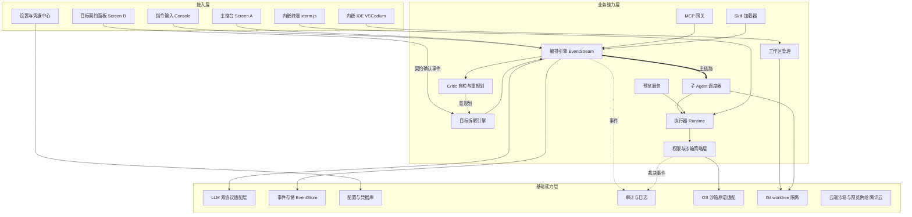
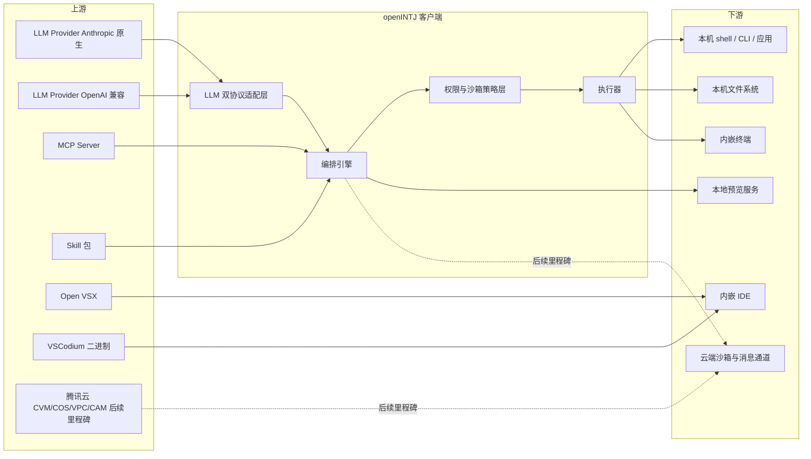
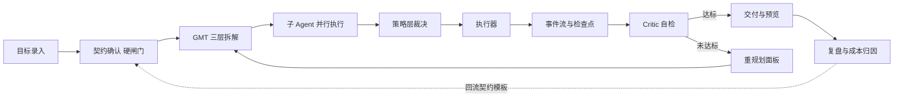
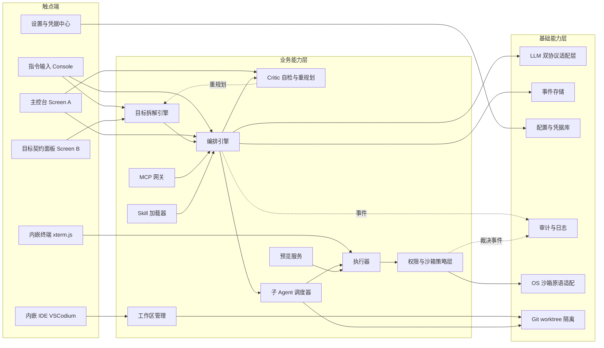

# AICoding 架构设计 · 高层架构设计 — openINTJ Agent Console

> 本文档为《AICoding 架构设计》核心产物之一，对应**高层架构设计**。
> 上游输入：用户原始诉求与资料摘要（`material_digest.md`）+ 行业调研报告（`research_report.md` v1.2）+ 既有界面设计资产（openINTJ Agent Console）；
> 下游输出：驱动《系统设计》《部署设计》《安全设计》《UserStory》四份文档的撰写。
> 阶段门：**G3**。本文档是 `system-architect` 与 `product-story-designer` 的唯一上游边界基线，经人工审核通过后方可下发 Phase 4。

**证据标注约定**（全文适用，用以区分事实、假设与建议）：

| 标注 | 含义 |
| --- | --- |
| 事实 | 可追溯到 `material_digest.md` 的 D 编号章节、`research_report.md` 的 SR 来源条目，或用户的已冻结裁决（X1、IC-01~IC-04） |
| 假设 | 上游无直接证据、由本阶段为推进设计而做出的推断，均已写明推断依据 |
| 建议 | 本阶段的取舍倾向或待用户确认项，不构成对下游的技术选型授权 |

---

## 0. 元信息：修订记录

> 记录文档版本、变更内容、修订人、修订时间，确保设计文档的可追溯。

```yaml
标题: openINTJ Agent Console - 高层架构设计 v1.1
版本: v1.1
状态: Draft   # Draft | Reviewing | Approved | Deprecated
创建日期: 2026-10-20
最后更新: 2026-10-20
作者: business-architect（业务架构师 - 许边界）
评审人:
  - team-lead（主理人）
  - 用户（G3 人工审核）

关联文档:
  上游输入:
    - 业务原始诉求 / PRD: .workbuddy/output/material_digest.md（D1~D6 共 48 条摘要，X1~X4 冲突，Q1~Q13 待澄清项）
    - 行业调研报告: .workbuddy/output/research_report.md（v1.2，11 家标杆，T1~T12 论题加权评分，SB-01~SB-06 自建能力集，R-01~R-12 风险，U-01~U-08 待确认项）
    - 既有设计资产: openINTJ Agent Console（Ardot 画布 1600×1000 双屏，Screen A 八模块 / Screen B 七模块，证据等级为二次转述）
  下游产出:
    - 系统设计: 系统设计.md（G4）
    - 部署设计: 部署设计.md（G5）
    - 安全设计: 安全设计.md（G5）
    - UserStory: UserStory.md（G4）

已冻结裁决（本阶段不得推翻）:
  - X1  产品形态 = 桌面客户端（非 Web 应用）
  - IC-01 T1 桌面壳层 = Electron（用户已接受包体 80–150MB / 空闲内存 150–300MB / 冷启动 1–3 秒）
  - IC-02 T2 IDE 嵌入形态 = 内嵌 VSCodium（Code-OSS 的 MIT 构建，遥测已移除）+ Open VSX 扩展源
  - IC-03 T8 云端沙箱供给 = 自建（自有云账号），用户已知悉「工程量最大且必须先补齐云账号基线」这一前提
  - IC-04 Q4 云厂商 = 腾讯云（CVM / 轻量应用服务器 + COS + VPC + CAM），Region 待定，假定 ap-guangzhou
  - 术语 ternimal = terminal（终端）笔误
  - LLM Provider = 直连真实模型 API，Anthropic 原生协议 + OpenAI 兼容协议双协议并行

经中间确认裁决（本阶段发出、已获用户裁决并冻结）:
  - IC-05 MVP 能力范围 = 方案 B：14 项能力原子全部进 MVP  # 裁决人: 用户；裁决日期: 2026-10-20；状态: 已冻结
      用户已知悉并接受的代价: 交付时间取决于 Q4 何时补齐，且自建必须先交付 SB-01~SB-06 六项能力，工期显著拉长
  - IC-06 双协议（Anthropic + OpenAI）的 UI 承载位 = 方案 A：新增独立「设置与凭据中心」页  # 裁决人: 用户；裁决日期: 2026-10-20；状态: 已冻结
      承载内容: 侧边栏胶囊导航底部增设入口；Screen A / B 双屏设计资产原样保留；首次启动必填引导（选供应商 → 选协议 → 填 Key → 连通性自检）
  - IC-07 目标契约的流程地位 = 方案 A：执行前硬闸门  # 裁决人: 用户；裁决日期: 2026-10-20；状态: 已冻结
      未确认目标契约与成功判据不得进入执行态；用户已知悉并接受的代价: 每次起任务多一步确认

首个版本（MVP）的前置阻塞项（由 IC-05 裁决产生，不再是后续里程碑的前置项）:
  - Q4 剩余四项: 云账号 / Region / 配额 / 预算上限 —— 缺任一项则云端三项的详细设计无法定出数值
  - U-05 核实项: 腾讯云 CVM 是否透传 /dev/kvm —— 决定沙箱隔离原语走 microVM 还是容器
  - SB-01 ~ SB-06 六项自建能力: 为 MVP（交付里程碑 1）内的必交付项，不是演进项
```

| 版本 | 日期 | 作者 | 变更内容 | 评审状态 |
| --- | --- | --- | --- | --- |
| v1.0 | 2026-10-20 | `business-architect` | 初稿：六章正文 + 附录 A/B/C；冻结 MVP 边界、业务闭环、差异化定位与对外承诺约束；发起 IC-05 / IC-06 / IC-07 三项中间确认 | Draft |
| v1.1 | 2026-10-20 | `business-architect` | 定点修订稿（依主理人补充注入的调研 §4.2 两条结论）：§2.5 与 §4.1 补入「本地沙箱为主、代码不出本机」基线承诺；§4.3 演进纪律新增云端工作量口径与「不得把云厂商已定误读为可进 MVP」两条；§6.1 的 F7 提升为 MVP 基线承诺并在列表后新增优先级排序说明，O1 ~ O3 的原因列改写为「云厂商已定不构成解锁」的四项完整依据；§6.6 新增 C8；附录 C 新增两行自检并把决策点总数更新为 11 | Draft |
| v1.2 | 2026-10-20 | `business-architect` | 定点修订稿（依 IC-05 用户裁决「方案 B：14 项全进 MVP」）：§0 新增经中间确认裁决与 MVP 前置阻塞项；§1.2 D1 改写；§2.2 新增 P9、§2.3 新增 V9、§2.5 新增云端缺口行；§4.1 / §4.2 / §4.3 重写部署形态与演进纪律；§5.1 基础能力层新增云端供给节点；§6.3 新增云端功能行并同步 P0 标记；§6.5 新增云端预览页；§6.6 重写 C4、加强 C5；§6.7 新增 Q4 阻塞项行 | Draft |
| v1.4 | 2026-10-20 | `business-architect` | 编号去重稿（依主理人复核指令）：§6.1 In-Scope 的功能条目编号由 F1 ~ F12 改为 **S1 ~ S12**（N1 ~ N3 不变），消除与 §6.3 功能清单 F 前缀的 ID 撞车；同步更新 14 处对 In-Scope 条目的引用（§4.3 MVP 范围列、§6.1 编号体系句 / 合并说明 / 优先级排序说明 / O3 行 / 硬指标行、§6.6 C4 与 C5、附录 C 的 IC-05 行与结论二行）；§6.1 新增「编号体系声明」段。**编号空间之外的内容、条目数量与 P0 / MVP 标记均未改动**；§6.3 的 F1 ~ F39 及其引用保持原样 | Draft |
| v1.3 | 2026-10-20 | `business-architect` | 矛盾修复稿（续 v1.2 被中断的部分，并回注 IC-06 / IC-07）：§6.1 的 O1 ~ O3（云端三项）整行删除并移入 In-Scope、Out-of-Scope 由 9 条重编为 6 条（O1 ~ O6）且全文交叉引用同步更新；In-Scope 重构为 15 条（F1 ~ F12 + N1 ~ N3）并写明三处合并的去向；§6.3 新增 F34 ~ F39 六条云端功能行、F31 由 P2 升为 P0；§6.4 补入 IC-06 / IC-07 裁决标记；§6.5 新增云端预览面板行；§6.7 Q4 标为首个版本前置阻塞项、Q5 / Q7 / Q9 同步；§0 与附录 C 的 IC-05 / IC-06 / IC-07 三行统一改为「经中间确认，已冻结」，删除全部「待回注 / 按推荐值撰写」表述 | Draft |

---

## 1. 需求概要

### 1.1 需求概要说明

> 一句话描述本期需求要解决的核心业务问题、覆盖的业务场景与服务对象。

openINTJ 用于解决「长程、多步、需要可验收交付的 Agent 任务在现有工具中既容易跑偏、又无法中断续跑」这一核心业务问题，服务于把工程与研究任务交给 Agent 自主完成的个人开发者与小团队，覆盖**目标契约化、并行子 Agent 执行、本地安全执行、交付预览**四类核心场景。

**三要素**：

1. **业务现状**：彻底的绿地项目——工作区仅含 `.workbuddy` 目录，无任何源代码、包管理清单、README、CI 配置或校验脚本（事实，D5 §5.1~§5.3）。唯一既有资产是上一次设计任务产出的界面设计 openINTJ Agent Console（事实，D3 §3.1）。
2. **触发事件**：用户提出「套用 openINTJ 设计任务的产出物，给我开发 openINTJ 的程序」（事实，D1 §1.2、§1.3），并明确「先出架构文档再开发」（事实，D2 §2.3）。
3. **系统定位一句话**：openINTJ 是一款以「目标先契约化、再自治执行」为核心差异的桌面端 Agent 工作台，承接既有设计资产并使其可运行。

### 1.2 关键决策摘要

> 列出本期最关键的 3 ~ 5 项设计决策（含范围决策、技术选型决策、MVP / 完整版边界决策）。

| 编号 | 决策类别 | 决策内容 | 关联章节 |
| --- | --- | --- | --- |
| D1 | 范围决策 | **14 项能力原子全部进 MVP**（经中间确认 IC-05，用户裁决方案 B，2026-10-20），首个版本完整对应用户原话，无能力削减。代价：交付时间取决于 Q4 剩余四项何时补齐，且自建必须先交付 SB-01 ~ SB-06 六项能力，工期显著拉长。In-Scope / Out-of-Scope 逐项清单见 §6.1 | §4.3、§6.1 |
| D2 | 产品形态决策 | 桌面客户端（X1 已裁决）；一体化形态——主控台、目标契约面板、内嵌 VSCodium IDE、内嵌终端、设置与凭据中心同处一个客户端，不拆成多个应用 | §4.2、§6.2 |
| D3 | 差异化决策 | 以既有设计资产 Screen B「目标 Agent 化拆解」为产品核心差异点：目标必须先契约化（目标契约 / 成功判据 / 约束），经用户确认后才允许进入执行态 | §4.1、§5.3、§6.3 |
| D4 | 复用 vs 新建 | 直接复用：Electron、VSCodium 二进制 + Open VSX、xterm.js + node-pty、MCP 官方 TS SDK、agentskills.io 开放标准；自研：编排引擎、工作区与隔离、权限与沙箱策略层、事件流与检查点、双协议适配层 | §2.4、§5.2 |
| D5 | 部署形态决策 | MVP 为纯本地单机桌面应用，数据默认不出本机；云端自建于腾讯云是后续里程碑的目标形态，MVP 只出接口不出实现 | §4.3、§5.2 |

**硬指标**：≥ 3 条，≤ 5 条。本节 5 条，每条均映射到正文具体章节（见上表关联章节列）。

### 1.3 价值主张

> 明确本系统/本期需求对业务的核心价值贡献（效率、合规、收入、成本、体验等维度）。

| 价值维度 | 量化目标 | 度量指标 | 当前值 | 目标值 | 截止时间 |
| --- | --- | --- | --- | --- | --- |
| 效率 | 长程任务的人工干预次数下降 | 在 ≤ 2 次干预内完成的任务占比 | 无基线（绿地项目） | ≥ 60% | MVP 验收 |
| 效率 | 长程任务中断后的恢复成本下降 | 从最近检查点恢复后需重放的步数 | 无基线（绿地项目） | ≤ 5 步 | MVP 验收 |
| 合规 | 本地执行全程可追溯 | 执行事件与权限裁决的留痕完整率 | 无基线（绿地项目） | 100% | MVP 验收 |
| 成本 | 长程任务的上下文成本下降 | 单任务 token 峰值较全量事件回放的下降幅度 | 无基线（绿地项目） | ≥ 60% | MVP 验收 |
| 体验 | 目标在执行前被显式确认 | 目标契约确认后才启动执行的任务占比 | 无基线（绿地项目） | 100% | MVP 验收 |

**硬指标**：业务价值 ≥ 2 条 + 技术/成本价值 ≥ 1 条。本节业务价值 4 条（效率 ×2、合规、体验）、成本价值 1 条，每条均为可量化数字，无「提升 / 优化 / 加强」类模糊表述。

---

## 2. 需求分析 & 痛点解构

### 2.1 核心角色关注点

> 按「甲方决策者 / 最终用户 / 受影响方」三类角色维度盘点，每行给出该角色唯一的 Top1 关心点。

| 角色 | 业务身份 | 主要操作 | Top1 关心点 | 来源 |
| --- | --- | --- | --- | --- |
| 甲方决策者 | 本人 / 自付 API 费用的个人开发者与小团队负责人 | 决定是否采用、配置模型供应商与协议、设定预算上限 | 单次长程任务的 API 花费是否可预测、能否中途熔断 | D2 §2.2（直连真实大模型 API）、D2 §2.4 原子 1 |
| 最终用户 A | 主控台操作者（工程师 / 研究者） | 下达目标、审阅目标契约、在重规划面板中干预 | 任务跑偏后能否从最近检查点续跑，而不必整体重来 | D3 §3.2（检查点与恢复、自检重规划循环） |
| 最终用户 B | 并行子 Agent 的委派与审阅者 | 拆分与派发子任务、审阅 Critic 评分趋势、批准干预 | 多个子 Agent 并行时是否彼此污染同一份工作区 | D3 §3.2（并行子 Agent 集群）；调研 §2.2.3（Cursor 8 并行 Agent + Git worktree 隔离，SR-07） |
| 受影响方：本机环境 | 用户机器的文件系统、进程、已安装应用与凭据 | 被 Agent 调用 shell / CLI / 应用程序与系统权限 | 是否会发生工作区之外的越权写入，以及 API Key 明文落盘导致的泄露 | D2 §2.4 原子 10 / 11 / 12；material_digest Q11 |
| 受影响方：合规与成本 | 数据驻留与支出的责任方（云端阶段为云账号持有者） | 审计执行轨迹、轮换凭据、审阅沙箱出网策略 | 代码与提示词是否离开本机；上云前是否有显式的授权与位置声明 | D2 §2.1；调研 IC-03 / R-03 |

**硬指标**：核心角色 5 类，覆盖甲方决策者、最终用户（两类）、受影响方（两类）三个角色维度，每类均给出唯一的 Top1 关心点，无「使用方便」类笼统表述。

### 2.2 核心痛点

> 以 P1 / P2 / P3 的优先级编码，列出本期需要解决的关键痛点，每条附现象或数据佐证。

| 编号 | 痛点描述 | 现象 / 数据 | 影响角色 | 影响程度 | 优先级 |
| --- | --- | --- | --- | --- | --- |
| P1 | 长程任务跑偏且中断即前功尽弃 | OpenHands 已核实「40 步调试会话可超过 100K tokens」，须依赖上下文压缩缓解（调研 R-06，SR-15）；现有工具不提供「成功判据」，任务是否达成只能由人主观判断 | 最终用户 A | 高（任务不可交付） | P1 |
| P2 | 本地执行越权，且 Windows 侧隔离强度不足 | Codex CLI 的 Windows 原生沙箱为实验特性，已知限制是无法阻止对 world-writable 目录的写入 / 删除 / 创建（调研 R-04，SR-05）；Claude Agent SDK 的 OS 级沙箱需宿主自行补齐（SR-02） | 受影响方：本机环境 | 高（安全底线） | P1 |
| P3 | 并行子 Agent 共享工作区互相污染 | Cursor 已验证并行 Agent 必须用 Git worktree 隔离才可并行（SR-07）；无隔离时多个子 Agent 的文件写入互相覆盖 | 最终用户 B | 高 | P2 |
| P4 | 双协议直连真实 API 却无配置与凭据承载位 | 用户要求 Anthropic 原生 + OpenAI 兼容双协议并行（D2 §2.2），但既有 Screen A 八模块与 Screen B 七模块清单中无模型供应商选择、API Key 管理与协议切换入口（冲突 X2，D3 §3.9） | 甲方决策者 | 高（不解决无法上线） | P1 |
| P5 | 长任务上下文膨胀推高成本并拉低质量 | 同 P1 的 40 步 > 100K tokens 数据；无检查点与分层压缩时，每次重规划都要全量回放事件流 | 甲方决策者 | 中 | P2 |
| P6 | 桌面壳层的资源代价影响启动与常驻体验 | Electron 路线安装包 80–150MB、空闲内存 150–300MB、冷启动 1–3 秒，用户已在 IC-01 中明确接受该代价（调研 R-09） | 最终用户 A | 中 | P2 |
| P7 | 自定义能力与工具无法跨产品复用 | MCP 已成事实标准；agentskills.io 开放标准已被 30+ 平台支持（调研 §4.1 原子 7，SR-47~SR-49）；不采用标准协议则每个工具都要重写适配 | 最终用户 A | 中 | P2 |
| P8 | 任务产出需要切换到外部工具才能验证 | 无内嵌预览时用户需自行起服务；本地 preview server 为成熟路径（调研 T12 打分 4.30） | 最终用户 A | 低 | P3 |
| P9 | 仅靠本地沙箱时，长时任务与高并行度受本机资源约束，且无法在离开本机后继续 | 调研 §3.3 组合分析指出「本地沙箱 + 云端自建」才是完整形态；用户已裁决 14 项能力原子全部进 MVP（IC-05），云端工作区 / 云端沙箱 / 云端预览为首个版本的必交付项 | 最终用户 B | 高（不交付不算完成） | P1 |

**优先级标准**：

- **P1**：直接影响业务核心流程或合规底线，不解决无法上线。
- **P2**：影响用户体验或运营效率，可在 MVP 后迭代。
- **P3**：体验型 / 长尾问题，列入完整版或后续版本。

**硬指标**：8 条痛点每条均有「现象 / 数据」佐证并标注调研来源编号；P1 共 3 条（P1 / P2 / P4），均在 §2.3 有对应的 V 级目标。

### 2.3 期待目标

> 以 V1 ~ V8 的形式列出可量化的业务目标，每条反向对齐 §2.2 中的痛点。

| 编号 | 目标描述 | 对齐痛点 | 度量指标 | 当前值 | 目标值 | 截止时间 |
| --- | --- | --- | --- | --- | --- | --- |
| V1 | 长程任务在任意检查点可恢复，恢复后重放步数 ≤ 5 步；Critic 自检未达标时自动触发重规划 | P1 | 恢复后重放步数 / 未达标自动重规划触发率 | 无基线（绿地项目） | ≤ 5 步 / 100% | MVP 验收 |
| V2 | 本地 shell / CLI / 应用程序调用与文件写入 100% 经策略层裁决；工作区外写入默认拒绝并留痕 | P2 | 策略层拦截与留痕完整率 | 无基线（绿地项目） | 100% | MVP 验收 |
| V3 | 每个并行子 Agent 独占一份工作区副本，写入互不覆盖 | P3 | 子 Agent 工作区隔离覆盖率 | 无基线（绿地项目） | 100% | MVP 验收 |
| V4 | Anthropic 原生协议与 OpenAI 兼容协议各至少一家供应商可完成一次含工具调用的完整循环；凭据不以明文落盘 | P4 | 双协议端到端成功率 / 凭据明文落盘处数 | 无基线（绿地项目） | 100% / 0 | MVP 验收 |
| V5 | 单次任务的上下文 token 峰值较全量事件回放下降 ≥ 60% | P5 | token 峰值下降幅度 | 无基线（绿地项目） | ≥ 60% | MVP 验收 |
| V6 | 客户端冷启动与常驻内存满足基线（承接 IC-01 已接受的代价，转为可验收指标） | P6 | 冷启动到可交互 P95 / 空闲内存占用 | 无基线（绿地项目） | ≤ 3 秒 / ≤ 300MB | MVP 验收 |
| V7 | MCP server 与 Skill 包 100% 通过标准协议接入，禁止引入私有工具协议 | P7 | 标准协议接入占比 | 无基线（绿地项目） | 100% | MVP 验收 |
| V8 | 一次点击即可预览本地服务，预览生命周期随任务结束自动回收 | P8 | 预览启动操作步骤数 / 残留进程数 | 无基线（绿地项目） | ≤ 1 步 / 0 | MVP 验收 |
| V9 | 云端三项（云端工作区 / 云端沙箱 + 消息通道 / 云端部署预览）在自有腾讯云账号下各完成一次端到端闭环；云端任务检查点恢复成功率 100%，沙箱出网违规次数 0 | P9 | 云端端到端任务成功率 / 沙箱出网违规次数 | 无基线（绿地项目） | 100% / 0 | MVP 验收 |

**硬指标**：9 条目标每条均有数字且对齐至少 1 条痛点；4 条 P1 痛点分别对应 V1、V2、V4、V9。

### 2.4 基线复用

> 现有架构 / 现有能力中可直接复用的组件、平台、模型、数据资产。**先盘点再决定新建**：§2.5 列出的每一条功能缺口，均已确认无法由下表覆盖。

| 复用类别 | 现有能力 | 复用方式 | 来源系统 | 备注 |
| --- | --- | --- | --- | --- |
| 核心底座 | Electron 桌面壳层 | 直接采用为壳层 | Electron 开源项目 | IC-01 已冻结；需手动配置 contextIsolation 与 CSP；代价（包体 / 内存 / 冷启动）已由用户接受，转 V6 验收 |
| 核心底座 | VSCodium 二进制（Code-OSS 的 MIT 构建，遥测已移除）+ Open VSX 扩展源 | 内嵌二进制 + 复用扩展源 | VSCodium 社区构建 / Open VSX | IC-02 已冻结；不得使用 VS Code 商标；微软专有扩展不可用（调研 R-01） |
| 终端底座 | xterm.js + node-pty | 直接采用 | 开源组件 | 需按 Electron ABI 重建原生模块并配置 asar unpack（调研 R-07） |
| 协议标准 | MCP 官方 TS SDK（2025-06-18 规范：stdio 与 Streamable HTTP，旧 SSE 已废弃） | 直接采用 | modelcontextprotocol | 需实现 client 与 server 双角色；保留对旧 HTTP+SSE 的兼容探测 |
| 协议标准 | Agent Skills 开放标准（SKILL.md + frontmatter 六字段） | 直接采纳标准 | agentskills.io | 30+ 平台支持；allowed-tools 为实验性字段，不作权限依据（调研 R-08） |
| 架构范式 | EventStream + Checkpoint 持久化语义（事件流即单一事实来源、检查点与恢复） | 借鉴设计，在 TypeScript 中自研实现 | OpenHands（Apache-2.0）、LangGraph | 不复用其 Python 实现；持久化语义参照 LangGraph，事件模型参照 OpenHands（调研 §4.3 T11） |
| 隔离范式 | Git worktree 隔离并行 Agent | 借鉴设计，自研实现 | Cursor、VS Code Agent HQ | 用于并行子 Agent 的工作区隔离，对应 V3 |
| 权限模型 | approval_policy × sandbox_mode 双轴权限（审批策略与沙箱策略正交可配） | 借鉴设计，自研实现 | Codex CLI | 审批与沙箱解耦，对应 V2 |
| 通道范式 | 统一 Channel Adapter（Webhook + IM Bot + MQ，事件归一化）+ 安全网关代理替代内网穿透 | 借鉴设计，后续里程碑实现 | Devin、腾讯 WorkBuddy | 云端能力不进 MVP，仅保留接口 |
| 界面资产 | openINTJ Agent Console 双屏设计（Screen A 八模块 / Screen B 七模块 + 视觉系统） | 直接承接为 UI 规格基线 | Ardot 画布 1600×1000 双屏 | 证据等级为二次转述（D4 §4.3），元素级规格待补（Q13） |
| 既有系统 | 无 | — | — | 绿地项目，无任何既有代码、工程规范或部署脚本可继承（D5 §5.3） |

### 2.5 功能缺口

> 在现有基线之上仍需新建的功能能力，按业务阶段分组（目标定义 / 执行中 / 交付 / 运营与治理）。

| 阶段 | 功能缺口 | 必要性 | 优先级 | 对齐目标 |
| --- | --- | --- | --- | --- |
| 目标定义 | 目标契约 / 成功判据 / 约束 的三段式录入与确认，并作为执行前硬闸门 | 必须 | MVP | V1 |
| 目标定义 | Goal-Milestone-Task 三层自动拆解与重规划面板 | 必须 | MVP | V1 |
| 执行中 | 事件流全量落盘、检查点与恢复、上下文分层压缩 | 必须 | MVP | V1、V5 |
| 执行中 | 并行子 Agent 集群调度与结果归并 | 必须 | MVP | V3 |
| 执行中 | 本地执行器 + 权限与沙箱策略层（审批在环 + 命令白名单 + OS 原语）；MVP 基线承诺为「本地沙箱为主、代码不出本机」 | 必须 | MVP | V2 |
| 执行中 | 云端工作区、云端沙箱与消息通道、云端部署测试预览（自建于腾讯云，含 SB-01 ~ SB-06 六项自建能力） | 必须 | MVP | V9 |
| 执行中 | MCP 与 Skill 两类标准协议接入 | 必须 | MVP | V7 |
| 执行中 | 双协议模型接入与凭据管理（冲突 X2 的承载位） | 必须 | MVP | V4 |
| 交付 | 内嵌 IDE 与内嵌终端的同屏协同（工作区同步与执行回显） | 必须 | MVP | V1 |
| 交付 | 本地部署、测试与预览服务 | 重要 | MVP | V8 |
| 运营与治理 | Critic 评分趋势与干预记录的复盘视图 | 重要 | MVP | V1 |
| 运营与治理 | 成本归因与执行轨迹回放 | 重要 | 完整版 | V5、V2 |

**硬指标**：12 条缺口每条均对齐 §2.3 至少一条目标；优先级为 MVP 的 11 条缺口，在 §6.3 功能清单中均有对应的 MVP 范围标记 ✅。

---

## 3. 行业调研

> 本节整合自 `research_report.md` v1.2（2026-10-20，调研人 `research-analyst`）。事实、对比、建议、风险四类信息分别标注，不把推断写成事实。

### 3.1 行业标杆系统分析

> 对标行业内代表性产品 / 系统，输出标签化清单。本轮实际覆盖 11 家，其中头部 SaaS 代表 5 家，开源 / 自研代表 6 家。

| 标杆系统 | 厂商 / 来源 | 场景覆盖 | 技术亮点 | 商业模式 | 适用度 |
| --- | --- | --- | --- | --- | --- |
| B1 Claude Code + Claude Agent SDK | Anthropic | 终端原生编码 Agent；SDK 可嵌入任意应用 | 内置 Read / Write / Edit / Bash 等工具集；Hooks 事件体系；Subagents；MCP client 与进程内 server；permissionMode 五档 | 商业（API 用量计费 + 订阅） | 高 |
| B2 OpenAI Codex CLI + Agents SDK | OpenAI | 终端编码 Agent；多 Agent handoff | approval_policy × sandbox_mode 双轴权限；macOS Seatbelt / Linux Landlock+seccomp / Windows 受限令牌；AGENTS.md 分层记忆 | 商业（API 用量计费） | 高 |
| B3 Cursor | Anysphere | AI 原生编辑器；并行 Agent；后台 / 云端 Agent | 最多 8 个并行 Agent；Git worktree 隔离；Background Agents 跑在隔离 Ubuntu VM；Composer 自研模型 | SaaS 订阅（20 美元/月起） | 高 |
| B4 Cline | Cline 开源社区 | 人工在环的编码 Agent | 每步操作显式审批；MCP Marketplace；Agent Core 与宿主解耦（CLI / Kanban / 编辑器插件同源） | 开源免费 + Teams 订阅 + BYOK | 中 |
| B5 Roo Code | Roo Code 开源社区 | 多模式自治编码 Agent | 「模式即 Agent 配置档」；Cloud Agents 可从 GitHub / Web 触发；Slack / Linear 集成 | 开源免费 + Cloud 按小时计费 | 中 |
| B6 OpenHands | OpenHands 社区（All Hands AI） | 通用软件工程 Agent 平台 | EventStream 事件流为单一事实来源；Runtime 抽象（Local / Docker / E2B）；动作封闭词表；多 Agent 委派 | Apache-2.0 开源 + 云订阅 | 高 |
| B7 GitHub Copilot Agent Mode / VS Code Agent HQ | Microsoft / GitHub | 多 Agent 编排中枢 | Agent Session 一等公民；后台 Agent 跑在专属 Git worktree；可复用 Claude Skills | 商业（Copilot 订阅） | 中 |
| B8 Windsurf | Cognition | 最大化自动化程度的 Agent IDE | Cascade Agent；深度代码库索引；自然语言驱动终端 | SaaS 订阅（15 美元/月） | 中 |
| B9 Devin | Cognition | 工单级异步自治软件工程师 | Brain / Devbox 两段架构；沙箱含 shell + 浏览器 + 编辑器；Slack / Jira / Linear 集成 | 按 ACU 计费（约 2.25 美元/ACU） | 低 |
| B10 Zed | Zed Industries | 高性能原生编辑器 + Agentic 编辑 | Rust + 自研 GPUI；CRDT 多人协同；可编辑 diff 审批 | 编辑器开源（GPL / Apache），AI 按用量 | 低 |
| B11 腾讯 CodeBuddy / WorkBuddy | 腾讯云 | 编码与办公双场景智能体 | 内置 20+ Skills 与 MCP；多窗口多 Agent 并行；安全网关代理规避内网穿透；企微 / QQ / 飞书 / 钉钉接入 | 商业（腾讯云账号与计费体系） | 中 |

**硬指标**：11 家（≥ 3 家）；含头部 SaaS 代表 5 家（B3 / B7 / B8 / B9 / B11）与开源代表 6 家（B1 / B2 / B4 / B5 / B6 / B10）。

### 3.2 方案对标及优先级打分

> 横向对比矩阵 + 打分结果（引自调研报告 §3.1.1，权重之和 = 1.00）。评估对象是「该标杆对 openINTJ 的可借鉴程度」，非产品本身优劣。

**对比矩阵**（每行权重之和 = 1）：

| 评估维度 | 权重 | 权重理由 | B1 得分 | B3 得分 | B6 得分 | B9 得分 | B11 得分 |
| --- | --- | --- | --- | --- | --- | --- | --- |
| 场景契合度 | 0.30 | 本项目为「一体化桌面客户端 + 本地 Agent + 沙箱 + 长程编排」，形态与能力模型的重合度是首要判据 | 5 | 4 | 4 | 4 | 4 |
| 技术成熟度 | 0.20 | 绿地项目需站在已验证路径上，未经验证的架构会放大返工风险 | 5 | 5 | 4 | 4 | 4 |
| 集成难度（反向，分越高越易集成） | 0.15 | 团队为 TS 全栈，闭源 / Python 实现 / 生态绑定都会抬高集成成本 | 4 | 3 | 5 | 2 | 3 |
| 成本（反向，分越高成本越低） | 0.15 | 无预算输入（Q4），成本可控性比绝对金额更重要 | 3 | 3 | 5 | 2 | 3 |
| 合规可控性 | 0.20 | 涉及许可证可自持性与数据驻留，属不可妥协项 | 3 | 2 | 5 | 2 | 3 |
| **加权总分** | **1.00** | — | **4.15** | **3.50** | **4.50** | **3.00** | **3.50** |

**结论摘要**：

- **优先借鉴**：`B6 OpenHands` —— 适用度 **4.50**。理由：EventStream + Runtime 抽象 + 多 Agent 委派正好覆盖长程编排与沙箱两项核心能力；Apache-2.0 且可自托管，是本轮唯一在合规可控性上得满分的标杆。
- **优先借鉴**：`B1 Claude Code / Claude Agent SDK` —— 适用度 **4.15**，**限定借鉴范围**：只借鉴其能力模型与协议约定（Hooks 事件名、matcher 语义、permissionMode 分档、Skill 目录约定），不借鉴其闭源运行时与单供应商绑定（与用户双协议要求直接冲突）。
- **部分借鉴**：`B3 Cursor` —— 借鉴点：并行 Agent 的 Git worktree 隔离范式、本地交互 + 云端委派的双层分工、语义 diff 自愈。不借鉴闭源编辑器内核与 VS Code fork 维护体系。评分 3.50。
- **部分借鉴**：`B11 CodeBuddy / WorkBuddy` —— 借鉴点：Skills 技能包组织方式、多窗口多 Agent 并行、IM 通道接入、安全网关代理替代内网穿透。不借鉴腾讯云生态绑定与国内模型生态锁定。评分 3.50。
- **不借鉴（否决）**：`B9 Devin` —— 否决理由：Brain 位于供应商云不可自持（合规可控性 2/5）、ACU 计费在开放式任务上不可预测（成本 2/5）、闭源且不可自托管（集成难度 2/5），三项同时触底，与「一体化桌面客户端 + 数据自持」定位冲突。评分 3.00。**仅保留其 Brain / Devbox 分离的架构思想作为参考，不采纳其产品形态与供给方式。**

**差异化定位的关键判断（假设）**：11 家标杆中没有任何一家把「目标契约 + 成功判据 + Critic 自检评分趋势」作为一等公民能力。**推断依据**：调研报告 §2.3 的 13 个能力维度横向事实表中不含该能力，§2.2.1~§2.2.11 的 11 张详述卡片亦均未出现对应描述。该判断是本阶段差异化主张的证据基础，属**推断而非已核实事实**。

### 3.3 完整报告参考

> 给出行业调研完整报告的链接或归档路径，供深度查阅。

- 完整报告链接：`.workbuddy/output/research_report.md`（v1.2，调研日期 2026-10-20）
- 调研工具：`tech-research-advisor`（见附录 B）
- 调研日期：2026-10-20
- 调研归档：同链接；来源条目 SR-01 ~ SR-65 全部到 URL 粒度
- 已冻结裁决承接：X1、IC-01 ~ IC-04 见调研报告 §0.1；自建云端沙箱最小能力集 SB-01 ~ SB-06 见调研报告 §4.4

---

## 4. 方案决策

### 4.1 价值定位澄清

> 当前需求 / 系统对业务全局的价值贡献。定位三段式为固定结构。

```
对外价值（客户侧）: 把「一句话目标」变成「可验收的交付」——用户在启动前确认目标契约、成功判据与约束，
                    Agent 自主执行到验收，全程可观测、可干预、可从最近检查点续跑
对内价值（运营侧）: 用户本人从「逐步驱动 Agent」转为「只在重规划与干预点介入」；
                    每一次本地执行经策略层裁决并留痕，使风险可控；
                    MVP 阶段以「本地沙箱为主、代码不出本机」为基线承诺（云端自建落地前，
                    本地沙箱是唯一可用的强隔离执行环境，见 §6.6 C8）；
                    事件流与检查点使 token 消耗可归因到具体里程碑，使成本可解释
差异化价值        : 目标先契约化，再自治执行。「目标契约 / 成功判据 / 约束 + Goal-Milestone-Task 三层拆解
                    + Critic 自检评分趋势 + 干预记录」构成一层显式的治理层，并以硬闸门约束：
                    目标契约未确认，不得进入执行态。该能力在 11 家标杆中未见（推断，依据见 §3.2 末段）
```

**与产品矩阵的关系**：openINTJ 在「个人与小团队的 AI Agent 工作台」这条价值主线上承担「目标治理 + 安全执行」的核心职责。上游承接 LLM Provider（Anthropic 原生 / OpenAI 兼容）、MCP server、Skill 包、Open VSX 扩展源、VSCodium 二进制与腾讯云（CVM / COS / VPC / CAM）；下游驱动本机 shell / 文件系统 / 内嵌 IDE / 内嵌终端、本地预览，以及自建于腾讯云的云端工作区、云端沙箱与云端预览，构成完整业务闭环（见 §5.2、§5.3）。其中云端三项在 MVP 即为必交付项（经中间确认 IC-05，用户裁决 2026-10-20）。

### 4.2 系统定位澄清

> 当前系统在产品矩阵 / 技术架构中的边界与上下游。

| 维度 | 内容 |
| --- | --- |
| 系统名称 | openINTJ Agent Console（标准名，承接既有设计资产 D3 §3.1；`openINTJ` 作为产品名与项目代号使用，是否对外开源待用户确认，见 §6.7） |
| 系统类型 | 新建（绿地项目，D5 §5.3） |
| 部署形态 | 本地为主 + 云端自建双轨：桌面客户端跑在用户本机，云端工作区 / 云端沙箱 / 云端预览自建于腾讯云（CVM / COS / VPC / CAM），Region 待定 · 假定 ap-guangzhou。**MVP 即包含云端三项**（经中间确认 IC-05） |
| 多租户 | 产品侧：否（无团队协作的账号体系、席位与共享工作区，见 §6.1 O3）。沙箱侧：是——云端沙箱按租户做资源归属与强隔离，隔离粒度 = 租户（SB-06），随云端三项在 MVP 一同交付 |
| 服务对象 | 甲方决策者（本人 / 自付 API 费用者）、最终用户 A（主控台操作者）、最终用户 B（子 Agent 委派与审阅者）、受影响方（本机环境、合规与成本责任方）——对齐 §2.1 |
| 上游依赖 | LLM Provider（Anthropic 原生 / OpenAI 兼容）、MCP server、Skill 包（agentskills.io）、Open VSX 扩展源、VSCodium 二进制、腾讯云（后续里程碑）——详见 §5.2 |
| 下游消费者 | 本机文件系统与 shell / CLI / 应用程序、内嵌 IDE、内嵌终端、本地预览与云端预览、云端沙箱与消息通道——详见 §5.2 |
| 边界（不做） | 不做模型训练与托管（由 LLM Provider 承担）；不做第三方 SaaS 沙箱接入（IC-03 已裁决自建）；不做 Web 端形态（X1 已裁决）；不做微软专有扩展的替代实现（列入 Out-of-Scope，见 §6.1 O2） |

### 4.3 MVP 与完整版决策

> 明确 MVP 范围、完整版范围、两者的演进关系。本表为本阶段的**范围裁决**，非调研侧可行性判断。

| 阶段 | 时间窗 | 范围（功能编号） | 架构差异点 | 退出标准 | 不做（延后） |
| --- | --- | --- | --- | --- | --- |
| MVP | 交付里程碑 1（无外部日期输入，按里程碑推进；工期与人力基线待用户确认，见 §6.7。**SB-01 ~ SB-06 六项自建能力为本里程碑内的必交付项，不是演进项**） | S1 ~ S12、N1 ~ N3 共 15 项，对应 **14 项能力原子全部**（经中间确认 IC-05） | 本地 + 云端自建双轨：事件流与检查点落本机存储并支持云端任务恢复；预览为本地 preview server 与云端 ephemeral preview 双轨；云端沙箱自建于腾讯云（CVM / COS / VPC / CAM）；Windows 侧 OS 级沙箱仍降级为审批在环 + 命令白名单 + 工作区根目录约束；内嵌 IDE 仅做最小集成（启动 / 打开 / 聚焦 / 工作区同步 / 扩展安装）。**云端部分的详细设计（容量与成本模型、Region 与 VPC 网段、隔离原语）在 Q4 剩余四项与 U-05 补齐前，只出接口与抽象，不出数值** | 其一，用真实 API Key（Anthropic 原生与 OpenAI 兼容各至少一家）端到端跑通本地主链路 1 次；其二，云端三项在自有腾讯云账号下各完成一次端到端闭环；其三，V1 ~ V9 九条目标全部可度量 | Windows OS 级隔离（O1）、微软专有扩展（O2）、面向团队协作的多租户产品能力（O3），详见 §6.1 |
| 完整版 | 交付里程碑 2（MVP 验收通过后） | 追加 F24、F26、F33，以及 O1 的后续演进（Windows OS 级隔离或 WSL2 补充层） | 完整补齐 Cloud 侧的高级形态：MCP server 对外暴露、客户端内自定义 Skill、成本归因报表；Windows 侧 OS 级隔离落地 | 追加功能全部可用并通过安全评审；Windows 侧 OS 级隔离方案落地，并同步更新对外承诺措辞 | — |

**演进纪律**（重要）：

- ✅ MVP 的架构骨架必须是完整版的**子集**：MVP 即定义 `SandboxProvider` 与 `PreviewProvider` 接口，并同时交付本地实现与云端实现（腾讯云）；完整版在其上补齐高级形态，不允许 MVP 上线后推倒重来。
- ✅ **本 MVP 不引入任何模型层 Mock**：用户明确要求直连真实大模型 API（D2 §2.2），模型调用链路从第一天起即为真实链路；这是本 MVP 与常规「先跑通再接真实」做法的关键差异，也是 V4 能被度量的前提。
- ✅ 可后插的能力已在 §6.1 明确列出「后续计划」，并在 §5.2 中定义了接口级依赖（云端沙箱、消息通道、云端预览）。
- ✅ **云端三项的工作量口径**：因 IC-03 以自建取代采购，能力原子 8 / 9 / 14 的工程量显著上升，其唯一的工作量分解底稿是调研报告 §4.4 的 SB-01 ~ SB-06 六项能力（镜像与快照 / 预热池 / 实例回收 / 网络策略 / 配额与成本模型 / 多租户隔离）。本文档不给云端三项任何工期或工作量数字；凡后续环节需要估算，一律以该六项为准，**不得沿用「采购第三方沙箱 SDK 接入」的旧估算**（对应调研 R-12，并已固化为 §6.6 的 C6）。
- ✅ **云端三项已进 MVP，但其详细设计仍处阻塞态**：经中间确认 IC-05，用户裁决 14 项能力原子全部进 MVP，云端工作区 / 云端沙箱 + 消息通道 / 云端部署预览均为首个版本的必交付项。但「可设计输入缺失」这一事实并未因裁决而消失——IC-04 只解决了厂商名称，账号 / Region / 配额 / 预算上限四项数值与位置输入仍缺，U-05（腾讯云 CVM 是否透传 /dev/kvm）仍待核实，SB-01 ~ SB-06 六项自建能力仍待交付。因此：**在补齐前，云端部分只出接口与抽象，不出数值**（容量与成本模型、Region 与 VPC 网段、隔离原语三项一律不得给出数值型承诺）。**该状态不得被表述为「用户已解除阻塞」**——解除的是范围裁决，不是输入缺口。Q4 剩余四项与 U-05 现为**首个版本交付的前置阻塞项**（见 §0 元信息与 §6.7）。
- ❌ 禁止：为赶工引入完整版无法继承的临时架构（如跳过事件流直接以内存态执行，导致完整版的检查点与轨迹回放需重写）。

---

## 5. 业务架构设计

### 5.1 业务架构图

> 形成系统级业务架构图，体现核心业务模块、流程方向与数据流。

本架构图按 **接入层 → 业务能力层 → 基础能力层** 三层组织；实线为同步调用，虚线为异步事件，粗线为主链路。每个模块使用标准名，与 §4.2 系统定位及 §6.2 模块全景图一致。



**分层职责**：

| 层 | 职责 | 模块标准名 |
| --- | --- | --- |
| 接入层 | 承载用户触点与交互入口，不持有业务状态 | 指令输入、目标契约面板、主控台、内嵌 IDE、内嵌终端、设置与凭据中心 |
| 业务能力层 | 承载目标治理、编排、执行与治理闭环的业务语义 | 目标拆解引擎、编排引擎、Critic 自检与重规划、子 Agent 调度器、执行器、权限与沙箱策略层、MCP 网关、Skill 加载器、工作区管理、预览服务 |
| 基础能力层 | 提供可被替换的技术能力与持久化，不含业务语义 | LLM 双协议适配层、事件存储、配置与凭据库、审计与日志、OS 沙箱原语适配、Git worktree 隔离、云端沙箱与预览供给（腾讯云，MVP 必交付） |

### 5.2 系统依赖架构

> 基于系统定位，明确上下游模块清单及交互方式（同步 / 异步 / 数据订阅）。每条依赖均明确接入方式、同步异步与关键约束。

| 依赖类型 | 系统 / 模块 | 提供方 | 依赖能力 | 接入方式 | 同步/异步 | 关键约束 |
| --- | --- | --- | --- | --- | --- | --- |
| 上游 | LLM Provider（Anthropic 原生协议） | Anthropic | 消息推理 / 工具调用 / 流式返回 | HTTPS REST（Anthropic Messages 原生协议） | 同步（流式） | 超时与重试策略；凭据不出本机且不明文落盘（V4）；需归一化到内部消息模型 |
| 上游 | LLM Provider（OpenAI 兼容协议） | 各兼容供应商 | 同上 | HTTPS REST（OpenAI Chat Completions 兼容） | 同步（流式） | 同上；两套协议在 system 字段位置、content block 结构、tool_use 形态、流式事件类型、缓存机制上均有实质差异，必须各自原生实现（调研 D-03） |
| 上游 | MCP Server | 第三方或本地进程 | 工具与资源 | stdio + Streamable HTTP（保留旧 SSE 兼容探测） | 同步 | 遵循 2025-06-18 规范；工具注册数量与单次调用超时由系统设计冻结 |
| 上游 | Skill 包 | 本地目录 / 仓库 | 能力扩展 | 文件系统扫描 + 渐进式加载 | 同步 | frontmatter 严格限定规范六字段；allowed-tools 不作权限判定依据（调研 R-08） |
| 上游 | Open VSX 扩展源 | Open VSX 社区 | 内嵌 IDE 扩展安装 | HTTPS | 同步 | 微软专有扩展不可用；需做覆盖度盘点（调研 R-11） |
| 上游 | VSCodium 二进制 | VSCodium 社区构建 | IDE 内核 | 内嵌二进制 + IPC | 混合 | 不得使用 VS Code 商标；版本锁定策略待定（调研 U-06） |
| 下游 | 本机 shell / CLI / 应用程序 | 用户机器 | 命令执行与进程管理 | 子进程（node-pty / child_process） | 同步 | 必经权限与沙箱策略层裁决；命令白名单 + 审批在环（V2） |
| 下游 | 本机文件系统 | 用户机器 | 读写 | 文件 API | 同步 | 默认限工作区内；工作区外写入需显式授权并留痕 |
| 下游 | 内嵌 IDE（VSCodium） | VSCodium 社区构建 | 编辑与扩展宿主 | IPC | 混合 | 工作区路径与编排引擎保持一致 |
| 下游 | 内嵌终端（xterm.js + node-pty） | 开源组件 | 命令交互与输出回显 | 内嵌渲染 + pty 绑定 | 同步 | 需按 Electron ABI 重建原生模块并配置 asar unpack（调研 R-07） |
| 下游 | 本地预览服务 | 本机 | 服务预览 | HTTP 本地端口 | 同步 | 端口分配与生命周期策略随任务结束自动回收（V8） |
| 复用底座 | Electron | Electron 开源项目 | 桌面壳层 | 框架依赖 | — | 需手动配置 contextIsolation 与 CSP（IC-01） |
| 复用底座 | 腾讯云 CVM / COS / VPC / CAM | 腾讯云 | 云端工作区与沙箱（MVP 必交付项） | HTTPS / SDK | 混合 | Q4 剩余四项补齐后方可设计（调研 R-02）；Region 待定 · 假定 ap-guangzhou，不得写成已确认事实 |
| 数据订阅 | 自建沙箱事件通道（后续里程碑） | 自建 | 任务事件外送 | Webhook / IM Bot / MQ（统一 Channel Adapter） | 异步 | 通道外延未定义（Q5）；借鉴安全网关代理替代内网穿透，避免暴露本地端口 |
| 数据订阅 | 审计事件订阅 | 本机 | 执行与裁决事件 | 进程内事件订阅 | 异步 | 至少一次送达；留痕完整率 100%（V2） |

**硬指标**：每条依赖均明确「接入方式 + 同步/异步 + 关键约束」，无仅写「调用 API」的行；三条 P1 痛点对应的核心能力均可在上表找到依赖来源——P1（检查点与编排）来自编排引擎自研 + OpenHands 范式借鉴，P2（越权拦截）来自权限与沙箱策略层自研 + Codex CLI 双轴模型借鉴，P4（双协议）来自两家 LLM Provider 直连 + 自研适配层。



### 5.3 业务闭环

> 描述业务全链路的闭环路径，标注关键环节、关键反馈回路与运营主线。

**业务主链路**（端到端）：

```
目标录入（指令输入）
  → 目标契约化（目标契约 / 成功判据 / 约束，用户确认，硬闸门）
  → Goal-Milestone-Task 三层拆解
  → 子 Agent 并行执行（每子 Agent 独占工作区副本）
  → 执行器调用（本地 shell / CLI / 应用程序）
  → 权限与沙箱策略层裁决（审批在环 + 命令白名单 + OS 原语）
  → 事件流落盘 + 检查点生成
  → Critic 自检评分
     ├─ 达标 → 交付（变更集 + 本地预览）
     └─ 未达标 → 重规划面板 → 回到「三层拆解」续跑
  → 复盘（干预记录 + 成本归因）
  → 反馈回路：复盘结论回流到目标契约模板与约束默认值
```



**关键反馈回路**：

| 回路 | 触发点 | 反馈对象 | 反馈机制 | 价值 |
| --- | --- | --- | --- | --- |
| 自检重规划回路 | Critic 评分低于成功判据阈值 | 编排引擎（重规划面板） | 同步触发重规划，从最近检查点续跑 | 纠偏，避免整任务重来（对齐 V1） |
| 人工干预回路 | 用户暂停 / 修改约束 / 修改成功判据 | 编排引擎 + 事件流 | 同步中断执行，并落一条干预记录事件 | 人工在环，所有干预可追溯（对齐 V1） |
| 上下文压缩回路 | 事件流累计 token 越过阈值 | 上下文管理器 | 分层压缩（近期保留原始事件，远期转为摘要） | 抑制上下文膨胀（对齐 V5，调研 R-06） |
| 安全审计回路 | 策略层拒绝或降级某次执行 | 审计与日志 + 用户提示 | 同步留痕并在 UI 明示降级原因 | 越权可追溯、对外承诺可验证（对齐 V2） |
| 成本归因回路 | 每次 LLM 调用与任务结束 | KPI 模块 + 复盘视图 | 实时累计 + 任务结束后按里程碑归因 | 花费可解释、可中途熔断（对齐甲方决策者 Top1 关心点） |

**运营主线**（与 §6.4、§6.5 原型呼应）：

| 节奏 | 由谁 | 看哪些指标 | 做哪些动作 |
| --- | --- | --- | --- |
| 每次任务前 | 最终用户 A | 目标契约草稿、成功判据、约束、预估花费区间 | 编辑并确认契约；调整并行度与预算上限 |
| 每次任务中 | 最终用户 A / B | 实时执行流、并行子 Agent 集群状态、Critic 评分趋势、累计花费 | 在重规划面板干预；批准或拒绝高风险执行 |
| 每次任务后 | 最终用户 A | 交付变更集、本地预览、干预记录、成本归因 | 验收或打回重规划；把有效约束沉淀为模板 |
| 每周 | 甲方决策者 | 干预次数分布、Critic 评分趋势、单任务花费分布 | 调整模型供应商与协议组合、调整默认约束 |
| 每月 | 甲方决策者 | 检查点恢复成功率、token 峰值下降幅度、越权拦截次数 | 调整并行度与压缩策略；复核凭据轮换 |

---

## 6. 产品需求及原型

### 6.1 需求边界

> 明确本期与后续版本的需求范围、能力边界、交付物边界。**本表为范围裁决**，逐项对应 material_digest D2 §2.4 的 14 项能力原子。

**In-Scope**（本期必做，MVP，共 15 条）：

```
S1.  目标契约工作台：目标契约 / 成功判据 / 约束录入与确认，Goal-Milestone-Task 三层拆解（能力原子 1、5）
S2.  主控台与长程任务编排：Screen A 八模块 + 事件流与检查点 + Critic 自检与重规划 + 干预记录（能力原子 1、2）
S3.  并行子 Agent 集群调度与结果归并
S4.  本地工作区管理与 Git worktree 隔离（能力原子 5）
S5.  本地执行器 + 权限与沙箱策略层：shell / CLI / 应用程序调用；审批在环 + 命令白名单；
     macOS Seatbelt 与 Linux Landlock + seccomp；Windows 降级为审批 + 白名单 + 工作区根目录约束
     （能力原子 10、11、12）——MVP 基线承诺为「本地沙箱为主、代码不出本机」
S6.  内嵌 IDE：VSCodium + Open VSX 最小集成（启动 / 打开 / 聚焦 / 工作区同步 / 扩展安装）（能力原子 3）
S7.  内嵌终端：xterm.js + node-pty（能力原子 4）
S8.  MCP 标准协议：client 与 server 双角色，stdio + Streamable HTTP（能力原子 6）
S9.  Skill 标准协议：agentskills.io 开放标准，SKILL.md + frontmatter 六字段（能力原子 7）
S10. 部署、测试与预览服务：本地 preview server + 自建于腾讯云的 ephemeral preview 双轨（能力原子 13、14）
S11. 云端工作区：自建于腾讯云 CVM / COS / VPC / CAM（能力原子 8）
S12. 云端沙箱与消息通道：自建沙箱编排层（含 SB-01 ~ SB-06 六项自建能力）+ 统一 Channel Adapter（能力原子 9）
N1.  桌面客户端基线：Electron 一体化壳层，冷启动到可交互 P95 ≤ 3 秒、空闲内存 ≤ 300MB（能力原子 2）
N2.  双协议并行直连真实大模型 API（Anthropic 原生 + OpenAI 兼容），模型层不接 Mock
N3.  事件流全量落盘，执行与权限裁决 100% 审计留痕
```

> **编号体系声明**：§6.1 的 In-Scope 使用 **S 前缀**（S1 ~ S12，另加非功能条目 N1 ~ N3），§6.3 的功能清单使用 **F 前缀**（F1 ~ F39）。二者是**两套独立编号空间，不可混用**：凡写作「§6.1 In-Scope S…」的引用指向本节的范围清单，凡写作「§6.3 F…」的引用指向功能清单。

**In-Scope 的条目数与编号体系**：上表共 **15 条**（S1 ~ S12 共 12 条功能条目 + N1 ~ N3 共 3 条非功能条目），恰好等于模板硬指标上限，且 **14 项能力原子全部覆盖**（原子 1 → S1 / S2 / S3；2 → S2 / N1；3 → S6；4 → S7；5 → S1 / S4；6 → S8；7 → S9；8 → S11；9 → S12；10 / 11 / 12 → S5；13 / 14 → S10）。

**为容纳云端三项所做的合并（被合并原条目的去向）**：云端三项（S11 / S12 与 S10 的云端预览部分）为新进条目，为不突破 15 条上限，对既有条目做了三处等价合并——其一，原「Critic 自检与重规划」并入 S2 主控台与长程任务编排（同属编排闭环，原编号 S3 释放给并行子 Agent）；其二，原「本地执行器」与「本地沙箱安全运行环境」合并为 S5（同属执行与策略层，二者本就共用一套策略层）；其三，原「本地部署、测试与预览」与新进的云端预览合并为 S10（同属部署与预览，且用户原话本就把本地与云端预览写在同一句里）。三处合并均未削减任何能力，仅改变了条目归属。

**In-Scope 的优先级排序说明**：上表中的 S5（本地执行器 + 权限与沙箱策略层）**排序不低于** S1、S2、S4 等条目。依据调研报告 §4.2 结论二：本地沙箱在 MVP 阶段是**唯一可用的强隔离执行环境**，其地位随 IC-03 自建裁决而上升，不再是单纯的「分级进入」项。对应地，S5 同时承担 §6.6 中的 C1 与 C8 两条对外承诺。

**Out-of-Scope**（本期不做，必须列原因）：

| 编号 | 不做的事 | 原因 | 后续计划 |
| --- | --- | --- | --- |
| O1 | Windows 平台的 OS 级本地沙箱（能力原子 12 的 Windows 分支） | Windows 原生沙箱为实验特性，已知限制是无法阻止 world-writable 目录写入（调研 R-04）；本期该项列入 Out-of-Scope，Windows 侧降级为审批在环 + 命令白名单 + 工作区根目录约束 | **后续演进**（完整版评估；候选为 WSL2 补充隔离层，须先确认 Q8 / U-07） |
| O2 | 微软专有扩展能力（C/C++、C# Dev Kit、Remote-SSH / Remote-Containers / Remote-WSL） | IC-02 已冻结为内嵌 VSCodium + Open VSX，微软市场条款不允许再分发这些扩展 | **部分由开源替代 + 部分不做**：clangd 替代 C/C++、BasedPyright 替代 Python、Open Remote-SSH / Open Remote-WSL 替代 Remote 系列；无法替代的（C# Dev Kit）**明确不做**，由用户在外部 IDE 完成 |
| O3 | 面向团队协作的多租户产品能力（账号体系、席位、共享工作区、权限分级管理） | 14 项能力原子中不含团队协作与席位管理；云端沙箱层仍按租户做资源归属与强隔离（SB-06，见 §6.1 In-Scope S12），但那属于**沙箱层的资源隔离**，不是面向团队的产品能力 | **不做**（本产品定位为个人与小团队的单机工作台；若后续要做团队版，需先引入账号体系） |
| O4 | 自研 LLM、模型训练与模型托管 | 用户明确要求直连真实大模型 API（D2 §2.2）；自研模型不在诉求内 | **不做**（由 LLM Provider 承担） |
| O5 | Web 端形态与浏览器访问 | X1 已裁决产品形态为桌面客户端；scene#56 内置提示词的「Web 应用」属场景模板默认倾向，不采纳 | **不做** |
| O6 | 移动端 / 远程访问形态 | 用户原话仅覆盖 Windows 与 macOS 桌面端（D2 §2.1） | **不做** |

**硬指标**：In-Scope 15 条（≤ 15）；Out-of-Scope 6 条（≥ 3）。每项 Out-of-Scope 均明确标注「不做」还是「后续演进」，无「视情况而定」。云端三项（能力原子 8 / 9 / 14）已由 Out-of-Scope 移入 In-Scope，见上表 S11 / S12 与 S10 的云端部分（经中间确认 IC-05，用户裁决 2026-10-20）。

### 6.2 产品模块全景图

> 形成产品模块的全景视图，体现模块拆分、模块归属与模块间关系。

**模块卡片**（每个模块必填字段）：

| 字段 | 说明 |
| --- | --- |
| 模块名称 | 标准名，与 §5.1 架构图及后续术语表一致 |
| 一级归属 | 接入层 / 业务能力层 / 基础能力层 |
| 责任团队 | 团队名 |
| 上游 | 模块 / 系统列表 |
| 下游 | 模块 / 系统列表 |
| MVP 是否包含 | 是 / 否 |

> **责任团队为建议划分**：本轮无任何团队与人力输入（Q7 未解），下表按「客户端组 / Agent 平台组 / 平台与安全组」三层做建议划分，待用户确认（见 §6.7）。

| 模块名称 | 一级归属 | 责任团队 | 上游 | 下游 | MVP 是否包含 |
| --- | --- | --- | --- | --- | --- |
| 指令输入 Console | 接入层 | 客户端组 | 用户 | 编排引擎、目标拆解引擎 | 是 |
| 目标契约面板 Goal Contract Panel | 接入层 | 客户端组 | 用户、目标拆解引擎 | 目标拆解引擎 | 是 |
| 主控台 Agent Console | 接入层 | 客户端组 | 编排引擎、Critic 自检与重规划、事件存储 | 用户 | 是 |
| 内嵌 IDE Embedded IDE | 接入层 | 客户端组 | VSCodium 二进制、Open VSX | 工作区管理 | 是 |
| 内嵌终端 Embedded Terminal | 接入层 | 客户端组 | 用户 | 执行器 | 是 |
| 设置与凭据中心 Settings & Credentials | 接入层 | 客户端组 | 用户 | 配置与凭据库、LLM 双协议适配层 | 是 |
| 目标拆解引擎 Goal Decomposition Engine | 业务能力层 | Agent 平台组 | 目标契约面板、指令输入 | 编排引擎、Critic 自检与重规划 | 是 |
| 编排引擎 Orchestration Engine | 业务能力层 | Agent 平台组 | 目标拆解引擎、MCP 网关、Skill 加载器、LLM 双协议适配层 | 子 Agent 调度器、事件存储、主控台 | 是 |
| Critic 自检与重规划 Critic & Replanning | 业务能力层 | Agent 平台组 | 编排引擎、目标拆解引擎 | 编排引擎、主控台、审计与日志 | 是 |
| 子 Agent 调度器 Sub-Agent Scheduler | 业务能力层 | Agent 平台组 | 编排引擎 | 执行器、Git worktree 隔离 | 是 |
| 执行器 Execution Runtime | 业务能力层 | Agent 平台组 | 子 Agent 调度器、编排引擎 | 权限与沙箱策略层、内嵌终端、预览服务 | 是 |
| 权限与沙箱策略层 Permission & Sandbox Policy | 业务能力层 | 平台与安全组 | 执行器 | OS 沙箱原语适配、本机 shell / 文件系统、审计与日志 | 是 |
| MCP 网关 MCP Gateway | 业务能力层 | Agent 平台组 | MCP Server | 编排引擎 | 是 |
| Skill 加载器 Skill Loader | 业务能力层 | Agent 平台组 | Skill 包 | 编排引擎 | 是 |
| 工作区管理 Workspace Manager | 业务能力层 | 平台与安全组 | 用户、内嵌 IDE | Git worktree 隔离、本机文件系统 | 是 |
| 预览服务 Preview Service | 业务能力层 | 平台与安全组 | 执行器 | 本地预览服务端口 | 是 |
| LLM 双协议适配层 LLM Provider Adapter | 基础能力层 | Agent 平台组 | 设置与凭据中心 | 两家 LLM Provider、编排引擎 | 是 |
| 事件存储 Event Store | 基础能力层 | Agent 平台组 | 编排引擎、Critic 自检与重规划 | 主控台、审计与日志 | 是 |
| 配置与凭据库 Config & Credential Vault | 基础能力层 | 平台与安全组 | 设置与凭据中心 | LLM 双协议适配层 | 是 |
| 审计与日志 Audit & Logging | 基础能力层 | 平台与安全组 | 编排引擎、权限与沙箱策略层、Critic 自检与重规划 | 复盘视图、用户 | 是 |
| OS 沙箱原语适配 OS Sandbox Primitives | 基础能力层 | 平台与安全组 | 权限与沙箱策略层 | 本机 OS 隔离原语（Seatbelt / 受限令牌 + AppContainer / Landlock + seccomp） | 是（Windows 分支为降级实现） |
| Git worktree 隔离 Workspace Isolation | 基础能力层 | 平台与安全组 | 工作区管理、子 Agent 调度器 | 本机 Git 仓库 | 是 |



### 6.3 功能清单

> 输出「一级模块 / 二级功能 / 优先级 / MVP 范围 / 完整版范围」功能清单。MVP 与完整版的取舍依据见 §4.3。

| 编号 | 一级模块 | 二级功能 | 功能描述 | 优先级 | MVP 范围 | 完整版范围 | 对齐目标 |
| --- | --- | --- | --- | --- | --- | --- | --- |
| F1 | 目标契约面板 | 目标契约录入与确认 | 把用户的一句话目标转为结构化目标契约，用户确认后方可进入执行态 | P0 | ✅ | ✅ | V1 |
| F2 | 目标契约面板 | 成功判据定义 | 定义可判定的验收条件，作为 Critic 自检的评分基准 | P0 | ✅ | ✅ | V1 |
| F3 | 目标契约面板 | 约束声明 | 声明禁改目录、禁网、预算上限、可用工具集等约束 | P0 | ✅ | ✅ | V1 |
| F4 | 目标拆解引擎 | Goal-Milestone-Task 三层自动拆解 | 把契约化的目标拆解为三层可执行结构 | P0 | ✅ | ✅ | V1 |
| F5 | 编排引擎 | 事件流落盘（Action / Observation 封闭词表） | 全量事件按序落盘，作为状态的单一事实来源 | P0 | ✅ | ✅ | V1 |
| F6 | 编排引擎 | 检查点与恢复 | 在 Milestone 边界与关键节点强制落检查点，支持从检查点续跑 | P0 | ✅ | ✅ | V1 |
| F7 | 编排引擎 | 上下文分层压缩 | 近期保留原始事件，远期转为摘要，抑制上下文膨胀 | P1 | ✅ | ✅ | V5 |
| F8 | Critic 自检与重规划 | 里程碑级 Critic 评分 | 依据成功判据对每个 Milestone 的产出打分 | P0 | ✅ | ✅ | V1 |
| F9 | Critic 自检与重规划 | 未达标自动重规划 | 评分未达阈值时自动生成重规划方案并从最近检查点续跑 | P0 | ✅ | ✅ | V1 |
| F10 | Critic 自检与重规划 | 干预记录与人工重规划入口 | 用户暂停 / 改约束 / 改判据，并落一条可追溯的干预记录 | P0 | ✅ | ✅ | V1 |
| F11 | 子 Agent 调度器 | 并行子 Agent 集群 | 多子 Agent 并发编排，各自绑定独立工作区副本 | P1 | ✅ | ✅ | V3 |
| F12 | 子 Agent 调度器 | 子 Agent 结果归并 | 汇总各子 Agent 产出并做冲突检测 | P1 | ✅ | ✅ | V3 |
| F13 | 工作区管理 | 本地工作区创建与切换 | 管理工作区根、Git 仓库绑定与切换 | P0 | ✅ | ✅ | V3 |
| F14 | 工作区管理 | Git worktree 隔离 | 为每个并行子 Agent 创建独立 worktree，避免互相覆盖 | P0 | ✅ | ✅ | V3 |
| F15 | 执行器 | shell / CLI 调用 | 经策略层裁决后执行本地命令 | P0 | ✅ | ✅ | V2 |
| F16 | 执行器 | 应用程序唤起 | 唤起本机已安装应用程序并回收其生命周期 | P2 | ❌ | ✅ | V2 |
| F17 | 权限与沙箱策略层 | 审批在环 + 命令白名单 | 双轴权限：审批策略与沙箱策略正交可配 | P0 | ✅ | ✅ | V2 |
| F18 | 权限与沙箱策略层 | macOS Seatbelt / Linux Landlock + seccomp | 平台原生 OS 隔离原语落地 | P0 | ✅ | ✅ | V2 |
| F19 | 权限与沙箱策略层 | Windows OS 级隔离（受限令牌 + AppContainer + Job Object） | 本期 Out-of-Scope（见 §6.1 O1）：Windows 原生沙箱为实验特性且无法阻止 world-writable 写入，Windows 侧以审批在环 + 白名单 + 工作区根目录约束替代 | P1 | ❌ | ✅ | V2 |
| F20 | LLM 双协议适配层 | Anthropic 原生协议接入 | 原生实现 Anthropic Messages 协议并归一化到内部消息模型 | P0 | ✅ | ✅ | V4 |
| F21 | LLM 双协议适配层 | OpenAI 兼容协议接入 | 原生实现 OpenAI Chat Completions 兼容协议并归一化 | P0 | ✅ | ✅ | V4 |
| F22 | 设置与凭据中心 | 供应商选择 / 协议切换 / API Key 管理 | 承载冲突 X2：多供应商配置、协议切换、凭据加密存储与轮换、连通性自检 | P0 | ✅ | ✅ | V4 |
| F23 | MCP 网关 | MCP client（消费外部 server） | 以 stdio 与 Streamable HTTP 接入外部 MCP server | P0 | ✅ | ✅ | V7 |
| F24 | MCP 网关 | MCP server（对外暴露能力） | 把 openINTJ 自身能力以 MCP 形态对外暴露 | P1 | ❌ | ✅ | V7 |
| F25 | Skill 加载器 | SKILL.md 扫描与渐进加载 | 按 agentskills.io 开放标准扫描技能目录并渐进式加载 | P0 | ✅ | ✅ | V7 |
| F26 | Skill 加载器 | 用户自定义 Skill 创建 | 在客户端内新建与编辑 Skill 包 | P2 | ❌ | ✅ | V7 |
| F27 | 内嵌 IDE | VSCodium 启动 / 打开 / 聚焦 / 工作区同步 | 内嵌 IDE 的最小集成，与编排引擎共享同一工作区路径 | P0 | ✅ | ✅ | V1 |
| F28 | 内嵌 IDE | Open VSX 扩展安装与管理 | 从 Open VSX 安装扩展，并提供缺失扩展的替代建议 | P1 | ✅ | ✅ | V1 |
| F29 | 内嵌终端 | xterm.js + node-pty 终端面板 | 客户端内可交互终端，命令执行前经策略层裁决 | P0 | ✅ | ✅ | V2 |
| F30 | 预览服务 | 本地 preview server 与端口管理 | 一键启停预览，端口自动分配，随任务结束自动回收 | P1 | ✅ | ✅ | V8 |
| F31 | 预览服务 | 云端 ephemeral preview | 自建于腾讯云的临时预览环境，含泛域名证书 + 临时反代路由 + 用完自动回收三要素（能力原子 14） | P0 | ✅ | ✅ | V9 |
| F32 | 审计与日志 | 执行轨迹回放 | 按事件时间轴回放任意一次任务的执行过程 | P1 | ✅ | ✅ | V2 |
| F33 | 审计与日志 | 成本归因报表 | 按 Milestone 归因 token 与费用 | P2 | ❌ | ✅ | V5 |
| F34 | 工作区管理 | 云端工作区（能力原子 8） | 自建于腾讯云 CVM / COS / VPC / CAM 的远端工作区，与本地工作区共用同一套工作区抽象 | P0 | ✅ | ✅ | V9 |
| F35 | 云端沙箱编排 | 镜像与快照（SB-01）+ 预热池（SB-02）+ 实例回收（SB-03） | 镜像版本管理与快照恢复；常驻预热实例池消除冷启动；会话结束 / 超时 / 异常时的实例销毁与孤儿实例夜巡兜底 | P0 | ✅ | ✅ | V9 |
| F36 | 云端沙箱编排 | 网络策略（SB-04） | 默认禁网 + 按需出网白名单 + 租户间网络隔离 + DNS 策略 | P0 | ✅ | ✅ | V9 |
| F37 | 云端沙箱编排 | 配额与成本模型（SB-05） | 单租户并发上限、单实例存活时长上限、按秒或按 vCPU-时计量与账单归集、预算熔断；阈值在 Q4 补齐后填入，补齐前只出接口不出数值 | P0 | ✅ | ✅ | V9 |
| F38 | 云端沙箱编排 | 多租户隔离（SB-06） | 租户到实例的资源归属与强隔离、租户级凭据隔离、跨租户不可见 | P0 | ✅ | ✅ | V9 |
| F39 | 消息通道 | 统一 Channel Adapter（Webhook + IM Bot + MQ，事件归一化） | 把任务事件外送到外部通道；借鉴安全网关代理替代内网穿透，避免暴露本地端口 | P0 | ✅ | ✅ | V9 |

**硬指标**：

- 每个 P0 功能在 MVP 范围内均为 ✅（本表共 39 项功能，其中 P0 共 28 项、P1 共 8 项、P2 共 3 项；28 项 P0 全部为 ✅，无一项 P0 落入 ❌）。
- 每个功能均能反向映射到 §2.5 的功能缺口与 §2.3 的期待目标（对齐目标列无空缺）。

### 6.4 产品原型 - openINTJ 主控台（Screen A / Screen B 触点端）

> 核心触点端的页面与交互原型设计。页面清单承接既有设计资产 D3 §3.2（Screen A 八模块）与 D3 §3.3（Screen B 七模块）。

**核心页面清单**：

| 页面 | 用途 | 关键交互 | MVP |
| --- | --- | --- | --- |
| 主控台主页（Screen A） | 长程任务执行与干预的总视图 | 侧边栏胶囊导航切换模块；执行流实时刷新；点击检查点跳转 | ✅ |
| 目标契约页（Screen B） | 目标录入与契约确认 | 契约确认后方可启动执行（硬闸门）；成功判据与约束可编辑 | ✅ |
| 设置与凭据中心 | 供应商选择 / 协议切换 / API Key 管理 | 首次启动必填引导：选供应商 → 选协议 → 填 Key → 连通性自检 | ✅ |
| 干预与重规划浮层 | 暂停 / 修改约束 / 修改成功判据 | 从最近检查点续跑；每次干预落一条记录 | ✅ |
| 复盘与成本归因页 | 任务结束后的归因与回放 | 按 Milestone 下钻 token 与费用；事件时间轴回放 | ❌（完整版） |

**关键交互约束**：

- **目标契约硬闸门**（经中间确认 IC-07，用户裁决 2026-10-20）：目标契约与成功判据未确认时，「开始执行」不可点击（对齐 V1）。这是「目标先契约化、再自治执行」这一差异化主张的兑现点——软提示会使 Screen B 的「成功判据」退化为参考信息，Critic 自检失去评分基准。
- **双协议配置入口**（经中间确认 IC-06，用户裁决 2026-10-20）：模型供应商选择、协议切换与 API Key 管理统一在独立「设置与凭据中心」页完成，Screen A / B 双屏设计资产原样保留，仅在侧边栏胶囊导航底部增设入口。
- **执行流实时性**：执行事件从产生到呈现 P95 ≤ 500ms。
- **恢复成本**：从检查点恢复后需重放的步数 ≤ 5 步（对齐 V1）。
- **核心路径步数**：从「下达目标」到「看到首个 Milestone 开始执行」≤ 3 步。
- **启动基线**：冷启动到可交互 P95 ≤ 3 秒、空闲内存 ≤ 300MB（对齐 V6，承接 IC-01 已接受的代价）。
- **Windows 侧明示**：在 Windows 上启用沙箱时，UI 必须明示其隔离强度弱于 macOS，不得承诺等价（对齐调研 R-04，见 §6.6）。

**视觉系统承接**（既有设计资产，D3 §3.5 ~ §3.7）：底色 `#030014` 深空紫黑；辉光色系为青蓝 / 紫蓝 / 青绿三色极光；玻璃卡片 `rgba(255,255,255,0.03)` 叠加 60px 背景模糊；胶囊按钮圆角 `radius 99`；字体三款 `Noto Sans SC` / `Inter Tight` / `JetBrains Mono`。画布规格为两块 1600×1000 屏。

**原型链接**：`https://ardot.tencent.com/file/738212981753792`（openINTJ Agent Console，D3 §3.1）。**证据等级声明**：本轮直接访问被重定向至登录页，未取得画布正文（D4 §4.1），上述规格来自 D3 的二次转述，**未经画布原样精读**，不得据此虚构像素坐标、图层结构与组件嵌套关系；元素级规格待补（Q13）。

### 6.5 产品原型 - 内嵌工作台（IDE / 终端 / 预览触点端）

> 第二个核心触点端的页面与交互原型设计。

**核心页面清单**：

| 页面 | 用途 | 关键交互 | MVP |
| --- | --- | --- | --- |
| 内嵌 IDE 面板 | 代码查看与编辑 | 与工作区路径同步；从 Open VSX 安装扩展 | ✅ |
| 内嵌终端面板 | 命令执行与输出回显 | 命令执行前弹出策略层裁决确认；支持 resize 与中断 | ✅ |
| 本地预览面板 | 服务预览 | 一键启停；端口自动分配；任务结束自动回收 | ✅ |
| 云端预览面板 | 云端临时环境预览 | 一键创建云端预览环境；到期自动回收；首次使用需先在设置与凭据中心完成云账号配置 | ✅ |
| MCP / Skill 管理面板 | 标准协议接入管理 | 添加 MCP server；扫描与启用 Skill 包 | ✅ |
| 轨迹回放页 | 审计与复盘 | 事件时间轴下钻；按工具类型过滤 | ❌（完整版） |
| 成本归因页 | 单任务 token 与费用归因 | 按 Milestone / 子 Agent / 模型多维下钻 | ❌（完整版） |

**关键交互约束**：

- **执行前裁决**：终端与执行器的每一次调用都必须经过权限与沙箱策略层，工作区外写入默认拒绝并弹出授权确认（对齐 V2）。
- **预览生命周期**：预览启动操作步骤 ≤ 1 步；任务结束后残留进程数 0（对齐 V8）。
- **协议一致性**：MCP 与 Skill 一律经标准协议接入，客户端内不提供私有工具协议的录入入口（对齐 V7）。

**原型链接**：同上 Ardot 画布；本触点端为新增设计，需在 UI 设计环节基于同一视觉系统补出（元素级规格待补，Q13）。

### 6.6 对外承诺约束（承接调研 R-01 / R-04 / R-12）

> 以下条目是**业务边界的一部分**，必须同步进入 UserStory、关于页、安装说明与安全设计，不得因 UI 文案或文档撰写而丢失。

| 编号 | 约束项 | 约束内容 | 来源 | 落点 |
| --- | --- | --- | --- | --- |
| C1 | Windows 沙箱隔离强度明示 | 在 Windows 上，本地沙箱以「审批在环 + 命令白名单 + 工作区根目录约束」实现，**不得对 Windows 用户承诺与 macOS 等价的 OS 级隔离强度**；UI 与文档必须明示该差异 | 调研 R-04（已核实：Windows 原生沙箱为实验特性且无法阻止 world-writable 写入） | §6.1 O1、UserStory 能力边界、安全设计可信边界 |
| C8 | 本地沙箱为主、代码不出本机（MVP 基线承诺） | 在云端自建沙箱落地之前，本地沙箱是**唯一可用的强隔离执行环境**；MVP 阶段对外明确「**本地沙箱为主、代码不出本机**」为基线承诺——用户代码、提示词与执行轨迹默认留在本机，任何上云行为都须显式授权并在 UI 中告知目标位置。本条与 C1 共同构成 MVP 阶段对用户的沙箱承诺边界：C1 说的是「Windows 侧隔离强度更弱，不得承诺等价」，C8 说的是「隔离发生在本地，代码默认不出本机」 | 调研报告 §4.2 结论二（因 IC-03 自建裁决，能力原子 12 的地位上升）；调研 §4.2 末段「本地沙箱为主、代码不出本机作为基线承诺」 | §6.1 F7 与排序说明、UserStory 能力边界、安全设计可信边界与数据流向声明 |
| C2 | 商标与命名合规 | 产品命名、UI 文案、文档、关于页、许可证声明中一律使用 VSCodium / Code-OSS 表述，**不得使用 Visual Studio Code 或 VS Code 商标** | IC-02、调研 R-01 | UserStory 文案、许可与品牌合规检查清单 |
| C3 | 微软专有扩展不可用 | C/C++、C# Dev Kit、Remote 系列扩展不得对外承诺；可替代项给出开源替代，无法替代项列入 Out-of-Scope 并在关于页与文档中声明 | 调研 R-01 | §6.1 O2、UserStory 能力边界 |
| C4 | 云端三项已进 MVP，但**不得给出数值型承诺** | MVP 包含云端工作区 / 云端沙箱 + 消息通道 / 云端部署预览（经中间确认 IC-05），对外可如实宣传这三项能力；但其**容量、成本、Region 与隔离原语的具数值**，在 Q4 剩余四项（账号 / Region / 配额 / 预算上限）补齐前**一律不得对外给出数值型承诺**。对外表述必须写明：云端能力的可用性依赖用户自有的腾讯云账号与资源配额，Region 一律标注「待定 · 假定 ap-guangzhou」 | 调研 R-02、U-05、U-08；§6.1 In-Scope S11 / S12 / S10 | UserStory、发布说明、关于页、安全设计可信边界 |
| C5 | 自建沙箱隔离原语可能降级（**云端三项进 MVP 后，本条的对外承诺权重上升**） | 云端沙箱的隔离原语取决于腾讯云 CVM 是否透传 /dev/kvm（调研 U-05，待核实）：若透传则走 Firecracker microVM（每沙箱独立内核，硬件级隔离）；若不透传则只能退回容器（共享内核，隔离弱于 microVM）。**该降级必须在设计文档、UI 文案与对外文档中显式承认，不得对隔离强度做无保留承诺**。云端三项进入 MVP 后，本条从「演进阶段的风险」升级为「首个版本即对外的承诺边界」，须与 C1（Windows 侧强度更弱）并列呈现 | 调研 U-05、R-10、SB-06 | §6.1 In-Scope S12、部署设计、安全设计、UI 文案、对外文档 |
| C6 | 自建工程量不得沿用旧直觉 | 自建取代采购后，云端三项能力的工作量以 SB-01 ~ SB-06 六项能力集为分解底稿（镜像与快照 / 预热池 / 实例回收 / 网络策略 / 配额与成本模型 / 多租户隔离），**不得沿用 T8 未裁决前的工期直觉** | 调研 R-12 | §4.3、部署设计工作量估算 |
| C7 | Region 与预算标注纪律 | 凡涉及 Region、实例规格、单价处一律标注「待定 · 假定 ap-guangzhou」；不得把该 Region 写成已确认事实，也不得据此推算具体单价或规格 | IC-04、调研 §4.4 | 部署设计、本文档 §4.2 / §5.2 |

### 6.7 待用户确认事项

> 本阶段不阻塞 G3 冻结，但需在后续阶段前补齐。编号沿用 `material_digest.md` §3.2 的 Q 编号，新增项以 N 编号。

| 编号 | 事项 | 本阶段建议 | 影响的下游环节 | 何时必须确认 |
| --- | --- | --- | --- | --- |
| **Q4（阻塞项）** | 云账号 / Region / 配额 / 预算上限四项仍缺 | **状态：首个版本（MVP）交付的前置阻塞项**，不再是「后续阶段的前置阻塞项」。云端三项已随 IC-05 进入 MVP，其容量与成本模型、Region 与 VPC 网段、隔离原语均依赖这四项输入；U-05（腾讯云 CVM 是否透传 /dev/kvm）同为该阻塞项的一部分。在补齐前，云端部分只出接口与抽象，不出数值 | 部署设计（G5）、安全设计（G5）、系统设计云端模块、§6.6 的 C4 / C5 | **MVP 云端部分开工前** |
| Q12 | openINTJ 是产品名 / 项目代号 / 开源项目名？是否对外开源？ | **建议**：`openINTJ` 同时作为产品名与项目代号使用（与既有设计资产 openINTJ Agent Console 一致）；**建议暂不开源**——先在闭源状态下交付 MVP，待核心差异点（目标契约治理层）被真实任务验证有效后再决定开源。理由：开源会同步固化品牌与许可证约束（尤其 C2 的商标合规），而在差异点尚未验证前固化，返工成本高于收益 | 命名与品牌合规、许可证选型、仓库可见性 | Phase 7 编码实现前 |
| Q9 | 验收标准缺失 | **建议**：以业务口径验收——其一，§2.3 的 V1 ~ V9 九条量化目标全部可度量；其二，本地主链路端到端跑通 1 次（真实 API Key，双协议各至少一家），且云端三项在自有腾讯云账号下各完成一次端到端闭环；其三，§6.1 的 15 条 In-Scope 逐条可演示。技术实现细节（表结构、接口签名）不在业务验收口径内 | UserStory 验收标准、G4 系统设计 | UserStory 编写前 |
| Q7 | 14 项能力原子的优先级与工期基线 | **建议**：采用 §4.3 的交付里程碑制（里程碑 1 = MVP，含 SB-01 ~ SB-06 六项自建能力；里程碑 2 = 完整版），不设绝对周次。原因：本轮无团队规模与人力输入，任何周次估算都缺乏依据。用户已在 IC-05 中接受「工期显著拉长」这一代价 | 排期、部署设计工作量估算 | Phase 7 编码实现前 |
| N-01 | 团队与责任划分 | **建议**：按 §6.2 的三组划分（客户端组 / Agent 平台组 / 平台与安全组）；若为单人开发，则三组归并为一人，里程碑顺序不变 | 责任团队列、排期 | Phase 7 编码实现前 |
| Q5 | 「消息通道」的外延 | **建议**：云端三项已进 MVP，统一 Channel Adapter（§6.3 F39）为必交付项。在 Q5 未明确前先实现 Webhook 适配器，IM Bot 与 MQ 适配器待确认后再补 | 系统设计接口清单、部署设计 | MVP 云端部分编码前 |
| Q8 / U-07 | Linux 与 WSL 是否在目标平台范围内 | **建议**：Linux 桌面端列为「支持但不承诺」（复用 Landlock + seccomp 分支，不做专门适配与测试）；Windows 侧保留 WSL2 作为补充隔离层的评估权，但不进 MVP | 部署设计打包矩阵、安全设计 | 完整版启动前 |
| Q13 | 画布元素级规格的获取方式 | **建议**：提供 Ardot 登录态或画布导出件（图片 / PDF / JSON），或人工整理的元素清单；在此之前前端实现以 D3 的模块清单与视觉系统为准，不虚构像素级规格 | UI 设计、前端实现 | Phase 7 编码实现前 |

---

## 附录 A：生成流程方法论

> 本附录为高层架构设计的**生成方法论**，描述每一步的目标、工具与产物形态，作为正文章节的产出依据。读者只需关注每一步的「目标 / 工具 / 产物形态」。

### A.0 生成流程总览

> 高层架构设计采用 **Step0 → Step5** 六步法，逐步从「业务背景」推导至「系统高层架构 + 产品需求原型」。

| 步骤 | 名称 | 核心产出 | 落入正文章节 |
| --- | --- | --- | --- |
| Step0 | 业务基础知识库构建 | 关联文档结构化知识库 | （为全文提供输入） |
| Step1 | 行业调研分析 | 行业标杆 / 方案对比 / MVP 决策 | §3 行业调研 |
| Step2 | 需求分析 / 痛点解构 | 需求画像卡 | §2 需求分析 & 痛点解构 |
| Step3 | 能力盘点，系统定位 | 价值定位 + 系统定位 | §4 方案决策 / §5.2 系统依赖架构 |
| Step4 | 生成系统高层架构设计 | 本文档主文档 | §1 ~ §5 |
| Step5 | 产品需求及原型 | 需求边界 + 全景图 + 原型 | §6 产品需求及原型 |


### A.1 Step0：业务基础知识库构建

#### A.1.1 目标

构建业务系统关联信息知识库，为后续步骤提供「现有架构、外部依赖文档」等业务背景。

#### A.1.2 工具（Skill）

- `docx`：解析 Word 类业务 / 产品文档
- `pdf`：解析 PDF 类规范、API 手册等
- `pptx`：解析方案 / 汇报型 PPT
- `xlsx`：解析数据表、清单类文件
- 本轮实际使用的解析方式见附录 B.3

#### A.1.3 能力效果展示

本轮把会话原文、工作区记忆（markdown）、在线画布（URL）、工作区目录现状与场景配置（JSON）五类素材结构化，沉淀为 `material_digest.md` 的 48 条摘要（D1 ~ D6），供本阶段按章节号直接定位回原文。

### A.2 Step1：行业调研分析

#### A.2.1 目标

基于当前需求，调研行业标杆系统及对应解决方案，**对标行业标杆的优秀方案**，结合当前系统背景及基础组件能力，**综合打分决策 MVP 功能和落地路径**。

#### A.2.2 工具（Skill）

- `tech-research-advisor`

#### A.2.3 完整报告参考

- 完整报告链接：`.workbuddy/output/research_report.md`（v1.2，2026-10-20）
- 来源条目：SR-01 ~ SR-65

#### A.2.4 能力效果展示

##### A.2.4.1 用户输入问题

调研行业内在「桌面端 AI Agent 客户端」这一品类上的形态、技术栈组合与商业模式，并对 14 项能力原子逐项判断可复用 / 可采购 / 必须自研。

##### A.2.4.2 行业标杆

产出 11 家标杆的标签化画像（对应正文 §3.1）。

##### A.2.4.3 行业优秀方案及对比

产出两套对比矩阵：对标产品借鉴价值矩阵（五维度）与关键技术选型论题矩阵 T1 ~ T12（七维度，共 35 个候选）。

##### A.2.4.4 方案打分及 MVP 功能评估

产出分层评分结论与调研侧的 MVP 可行性判断（对应正文 §3.2 与调研报告 §4.2）。

##### A.2.4.5 能力清单 & 方案总结

产出 14 项能力原子的自研 / 采购 / 复用边界建议，以及自建云端沙箱最小能力集 SB-01 ~ SB-06。

### A.3 Step2：需求分析 / 痛点解构

#### A.3.1 目标

构建**需求画像卡**，深入解构需求要点及目标。

#### A.3.2 能力效果展示

按「核心角色关注点 / 核心痛点 / 期待目标 / 基线复用 / 功能缺口」五段式产出需求画像卡（对应正文 §2.1 ~ §2.5）。

### A.4 Step3：能力盘点，系统定位

#### A.4.1 目标

- 从能力知识库中召回现有系统架构，与当前问题相关的已有能力，并完成**分层与去重**
- **系统价值及能力嵌入**：明确需求 / 系统在当前架构中的价值定位
- **系统架构定位、上下游推导**：让目标系统在图中「被看见」，并自动生成上下游关系说明

#### A.4.2 产物形态

- 价值定位澄清（对应正文 §4.1）
- 系统定位澄清（对应正文 §4.2）
- 系统依赖架构（对应正文 §5.2）

### A.5 Step4：生成系统高层架构设计

#### A.5.1 目标

整合行业分析、需求结构、现有项目背景知识库，输出**系统高层设计**（即本文档正文 §1 ~ §5）。

#### A.5.2 产物形态

- 需求概要（§1）
- 需求分析 & 痛点解构（§2）
- 行业调研（§3）
- 方案决策（§4）
- 业务架构设计（§5）

### A.6 Step5：产品需求及原型

#### A.6.1 目标

在系统高层设计的基础上，输出可被产品 / 研发直接消费的需求边界、功能清单与产品原型（即本文档正文 §6）。

#### A.6.2 产物形态

- 需求边界（§6.1）
- 产品模块全景图（§6.2）
- 功能清单（§6.3）
- 产品原型 - openINTJ 主控台（§6.4）
- 产品原型 - 内嵌工作台（§6.5）
- 对外承诺约束与待用户确认事项（§6.6、§6.7）

---

## 附录 B：配套工具清单

### B.1 知识库 Skill

> 用途：解析存量知识库内容。

- `docx`
- `pdf`
- `pptx`
- `xlsx`

### B.2 行业调研

> 用途：基于核心痛点与客户诉求，调研行业标杆项目及解决方案。

- `tech-research-advisor`

### B.3 图示工具与选型理由

> 用途：生成正文中的业务架构图、系统依赖图、业务闭环图与模块全景图。

| 候选 | 工具 | 适用性判断 | 结论 |
| --- | --- | --- | --- |
| A | Mermaid（Markdown 内嵌） | 与本文档模板的 §5.1 / §6.2 原生格式一致；无需额外运行时与二进制依赖；可在任意 Markdown 渲染器中直接查看与版本化管理 | **采用** |
| B | `diagrams`（Python，PNG / SVG） | 云图标丰富，但需 Graphviz 系统二进制与 Python 包；本轮运行环境两者均不可用，且会引入与文档分离的二进制资产 | 不采用 |
| C | `graphviz`（Python 绑定） | 通用流程图能力强，同样依赖 Graphviz 系统二进制，本轮不可用 | 不采用 |

**说明**：四张图（§5.1 三层业务架构图、§5.2 系统依赖图、§5.3 业务闭环图、§6.2 模块全景图）均由 business-architect 直接绘制并内嵌于本文档，未委托独立图表角色；全部使用 Mermaid，图中节点名与正文模块标准名严格一致。

---

## 附录 C：中间确认自检报告

> 依据 `skills/aicoding-team-bootstrap/protocols/intermediate_confirmation.md` §2.4，对本阶段每个关键决策点完成 §2.1 判定与 §2.3 反向验证三问。本附录随 G3 审核一并提交，作为追溯材料。

### C.1 已命中并发起中间确认的决策点（3 项，已发出，待用户回注）

| 编号 | 决策点 | §2.1 判定（方案分歧） | §2.3 Q1（3 个月后推翻的工程返工成本） | §2.3 Q2（用户 / 客户 / 监管能否感知） | §2.3 Q3（与用户原始诉求是否一致） | 命中条款 | 推荐项与处置 |
| --- | --- | --- | --- | --- | --- | --- | --- |
| IC-05 | MVP 能力范围（14 项能力原子中哪几项进 MVP） | **命中**。三个方案均合理：11 项进 + 云端 3 项延后 / 14 项全进等 Q4 / 再收缩至 8 项；且该决策直接决定下游系统设计、部署设计与 UserStory 的范围。用户原话为并列枚举，未做优先级排序（Q7 未解），调研报告 U-08 明确把该裁决权留给本阶段 | **不可控**。返工范围：§4.3 MVP 表、§6.1 In-Scope 与 Out-of-Scope 两张清单、§6.3 功能清单 33 行的 MVP 列、§6.5 预览触点端的 MVP 标记，共约 6 处；若从「11 项」改为「14 项全进」，还需追加 SB-01 ~ SB-06 六项自建能力，切换成本估 **2 人月以上**，超过 1 人月阈值 | **用户可感知**。感知方为用户本人；感知点是「首个可交付版本是否具备云端工作区 / 云端沙箱 / 云端预览」——这三项正是用户原话点名的能力，属典型的功能是否提供与产品形态变化 | **不一致（部分）**。用户原话「有云端的工作区、沙箱可以接入消息通道」「能够在本地以及云端部署、测试和预览服务」显式提及这三项能力，把它们排除在首个交付版本之外，属对显式诉求的可见削减 | §2.1 + §2.2(1) + §2.2(2) + §2.2(3) | **经中间确认，已冻结。用户裁决 = 方案 B：14 项能力原子全部进 MVP**（裁决人：用户，2026-10-20）。文档已按该裁决修订：云端三项由 Out-of-Scope 移入 In-Scope（§6.1 的 S11 / S12 与 S10 的云端部分），§4.3 / §6.3 / §6.5 / §6.6 / §6.7 同步更新 |
| IC-06 | 双协议（Anthropic + OpenAI）的 UI 承载位（冲突 X2） | **命中**。三个方案均合理：独立设置页 / 扩屏为 Screen C / 并入现有模块；且决定系统设计是否新增配置模块与凭据存储接口、UserStory 是否新增设置类故事。X2 在上游被明确记录为「不裁决，交由本阶段处理」 | **可控**。返工范围：§5.1 接入层节点、§6.2 接入层模块清单、§6.3 的 F22 行、§6.4 页面清单与关键交互约束，约 4 处；切换成本估 **2 ~ 4 人周**，低于 1 人月阈值 | **用户可感知**。感知方为用户本人；感知点是「在哪里配置模型供应商、填 API Key、切换协议」，以及首次启动是否多一步必填引导——属用户操作步骤的增减 | **未显式提及且涉及产品形态**：用户原话只要求「双协议并行」与「直连真实 API」，未指定承载位；既有 Screen A / B 共 15 个模块中确无该承载位（D3 §3.9）。其中方案 B 会改变既有「两块 1600×1000 屏」的设计资产形态 | §2.1 + §2.2(2) + §2.2(3) | **经中间确认，已冻结。用户裁决 = 方案 A：新增独立「设置与凭据中心」页，Screen A / B 双屏设计资产原样保留**（裁决人：用户，2026-10-20）。§5.1 / §6.2 / §6.3 F22 / §6.4 已定稿 |
| IC-07 | 目标契约是「执行前硬闸门」还是「自动生成后直接执行的软提示」 | **命中**。三个方案均合理：硬闸门 / 软提示 / 按长短任务分级；且决定编排引擎是否实现门禁、UserStory 主路径是否多一步确认 | **可控**。返工范围：§4.1 差异化段落、§5.3 主链路、§6.3 的 F1 ~ F3 行、§6.4 关键交互约束，约 4 处；切换成本估 **约 2 人周**，为三项中最低 | **用户可感知**。感知方为用户本人；感知点是「起任务时是否多一步契约确认」，属用户操作步骤的增减 | **一致**。用户要求「套用 openINTJ 设计任务的产出物」（D1 §1.2），Screen B 模块清单显式含「目标契约 / 成功判据 / 约束」（D3 §3.3）；硬闸门是该资产的直接兑现，不改变能力集合 | §2.1 + §2.2(2) | **经中间确认，已冻结。用户裁决 = 方案 A：执行前硬闸门**（裁决人：用户，2026-10-20）。§4.1 / §5.3 / §6.3 的 F1 ~ F3 / §6.4 已定稿 |

### C.2 未命中、不发起中间确认的决策点（含反向验证证据）

| 决策点 | §2.1 判定 | §2.3 Q1 答案与证据 | §2.3 Q2 答案与证据 | §2.3 Q3 答案与证据 | 结论 |
| --- | --- | --- | --- | --- | --- |
| 系统定位与部署形态（桌面客户端 + 本地优先 + 云端自建演进） | 未命中。**已冻结**：X1 已裁决桌面客户端；IC-03 / IC-04 已裁决云端自建于腾讯云。协议 §6 禁止就已裁决论题重复发起 | 不适用（已冻结，用户本人裁决） | 不适用（已冻结） | 不适用（已冻结） | 不发起（已裁决） |
| 核心能力底座选型（Electron / 内嵌 VSCodium + Open VSX / MCP 官方 TS SDK / agentskills.io / xterm.js + node-pty） | 未命中。前两项已由 IC-01 / IC-02 冻结；后三项为业界事实标准，不存在跨方案选择 | **可控**。返工范围分别为：MCP 传输层约 1 个模块、Skill 扫描与解析约 1 个模块、终端渲染与 pty 绑定约 1 个模块；各项切换成本均不超过 2 人周，低于 1 人月阈值 | **感知不到**。判断依据：三者的对外呈现分别是「可添加 MCP server 并使用其工具」「技能目录 + 触发时加载」「客户端内可交互终端」，功能集合与用户操作步骤不因内部实现选型而变化 | **一致**。用户原话「有 MCP」「skill 标准协议的实现」「嵌入 ternimal（terminal）」，采纳标准协议与成熟组件正是这些诉求的直接落地 | 不发起 |
| Windows 侧沙箱降级为「审批在环 + 命令白名单 + 工作区根目录约束」，并在 UI 与文档明示 | 未命中。Windows 原生沙箱为实验特性且已知无法阻止 world-writable 写入，这是**已核实的 OS 能力事实**（调研 R-04，SR-05），MVP 阶段不存在第二个可行的 OS 级方案 | **可控**。返工范围：权限与沙箱策略层的 Windows 分支实现 + 1 张权限分级表 + 1 处 UI 明示文案；切换成本估 2 ~ 3 人周 | **感知不到（指交互路径）**。判断依据：无论采用哪种原语，对外呈现均为「本地沙箱 + 授权弹窗」这一同一交互路径，功能集合与操作步骤一致；差异仅体现在**隔离强度的承诺措辞**上，而该措辞差异已由 C1 强制要求对外明示，属合规要求而非待裁决的方案选择。**本判定承袭调研报告附录 B.2 中 T9 行的同一结论**，不重复发起 | **一致**。用户原话「本地沙箱安全运行环境」与「本地系统权限」，本决策是该诉求在同一交互路径下的实现选择；Windows 侧的降级明示属合规要求，不构成对诉求的削减 | 不发起（承袭调研报告已记录的自检结论 + R-04 强制对外明示） |
| 以「目标先契约化、再自治执行」作为核心差异化定位 | 未命中（定位本身）。目标契约面板是既有设计资产 Screen B 的显式模块，用户要求「套用」该资产，能力是否提供不存在分歧 | **可控**。返工范围：§4.1 差异化段落与 §6.4 的定位文案，约 2 处；切换成本不超过 1 人周 | **用户可感知，但属新增能力而非削减**：感知点是客户端多出一个目标契约页；该页直接来自用户要求套用的既有设计资产 | **一致**。D1 §1.2「套用 openINTJ 设计任务的产出物」+ D3 §3.3 模块清单显式含目标契约 / 成功判据 / 约束 | 不发起（**注**：该定位下的「硬闸门 vs 软提示」分支已单独按 IC-07 发起） |
| 采纳调研 §4.2 结论二：把本地沙箱提升为 MVP 基线承诺「本地沙箱为主、代码不出本机」，且其排序不低于能力原子 1 / 2 / 5 | 未命中。这是**对外承诺的增强**而非能力削减；调研 §4.2 已给出明确建议，主理人已指令采纳，不存在跨方案分歧 | **可控**。返工范围：§6.1 的 S5 描述与优先级排序说明、§6.6 的 C8 行，共 2 处；切换成本不足 1 人周 | **用户可感知，但感知内容是更强的承诺**：用户看到的是「代码不出本机」的明示文案与 Windows 侧强度差异说明；功能集合与操作步骤不变，仅承诺措辞增强。判断依据：本条不改变任何交互路径，只增加一条对外明示 | **一致**。用户原话「本地沙箱安全运行环境」「本地系统权限」（D2 §2.4 原子 11、12）与本条是同一诉求的兑现与强化；且直接对应 §2.1 中「受影响方：本机环境」的 Top1 关心点（越权写入与凭据泄露） | 不发起（承袭调研 §4.2 结论二 + 主理人注入指令；且已由 §6.6 的 C1 与 C8 强制对外明示） |
| 采纳调研 §4.2 结论一：把「云厂商已定不构成解锁」改写为云端三项的**阻塞说明**，而非「不进 MVP」的依据 | 未命中。**属 IC-05 论题的证据补强，非新增决策点**：用户已裁决方案 B，云端三项进 MVP；结论一现在的用途是解释「为什么云端部分的详细设计仍只出接口不出数值」 | 不适用（未改变裁决，故无新增返工；IC-05 的返工估值见 C.1） | 不适用（与 IC-05 同一感知点） | 不适用（用户在 IC-05 中选择方案 B，正是为避免对用户显式诉求的可见削减） | 不发起（并入 IC-05，不重复发起） |
| 视觉系统承接（深空紫黑底、极光辉光、玻璃卡片、胶囊按钮、三款字体） | 未命中。属既有设计资产的直接承接，无方案分歧 | **可控**。返工范围：样式变量表 1 张；切换成本不超过 1 人周 | **感知不到**（指本决策不产生变化）。判断依据：本决策是「原样承接既有资产」，相对于基线没有任何交互路径或产品形态变化 | **一致**。D3 §3.5 ~ §3.7 已显式定义，且用户要求套用该产出物 | 不发起 |
| 把 Q12 / Q9 / Q7 / Q5 / Q8 / Q13 列为待用户确认而非阻塞项 | 未命中。这些是**事实缺口的如实记录**，本阶段不对其做取舍裁决 | 不适用（本阶段未做裁决，故无返工） | **感知不到**。判断依据：本决策只影响文档中的「待确认事项」清单，不改变任何功能、交互路径或对外承诺 | **一致**。用户原始诉求未显式提及这些项，本文档如实标注为待确认，未擅自填补 | 不发起（改为写入 §6.7 待用户确认事项，随 G3 人工审核一并呈现） |

### C.3 自检完整性说明

- 本阶段共完成 **11 个决策点**的 §2.1 判定与 §2.3 反向验证三问，无遗漏。
- 命中并发起中间确认：**3 项**（IC-05、IC-06、IC-07），均按协议 §3.2 五项必填字段（论题 / 候选方案 / 推荐项 / 阻塞范围 / 期望回答时限）逐题单发，未合并，且均明确给出推荐项。**三项均已获用户裁决并冻结**；其中 IC-06 与 IC-07 的用户裁决与本阶段推荐项一致，但记录为**用户裁决**而非「沿用推荐」。
- 未命中 **8 项**，均已在上表给出三问的具体答案与证据，未以「可控 / 感知不到 / 一致」的空泛结论替代。
- 已冻结论题（X1、IC-01 ~ IC-04）未重复发起；Windows 沙箱降级一项承袭调研报告附录 B.2 的既有自检结论，未重复打扰用户。
- 主理人补充注入的调研 §4.2 两条结论已按上述两行完成自检：结论一并入 IC-05（不重复发起），结论二按「承诺增强而非能力削减」判定为不发起，并以 §6.6 的 C8 固化对外承诺。
- IC-05 / IC-06 / IC-07 三项均已获用户回注，状态统一为「**经中间确认，已冻结**」；本文档已按裁决完成定点修订，无「待回注 / 按推荐值撰写 / 暂缓定稿」类残留表述。
